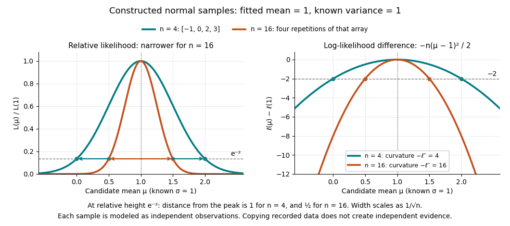

# Maximum-likelihood estimator

↑ **Parent:** [Maximum likelihood estimation](maximum-likelihood-estimation.md)

A [maximum-likelihood estimator](maximum-likelihood-estimator.md) is an [estimator](estimator.md) whose value maximizes the [likelihood function](likelihood-function.md) for each sample where a finite maximizer exists. Before observation, $\widehat\theta(X)$ is a [random variable](random-variable-split.md) (the choice of maximizer must be a [measurable function](measurable-function.md)); after observation, $\widehat\theta(x)$ is the numerical [maximum-likelihood estimate](maximum-likelihood-estimator.md). A formula must specify the allowed parameter set, including whether its endpoints belong to it.

For ten independent [Bernoulli trials](bernoulli-trial.md), write $K=\sum_{i=1}^{10}X_i$. On the closed parameter interval $[0,1]$, the [binomial proportion maximum-likelihood estimator](binomial-proportion-maximum-likelihood-estimator.md) is $\widehat p=K/10$. Eight successes give the estimate $0.8$. If $K=0$, the [likelihood](likelihood-function.md) is $(1-p)^{10}$ and has its unique maximum at $p=0$; if $K=10$, it is $p^{10}$ and has its unique maximum at $p=1$. On the open interval $(0,1)$ these two samples have no [maximum-likelihood estimate](maximum-likelihood-estimator.md): the [supremum](supremum.md) is one, but it is not attained. This is the same issue as [likelihood supremum at an excluded boundary](likelihood-supremum-at-an-excluded-boundary.md).

A complete continuous example uses [independent and identically distributed random variables](independent-and-identically-distributed-random-variables.md) $X_i\sim N(\mu,1)$ with unknown [mean](expected-value.md) $\mu\in\mathbb R$ and known [standard deviation](standard-deviation.md) one. Their [likelihood function](likelihood-function.md) and [log-likelihood](log-likelihood.md) are

$$
L(\mu;x)=(2\pi)^{-n/2}\exp\left[-\frac12\sum_{i=1}^n(x_i-\mu)^2\right],\qquad \ell(\mu;x)=-\frac n2\log(2\pi)-\frac12\sum_{i=1}^n(x_i-\mu)^2.
$$

The [sum](sum.md) of squared deviations separates as

$$
\sum_{i=1}^n(x_i-\mu)^2=\sum_{i=1}^n(x_i-\bar x)^2+n(\mu-\bar x)^2,
$$

because $\sum_i(x_i-\bar x)=0$. The first term is fixed in $\mu$, so the unique [maximum-likelihood estimator](maximum-likelihood-estimator.md) is the [sample mean](sample-mean.md) $\widehat\mu=\overline X$. This also proves the equivalence with [ordinary least squares](ordinary-least-squares.md) for this model. With the constructed observations $[-1,0,2,3]$, the [sample mean](sample-mean.md) is one and the residual sum of squares is ten; hence

$$
\ell(\mu;x)=-2\log(2\pi)-5-2(\mu-1)^2,\qquad \widehat\mu=1.
$$

At $\mu=0$ or $2$, the [log-likelihood](log-likelihood.md) is two below its peak, so the [likelihood ratio](likelihood-ratio.md) to the fitted value is $e^{-2}\approx0.135335$. The absolute [likelihood](likelihood-function.md) at the peak is $(2\pi)^{-2}e^{-5}\approx0.000170674$, a joint density value, not the [probability](probability.md) of observing exactly those four real numbers.

The following figure compares that sample with a constructed sixteen-observation sample consisting of four repetitions of the displayed four values, modeled as sixteen independent draws. Both fits have [sample mean](sample-mean.md) one, but

$$
\ell_n(\mu)-\ell_n(1)=-\frac n2(\mu-1)^2,\qquad \frac{L_n(\mu)}{L_n(1)}=e^{-n(\mu-1)^2/2},\qquad -\ell_n''(\mu)=n.
$$

Thus the [observed information](observed-fisher-information.md) is four times as large for $n=16$ as for $n=4$. The distance from the peak at relative height $e^{-2}$ decreases from one to $1/2$: the width scales as $1/\sqrt n$. This is a comparison of two stipulated samples; merely copying recorded observations would not create new independent evidence.

**[Figure 3](#image-known-variance-normal-mean-the-same-fitted-mean-with-different-likelihood-curvature). Known-variance normal mean: the same fitted mean with different likelihood curvature**.

Even uniqueness needs checking. If the [Bernoulli distribution](bernoulli-distribution.md) success parameter is written $p=\theta^2$ with $\theta\in[-1,1]$, eight successes give two [maximum-likelihood estimates](maximum-likelihood-estimator.md), $\theta=\pm\sqrt{0.8}$, because both give the same [probability distribution](probability-distribution.md). The problem is a failure of [identifiability](identifiability.md). The special cases below show other ways an [MLE](maximum-likelihood-estimator.md) can have [bias](bias-of-an-estimator.md) or fail the usual [asymptotic normality](asymptotic-normality.md).

**Table of contents**

- [Likelihood supremum at an excluded boundary](likelihood-supremum-at-an-excluded-boundary.md)
- [Uniform endpoint maximum-likelihood estimator](uniform-endpoint-maximum-likelihood-estimator.md)
- [Neyman-Scott incidental parameter problem](neyman-scott-incidental-parameter-problem.md)
- [Endpoint maximum likelihood for a singular location density](endpoint-maximum-likelihood-for-a-singular-location-density.md)
- [Exponential-rate maximum-likelihood estimator](exponential-rate-maximum-likelihood-estimator.md)
- [Maximum-likelihood fitted value](maximum-likelihood-fitted-value.md)
  - [Maximum-likelihood fitted probability](maximum-likelihood-fitted-probability.md)
- [Normal mean and variance maximum-likelihood estimators](normal-mean-and-variance-maximum-likelihood-estimators.md)
- [Invariance property of maximum likelihood estimation](invariance-property-of-maximum-likelihood-estimation.md)
- [Likelihood function](likelihood-function.md)
  - [Log-likelihood](log-likelihood.md)
  - [Marginal likelihood from a nuisance-free statistic](marginal-likelihood-from-a-nuisance-free-statistic.md)
  - [Conditional likelihood](conditional-likelihood.md)
    - [Saddlepoint conditional likelihood adjustment](saddlepoint-conditional-likelihood-adjustment.md)
  - [Observed-data likelihood](observed-data-likelihood.md)
  - [Bayesian deviance](bayesian-deviance.md)
  - [Conditional maximum likelihood](conditional-maximum-likelihood.md)
  - [Profile likelihood](profile-likelihood.md)
    - [Modified profile likelihood](modified-profile-likelihood.md)
      - [Modified profile likelihood for inverse Gaussian shape](modified-profile-likelihood-for-inverse-gaussian-shape.md)
      - [Modified profile likelihood for exponential regression](modified-profile-likelihood-for-exponential-regression.md)
    - [Gamma-ratio marginal and profile likelihood identity](gamma-ratio-marginal-and-profile-likelihood-identity.md)
    - [Profile log-likelihood](profile-log-likelihood.md)
- [Binomial proportion maximum-likelihood estimator](binomial-proportion-maximum-likelihood-estimator.md)
- [Exponential distribution rate estimator](exponential-distribution-rate-estimator.md)
- [Asymptotic normality of a maximum likelihood estimator](asymptotic-normality-of-a-maximum-likelihood-estimator.md)

## ↑ Ancestors (7)

1. [Maximum likelihood estimation](maximum-likelihood-estimation.md)
2. [Statistical modelling](statistical-modelling-split.md)
3. [Statistical model](statistical-model-split.md)
4. [Probability and statistics](probability-and-statistics-split.md)
5. [Area of mathematics](area-of-mathematics.md)
6. [Mathematics](mathematics-split.md)
7. [Codex Wiki](split.md)

## ← Incoming links (140)

- [Ancillary-conditioned score density](ancillary-conditioned-score-density.md)
- [Boundary likelihood-ratio test for two Gaussian means](boundary-likelihood-ratio-test-for-two-gaussian-means.md)
- [Concavity of the Poisson regression likelihood](concavity-of-the-poisson-regression-likelihood.md)
- [Conditional and stationary AR1 likelihood estimators](conditional-and-stationary-ar1-likelihood-estimators.md)
- [Conditional cure-weight equations for paired Poisson counts](conditional-cure-weight-equations-for-paired-poisson-counts.md)
- [Constrained Poisson and multinomial likelihood equivalence](constrained-poisson-and-multinomial-likelihood-equivalence.md)
- [Correlated Gaussian common-mean estimator](correlated-gaussian-common-mean-estimator.md)
- [Events divided by exposure estimator](events-divided-by-exposure-estimator.md)
- [Exact endpoint limit for a shifted exponential distribution](exact-endpoint-limit-for-a-shifted-exponential-distribution.md)
- [Exponential-mean confidence interval by pivot inversion](exponential-mean-confidence-interval-by-pivot-inversion.md)
- [Finite-exposure Poisson inconsistency](finite-exposure-poisson-inconsistency.md)
- [Gaussian covariance diagonality likelihood-ratio test](gaussian-covariance-diagonality-likelihood-ratio-test.md)
- [Inverse Gaussian shape estimation and nuisance orthogonality](inverse-gaussian-shape-estimation-and-nuisance-orthogonality.md)
- [Likelihood function](likelihood-function.md)
- [Log-likelihood](log-likelihood.md)
- [Maximum likelihood estimation](maximum-likelihood-estimation.md)
- [Maximum-likelihood estimator](maximum-likelihood-estimator.md)
- [Maximum likelihood existence in a full regular natural exponential family](maximum-likelihood-existence-in-a-full-regular-natural-exponential-family.md)
- [Negative binomial mean-size parameter orthogonality](negative-binomial-mean-size-parameter-orthogonality.md)
- [Neyman-Scott incidental parameter problem](neyman-scott-incidental-parameter-problem.md)
- [Normal likelihood with variance equal to squared mean](normal-likelihood-with-variance-equal-to-squared-mean.md)
- [Normal mean and variance maximum-likelihood estimators](normal-mean-and-variance-maximum-likelihood-estimators.md)
- [Normal natural-mean parameter ratio estimator](normal-natural-mean-parameter-ratio-estimator.md)
- [P-star approximation](p-star-approximation.md)
- [P-star density for an exponential mean](p-star-density-for-an-exponential-mean.md)
- [P-star density for two exponential rates](p-star-density-for-two-exponential-rates.md)
- [Solution](past-exam-of-the-mathematics-course-of-the-university-of-cambridge/2001/ib/paper-4/12d/solution.md)
- [Solution](past-exam-of-the-mathematics-course-of-the-university-of-cambridge/2001/iii/paper-28/5/i/solution.md)
- [Solution](past-exam-of-the-mathematics-course-of-the-university-of-cambridge/2001/iii/paper-30/1/i/solution.md)
- [Solution](past-exam-of-the-mathematics-course-of-the-university-of-cambridge/2001/iii/paper-30/1/ii/solution.md)
- [Solution](past-exam-of-the-mathematics-course-of-the-university-of-cambridge/2001/iii/paper-32/1/solution.md)
- [Solution](past-exam-of-the-mathematics-course-of-the-university-of-cambridge/2001/iii/paper-32/2/solution.md)
- [Solution](past-exam-of-the-mathematics-course-of-the-university-of-cambridge/2001/iii/paper-32/6/ii/solution.md)
- [Solution](past-exam-of-the-mathematics-course-of-the-university-of-cambridge/2001/iii/paper-32/6/iii/solution.md)
- [Solution](past-exam-of-the-mathematics-course-of-the-university-of-cambridge/2002/iii/paper-38/1/solution.md)
- [Solution](past-exam-of-the-mathematics-course-of-the-university-of-cambridge/2002/iii/paper-38/6/i/solution.md)
- [Solution](past-exam-of-the-mathematics-course-of-the-university-of-cambridge/2002/iii/paper-38/6/ii/solution.md)
- [Solution](past-exam-of-the-mathematics-course-of-the-university-of-cambridge/2003/iii/paper-41/1/i/solution.md)
- [Solution](past-exam-of-the-mathematics-course-of-the-university-of-cambridge/2003/iii/paper-41/2/solution.md)
- [Solution](past-exam-of-the-mathematics-course-of-the-university-of-cambridge/2003/iii/paper-41/3/solution.md)
- [Solution](past-exam-of-the-mathematics-course-of-the-university-of-cambridge/2003/iii/paper-41/6/v/solution.md)
- [Solution](past-exam-of-the-mathematics-course-of-the-university-of-cambridge/2003/iii/paper-42/1/ii/solution.md)
- [Solution](past-exam-of-the-mathematics-course-of-the-university-of-cambridge/2004/iii/paper-37/1/i/solution.md)
- [Solution](past-exam-of-the-mathematics-course-of-the-university-of-cambridge/2004/iii/paper-37/2/i/solution.md)
- [Solution](past-exam-of-the-mathematics-course-of-the-university-of-cambridge/2004/iii/paper-42/6/solution.md)
- [Solution](past-exam-of-the-mathematics-course-of-the-university-of-cambridge/2004/iii/paper-43/2/i/solution.md)
- [Solution](past-exam-of-the-mathematics-course-of-the-university-of-cambridge/2004/iii/paper-43/2/ii/solution.md)
- [Solution](past-exam-of-the-mathematics-course-of-the-university-of-cambridge/2005/ii/paper-4/13i/ii/solution.md)
- [Solution](past-exam-of-the-mathematics-course-of-the-university-of-cambridge/2005/ii/paper-4/13i/iii/solution.md)
- [Solution](past-exam-of-the-mathematics-course-of-the-university-of-cambridge/2005/iii/paper-41/2/solution.md)
- [Solution](past-exam-of-the-mathematics-course-of-the-university-of-cambridge/2005/iii/paper-42/3/solution.md)
- [Solution](past-exam-of-the-mathematics-course-of-the-university-of-cambridge/2005/iii/paper-42/6/ii/solution.md)
- [Solution](past-exam-of-the-mathematics-course-of-the-university-of-cambridge/2005/iii/paper-42/6/viii/solution.md)
- [Solution](past-exam-of-the-mathematics-course-of-the-university-of-cambridge/2005/iii/paper-44/1/c/solution.md)
- [Solution](past-exam-of-the-mathematics-course-of-the-university-of-cambridge/2005/iii/paper-44/1/d/solution.md)
- [Solution](past-exam-of-the-mathematics-course-of-the-university-of-cambridge/2005/iii/paper-44/5/b/solution.md)
- [Solution](past-exam-of-the-mathematics-course-of-the-university-of-cambridge/2005/iii/paper-48/5/c/solution.md)
- [Solution](past-exam-of-the-mathematics-course-of-the-university-of-cambridge/2006/ii/paper-4/27j/b/solution.md)
- [Solution](past-exam-of-the-mathematics-course-of-the-university-of-cambridge/2006/iii/paper-42/2/solution.md)
- [Solution](past-exam-of-the-mathematics-course-of-the-university-of-cambridge/2006/iii/paper-42/4/i/solution.md)
- [Solution](past-exam-of-the-mathematics-course-of-the-university-of-cambridge/2006/iii/paper-44/2/a/solution.md)
- [Solution](past-exam-of-the-mathematics-course-of-the-university-of-cambridge/2007/ib/paper-4/19c/i/solution.md)
- [Solution](past-exam-of-the-mathematics-course-of-the-university-of-cambridge/2007/ii/paper-3/5i/solution.md)
- [Solution](past-exam-of-the-mathematics-course-of-the-university-of-cambridge/2007/ii/paper-4/5i/solution.md)
- [Solution](past-exam-of-the-mathematics-course-of-the-university-of-cambridge/2008/ib/paper-1/18h/i/solution.md)
- [Solution](past-exam-of-the-mathematics-course-of-the-university-of-cambridge/2008/ib/paper-1/18h/ii/solution.md)
- [Solution](past-exam-of-the-mathematics-course-of-the-university-of-cambridge/2008/iii/paper-41/1/solution.md)
- [Solution](past-exam-of-the-mathematics-course-of-the-university-of-cambridge/2008/iii/paper-41/3/solution.md)
- [Solution](past-exam-of-the-mathematics-course-of-the-university-of-cambridge/2008/iii/paper-47/6/b/i/solution.md)
- [Solution](past-exam-of-the-mathematics-course-of-the-university-of-cambridge/2008/iii/paper-47/6/b/iii/solution.md)
- [Solution](past-exam-of-the-mathematics-course-of-the-university-of-cambridge/2008/iii/paper-47/6/b/iv/solution.md)
- [Solution](past-exam-of-the-mathematics-course-of-the-university-of-cambridge/2009/ib/paper-1/7h/solution.md)
- [Solution](past-exam-of-the-mathematics-course-of-the-university-of-cambridge/2009/ib/paper-3/8h/solution.md)
- [Solution](past-exam-of-the-mathematics-course-of-the-university-of-cambridge/2009/ii/paper-1/5i/solution.md)
- [Solution](past-exam-of-the-mathematics-course-of-the-university-of-cambridge/2009/ii/paper-2/28i/solution.md)
- [Solution](past-exam-of-the-mathematics-course-of-the-university-of-cambridge/2009/ii/paper-3/5i/solution.md)
- [Solution](past-exam-of-the-mathematics-course-of-the-university-of-cambridge/2009/ii/paper-4/13i/solution.md)
- [Solution](past-exam-of-the-mathematics-course-of-the-university-of-cambridge/2009/iii/paper-102/2/a/solution.md)
- [Solution](past-exam-of-the-mathematics-course-of-the-university-of-cambridge/2009/iii/paper-34/1/b/solution.md)
- [Solution](past-exam-of-the-mathematics-course-of-the-university-of-cambridge/2009/iii/paper-38/2/solution.md)
- [Solution](past-exam-of-the-mathematics-course-of-the-university-of-cambridge/2009/iii/paper-40/6/c/solution.md)
- [Solution](past-exam-of-the-mathematics-course-of-the-university-of-cambridge/2010/ii/paper-2/5j/solution.md)
- [Solution](past-exam-of-the-mathematics-course-of-the-university-of-cambridge/2010/iii/paper-32/1/solution.md)
- [Solution](past-exam-of-the-mathematics-course-of-the-university-of-cambridge/2010/iii/paper-32/2/2/solution.md)
- [Solution](past-exam-of-the-mathematics-course-of-the-university-of-cambridge/2010/iii/paper-32/2/solution.md)
- [Solution](past-exam-of-the-mathematics-course-of-the-university-of-cambridge/2010/iii/paper-33/2/solution.md)
- [Solution](past-exam-of-the-mathematics-course-of-the-university-of-cambridge/2010/iii/paper-36/3/b/solution.md)
- [Solution](past-exam-of-the-mathematics-course-of-the-university-of-cambridge/2010/iii/paper-36/3/f/solution.md)
- [Solution](past-exam-of-the-mathematics-course-of-the-university-of-cambridge/2010/iii/paper-37/3/b/solution.md)
- [Solution](past-exam-of-the-mathematics-course-of-the-university-of-cambridge/2011/ii/paper-1/28k/solution.md)
- [Solution](past-exam-of-the-mathematics-course-of-the-university-of-cambridge/2012/iii/paper-37/1/a/solution.md)
- [Solution](past-exam-of-the-mathematics-course-of-the-university-of-cambridge/2012/iii/paper-37/3/d/solution.md)
- [Solution](past-exam-of-the-mathematics-course-of-the-university-of-cambridge/2012/iii/paper-37/4/a/solution.md)
- [Solution](past-exam-of-the-mathematics-course-of-the-university-of-cambridge/2013/ib/paper-4/19h/solution.md)
- [Solution](past-exam-of-the-mathematics-course-of-the-university-of-cambridge/2013/iii/paper-31/3/solution.md)
- [Solution](past-exam-of-the-mathematics-course-of-the-university-of-cambridge/2013/iii/paper-32/3/a/ii/solution.md)
- [Solution](past-exam-of-the-mathematics-course-of-the-university-of-cambridge/2014/iii/paper-30/1/solution.md)
- [Solution](past-exam-of-the-mathematics-course-of-the-university-of-cambridge/2014/iii/paper-33/1/solution.md)
- [Solution](past-exam-of-the-mathematics-course-of-the-university-of-cambridge/2015/ii/paper-2/25j/i/solution.md)
- [Solution](past-exam-of-the-mathematics-course-of-the-university-of-cambridge/2015/ii/paper-2/25j/ii/solution.md)
- [Solution](past-exam-of-the-mathematics-course-of-the-university-of-cambridge/2015/ii/paper-2/4j/solution.md)
- [Solution](past-exam-of-the-mathematics-course-of-the-university-of-cambridge/2015/ii/paper-3/24j/solution.md)
- [Solution](past-exam-of-the-mathematics-course-of-the-university-of-cambridge/2015/ii/paper-4/4j/solution.md)
- [Solution](past-exam-of-the-mathematics-course-of-the-university-of-cambridge/2016/ib/paper-4/19h/a/solution.md)
- [Solution](past-exam-of-the-mathematics-course-of-the-university-of-cambridge/2016/ib/paper-4/19h/b/solution.md)
- [Solution](past-exam-of-the-mathematics-course-of-the-university-of-cambridge/2016/iii/paper-206/2/b/solution.md)
- [Solution](past-exam-of-the-mathematics-course-of-the-university-of-cambridge/2016/iii/paper-206/2/f/solution.md)
- [Solution](past-exam-of-the-mathematics-course-of-the-university-of-cambridge/2017/ii/paper-1/28k/a/solution.md)
- [Solution](past-exam-of-the-mathematics-course-of-the-university-of-cambridge/2017/ii/paper-2/26k/c/solution.md)
- [Solution](past-exam-of-the-mathematics-course-of-the-university-of-cambridge/2017/ii/paper-4/27k/c/i/solution.md)
- [Solution](past-exam-of-the-mathematics-course-of-the-university-of-cambridge/2018/ii/paper-3/28k/b/solution.md)
- [Solution](past-exam-of-the-mathematics-course-of-the-university-of-cambridge/2019/ii/paper-2/28j/a/solution.md)
- [Solution](past-exam-of-the-mathematics-course-of-the-university-of-cambridge/2019/ii/paper-2/28j/d/solution.md)
- [Solution](past-exam-of-the-mathematics-course-of-the-university-of-cambridge/2019/ii/paper-3/28j/a/solution.md)
- [Solution](past-exam-of-the-mathematics-course-of-the-university-of-cambridge/2019/ii/paper-4/28j/a/solution.md)
- [Solution](past-exam-of-the-mathematics-course-of-the-university-of-cambridge/2019/ii/paper-4/28j/b/iv/solution.md)
- [Solution](past-exam-of-the-mathematics-course-of-the-university-of-cambridge/2019/iii/paper-219/1/b/solution.md)
- [Solution](past-exam-of-the-mathematics-course-of-the-university-of-cambridge/2020/ii/paper-3/5j/a/solution.md)
- [Solution](past-exam-of-the-mathematics-course-of-the-university-of-cambridge/2021/ib/paper-3/18h/i/solution.md)
- [Solution](past-exam-of-the-mathematics-course-of-the-university-of-cambridge/2021/ii/paper-3/28j/a/solution.md)
- [Solution](past-exam-of-the-mathematics-course-of-the-university-of-cambridge/2022/ib/paper-2/6h/a/solution.md)
- [Solution](past-exam-of-the-mathematics-course-of-the-university-of-cambridge/2022/ii/paper-1/29k/d/solution.md)
- [Solution](past-exam-of-the-mathematics-course-of-the-university-of-cambridge/2022/iii/paper-207/2/2/solution.md)
- [Solution](past-exam-of-the-mathematics-course-of-the-university-of-cambridge/2022/iii/paper-207/4/b/solution.md)
- [Solution](past-exam-of-the-mathematics-course-of-the-university-of-cambridge/2022/iii/paper-218/1/c/solution.md)
- [Solution](past-exam-of-the-mathematics-course-of-the-university-of-cambridge/2022/iii/paper-219/1/c/solution.md)
- [Solution](past-exam-of-the-mathematics-course-of-the-university-of-cambridge/2023/ib/paper-4/17h/b/solution.md)
- [Solution](past-exam-of-the-mathematics-course-of-the-university-of-cambridge/2023/ii/paper-2/5j/solution.md)
- [Solution](past-exam-of-the-mathematics-course-of-the-university-of-cambridge/2023/iii/paper-207/2/c/i/solution.md)
- [Solution](past-exam-of-the-mathematics-course-of-the-university-of-cambridge/2023/iii/paper-207/6/b/vii/solution.md)
- [Solution](past-exam-of-the-mathematics-course-of-the-university-of-cambridge/2023/iii/paper-218/1/a/solution.md)
- [Solution](past-exam-of-the-mathematics-course-of-the-university-of-cambridge/2023/iii/paper-218/3/c/solution.md)
- [Solution](past-exam-of-the-mathematics-course-of-the-university-of-cambridge/2024/iii/paper-207/6/b/ii/solution.md)
- [Solution](past-exam-of-the-mathematics-course-of-the-university-of-cambridge/2024/iii/paper-218/4/d/solution.md)
- [Solution](past-exam-of-the-mathematics-course-of-the-university-of-cambridge/2025/iii/paper-219/1/e/solution.md)
- [Solution](past-exam-of-the-mathematics-course-of-the-university-of-cambridge/2026/ii/paper-1/29l/a/solution.md)
- [Solution](past-exam-of-the-mathematics-course-of-the-university-of-cambridge/2026/iii/paper-218/5/c/solution.md)
- [Poisson log-rate ratio](poisson-log-rate-ratio.md)
- [Poisson regression margin-matching score equations](poisson-regression-margin-matching-score-equations.md)
- [Regular natural exponential family](regular-natural-exponential-family.md)
