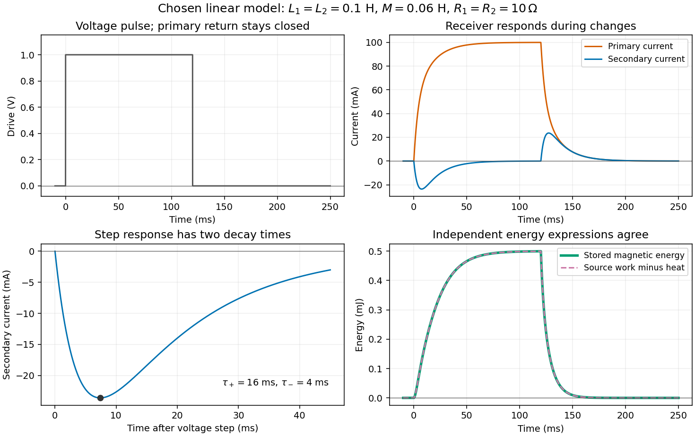
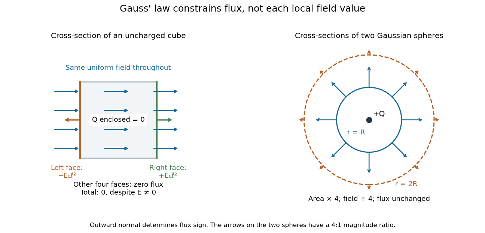
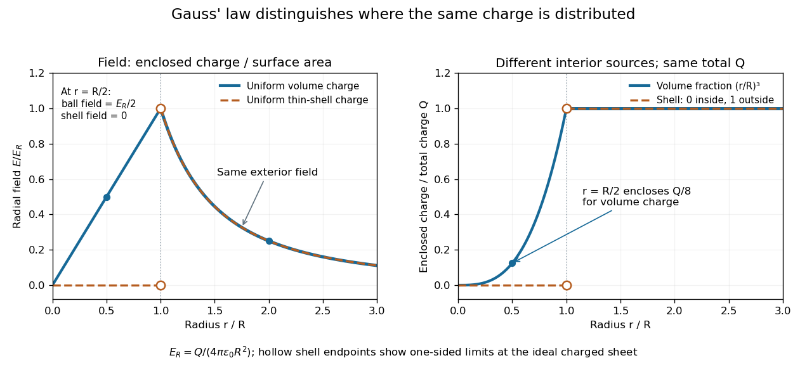

# Maxwell equations

↑ **Parent:** [Electromagnetism](electromagnetism.md)  
ⓦ [Wiki](https://en.wikipedia.org/wiki/Maxwell_equations)

The [Maxwell equations](maxwell-equations.md) are the field equations of classical [electromagnetism](electromagnetism.md). In [SI](physics.md#international-system-of-units) units, in vacuum with prescribed [charge density](electric-charge.md#charge-density) $\rho$ and [current density](electric-charge.md#current-density) $\mathbf J$, they are

$$
\begin{aligned}
\nabla\cdot\mathbf E&=\rho/\epsilon_0,
&\nabla\cdot\mathbf B&=0,\\
\nabla\times\mathbf E&=-\frac{\partial\mathbf B}{\partial t},
&\nabla\times\mathbf B&=\mu_0\mathbf J+\mu_0\epsilon_0\frac{\partial\mathbf E}{\partial t}.
\end{aligned}
$$

Here $\mathbf E$ is the [electric field](electric-field.md) in volts per metre, $\mathbf B$ the [magnetic field](magnetic-field.md) in teslas, $\rho$ in coulombs per cubic metre, and $\mathbf J$ in amperes per square metre. The constants are [vacuum permittivity](permittivity.md#vacuum-permittivity) $\epsilon_0$ and the vacuum value $\mu_0$ of [magnetic permeability](#permeability-electromagnetism). “Vacuum” specifies the field laws without a material response; “source-free” additionally means $\rho=0$ and $\mathbf J=0$. Matter described by averaged fields instead requires [Maxwell equations in matter](#maxwell-equations-in-matter) and [constitutive relations](#constitutive-relations).

The first equation, [Gauss's law](#gauss-s-law), makes [electric charge](electric-charge.md) a source of [electric flux](electric-field.md#electric-flux). [Gauss's law for magnetism](#gauss-s-law-for-magnetism) sets the net [magnetic flux](magnetic-field.md#magnetic-flux) through a closed surface to zero. The two [curl](multivariable-calculus.md#curl) equations, [Faraday's law](#faraday-s-law-of-induction) and the [Ampère-Maxwell equation](#ampere-s-circuital-law), couple changes of the [electric field](electric-field.md) and [magnetic field](magnetic-field.md). Appropriate [initial conditions](differential-equation.md#initial-condition) and [boundary conditions](differential-equation.md#boundary-condition) select a physical solution; the two [divergence](multivariable-calculus.md#divergence) equations constrain the initial fields. [MIT 8.02 notes, §13.3: Maxwell's equations](https://ocw.mit.edu/courses/8-02-physics-ii-electricity-and-magnetism-spring-2007/2d2f227e6fd26ee25f366759e02f03dc_chapte13em_waves.pdf).

**Table of contents**

- [Electromagnetic duality](#electromagnetic-duality)
- [Derivative-order ambiguity in covariant Maxwell potential equations](#derivative-order-ambiguity-in-covariant-maxwell-potential-equations)
- [Magnetic Galilean limit of the pre-Maxwell equations](#magnetic-galilean-limit-of-the-pre-maxwell-equations)
- [Gauss's law for magnetism](#gauss-s-law-for-magnetism)
  - [Axisymmetric magnetic field near a regular axis](#axisymmetric-magnetic-field-near-a-regular-axis)
  - [Near-axis radial magnetic field](#near-axis-radial-magnetic-field)
- [Vacuum Maxwell equations](#vacuum-maxwell-equations)
  - [Anti-self-dual Maxwell equations](#anti-self-dual-maxwell-equations)
- [Maxwell equations in matter](#maxwell-equations-in-matter)
  - [Constitutive relations](#constitutive-relations)
    - [Permeability (electromagnetism)](#permeability-electromagnetism)
      - [Vacuum permeability](#vacuum-permeability)
  - [Linear anisotropic dielectric](#linear-anisotropic-dielectric)
    - [Birefringence](#birefringence)
      - [Birefringent optical compensator](#birefringent-optical-compensator)
        - [Quartz compensator](#quartz-compensator)
      - [Extraordinary phase-index angular dependence](#extraordinary-phase-index-angular-dependence)
      - [Interference colour](#interference-colour)
        - [Spectral extinction between crossed polarizers](#spectral-extinction-between-crossed-polarizers)
      - [Form birefringence](#form-birefringence)
      - [Linear birefringence](#linear-birefringence)
      - [Calcite double-image experiment](#calcite-double-image-experiment)
      - [Uniaxial optical medium](#uniaxial-optical-medium)
        - [Optic axis](#optic-axis)
        - [Ordinary wave](#ordinary-wave)
        - [Extraordinary wave](#extraordinary-wave)
          - [Birefringent walk-off](#birefringent-walk-off)
            - [Electric-displacement angle from birefringent walk-off](#electric-displacement-angle-from-birefringent-walk-off)
      - [Waveplate](#waveplate)
        - [Retardance](#retardance)
        - [Phase retardation](#phase-retardation)
          - [Waveplate retardance detuning](#waveplate-retardance-detuning)
        - [Quarter-wave plate](#quarter-wave-plate)
          - [Half-wave and quarter-wave achromatic circularizer](#half-wave-and-quarter-wave-achromatic-circularizer)
          - [Two-element polarization identification](#two-element-polarization-identification)
          - [Pure-polarization preparation with two quarter-wave plates](#pure-polarization-preparation-with-two-quarter-wave-plates)
          - [Double-pass quarter-wave plate](#double-pass-quarter-wave-plate)
            - [Mirror return through an ordered polarizer-retarder pair](#mirror-return-through-an-ordered-polarizer-retarder-pair)
        - [Half-wave plate](#half-wave-plate)
      - [Circular birefringence](#circular-birefringence)
        - [Rotatory power](#rotatory-power)
- [Ampère's circuital law](#ampere-s-circuital-law)
  - [Amperian loop](#amperian-loop)
  - [Magnetostatic Ampère law](#magnetostatic-ampere-law)
  - [Displacement current](#displacement-current)
    - [Axisymmetric high-frequency capacitor field](#axisymmetric-high-frequency-capacitor-field)
    - [Conduction-to-displacement current ratio](#conduction-to-displacement-current-ratio)
    - [Surface independence of Ampère circulation during capacitor charging](#surface-independence-of-ampere-circulation-during-capacitor-charging)
- [Faraday's law of induction](#faraday-s-law-of-induction)
  - [Induced current in a tilted resistive loop](#induced-current-in-a-tilted-resistive-loop)
  - [Faraday induction-ring experiment](#faraday-induction-ring-experiment)
    - [Coupled RL induction model](#coupled-rl-induction-model)
      - [Equal-loop RL induction step](#equal-loop-rl-induction-step)
      - [Closed-return induction under a voltage pulse](#closed-return-induction-under-a-voltage-pulse)
      - [Energy balance of coupled RL circuits](#energy-balance-of-coupled-rl-circuits)
  - [Pickup coil](#pickup-coil)
  - [Lenz's law](#lenz-s-law)
    - [Terminal speed of a falling conducting loop](#terminal-speed-of-a-falling-conducting-loop)
      - [Lossless limit of magnetic loop braking](#lossless-limit-of-magnetic-loop-braking)
- [Gauss's law](#gauss-s-law)
  - [Net charge from the asymptotic radial electric field](#net-charge-from-the-asymptotic-radial-electric-field)
  - [Electric field for a radial power-law charge density](#electric-field-for-a-radial-power-law-charge-density)
  - [Electric field of a uniformly charged ball](#electric-field-of-a-uniformly-charged-ball)
  - [Electric field of a uniformly charged spherical shell](#electric-field-of-a-uniformly-charged-spherical-shell)
  - [Hyperbolic-space Coulomb field](#hyperbolic-space-coulomb-field)
  - [Force between hemispheres of a uniformly charged ball](#force-between-hemispheres-of-a-uniformly-charged-ball)
  - [Gaussian surface](#gaussian-surface)
  - [Gaussian pillbox](#gaussian-pillbox)
- [Charge conservation from Maxwell equations](#charge-conservation-from-maxwell-equations)
  - [Charge continuity equation](#charge-continuity-equation)
- [Covariant Maxwell equation with the minus-plus-plus-plus metric](#covariant-maxwell-equation-with-the-minus-plus-plus-plus-metric)
- [Source-free Maxwell equations in a linear medium](#source-free-maxwell-equations-in-a-linear-medium)
  - [Plane electromagnetic wave in a linear medium](#plane-electromagnetic-wave-in-a-linear-medium)
    - [Transversality of an electromagnetic plane wave](#transversality-of-an-electromagnetic-plane-wave)

## Electromagnetic duality

↑ **Parent:** [Maxwell equations](maxwell-equations.md)  
ⓦ [Wiki](https://en.wikipedia.org/wiki/Electromagnetic_duality)

Vacuum [Maxwell equations](maxwell-equations.md) without sources are invariant under $E'=E\cos\alpha+cB\sin\alpha$, $cB'=cB\cos\alpha-E\sin\alpha$. At $\alpha=\pi/2$ this is $E'=cB$, $B'=-E/c$. Electric-conductor boundary conditions are not invariant under arbitrary duality rotations; the transformed fields must be tested separately against the wall conditions.

## Derivative-order ambiguity in covariant Maxwell potential equations

↑ **Parent:** [Maxwell equations](maxwell-equations.md)

Use the negative curvature convention defined in [curvature-sign convention in Killing derivative identities](killing-vector-field.md#curvature-sign-convention-in-killing-derivative-identities), and $C_{ab}=C^c{}_{acb}$. Covariant derivatives of a vector obey $[\nabla_b,\nabla^a]A^b=-C^a{}_bA^b$. Hence the flat-space equivalent expressions $\Box A^a-\partial_b\partial^aA^b$ and $\Box A^a-\partial^a\partial_bA^b$ acquire a difference $+C^a{}_bA^b$ under the [comma-to-semicolon prescription](general-relativity.md#comma-to-semicolon-prescription). Covariantizing $F_{ab}=2\nabla_{[a}A_{b]}$ and its [Maxwell equations](maxwell-equations.md) gives $\Box A^a-\nabla^a(\nabla_bA^b)+C^a{}_bA^b=\mu_0J^a$. This form respects [gauge invariance](relativistic-quantum-field.md#gauge-invariance). Dropping the Ricci term is generally not gauge invariant. The two expressions coincide in a Ricci-flat [vacuum spacetime](einstein-field-equations.md#vacuum-spacetime); vanishing matter alone with nonzero [cosmological constant](cosmology.md#cosmological-constant) does not imply Ricci flatness.

## Magnetic Galilean limit of the pre-Maxwell equations

↑ **Parent:** [Maxwell equations](maxwell-equations.md)

The magnetic nonrelativistic limit neglects displacement current and uses $\partial_t\mathbf B=-\nabla\times\mathbf E$, $\nabla\times\mathbf B=\mu_0\mathbf J$, $\nabla\cdot\mathbf B=0$. Under a [Galilean transformation](special-relativity.md#galilean-transformation) $\mathbf x'=\mathbf x-\mathbf vt$, $t'=t$, its consistent field transformations are $\mathbf B'=\mathbf B$, $\mathbf J'=\mathbf J$ and $\mathbf E'=\mathbf E+\mathbf v\times\mathbf B$. Indeed $\partial_{t'}=\partial_t+\mathbf v\cdot\nabla$ and $\nabla\times(\mathbf v\times\mathbf B)=-(\mathbf v\cdot\nabla)\mathbf B$, giving covariance of the induction equation. The full charge-current transformation has $\mathbf J'=\mathbf J-\rho_e\mathbf v$; neglecting its convective correction belongs to the magnetic quasineutral approximation, not exact relativistic electrodynamics. With $\mathbf u'=\mathbf u-\mathbf v$, the combination $\mathbf E+\mathbf u\times\mathbf B$ is invariant. Vanishing electric field in the fluid rest frame therefore gives the [ideal magnetohydrodynamic induction equation](ideal-magnetohydrodynamics.md#ideal-magnetohydrodynamic-induction-equation).

<h2 id="gauss-s-law-for-magnetism">Gauss's law for magnetism</h2>

↑ **Parent:** [Maxwell equations](maxwell-equations.md)  
ⓦ [Wiki](https://en.wikipedia.org/wiki/Gauss's_law_for_magnetism)

Gauss's law for magnetism is $\nabla\mathbin\cdot\mathbf B=0$. Its integral form says that the net magnetic flux through every closed surface vanishes, so the normal magnetic field is continuous across an ordinary interface.

### Axisymmetric magnetic field near a regular axis

↑ **Parent:** [Gauss's law for magnetism](#gauss-s-law-for-magnetism)

Let a smooth [magnetic field](magnetic-field.md) with [axisymmetry](multivariable-calculus.md#axisymmetric-vector-field) have axial value $B_0(z)$ and no line singularity on its axis. [Gauss's law for magnetism](#gauss-s-law-for-magnetism) gives $\partial_r(rB_r)=-r\partial_zB_z$. Since $B_z(r,z)=B_0(z)+O(r^2)$, integration from the regular axis gives the displayed expansion. A falling axial field therefore implies outward field lines above a positive-source loop. In a current-free region, [Ampère's law](#ampere-s-circuital-law) also gives $B_z(r,z)=B_0(z)-r^2B_0''(z)/4+O(r^4)$, which follows by equating $\partial_zB_r=\partial_rB_z$.

### Near-axis radial magnetic field

↑ **Parent:** [Gauss's law for magnetism](#gauss-s-law-for-magnetism)

For a smooth axisymmetric [magnetic field](magnetic-field.md), write $B_z(\rho,z)=B_0(z)+O(\rho^2)$. The absence of magnetic monopoles gives $\rho^{-1}\partial_\rho(\rho B_\rho)=-B_0'(z)+O(\rho^2)$. Integrating from the axis and excluding a singular $1/\rho$ term proves the displayed relation. An axial field decreasing along $+z$ has an outward radial component, even when the field points purely axially on the axis itself.

## Vacuum Maxwell equations

↑ **Parent:** [Maxwell equations](maxwell-equations.md)

For the electromagnetic two-form $F$, the source-free Maxwell equations are $dF=0$ and $d(*F)=0$. The first is the Bianchi identity and the second is the dynamical equation.

### Anti-self-dual Maxwell equations

↑ **Parent:** [Vacuum Maxwell equations](#vacuum-maxwell-equations)

In the [two-component spinor](connection-1-form.md#two-component-spinor) convention with primed symmetric [gauge curvature](relativistic-quantum-field.md#gauge-field-strength) self-dual, an [Abelian](group.md#abelian-group) [Maxwell field](electromagnetism.md#electromagnetic-field) is anti-self-dual when its primed symmetric [gauge curvature](relativistic-quantum-field.md#gauge-field-strength) [two-component spinor](connection-1-form.md#two-component-spinor) vanishes. For a locally exact field $F=dA$, the [Bianchi identity](fiber-bundle.md#bianchi-identity) gives $dF=0$; the duality relation then also gives $d{*}F=0$. Thus it obeys the source-free [Maxwell equations](maxwell-equations.md). In complexified Lorentzian signature the [Hodge star](differential-form.md#hodge-star-operator) [eigenvalues](linear-operator-theory.md#eigenvalue) are $\pm i$; the [two-component spinor](connection-1-form.md#two-component-spinor) condition specifies which component is meant without imposing a Euclidean eigenvalue on that signature.

// Destination: general-relativity.bigb

## Maxwell equations in matter

↑ **Parent:** [Maxwell equations](maxwell-equations.md)

In macroscopic matter with free charge density $\rho$ and free current density $J$,

$$
\nabla\cdot D=\rho,
\quad
\nabla\cdot B=0,
\quad
\nabla\times E=-\partial_tB,
\quad
\nabla\times H=J+\partial_tD.
$$

The electric displacement $D$ and magnetic field strength $H$ encode the material response.

These are the [Maxwell equations](maxwell-equations.md) after separating free and bound material sources.

### Constitutive relations

↑ **Parent:** [Maxwell equations in matter](#maxwell-equations-in-matter)

Constitutive relations specify how matter responds to fields. A homogeneous isotropic linear electromagnetic medium obeys $\mathbf D=\varepsilon\mathbf E$ and $\mathbf B=\mu\mathbf H$.

#### Permeability (electromagnetism)

↑ **Parent:** [Constitutive relations](#constitutive-relations)  
ⓦ [Wiki](https://en.wikipedia.org/wiki/Permeability_(electromagnetism))

Electromagnetic permeability relates magnetic flux density to magnetic field strength through $\mathbf B=\mu\mathbf H$ in an isotropic linear medium.

##### Vacuum permeability

↑ **Parent:** [Permeability (electromagnetism)](#permeability-electromagnetism)

Vacuum permeability is the [magnetic permeability](#permeability-electromagnetism) appearing in the vacuum [Maxwell equations](maxwell-equations.md). In [SI](physics.md#international-system-of-units), it relates vacuum magnetic field strength to [magnetic flux density](magnetic-field.md) through $\mathbf B=\mu_0\mathbf H$ and obeys $\mu_0\varepsilon_0c^2=1$, where $c$ is the [speed of light](special-relativity.md#speed-of-light) and $\varepsilon_0$ the [vacuum permittivity](permittivity.md#vacuum-permittivity).

### Linear anisotropic dielectric

↑ **Parent:** [Maxwell equations in matter](#maxwell-equations-in-matter)

A linear anisotropic medium has constitutive relations $D_i=\varepsilon_{ij}E_j$ and $B_i=\mu_{ij}H_j$. Symmetric, time-independent tensors make the field-energy density a quadratic form.

Here [permittivity](permittivity.md) is a tensor, so the electric displacement need not be parallel to the electric field.

#### Birefringence

↑ **Parent:** [Linear anisotropic dielectric](#linear-anisotropic-dielectric)  
ⓦ [Wiki](https://en.wikipedia.org/wiki/Birefringence)

[Birefringence](#birefringence) is the existence of different optical propagation constants for different eigenpolarizations in an anisotropic material. It provides the propagation-mode separation needed for [adiabatic optical following in a twisted nematic](critical-phenomenon.md#adiabatic-optical-following-in-a-twisted-nematic).

Two different [refractive indices](electromagnetic-wave.md#refractive-index) can produce two displaced images, as in the [calcite double-image experiment](#calcite-double-image-experiment), or a [phase retardation](#phase-retardation) between overlapping components, as in a [waveplate](#waveplate). Spatial separation concerns where [energy flux](mathematical-physics.md#energy-flux) travels; [phase retardation](#phase-retardation) concerns the relative [wave phase](wave.md#phase-waves). A specimen need not show two visibly separated images to have [birefringence](#birefringence).

##### Birefringent optical compensator

↑ **Parent:** [Birefringence](#birefringence)

A known retarder inserted in a [polarization](wave.md#polarization-waves) microscope to compare [phase](wave.md#phase-waves) delay with an unknown specimen. Parallel slow directions add signed retardations; a slow direction paired with a fast one subtracts them. General relative angles require composing [polarization](wave.md#polarization-waves) transformations rather than scalar addition.

###### Quartz compensator

↑ **Parent:** [Birefringent optical compensator](#birefringent-optical-compensator)

A [quartz](chemical-substance.md#quartz) retarder used to identify specimen fast and slow directions through changes of [interference colour](#interference-colour) or compensation. Its own retardation and orientation must be specified before unique final colours can be predicted.

##### Extraordinary phase-index angular dependence

↑ **Parent:** [Birefringence](#birefringence)

For a lossless uniaxial [dielectric](permittivity.md#dielectric), $n_{\rm ex}^{-2}=\cos^2\vartheta/n_o^2+\sin^2\vartheta/n_e^2$, where $\vartheta$ is the angle between the [wave vector](elasticity-physics.md#wavevector) and [optic axis](#optic-axis). Along the axis $n_{\rm ex}=n_o$, while perpendicular propagation gives $n_{\rm ex}=n_e$.

##### Interference colour

↑ **Parent:** [Birefringence](#birefringence)

Colour produced when wavelength-dependent [interference](physical-optics.md#interference-wave-propagation) selectively transmits or reflects part of white light. Between crossed [polarizers](electromagnetic-wave.md#polarizer), a uniform birefringent plate gives a factor $\sin^2(\pi\Gamma/\lambda)$, where $\Gamma$ is its [optical path difference](physical-optics.md#optical-path-difference). The observed colour also depends on illumination and the spectral response of the observer.

###### Spectral extinction between crossed polarizers

↑ **Parent:** [Interference colour](#interference-colour)

A birefringent plate with retardation $\Gamma=t\Delta n$ gives $I/I_P=\sin^2(2\alpha)\sin^2(\pi\Gamma/\lambda)$. At non-extinction azimuths, wavelengths satisfying $\Gamma=m\lambda$ are removed by a crossed analyser. At a principal-axis azimuth every wavelength is extinguished.

##### Form birefringence

↑ **Parent:** [Birefringence](#birefringence)

[Birefringence](#birefringence) produced by subwavelength structure rather than solely by intrinsic crystalline anisotropy. For ideal dielectric lamellae, continuity of tangential [electric field](electric-field.md) gives $\epsilon_\parallel=f\epsilon_1+(1-f)\epsilon_2$, while continuity of normal [electric displacement field](electromagnetism.md#electric-displacement-field) gives $\epsilon_\perp^{-1}=f/\epsilon_1+(1-f)/\epsilon_2$. The unequal effective [permittivities](permittivity.md) give different principal [refractive indices](electromagnetic-wave.md#refractive-index).

##### Linear birefringence

↑ **Parent:** [Birefringence](#birefringence)

[Linear birefringence](#linear-birefringence) means that two orthogonal [linear polarizations](electromagnetic-wave.md#linear-polarization) have different [refractive indices](electromagnetic-wave.md#refractive-index). Their different propagation phases produce [phase retardation](#phase-retardation). In a lossless [waveplate](#waveplate), with fast-axis angle $\theta$ and slow-minus-fast retardation $\delta$, the [Jones matrix](wave.md#jones-matrix), up to a common phase, is

$$
J_\delta(\theta)=R(-\theta)\begin{pmatrix}1&0\\0&e^{i\delta}\end{pmatrix}R(\theta),\qquad R(\theta)=\begin{pmatrix}\cos\theta&\sin\theta\\-\sin\theta&\cos\theta\end{pmatrix},
$$

using time dependence $e^{-i\omega t}$. [Circular birefringence](#circular-birefringence) instead has circular eigenpolarizations.

##### Calcite double-image experiment

↑ **Parent:** [Birefringence](#birefringence)

Place a clear [calcite](https://en.wikipedia.org/wiki/Calcite) specimen on a transparency bearing printed words on an overhead projector. The projected readout is two copies of the lettering. Put a rotatable linear [polarizer](electromagnetic-wave.md#polarizer) after the specimen: suitable orientations suppress one copy or the other. These are the actual apparatus and observations in the University of Iowa demonstration.[Demonstration 6H35.15, Equipment and Procedure: crystals, polarizers, printed overhead transparency, two sets of words and selective extinction; final note on natural defects](physics-bibliography.md#polarization-calcite-and-iceland-spar-by-university-of-iowa-department-of-physics-and-astronomy)

For a useful control, remove the specimen while keeping the transparency, projector and screen fixed: the doubling should disappear. Replace it, hold it stationary and rotate only the [polarizer](electromagnetic-wave.md#polarizer); complementary brightness changes distinguish two [linear polarizations](electromagnetic-wave.md#linear-polarization) from an accidental duplicate transparency. These are suggested controls, rather than additional reported measurements. Ideally the two copies obey complementary [Malus's law](wave.md#malus-s-law) curves, $I_o(\alpha)=I_{o,\max}\cos^2\alpha$ and $I_e(\alpha)=I_{e,\max}\sin^2\alpha$, with [angle](geometry-and-topology.md#angle) $\alpha$ measured from the exiting [ordinary wave](#ordinary-wave)'s [linear polarization](electromagnetic-wave.md#linear-polarization). Unequal maxima do not invalidate the test. Finite [polarizer](electromagnetic-wave.md#polarizer) extinction, poor focus and specimen defects limit visibility; image separation alone does not determine either [refractive index](electromagnetic-wave.md#refractive-index) without the specimen geometry.

**[Figure 1](#image-separated-ordinary-wave-and-extraordinary-wave-paths-carry-different-linear-polarizations). Separated ordinary wave and extraordinary wave paths carry different linear polarizations**. An ideal parallel slab with a tilted [optic axis](#optic-axis) illustrates [birefringent walk-off](#birefringent-walk-off) at normal incidence. Both internal [wavevectors](elasticity-physics.md#wavevector) are normal to the faces, but the [extraordinary wave](#extraordinary-wave)'s [Poynting vector](electromagnetic-wave.md#poynting-vector) is tilted. The rays emerge parallel with a lateral displacement. The paired letters symbolize two image channels, not an optical prescription for the projector. The [polarizer](electromagnetic-wave.md#polarizer) inset shows how an exiting channel is selected.

##### Uniaxial optical medium

↑ **Parent:** [Birefringence](#birefringence)

A transparent, nonmagnetic [linear anisotropic dielectric](#linear-anisotropic-dielectric) is uniaxial when two principal [permittivities](permittivity.md) agree. With the [optic axis](#optic-axis) along $z$, its [permittivity](permittivity.md) [tensor](multilinear-algebra.md#tensor) has the displayed [diagonal matrix](linear-algebra.md#diagonal-matrix) form. Here $n_o$ and $n_e$ are principal [refractive indices](electromagnetic-wave.md#refractive-index) at a specified [frequency](wave.md#frequency); $n_e$ is not the [extraordinary wave](#extraordinary-wave)'s index in every direction.[§2.8.1, printed pp. 154–156, equations 2.406–2.413: uniaxial tensor and direction-dependent extraordinary index](physics-bibliography.md#fundamentals-of-photonics-and-quantum-electronics-lecture-notes-by-franz-x-kartner)

###### Optic axis

↑ **Parent:** [Uniaxial optical medium](#uniaxial-optical-medium)

The symmetry direction of a [uniaxial optical medium](#uniaxial-optical-medium). For a [wavevector](elasticity-physics.md#wavevector) along it, the two [refractive indices](electromagnetic-wave.md#refractive-index) coincide: there is no [birefringence](#birefringence) for that propagation direction, even though $n_e\ne n_o$.

###### Ordinary wave

↑ **Parent:** [Uniaxial optical medium](#uniaxial-optical-medium)

The [ordinary wave](#ordinary-wave)'s [electric field](electric-field.md) is perpendicular to the plane containing the [wavevector](elasticity-physics.md#wavevector) and [optic axis](#optic-axis). Its [refractive index](electromagnetic-wave.md#refractive-index) $n_o$ is direction independent at fixed [frequency](wave.md#frequency).

###### Extraordinary wave

↑ **Parent:** [Uniaxial optical medium](#uniaxial-optical-medium)

The [extraordinary wave](#extraordinary-wave)'s [electric displacement field](electromagnetism.md#electric-displacement-field) lies in that plane and is perpendicular to the [wavevector](elasticity-physics.md#wavevector); its [electric field](electric-field.md) need not be. For [angle](geometry-and-topology.md#angle) $\theta$ between the [wavevector](elasticity-physics.md#wavevector) and [optic axis](#optic-axis),

$$
\frac{1}{n_{\mathrm{ex}}(\theta)^2}=\frac{\cos^2\theta}{n_o^2}+\frac{\sin^2\theta}{n_e^2}.
$$

Thus $n_{\mathrm{ex}}(0)=n_o$ and $n_{\mathrm{ex}}(\pi/2)=n_e$.[§§2.8.2–2.8.3, printed p. 156, equations 2.410–2.413 and longitudinal electric-field discussion](physics-bibliography.md#fundamentals-of-photonics-and-quantum-electronics-lecture-notes-by-franz-x-kartner)

A short derivation starts from the existing [plane wave in an anisotropic dielectric](electromagnetic-wave.md#plane-wave-in-an-anisotropic-dielectric) equation. Put $\mathbf k=(k_x,0,k_z)$ and $k_0=\omega/c$, with [angular frequency](lagrangian-mechanics.md#angular-frequency) $\omega$ and vacuum [speed of light](special-relativity.md#speed-of-light) $c$. The $y$ component gives the [ordinary wave](#ordinary-wave) relation $k_x^2+k_z^2=n_o^2k_0^2$. The [determinant](multilinear-algebra.md#determinant) of the $x,z$ system gives

$$
\frac{k_x^2}{n_e^2}+\frac{k_z^2}{n_o^2}=k_0^2.
$$

Substituting $k_x=n_{\mathrm{ex}}k_0\sin\theta$ and $k_z=n_{\mathrm{ex}}k_0\cos\theta$ yields the displayed directional [refractive index](electromagnetic-wave.md#refractive-index).

###### Birefringent walk-off

↑ **Parent:** [Extraordinary wave](#extraordinary-wave)

The [extraordinary wave](#extraordinary-wave)'s [Poynting vector](electromagnetic-wave.md#poynting-vector) can differ in direction from its [wavevector](elasticity-physics.md#wavevector). The latter specifies [wave phase](wave.md#phase-waves) propagation, while the former specifies [energy flux](mathematical-physics.md#energy-flux). This angular separation is walk-off.[§2.8.3, printed pp. 157–158, equations 2.414–2.419: Poynting direction and walk-off](physics-bibliography.md#fundamentals-of-photonics-and-quantum-electronics-lecture-notes-by-franz-x-kartner)

In the lossless, nondispersive model above, take the [gradient](multivariable-calculus.md#gradient) of $\omega=c\sqrt{k_x^2/n_e^2+k_z^2/n_o^2}$ to obtain the [group velocity](dispersion-relation.md#group-velocity), parallel to the [Poynting vector](electromagnetic-wave.md#poynting-vector). If its [angle](geometry-and-topology.md#angle) to the [optic axis](#optic-axis) is $\phi$, this gives $\tan\phi=(n_o^2/n_e^2)\tan\theta$. Consequently the [extraordinary wave](#extraordinary-wave) generally carries [energy](energy.md) away from its [wavevector](elasticity-physics.md#wavevector) direction. An internal [wavevector](elasticity-physics.md#wavevector) normal to a slab face therefore does not guarantee a normal energy path. [Birefringent walk-off](#birefringent-walk-off) vanishes at $\theta=0$ and $\theta=\pi/2$; the latter direction still has unequal [refractive indices](electromagnetic-wave.md#refractive-index). This is a useful [waveplate](#waveplate) geometry: overlapping components can acquire [phase retardation](#phase-retardation) without spatial splitting. A thin specimen, insufficient imaging resolution, or excitation of only one [linear polarization](electromagnetic-wave.md#linear-polarization) can also hide a double image, for different reasons.

###### Electric-displacement angle from birefringent walk-off

↑ **Parent:** [Birefringent walk-off](#birefringent-walk-off)

For a lossless nonmagnetic [uniaxial optical medium](#uniaxial-optical-medium), the [electric displacement field](electromagnetism.md#electric-displacement-field) of a [plane electromagnetic wave](electromagnetic-wave.md#plane-electromagnetic-wave) is perpendicular to its [wavevector](elasticity-physics.md#wavevector). The magnetic field is perpendicular to the plane containing the [electric field](electric-field.md) and [wavevector](elasticity-physics.md#wavevector), while the [Poynting vector](electromagnetic-wave.md#poynting-vector) is perpendicular to the electric field in that same plane. Thus the angle between $\mathbf E$ and $\mathbf D$ equals the walk-off angle between energy flow and phase propagation. At [normal incidence](optics.md#normal-incidence) on a parallel slab of thickness $L$, a lateral separation $\Delta$ of the ordinary and extraordinary exiting rays gives $\alpha_e=\arctan(|\Delta|/L)$, while $\alpha_o=0$. The output rays can be parallel even though their internal energy paths differ.

##### Waveplate

↑ **Parent:** [Birefringence](#birefringence)  
ⓦ [Wiki](https://en.wikipedia.org/wiki/Waveplate)

A [waveplate](#waveplate) uses [birefringence](#birefringence) to change [polarization of an electromagnetic wave](electromagnetic-wave.md#polarization-of-an-electromagnetic-wave) through [phase retardation](#phase-retardation). Its fast axis has the smaller [refractive index](electromagnetic-wave.md#refractive-index), hence the larger [phase velocity](dispersion-relation.md#phase-velocity); its slow axis has the larger index. Consider normal incidence with the [optic axis](#optic-axis) in the plate face, so both components follow the same straight path. A [linear polarization](electromagnetic-wave.md#linear-polarization) at $45^\circ$ to these axes excites equal [wave amplitudes](wave.md#wave-amplitude).

A complementary experiment uses two sheet [polarizers](electromagnetic-wave.md#polarizer) with a cellophane sheet between them. First cross the [polarizers](electromagnetic-wave.md#polarizer) and remove the sheet: the field is dark. Insert and rotate the sheet about the beam: light returns at intermediate orientations, but extinction recurs at two perpendicular orientations. The sheet has changed the [polarization of an electromagnetic wave](electromagnetic-wave.md#polarization-of-an-electromagnetic-wave), without requiring a resolved double image. With white [light](optics.md#light), different [wavelengths](wave-equation.md#wavelength) can produce different transmitted colors.[I §33–3, Fig. 33–3 and the paragraphs describing removal, rotation and white-light colors of cellophane](physics-bibliography.md#the-feynman-lectures-on-physics-volume-i-by-richard-feynman-and-others). Brightness alone does not establish [circular polarization](electromagnetic-wave.md#circular-polarization): an ideal rotating linear [polarizer](electromagnetic-wave.md#polarizer) also gives orientation-independent [light intensity](wave.md#light-intensity) for [unpolarized light](wave.md#unpolarized-light).

###### Retardance

↑ **Parent:** [Waveplate](#waveplate)

The relative phase accumulated by orthogonal eigenpolarizations is $\Delta=2\pi L(n_2-n_1)/\lambda_0$. A [quarter-wave plate](#quarter-wave-plate) has relative phase $\pi/2$ modulo $2\pi$, while a [half-wave plate](#half-wave-plate) has $\pi$ modulo $2\pi$.

###### Phase retardation

↑ **Parent:** [Waveplate](#waveplate)

For the overlapping [monochromatic wave](wave.md#monochromatic-wave) components, let $d$ be the thickness and $\lambda_0$ the vacuum [wavelength](wave-equation.md#wavelength). Define $\Delta n=n_s-n_f>0$ using the slow and fast [refractive indices](electromagnetic-wave.md#refractive-index). With [complex amplitude](wave.md#complex-amplitude) convention $e^{i(kz-\omega t)}$, the accumulated slow-minus-fast [phase difference](wave.md#phase-difference) is

$$
\delta=(k_s-k_f)d=\frac{2\pi}{\lambda_0}(n_s-n_f)d.
$$

This is the [optical path difference](physical-optics.md#optical-path-difference) $\Delta n\,d$ expressed as a [wave phase](wave.md#phase-waves). It is a signed accumulation convention; with the opposite time convention the sign reverses. The outgoing [polarization of an electromagnetic wave](electromagnetic-wave.md#polarization-of-an-electromagnetic-wave) depends on $\delta$ modulo $2\pi$. Here the positive slow-minus-fast $\Delta n$ differs from the signed principal-index $n_e-n_o$ used in the parent [birefringence](#birefringence) entry when $n_e<n_o$.

For an original worked example, stipulate $\Delta n=0.0100$ at $\lambda_0=600\,\mathrm{nm}$ and a uniform thickness $d=15.0\,\mathrm{\mu m}$. These are design assumptions, not measured material data. The [optical path difference](physical-optics.md#optical-path-difference) is $150\,\mathrm{nm}$, so

$$
\delta=2\pi\frac{150\,\mathrm{nm}}{600\,\mathrm{nm}}=\frac{\pi}{2}.
$$

It is a [quarter-wave plate](#quarter-wave-plate). At the same [wavelength](wave-equation.md#wavelength) and [refractive indices](electromagnetic-wave.md#refractive-index), doubling $d$ to $30.0\,\mathrm{\mu m}$ gives $\delta=\pi$, a [half-wave plate](#half-wave-plate). A $1.0\,\mathrm{\mu m}$ thickness increase changes $\delta$ by $\pi/30$, or $6^\circ$; retaining the same [birefringence](#birefringence) at $500\,\mathrm{nm}$ would instead give $\delta=3\pi/5$ for the $15.0\,\mathrm{\mu m}$ plate. Real [refractive indices](electromagnetic-wave.md#refractive-index) also vary with [wavelength](wave-equation.md#wavelength), so this last calculation explicitly neglects [optical dispersion](geometrical-optics.md#dispersion-optics).

**[Figure 2](#image-phase-retardation-grows-with-thickness-while-overlapping-components-change-polarization-of-an-electromagnetic-wave). Phase retardation grows with thickness while overlapping components change polarization of an electromagnetic wave**. The stipulated $\Delta n=0.0100$, $\lambda_0=600\,\mathrm{nm}$ model gives quarter-wave and half-wave thicknesses of $15$ and $30\,\mathrm{\mu m}$. Insets trace the normalized [electric field](electric-field.md) at a fixed point for equal fast/slow [wave amplitudes](wave.md#wave-amplitude), with $E_f=\cos\tau$ and $E_s=\cos(\tau+\delta)$. The intermediate [ellipse](euclidean-geometry.md#ellipse), circle and rotated line require no spatial beam separation.

For these equal transmitted [wave amplitudes](wave.md#wave-amplitude), [orthogonal projection](hilbert-space.md#orthogonal-projection) onto a [polarizer](electromagnetic-wave.md#polarizer) crossed with the initial $45^\circ$ [linear polarization](electromagnetic-wave.md#linear-polarization) gives a simple independent readout. After removing a common [wave phase](wave.md#phase-waves), the component [complex amplitudes](wave.md#complex-amplitude) are proportional to $(1,e^{i\delta})/\sqrt2$; [orthogonal projection](hilbert-space.md#orthogonal-projection) onto $(1,-1)/\sqrt2$ gives $(1-e^{i\delta})/2$. Squaring its [modulus](complex-analysis.md#modulus) yields $I_\perp/I_{\mathrm{in}}=\sin^2(\delta/2)$: zero at $d=0$, one half at $15\,\mathrm{\mu m}$, and one at $30\,\mathrm{\mu m}$. This assumes ideal [polarizers](electromagnetic-wave.md#polarizer), negligible [specular reflection](optics.md#specular-reflection) and [wave absorption](wave.md#wave-absorption), overlapping components and stable relative [wave phase](wave.md#phase-waves). It measures a periodic function of [phase retardation](#phase-retardation), so one brightness measurement cannot determine the thickness uniquely.

###### Waveplate retardance detuning

↑ **Parent:** [Phase retardation](#phase-retardation)

A zero-order [quarter-wave plate](#quarter-wave-plate) satisfies $\omega_0d\Delta n(\omega_0)/c=\pi/2$. Its [retardance](#retardance) error at nearby [angular frequency](lagrangian-mechanics.md#angular-frequency) is $\epsilon=\omega d\Delta n(\omega)/c-\pi/2$. Taylor expansion gives the title expression, including material dispersion. Neglecting that dispersion yields $\epsilon=(\pi/2)\Delta\omega/\omega_0$. A [half-wave plate](#half-wave-plate) made from twice the same material thickness has exactly twice this [phase](wave.md#phase-waves) error. Common propagation [phase](wave.md#phase-waves) can be removed from its [Jones matrix](wave.md#jones-matrix) without changing [polarization](wave.md#polarization-waves).

###### Quarter-wave plate

↑ **Parent:** [Waveplate](#waveplate)

A [quarter-wave plate](#quarter-wave-plate) gives a quarter-cycle [phase retardation](#phase-retardation). Equal transmitted [wave amplitudes](wave.md#wave-amplitude) initially in [linear polarization](electromagnetic-wave.md#linear-polarization) at $45^\circ$ become [circular polarization](electromagnetic-wave.md#circular-polarization); unequal [wave amplitudes](wave.md#wave-amplitude) generally give [elliptical polarization](wave.md#elliptical-polarization). Reversing the sign reverses the traversal of the same circle.

###### Half-wave and quarter-wave achromatic circularizer

↑ **Parent:** [Quarter-wave plate](#quarter-wave-plate)

Take a [half-wave plate](#half-wave-plate) with fast axis at $15^\circ$ to a linearly polarized input, followed by a [quarter-wave plate](#quarter-wave-plate) at a further $60^\circ$, so the second axis is at $75^\circ$ to the input. With shared quarter-wave [retardance](#retardance) error $\epsilon$ and half-wave error $2\epsilon$, use $Q=\operatorname{diag}(1,ie^{i\epsilon})$ and $H=\operatorname{diag}(1,-e^{2i\epsilon})$. Rotating each matrix into the input axes and multiplying gives $\mathbf J(0)=e^{i75^\circ}(1,-i)^{\mathsf T}/\sqrt2$ and the title expansion. Its first-order change is common [phase](wave.md#phase-waves) only, so the output remains circular to first order. This input-specific local compensation does not prove a frequency-independent quarter-wave operator for arbitrary input across a finite spectral band.

###### Two-element polarization identification

↑ **Parent:** [Quarter-wave plate](#quarter-wave-plate)

Suppose the unknown ideal elements are a linear [polarizer](electromagnetic-wave.md#polarizer) and a [quarter-wave plate](#quarter-wave-plate), and the two unknown sources are unpolarized and circularly polarized. Test both element orders while rotating their relative axes and monitoring output [intensity](wave.md#intensity-physics). Only circular input followed by the [quarter-wave plate](#quarter-wave-plate) and then the [polarizer](electromagnetic-wave.md#polarizer) gives complete modulation: the plate makes linear [light](optics.md#light) and the analyzer obeys [Malus's law](wave.md#malus-s-law). Polarizer-first output is constant half-intensity because the following lossless plate changes polarization but not [intensity](wave.md#intensity-physics). Unpolarized input is constant in either order. This identifies both elements and both sources without comparing source brightnesses.

###### Pure-polarization preparation with two quarter-wave plates

↑ **Parent:** [Quarter-wave plate](#quarter-wave-plate)

Two rotatable ideal [quarter-wave plates](#quarter-wave-plate) can transform a fixed [circular polarization](electromagnetic-wave.md#circular-polarization) into any [pure polarization](wave.md#pure-polarization) represented by a [Jones vector](wave.md#jones-vector). Use time dependence $e^{-i\omega t}$, $Q(\theta)=R(-\theta)\operatorname{diag}(1,i)R(\theta)$ and input $J_L=(1,i)^T/\sqrt2$. Every target [polarization ellipse](wave.md#polarization-ellipse) can be written, up to a common phase, as $R(-\beta)(\cos\eta,i\sin\eta)^T$, with signed ellipticity angle $-\pi/4\leq\eta\leq\pi/4$. The first [quarter-wave plate](#quarter-wave-plate) at $\theta_1=\beta+\eta+\pi/4$ produces [linear polarization](electromagnetic-wave.md#linear-polarization) at $\beta+\eta$. The second, at $\theta_2=\beta$, therefore produces the required target. The two angles supply the two independent parameters of pure [polarization](wave.md#polarization-waves).

###### Double-pass quarter-wave plate

↑ **Parent:** [Quarter-wave plate](#quarter-wave-plate)

For a reciprocal ideal [quarter-wave plate](#quarter-wave-plate) followed by a mirror at [normal incidence](optics.md#normal-incidence), use the same fixed transverse laboratory axes for the forward and returning [Jones vectors](wave.md#jones-vector). If the axes coincide with the plate's fast and slow axes, each pass has [Jones matrix](wave.md#jones-matrix) $J=\operatorname{diag}(1,i)$ up to a common [phase factor](wave.md#phase-factor). A polarization-independent mirror has scalar reflection coefficient $r_m$, so the returned [Jones vector](wave.md#jones-vector) is $r_mJ^2\mathbf e=r_m\operatorname{diag}(1,-1)\mathbf e$. The plate acts twice as a [half-wave plate](#half-wave-plate), rather than undoing its [phase retardation](#phase-retardation).

For input [linear polarization](electromagnetic-wave.md#linear-polarization) at [angle](geometry-and-topology.md#angle) $\alpha$ to the fast axis, the returned line is at $-\alpha$ modulo $\pi$. At $\alpha=45^\circ$ it is perpendicular to the original line. An axis-aligned input instead returns along the same line. General [elliptical polarization](wave.md#elliptical-polarization) requires its full input [Jones vector](wave.md#jones-vector); no unique returned state follows from the word “polarized” alone. The propagation direction reverses, so comparing descriptions of [circular polarization](electromagnetic-wave.md#circular-polarization) must also specify the viewing convention.

###### Mirror return through an ordered polarizer-retarder pair

↑ **Parent:** [Double-pass quarter-wave plate](#double-pass-quarter-wave-plate)

Take a linear [polarizer](electromagnetic-wave.md#polarizer) $P=\operatorname{diag}(1,0)$ and a reciprocal [quarter-wave plate](#quarter-wave-plate) $Q=2^{-1/2}\begin{pmatrix}1&i\\i&1\end{pmatrix}$ in fixed physical transverse axes. A near-normal isotropic mirror has $M=-I_2$ up to global [phase](wave.md#phase-waves). If the source/detector side encounters P before Q, the round-trip matrix is $PQM QP=-PQ^2P=0$. Reversing the filter gives $QPM P Q=-QPQ$, which transmits half an initially unpolarized [intensity](wave.md#intensity-physics). The result is double-pass rejection, not optical nonreciprocity; changing direction without changing the input polarization does not preserve the same physical input state.

###### Half-wave plate

↑ **Parent:** [Waveplate](#waveplate)

A [half-wave plate](#half-wave-plate) reverses the relative sign of the two components. For initial [linear polarization](electromagnetic-wave.md#linear-polarization) at [angle](geometry-and-topology.md#angle) $\alpha$ to the fast axis, the outgoing line is at $-\alpha$ modulo $\pi$. The $45^\circ$ input therefore rotates by $90^\circ$.

##### Circular birefringence

↑ **Parent:** [Birefringence](#birefringence)

[Circular birefringence](#circular-birefringence) means different [refractive indices](electromagnetic-wave.md#refractive-index) for opposite [circular polarizations](electromagnetic-wave.md#circular-polarization). In a transparent isotropic medium, their relative [wave phase](wave.md#phase-waves) changes rotate the direction of transmitted [linear polarization](electromagnetic-wave.md#linear-polarization); [optical activity](stereochemistry.md#optical-activity) gives the solution measurement and convention.

###### Rotatory power

↑ **Parent:** [Circular birefringence](#circular-birefringence)

The [rotatory power](#rotatory-power) is the rotation of transmitted [linear polarization](electromagnetic-wave.md#linear-polarization) per unit path length, in $\mathrm{rad\,m^{-1}}$. With equally transmitted circular eigenmodes $(\mathbf e_1\mp i\mathbf e_2)/\sqrt2$ and time convention $e^{-i\omega t}$, their accumulated [phase difference](wave.md#phase-difference) gives $\theta=(\phi_+-\phi_-)/2$. For uniform [circular birefringence](#circular-birefringence), $\rho=\pi(n_+-n_-)/\lambda_0$. Generic linear [birefringence](#birefringence) need not admit one rotation angle common to all incident polarization directions. In a weak longitudinal [Faraday effect](electromagnetic-wave.md#faraday-effect), $\rho=VB_\parallel$, with signed [Verdet constant](electromagnetic-wave.md#verdet-constant) $V$.

<h2 id="ampere-s-circuital-law">Ampère's circuital law</h2>

↑ **Parent:** [Maxwell equations](maxwell-equations.md)  
ⓦ [Wiki](https://en.wikipedia.org/wiki/Ampère's_circuital_law)

The Ampère-Maxwell equation

$$
\nabla\times B=\mu_0J+\mu_0\epsilon_0\frac{\partial E}{\partial t}
$$

relates magnetic circulation to conduction and displacement current.

### Amperian loop

↑ **Parent:** [Ampère's circuital law](#ampere-s-circuital-law)  
ⓦ [Wiki](https://en.wikipedia.org/wiki/Amperian_loop)

An Amperian loop is a closed curve used in the integral form of Ampère's circuital law or the Ampère-Maxwell equation.

<h3 id="magnetostatic-ampere-law">Magnetostatic Ampère law</h3>

↑ **Parent:** [Ampère's circuital law](#ampere-s-circuital-law)

In vacuum [magnetostatics](electromagnetism.md#magnetostatics), the [Ampère-Maxwell equation](#ampere-s-circuital-law) reduces to $\nabla\times\mathbf B=\mu_0\mathbf J$. Applying [Stokes theorem](multivariable-calculus.md#stokes-theorem) gives $\oint_C\mathbf B\cdot d\boldsymbol\ell=\mu_0I_{\mathrm{enc}}$, where $I_{\mathrm{enc}}$ is the [electric current](electric-charge.md#electric-current) crossing an oriented spanning surface. Time-dependent [electric fields](electric-field.md) require the additional [displacement current](#displacement-current) term in the [Ampère-Maxwell equation](#ampere-s-circuital-law).

### Displacement current

↑ **Parent:** [Ampère's circuital law](#ampere-s-circuital-law)  
ⓦ [Wiki](https://en.wikipedia.org/wiki/Displacement_current)

In vacuum, [displacement current](#displacement-current) is the term $\mathbf J_D=\epsilon_0\partial_t\mathbf E$ in the [Ampère-Maxwell equation](#ampere-s-circuital-law). It has the units of [current density](electric-charge.md#current-density), but need not describe [electric charge](electric-charge.md) crossing the region. In [Maxwell equations in matter](#maxwell-equations-in-matter), the corresponding term is $\partial_t\mathbf D$, with $\mathbf D$ the [electric displacement field](electromagnetism.md#electric-displacement-field).

Consider a slowly charging [parallel-plate capacitor](electromagnetism.md#parallel-plate-capacitor) with vacuum gap, plate area $A$, and charge $Q(t)$ on its positive plate. Neglect fringing and assume the charging timescale is long compared with the light-travel time across the apparatus. The nearly uniform gap [electric field](electric-field.md) has magnitude $E=Q/(\epsilon_0A)$, so the [displacement current](#displacement-current) through the gap is

$$
I_D=\epsilon_0 A\frac{dE}{dt}=\frac{dQ}{dt}=I.
$$

For $A=0.010\,\mathrm{m^2}$ and charging [electric current](electric-charge.md#electric-current) $I=1.0\,\mathrm{mA}$, this gives $dE/dt\simeq1.13\times10^{10}\,\mathrm{V\,m^{-1}\,s^{-1}}$ and $J_D=0.10\,\mathrm{A/m^2}$. No conducting [electric current](electric-charge.md#electric-current) crosses the gap. A spanning surface cutting the wire and another passing between the plates nevertheless give the same magnetic circulation when the full [Ampère-Maxwell equation](#ampere-s-circuital-law) is used. [Feynman lectures, II.18.2: charging a capacitor](https://www.feynmanlectures.caltech.edu/II_18.html#Ch18-S2).

The local consistency check is short. Without [displacement current](#displacement-current), taking the [divergence](multivariable-calculus.md#divergence) of $\nabla\times\mathbf B=\mu_0\mathbf J$ would force $\nabla\cdot\mathbf J=0$, allowing no local accumulation of [electric charge](electric-charge.md). With [displacement current](#displacement-current), the [divergence of a curl is zero](multivariable-calculus.md#divergence-of-a-curl-is-zero) and [Gauss's law](#gauss-s-law) give

$$
0=\mu_0\left(\nabla\cdot\mathbf J+\epsilon_0\partial_t\nabla\cdot\mathbf E\right)
=\mu_0\left(\nabla\cdot\mathbf J+\partial_t\rho\right).
$$

This is precisely the [charge continuity equation](#charge-continuity-equation). [Electric charge conservation](electric-charge.md#charge-conservation) fixes the required [divergence](multivariable-calculus.md#divergence) of the added term; it does not by itself exclude other divergence-free additions. The specific [Maxwell equations](maxwell-equations.md) also yield the [electromagnetic wave equation](electromagnetic-wave.md#electromagnetic-wave-equation), linking this consistency correction to propagation at the [speed of light](special-relativity.md#speed-of-light).

#### Axisymmetric high-frequency capacitor field

↑ **Parent:** [Displacement current](#displacement-current)

If a thin [capacitor](electromagnetism.md#capacitor) interior is modeled with axially uniform axisymmetric fields, Maxwell's equations give $r^{-1}(rE_z')'+(\omega/c)^2E_z=0$. The solution regular at the axis is proportional to $J_0(\omega r/c)$. Normalizing to a central sinusoidal [voltage](random-walk.md#voltage) gives $E_z=-(V_0/L)J_0(\omega r/c)\sin\omega t$ in this ideal interior model. It can change sign across the radius when propagation matters. Feed, edge and radiation [boundary conditions](differential-equation.md#boundary-condition) are needed for a full driven-device solution.

#### Conduction-to-displacement current ratio

↑ **Parent:** [Displacement current](#displacement-current)

For a uniform ohmic material under harmonic forcing, the magnitudes obey $|J_{\rm cond}|/|J_{\rm disp}|=\sigma/(\omega\epsilon)$. A large ratio supports a local conduction-dominated approximation; it does not remove the displacement term from Maxwell's exact continuity relation.

<h4 id="surface-independence-of-ampere-circulation-during-capacitor-charging">Surface independence of Ampère circulation during capacitor charging</h4>

↑ **Parent:** [Displacement current](#displacement-current)

A spanning surface that cuts a charging wire carries free current $I$. A surface passing through the [capacitor](electromagnetism.md#capacitor) gap instead carries displacement flux $\int\partial_t\mathbf D\cdot d\mathbf A=\dot Q=I$. Their common boundary has the same magnetic circulation only when both terms are included in [Ampère's law](#ampere-s-circuital-law).

<h2 id="faraday-s-law-of-induction">Faraday's law of induction</h2>

↑ **Parent:** [Maxwell equations](maxwell-equations.md)  
ⓦ [Wiki](https://en.wikipedia.org/wiki/Faraday's_law_of_induction)

[Faraday's law of induction](#faraday-s-law-of-induction) relates a changing [magnetic field](magnetic-field.md) to circulation of the [electric field](electric-field.md). For a fixed [oriented surface](differential-geometry.md#oriented-surface) $S$ with boundary $C=\partial S$, choose the positive direction around $C$ by the [right-hand rule](electromagnetism.md#right-hand-rule): the fingers follow $C$ while the thumb follows the chosen [unit normal](differential-geometry.md#unit-normal). The fixed-loop electromagnetic [electromotive force](electric-charge.md#electromotive-force) is

$$
\mathcal E=\oint_C\mathbf E\cdot d\mathbf l
=-\frac{\partial}{\partial t}\int_S\mathbf B\cdot d\mathbf S
=-\frac{d\Phi_B}{dt},
\qquad
\nabla\times\mathbf E=-\frac{\partial\mathbf B}{\partial t}.
$$

The final [derivative](calculus.md#derivative) of [magnetic flux](magnetic-field.md#magnetic-flux) is an ordinary time derivative, with the [surface](topological-surface.md) held fixed. Reversing both the [unit normal](differential-geometry.md#unit-normal) and the boundary direction reverses both signs. The loop may be an imagined path: the field law does not require a wire or an [electric current](electric-charge.md#electric-current). [Feynman lectures, II.17.1: electric-field circulation and induction](https://www.feynmanlectures.caltech.edu/II_17.html#Ch17-S1).

For a computed example, a fixed single-turn loop has [area](differential-geometry.md#surface-area) $A=0.020\,\mathrm{m^2}$ and out-of-page [unit normal](differential-geometry.md#unit-normal). Prescribe an external uniform [magnetic field](magnetic-field.md) in that direction with $B(t)=0.10\,\mathrm T+(0.30\,\mathrm{T/s})t$ for $0\le t\le1.0\,\mathrm s$. Then

$$
\Phi_{\mathrm{ext}}(t)=AB(t)
=0.0020\,\mathrm{Wb}+(0.0060\,\mathrm{Wb/s})t,
\qquad
\mathcal E_{\mathrm{CCW}}=-0.0060\,\mathrm V.
$$

In a quasistatic resistive model with [electrical resistance](electric-charge.md#electrical-resistance) $R=2.0\,\Omega$, neglect the loop's [self-inductance](electromagnetism.md#self-inductance) and its own contribution to changing [magnetic flux](magnetic-field.md#magnetic-flux). [Ohm's law](electric-charge.md#ohm-s-law) gives

$$
I_{\mathrm{CCW}}=\frac{\mathcal E_{\mathrm{CCW}}}{R}=-0.0030\,\mathrm A.
$$

The [magnetic flux](magnetic-field.md#magnetic-flux) rises from $0.0020\,\mathrm{Wb}$ to $0.0080\,\mathrm{Wb}$ while the induced [electromotive force](electric-charge.md#electromotive-force) stays constant: it measures the rate of change, rather than the amount of [magnetic flux](magnetic-field.md#magnetic-flux). The negative sign means clockwise [electric current](electric-charge.md#electric-current); its [magnetic field](magnetic-field.md) through the loop points into the page, as explained by [Lenz's law](#lenz-s-law). The toy model describes the interval of steady ramping, excluding switching transients at its ends.

**[Figure 3](#image-faraday-s-law-of-induction-and-lenz-s-law-for-increasing-out-of-page-magnetic-flux). Faraday's law of induction and Lenz's law for increasing out-of-page magnetic flux**. Counterclockwise is the positive orientation. Dots denote the external out-of-page [magnetic field](magnetic-field.md), and crosses denote the in-page [magnetic field](magnetic-field.md) produced by the clockwise induced [electric current](electric-charge.md#electric-current). The plots show $\Phi_{\mathrm{ext}}$ increasing from $2$ to $8\,\mathrm{mWb}$, with constant $\mathcal E=-6\,\mathrm{mV}$ and $I=-3\,\mathrm{mA}$ in the resistive approximation.

For a moving conducting loop $C(t)$, the electromagnetic [electromotive force](electric-charge.md#electromotive-force) instead includes the [Lorentz force](relativistic-electromagnetism.md#lorentz-force) contribution from the local [velocity](classical-mechanics.md#velocity) $\mathbf v$ of each conductor segment:

$$
\mathcal E(t)=\oint_{C(t)}(\mathbf E+\mathbf v\times\mathbf B)\cdot d\mathbf l
=-\frac{d}{dt}\int_{S(t)}\mathbf B\cdot d\mathbf S.
$$

This form assumes a thin-wire model with a well-defined closed contour and spanning [oriented surface](differential-geometry.md#oriented-surface) that move compatibly, a [magnetic field](magnetic-field.md) satisfying [Gauss's law for magnetism](#gauss-s-law-for-magnetism), and conductor speeds small compared with the [speed of light](special-relativity.md#speed-of-light). Ideal sliding contacts such as those in [motional electromotive force](electric-charge.md#motional-electromotive-force) can be treated piecewise. Arbitrary changes of electrical connections require checking the actual contour and conductor velocities; differentiating the flux through an arbitrary chosen moving path is insufficient. The [velocity](classical-mechanics.md#velocity) here describes conductor motion, not the charge carriers' drift along the wire. [Feynman lectures, II.17.2: limits of the flux rule](https://www.feynmanlectures.caltech.edu/II_17.html#Ch17-S2).

A short derivation of the fixed-loop integral statement applies [Stokes theorem](multivariable-calculus.md#stokes-theorem) to the local [curl](multivariable-calculus.md#curl) equation and differentiates under the fixed [surface integral](multivariable-calculus.md#surface-integral). For the moving loop, the [magnetic flux transport for a moving circuit](electric-charge.md#magnetic-flux-transport-for-a-moving-circuit) adds the swept-area term $-\oint_C(\mathbf v\times\mathbf B)\cdot d\mathbf l$ to $d\Phi_B/dt$. Combining these two identities gives the moving-loop statement. This derives the integral forms from the local field law; it is not a proof of that empirical law from mathematics alone.

The useful unity is geometric: changing the [magnetic field](magnetic-field.md), the enclosed [area](differential-geometry.md#surface-area), or the orientation can change [magnetic flux](magnetic-field.md#magnetic-flux) and hence produce an [electromotive force](electric-charge.md#electromotive-force). A coil's multiple turns are accounted for by [magnetic flux linkage](electromagnetism.md#magnetic-flux-linkage), rather than by multiplying a single-turn flux without checking which flux each turn receives. [OpenStax University Physics 2, §13.1: flux changes and coils](https://openstax.org/books/university-physics-volume-2/pages/13-1-faradays-law).

Faraday's report read on 24 November 1831 describes opposite momentary responses when a neighboring circuit is connected and disconnected, with no continuing response while its steady [electric current](electric-charge.md#electric-current) is maintained. These are concrete experimental roots of the changing-flux idea. The report predates the modern [Maxwell equations](maxwell-equations.md) notation used above. [Faraday, Experimental Researches in Electricity, First Series (1831), §§10–11, reprinted in volume I](physics-bibliography.md#experimental-researches-in-electricity-volume-1-by-michael-faraday).

### Induced current in a tilted resistive loop

↑ **Parent:** [Faraday's law of induction](#faraday-s-law-of-induction)

Choose the positive loop normal and its positive circulation by the [right-hand rule](electromagnetism.md#right-hand-rule). A spatially uniform external [magnetic field](magnetic-field.md) of fixed direction and signed magnitude $B_0\cos\omega t$, at angle $\theta$ to that normal, gives [magnetic flux](magnetic-field.md#magnetic-flux) $\Phi=\pi r^2B_0\cos\theta\cos\omega t$. Neglecting the loop's [self-inductance](electromagnetism.md#self-inductance), [Faraday's law of induction](#faraday-s-law-of-induction) and [Ohm's law](electric-charge.md#ohm-s-law) give the displayed [electric current](electric-charge.md#electric-current). At a quarter-cycle the external field is zero but its normal component is decreasing most rapidly, so the current produces a field in the direction of the initial normal flux, as required by [Lenz's law](#lenz-s-law). With appreciable self-inductance the circuit instead obeys $L\dot I+RI=-\dot\Phi_{\rm ext}$.

### Faraday induction-ring experiment

↑ **Parent:** [Faraday's law of induction](#faraday-s-law-of-induction)

[Michael Faraday](chemistry.md#michael-faraday)'s induction ring separates two questions: can one [electrical circuit](electrical-circuit.md) affect another without an electrical connection, and does that effect continue under steady conditions? The surviving apparatus uses insulated [copper](chemical-substance.md#copper) windings around an [iron](chemical-substance.md#iron) ring; the Royal Institution dates the successful experiment to 29 August 1831.[Collection record, date, materials and Description](physics-bibliography.md#michael-faraday-s-ring-coil-apparatus-by-royal-institution)

Faraday connected one winding group to a [battery](electrical-circuit.md#electric-battery), the other to a [galvanometer](electric-charge.md#galvanometer). Making battery contact deflected the needle; maintaining contact let it return to rest; breaking contact reversed the response. Reversing the battery reversed the deflections. His separate cylinder comparison enhanced induction with [iron](chemical-substance.md#iron), whereas replacing it with [copper](chemical-substance.md#copper) gave no enhancement over the windings alone.[First Series, §§27–30, ring, connections and reversal; §§34–35, distinct cylinder comparison](physics-bibliography.md#experimental-researches-in-electricity-volume-1-by-michael-faraday)

**[Figure 4](#image-separate-electrical-circuits-in-faraday-s-induction-ring-experiment). Separate electrical circuits in Faraday's induction-ring experiment**. [Source](faraday-induction-ring-functional-apparatus.py). Original functional diagram. Each drawn winding represents a winding group; the illustration gives no historical turn count, dimensions or scale. The needle is the readout, rather than a plotted electric-current measurement.

The contrast between a switching response and a quiet steady state makes [mutual induction](electromagnetism.md#mutual-induction) tangible. A steady primary [electric current](electric-charge.md#electric-current) can maintain [magnetic flux](magnetic-field.md#magnetic-flux) without sustaining a secondary [electromotive force](electric-charge.md#electromotive-force). Changes in [magnetic flux linkage](electromagnetism.md#magnetic-flux-linkage) matter, as expressed by [Faraday's law of induction](#faraday-s-law-of-induction). This is why a driven [electrical transformer](electrical-engineering.md#transformer-electrical-engineering) uses repeated changes in [magnetic flux](magnetic-field.md#magnetic-flux) to supply secondary [power](energy.md#power).

The [galvanometer readout of an induction pulse](electric-charge.md#galvanometer-readout-of-an-induction-pulse) also separates the measured motion from the inferred [electric current](electric-charge.md#electric-current). Its [moment of inertia](rigid-body-dynamics.md#moment-of-inertia) and [damping](wave-equation.md#damping) mean that a deflection is not an instantaneous trace of [electric current](electric-charge.md#electric-current). The following [coupled RL induction model](#coupled-rl-induction-model) calculates currents in a stipulated circuit, rather than fitting Faraday's needle motion or reconstructing his switching times.

#### Coupled RL induction model

↑ **Parent:** [Faraday induction-ring experiment](#faraday-induction-ring-experiment)

Take two [electrical circuits](electrical-circuit.md) containing [coupled inductors](electromagnetism.md#coupled-inductors). Let their constant [self-inductances](electromagnetism.md#self-inductance) be $L_1,L_2>0$, [mutual inductance](electromagnetism.md#mutual-inductance) $M$, and positive [electrical resistances](electric-charge.md#electrical-resistance) $R_1,R_2$. Choose current directions so that the off-diagonal entries of the [inductance matrix](electromagnetism.md#inductance-matrix) are $+M$. Assume a linear, quasistatic model, with no capacitive effects or core [hysteresis](critical-phenomenon.md#hysteresis). The [magnetic flux linkages](electromagnetism.md#magnetic-flux-linkage) are $\lambda_1=L_1i_1+Mi_2$ and $\lambda_2=Mi_1+L_2i_2$. Combining their time derivatives with resistive [electric potential differences](electric-field.md#electric-potential-difference) gives

$$
L_1\dot i_1+M\dot i_2+R_1i_1=V(t),\qquad
M\dot i_1+L_2\dot i_2+R_2i_2=0.
$$

The secondary is a closed, undriven [electrical circuit](electrical-circuit.md). Require $M^2<L_1L_2$, making $\mathbf L$ a [positive-definite matrix](quadratic-form.md#positive-definite-matrix). The chosen current convention fixes the signs; reversing the secondary's reference direction changes the sign assigned to $M$ and $i_2$ without changing the physical circuit.

There is an essential switching assumption: **the primary loop remains closed when $V$ becomes zero**. An ideal [voltage source](electrical-engineering.md#voltage-source) then imposes zero [electric potential difference](electric-field.md#electric-potential-difference), allowing the current to decay. Literally opening an inductive circuit requires additional physics to determine the interruption, including possible [capacitance](electromagnetism.md#capacitance) and an [electric arc](electrical-engineering.md#electric-arc). This closed-return model explains transient induction while keeping that distinction from Faraday's historical making and breaking of contact explicit.

##### Equal-loop RL induction step

↑ **Parent:** [Coupled RL induction model](#coupled-rl-induction-model)

For an exactly soluble example, set $L_1=L_2=L$, $R_1=R_2=R$, and $0<M<L$. Start with zero [electric currents](electric-charge.md#electric-current), and apply a constant [electric potential difference](electric-field.md#electric-potential-difference) $V_0>0$ at $t=0$. The sums $s=i_1+i_2$ and $d=i_1-i_2$ obey separate [first-order linear differential equations](linear-ordinary-differential-equation.md#first-order-linear-differential-equation):

$$
(L+M)\dot s+Rs=V_0,\qquad
(L-M)\dot d+Rd=V_0.
$$

Their [time constants](analysis.md#time-constant) are $\tau_+=(L+M)/R$ and $\tau_-=(L-M)/R$. Thus, for $t\geq0$,

$$
i_1(t)=\frac{V_0}{2R}\left(2-e^{-t/\tau_+}-e^{-t/\tau_-}\right),\qquad
i_2(t)=\frac{V_0}{2R}\left(e^{-t/\tau_-}-e^{-t/\tau_+}\right).
$$

Since $\tau_-<\tau_+$, **$i_2(t)<0$ for $t>0$, but $i_2(t)\to0$ as $t\to\infty$**. The primary approaches $V_0/R$. The secondary response opposes the rise of linked [magnetic flux](magnetic-field.md#magnetic-flux), in accordance with [Lenz's law](#lenz-s-law). Removing [mutual inductance](electromagnetism.md#mutual-inductance) by setting $M=0$ makes the two exponentials equal and gives zero secondary [electric current](electric-charge.md#electric-current).

For stipulated $L=0.1\,\mathrm H$, $M=0.06\,\mathrm H$, $R=10\,\Omega$ and $V_0=1\,\mathrm V$, the two [time constants](analysis.md#time-constant) are $16\,\mathrm{ms}$ and $4\,\mathrm{ms}$. Setting $\dot i_2=0$ gives its largest negative magnitude at

$$
t_* =\frac{\tau_+\tau_-}{\tau_+-\tau_-}\log\frac{\tau_+}{\tau_-}
\simeq7.394\,\mathrm{ms},\qquad
i_2(t_*)\simeq-23.62\,\mathrm{mA}.
$$

The continuing primary [electric current](electric-charge.md#electric-current) eventually reaches $100\,\mathrm{mA}$ while the secondary returns to zero. These numbers belong to the stated model, not the 1831 apparatus.

##### Closed-return induction under a voltage pulse

↑ **Parent:** [Coupled RL induction model](#coupled-rl-induction-model)

Apply $V_0$ for $0\leq t<T$ and then set the drive to zero while retaining the closed primary return. By [superposition](vector-space.md#superposition-principle), each pulse-response [electric current](electric-charge.md#electric-current) is its [equal-loop RL induction step](#equal-loop-rl-induction-step) response at $t$ minus that response at $t-T$, with the step response defined as zero before its onset. All currents remain continuous at $T$; the drive changes their [derivatives](calculus.md#derivative).

**[Figure 5](#image-calculated-induction-transients-and-magnetic-energy-in-a-closed-return-rl-model). Calculated induction transients and magnetic energy in a closed-return RL model**. [Source](coupled-rl-voltage-pulse-and-energy.py). The applied voltage lasts $120\,\mathrm{ms}$. Currents are exact linear-model calculations. The lower-right panel compares the magnetic energy computed from the currents with source work minus Joule heat, obtained by separate analytic integrations. No curves are historical measurements or galvanometer needle traces.

For the displayed pulse, the secondary responds negatively as the primary builds and positively as it decays. Between these transients, the primary is almost steady and the secondary is almost quiet. The [energy balance of coupled RL circuits](#energy-balance-of-coupled-rl-circuits) accounts for the entire process, including the [energy](energy.md) remaining in the [magnetic field](magnetic-field.md) when the drive changes.

##### Energy balance of coupled RL circuits

↑ **Parent:** [Coupled RL induction model](#coupled-rl-induction-model)

The [magnetic energy](electromagnetic-wave.md#magnetic-energy) of this constant-[inductance](electromagnetism.md#inductance) model is

$$
W=\frac12L_1i_1^2+Mi_1i_2+\frac12L_2i_2^2
=\frac12\mathbf i^T\mathbf L\mathbf i.
$$

The [positive-definite matrix](quadratic-form.md#positive-definite-matrix) condition makes $W\geq0$. Multiplying the two circuit equations by $i_1$ and $i_2$, then adding, gives the displayed [conservation of energy](mathematical-physics.md#conservation-of-energy) statement: input [power](energy.md#power) $Vi_1$ supplies stored [magnetic energy](electromagnetic-wave.md#magnetic-energy) and [Joule heating](electric-charge.md#joule-heating). With zero drive, $\dot W\leq0$. After the drive becomes zero, the stored [magnetic energy](electromagnetic-wave.md#magnetic-energy) supplies the remaining [Joule heating](electric-charge.md#joule-heating).

### Pickup coil

↑ **Parent:** [Faraday's law of induction](#faraday-s-law-of-induction)

A [pickup coil](#pickup-coil) links [magnetic flux](magnetic-field.md#magnetic-flux) from a source and develops an [electromotive force](electric-charge.md#electromotive-force) when that linked [magnetic flux](magnetic-field.md#magnetic-flux) changes.

<h3 id="lenz-s-law">Lenz's law</h3>

↑ **Parent:** [Faraday's law of induction](#faraday-s-law-of-induction)  
ⓦ [Wiki](https://en.wikipedia.org/wiki/Lenz's_law)

[Lenz's law](#lenz-s-law) expresses the minus sign in [Faraday's law of induction](#faraday-s-law-of-induction): the induced [electromotive force](electric-charge.md#electromotive-force) drives a passive resistive loop's [electric current](electric-charge.md#electric-current) in the direction whose own [magnetic field](magnetic-field.md) opposes the imposed change in [magnetic flux](magnetic-field.md#magnetic-flux). **It opposes the change of flux, not invariably the external magnetic field.** Choose an [oriented surface](differential-geometry.md#oriented-surface) and its positive boundary direction first, find the sign of $d\Phi_{\mathrm{ext}}/dt$, and then use the [right-hand rule](electromagnetism.md#right-hand-rule) to translate the signed [electric current](electric-charge.md#electric-current) into a physical direction. [OpenStax University Physics 2, §13.2: current direction and changing flux](https://openstax.org/books/university-physics-volume-2/pages/13-2-lenzs-law).

In the fixed-loop example in [Faraday's law of induction](#faraday-s-law-of-induction), out-of-page [magnetic flux](magnetic-field.md#magnetic-flux) increases at $0.0060\,\mathrm{Wb/s}$. With counterclockwise positive, $I=-0.0030\,\mathrm A$ is clockwise, producing an in-page [magnetic field](magnetic-field.md) through the loop. Reverse the ramp to $B(t)=0.40\,\mathrm T-(0.30\,\mathrm{T/s})t$ on the same one-second interval: now $\mathcal E=+0.0060\,\mathrm V$ and $I=+0.0030\,\mathrm A$. The counterclockwise [electric current](electric-charge.md#electric-current) produces an out-of-page [magnetic field](magnetic-field.md), supporting the decreasing external [magnetic flux](magnetic-field.md#magnetic-flux). A steady out-of-page [magnetic field](magnetic-field.md) with fixed loop geometry gives no induced [electromotive force](electric-charge.md#electromotive-force) in either direction.

For the increasing-area example in [motional electromotive force](electric-charge.md#motional-electromotive-force), clockwise [electric current](electric-charge.md#electric-current) runs down the right-hand rod. Its [magnetic force on a current-carrying wire](relativistic-electromagnetism.md#magnetic-force-on-a-current-carrying-wire) points left, opposing the imposed motion to the right. Writing $I_{\mathrm{mag}}=B\ell v/R$ for the current magnitude, the [power](energy.md#power) required to maintain constant [speed](classical-mechanics.md#speed) is

$$
P_{\mathrm{drive}}=(I_{\mathrm{mag}}\ell B)v
=\frac{(B\ell v)^2}{R}=I_{\mathrm{mag}}^2R=P_{\mathrm{Joule}}.
$$

Thus the sign agrees with [conservation of energy](mathematical-physics.md#conservation-of-energy): the external drive supplies the [Joule heating](electric-charge.md#joule-heating). The [magnetic forces do no work](relativistic-electromagnetism.md#magnetic-forces-do-no-work) on individual charges; mechanical [work](energy.md#work) by the drive supplies the electrical [energy](energy.md). This also explains the usefulness of [electromagnetic braking of a sliding rod](electric-charge.md#electromagnetic-braking-of-a-sliding-rod) and the [terminal speed of a falling conducting loop](#terminal-speed-of-a-falling-conducting-loop). [OpenStax University Physics 2, §13.3: mechanical power and resistive heating](https://openstax.org/books/university-physics-volume-2/pages/13-3-motional-emf).

The sign of induced [electromotive force](electric-charge.md#electromotive-force) alone does not determine an arbitrary circuit's instantaneous [electric current](electric-charge.md#electric-current). Retaining constant [self-inductance](electromagnetism.md#self-inductance) $L$ gives $L\,dI/dt+RI=-d\Phi_{\mathrm{ext}}/dt$, so a pre-existing [electric current](electric-charge.md#electric-current) can persist while the induced drive opposes its change. The distinction matters in the [lossless limit of magnetic loop braking](#lossless-limit-of-magnetic-loop-braking). The resistive toy examples use $L=0$ as an approximation, not a general consequence of [Lenz's law](#lenz-s-law).

#### Terminal speed of a falling conducting loop

↑ **Parent:** [Lenz's law](#lenz-s-law)

If a loop of resistance $R$ has magnetic flux $\Phi_B=-kz$, then its induced current is $I=k\dot z/R$. When its magnetic force is $-kI$ in the vertical direction, its equation under gravity is

$$
m\ddot z=-mg-\frac{k^2}{R}\dot z,
$$

so its downward terminal speed is $Rmg/k^2$.

##### Lossless limit of magnetic loop braking

↑ **Parent:** [Terminal speed of a falling conducting loop](#terminal-speed-of-a-falling-conducting-loop)

For an external loop flux $Kz$, positive current orientation and upward [Lorentz force](relativistic-electromagnetism.md#lorentz-force) $KI$, including [self-inductance](electromagnetism.md#self-inductance) gives $\mathcal L\dot I+RI=-K\dot z$ and $m\ddot z=-mg+KI$. At zero resistance total linked flux is conserved. If initially $I=0$ at $z=z_0$, then $I=-K(z-z_0)/\mathcal L$ and the mechanical motion is an undamped oscillator about $z_0-mg\mathcal L/K^2$. The finite-resistance terminal speed tends to zero as $R\to0$, but neglecting [self-inductance](electromagnetism.md#self-inductance) is a singular approximation in that limit. A lossless loop does not dispose of [energy](energy.md) through [Joule heating](electric-charge.md#joule-heating).

<h2 id="gauss-s-law">Gauss's law</h2>

↑ **Parent:** [Maxwell equations](maxwell-equations.md)  
ⓦ [Wiki](https://en.wikipedia.org/wiki/Gauss's_law)

[Gauss's law](#gauss-s-law) relates the [electric field](electric-field.md) on a [closed surface](smooth-manifold.md#closed-surface) to the net [electric charge](electric-charge.md) inside it. In [SI](physics.md#international-system-of-units) units, with outward [unit normal](differential-geometry.md#unit-normal) $\mathbf n$,

$$
\boxed{\oint_{\partial V}\mathbf E\cdot\mathbf n\,dS=\frac{Q_{\mathrm{enclosed}}}{\varepsilon_0},\qquad Q_{\mathrm{enclosed}}=\int_V\rho\,dV.}
$$

Here $\rho$ describes a volume [charge density](electric-charge.md#charge-density), and $\varepsilon_0$ is the [vacuum permittivity](permittivity.md#vacuum-permittivity); for ideal point or surface charges, use the enclosed [electric charge](electric-charge.md) directly rather than an ordinary volume-density integral. The left side is [electric flux](electric-field.md#electric-flux): the [surface integral](multivariable-calculus.md#surface-integral) of the outward normal component of the [electric field](electric-field.md). Field directed outward contributes positively; field directed inward contributes negatively. The equality uses net signed [electric charge](electric-charge.md), so positive and negative enclosed charges can cancel. The [Gaussian surface](#gaussian-surface) is an imagined accounting boundary, not necessarily a material object. See [OpenStax, explaining Gauss's law](https://openstax.org/books/university-physics-volume-2/pages/6-2-explaining-gausss-law).

Where the [electric field](electric-field.md) and [charge density](electric-charge.md#charge-density) are smooth, the local statement is $\nabla\cdot\mathbf E=\rho/\varepsilon_0$. The [divergence theorem](multivariable-calculus.md#divergence-theorem) connects this [divergence](multivariable-calculus.md#divergence) to the [surface integral](multivariable-calculus.md#surface-integral). This is the satisfying connection between local sources and global accounting: a surface can register how much net [electric charge](electric-charge.md) it encloses without revealing where that charge is located within it. A [point charge](electric-field.md#point-charge) requires care with the singular field at its position; the integral formulation remains useful with a boundary that avoids the charge.

The law fixes total [electric flux](electric-field.md#electric-flux), rather than every value of the [electric field](electric-field.md). In an uncharged region, a uniform [electric field](electric-field.md) $\mathbf E=(E_0,0,0)$ crosses a cube of side $\ell$. Its left and right faces contribute $-E_0\ell^2$ and $+E_0\ell^2$; the other four faces contribute zero. Thus **the net electric flux is zero while the electric field is nonzero everywhere**. Charges outside a [Gaussian surface](#gaussian-surface) can change the field on it without changing its net [electric flux](electric-field.md#electric-flux). Conversely, fields cannot generally be reconstructed from enclosed [electric charge](electric-charge.md) alone. [Electrostatics](electrostatics.md) also requires the [electric field](electric-field.md) to be the negative [gradient](multivariable-calculus.md#gradient) of an [electric potential](electric-field.md#electric-potential), with appropriate boundary information. This distinction is emphasized in [Feynman lectures II.5, application of Gauss' law](https://www.feynmanlectures.caltech.edu/II_05.html).

**[Figure 6](#image-zero-net-flux-can-coexist-with-a-nonzero-uniform-field-and-equal-enclosed-charge-can-give-different-field-magnitudes-on-different-spheres). Zero net flux can coexist with a nonzero uniform field, and equal enclosed charge can give different field magnitudes on different spheres**.

[Spherical symmetry](geometry-and-topology.md#spherical-symmetry) supplies the extra information needed for a particularly simple calculation. An isolated [spherically symmetric](geometry-and-topology.md#spherical-symmetry) charge distribution in vacuum produces a radial [electric field](electric-field.md), constant in magnitude on each concentric [sphere](euclidean-geometry.md#sphere). Its [electric flux](electric-field.md#electric-flux) is therefore $4\pi r^2E_r(r)$, giving

$$
E_r(r)=\frac{Q_{\mathrm{enclosed}}(r)}{4\pi\varepsilon_0r^2}.
$$

Outside the distribution, doubling $r$ quadruples the [surface area](differential-geometry.md#surface-area) and divides the radial [electric field](electric-field.md) by four, while the [electric flux](electric-field.md#electric-flux) stays $Q/\varepsilon_0$. The inverse-square dependence is an area-dilution result. The [electric field of a uniformly charged ball](#electric-field-of-a-uniformly-charged-ball) and [electric field of a uniformly charged spherical shell](#electric-field-of-a-uniformly-charged-spherical-shell) show that the same total charge can give different interior fields. These symmetry arguments and their limits are developed in [OpenStax, applying Gauss's law](https://openstax.org/books/university-physics-volume-2/pages/6-3-applying-gausss-law).

### Net charge from the asymptotic radial electric field

↑ **Parent:** [Gauss's law](#gauss-s-law)

For a spherically symmetric [electric field](electric-field.md) in [vacuum](physics.md#vacuum), integrate [Gauss's law](#gauss-s-law) over a sphere. Its [electric flux](electric-field.md#electric-flux) is $4\pi r^2E_r(r)$, so taking the enclosing [radius](topology.md#radius) to infinity gives the displayed total charge, whenever that limit and total charge exist. In particular, a radial field decaying faster than $r^{-2}$ can be nonzero locally while its total source charge is zero. The origin must also be checked: a point charge contributes a nonzero limiting flux as $r\to0$.

### Electric field for a radial power-law charge density

↑ **Parent:** [Gauss's law](#gauss-s-law)

Let the spherically symmetric [volume](geometry-and-topology.md#volume) [charge density](electric-charge.md#charge-density) be $\rho(r)=Ar^p$, with $p>-3$ so the origin contains finite charge. Integration gives $Q(r)=4\pi Ar^{p+3}/(p+3)$. [Gauss's law](#gauss-s-law) yields the radial [electric field](electric-field.md) $\mathbf E=Ar^{p+1}\widehat{\mathbf r}/[\epsilon_0(p+3)]$ for $r>0$. The field tends to zero at the centre if $p>-1$; finite enclosed charge alone does not guarantee a regular central field.

### Electric field of a uniformly charged ball

↑ **Parent:** [Gauss's law](#gauss-s-law)

Distribute a positive [electric charge](electric-charge.md) $Q$ uniformly through a [closed ball](topological-analysis.md#closed-ball) of radius $R$ in vacuum, with no external field. Its volume [charge density](electric-charge.md#charge-density) is $3Q/(4\pi R^3)$. For $0<r<R$, the enclosed fraction is $(r/R)^3$. Applying [Gauss's law](#gauss-s-law) on a concentric [Gaussian surface](#gaussian-surface) gives

$$
E_r(r)=\begin{cases}\dfrac{Qr}{4\pi\varepsilon_0R^3},&0\leq r\leq R,\\[4pt]\dfrac{Q}{4\pi\varepsilon_0r^2},&r\geq R.\end{cases}
$$

The [electric field](electric-field.md) grows linearly inside and decays as an inverse square outside. With $E_R=Q/(4\pi\varepsilon_0R^2)$, its values at $r/R=1/2,1,2$ are $E_R/2,E_R,E_R/4$. The field vanishes at the centre by [spherical symmetry](geometry-and-topology.md#spherical-symmetry) and is continuous at the surface because this ideal volume distribution has no singular surface layer. Its interior behavior differs from a [conductor in electrostatic equilibrium](electrostatics.md#conductor-in-electrostatic-equilibrium), where mobile charge redistributes.

**[Figure 7](#image-a-uniform-volume-charge-and-a-uniform-thin-shell-charge-have-the-same-exterior-field-but-different-interior-fields). A uniform volume charge and a uniform thin-shell charge have the same exterior field but different interior fields**.

### Electric field of a uniformly charged spherical shell

↑ **Parent:** [Gauss's law](#gauss-s-law)

Place the same positive [electric charge](electric-charge.md) $Q$ uniformly on the [sphere](euclidean-geometry.md#sphere) of radius $R$, with no external field. Every concentric interior [Gaussian surface](#gaussian-surface) encloses zero charge; [spherical symmetry](geometry-and-topology.md#spherical-symmetry) then makes the interior [electric field](electric-field.md) zero. Outside, it is again $Q/(4\pi\varepsilon_0r^2)$. At $R$, the inner and outer limits differ by $Q/(4\pi\varepsilon_0R^2)=\sigma/\varepsilon_0$, with [surface charge density](electrostatics.md#surface-charge-density) $\sigma=Q/(4\pi R^2)$. The ideal surface charge makes the field discontinuous, so the plot displays one-sided limits rather than assigning a single field value on the charged sheet. An isolated charged conducting sphere in [electrostatic equilibrium](electrostatics.md#electrostatic-equilibrium) realizes this exterior/interior pattern.

### Hyperbolic-space Coulomb field

↑ **Parent:** [Gauss's law](#gauss-s-law)

In static time times round three-dimensional [hyperbolic space](hyperbolic-geometry.md#hyperbolic-space) of curvature radius $R$, a geodesic sphere has area $4\pi R^2\sinh^2(\xi/R)$. The [Gauss law](#gauss-s-law) therefore gives the displayed radial field. It approaches the flat-space inverse-square field near the charge and falls exponentially at large geodesic distance. The curvature changes the area of a sphere, not the conserved flux.

### Force between hemispheres of a uniformly charged ball

↑ **Parent:** [Gauss's law](#gauss-s-law)

For uniform [charge density](electric-charge.md#charge-density) $\rho_e=3Q/(4\pi R^3)$, [Gauss's law](#gauss-s-law) gives the interior [electric field](electric-field.md) $E=\rho_e r/(3\varepsilon_0)$. Integrate its vertical force density $\rho_e^2z/(3\varepsilon_0)$ over the upper hemisphere: $\int z\,dV=\pi R^4/4$. Internal pair forces in that hemisphere cancel, so its net force is exactly the force from the lower hemisphere. The result is upward and has magnitude $3Q^2/(64\pi\varepsilon_0R^2)$.

### Gaussian surface

↑ **Parent:** [Gauss's law](#gauss-s-law)  
ⓦ [Wiki](https://en.wikipedia.org/wiki/Gaussian_surface)

A [Gaussian surface](#gaussian-surface) is a [closed surface](smooth-manifold.md#closed-surface) used with the integral form of [Gauss's law](#gauss-s-law) to relate [electric flux](electric-field.md#electric-flux) to enclosed [electric charge](electric-charge.md). It need not coincide with the surface of any charged body. Choosing it to match a [symmetry](physics.md#symmetry-physics) can make the normal component of the [electric field](electric-field.md) constant on a portion of it, allowing that component to be taken outside a [surface integral](multivariable-calculus.md#surface-integral). A concentric [sphere](euclidean-geometry.md#sphere) works for an isolated [spherically symmetric](geometry-and-topology.md#spherical-symmetry) charge distribution; an arbitrarily placed [sphere](euclidean-geometry.md#sphere) generally does not.

Zero enclosed [electric charge](electric-charge.md) implies zero total [electric flux](electric-field.md#electric-flux). Inferring zero [electric field](electric-field.md) additionally needs information such as the [spherical symmetry](geometry-and-topology.md#spherical-symmetry) used in the [electric field of a uniformly charged spherical shell](#electric-field-of-a-uniformly-charged-spherical-shell). The imagined boundary does not itself block or redirect the [electric field](electric-field.md).

### Gaussian pillbox

↑ **Parent:** [Gauss's law](#gauss-s-law)

A Gaussian pillbox is a thin cylindrical [Gaussian surface](#gaussian-surface) crossing an interface. Shrinking its height converts a divergence law into a jump condition for the field's normal component.

## Charge conservation from Maxwell equations

↑ **Parent:** [Maxwell equations](maxwell-equations.md)

Taking the divergence of the Ampère-Maxwell equation and using Gauss's law gives

$$
\partial_t\rho+\nabla\cdot J=0.
$$

Hence the charge in a fixed volume changes only through current crossing its boundary.

### Charge continuity equation

↑ **Parent:** [Charge conservation from Maxwell equations](#charge-conservation-from-maxwell-equations)

The local form of [conservation of electric charge](electric-charge.md#charge-conservation) relates [charge density](electric-charge.md#charge-density) to [current density](electric-charge.md#current-density). Taking the [divergence](multivariable-calculus.md#divergence) of the [Ampère-Maxwell equation](#ampere-s-circuital-law) and substituting [Gauss's law](#gauss-s-law) proves the equation, using that the [divergence of a curl is zero](multivariable-calculus.md#divergence-of-a-curl-is-zero).

## Covariant Maxwell equation with the minus-plus-plus-plus metric

↑ **Parent:** [Maxwell equations](maxwell-equations.md)

With metric signature $(-,+,+,+)$, $A_0=-\Phi/c$, and $j^\mu=(c\rho,J)$, the field tensor satisfies

$$
\partial_\nu F^{\mu\nu}=\mu_0j^\mu,
\qquad
\partial_{[\lambda}F_{\mu\nu]}=0.
$$

Its components are $F_{0i}=-E_i/c$ and $F_{ij}=\epsilon_{ijk}B_k$, so these tensor equations reproduce all four Maxwell equations.

## Source-free Maxwell equations in a linear medium

↑ **Parent:** [Maxwell equations](maxwell-equations.md)

For $D=\epsilon E$ and $B=\mu H$ with no free charge or current,

$$
\nabla\cdot D=0,\qquad
\nabla\cdot B=0,\qquad
\nabla\times E=-\partial_tB,\qquad
\nabla\times H=\partial_tD.
$$

### Plane electromagnetic wave in a linear medium

↑ **Parent:** [Source-free Maxwell equations in a linear medium](#source-free-maxwell-equations-in-a-linear-medium)

A plane wave in a homogeneous linear medium satisfies

$$
\omega^2=\frac{|k|^2}{\epsilon\mu},
\qquad
v=\frac1{\sqrt{\epsilon\mu}},
\qquad
B_0=\frac1\omega k\times E_0.
$$

#### Transversality of an electromagnetic plane wave

↑ **Parent:** [Plane electromagnetic wave in a linear medium](#plane-electromagnetic-wave-in-a-linear-medium)

The source-free divergence equations imply $\mathbf k\cdot\mathbf E_0=\mathbf k\cdot\mathbf B_0=0$, so both fields are transverse to the wavevector.

## ↑ Ancestors (4)

1. [Electromagnetism](electromagnetism.md)
2. [Branches of physics](physics.md#branches-of-physics)
3. [Physics](physics.md)
4. [Codex Wiki](README.md)

## ← Incoming links (107)

- [Anti-self-dual Maxwell equations](#anti-self-dual-maxwell-equations)
- [Charge conservation](electric-charge.md#charge-conservation)
- [Charged-particle conserved quantity from a Killing symmetry](killing-vector-field.md#charged-particle-conserved-quantity-from-a-killing-symmetry)
- [Covariant transversality of a vacuum plane wave](electromagnetic-wave.md#covariant-transversality-of-a-vacuum-plane-wave)
- [Derivative-order ambiguity in covariant Maxwell potential equations](#derivative-order-ambiguity-in-covariant-maxwell-potential-equations)
- [Displacement current](#displacement-current)
- [Dual electromagnetic field tensor](relativistic-electromagnetism.md#dual-electromagnetic-field-tensor)
- [Electromagnetic Bianchi identity](relativistic-electromagnetism.md#electromagnetic-bianchi-identity)
- [Electromagnetic duality](#electromagnetic-duality)
- [Electromagnetic radiation](electromagnetic-radiation.md)
- [Electromagnetic stress-energy divergence identity](relativistic-electromagnetism.md#electromagnetic-stress-energy-divergence-identity)
- [Electromagnetic wave](electromagnetic-wave.md)
- [Electromagnetism](electromagnetism.md)
- [Evanescent field in total internal reflection](electromagnetic-wave.md#evanescent-field-in-total-internal-reflection)
- [Faraday's law of induction](#faraday-s-law-of-induction)
- [Four-current](electric-charge.md#four-current)
- [Fresnel diffraction](physical-optics.md#fresnel-diffraction)
- [Frustrated total internal reflection](electromagnetic-wave.md#frustrated-total-internal-reflection)
- [Gauge-invariant Maxwell stress-energy tensor](classical-field-theory.md#gauge-invariant-maxwell-stress-energy-tensor)
- [Gaussian beam](physical-optics.md#gaussian-beam)
- [Index conventions for the electromagnetic field tensor](relativistic-electromagnetism.md#index-conventions-for-the-electromagnetic-field-tensor)
- [Interface conditions for electromagnetic fields](electromagnetic-wave.md#interface-conditions-for-electromagnetic-fields)
- [Lorenz-gauge reduction of the electromagnetic action](electromagnetism.md#lorenz-gauge-reduction-of-the-electromagnetic-action)
- [Maxwell equations](maxwell-equations.md)
- [Maxwell equations in matter](#maxwell-equations-in-matter)
- [Ohmic-conductor complex wavenumber](electric-charge.md#ohmic-conductor-complex-wavenumber)
- [Outgoing radiation pulse](electromagnetic-radiation.md#outgoing-radiation-pulse)
- [Papapetrou electromagnetic field](killing-vector-field.md#papapetrou-electromagnetic-field)
- [Solution](past-exam-of-the-astrophysical-fluid-dynamics-course-of-the-university-of-cambridge/2018.md#section-a/a1/b/solution)
- [Solution](past-exam-of-the-mathematics-course-of-the-university-of-cambridge/2001/iii/paper-59.md#4/solution)
- [Solution](past-exam-of-the-mathematics-course-of-the-university-of-cambridge/2003/ia/paper-4.md#9e/solution)
- [Solution](past-exam-of-the-mathematics-course-of-the-university-of-cambridge/2003/iii/paper-53.md#9/solution)
- [Solution](past-exam-of-the-mathematics-course-of-the-university-of-cambridge/2003/iii/paper-54.md#3/solution)
- [Solution](past-exam-of-the-mathematics-course-of-the-university-of-cambridge/2004/ib/paper-2.md#7b/solution)
- [Solution](past-exam-of-the-mathematics-course-of-the-university-of-cambridge/2004/iii/paper-51.md#4/solution)
- [Solution](past-exam-of-the-mathematics-course-of-the-university-of-cambridge/2005/ib/paper-2.md#6h/solution)
- [Solution](past-exam-of-the-mathematics-course-of-the-university-of-cambridge/2005/ib/paper-3.md#17h/solution)
- [Solution](past-exam-of-the-mathematics-course-of-the-university-of-cambridge/2005/ib/paper-4.md#7h/solution)
- [Solution](past-exam-of-the-mathematics-course-of-the-university-of-cambridge/2006/ib/paper-3.md#17g/solution)
- [Solution](past-exam-of-the-mathematics-course-of-the-university-of-cambridge/2006/ib/paper-4.md#7g/solution)
- [Solution](past-exam-of-the-mathematics-course-of-the-university-of-cambridge/2006/iii/paper-48.md#4/solution)
- [Solution](past-exam-of-the-mathematics-course-of-the-university-of-cambridge/2007/ib/paper-2.md#17e/solution)
- [Solution](past-exam-of-the-mathematics-course-of-the-university-of-cambridge/2007/ii/paper-4.md#35e/solution)
- [Solution](past-exam-of-the-mathematics-course-of-the-university-of-cambridge/2007/iii/paper-61.md#2/solution)
- [Solution](past-exam-of-the-mathematics-course-of-the-university-of-cambridge/2007/iii/paper-80.md#1/b/solution)
- [Solution](past-exam-of-the-mathematics-course-of-the-university-of-cambridge/2009/ib/paper-2.md#17a/solution)
- [Solution](past-exam-of-the-mathematics-course-of-the-university-of-cambridge/2009/iii/paper-64.md#1/a/solution)
- [Solution](past-exam-of-the-mathematics-course-of-the-university-of-cambridge/2009/iii/paper-78.md#3/b/i/solution)
- [Solution](past-exam-of-the-mathematics-course-of-the-university-of-cambridge/2011/ii/paper-3.md#36c/solution)
- [Solution](past-exam-of-the-mathematics-course-of-the-university-of-cambridge/2012/iii/paper-46.md#3/solution)
- [Solution](past-exam-of-the-mathematics-course-of-the-university-of-cambridge/2014/ib/paper-2.md#18a/solution)
- [Solution](past-exam-of-the-mathematics-course-of-the-university-of-cambridge/2014/ib/paper-2.md#6a/solution)
- [Solution](past-exam-of-the-mathematics-course-of-the-university-of-cambridge/2015/ii/paper-1.md#34a/i/solution)
- [Solution](past-exam-of-the-mathematics-course-of-the-university-of-cambridge/2016/ib/paper-1.md#16d/a/solution)
- [Solution](past-exam-of-the-mathematics-course-of-the-university-of-cambridge/2016/ib/paper-2.md#18d/a/solution)
- [Solution](past-exam-of-the-mathematics-course-of-the-university-of-cambridge/2016/ib/paper-4.md#7d/a/solution)
- [Solution](past-exam-of-the-mathematics-course-of-the-university-of-cambridge/2016/ib/paper-4.md#7d/b/ii/solution)
- [Solution](past-exam-of-the-mathematics-course-of-the-university-of-cambridge/2017/ib/paper-1.md#16c/solution)
- [Solution](past-exam-of-the-mathematics-course-of-the-university-of-cambridge/2017/ii/paper-3.md#35d/solution)
- [Solution](past-exam-of-the-mathematics-course-of-the-university-of-cambridge/2017/iii/paper-301.md#1/a/solution)
- [Solution](past-exam-of-the-mathematics-course-of-the-university-of-cambridge/2017/iii/paper-309.md#3/d/solution)
- [Solution](past-exam-of-the-mathematics-course-of-the-university-of-cambridge/2018/ib/paper-2.md#6c/solution)
- [Solution](past-exam-of-the-mathematics-course-of-the-university-of-cambridge/2018/iii/paper-301.md#4/v/solution)
- [Solution](past-exam-of-the-mathematics-course-of-the-university-of-cambridge/2018/iii/paper-301.md#4/vi/solution)
- [Solution](past-exam-of-the-mathematics-course-of-the-university-of-cambridge/2019/ib/paper-4.md#7a/solution)
- [Solution](past-exam-of-the-mathematics-course-of-the-university-of-cambridge/2020/ii/paper-3.md#36d/i/solution)
- [Solution](past-exam-of-the-mathematics-course-of-the-university-of-cambridge/2021/ib/paper-4.md#5d/solution)
- [Solution](past-exam-of-the-mathematics-course-of-the-university-of-cambridge/2022/ib/paper-2.md#16d/a/solution)
- [Solution](past-exam-of-the-mathematics-course-of-the-university-of-cambridge/2022/ii/paper-1.md#37b/b/solution)
- [Solution](past-exam-of-the-mathematics-course-of-the-university-of-cambridge/2022/ii/paper-3.md#36b/a/solution)
- [Solution](past-exam-of-the-mathematics-course-of-the-university-of-cambridge/2023/ib/paper-1.md#15d/solution)
- [Solution](past-exam-of-the-mathematics-course-of-the-university-of-cambridge/2024/ii/paper-3.md#36d/a/solution)
- [Solution](past-exam-of-the-mathematics-course-of-the-university-of-cambridge/2024/ii/paper-4.md#36d/b/solution)
- [Solution](past-exam-of-the-mathematics-course-of-the-university-of-cambridge/2024/iii/paper-309.md#2/b/i/solution)
- [Solution](past-exam-of-the-mathematics-course-of-the-university-of-cambridge/2025/ib/paper-2.md#4b/solution)
- [Solution](past-exam-of-the-mathematics-course-of-the-university-of-cambridge/2025/ii/paper-4.md#36b/b/solution)
- [Solution](past-exam-of-the-mathematics-course-of-the-university-of-cambridge/2025/iii/paper-301.md#1/c/solution)
- [Solution](past-exam-of-the-mathematics-course-of-the-university-of-cambridge/2025/iii/paper-305.md#1/ii/solution)
- [Solution](past-exam-of-the-mathematics-course-of-the-university-of-cambridge/2025/iii/paper-309.md#4/c/solution)
- [Solution](past-exam-of-the-mathematics-course-of-the-year-2-of-the-natural-sciences-course-of-the-university-of-cambridge/2018/paper-2.md#6/b/i/solution)
- [Solution](past-exam-of-the-mathematics-course-of-the-year-2-of-the-natural-sciences-course-of-the-university-of-cambridge/2018/paper-2.md#6/b/ii/solution)
- [Solution](past-exam-of-the-mathematics-course-of-the-year-2-of-the-natural-sciences-course-of-the-university-of-cambridge/2018/paper-2.md#6/b/iii/solution)
- [Solution](past-exam-of-the-mathematics-course-of-the-year-2-of-the-natural-sciences-course-of-the-university-of-cambridge/2018/paper-2.md#6/b/iv/solution)
- [Solution](past-exam-of-the-optics-and-electrodynamics-course-of-the-university-of-cambridge/2016/paper-1.md#2/c/solution)
- [Transversality and tensor conventions](past-exam-of-the-optics-and-electrodynamics-course-of-the-university-of-cambridge/2019.md#section-b/b6/transversality-and-tensor-conventions)
- [Solution](past-exam-of-the-optics-and-electrodynamics-course-of-the-university-of-cambridge/2021.md#section-b/b6/d/solution)
- [Solution](past-exam-of-the-physics-a-course-of-the-university-of-cambridge/2019/paper-2.md#section-d/d12/solution)
- [Solution](past-exam-of-the-physics-b-course-of-the-university-of-cambridge/2010/paper-1.md#section-a/4/solution)
- [Solution](past-exam-of-the-physics-b-course-of-the-university-of-cambridge/2010/paper-1.md#section-b/b7/solution)
- [Solution](past-exam-of-the-physics-b-course-of-the-university-of-cambridge/2011/paper-1.md#section-b/b6/d/solution)
- [Solution](past-exam-of-the-physics-b-course-of-the-university-of-cambridge/2011/paper-1.md#section-b/b8/a/solution)
- [Solution](past-exam-of-the-physics-b-course-of-the-university-of-cambridge/2014/paper-1.md#section-b/b8/solution)
- [Solution](past-exam-of-the-physics-b-course-of-the-university-of-cambridge/2015/paper-2.md#section-b/b6/c/solution)
- [Solution](past-exam-of-the-physics-b-course-of-the-university-of-cambridge/2015/paper-2.md#section-b/b7/solution)
- [Solution](past-exam-of-the-physics-b-course-of-the-university-of-cambridge/2021/paper-2.md#section-b/b7/solution)
- [Solution](past-exam-of-the-quantum-condensed-matter-field-theory-course-of-the-university-of-cambridge/2015/paper-1.md#2/c/solution)
- [Solution](past-exam-of-the-relativity-course-of-the-university-of-cambridge/2012/paper-1.md#2/c/solution)
- [Solution](past-exam-of-the-relativity-course-of-the-university-of-cambridge/2019.md#section-b/b4/solution)
- [Solution](past-exam-of-the-theoretical-physics-i-course-of-the-university-of-cambridge/2016/paper-1.md#2/a/solution)
- [Solution](past-exam-of-the-theoretical-physics-i-course-of-the-university-of-cambridge/2019.md#1/a/solution)
- [Rectangular electromagnetic waveguide](electromagnetic-wave.md#rectangular-electromagnetic-waveguide)
- [Refractive index and electromagnetic response](electromagnetic-wave.md#refractive-index-and-electromagnetic-response)
- [Scalar diffraction theory](physical-optics.md#scalar-diffraction-theory)
- [Superspace Yang-Mills Bianchi identity](supersymmetry.md#superspace-yang-mills-bianchi-identity)
- [Transverse electric mode of a rectangular waveguide](electromagnetic-wave.md#transverse-electric-mode-of-a-rectangular-waveguide)
- [Vacuum permeability](#vacuum-permeability)
- [Vector calculus](multivariable-calculus.md#vector-calculus)
