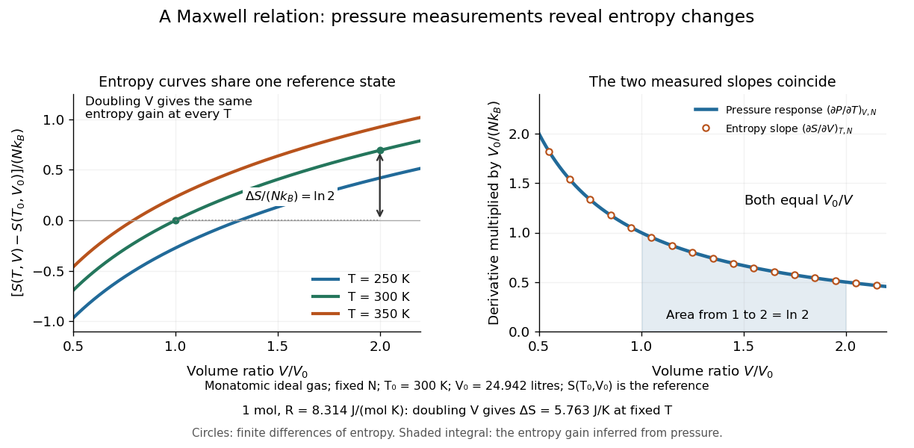

# Maxwell relations

↑ **Parent:** [Thermodynamics](thermodynamics-split.md)  
ⓦ [Wiki](https://en.wikipedia.org/wiki/Maxwell_relations)

Maxwell relations turn [pressure](pressure-split.md), [volume](volume-thermodynamics.md) and [temperature](temperature-split.md) measurements into information about [entropy](entropy-split.md). For example, the [pressure](pressure-split.md) rise when heating a rigid sealed vessel determines the [entropy](entropy-split.md) change when expanding the same sample isothermally:

$$
\left(\frac{\partial S}{\partial V}\right)_{T,N}
=\left(\frac{\partial P}{\partial T}\right)_{V,N}.
$$

The quantities on the two sides describe different experiments, yet both are [mixed partial derivatives](mixed-partial-derivative.md) of one [Helmholtz free energy](helmholtz-free-energy.md). This is the useful surprise: a mechanical measurement can reveal a thermal property. Similarly, the [coefficient of thermal expansion](coefficient-of-thermal-expansion.md) gives $(\partial S/\partial P)_{T,N}=-\alpha V$. [MIT 5.60, Lecture 13: entropy derivatives from equations of state](https://ocw.mit.edu/courses/5-60-thermodynamics-kinetics-spring-2008/7bc33304ab1db561a64b4a6b12e25476_5_60_lecture13.pdf)

For a [simple compressible system](simple-compressible-system.md), hold particle number $N$ and composition fixed, and allow only [pressure](pressure-split.md)-[volume](volume-thermodynamics.md) [work](work.md). Write $U$ for [internal energy](internal-energy-split.md), $H=U+PV$ for [enthalpy](enthalpy-split.md), $F=U-TS$ for [Helmholtz free energy](helmholtz-free-energy.md), and $G=H-TS$ for [Gibbs free energy](gibbs-free-energy.md). Their natural-variable differentials are

$$
\begin{aligned}
dU(S,V,N)&=T\,dS-P\,dV, &dH(S,P,N)&=T\,dS+V\,dP,\\
dF(T,V,N)&=-S\,dT-P\,dV, &dG(T,P,N)&=-S\,dT+V\,dP.
\end{aligned}
$$

Thus the first [partial derivatives](partial-derivative.md), with the subscript recording the variables kept fixed, are

$$
\begin{aligned}
U_S\big|_{V,N}=T,&\quad U_V\big|_{S,N}=-P, &H_S\big|_{P,N}=T,&\quad H_P\big|_{S,N}=V,\\
F_T\big|_{V,N}=-S,&\quad F_V\big|_{T,N}=-P, &G_T\big|_{P,N}=-S,&\quad G_P\big|_{T,N}=V.
\end{aligned}
$$

The [symmetry of second derivatives](symmetry-of-second-derivatives.md) produces all four standard [Maxwell relations](maxwell-relations.md), including their signs:

$$
\begin{aligned}
U:\quad\left(\frac{\partial T}{\partial V}\right)_{S,N}
&=-\left(\frac{\partial P}{\partial S}\right)_{V,N},\\
H:\quad\left(\frac{\partial T}{\partial P}\right)_{S,N}
&=\left(\frac{\partial V}{\partial S}\right)_{P,N},\\
F:\quad\left(\frac{\partial S}{\partial V}\right)_{T,N}
&=\left(\frac{\partial P}{\partial T}\right)_{V,N},\\
G:\quad\left(\frac{\partial S}{\partial P}\right)_{T,N}
&=-\left(\frac{\partial V}{\partial T}\right)_{P,N}.
\end{aligned}
$$

For a brief derivation of the $F$ relation, differentiate $F_T=-S$ with respect to $V$ and $F_V=-P$ with respect to $T$: $-S_V=F_{TV}=F_{VT}=-P_T$. Each other row follows in the same way. Assume continuous second [partial derivatives](partial-derivative.md) of the relevant [thermodynamic potential](thermodynamic-potential-split.md) in the region considered. At a [phase transition](phase-transition.md), the equilibrium potential may lose this smoothness; apply the identities within each smooth [thermodynamic phase](thermodynamic-phase.md), and handle [latent heat](latent-heat.md) and [phase coexistence](phase-coexistence.md) separately. If particle numbers vary, the potential differentials acquire [chemical potential](chemical-potential-split.md) terms, so the fixed-$N$ constraints must remain explicit. [David Tong, Statistical Physics, section 4.4.2: the four Maxwell relations](https://davidtong.org/teaching/statistical-physics/statmechhtml/S4#S4.SS4.SSS2)

For an [ideal gas](ideal-gas-split.md) with fixed $N$, the [ideal gas law](ideal-gas-law.md) gives $P=Nk_BT/V$. At fixed [volume](volume-thermodynamics.md), heating changes the [pressure](pressure-split.md) at rate $Nk_B/V$. Consequently an [isothermal expansion](isothermal-expansion.md) at positive [temperature](temperature-split.md) has

$$
\Delta S=\int_{V_1}^{V_2}\left(\frac{\partial P}{\partial T}\right)_{V,N}\,dV
=Nk_B\ln\frac{V_2}{V_1}.
$$

For one [mole](mole-unit.md) with $R=8.314\,\mathrm{J\,mol^{-1}\,K^{-1}}$ and $V_2=2V_1$, this is $\Delta S=R\ln2\simeq5.763\,\mathrm{J\,K^{-1}}$. At $300\,\mathrm K$, a reversible [isothermal expansion](isothermal-expansion.md) absorbs $Q=T\Delta S\simeq1728.85\,\mathrm J$ and performs equal [work](work.md), since its [internal energy](internal-energy-split.md) is unchanged. The [entropy](entropy-split.md) difference is a [state function](state-function.md) difference: the same equilibrium endpoints give the same $\Delta S$ in an insulated [free expansion](free-expansion.md), although there $Q=0$ and the process is irreversible.

**[Figure 14](#image-ideal-gas-entropy-slopes-equal-measured-pressure-responses-to-heating). Ideal gas entropy slopes equal measured pressure responses to heating**. Left: [entropy](entropy-split.md) relative to one common reference state $(T_0,V_0)$ for a classical [monatomic gas](monatomic-gas.md), $[S(T,V)-S(T_0,V_0)]/(Nk_B)=\frac32\ln(T/T_0)+\ln(V/V_0)$, with $T_0=300\,\mathrm K$. Each fixed-[temperature](temperature-split.md) curve gains $\ln2$ on doubling the [volume](volume-thermodynamics.md). Right: both [partial derivatives](partial-derivative.md), multiplied by $V_0/(Nk_B)$, equal $V_0/V$; circles are independent finite differences of [entropy](entropy-split.md), while the line is the [pressure](pressure-split.md) response.

The same [Maxwell relations](maxwell-relations.md) let thermal measurements determine the [difference between constant-pressure and constant-volume heat capacities](difference-between-constant-pressure-and-constant-volume-heat-capacities.md). In a smooth single [thermodynamic phase](thermodynamic-phase.md),

$$
dS=\frac{C_V}{T}\,dT+\frac{\alpha}{\kappa_T}\,dV
=\frac{C_P}{T}\,dT-\alpha V\,dP,
$$

using [heat capacity at constant volume](heat-capacity-at-constant-volume.md), [heat capacity at constant pressure](heat-capacity-at-constant-pressure.md), [coefficient of thermal expansion](coefficient-of-thermal-expansion.md) and [isothermal compressibility](isothermal-compressibility.md). Along fixed [pressure](pressure-split.md), $dV=\alpha V\,dT$, so

$$
C_P-C_V=\frac{TV\alpha^2}{\kappa_T}.
$$

Thus measured expansion and compression responses determine a [heat capacity](heat-capacity.md) difference without measuring both [heat capacities](heat-capacity.md) separately. They do not determine the absolute [heat capacities](heat-capacity.md) or absolute [entropy](entropy-split.md) by themselves; an independent thermal measurement supplies that missing information. For an [ideal gas](ideal-gas-split.md), $\alpha=1/T$ and $\kappa_T=1/P$ reduce the result to $C_P-C_V=PV/T=Nk_B$, which is [Mayer's relation](mayer-s-relation.md).

When the necessary higher [partial derivatives](partial-derivative.md) exist and commute, differentiating the [Maxwell relations](maxwell-relations.md) once more also gives

$$
\left(\frac{\partial C_V}{\partial V}\right)_{T,N}
=T\left(\frac{\partial^2P}{\partial T^2}\right)_{V,N},\qquad
\left(\frac{\partial C_P}{\partial P}\right)_{T,N}
=-T\left(\frac{\partial^2V}{\partial T^2}\right)_{P,N}.
$$

Integrating these slopes determines how a [heat capacity](heat-capacity.md) changes with [volume](volume-thermodynamics.md) or [pressure](pressure-split.md) at fixed [temperature](temperature-split.md). For an [ideal gas](ideal-gas-split.md), both right-hand sides vanish because the [ideal gas law](ideal-gas-law.md) is linear in [temperature](temperature-split.md) at either fixed [volume](volume-thermodynamics.md) or fixed [pressure](pressure-split.md). Consequently $C_V$ and $C_P$ depend only on [temperature](temperature-split.md) at fixed $N$, although they need not be constant in [temperature](temperature-split.md). [Tong, section 4.4.2: heat-capacity changes from thermal pressure and volume curves](https://davidtong.org/teaching/statistical-physics/statmechhtml/S4#S4.SS4.SSS2)

Historically, [James Clerk Maxwell](james-clerk-maxwell.md)'s _Theory of Heat_, first published in 1871, presents these connections using the geometry of [isothermal processes](isothermal-process.md) and reversible [adiabatic processes](adiabatic-process.md). His fourth edition, page 167, explicitly relates expansion on heating at fixed [pressure](pressure-split.md) to [heat](heat-split.md) emitted during an [isothermal compression](isothermal-compression.md): the modern $G$ relation gives $\delta Q_{\rm rev}=T\,dS=-T\alpha V\,dP$. This explains why a substance with positive [coefficient of thermal expansion](coefficient-of-thermal-expansion.md) emits [heat](heat-split.md) when compressed isothermally, whereas one with negative coefficient absorbs it. [Maxwell, Theory of Heat, publication record and chapter IX](https://www.cambridge.org/core/books/theory-of-heat/7052E2DAA4CD862126D5105ABBFFAD0F/listing) [Maxwell, Theory of Heat, fourth edition, page 167](https://en.wikisource.org/wiki/Page:Theory_of_Heat,_James_Clerk_Maxwell,_Fourth_Edition.djvu/183)

**Table of contents**

- [Isentropic temperature-volume derivative](isentropic-temperature-volume-derivative.md)

## ↑ Ancestors (5)

1. [Thermodynamics](thermodynamics-split.md)
2. [Statistical physics](statistical-physics-split.md)
3. [Branches of physics](branches-of-physics.md)
4. [Physics](physics-split.md)
5. [Codex Wiki](split.md)

## ← Incoming links (7)

- [Coefficient of thermal expansion](coefficient-of-thermal-expansion.md)
- [Compressibility](compressibility.md)
- [Maxwell relations](maxwell-relations.md)
- [Solution](past-exam-of-the-mathematics-course-of-the-university-of-cambridge/2010/ii/paper-3/35c/ii/solution.md)
- [Solution](past-exam-of-the-mathematics-course-of-the-year-1-of-the-natural-sciences-course-of-the-university-of-cambridge/2013/paper-2/17/a/solution.md)
- [Solution](past-exam-of-the-physics-b-course-of-the-university-of-cambridge/2010/paper-1/section-c/c13/solution.md)
- [Solution](past-exam-of-the-physics-b-course-of-the-university-of-cambridge/2012/paper-2/section-c/c13/solution.md)
