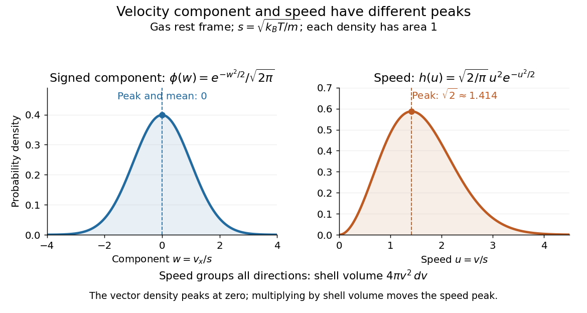
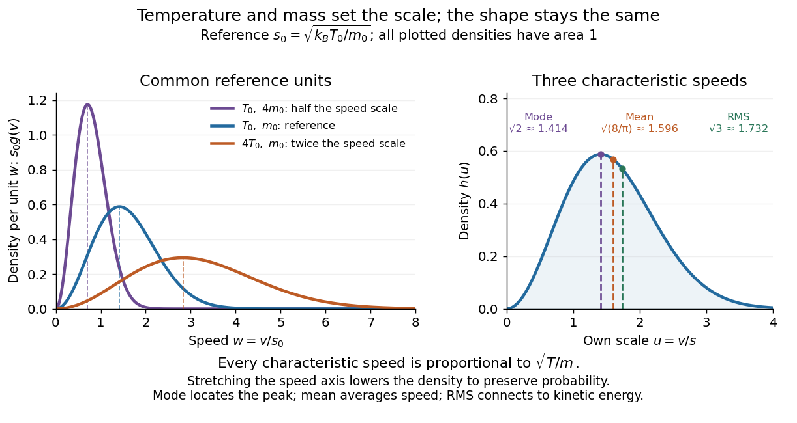

# Maxwell speed distribution

↑ **Parent:** [Maxwell-Boltzmann velocity distribution](maxwell-boltzmann-velocity-distribution.md)

The Maxwell speed distribution is the [probability density function](probability-density-function.md) for the magnitude $v=|\mathbf v|$. Unlike a signed [velocity](velocity.md) component, [speed](speed.md) cannot be negative:

$$
g(v)=4\pi v^2
\left(\frac{m}{2\pi k_BT}\right)^{3/2}
e^{-mv^2/(2k_BT)}
=\sqrt{\frac2\pi}\frac{v^2}{s^3}e^{-v^2/(2s^2)},
\qquad v\geq0.
$$

For $0\leq a<b$, the [probability](probability.md) of a [speed](speed.md) in $[a,b]$ is $\int_a^b g(v)\,dv$, and $\int_0^\infty g(v)\,dv=1$. The density has units of inverse [speed](speed.md), so its height alone is not a [probability](probability.md). [OpenStax, University Physics Volume 2, §2.4](https://openstax.org/books/university-physics-volume-2/pages/2-4-distribution-of-molecular-speeds)

All [velocities](velocity.md) with magnitudes from $v$ to $v+dv$ occupy a thin [spherical shell](spherical-shell.md) of volume $4\pi v^2\,dv$ in [velocity](velocity.md) space. The [isotropy](isotropy.md) of the [Maxwell-Boltzmann velocity distribution](maxwell-boltzmann-velocity-distribution.md) makes its density constant over each shell, giving $g(v)=4\pi v^2 f(v\mathbf e_x)$ for any fixed unit direction $\mathbf e_x$. A larger radius offers more directions and more volume. The increasing shell factor initially wins over the decreasing [Boltzmann factor](boltzmann-factor.md), so $g(0)=0$ and the [most probable speed](most-probable-speed-in-the-maxwell-distribution.md) is positive. This is the geometric reason that the peaks of the vector and [speed](speed.md) densities disagree.

With the [dimensionless quantity](dimensionless-quantity.md) $u=v/s$, every such gas has the same rescaled [speed](speed.md) density:

$$
g(v)\,dv=h(u)\,du,
\qquad h(u)=\sqrt{\frac2\pi}u^2e^{-u^2/2},\quad u\geq0.
$$

For comparison, $w=v_x/s$ has the standard [normal distribution](normal-distribution.md) density $\phi(w)=e^{-w^2/2}/\sqrt{2\pi}$ on the whole real line. The [Maxwell speed distribution](maxwell-speed-distribution.md) is neither the positive half of this curve nor the distribution of $|v_x|$: it combines three components.

**[Figure 1](#image-one-signed-velocity-component-peaks-at-zero-while-speed-peaks-above-zero-because-of-spherical-shells). One signed velocity component peaks at zero, while speed peaks above zero because of spherical shells**.

The first two [moments](moment.md) of the [Maxwell speed distribution](maxwell-speed-distribution.md) give the [mean](expected-value-split.md) and [root mean square](root-mean-square.md):

$$
\langle v\rangle=\sqrt{\frac8\pi}\,s,\qquad
\langle v^2\rangle=3s^2,\qquad
v_{\rm rms}=\sqrt{\langle v^2\rangle}=\sqrt3\,s.
$$

Consequently the [mean](expected-value-split.md) translational [kinetic energy](kinetic-energy.md) is $m\langle v^2\rangle/2=3k_BT/2$, as required by the [equipartition theorem](equipartition-theorem.md). [OpenStax, University Physics Volume 2, §2.2](https://openstax.org/books/university-physics-volume-2/pages/2-2-pressure-temperature-and-rms-speed) The [mean](expected-value-split.md) [speed](speed.md) weights fast particles more than the density peak does, and the [root mean square](root-mean-square.md) weights them more strongly still.

Changing [temperature](temperature-split.md) or particle [mass](mass.md) only changes $s\propto\sqrt{T/m}$. At fixed [mass](mass.md), four times the [temperature](temperature-split.md) doubles every characteristic [speed](speed.md); at fixed [temperature](temperature-split.md), four times the [mass](mass.md) halves them. A stretched density becomes lower so that its area stays one. For two species at the same [temperature](temperature-split.md), equal [mean](expected-value-split.md) translational [kinetic energy](kinetic-energy.md) therefore means different typical [speeds](speed.md).

**[Figure 2](#image-fourfold-temperature-doubles-the-speed-scale-while-fourfold-particle-mass-halves-it). Fourfold temperature doubles the speed scale, while fourfold particle mass halves it**.

**Table of contents**

- [Most probable speed in the Maxwell distribution](most-probable-speed-in-the-maxwell-distribution.md)

## ↑ Ancestors (7)

1. [Maxwell-Boltzmann velocity distribution](maxwell-boltzmann-velocity-distribution.md)
2. [Maxwell-Boltzmann distribution](maxwell-boltzmann-distribution.md)
3. [Quantum ideal-gas statistics](quantum-ideal-gas-statistics-split.md)
4. [Statistical physics](statistical-physics-split.md)
5. [Branches of physics](branches-of-physics.md)
6. [Physics](physics-split.md)
7. [Codex Wiki](split.md)

## ← Incoming links (12)

- [Effusive beam speed distribution](effusive-beam-speed-distribution.md)
- [Gas thermometer](gas-thermometer.md)
- [Maxwell-Boltzmann distribution](maxwell-boltzmann-distribution.md)
- [Maxwell-Boltzmann velocity distribution](maxwell-boltzmann-velocity-distribution.md)
- [Maxwell speed distribution](maxwell-speed-distribution.md)
- [Mode (statistics)](mode-statistics.md)
- [Most probable speed in the Maxwell distribution](most-probable-speed-in-the-maxwell-distribution.md)
- [Solution](past-exam-of-the-mathematics-course-of-the-university-of-cambridge/2018/ii/paper-2/36a/a/solution.md)
- [Solution](past-exam-of-the-physics-b-course-of-the-university-of-cambridge/2014/paper-1/section-a/a2/solution.md)
- [Solution](past-exam-of-the-physics-b-course-of-the-university-of-cambridge/2017/paper-2/section-c/c12/solution.md)
- [Radial Brownian displacement](radial-brownian-displacement.md)
- [Speed distribution](speed-distribution.md)
