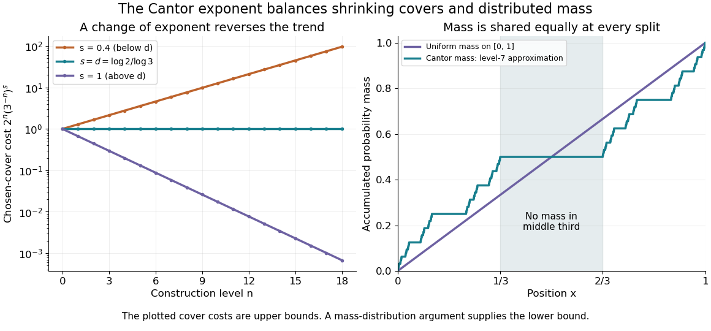
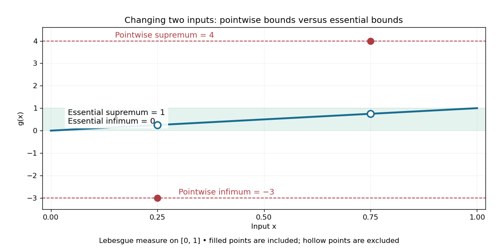
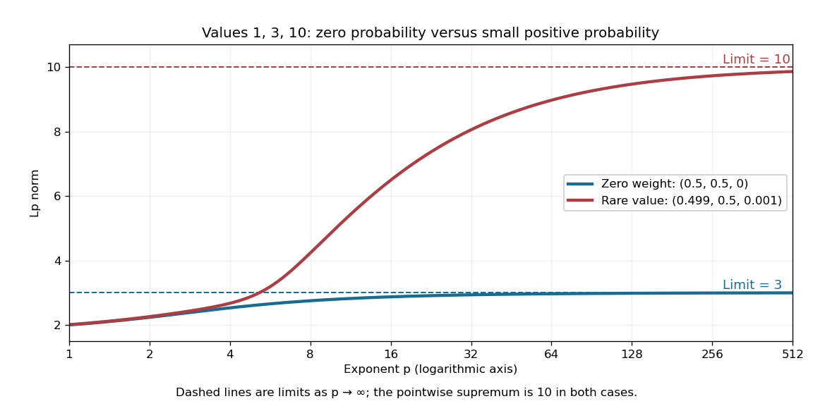
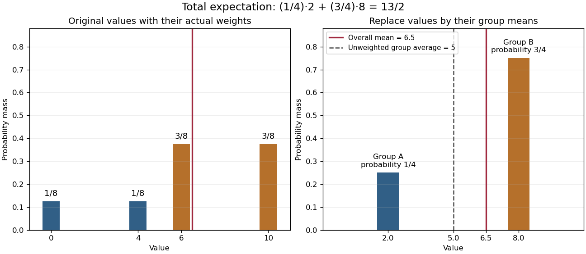
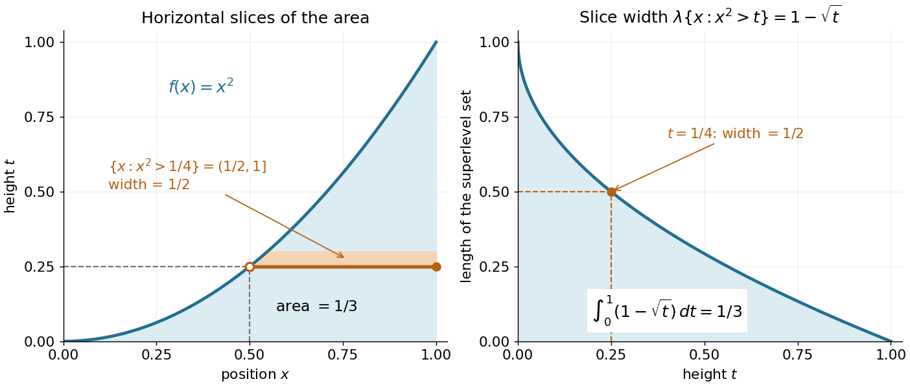
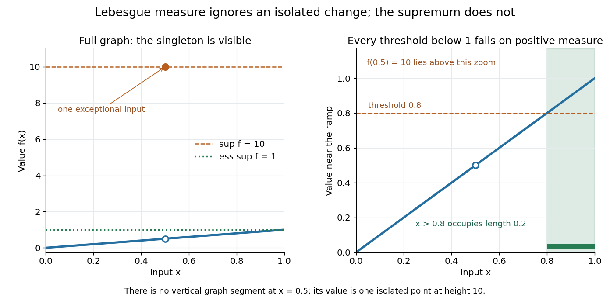

# Measure theory

↑ **Parent:** [Real analysis](real-analysis.md)  
ⓦ [Wiki](https://en.wikipedia.org/wiki/Measure_theory)

Measure theory studies [measures](measure.md), which assign sizes to [measurable sets](#measurable-set), and the [Lebesgue integral](#lebesgue-integral), which accumulates values weighted by those sizes. The same framework describes [Lebesgue measure](#lebesgue-measure) on the [real numbers](arithmetic.md#real-number), [counting measure](measure.md#counting-measure) on discrete collections, and [probability measures](probability-space.md#probability-measure) on possible outcomes. The choice of [measure](measure.md) determines what counts as large; the choice of [sigma-algebra](#sigma-algebra) determines what can be measured.

A striking example separates size from proximity: the [rational numbers](number-theory.md#rational-number) in $[0,1]$ form a [dense set](topology.md#dense-set) with [Lebesgue measure](#lebesgue-measure) zero, although the whole interval has [Lebesgue measure](#lebesgue-measure) one. This distinction makes [almost everywhere](#almost-everywhere) statements useful: exceptional [null sets](#null-set) can be ignored in a [Lebesgue integral](#lebesgue-integral) even when they meet every open subinterval. The [monotone convergence theorem](#monotone-convergence-theorem) and [dominated convergence theorem](#dominated-convergence-theorem) then give precise conditions for passing a [limit](calculus.md#limit-of-a-function) through an [integral](integral.md).

A historical starting point is Lebesgue's 1902 thesis, [Intégrale, Longueur, Aire (original title page reproduced in USP lecture notes)](https://www.ime.usp.br/~glaucio/mat5798/textos/aula1.pdf#page=2). Its title connects [integration](integral.md) with the geometric task of assigning sizes.

**Table of contents**

- [Convergence in measure](#convergence-in-measure)
  - [Completeness of convergence in measure on a finite measure space](#completeness-of-convergence-in-measure-on-a-finite-measure-space)
- [Non-measurable set](#non-measurable-set)
- [Wiener covering lemma](#wiener-covering-lemma)
  - [Disjoint ball decomposition modulo null sets](#disjoint-ball-decomposition-modulo-null-sets)
- [Geometric measure theory](#geometric-measure-theory)
  - [Coarea formula](#coarea-formula)
  - [Hausdorff measure](#hausdorff-measure)
    - [Scale-restricted Hausdorff content](#scale-restricted-hausdorff-content)
    - [Hausdorff dimension](#hausdorff-dimension)
      - [Mass distribution principle](#mass-distribution-principle)
      - [Hausdorff dimension of the Cantor set](#hausdorff-dimension-of-the-cantor-set)
      - [Pressure upper bound for Hausdorff dimension](#pressure-upper-bound-for-hausdorff-dimension)
      - [Hausdorff dimension of a connected set](#hausdorff-dimension-of-a-connected-set)
- [Vector measure](#vector-measure)
  - [Vector Radon measure](#vector-radon-measure)
    - [Polar decomposition of a vector measure](#polar-decomposition-of-a-vector-measure)
- [Standard Borel probability space](#standard-borel-probability-space)
- [Measurable space](#measurable-space)
  - [Standard Borel space](#standard-borel-space)
- [Null set](#null-set)
  - [Lebesgue null set](#lebesgue-null-set)
  - [Borel null set](#borel-null-set)
- [Random measure](#random-measure)
- [Measurable partition](#measurable-partition)
  - [Partition atom](#partition-atom)
  - [Entropy of a countable measurable partition](#entropy-of-a-countable-measurable-partition)
    - [Conditional information function](#conditional-information-function)
      - [Maximal inequality for conditional information functions](#maximal-inequality-for-conditional-information-functions)
      - [Conditional entropy of a countable measurable partition](#conditional-entropy-of-a-countable-measurable-partition)
  - [Join of measurable partitions](#join-of-measurable-partitions)
- [Field of sets](#field-of-sets)
- [Semiring of sets](#semiring-of-sets)
- [Monotone class](#monotone-class)
  - [Monotone class theorem](#monotone-class-theorem)
    - [Functional monotone-class theorem](#functional-monotone-class-theorem)
- [Measurable function](#measurable-function)
  - [Lebesgue measurable function](#lebesgue-measurable-function)
  - [Doob-Dynkin lemma](#doob-dynkin-lemma)
  - [Essential range](#essential-range)
  - [Measurability](#measurability)
  - [Borel measurable function](#borel-measurable-function)
  - [Composition of measurable functions](#composition-of-measurable-functions)
    - [Borel postcomposition preserves Lebesgue measurability](#borel-postcomposition-preserves-lebesgue-measurability)
- [Measure density](#measure-density)
  - [Spherical derivative of a measure](#spherical-derivative-of-a-measure)
    - [Spherical derivative of a singular measure vanishes](#spherical-derivative-of-a-singular-measure-vanishes)
  - [Lebesgue differentiation theorem](#lebesgue-differentiation-theorem)
    - [Oscillating annuli obstruct differentiation at a point](#oscillating-annuli-obstruct-differentiation-at-a-point)
    - [Lebesgue point](#lebesgue-point)
    - [Differentiation of an indefinite Lebesgue integral](#differentiation-of-an-indefinite-lebesgue-integral)
  - [Lebesgue's density theorem](#lebesgue-s-density-theorem)
    - [Density point](#density-point)
    - [High-density interval in a positive-measure subset of the real line](#high-density-interval-in-a-positive-measure-subset-of-the-real-line)
- [Lebesgue measurable set](#lebesgue-measurable-set)
  - [Lebesgue sigma-algebra](#lebesgue-sigma-algebra)
  - [Regularity of Lebesgue measure](#regularity-of-lebesgue-measure)
- [Almost everywhere](#almost-everywhere)
- [Lebesgue integrable function](#lebesgue-integrable-function)
  - [An integrable perturbation cannot repair nonintegrability](#an-integrable-perturbation-cannot-repair-nonintegrability)
  - [Integrability](#integrability)
- [Conditional expectation](#conditional-expectation)
  - [Conditional dominated convergence theorem](#conditional-dominated-convergence-theorem)
  - [First-crossing maximal inequality for refining partitions](#first-crossing-maximal-inequality-for-refining-partitions)
    - [Differentiation along refining metric partitions](#differentiation-along-refining-metric-partitions)
  - [Conditional expectation under a martingale density](#conditional-expectation-under-a-martingale-density)
  - [Mutual conditional expectation rigidity in L2](#mutual-conditional-expectation-rigidity-in-l2)
  - [Conditional monotone convergence theorem](#conditional-monotone-convergence-theorem)
  - [Measurable-factor rule for conditional expectation](#measurable-factor-rule-for-conditional-expectation)
  - [Conditional mean of a bounded success time](#conditional-mean-of-a-bounded-success-time)
  - [Conditional expectation preserving a distribution](#conditional-expectation-preserving-a-distribution)
  - [Dyadic conditional averages recover integrable functions](#dyadic-conditional-averages-recover-integrable-functions)
  - [Symmetrization as conditional expectation](#symmetrization-as-conditional-expectation)
    - [Sampling with and without replacement comparison for bounded products](#sampling-with-and-without-replacement-comparison-for-bounded-products)
  - [Conditional expectation from finite-measure densities](#conditional-expectation-from-finite-measure-densities)
  - [Equality case for conditional second moments](#equality-case-for-conditional-second-moments)
  - [Conditional L2 norm](#conditional-l2-norm)
    - [Conditional norm covariance under a factor map](#conditional-norm-covariance-under-a-factor-map)
    - [Uniform conditional L2 norm](#uniform-conditional-l2-norm)
  - [Conditional Jensen inequality](#conditional-jensen-inequality)
  - [L1 contraction of conditional expectation](#l1-contraction-of-conditional-expectation)
  - [Conditional expectation of a summand given future partial sums](#conditional-expectation-of-a-summand-given-future-partial-sums)
  - [Law of total expectation](#law-of-total-expectation)
    - [Expectation closure error for a nonlinear recurrence](#expectation-closure-error-for-a-nonlinear-recurrence)
    - [Nested conditioning keeps the coarser information](#nested-conditioning-keeps-the-coarser-information)
  - [Independent sigma-algebras have trivial intersection](#independent-sigma-algebras-have-trivial-intersection)
  - [Iterated conditional expectation over nonnested sigma-algebras](#iterated-conditional-expectation-over-nonnested-sigma-algebras)
  - [Conditional Fatou lemma](#conditional-fatou-lemma)
- [Fatou's lemma](#fatou-s-lemma)
  - [Reverse Fatou lemma](#reverse-fatou-lemma)
  - [Almost-everywhere limit under a uniform L1 bound](#almost-everywhere-limit-under-a-uniform-l1-bound)
  - [Fatou lemma for series](#fatou-lemma-for-series)
  - [Proof of Fatou lemma](#proof-of-fatou-lemma)
  - [Strict inequality in Fatou lemma](#strict-inequality-in-fatou-lemma)
- [Ergodic theory](ergodic-theory.md)
  - [Generic point for an invariant measure](ergodic-theory.md#generic-point-for-an-invariant-measure)
  - [Invariant measure](ergodic-theory.md#invariant-measure)
    - [Invariant probability measure for a semigroup](ergodic-theory.md#invariant-probability-measure-for-a-semigroup)
      - [Krylov–Bogolyubov theorem](ergodic-theory.md#krylov-bogolyubov-theorem)
  - [Cutting and stacking](ergodic-theory.md#cutting-and-stacking)
    - [Chacon transformation](ergodic-theory.md#chacon-transformation)
  - [Unique ergodicity](ergodic-theory.md#unique-ergodicity)
    - [Uniform ergodic convergence for uniquely ergodic systems](ergodic-theory.md#uniform-ergodic-convergence-for-uniquely-ergodic-systems)
  - [Van der Corput lemma (Hilbert space sequences)](ergodic-theory.md#van-der-corput-lemma-hilbert-space-sequences)
    - [Van der Corput inequality for finite scalar sequences](ergodic-theory.md#van-der-corput-inequality-for-finite-scalar-sequences)
  - [Equidistributed sequence](ergodic-theory.md#equidistributed-sequence)
    - [Equidistribution criterion for a torus translation](ergodic-theory.md#equidistribution-criterion-for-a-torus-translation)
    - [Interval discrepancy](ergodic-theory.md#interval-discrepancy)
    - [Weyl criterion](ergodic-theory.md#weyl-criterion)
      - [Differencing obstruction to equidistribution](ergodic-theory.md#differencing-obstruction-to-equidistribution)
      - [Equidistribution of a quadratic polynomial with irrational leading coefficient](ergodic-theory.md#equidistribution-of-a-quadratic-polynomial-with-irrational-leading-coefficient)
        - [Uniform square recurrence on the circle](ergodic-theory.md#uniform-square-recurrence-on-the-circle)
  - [Nonsingular transformation](ergodic-theory.md#nonsingular-transformation)
  - [Koopman operator](ergodic-theory.md#koopman-operator)
    - [Spectral measure of a Koopman observable](ergodic-theory.md#spectral-measure-of-a-koopman-observable)
    - [Almost periodic observable](ergodic-theory.md#almost-periodic-observable)
      - [Syndetic near returns of an almost periodic observable](ergodic-theory.md#syndetic-near-returns-of-an-almost-periodic-observable)
      - [Compact measure-preserving system](ergodic-theory.md#compact-measure-preserving-system)
    - [Decay of autocorrelation implies weak convergence of an observable](ergodic-theory.md#decay-of-autocorrelation-implies-weak-convergence-of-an-observable)
    - [Bounded Koopman operator criterion](ergodic-theory.md#bounded-koopman-operator-criterion)
  - [Measure-preserving transformation](ergodic-theory.md#measure-preserving-transformation)
    - [Invariance from integral duality for a measure-preserving transformation](ergodic-theory.md#invariance-from-integral-duality-for-a-measure-preserving-transformation)
    - [Lebesgue-measure-preserving map](ergodic-theory.md#lebesgue-measure-preserving-map)
    - [Integer multiplication map on the circle](ergodic-theory.md#integer-multiplication-map-on-the-circle)
      - [Ergodicity of integer multiplication on the circle](ergodic-theory.md#ergodicity-of-integer-multiplication-on-the-circle)
    - [Measure-preserving system](ergodic-theory.md#measure-preserving-system)
      - [Factor of a measure-preserving system](ergodic-theory.md#factor-of-a-measure-preserving-system)
        - [Factor map between measure-preserving systems](ergodic-theory.md#factor-map-between-measure-preserving-systems)
          - [Compact extension of a measure-preserving system](ergodic-theory.md#compact-extension-of-a-measure-preserving-system)
            - [Finite-fiber compact extension](ergodic-theory.md#finite-fiber-compact-extension)
            - [Positive-measure almost periodic indicator in a compact extension](ergodic-theory.md#positive-measure-almost-periodic-indicator-in-a-compact-extension)
          - [Relatively almost periodic observable](ergodic-theory.md#relatively-almost-periodic-observable)
            - [Localization of relative almost periodicity to base sets](ergodic-theory.md#localization-of-relative-almost-periodicity-to-base-sets)
    - [Finite full-support measure-preserving map is bijective](ergodic-theory.md#finite-full-support-measure-preserving-map-is-bijective)
    - [Invertible measure-preserving system](ergodic-theory.md#invertible-measure-preserving-system)
    - [Invariant sigma-algebra](ergodic-theory.md#invariant-sigma-algebra)
      - [Invariant set of a measure-preserving transformation](ergodic-theory.md#invariant-set-of-a-measure-preserving-transformation)
    - [Ergodicity](ergodic-theory.md#ergodicity)
      - [Strong mixing](ergodic-theory.md#strong-mixing)
        - [Diagonal set-correlation criterion for mixing](ergodic-theory.md#diagonal-set-correlation-criterion-for-mixing)
      - [Ergodic decomposition](ergodic-theory.md#ergodic-decomposition)
        - [Ergodic components of a rational circle rotation](ergodic-theory.md#ergodic-components-of-a-rational-circle-rotation)
        - [Ergodic component](ergodic-theory.md#ergodic-component)
          - [Countable-test proof of ergodicity of conditional components](ergodic-theory.md#countable-test-proof-of-ergodicity-of-conditional-components)
        - [Affinity of entropy under ergodic decomposition](ergodic-theory.md#affinity-of-entropy-under-ergodic-decomposition)
      - [Ergodic invariant probability on a countable state space has finite cyclic support](ergodic-theory.md#ergodic-invariant-probability-on-a-countable-state-space-has-finite-cyclic-support)
      - [Invariant-function characterization of ergodicity](ergodic-theory.md#invariant-function-characterization-of-ergodicity)
      - [Bernoulli shift](ergodic-theory.md#bernoulli-shift)
        - [Bernoulli coordinate observable is not almost periodic](ergodic-theory.md#bernoulli-coordinate-observable-is-not-almost-periodic)
        - [Cantor Bernoulli measure](ergodic-theory.md#cantor-bernoulli-measure)
      - [Irrational rotation](ergodic-theory.md#irrational-rotation)
        - [Ergodicity criterion for a circle rotation](ergodic-theory.md#ergodicity-criterion-for-a-circle-rotation)
        - [Everywhere interval frequency under an irrational rotation](ergodic-theory.md#everywhere-interval-frequency-under-an-irrational-rotation)
      - [Weakly mixing measure-preserving transformation](ergodic-theory.md#weakly-mixing-measure-preserving-transformation)
        - [Arithmetic-progression multiple averages under weak mixing](ergodic-theory.md#arithmetic-progression-multiple-averages-under-weak-mixing)
          - [Density convergence of multiple weak-mixing correlations](ergodic-theory.md#density-convergence-of-multiple-weak-mixing-correlations)
        - [Stability of weak mixing under powers and products](ergodic-theory.md#stability-of-weak-mixing-under-powers-and-products)
        - [Product characterization of weak mixing](ergodic-theory.md#product-characterization-of-weak-mixing)
          - [Square-correlation proof of weak mixing from product ergodicity](ergodic-theory.md#square-correlation-proof-of-weak-mixing-from-product-ergodicity)
        - [Koopman eigenfunction obstruction to weak mixing](ergodic-theory.md#koopman-eigenfunction-obstruction-to-weak-mixing)
        - [Simultaneous hitting characterization of weak mixing](ergodic-theory.md#simultaneous-hitting-characterization-of-weak-mixing)
    - [Poincaré recurrence theorem](ergodic-theory.md#poincare-recurrence-theorem)
      - [Furstenberg multiple recurrence theorem](ergodic-theory.md#furstenberg-multiple-recurrence-theorem)
        - [SZ property](ergodic-theory.md#sz-property)
        - [Multiple recurrence for circle rotations](ergodic-theory.md#multiple-recurrence-for-circle-rotations)
  - [Birkhoff ergodic theorem](ergodic-theory.md#birkhoff-ergodic-theorem)
    - [Nonnegative ergodic averages with infinite integral](ergodic-theory.md#nonnegative-ergodic-averages-with-infinite-integral)
    - [Maximal ergodic lemma](ergodic-theory.md#maximal-ergodic-lemma)
    - [Triangular ergodic averaging lemma](ergodic-theory.md#triangular-ergodic-averaging-lemma)
    - [Linear growth bound for integrable observables](ergodic-theory.md#linear-growth-bound-for-integrable-observables)
      - [Sharpness of the linear growth bound for integrable observables](ergodic-theory.md#sharpness-of-the-linear-growth-bound-for-integrable-observables)
    - [L1 convergence in the Birkhoff ergodic theorem on a finite measure space](ergodic-theory.md#l1-convergence-in-the-birkhoff-ergodic-theorem-on-a-finite-measure-space)
  - [Upper Banach density](ergodic-theory.md#upper-banach-density)
    - [Furstenberg correspondence principle](ergodic-theory.md#furstenberg-correspondence-principle)
  - [Convergence in density of a sequence](ergodic-theory.md#convergence-in-density-of-a-sequence)
    - [Mean-square criterion for convergence in density](ergodic-theory.md#mean-square-criterion-for-convergence-in-density)
    - [Cesaro convergence of a sequence](ergodic-theory.md#cesaro-convergence-of-a-sequence)
  - [Entropy of a finite measurable partition](ergodic-theory.md#entropy-of-a-finite-measurable-partition)
    - [Conditional entropy of finite measurable partitions](ergodic-theory.md#conditional-entropy-of-finite-measurable-partitions)
    - [Entropy rate of a measurable partition](ergodic-theory.md#entropy-rate-of-a-measurable-partition)
      - [Infinite-future formula for partition entropy rate](ergodic-theory.md#infinite-future-formula-for-partition-entropy-rate)
        - [Block conditional entropy given the infinite future](ergodic-theory.md#block-conditional-entropy-given-the-infinite-future)
      - [Shannon-McMillan-Breiman theorem](ergodic-theory.md#shannon-mcmillan-breiman-theorem)
      - [Monotonicity of normalized block entropy](ergodic-theory.md#monotonicity-of-normalized-block-entropy)
      - [Kolmogorov-Sinai entropy](ergodic-theory.md#kolmogorov-sinai-entropy)
        - [Completely positive entropy](ergodic-theory.md#completely-positive-entropy)
        - [Generating measurable partition](ergodic-theory.md#generating-measurable-partition)
          - [One-sided generator](ergodic-theory.md#one-sided-generator)
            - [Finite one-sided generator of an invertible system forces zero entropy](ergodic-theory.md#finite-one-sided-generator-of-an-invertible-system-forces-zero-entropy)
          - [Kolmogorov-Sinai generator theorem](ergodic-theory.md#kolmogorov-sinai-generator-theorem)
        - [Host equidistribution theorem](ergodic-theory.md#host-equidistribution-theorem)
          - [Rudolph measure rigidity theorem](ergodic-theory.md#rudolph-measure-rigidity-theorem)
        - [Entropy preservation under a finite-to-one factor](ergodic-theory.md#entropy-preservation-under-a-finite-to-one-factor)
        - [Pinsker sigma-algebra](ergodic-theory.md#pinsker-sigma-algebra)
          - [Tail characterization of the Pinsker sigma-algebra](ergodic-theory.md#tail-characterization-of-the-pinsker-sigma-algebra)
      - [Infimum rule for partition entropy rate](ergodic-theory.md#infimum-rule-for-partition-entropy-rate)
  - [K-mixing](ergodic-theory.md#k-mixing)
    - [Tail sigma-algebra of a measurable partition](ergodic-theory.md#tail-sigma-algebra-of-a-measurable-partition)
      - [Finite partitions measurable in a partition tail have zero entropy rate](ergodic-theory.md#finite-partitions-measurable-in-a-partition-tail-have-zero-entropy-rate)
- [Outer measure](#outer-measure)
  - [Metric outer measure](#metric-outer-measure)
  - [Regular outer measure](#regular-outer-measure)
    - [Maximal additivity algebra of a regular outer measure](#maximal-additivity-algebra-of-a-regular-outer-measure)
    - [Measurability criterion inside a finite measurable hull](#measurability-criterion-inside-a-finite-measurable-hull)
  - [Carathéodory's criterion](#caratheodory-s-criterion)
  - [Lebesgue outer measure](#lebesgue-outer-measure)
    - [Translation invariance of Lebesgue outer measure](#translation-invariance-of-lebesgue-outer-measure)
    - [Monotonicity of Lebesgue outer measure](#monotonicity-of-lebesgue-outer-measure)
    - [Countable subadditivity of Lebesgue outer measure](#countable-subadditivity-of-lebesgue-outer-measure)
    - [High-density interval for outer measure](#high-density-interval-for-outer-measure)
- [Measure](measure.md)
  - [Monotonicity of a measure](measure.md#monotonicity-of-a-measure)
  - [Restriction of a measure to a measurable subset](measure.md#restriction-of-a-measure-to-a-measurable-subset)
  - [Inner regular measure](measure.md#inner-regular-measure)
  - [p-adic measure](measure.md#p-adic-measure)
    - [Mahler expansion of continuous p-adic functions](measure.md#mahler-expansion-of-continuous-p-adic-functions)
    - [Amice transform](measure.md#amice-transform)
    - [Convolution of p-adic measures](measure.md#convolution-of-p-adic-measures)
  - [Stieltjes transform of a measure](measure.md#stieltjes-transform-of-a-measure)
  - [Outer regular measure](measure.md#outer-regular-measure)
  - [Complex measure](measure.md#complex-measure)
  - [Countable subadditivity of a measure](measure.md#countable-subadditivity-of-a-measure)
  - [Complete measure](measure.md#complete-measure)
    - [Completion of a measure](measure.md#completion-of-a-measure)
  - [Variation measure](measure.md#variation-measure)
    - [Total variation norm of a measure](measure.md#total-variation-norm-of-a-measure)
  - [Signed measure](measure.md#signed-measure)
    - [Hahn decomposition](measure.md#hahn-decomposition)
  - [Dirac measure](measure.md#dirac-measure)
  - [Atom (measure theory)](measure.md#atom-measure-theory)
    - [Point atom of a measure](measure.md#point-atom-of-a-measure)
      - [Countability of point atoms of a finite measure](measure.md#countability-of-point-atoms-of-a-finite-measure)
    - [Non-atomic measure](measure.md#non-atomic-measure)
      - [Lyapunov convexity theorem](measure.md#lyapunov-convexity-theorem)
  - [Counting measure](measure.md#counting-measure)
    - [Series as a Lebesgue integral against counting measure](measure.md#series-as-a-lebesgue-integral-against-counting-measure)
  - [Premeasure](measure.md#premeasure)
    - [Cylinder premeasure from a positive functional](measure.md#cylinder-premeasure-from-a-positive-functional)
    - [Carathéodory's extension theorem](measure.md#caratheodory-s-extension-theorem)
  - [Positive measure](measure.md#positive-measure)
    - [Finite supremum of positive measures](measure.md#finite-supremum-of-positive-measures)
      - [Lebesgue decomposition commutes with finite measure suprema](measure.md#lebesgue-decomposition-commutes-with-finite-measure-suprema)
  - [Borel measure](measure.md#borel-measure)
    - [Support of a measure](measure.md#support-of-a-measure)
      - [Support under a continuous map](measure.md#support-under-a-continuous-map)
    - [Borel probability measure](measure.md#borel-probability-measure)
      - [Continuous approximation of Borel indicators on a compact metric space](measure.md#continuous-approximation-of-borel-indicators-on-a-compact-metric-space)
    - [Regular Borel measure](measure.md#regular-borel-measure)
    - [Radon measure](measure.md#radon-measure)
      - [Regularity of finite Borel measures on Euclidean space](measure.md#regularity-of-finite-borel-measures-on-euclidean-space)
  - [Measure space](measure.md#measure-space)
  - [Pushforward measure](measure.md#pushforward-measure)
    - [Finite probability pushforward](measure.md#finite-probability-pushforward)
    - [Radial disintegration of an orthogonally invariant measure](measure.md#radial-disintegration-of-an-orthogonally-invariant-measure)
    - [Probability pushforward embedding theorem](measure.md#probability-pushforward-embedding-theorem)
  - [Change of measure](measure.md#change-of-measure)
    - [Density process](measure.md#density-process)
  - [Haar measure](measure.md#haar-measure)
    - [Haar sampling by Gaussian QR decomposition](measure.md#haar-sampling-by-gaussian-qr-decomposition)
    - [Haar measure from a left-invariant coframe](measure.md#haar-measure-from-a-left-invariant-coframe)
    - [Haar measure from normalized covering functionals](measure.md#haar-measure-from-normalized-covering-functionals)
    - [Compact-group invariant probability by finite averaging](measure.md#compact-group-invariant-probability-by-finite-averaging)
    - [Haar integral](measure.md#haar-integral)
    - [Weyl integration formula for SU(2)](measure.md#weyl-integration-formula-for-su-2)
    - [Pauli-coordinate Haar measure on SU(2)](measure.md#pauli-coordinate-haar-measure-on-su-2)
    - [Minimal left covering net of a compact group](measure.md#minimal-left-covering-net-of-a-compact-group)
      - [Matching minimal covering nets of a compact group](measure.md#matching-minimal-covering-nets-of-a-compact-group)
  - [Countable additivity](measure.md#countable-additivity)
    - [Continuity from below of a measure](measure.md#continuity-from-below-of-a-measure)
    - [Continuity from above of a measure](measure.md#continuity-from-above-of-a-measure)
  - [Finite measure](measure.md#finite-measure)
    - [Finite-measure set](measure.md#finite-measure-set)
  - [Sigma-finite measure](measure.md#sigma-finite-measure)
- [Step function](#step-function)
  - [Uniform step approximation of a continuous function on a compact interval](#uniform-step-approximation-of-a-continuous-function-on-a-compact-interval)
- [Lebesgue integral](#lebesgue-integral)
  - [Integral average](#integral-average)
    - [Volume average](#volume-average)
  - [Simple function](#simple-function)
- [Indicator function](#indicator-function)
  - [Indicator vector](#indicator-vector)
- [Sigma-algebra](#sigma-algebra)
  - [Sigma-algebra generated by a collection](#sigma-algebra-generated-by-a-collection)
  - [Trace sigma-algebra](#trace-sigma-algebra)
  - [Sub-sigma-algebra](#sub-sigma-algebra)
  - [Sigma-algebra generated by a random variable](#sigma-algebra-generated-by-a-random-variable)
    - [Sigma-algebra of a finite-valued random vector](#sigma-algebra-of-a-finite-valued-random-vector)
  - [Algebra of sets](#algebra-of-sets)
    - [Countable generating algebra](#countable-generating-algebra)
  - [Measurable set](#measurable-set)
  - [Atom of a sigma-algebra](#atom-of-a-sigma-algebra)
  - [Borel set](#borel-set)
    - [Borel hierarchy](#borel-hierarchy)
    - [Borel sigma-algebra](#borel-sigma-algebra)
      - [Borel sigma-algebra of a discrete space](#borel-sigma-algebra-of-a-discrete-space)
  - [Pi-system](#pi-system)
  - [Dynkin system](#dynkin-system)
    - [Dynkin lemma](#dynkin-lemma)
- [Fubini's theorem](#fubini-s-theorem)
  - [An antisymmetric kernel with unequal iterated integrals](#an-antisymmetric-kernel-with-unequal-iterated-integrals)
  - [Finite iterated integrals without joint integrability](#finite-iterated-integrals-without-joint-integrability)
  - [Weighted dilation kernel](#weighted-dilation-kernel)
  - [Lebesgue measurable sections](#lebesgue-measurable-sections)
  - [Frullani integral](#frullani-integral)
    - [Hyperbolic-secant Frullani integral](#hyperbolic-secant-frullani-integral)
- [Sigma-finite uniqueness theorem for measures](#sigma-finite-uniqueness-theorem-for-measures)
  - [Lebesgue measure](#lebesgue-measure)
    - [Lebesgue inner measure](#lebesgue-inner-measure)
    - [Translation invariance of Lebesgue measure](#translation-invariance-of-lebesgue-measure)
    - [Essential closure](#essential-closure)
    - [Null-set limsup cover by finite arc families](#null-set-limsup-cover-by-finite-arc-families)
    - [Compact batching of a small open set](#compact-batching-of-a-small-open-set)
    - [Inner regularity of Lebesgue measure](#inner-regularity-of-lebesgue-measure)
    - [Sierpiński set](#sierpinski-set)
    - [Divisibility of Lebesgue measure](#divisibility-of-lebesgue-measure)
      - [Cumulative measure of a finite-measure set](#cumulative-measure-of-a-finite-measure-set)
    - [Completeness of Lebesgue measure](#completeness-of-lebesgue-measure)
- [Bochner integral](#bochner-integral)
  - [Mean-square integral](#mean-square-integral)
  - [Barycenter of a measure on a Banach space](#barycenter-of-a-measure-on-a-banach-space)
  - [Strongly measurable function](#strongly-measurable-function)
- [Essential supremum](#essential-supremum)
- [Lp space](#lp-space)
  - [L1 Kolmogorov-Riesz compactness criterion](#l1-kolmogorov-riesz-compactness-criterion)
  - [Density of continuous functions in Lp on an interval](#density-of-continuous-functions-in-lp-on-an-interval)
  - [Typewriter sequence](#typewriter-sequence)
    - [Unbounded typewriter sequence with vanishing L1 norm](#unbounded-typewriter-sequence-with-vanishing-l1-norm)
  - [L1 space](#l1-space)
    - [Summable L1 norms imply almost-everywhere absolute convergence](#summable-l1-norms-imply-almost-everywhere-absolute-convergence)
      - [Integration of a series with summable L1 norms](#integration-of-a-series-with-summable-l1-norms)
  - [Sum of Lp spaces](#sum-of-lp-spaces)
    - [Threshold decomposition between Lp spaces](#threshold-decomposition-between-lp-spaces)
  - [Sine sequence is not Cauchy in the integral norm](#sine-sequence-is-not-cauchy-in-the-integral-norm)
  - [Translation continuity in Lp on a locally compact group](#translation-continuity-in-lp-on-a-locally-compact-group)
  - [Derivative of a power of the Lp norm](#derivative-of-a-power-of-the-lp-norm)
  - [Closest point theorem for a closed convex subset of Lp](#closest-point-theorem-for-a-closed-convex-subset-of-lp)
  - [Completeness of Lp spaces](#completeness-of-lp-spaces)
  - [Weak Lq space](#weak-lq-space)
    - [Integral norm for weak Lq](#integral-norm-for-weak-lq)
  - [Mixed Lebesgue norm](#mixed-lebesgue-norm)
  - [Locally square-integrable function](#locally-square-integrable-function)
  - [Translation continuity in Lp](#translation-continuity-in-lp)
  - [Translation continuity in L1 on the circle](#translation-continuity-in-l1-on-the-circle)
  - [Lp norms converge to the supremum norm](#lp-norms-converge-to-the-supremum-norm)
    - [Moment ratios converge to the essential supremum](#moment-ratios-converge-to-the-essential-supremum)
  - [Lp interpolation inequality](#lp-interpolation-inequality)
    - [Nonvanishing level-set bound between three Lp norms](#nonvanishing-level-set-bound-between-three-lp-norms)
  - [Square-integrable function](#square-integrable-function)
  - [L2 space is a Hilbert space](#l2-space-is-a-hilbert-space)
    - [Exponentially weighted L2 space](#exponentially-weighted-l2-space)
      - [Weighted essential spectrum of a Fisher travelling front](#weighted-essential-spectrum-of-a-fisher-travelling-front)
    - [Mean-zero L2 space](#mean-zero-l2-space)
    - [L2 inner product](#l2-inner-product)
  - [Riesz-Fischer theorem](#riesz-fischer-theorem)
    - [Riesz-Fischer theorem for an orthonormal system](#riesz-fischer-theorem-for-an-orthonormal-system)
  - [Banach intersection of L1 and L2](#banach-intersection-of-l1-and-l2)
- [Approximation by nonnegative simple functions](#approximation-by-nonnegative-simple-functions)
- [Monotone convergence theorem](#monotone-convergence-theorem)
  - [Moving-spike obstruction to interchanging a limit and an infinite sum](#moving-spike-obstruction-to-interchanging-a-limit-and-an-infinite-sum)
- [Dominated convergence theorem](#dominated-convergence-theorem)
  - [Sine integral with an exponential denominator](#sine-integral-with-an-exponential-denominator)
  - [Continuity of parameter integrals on compact rectangles](#continuity-of-parameter-integrals-on-compact-rectangles)
  - [Logarithmic reweighting under dominated convergence](#logarithmic-reweighting-under-dominated-convergence)
- [Bounded convergence theorem](#bounded-convergence-theorem)
- [Tonelli theorem](#tonelli-theorem)
- [Mutually singular measures](#mutually-singular-measures)
  - [Density level sets separate a singular measure](#density-level-sets-separate-a-singular-measure)
- [Absolute continuity of measures](#absolute-continuity-of-measures)
  - [Dominating measure](#dominating-measure)
  - [Lusin condition N](#lusin-condition-n)
  - [Image-length measure of a strictly increasing continuous function](#image-length-measure-of-a-strictly-increasing-continuous-function)
  - [Uniform absolute continuity for a finite measure](#uniform-absolute-continuity-for-a-finite-measure)
  - [Mutually absolutely continuous measures](#mutually-absolutely-continuous-measures)
    - [Equivalent probability measure](#equivalent-probability-measure)
  - [Radon-Nikodym theorem](#radon-nikodym-theorem)
    - [Hilbert-space construction of dominated measure densities](#hilbert-space-construction-of-dominated-measure-densities)
    - [Radon-Nikodym derivative](#radon-nikodym-derivative)
      - [Radon-Nikodym density martingale](#radon-nikodym-density-martingale)
    - [Positive Radon-Nikodym derivative](#positive-radon-nikodym-derivative)
  - [Lebesgue decomposition theorem](#lebesgue-decomposition-theorem)
    - [Dyadic density martingale](#dyadic-density-martingale)
      - [Martingale construction of Lebesgue decomposition](#martingale-construction-of-lebesgue-decomposition)
    - [Lebesgue decomposition from a sum-measure density](#lebesgue-decomposition-from-a-sum-measure-density)
  - [Dominating mixture measure](#dominating-mixture-measure)
- [Lebesgue-Stieltjes measure](#lebesgue-stieltjes-measure)
  - [Lebesgue–Stieltjes integration](#lebesgue-stieltjes-integration)
- [Lp inclusion on a finite measure space](#lp-inclusion-on-a-finite-measure-space)
  - [Almost-everywhere convergent subsequence from Lp convergence](#almost-everywhere-convergent-subsequence-from-lp-convergence)
  - [Lq inclusion implies finite measure on a Euclidean Borel subset](#lq-inclusion-implies-finite-measure-on-a-euclidean-borel-subset)
  - [Power singularity integrability](#power-singularity-integrability)

## Convergence in measure

↑ **Parent:** [Measure theory](measure-theory.md)  
ⓦ [Wiki](https://en.wikipedia.org/wiki/Convergence_in_measure)

A sequence of real [measurable functions](#measurable-function) converges in measure to $f$ when the displayed condition holds for every positive threshold. It controls the measure of the exceptional set at each index, rather than requiring eventual closeness on each sample path. On a probability space it is exactly [convergence in probability](convergence-of-random-variables.md#convergence-in-probability). On a finite measure space, almost-everywhere convergence implies convergence in measure by continuity of measure on the decreasing tail events. The converse need not hold for the full sequence, but convergence in measure always admits an almost-everywhere convergent subsequence.

### Completeness of convergence in measure on a finite measure space

↑ **Parent:** [Convergence in measure](#convergence-in-measure)

Modulo equality almost everywhere, the displayed metric induces [convergence in measure](#convergence-in-measure) and is complete. A sequence Cauchy in measure has a strictly increasing subsequence $f_{n_k}$ with $\mu(|f_{n_{k+1}}-f_{n_k}|>2^{-k})<2^{-k}$. Subadditivity makes the limsup of these exceptional sets null, so the subsequence has summable pointwise successive differences almost everywhere. It therefore has a finite measurable limit. Almost-everywhere convergence implies convergence in measure for finite measure, and the triangle inequality plus the original Cauchy property extends convergence to the full sequence.

For the metric equivalence, $d(f_n,f)\leq\varepsilon\mu(E)+\mu(|f_n-f|>\varepsilon)$ for $0<\varepsilon<1$, while $\mu(|f_n-f|>\varepsilon)\leq d(f_n,f)/\min\{1,\varepsilon\}$. The same estimates compare the two Cauchy properties. Define the subsequence limit as zero where no finite limit exists; that exceptional set is measurable by the countable Cauchy criterion, so completeness of the underlying measure is unnecessary.

## Non-measurable set

↑ **Parent:** [Measure theory](measure-theory.md)

A [subset](set.md#subset) $A$ of a [measurable space](#measurable-space) $(X,\Sigma)$ is non-measurable when $A\notin\Sigma$. On the [real line](real-analysis.md#real-line), unless another [sigma-algebra](#sigma-algebra) is specified, this commonly means that $A$ is not a [Lebesgue measurable set](#lebesgue-measurable-set). By [completeness of Lebesgue measure](#completeness-of-lebesgue-measure), such a set cannot be contained in a [Lebesgue null set](#lebesgue-null-set).

For an example, use the [axiom of choice](set-theory.md#axiom-of-choice) to select one representative from each equivalence class of $[0,1]$ under $x\sim y$ if $x-y\in\mathbb Q$, and call the resulting set $V$. The translates $V+q$, for $q\in\mathbb Q\cap[-1,1]$, are pairwise disjoint, their union contains $[0,1]$, and their union is contained in $[-1,2]$. If $V$ were a [Lebesgue measurable set](#lebesgue-measurable-set), translation invariance and countable additivity would make that union have measure zero when $m(V)=0$ and infinite measure when $m(V)>0$. Both conclusions contradict these inclusions. Thus $V$ is non-measurable.

## Wiener covering lemma

↑ **Parent:** [Measure theory](measure-theory.md)

A finite collection of Euclidean open balls has a disjoint subcollection whose concentric triples cover the original union. Greedily retain a largest remaining ball and discard all intersecting ones. Each discarded ball has radius no greater than the retained one and lies in its triple. [Lebesgue measure](#lebesgue-measure) consequently bounds the original union by $3^d$ times the sum of the retained volumes. This covering lemma is distinct from inverse-closedness results for the [Wiener algebra](fourier-series.md#wiener-algebra).

### Disjoint ball decomposition modulo null sets

↑ **Parent:** [Wiener covering lemma](#wiener-covering-lemma)

Every open set of finite [Lebesgue measure](#lebesgue-measure) in Euclidean space is covered, up to a [null set](#null-set), by countably many pairwise disjoint open balls contained in it. At each stage cover a compact subset of the open remainder, choose a packing with the [Wiener covering lemma](#wiener-covering-lemma), and remove its closed balls. A fixed positive fraction of the remaining measure is removed each time, while sphere boundaries are null.

## Geometric measure theory

↑ **Parent:** [Measure theory](measure-theory.md)  
ⓦ [Wiki](https://en.wikipedia.org/wiki/Geometric_measure_theory)

Geometric measure theory uses [measures](measure.md) and [analysis](analysis.md) to study geometric objects that need not be smooth. Its measuring rules can distinguish a [curve](topology.md#curve) from its surrounding plane or capture the fine structure of a [fractal](geometry-and-topology.md#fractal). [Hausdorff measure](#hausdorff-measure) supplies size adapted to an exponent, while [Hausdorff dimension](#hausdorff-dimension) identifies the exponent at which that size changes character.

The [Cantor set](geometry-and-topology.md#cantor-set) is an elementary starting point: it has zero [Lebesgue measure](#lebesgue-measure) but positive [Hausdorff dimension](#hausdorff-dimension). In [Hausdorff dimension of the Cantor set](#hausdorff-dimension-of-the-cantor-set), explicit small [covers](set.md#cover-topology) give an upper bound and a distributed [probability measure](probability-space.md#probability-measure) supplies the matching lower bound. This combination of geometric coverings and analytic control is useful even before more advanced tools for irregular surfaces are introduced.

### Coarea formula

↑ **Parent:** [Geometric measure theory](#geometric-measure-theory)  
ⓦ [Wiki](https://en.wikipedia.org/wiki/Coarea_formula)

For a scalar smooth map $\Phi:\mathbb R^n\to\mathbb R$, integration can be decomposed into its level surfaces with the [gradient](multivariable-calculus.md#gradient) weight displayed in the title. Near a regular level, using $\Phi$ as the normal coordinate gives the volume element $dx=dS\,ds/|\nabla\Phi|$, which explains the formula by [integration by substitution](integral.md#integration-by-substitution). In particular, $\int W(x)\delta(\Phi(x))\,dx=\int_{\Phi=0}W/|\nabla\Phi|\,dS$ when the zero level is regular and the integrals are well-defined. General versions allow [Lipschitz functions](real-analysis.md#lipschitz-continuity) and maps into higher-dimensional spaces.

### Hausdorff measure

↑ **Parent:** [Geometric measure theory](#geometric-measure-theory)  
ⓦ [Wiki](https://en.wikipedia.org/wiki/Hausdorff_measure)

Hausdorff measure measures the geometric size of a [set](set.md) using [covers](set.md#cover-topology) by increasingly small pieces. The exponent $s$ chooses the measuring scale: $s=1$ is length-like, $s=2$ is area-like, and noninteger exponents can measure [fractals](geometry-and-topology.md#fractal). Unlike a count of occupied grid cells, the construction allows pieces of different sizes and considers every admissible [cover](set.md#cover-topology).

For $s>0$ and a [subset](set.md#subset) $E$ of a [metric space](topological-analysis.md#metric-space), use the diameter-cost convention

$$
\mathcal H_\delta^s(E)=\inf\left\{
\sum_{j=1}^\infty(\operatorname{diam}U_j)^s:
E\subseteq\bigcup_jU_j,\quad\operatorname{diam}U_j\leq\delta
\right\},\qquad
\mathcal H^s(E)=\lim_{\delta\downarrow0}\mathcal H_\delta^s(E).
$$

The first quantity is [scale-restricted Hausdorff content](#scale-restricted-hausdorff-content). Shrinking $\delta$ removes options from the [infimum](real-analysis.md#infimum), so these contents increase to a [limit](calculus.md#limit-of-a-function), possibly infinite. The resulting [outer measure](#outer-measure) restricts to a [measure](measure.md) on the [Borel sets](#borel-set). For $s=0$, counting each nonempty covering piece with cost one gives [counting measure](measure.md#counting-measure).

A different common convention multiplies these quantities by $c_s=\pi^{s/2}/(2^s\Gamma(1+s/2))$, using the [Gamma function](complex-analysis.md#gamma-function). At integer $s$, that normalization agrees with ordinary Euclidean $s$-dimensional volume. Here $c_1=1$, so both conventions make $\mathcal H^1$ agree with [arc length](riemannian-geometry.md#arc-length) on [smooth curves](differential-geometry.md#smooth-curve) in [Euclidean space](normed-vector-space.md#euclidean-norm). Positive normalization constants never change [Hausdorff dimension](#hausdorff-dimension). A definition must specify this constant when numerical values of [Hausdorff measure](#hausdorff-measure) matter.

For a line segment of [length](physics.md#length) $L$, splitting it into $n$ equal pieces gives the [cover](set.md#cover-topology) cost

$$
n(L/n)^s=L^s n^{1-s}.
$$

It tends to zero for $s>1$, stays at $L$ for $s=1$, and grows for $s<1$. The matching lower bound comes from the fact that any interval [cover](set.md#cover-topology) must have total [length](physics.md#length) at least $L$. The exponent one is therefore the transition between a measuring rule too coarse to see the segment and one that assigns it infinite size. For a [Cantor set](geometry-and-topology.md#cantor-set), the transition is instead at $\log2/\log3$, as shown in [Hausdorff dimension of the Cantor set](#hausdorff-dimension-of-the-cantor-set).

This makes [Hausdorff measure](#hausdorff-measure) useful when ordinary [Lebesgue measure](#lebesgue-measure) sees too little: a [curve](topology.md#curve) in the plane has zero planar area but can have positive [arc length](riemannian-geometry.md#arc-length), and the [Cantor set](geometry-and-topology.md#cantor-set) has zero line [length](physics.md#length) but positive geometric size at its own dimension. It also separates local covering estimates from global cardinality: a [countable](cardinal-number.md#countable-set) dense [set](set.md) has zero [Hausdorff dimension](#hausdorff-dimension), despite meeting every open region of its closure.

An original source for the construction is Felix Hausdorff's [Dimension und äußeres Maß, Mathematische Annalen 79, pp. 157–179](https://link.springer.com/article/10.1007/BF01457179). The modern covering and [Hausdorff dimension](#hausdorff-dimension) framework is developed in [Bishop and Peres, Fractals in Probability and Analysis, §1.2](https://www.math.stonybrook.edu/~bishop/fractalbook.pdf).

#### Scale-restricted Hausdorff content

↑ **Parent:** [Hausdorff measure](#hausdorff-measure)

For $\delta>0$, [scale-restricted Hausdorff content](#scale-restricted-hausdorff-content) is the [infimum](real-analysis.md#infimum) of $\sum_j(\operatorname{diam}U_j)^s$ over [countable](cardinal-number.md#countable-set) [covers](set.md#cover-topology) of $F$ by [sets](set.md) of [diameter](topological-analysis.md#diameter) at most $\delta$, using the convention in [Hausdorff measure](#hausdorff-measure). It increases as $\delta$ decreases; its [limit](calculus.md#limit-of-a-function) is [Hausdorff measure](#hausdorff-measure). Unrestricted Hausdorff content imposes no [diameter](topological-analysis.md#diameter) bound and can behave differently.

Any explicit [cover](set.md#cover-topology) supplies an upper bound on [scale-restricted Hausdorff content](#scale-restricted-hausdorff-content), rather than its exact value. The level-$n$ intervals of the [Cantor set](geometry-and-topology.md#cantor-set), for example, give

$$
\mathcal H_{3^{-n}}^s(C)\leq2^n3^{-ns}.
$$

If this right-hand side tends to zero, then $\mathcal H^s(C)=0$. If it grows, that alone proves no positive lower bound: a different [cover](set.md#cover-topology) might be cheaper. The [mass distribution principle](#mass-distribution-principle) addresses precisely this gap by bounding the cost of every sufficiently small [cover](set.md#cover-topology).

#### Hausdorff dimension

↑ **Parent:** [Hausdorff measure](#hausdorff-measure)  
ⓦ [Wiki](https://en.wikipedia.org/wiki/Hausdorff_dimension)

The Hausdorff dimension is the critical exponent at which [Hausdorff measure](#hausdorff-measure) changes from infinite to zero:

$$
\dim_HE=\inf\{s\geq0:\mathcal H^s(E)=0\}
=\sup\{s\geq0:\mathcal H^s(E)=\infty\},
$$

with the standard endpoint convention for an empty supremum. This measures fine-scale geometric size rather than the number of coordinates used to describe the [set](set.md). A line segment has [Hausdorff dimension](#hausdorff-dimension) one; a square has dimension two; the middle-third [Cantor set](geometry-and-topology.md#cantor-set) has dimension $\log2/\log3\approx0.63093$.

Why can a dimension be fractional? At a scale reduced by a factor of three, the [Cantor set](geometry-and-topology.md#cantor-set) needs twice as many construction intervals. The balance $2(1/3)^d=1$ gives $d=\log2/\log3$, between the growth rates of finitely many points and a whole interval. Making this argument rigorous requires a [cover](set.md#cover-topology) upper bound and the [mass distribution principle](#mass-distribution-principle) lower bound, as in [Hausdorff dimension of the Cantor set](#hausdorff-dimension-of-the-cantor-set).

At the critical exponent itself, [Hausdorff measure](#hausdorff-measure) can be zero, finite and positive, or infinite; dimension does not specify that endpoint value. For example, [finite sets](set.md#finite-set) and [countably infinite sets](cardinal-number.md#countably-infinite-set) both have dimension zero, although their [counting measures](measure.md#counting-measure) differ. Dimension is also different from a finite-resolution estimate: [box-counting dimension](geometry-and-topology.md#box-counting-dimension) is another asymptotic definition, and fitting a scaling slope over a handful of observed scales does not establish either dimension.

The metric matters. Multiplying every distance by a fixed positive constant multiplies $\mathcal H^s$ by that constant to the power $s$ and preserves [Hausdorff dimension](#hausdorff-dimension). A [Lipschitz map](real-analysis.md#lipschitz-continuity) cannot increase it, because mapped [cover](set.md#cover-topology) [diameters](topological-analysis.md#diameter) increase by at most a fixed factor. A [bi-Lipschitz map](real-analysis.md#bi-lipschitz-map) therefore preserves it by applying this fact in both directions. These properties make [Hausdorff dimension](#hausdorff-dimension) useful for comparing geometric models while controlling how their measurements change.

##### Mass distribution principle

↑ **Parent:** [Hausdorff dimension](#hausdorff-dimension)

The mass distribution principle converts a diffuse [measure](measure.md) into a lower bound on [Hausdorff dimension](#hausdorff-dimension). Let $s>0$ and let a [Borel probability measure](measure.md#borel-probability-measure) $\mu$ give a [Borel set](#borel-set) $E$ full mass. If, for some $C,r_0>0$, every [ball](topological-analysis.md#ball-mathematics) centered in $E$ satisfies

$$
\mu(B(x,r))\leq Cr^s\qquad(0<r<r_0),
$$

then $\mathcal H^s(E)\geq1/C>0$ in the diameter-cost convention, and consequently $\dim_HE\geq s$.

The idea is to keep unit mass from being crowded into cheap covering pieces. For a piece $U$ of positive [diameter](topological-analysis.md#diameter) $r$ meeting $E$, choose $x\in U\cap E$. A ball of radius $r+\varepsilon$ contains $U$; letting $\varepsilon\downarrow0$ gives $\mu^*(U)\leq Cr^s$, where $\mu^*$ is the associated [outer measure](#outer-measure). Zero-diameter pieces have zero mass by the same estimate. For any sufficiently small [cover](set.md#cover-topology),

$$
1=\mu(E)\leq\sum_j\mu^*(U_j)\leq C\sum_j(\operatorname{diam}U_j)^s.
$$

Thus every cover costs at least $1/C$. This is the lower-bound counterpart to the explicit covers in [scale-restricted Hausdorff content](#scale-restricted-hausdorff-content). The [Cantor distribution](continuous-probability-distribution.md#cantor-distribution) supplies the needed mass in [Hausdorff dimension of the Cantor set](#hausdorff-dimension-of-the-cantor-set). [Bishop and Peres, §1.2: the mass distribution principle](https://www.math.stonybrook.edu/~bishop/fractalbook.pdf).

##### Hausdorff dimension of the Cantor set

↑ **Parent:** [Hausdorff dimension](#hausdorff-dimension)

The middle-third [Cantor set](geometry-and-topology.md#cantor-set) has [Hausdorff dimension](#hausdorff-dimension)

$$
d=\frac{\log2}{\log3}\approx0.63093.
$$

Its [Lebesgue measure](#lebesgue-measure) is zero, yet $0<\mathcal H^d(C)<\infty$. These assertions measure different aspects of size: interval [length](physics.md#length) is too coarse to distinguish this set from a [null set](#null-set), while the critical fractional measuring rule captures its remaining structure.

At level $n$, the construction [covers](set.md#cover-topology) $C$ by $2^n$ intervals of [diameter](topological-analysis.md#diameter) $3^{-n}$. Their total $s$-cost is

$$
2^n(3^{-n})^s=(2\,3^{-s})^n.
$$

For $s>d$ it tends to zero, proving the upper dimension bound. At $s=d$ it equals one, giving $\mathcal H^d(C)\leq1$. For $s<d$ this particular [cover](set.md#cover-topology)'s cost grows, but that alone would not prove a lower bound on [Hausdorff measure](#hausdorff-measure).

<a id="image-cantor-cover-costs-change-trend-at-the-critical-exponent-and-distributed-mass-supplies-the-lower-bound"></a>


**[Figure 1](#image-cantor-cover-costs-change-trend-at-the-critical-exponent-and-distributed-mass-supplies-the-lower-bound). Cantor cover costs change trend at the critical exponent, and distributed mass supplies the lower bound**.

For the matching lower bound, use the [Cantor distribution](continuous-probability-distribution.md#cantor-distribution), which assigns mass $2^{-n}$ to each level-$n$ [Cantor cylinder](geometry-and-topology.md#cantor-cylinder). An interval of length $r$ with $3^{-(n+1)}<r\leq3^{-n}$ meets at most two level-$n$ construction intervals, since their gaps are at least $3^{-n}$. Its mass is therefore at most

$$
2\,2^{-n}=2(3^{-n})^d<2\,3^d r^d=4r^d.
$$

Every covering [set](set.md) of [diameter](topological-analysis.md#diameter) $r$ in the line lies in an interval of length $r$, so any small [cover](set.md#cover-topology) must have total $d$-cost at least $1/4$. This is the [mass distribution principle](#mass-distribution-principle) in its interval form: $1/4\leq\mathcal H^d(C)\leq1$, sufficient to prove the claimed dimension. The constants are convenient bounds, rather than an assertion of the exact critical [Hausdorff measure](#hausdorff-measure). In the diagram, the right panel is a finite-stage approximation to the [Cantor function](mathematics.md#cantor-function), showing how probability is shared while the middle third receives none.

The reusable pattern is to obtain an upper bound by constructing [covers](set.md#cover-topology) and a lower bound by distributing mass. The same strategy underlies [Cartesian powers of the Cantor set](geometry-and-topology.md#cartesian-powers-of-the-cantor-set) and the dimension formula for a [finite similarity iterated function system](geometry-and-topology.md#finite-similarity-iterated-function-system) satisfying the [open set condition](geometry-and-topology.md#open-set-condition).

##### Pressure upper bound for Hausdorff dimension

↑ **Parent:** [Hausdorff dimension](#hausdorff-dimension)

Suppose shrinking interval covers of $F$ have length-power sums with logarithmic growth rate $P(\gamma)$, and $P$ is strictly decreasing with zero $\gamma_*$. For every $\gamma>\gamma_*$ those sums tend to zero exponentially. The definition of [Hausdorff measure](#hausdorff-measure) then gives $\mathcal H^\gamma(F)=0$, hence the displayed upper bound. A matching lower bound requires additional information and does not follow from this covering argument alone.

##### Hausdorff dimension of a connected set

↑ **Parent:** [Hausdorff dimension](#hausdorff-dimension)

A [connected](geometry-and-topology.md#connected-space) subset $C$ of [Euclidean space](normed-vector-space.md#euclidean-norm) containing distinct points $a,b$ has [Hausdorff dimension](#hausdorff-dimension) at least one. The [Lipschitz](real-analysis.md#lipschitz-continuity) map $x\mapsto|x-a|$ maps $C$ onto a set containing $[0,|b-a|]$, since [continuous images of connected spaces](geometry-and-topology.md#continuous-image-of-a-connected-space) are [connected](geometry-and-topology.md#connected-space). A [Lipschitz map](real-analysis.md#lipschitz-continuity) cannot increase [Hausdorff dimension](#hausdorff-dimension), whereas an interval has [Hausdorff dimension](#hausdorff-dimension) one. Consequently any set of [Hausdorff dimension](#hausdorff-dimension) less than one is [totally disconnected](non-archimedean-analysis.md#totally-disconnected-space).

## Vector measure

↑ **Parent:** [Measure theory](measure-theory.md)

A finite-dimensional [vector measure](#vector-measure) has scalar [measures](measure.md) as components and a [total variation norm of a measure](measure.md#total-variation-norm-of-a-measure) defined using their joint vector [norm](normed-vector-space.md#norm). Finite variation controls every pairing with a bounded continuous vector test. [Derivatives](calculus.md#derivative) in the [bounded-variation space](inverse-problem.md#function-of-bounded-variation-on-a-domain) are examples.

### Vector Radon measure

↑ **Parent:** [Vector measure](#vector-measure)

A vector [Radon measure](measure.md#radon-measure) has [Radon measures](measure.md#radon-measure) as components. The vector form of the [Riesz-Markov-Kakutani representation theorem](functional-analysis.md#riesz-markov-kakutani-representation-theorem) identifies finite such [measures](measure.md) with bounded functionals on $C_0(\Omega;\mathbb R^n)$.

#### Polar decomposition of a vector measure

↑ **Parent:** [Vector Radon measure](#vector-radon-measure)

Each component of a finite [vector measure](#vector-measure) is absolutely continuous with respect to its variation [measure](measure.md). The [Radon-Nikodym theorem](#radon-nikodym-theorem) gives a vector density $\sigma$. Taking the [variation measure](measure.md#variation-measure) of this representation gives $|\mu|=|\sigma||\mu|$, hence the unit-length property. For a BV [derivative](calculus.md#derivative) this separates the magnitude of variation from its local direction.

## Standard Borel probability space

↑ **Parent:** [Measure theory](measure-theory.md)

A probability space whose measurable space is isomorphic to a Borel subset of a complete separable metric space with its Borel sigma-algebra. This supplies a [countable generating algebra](#countable-generating-algebra) and permits the [disintegration theorem for a probability measure](probability-theory.md#disintegration-theorem-for-a-probability-measure). Completions can be handled modulo null sets; conditional kernels are chosen on the underlying Borel model.

## Measurable space

↑ **Parent:** [Measure theory](measure-theory.md)  
ⓦ [Wiki](https://en.wikipedia.org/wiki/Measurable_space)

A measurable space is a set equipped with a [sigma-algebra](#sigma-algebra) of measurable subsets. A [measure space](measure.md#measure-space) additionally specifies a [measure](measure.md) on that sigma-algebra.

### Standard Borel space

↑ **Parent:** [Measurable space](#measurable-space)  
ⓦ [Wiki](https://en.wikipedia.org/wiki/Standard_Borel_space)

A [standard Borel space](#standard-borel-space) is a [measurable space](#measurable-space) isomorphic to a [Borel set](#borel-set) of a [Polish space](topological-analysis.md#polish-space), with its Borel sigma-algebra. This measurable regularity permits the usual constructions of random samples and random counting measures, without requiring a particular compatible topology.

## Null set

↑ **Parent:** [Measure theory](measure-theory.md)  
ⓦ [Wiki](https://en.wikipedia.org/wiki/Null_set)

A [measurable set](#measurable-set) $N$ is a null set for a [measure](measure.md) $\mu$ when $\mu(N)=0$. A property holds [almost everywhere](#almost-everywhere) when its exceptions lie in a null set. With a [complete measure](measure.md#complete-measure), every [subset](set.md#subset) of a null set is measurable and is itself a null set.

### Lebesgue null set

↑ **Parent:** [Null set](#null-set)

A Lebesgue null set has zero [Lebesgue measure](#lebesgue-measure). Since [Lebesgue measure](#lebesgue-measure) is complete, every [subset](set.md#subset) of one is also measurable and null. The [Cantor set](geometry-and-topology.md#cantor-set) is an [uncountable](cardinal-number.md#uncountable-set) example with positive [Hausdorff dimension](#hausdorff-dimension); the [rational numbers](number-theory.md#rational-number) form a [countable](cardinal-number.md#countable-set), [dense](topology.md#dense-set) example with [Hausdorff dimension](#hausdorff-dimension) zero. Being null does not imply being empty or having finitely many points.

### Borel null set

↑ **Parent:** [Null set](#null-set)

A [Borel set](#borel-set) of [Lebesgue measure](#lebesgue-measure) zero. Every Lebesgue-null [set](set.md) is contained in a Borel [null set](#null-set), by outer regularity; consequently testing all [Borel null sets](#borel-null-set) suffices in the definition of a [Sierpiński set](#sierpinski-set).

## Random measure

↑ **Parent:** [Measure theory](measure-theory.md)  
ⓦ [Wiki](https://en.wikipedia.org/wiki/Random_measure)

A random measure assigns a [measure](measure.md) $\mu_\omega$ to each outcome so that $\omega\mapsto\mu_\omega(A)$ is a [random variable](random-variable.md) for every measurable $A$. A [finite-variation process](stochastic-calculus.md#finite-variation-process) gives pathwise signed random measures through [Lebesgue–Stieltjes integration](#lebesgue-stieltjes-integration).

## Measurable partition

↑ **Parent:** [Measure theory](measure-theory.md)

A countable measurable partition is a countable family of pairwise disjoint measurable sets whose union has full measure. Its members are its atoms; null atoms can be discarded in statements made [almost everywhere](#almost-everywhere).

### Partition atom

↑ **Parent:** [Measurable partition](#measurable-partition)

A partition atom is a member of a [measurable partition](#measurable-partition). For a finite or countable partition, each cell is an [atom of a sigma-algebra](#atom-of-a-sigma-algebra) generated by that partition, whose measurable sets are unions of cells. A partition atom need not be an [atom of a measure](measure.md#atom-measure-theory): an interval cell with positive [Lebesgue measure](#lebesgue-measure) can be split into smaller positive-measure sets that lie outside the generated partition sigma-algebra.

### Entropy of a countable measurable partition

↑ **Parent:** [Measurable partition](#measurable-partition)

For a countable [measurable partition](#measurable-partition), its entropy is $H_\mu(\xi)=-\sum_{A\in\xi}\mu(A)\log\mu(A)$, with $0\log0=0$. This extends [entropy of a finite measurable partition](ergodic-theory.md#entropy-of-a-finite-measurable-partition) and is allowed to be infinite.

#### Conditional information function

↑ **Parent:** [Entropy of a countable measurable partition](#entropy-of-a-countable-measurable-partition)

For a [measurable partition](#measurable-partition) $\xi$ and a [sigma-algebra](#sigma-algebra) $\mathcal G$, the conditional information function is

$$
I_\mu(\xi\mid\mathcal G)
=-\sum_{A\in\xi}\mathbf1_A\log\mathbb E_\mu[\mathbf1_A\mid\mathcal G].
$$

The [conditional expectation](#conditional-expectation) in this formula is positive [almost everywhere](#almost-everywhere) on $A$. Without conditioning, the information is $I_\mu(\xi)(x)=-\log\mu(\xi(x))$.

##### Maximal inequality for conditional information functions

↑ **Parent:** [Conditional information function](#conditional-information-function)

For increasing [sigma-algebras](#sigma-algebra) $\mathcal G_n$, put $f_n=I_\mu(\xi\mid\mathcal G_n)$ and $F=\sup_n f_n$. For each atom $A\in\xi$ and $t\geq0$,

$$
\mu(A\cap\{F>t\})\leq e^{-t}.
$$

Together with the bound by $\mu(A)$ and the [tail integral formula for moments](expected-value.md#tail-integral-formula-for-moments), this yields $\int F\,d\mu\leq H_\mu(\xi)+1$. The inequality follows by stopping the [conditional-expectation martingale](martingale.md#conditional-expectation-martingale) $\mathbb E[\mathbf1_A\mid\mathcal G_n]$ the first time it falls below $e^{-t}$.

##### Conditional entropy of a countable measurable partition

↑ **Parent:** [Conditional information function](#conditional-information-function)

The conditional entropy is the integral of the [conditional information function](#conditional-information-function). Its chain rule expresses the entropy of a [join of measurable partitions](#join-of-measurable-partitions) as unconditional entropy plus conditional entropy. [Conditioning reduces entropy](information-theory.md#conditioning-reduces-entropy), also for countable partitions of finite entropy.

### Join of measurable partitions

↑ **Parent:** [Measurable partition](#measurable-partition)

The join is the common refinement of two [measurable partitions](#measurable-partition), with atoms given by their nonempty intersections. For a [measure-preserving transformation](ergodic-theory.md#measure-preserving-transformation), the block partition is $\xi_0^{n-1}=\bigvee_{j=0}^{n-1}T^{-j}\xi$.

## Field of sets

↑ **Parent:** [Measure theory](measure-theory.md)  
ⓦ [Wiki](https://en.wikipedia.org/wiki/Field_of_sets)

A Boolean algebra of subsets contains the empty set and is closed under finite unions and complements. It is consequently closed under finite intersections, differences, and symmetric differences.

## Semiring of sets

↑ **Parent:** [Measure theory](measure-theory.md)

A semiring of sets contains the empty set, is closed under intersections, and has the property that the difference of two members is a finite disjoint union of members. Predictable rectangles form a semiring generating the predictable sigma-algebra.

## Monotone class

↑ **Parent:** [Measure theory](measure-theory.md)

A monotone class of sets is closed under increasing countable unions and decreasing countable intersections.

### Monotone class theorem

↑ **Parent:** [Monotone class](#monotone-class)  
ⓦ [Wiki](https://en.wikipedia.org/wiki/Monotone_class_theorem)

The monotone class theorem says that the smallest monotone class containing an algebra of sets equals the sigma-algebra generated by that algebra. It extends identities proved on a generating algebra to the full sigma-algebra.

#### Functional monotone-class theorem

↑ **Parent:** [Monotone class theorem](#monotone-class-theorem)

A vector space of bounded functions containing constants and indicators of a generating pi-system, and closed under uniformly bounded monotone pointwise limits, contains all bounded functions measurable for the generated sigma-algebra. This function version extends identities established on elementary integrands to every bounded measurable integrand.

// Target: probability-and-statistics.bigb

## Measurable function

↑ **Parent:** [Measure theory](measure-theory.md)  
ⓦ [Wiki](https://en.wikipedia.org/wiki/Measurable_function)

A function $f:(X,\mathcal A)\to(Y,\mathcal B)$ between measurable spaces is measurable when $f^{-1}(B)\in\mathcal A$ for every $B\in\mathcal B$.

### Lebesgue measurable function

↑ **Parent:** [Measurable function](#measurable-function)

A [Lebesgue measurable function](#lebesgue-measurable-function) $f:\mathbb R\to\mathbb R$ has a [Lebesgue measurable set](#lebesgue-measurable-set) as the [preimage](set-theory.md#preimage) of every open [subset](set.md#subset) of $\mathbb R$. Equivalently, use every [Borel set](#borel-set) in the target: the sets whose preimages are measurable form a [sigma-algebra](#sigma-algebra) containing all open sets. The source carries the [Lebesgue sigma-algebra](#lebesgue-sigma-algebra) and the target its [Borel sigma-algebra](#borel-sigma-algebra). A [Borel measurable function](#borel-measurable-function) on $\mathbb R$ instead requires the preimages to be Borel in the source as well. Restricting the source to a [Lebesgue measurable set](#lebesgue-measurable-set) uses its induced sigma-algebra.

### Doob-Dynkin lemma

↑ **Parent:** [Measurable function](#measurable-function)

For real [random variables](random-variable.md) $X,Z$, if $Z$ is [measurable](#measurability) with respect to the [sigma-algebra generated by a random variable](#sigma-algebra-generated-by-a-random-variable) $X$, there is a [Borel measurable function](#borel-measurable-function) $g:\mathbb R\to\mathbb R$ with $Z=g(X)$. To prove the bounded case, approximate $Z$ pointwise by finite-valued [simple functions](#simple-function) $Z_m$. Each level [set](set.md) is $X^{-1}(B)$ for a [Borel set](#borel-set) $B$, so each approximation factors as $Z_m=g_m(X)$ with $g_m$ a [Borel measurable function](#borel-measurable-function). Apply [scalar clipping](topology.md#scalar-clipping) to $g_m$ with a common bounded interval and use its [limit superior](sequence-and-series.md#limit-superior) to obtain $g$. For unbounded finite $Z$, apply the bounded case to the one-to-one bounded [continuous function](calculus.md#continuous-function) $t\mapsto\arctan t$, then invert on $(-\pi/2,\pi/2)$ and assign arbitrary values elsewhere. Exact [measurability](#measurability) gives exact factorization; assumptions after adjoining [null sets](#null-set) give an [almost surely](convergence-of-random-variables.md#almost-sure-convergence) equal version.

### Essential range

↑ **Parent:** [Measurable function](#measurable-function)  
ⓦ [Wiki](https://en.wikipedia.org/wiki/Essential_range)

The essential range of a real or complex [measurable function](#measurable-function) $m$ consists of the values $z$ whose every [neighborhood](topology.md#neighbourhood-mathematics) receives inputs of positive [measure](measure.md):

$$
\operatorname{essran}_\mu m=\{z:\mu(\{x:|m(x)-z|<\varepsilon\})>0\text{ for every }\varepsilon>0\}.
$$

It depends on the [measure](measure.md) as well as the [function](function.md). This definition concerns values arbitrarily near $z$, not necessarily inputs at which $m=z$ exactly. It therefore retains meaningful limiting values while ignoring values occurring only on [null sets](#null-set). [Teschl, Mathematical Methods in Quantum Mechanics, §2.4, equation (2.77): essential range](https://www.mat.univie.ac.at/~gerald/ftp/book-schroe/schroe2.pdf).

For $m(x)=x$ on $(0,1)$ with [Lebesgue measure](#lebesgue-measure), **the ordinary [image of a function](set-theory.md#image-of-a-function) is $(0,1)$, but the [essential range](#essential-range) is $[0,1]$**. Neither endpoint is attained, yet inputs with $|m(x)|<\varepsilon$ or $|m(x)-1|<\varepsilon$ have positive [measure](measure.md) for every $\varepsilon>0$. Every interior value also belongs to the [essential range](#essential-range), although its exact [fiber](function.md#fiber-of-a-function) is a [singleton](set.md#singleton-mathematics) of zero [measure](measure.md). Positive [measure](measure.md) of a fiber is sufficient, but is not necessary, for a value to belong to the [essential range](#essential-range).

The two-sided example $g$ from [essential infimum and essential supremum](real-analysis.md#essential-infimum-and-essential-supremum) illustrates what disappears. It follows $g(x)=x$ on $[0,1]$, except $g(1/4)=-3$ and $g(3/4)=4$. Its ordinary [image of a function](set-theory.md#image-of-a-function) is $([0,1]\setminus\{1/4,3/4\})\cup\{-3,4\}$, whereas its [essential range](#essential-range) remains $[0,1]$. The missing ordinary values $1/4$ and $3/4$ still have arbitrarily close neighbors with positive [measure](measure.md); the exceptional values $-3$ and $4$ can each be isolated by a sufficiently small [neighborhood](topology.md#neighbourhood-mathematics) whose [preimage](set-theory.md#preimage) is a [null set](#null-set).

<a id="image-the-essential-range-of-the-modified-identity-function-remains-0-1-while-its-ordinary-image-of-a-function-includes-two-isolated-outliers"></a>


**[Figure 2](#image-the-essential-range-of-the-modified-identity-function-remains-0-1-while-its-ordinary-image-of-a-function-includes-two-isolated-outliers). The essential range of the modified identity function remains $[0,1]$, while its ordinary image of a function includes two isolated outliers**. For [Lebesgue measure](#lebesgue-measure), the filled outliers $-3$ and $4$ fail the criterion of positive [measure](measure.md) in every [neighborhood](topology.md#neighbourhood-mathematics). The hollow values $1/4$ and $3/4$ still belong to the [essential range](#essential-range) because nearby outputs occur on [intervals](real-analysis.md#interval-mathematics) of positive [measure](measure.md).

For the three-point example in [L-infinity norm](real-analysis.md#l-infinity-norm), the values are $1,3,10$. With weights $(0.5,0.5,0)$ the [essential range](#essential-range) is $\{1,3\}$; with weights $(0.499,0.5,0.001)$ it is $\{1,3,10\}$. A small but positive [probability](probability-theory.md#probability) retains ten, so an [essential range](#essential-range) does not discard a value merely because it is rare. For a real [function](function.md) on a space of positive total [measure](measure.md), the [essential infimum](real-analysis.md#essential-infimum) and [essential supremum](#essential-supremum) are the lower and upper edges of its [essential range](#essential-range), allowing infinite bounds. The [L-infinity norm](real-analysis.md#l-infinity-norm) instead takes the upper edge of the [essential range](#essential-range) of $|m|$.

<a id="image-including-ten-in-the-essential-range-changes-the-limiting-lp-norm-even-when-its-probability-is-only-0-001"></a>


**[Figure 3](#image-including-ten-in-the-essential-range-changes-the-limiting-lp-norm-even-when-its-probability-is-only-0-001). Including ten in the essential range changes the limiting Lp norm, even when its probability is only $0.001$**. The blue case has [essential range](#essential-range) $\{1,3\}$, while the red case has [essential range](#essential-range) $\{1,3,10\}$. These finite positive-valued examples make their largest essential values equal to their [L-infinity norms](real-analysis.md#l-infinity-norm).

A useful operator connection is the [spectrum of a real multiplication operator](vector-space.md#spectrum-of-a-real-multiplication-operator): on a nonzero [L2 space](#l2-space-is-a-hilbert-space) over a [sigma-finite measure](measure.md#sigma-finite-measure), multiplication by a real [measurable function](#measurable-function) $m$ has [spectrum](linear-operator-theory.md#spectrum-functional-analysis) equal to its [essential range](#essential-range), with the natural domain when $m$ is unbounded. Outside that range, $|m-z|$ has a positive lower bound [almost everywhere](#almost-everywhere), so multiplication by $1/(m-z)$ gives an [inverse function](function.md#inverse-function) that is a [bounded linear operator](topological-vector-space.md#continuous-linear-operator). Near an essential value, this lower bound fails. Thus discarding [null sets](#null-set) is precisely what makes the range match an operator acting on [almost everywhere](#almost-everywhere) [equivalence classes](set-theory.md#equivalence-class). [Teschl, Mathematical Methods in Quantum Mechanics, §2.4, equations (2.74)–(2.77): multiplication-operator spectrum](https://www.mat.univie.ac.at/~gerald/ftp/book-schroe/schroe2.pdf).

### Measurability

↑ **Parent:** [Measurable function](#measurable-function)

Measurability is the property that inverse images of measurable target sets are measurable in the source space. For a [stochastic process](stochastic-process.md), joint measurability in time and sample is a different condition from the separate adaptedness condition at each fixed time. The [predictable sigma-algebra](martingale.md#predictable-sigma-algebra) and [progressive measurability](stochastic-process.md#progressive-measurability) encode particular joint measurability requirements.

### Borel measurable function

↑ **Parent:** [Measurable function](#measurable-function)

For [topological spaces](topology.md#topological-space) $X,Y$, a [Borel measurable function](#borel-measurable-function) $f:X\to Y$ is a [measurable function](#measurable-function) for the [Borel sigma-algebras](#borel-sigma-algebra) on both spaces. Equivalently, the [preimage](set-theory.md#preimage) of every open [set](set.md) in $Y$ is a [Borel set](#borel-set) in $X$. With a different source sigma-algebra $\mathcal A$, the phrase measurable into $Y$ with its Borel sigma-algebra means $f^{-1}(B)\in\mathcal A$ for every Borel $B\subseteq Y$; specifying the source is essential.

### Composition of measurable functions

↑ **Parent:** [Measurable function](#measurable-function)

If $f:(X,\mathcal A)\to(Y,\mathcal B)$ and $g:(Y,\mathcal B)\to(Z,\mathcal C)$ are measurable, then $g\circ f$ is measurable because

$$
(g\circ f)^{-1}(C)=f^{-1}(g^{-1}(C)).
$$

#### Borel postcomposition preserves Lebesgue measurability

↑ **Parent:** [Composition of measurable functions](#composition-of-measurable-functions)

If $g$ is a [Lebesgue measurable function](#lebesgue-measurable-function) and $h$ is a [Borel measurable function](#borel-measurable-function), then $h\circ g$ is a [Lebesgue measurable function](#lebesgue-measurable-function). For an open [set](set.md) $U$, $h^{-1}(U)$ is a [Borel set](#borel-set). By measurability of $g$, $g^{-1}(h^{-1}(U))$ is a [Lebesgue measurable set](#lebesgue-measurable-set), and it equals $(h\circ g)^{-1}(U)$. This is [composition of measurable functions](#composition-of-measurable-functions) with the intermediate [Borel sigma-algebra](#borel-sigma-algebra) stated explicitly. Merely knowing both functions are Lebesgue measurable would not ensure that the intermediate sigma-algebras match.

## Measure density

↑ **Parent:** [Measure theory](measure-theory.md)

For a measurable set $A\subseteq\mathbb R^n$, its density at $x$ with respect to a locally finite measure $\mu$ is

$$
\rho_{\mu,A}(x)=\lim_{r\downarrow0}\frac{\mu(A\cap B_r(x))}{\mu(B_r(x))}
$$

when this [limit](calculus.md#limit-of-a-function) exists.

### Spherical derivative of a measure

↑ **Parent:** [Measure density](#measure-density)

The spherical [derivative](calculus.md#derivative) compares the mass of shrinking centered [open balls](topology.md#open-ball) with their [Lebesgue measure](#lebesgue-measure), when the limit exists. This is a density of one [measure](measure.md) relative to Euclidean volume, rather than the relative density of a set within one fixed [measure](measure.md). A singular finite [Borel measure](measure.md#borel-measure) has spherical [derivative](calculus.md#derivative) zero [Lebesgue almost everywhere](#almost-everywhere).

#### Spherical derivative of a singular measure vanishes

↑ **Parent:** [Spherical derivative of a measure](#spherical-derivative-of-a-measure)

For a finite singular [Borel measure](measure.md#borel-measure), choose [compact subsets](topology.md#compact-space) of a Lebesgue-null carrier whose omitted mass is arbitrarily small. Outside any such [compact subset](topology.md#compact-space), sufficiently small balls see only the omitted [measure](measure.md). The [uncentered maximal weak-type inequality](analysis.md#uncentered-maximal-weak-type-inequality) bounds the volume of points where the omitted [measure](measure.md) has large density. Letting its total mass tend to zero shows that the upper spherical density is zero almost everywhere. This argument does not require the null carrier itself to be closed or separated from every point outside it.

### Lebesgue differentiation theorem

↑ **Parent:** [Measure density](#measure-density)  
ⓦ [Wiki](https://en.wikipedia.org/wiki/Lebesgue_differentiation_theorem)

If $f$ is locally [Lebesgue integrable](#lebesgue-integrable-function) on $\mathbb R^n$, then for [Lebesgue almost every](#almost-everywhere) $x$,

$$
\lim_{r\downarrow0}\frac1{|B_r(x)|}\int_{B_r(x)}f(y)\,dy=f(x).
$$

#### Oscillating annuli obstruct differentiation at a point

↑ **Parent:** [Lebesgue differentiation theorem](#lebesgue-differentiation-theorem)

Let $a_n=2^{-2^n}$ and, in angular coordinates near zero, take a bounded indicator alternating between one and zero on the rings $a_{n+1}<|t|\leq a_n$. Since $a_{n+1}/a_n\to0$, the mean over $[-a_n,a_n]$ approaches the value of the outermost ring. Its even and odd subsequences approach one and zero. Thus an integrable function can fail to have a limiting centered average at a specified point, although [Lebesgue differentiation theorem](#lebesgue-differentiation-theorem) ensures convergence almost everywhere.

#### Lebesgue point

↑ **Parent:** [Lebesgue differentiation theorem](#lebesgue-differentiation-theorem)  
ⓦ [Wiki](https://en.wikipedia.org/wiki/Lebesgue_point)

A point $x\in\mathbb R^n$ is a Lebesgue point of a locally [Lebesgue integrable function](#lebesgue-integrable-function) $f$ when

$$
\lim_{r\downarrow0}\frac1{|B_r(x)|}
\int_{B_r(x)}|f(y)-f(x)|\,dy=0.
$$

The [Lebesgue differentiation theorem](#lebesgue-differentiation-theorem) says that almost every point is a Lebesgue point.

#### Differentiation of an indefinite Lebesgue integral

↑ **Parent:** [Lebesgue differentiation theorem](#lebesgue-differentiation-theorem)

If $g$ is locally [Lebesgue integrable](#lebesgue-integrable-function) and

$$
G(x)=\int_a^x g(t)\,dt,
$$

then $G'(x)=g(x)$ at every [Lebesgue point](#lebesgue-point) of $g$, and hence [almost everywhere](#almost-everywhere).

<h3 id="lebesgue-s-density-theorem">Lebesgue's density theorem</h3>

↑ **Parent:** [Measure density](#measure-density)  
ⓦ [Wiki](https://en.wikipedia.org/wiki/Lebesgue's_density_theorem)

For every [Lebesgue measurable set](#lebesgue-measurable-set) $A\subseteq\mathbb R^n$, its [Lebesgue density](#measure-density) is $1$ at almost every point of $A$ and $0$ at almost every point of its complement.

#### Density point

↑ **Parent:** [Lebesgue's density theorem](#lebesgue-s-density-theorem)

A point at which a measurable set occupies an asymptotically full fraction of small balls, as expressed above with [Lebesgue measure](#lebesgue-measure). The [Lebesgue density theorem](#lebesgue-s-density-theorem) says that almost every point of a measurable set is a density point. On the real line, the same limiting conclusion holds for arbitrary shrinking intervals containing that point, since each interval lies in a centered interval of at most twice its length.

#### High-density interval in a positive-measure subset of the real line

↑ **Parent:** [Lebesgue's density theorem](#lebesgue-s-density-theorem)

If a measurable set $E\subseteq\mathbb R$ has positive measure, then for every $\varepsilon>0$ there is a bounded interval $I$ such that

$$
m(E\cap I)>(1-\varepsilon)m(I).
$$

Choose a density-one point of a finite positive-measure portion of $E$ using the [Lebesgue density theorem](#lebesgue-s-density-theorem), and take a sufficiently small interval centred there.

## Lebesgue measurable set

↑ **Parent:** [Measure theory](measure-theory.md)

A [subset](set.md#subset) $E\subseteq\mathbb R$ is a [Lebesgue measurable set](#lebesgue-measurable-set) when it satisfies [Carathéodory's criterion](#caratheodory-s-criterion) for [Lebesgue outer measure](#lebesgue-outer-measure): for every [subset](set.md#subset) $A\subseteq\mathbb R$,

$$
m^*(A)=m^*(A\cap E)+m^*(A\setminus E).
$$

These sets form the [Lebesgue sigma-algebra](#lebesgue-sigma-algebra), the completion of the [Borel sigma-algebra](#borel-sigma-algebra) with respect to [Lebesgue measure](#lebesgue-measure). Equivalently, $E$ differs from a [Borel set](#borel-set) by a [subset](set.md#subset) of a [Borel null set](#borel-null-set).

### Lebesgue sigma-algebra

↑ **Parent:** [Lebesgue measurable set](#lebesgue-measurable-set)

The [sigma-algebra](#sigma-algebra) of all [Lebesgue measurable sets](#lebesgue-measurable-set), equivalently the [completion of a measure](measure.md#completion-of-a-measure) of the [Borel sigma-algebra](#borel-sigma-algebra) under [Lebesgue measure](#lebesgue-measure). It contains every [subset](set.md#subset) of every [Lebesgue null set](#lebesgue-null-set). Applying [Carathéodory's criterion](#caratheodory-s-criterion) to [Lebesgue outer measure](#lebesgue-outer-measure) gives another construction of this same sigma-algebra.

### Regularity of Lebesgue measure

↑ **Parent:** [Lebesgue measurable set](#lebesgue-measurable-set)

Every Lebesgue measurable set of finite measure can be approximated arbitrarily closely in measure from outside by an open set and from inside by a compact set. On a bounded interval it can consequently be approximated in symmetric-difference measure by a finite union of intervals.

## Almost everywhere

↑ **Parent:** [Measure theory](measure-theory.md)  
ⓦ [Wiki](https://en.wikipedia.org/wiki/Almost_everywhere)

A property holds almost everywhere with respect to a [measure](measure.md) when the set of points where it fails has measure zero.

## Lebesgue integrable function

↑ **Parent:** [Measure theory](measure-theory.md)

A measurable function $f$ is Lebesgue integrable when $\int |f|\,d\lambda<\infty$.

### An integrable perturbation cannot repair nonintegrability

↑ **Parent:** [Lebesgue integrable function](#lebesgue-integrable-function)

If $u$ is [Lebesgue integrable](#lebesgue-integrable-function) and $v$ is measurable on the same [measure space](measure.md#measure-space), then $u+v$ is integrable exactly when $v$ is integrable. One implication follows from $|u+v|\leq|u|+|v|$; the other follows from $|v|\leq|u+v|+|u|$. Thus adding a [function](function.md) with finite [integral](integral.md) of its [absolute value](real-analysis.md#absolute-value) cannot remove a failure of [absolute integrability](#integrability). This is the [vector space](vector-space.md) property of [L1 space](#l1-space) stated as a useful test for a sum of terms with different decay rates.

### Integrability

↑ **Parent:** [Lebesgue integrable function](#lebesgue-integrable-function)

A real or complex [measurable function](#measurable-function) is integrable for a [measure](measure.md) $\mu$ when its absolute value has finite integral. For a [random variable](random-variable.md), this is integrability with respect to its [probability measure](probability-space.md#probability-measure), and makes its [expectation](expected-value.md) finite.

## Conditional expectation

↑ **Parent:** [Measure theory](measure-theory.md)  
ⓦ [Wiki](https://en.wikipedia.org/wiki/Conditional_expectation)

The conditional expectation is the average of a [random variable](random-variable.md) that can be predicted using specified information. It is itself a [random variable](random-variable.md): the average appropriate to one observed group may differ from that appropriate to another group. The [sigma-algebra](#sigma-algebra) $\mathcal G$ records which [events](probability-space.md#event) can be distinguished with the available information.

For a real [integrable random variable](expected-value.md#integrable-random-variable) $X$ on a [probability space](probability-space.md) $(\Omega,\mathcal F,\mathbb P)$ and a sub-[sigma-algebra](#sigma-algebra) $\mathcal G$, the conditional expectation $m=\mathbb E[X\mid\mathcal G]$ is the [almost surely](convergence-of-random-variables.md#almost-sure-convergence) unique [integrable random variable](expected-value.md#integrable-random-variable) that is [measurable](#measurability) with respect to $\mathcal G$ and satisfies

$$
\int_A m\,d\mathbb P=\int_A X\,d\mathbb P\qquad\text{for every }A\in\mathcal G.
$$

Its average therefore agrees with that of $X$ on every distinguishable [event](probability-space.md#event). The integral characterization handles discrete observations, continuous observations, and information that is not given by a single numerical value.[PDF pp. 4–8](mathematics-bibliography.md#18-175-lecture-16-conditional-expectation-random-walks-martingales-by-scott-sheffield)

If the information tells us which member of a finite [measurable partition](#measurable-partition) $A_1,\ldots,A_k$ contains the outcome, then on every member of positive [probability](probability-theory.md#probability),

$$
m=\frac{\mathbb E[X\mathbf1_{A_i}]}{\mathbb P(A_i)}\quad\text{on }A_i.
$$

Here $\mathbf1_{A_i}$ is an [indicator function](#indicator-function). Zero-probability members do not determine a unique value, which is why uniqueness is only [almost surely](convergence-of-random-variables.md#almost-sure-convergence). For [square-integrable](#square-integrable-function) $X$, this same [conditional mean](#conditional-expectation) is the best predictor among $\mathcal G$-measurable [random variables](random-variable.md) under [mean squared error](statistical-modelling.md#mean-squared-error); the [conditional variance](variance.md#conditional-variance) describes its remaining error. A [conditional mean](#conditional-expectation) is generally not the same as the actual observed value of $X$.[Theorem 4.1.15, p. 213](mathematics-bibliography.md#probability-theory-and-examples-fifth-edition-by-rick-durrett/4-1-conditional-expectation)

### Conditional dominated convergence theorem

↑ **Parent:** [Conditional expectation](#conditional-expectation)

If $X_n\to X$ almost surely and $|X_n|\leq H$ for integrable $H$, [conditional expectations](#conditional-expectation) converge almost surely and in $L^1$. [Conditional Fatou lemma](#conditional-fatou-lemma) applied to $H+X_n$ and $H-X_n$ bounds the conditional liminf and limsup by the same limit. For $L^1$ convergence, the contraction estimate $\mathbb E|\mathbb E(X_n-X\mid\mathcal G)|\leq\mathbb E|X_n-X|$ and [dominated convergence theorem](#dominated-convergence-theorem) finish the proof. This also permits taking an unbounded measurable factor out of a [conditional expectation](#conditional-expectation) by clipping it, provided the original product is integrable.

### First-crossing maximal inequality for refining partitions

↑ **Parent:** [Conditional expectation](#conditional-expectation)

Let a [probability space](probability-space.md) have countable measurable partitions of positive-[measure](measure.md) cells, each partition refining its predecessor. An exceeding point has a first level where its cell average of $|f|$ exceeds $t$. The cells at those first crossings are disjoint: intersecting cells at different levels are nested, and an earlier exceeding cell prevents any of its descendants from being a first crossing. They cover exactly the maximal superlevel set. Summing their strict average inequalities gives the displayed [weak type (1,1)](functional-analysis.md#weak-type-1-1) estimate with constant one. The same proof works on a general [measure](measure.md) space when every relevant cell has positive finite [measure](measure.md).

#### Differentiation along refining metric partitions

↑ **Parent:** [First-crossing maximal inequality for refining partitions](#first-crossing-maximal-inequality-for-refining-partitions)

Assume in addition that the [probability space](probability-space.md) is a [metric space](topological-analysis.md#metric-space), continuous integrable functions are dense in $L^1$, and the diameters of its partition cells tend to zero at each point. For a continuous $g$, the oscillation average tends to zero because every point in $M_k(x)$ is within its [diameter](topological-analysis.md#diameter) of $x$. For $h=f-g$, the upper limit of the oscillation of $f$ is bounded by the partition maximal function of $h$ plus $|h(x)|$. The [first-crossing maximal inequality for refining partitions](#first-crossing-maximal-inequality-for-refining-partitions) and [Chebyshev's inequality](probability-inequality.md#chebyshev-s-inequality) bound the [measure](measure.md) where this exceeds $2\varepsilon$ by $2\|h\|_1/\varepsilon$. Approximation proves the displayed [almost everywhere](#almost-everywhere) assertion. Refinement supplies the maximal estimate; shrinking [diameter](topological-analysis.md#diameter) supplies the approximation argument. Without shrinking [diameter](topological-analysis.md#diameter), a constant partition generally converges only to its cell averages.

### Conditional expectation under a martingale density

↑ **Parent:** [Conditional expectation](#conditional-expectation)

Let $Z_s>0$ be a [martingale](martingale.md) with $Z_0=1$ and let $dQ=Z_T\,dP$ on a finite horizon. Its restriction to $\mathcal F_s$ has [Radon-Nikodym derivative](#radon-nikodym-derivative) $Z_s$. If $Y$ is Q-integrable and $U=\mathbb E_Q[Y\mid\mathcal F_s]$, then for every $A\in\mathcal F_s$,

$$
\mathbb E_P[\mathbf1_AZ_sU]=\mathbb E_Q[\mathbf1_AU]
=\mathbb E_Q[\mathbf1_AY]=\mathbb E_P[\mathbf1_AYZ_T].
$$

Also $Z_sU$ is P-integrable because $\mathbb E_P[Z_s|U|]=\mathbb E_Q|U|<\infty$. The defining uniqueness of [conditional expectation](#conditional-expectation) gives the displayed formula. In particular, if $N_sZ_s$ is a P-martingale and $N_s$ is Q-integrable, conditioning first at an intermediate time proves $N_s$ is a Q-martingale.

### Mutual conditional expectation rigidity in L2

↑ **Parent:** [Conditional expectation](#conditional-expectation)

Let $A,B$ belong to [L2 space](#l2-space-is-a-hilbert-space), and suppose $B=\mathbb E[A\mid\mathcal H]$ and $A=\mathbb E[B\mid\mathcal G]$ [almost surely](convergence-of-random-variables.md#almost-sure-convergence), for two possibly nonnested [sigma-algebras](#sigma-algebra). Then $A=B$ [almost surely](convergence-of-random-variables.md#almost-sure-convergence). No [independence](random-variable.md#independent-random-variables) or inclusion between the [sigma-algebras](#sigma-algebra) is required.

The identities supply $\mathcal H$-[measurable](#measurability) and $\mathcal G$-[measurable](#measurability) versions of $B$ and $A$. The [measurable-factor rule for conditional expectation](#measurable-factor-rule-for-conditional-expectation) and [Cauchy-Schwarz inequality](probability-and-statistics.md#cauchy-schwarz-inequality) give

$$
\mathbb E[AB]=\mathbb E[B^2]=\mathbb E[A^2].
$$

Expanding the square shows $\mathbb E[(A-B)^2]=0$, and hence the required [almost sure equality](convergence-of-random-variables.md#almost-sure-equality). Equivalently, each [conditional expectation](#conditional-expectation) is an [orthogonal projection](hilbert-space.md#orthogonal-projection) in [L2 space](#l2-space-is-a-hilbert-space), and the two projection identities force equality in the [equality case for conditional second moments](#equality-case-for-conditional-second-moments).

Equality after applying a [function](function.md) need not identify its original input. For instance, on four equally likely outcomes let $X$ take $-2,-1,1,2$ and set $Y=-X$. Their squares are the same nonconstant [random variable](random-variable.md), even though $X$ and $Y$ differ everywhere. Injectivity of the [function](function.md) would rule out this loss of information.

### Conditional monotone convergence theorem

↑ **Parent:** [Conditional expectation](#conditional-expectation)

For nonnegative [random variables](random-variable.md) $Y_n\uparrow Y$, the corresponding nonnegative [conditional expectations](#conditional-expectation) increase [almost surely](convergence-of-random-variables.md#almost-sure-convergence) to $\mathbb E[Y\mid\mathcal G]$, allowing the extended value $+\infty$. When $Y$ is an [integrable random variable](expected-value.md#integrable-random-variable), all [conditional expectations](#conditional-expectation) can be taken in their ordinary finite sense.

To prove this integrable case, choose versions simultaneously ordered outside a single [null set](#null-set), and put $V=\lim_n\mathbb E[Y_n\mid\mathcal G]$. This limit is $\mathcal G$-[measurable](#measurability). For every $A\in\mathcal G$, the ordinary [monotone convergence theorem](#monotone-convergence-theorem) twice gives

$$
\mathbb E[\mathbf1_AV]
=\lim_n\mathbb E[\mathbf1_A\mathbb E[Y_n\mid\mathcal G]]
=\lim_n\mathbb E[\mathbf1_AY_n]
=\mathbb E[\mathbf1_AY].
$$

In particular $\mathbb EV=\mathbb EY<\infty$, and this is exactly the defining property of [conditional expectation](#conditional-expectation). For a general nonnegative $Y$, define its extended [conditional expectation](#conditional-expectation) by increasing bounded truncations; the same nonnegative [integral](integral.md) argument proves the statement.

### Measurable-factor rule for conditional expectation

↑ **Parent:** [Conditional expectation](#conditional-expectation)

Let $Y$ be an [integrable random variable](expected-value.md#integrable-random-variable), let $H$ be a finite $\mathcal G$-[measurable](#measurability) [random variable](random-variable.md), and suppose $HY$ is an [integrable random variable](expected-value.md#integrable-random-variable). Then a known factor can be taken outside the [conditional expectation](#conditional-expectation):

$$
\mathbb E[HY\mid\mathcal G]=H\mathbb E[Y\mid\mathcal G]\quad\text{a.s.}
$$

For a bounded $H$, first verify the defining [integral](integral.md) identity when $H$ is the [indicator function](#indicator-function) of a [measurable set](#measurable-set) in $\mathcal G$, extend by [linearity](vector-space.md#linearity) to [simple functions](#simple-function), and then use bounded approximation and the [dominated convergence theorem](#dominated-convergence-theorem). For nonnegative $H,Y$, truncating $H$ and using the [conditional monotone convergence theorem](#conditional-monotone-convergence-theorem) proves the identity with extended nonnegative [conditional expectations](#conditional-expectation). In particular,

$$
\mathbb E\bigl[|H|\mathbb E[|Y|\mid\mathcal G]\bigr]=\mathbb E|HY|<\infty.
$$

For general $H,Y$ under the stated [integrability](#integrability) assumptions, the [conditional Jensen inequality](#conditional-jensen-inequality) bounds $|H\mathbb E[Y\mid\mathcal G]|$ by that [integrable random variable](expected-value.md#integrable-random-variable). Apply the bounded-factor result to truncations of $H$, then use the [dominated convergence theorem](#dominated-convergence-theorem) on the products and the [L1 contraction of conditional expectation](#l1-contraction-of-conditional-expectation). This proves the identity without assuming $H$ itself is an [integrable random variable](expected-value.md#integrable-random-variable).

The product-integrability condition is essential to the ordinary finite [conditional expectation](#conditional-expectation) statement. An unbounded factor cannot be moved through an [expected value](expected-value.md) simply because its partner is an [integrable random variable](expected-value.md#integrable-random-variable).[§4.1.2, Theorem 4.1.14, printed pp. 212–213](mathematics-bibliography.md#probability-theory-and-examples-fifth-edition-by-rick-durrett)

### Conditional mean of a bounded success time

↑ **Parent:** [Conditional expectation](#conditional-expectation)

Let $h_j$ be the probability of first success on attempt $j$, conditional on reaching that attempt. Then the [chain rule for probabilities](probability-theory.md#chain-rule-for-probabilities) gives $P(K=j)=h_j\prod_{i<j}(1-h_i)$; no assumption of independent attempts is needed when these are the specified conditional probabilities. The chance of success by attempt $m$ is $1-\prod_{j=1}^m(1-h_j)$. Divide the truncated first moment by that probability to obtain the displayed [conditional expectation](#conditional-expectation), provided its denominator is positive. This is different from counting all unsuccessful cases as though they succeeded on the last permitted attempt.

### Conditional expectation preserving a distribution

↑ **Parent:** [Conditional expectation](#conditional-expectation)

For a real [integrable random variable](expected-value.md#integrable-random-variable) $X$, a [conditional expectation](#conditional-expectation) $Y=\mathbb E[X\mid\mathcal G]$ with the same [probability distribution](probability-distribution.md) as $X$ must equal $X$ [almost surely](convergence-of-random-variables.md#almost-sure-convergence). No second moment is needed. For any real $c$, the nonnegative [random variable](random-variable.md) $D_c=|X-c|-\operatorname{sign}(Y-c)(X-c)$ has [expected value](expected-value.md) zero, by conditioning and equality of the two absolute moments. Thus $Y>c$ implies $X\geq c$, $Y<c$ implies $X\leq c$, and $Y=c$ implies $X=c$, outside a null set. Using a [countable](cardinal-number.md#countable-set) family of rational $c$ separates any unequal real values and proves the claim. Equality of the probabilities of $X=c$ and $Y=c$ also gives equality of their zero sets and hence equality of the two sign functions for every fixed $c$.

### Dyadic conditional averages recover integrable functions

↑ **Parent:** [Conditional expectation](#conditional-expectation)

For an integrable [function](function.md) on $[0,1]$, average $f$ on each [dyadic interval](real-analysis.md#dyadic-interval) of length $2^{-n}$. The resulting [step function](#step-function) $f_n$ converges to $f$ [almost everywhere](#almost-everywhere) and in the [L1 norm](normed-vector-space.md#l1-norm). If $U$ has the [uniform distribution](continuous-probability-distribution.md#continuous-uniform-distribution) on $[0,1]$, then $f_n(U)=\mathbb E[f(U)\mid\sigma(b_n(U))]$, where $b_n$ rounds down to a dyadic endpoint. Refinement makes these [conditional expectations](#conditional-expectation) a [uniformly integrable](convergence-of-random-variables.md#uniform-integrability) [martingale](martingale.md). The [uniformly integrable martingale convergence theorem](martingale.md#uniformly-integrable-martingale-convergence-theorem) gives almost-sure and [convergence in L1](convergence-of-random-variables.md#convergence-in-l1) to a limit $Y$.

Since $b_n(U)\to U$, the generated limiting [sigma-algebra](#sigma-algebra) contains $U$ up to null sets. For every [event](probability-space.md#event) $A$ in any finite-stage [sigma-algebra](#sigma-algebra), convergence in the [L1 norm](normed-vector-space.md#l1-norm) gives $\mathbb E[Y\mathbf1_A]=\mathbb E[f(U)\mathbf1_A]$. The [pi-lambda theorem](probability-theory.md#pi-lambda-theorem) extends this equality to the limiting [sigma-algebra](#sigma-algebra), identifying $Y=f(U)$. The [uniform distribution](continuous-probability-distribution.md#continuous-uniform-distribution) of $U$ translates the two convergence conclusions into the assertions for $f_n$. Choosing a Borel representative of $f$ and assigning arbitrary values at the endpoint one makes all random variables well defined without changing either conclusion.

### Symmetrization as conditional expectation

↑ **Parent:** [Conditional expectation](#conditional-expectation)

If a finite group $\Gamma$ acts by measure-preserving maps on a [probability space](probability-space.md), let $\mathcal I$ be its invariant [sigma-algebra](#sigma-algebra). For an integrable [random variable](random-variable.md) $Z$, the displayed group average is $\mathcal I$-measurable. For $A\in\mathcal I$, changing variables under each group element gives $\int_A Z\circ T_g\,d\mathbb P=\int_A Z\,d\mathbb P$. The average therefore satisfies the defining integral identity for [conditional expectation](#conditional-expectation). For permutations of $N$ exchangeable coordinates, averaging a product attached to $d$ distinct indices yields the sum over all ordered distinct $d$-tuples divided by the [falling factorial](combinatorics.md#falling-factorial) $(N)_d=N!/(N-d)!$.

#### Sampling with and without replacement comparison for bounded products

↑ **Parent:** [Symmetrization as conditional expectation](#symmetrization-as-conditional-expectation)

For arrays of values in $[0,1]$, let $U_N$ average a product of $d$ entries over all ordered index tuples from $N$ coordinates, and let $V_N$ average it over the tuples with distinct indices. Decompose the first average as $U_N=\alpha V_N+(1-\alpha)W_N$, where $\alpha=(N)_d/N^d$ and the repeated-index average $W_N$ lies in $[0,1]$. This gives $|U_N-V_N|\leq1-\alpha$. For uniformly sampled indices, a [union bound](probability-inequality.md#boole-s-inequality) over the $\binom d2$ pairs bounds the collision probability by $\binom d2/N$. This deterministic estimate is the bridge between empirical-product limits and the [De Finetti theorem](probability-distribution.md#de-finetti-theorem).

### Conditional expectation from finite-measure densities

↑ **Parent:** [Conditional expectation](#conditional-expectation)

For nonnegative [integrable](#integrability) $f$, the finite [measure](measure.md) $A\mapsto\int_Af\,d\mu$ restricted to a sub-[sigma-algebra](#sigma-algebra) $\Sigma_0$ is [absolutely continuous with respect to](#absolute-continuity-of-measures) the restricted base [measure](measure.md). Its [Radon-Nikodym derivative](#radon-nikodym-derivative) is $\Sigma_0$-measurable and has the required integral identities. Positive and negative parts extend the construction to real [integrable](#integrability) functions; real and imaginary parts extend it to complex functions. The result is unique [almost everywhere](#almost-everywhere).

### Equality case for conditional second moments

↑ **Parent:** [Conditional expectation](#conditional-expectation)

If $Y$ is a real square-integrable [random variable](random-variable.md) and $X=\mathbb E[Y\mid\mathcal G]$, then $\mathbb E[XY]=\mathbb EX^2$ and the displayed identity follows by expansion. Thus equality of the second moments forces $X=Y$ as an [almost sure equality](convergence-of-random-variables.md#almost-sure-equality). This is the equality case of the [conditional Jensen inequality](#conditional-jensen-inequality) for the strictly convex function $z\mapsto z^2$.

### Conditional L2 norm

↑ **Parent:** [Conditional expectation](#conditional-expectation)

Disintegrate over a [factor map](ergodic-theory.md#factor-map-between-measure-preserving-systems) and take the $L^2$ norm using the conditional probability on each fiber. Its square integrates to the global squared norm. The [uniform conditional L2 norm](#uniform-conditional-l2-norm) takes the essential supremum of these fiber norms.

#### Conditional norm covariance under a factor map

↑ **Parent:** [Conditional L2 norm](#conditional-l2-norm)

For invertible probability systems linked by a [factor map](ergodic-theory.md#factor-map-between-measure-preserving-systems), invariance and uniqueness of disintegration identify the pushforward of each conditional measure with the conditional measure on the transformed fiber. The displayed norm identity follows for all integer times on a common full-measure set. It transports uniform conditional error bounds along whole orbits.

#### Uniform conditional L2 norm

↑ **Parent:** [Conditional L2 norm](#conditional-l2-norm)

The essential supremum over the base of the [conditional L2 norm](#conditional-l2-norm). It may be infinite for a globally square-integrable function. For probability fibers, $\|f\|_2\leq\|f\|_{2,\infty\mid Y}$; the uniform norm controls all fibers outside a null set rather than only their average.

### Conditional Jensen inequality

↑ **Parent:** [Conditional expectation](#conditional-expectation)

For an integrable [random variable](random-variable.md) $X$, a sub-[sigma-algebra](#sigma-algebra) $\mathcal G$, and a convex function $\phi$ with suitable integrability, $\phi(\mathbb E[X\mid\mathcal G])\le\mathbb E[\phi(X)\mid\mathcal G]$ almost surely. One proof writes $\phi$ as a supremum of supporting affine functions and applies monotonicity and [linearity](vector-space.md#linearity) of [conditional expectation](#conditional-expectation) to each. This proves the convex-loss form of the [Rao-Blackwell theorem](probability-and-statistics.md#rao-blackwell-theorem).

### L1 contraction of conditional expectation

↑ **Parent:** [Conditional expectation](#conditional-expectation)

For an [integrable random variable](expected-value.md#integrable-random-variable) $Y$, the [conditional expectation](#conditional-expectation) satisfies $|\mathbb E[Y\mid\mathcal G]|\leq\mathbb E[|Y|\mid\mathcal G]$ [almost surely](convergence-of-random-variables.md#almost-sure-convergence). Taking [expected values](expected-value.md) gives the [L1 contraction of conditional expectation](#l1-contraction-of-conditional-expectation). Applying it to $Y_n-Y$ shows that [convergence in L1](convergence-of-random-variables.md#convergence-in-l1) is preserved by [conditional expectation](#conditional-expectation) with respect to any fixed [sigma-algebra](#sigma-algebra).

### Conditional expectation of a summand given future partial sums

↑ **Parent:** [Conditional expectation](#conditional-expectation)

For [independent and identically distributed random variables](random-variable.md#independent-and-identically-distributed-random-variables) $X_j$ that are [integrable random variables](expected-value.md#integrable-random-variable), with $S_n=\sum_{j=1}^nX_j$, symmetry gives $\mathbb E[X_1\mid S_n,S_{n+1},\ldots]=S_n/n$. The decreasing [sigma-algebras](#sigma-algebra) generated by these future sums permit application of the [reverse martingale convergence theorem](martingale.md#reverse-martingale-convergence-theorem).

### Law of total expectation

↑ **Parent:** [Conditional expectation](#conditional-expectation)  
ⓦ [Wiki](https://en.wikipedia.org/wiki/Law_of_total_expectation)

The law of total expectation makes averaging in stages reliable, provided the outer stage uses the actual [probabilities](probability-theory.md#probability) of the groups. For an [integrable random variable](expected-value.md#integrable-random-variable) $X$ and a sub-[sigma-algebra](#sigma-algebra) $\mathcal G$,

$$
\boxed{\mathbb E[\mathbb E[X\mid\mathcal G]]=\mathbb E[X].}
$$

Replacing each outcome by its group's [conditional mean](#conditional-expectation) preserves the overall [expected value](expected-value.md). In the definition of [conditional expectation](#conditional-expectation), take the [event](probability-space.md#event) $A=\Omega$ to obtain this identity.[Equation (4.1.5), p. 212](mathematics-bibliography.md#probability-theory-and-examples-fifth-edition-by-rick-durrett/4-1-conditional-expectation)

For a complete finite example, choose a group $Y=A$ with [probability](probability-theory.md#probability) $1/4$ and $Y=B$ with [probability](probability-theory.md#probability) $3/4$. Within group $A$, $X$ is $0$ or $4$ with equal [conditional probabilities](probability-theory.md#conditional-probability); within group $B$, it is $6$ or $10$ with equal [conditional probabilities](probability-theory.md#conditional-probability). Thus the [joint probability distribution](probability-distribution.md#joint-probability-distribution) puts probabilities $1/8,1/8,3/8,3/8$ on $(A,0),(A,4),(B,6),(B,10)$. The [conditional means](#conditional-expectation) are two and eight. Consequently,

$$
\boxed{\mathbb E X=\frac14\cdot2+\frac34\cdot8=\frac{13}{2}.}
$$

Direct averaging of the four values gives the same $0/8+4/8+18/8+30/8=13/2$. Taking the unweighted average of the two group means instead gives five, which describes a different choice of group [probabilities](probability-theory.md#probability). This is why the outer weighting matters.

<a id="image-group-averages-preserve-the-overall-mean-when-weighted-by-group-probabilities"></a>


**[Figure 4](#image-group-averages-preserve-the-overall-mean-when-weighted-by-group-probabilities). Group averages preserve the overall mean when weighted by group probabilities**. The stipulated [joint probability distribution](probability-distribution.md#joint-probability-distribution) assigns probabilities $1/8,1/8,3/8,3/8$ to values $0,4,6,10$ in groups $A,A,B,B$. The [conditional means](#conditional-expectation) are two and eight, occurring with probabilities $1/4$ and $3/4$. Both representations have [expected value](expected-value.md) $13/2$. The unweighted average of the group means, five, is shown separately as the result of different weighting. These are exact illustrative probabilities, not observations.

The formula is useful when conditioning on a first choice makes the remaining experiment simple. It can replace a large outcome enumeration by smaller calculations within groups. In a [mixture distribution](probability-distribution.md#mixture-distribution), it combines component [means](expected-value.md) using mixture weights; in a [random sum of independent claims](actuarial-statistics.md#random-sum-of-independent-claims), it separates the number of summands from their individual [expected values](expected-value.md) under the stated [independence](random-variable.md#independent-random-variables) assumptions. The same averaging step appears in the [law of total variance](probability-theory.md#law-of-total-variance).

#### Expectation closure error for a nonlinear recurrence

↑ **Parent:** [Law of total expectation](#law-of-total-expectation)

A bound $\mathbb E[B_{j+1}\mid B_j]\leq f(B_j)$ implies $\mathbb E B_{j+1}\leq\mathbb E f(B_j)$. It does not by itself imply $\mathbb E B_{j+1}\leq f(\mathbb E B_j)$. For $f(b)=b^2/n$, [Jensen's inequality](real-analysis.md#jensen-s-inequality) goes in the opposite direction. The missing contribution is the [variance](variance.md): $\mathbb E[B_j^2]=(\mathbb E B_j)^2+\operatorname{Var}(B_j)$.

#### Nested conditioning keeps the coarser information

↑ **Parent:** [Law of total expectation](#law-of-total-expectation)

For [integrable random variable](expected-value.md#integrable-random-variable) $X$ and nested sub-[sigma-algebras](#sigma-algebra) $\mathcal H\subseteq\mathcal G$, the [tower property](#law-of-total-expectation) says

$$
\mathbb E[\mathbb E[X\mid\mathcal G]\mid\mathcal H]
=\mathbb E[X\mid\mathcal H].
$$

The finer-information [conditional mean](#conditional-expectation) can be averaged within each coarser group, recovering the coarser-information [conditional mean](#conditional-expectation). Conversely, conditioning an already $\mathcal H$-measurable [conditional mean](#conditional-expectation) on $\mathcal G$ leaves it unchanged. Both orders therefore recover $\mathbb E[X\mid\mathcal H]$ when the information is nested.[Theorem 4.1.13, p. 212](mathematics-bibliography.md#probability-theory-and-examples-fifth-edition-by-rick-durrett/4-1-conditional-expectation)

For the finite example in [law of total expectation](#law-of-total-expectation), exact knowledge of $X$ gives the finer mean $X$ itself. Averaging within the groups $A,B$ recovers two and eight. Forgetting the group then gives $13/2$. The nesting condition is essential; [iterated conditional expectation over nonnested sigma-algebras](#iterated-conditional-expectation-over-nonnested-sigma-algebras) describes why arbitrary successive conditioning cannot simply be replaced by conditioning on an intersection.

### Independent sigma-algebras have trivial intersection

↑ **Parent:** [Conditional expectation](#conditional-expectation)

If sub-sigma-algebras $\mathcal G$ and $\mathcal H$ are independent, every event in $\mathcal G\cap\mathcal H$ is independent of itself and consequently has probability zero or one. Thus

$$
\mathbb E[X\mid\mathcal G\cap\mathcal H]=\mathbb E[X]
$$

almost surely for every integrable random variable $X$.

### Iterated conditional expectation over nonnested sigma-algebras

↑ **Parent:** [Conditional expectation](#conditional-expectation)

In general,

$$
\mathbb E[\mathbb E[X\mid\mathcal G]\mid\mathcal H]
\ne\mathbb E[X\mid\mathcal G\cap\mathcal H].
$$

Equality does hold when either sigma-algebra contains the other or when they are independent.

### Conditional Fatou lemma

↑ **Parent:** [Conditional expectation](#conditional-expectation)

For nonnegative random variables $X_n$ and a sigma-algebra $\mathcal G$,

$$
\mathbb E[\liminf_nX_n\mid\mathcal G]
\leq\liminf_n\mathbb E[X_n\mid\mathcal G]
$$

almost surely. It follows from the ordinary [Fatou lemma](#fatou-s-lemma) after testing both sides on every event in $\mathcal G$.

<h2 id="fatou-s-lemma">Fatou's lemma</h2>

↑ **Parent:** [Measure theory](measure-theory.md)  
ⓦ [Wiki](https://en.wikipedia.org/wiki/Fatou's_lemma)

For nonnegative measurable functions,

$$
\int\liminf_nf_n\,d\mu\leq\liminf_n\int f_n\,d\mu.
$$

### Reverse Fatou lemma

↑ **Parent:** [Fatou's lemma](#fatou-s-lemma)

If $Y_n$ are [random variables](random-variable.md) bounded above by an [integrable function](#lebesgue-integrable-function) $Z$, with all relevant expectations well defined, [Fatou's lemma](#fatou-s-lemma) applied to the nonnegative variables $Z-Y_n$ gives $\limsup_n\mathbb E Y_n\leq\mathbb E\limsup_nY_n$. In particular, bounded [indicator random variables](expected-value.md#indicator-random-variable) that tend almost surely to zero have probabilities tending to zero.

### Almost-everywhere limit under a uniform L1 bound

↑ **Parent:** [Fatou's lemma](#fatou-s-lemma)

Let $g_n$ be [Lebesgue measurable functions](#lebesgue-measurable-function) on a [Lebesgue measurable set](#lebesgue-measurable-set) $E$, converging [almost everywhere](#almost-everywhere) to $g$, with $\sup_n\int_E|g_n|<\infty$. The limit has a measurable representative: use $\limsup_ng_n$ off the exceptional [null set](#null-set) and zero on it. The [completeness of Lebesgue measure](#completeness-of-lebesgue-measure) makes any alternative values on that null set measurable as well. [Fatou's lemma](#fatou-s-lemma) applied to $|g_n|$ gives the displayed bound, so $g$ is finite [almost everywhere](#almost-everywhere) and [Lebesgue integrable](#lebesgue-integrable-function). A uniform [L1 norm](normed-vector-space.md#l1-norm) bound alone does not imply convergence in [L1 space](#l1-space); the [strict inequality in Fatou lemma](#strict-inequality-in-fatou-lemma) supplies a shrinking-spike example.

### Fatou lemma for series

↑ **Parent:** [Fatou's lemma](#fatou-s-lemma)

For nonnegative numbers $a_{n,k}$, [Fatou lemma](#fatou-s-lemma) applied to counting measure gives

$$
\sum_k\liminf_{n\to\infty}a_{n,k}
\leq\liminf_{n\to\infty}\sum_ka_{n,k}.
$$

### Proof of Fatou lemma

↑ **Parent:** [Fatou's lemma](#fatou-s-lemma)

Set

$$
g_n=\inf_{k\geq n}f_k.
$$

Then $0\leq g_n\uparrow\liminf_k f_k$. The [monotone convergence theorem](#monotone-convergence-theorem) and $g_n\leq f_k$ for every $k\geq n$ give

$$
\int\liminf_kf_k\,d\mu
=\lim_n\int g_n\,d\mu
\leq\lim_n\inf_{k\geq n}\int f_k\,d\mu
=\liminf_k\int f_k\,d\mu.
$$

### Strict inequality in Fatou lemma

↑ **Parent:** [Fatou's lemma](#fatou-s-lemma)

On $([0,1],\lambda)$, the functions

$$
f_n=n\mathbf1_{(0,1/n)}
$$

converge pointwise to zero but satisfy $\int f_n\,d\lambda=1$. Hence the two sides of [Fatou lemma](#fatou-s-lemma) can be zero and one.

## Ergodic theory

↑ **Parent:** [Measure theory](measure-theory.md)

[This section is present in another page, follow this link to view it.](ergodic-theory.md)

## Outer measure

↑ **Parent:** [Measure theory](measure-theory.md)  
ⓦ [Wiki](https://en.wikipedia.org/wiki/Outer_measure)

An outer measure $\mu^*$ is defined on every subset, vanishes on the empty set, is monotone, and is countably subadditive.

### Metric outer measure

↑ **Parent:** [Outer measure](#outer-measure)

An [outer measure](#outer-measure) on a [metric space](topological-analysis.md#metric-space) is metric when positively separated sets satisfy the displayed equality. Every [Borel set](#borel-set) is then measurable under [Caratheodory measurability criterion](#caratheodory-s-criterion). [Lebesgue outer measure](#lebesgue-outer-measure) is metric: refine every box of a covering into finitely many boxes of diameter smaller than the separation. Each refined box meets at most one of the two sets, splitting the cover without changing its total volume. Taking infima proves the additive lower bound; outer subadditivity gives equality.

### Regular outer measure

↑ **Parent:** [Outer measure](#outer-measure)

An [outer measure](#outer-measure) is regular in this sense when every [set](set.md) admits a measurable hull of equal [outer measure](#outer-measure). This is different from merely specifying inner or outer approximation of already [measurable sets](#measurable-set) by compact or open sets. [Lebesgue outer measure](#lebesgue-outer-measure) has a hull that is a [Borel set](#borel-set): for finite [outer measure](#outer-measure) choose open covers of total volumes within $1/j$ of its value and intersect their unions. [Monotonicity](calculus.md#monotonic-function) gives equality of the hull's [outer measure](#outer-measure) with that of the original [set](set.md). For infinite [outer measure](#outer-measure) the whole Euclidean space is a hull. This regularity is useful for turning numerical equality of inner and outer sizes into [measurability](#measurability).

#### Maximal additivity algebra of a regular outer measure

↑ **Parent:** [Regular outer measure](#regular-outer-measure)

For a [regular outer measure](#regular-outer-measure), its [Caratheodory measurability criterion](#caratheodory-s-criterion) defines a maximal [algebra of sets](#algebra-of-sets) on which that [outer measure](#outer-measure) is finitely additive. Indeed, suppose an additive algebra contains all [measurable sets](#measurable-set) and also $A$. Given $E$ of finite [outer measure](#outer-measure), take a measurable hull $H\supseteq E$ of equal mass. [Finite additivity](function.md#finite-additivity-of-a-set-function) splits $H$ by $A$, and [monotonicity](calculus.md#monotonic-function) gives $\mu^*(E)\geq\mu^*(E\cap A)+\mu^*(E\setminus A)$. Outer subadditivity gives equality. For infinite mass that equality already follows from outer subadditivity. Thus $A$ was measurable. No [sigma-finite measure](measure.md#sigma-finite-measure) assumption is necessary.

#### Measurability criterion inside a finite measurable hull

↑ **Parent:** [Regular outer measure](#regular-outer-measure)

For a [regular outer measure](#regular-outer-measure) and measurable $M$, the forward implication is [countable additivity](measure.md#countable-additivity). For the reverse, choose a measurable hull of $A$ and intersect it with $M$ to obtain $A\subseteq B\subseteq M$ and $\mu(B)=\mu^*(A)$. [Measurability](#measurability) of $B$ splits $M\setminus A$ into $M\setminus B$ and $B\setminus A$, so

$$
\mu^*(M\setminus A)=\mu(M\setminus B)+\mu^*(B\setminus A).
$$

The assumed equality and finiteness force $\mu^*(B\setminus A)=0$. Every outer-[measure](measure.md)-null [set](set.md) is measurable by [Caratheodory measurability criterion](#caratheodory-s-criterion), so $A=B\setminus(B\setminus A)$ is measurable. Finiteness prevents invalid subtraction of infinite masses.

<h3 id="caratheodory-s-criterion">Carathéodory's criterion</h3>

↑ **Parent:** [Outer measure](#outer-measure)  
ⓦ [Wiki](https://en.wikipedia.org/wiki/Carathéodory's_criterion)

A set $E$ is measurable for an [outer measure](#outer-measure) $\mu^*$ when every set $A$ is split additively by $E$:

$$
\mu^*(A)=\mu^*(A\cap E)+\mu^*(A\setminus E).
$$

The measurable sets form a [sigma-algebra](#sigma-algebra), and the restriction of $\mu^*$ to it is a complete measure.

### Lebesgue outer measure

↑ **Parent:** [Outer measure](#outer-measure)

The resulting [Lebesgue measure](#lebesgue-measure) is the restriction of this outer measure to the sets satisfying the measurability criterion.

Lebesgue outer measure on $\mathbb R$ is

$$
m^*(E)=\inf\left\{\sum_{n=1}^{\infty}|I_n|:E\subseteq\bigcup_{n=1}^{\infty}I_n\right\},
$$

where the infimum is over countable interval covers. The [Caratheodory measurability criterion](#caratheodory-s-criterion) selects the Lebesgue-measurable sets.

## Measure

↑ **Parent:** [Measure theory](measure-theory.md)

[This section is present in another page, follow this link to view it.](measure.md)

#### Translation invariance of Lebesgue outer measure

↑ **Parent:** [Lebesgue outer measure](#lebesgue-outer-measure)

Translating every [interval](real-analysis.md#interval-mathematics) of a countable cover of $A\subseteq\mathbb R$ by $a$ produces a cover of $A+a$ with the same lengths. Taking the [infimum](real-analysis.md#infimum) of cover lengths gives $m^*(A+a)\leq m^*(A)$. Translating back by $-a$ gives the reverse inequality. This proves [translation invariance](physics.md#translation-invariance) for [Lebesgue outer measure](#lebesgue-outer-measure) on every [subset](set.md#subset), without first assuming the set is [Lebesgue measurable](#lebesgue-measurable-set).

#### Monotonicity of Lebesgue outer measure

↑ **Parent:** [Lebesgue outer measure](#lebesgue-outer-measure)

If $A\subseteq B$, every countable [interval](real-analysis.md#interval-mathematics) cover of $B$ is also a cover of $A$. Taking the [infimum](real-analysis.md#infimum) of the lengths over the larger family of covers can only decrease the result. Thus [Lebesgue outer measure](#lebesgue-outer-measure) is monotone on all [subsets](set.md#subset), with no [measurability](#measurability) assumption.

#### Countable subadditivity of Lebesgue outer measure

↑ **Parent:** [Lebesgue outer measure](#lebesgue-outer-measure)

If the sum of [Lebesgue outer measures](#lebesgue-outer-measure) on the right is infinite, the inequality is automatic. Otherwise, fix $\varepsilon>0$ and cover each $A_n$ by a countable family of [intervals](real-analysis.md#interval-mathematics) whose total length is less than $m^*(A_n)+\varepsilon2^{-n}$. These covers exist by the definition of [infimum](real-analysis.md#infimum). The combined countable family covers $\bigcup_nA_n$ and has total length at most $\sum_nm^*(A_n)+\varepsilon$. Take the infimum over covers of the union, then let $\varepsilon$ tend to zero. No [measurability](#measurability) assumption on the $A_n$ is needed.

#### High-density interval for outer measure

↑ **Parent:** [Lebesgue outer measure](#lebesgue-outer-measure)

For any $E\subseteq\mathbb R$ with positive [Lebesgue outer measure](#lebesgue-outer-measure) and any $0<\lambda<1$, some bounded nonempty open [interval](real-analysis.md#interval-mathematics) $I$ satisfies the displayed inequality. The set $E$ need not be a [Lebesgue measurable set](#lebesgue-measurable-set).

To prove this, first choose a bounded portion $F=E\cap[-N,N]$ with $0<a=m^*(F)<\infty$, using [countable subadditivity](measure.md#countable-subadditivity-of-a-measure). Choose a countable open-interval cover $(I_j)$ of $F$ with $\sum_j|I_j|<a/\lambda$. If $m^*(E\cap I_j)\leq\lambda|I_j|$ for every $j$, then

$$
a\leq\sum_jm^*(F\cap I_j)\leq\lambda\sum_j|I_j|<a,
$$

a contradiction. For measurable $E$ this gives the [high-density interval in a positive-measure subset of the real line](#high-density-interval-in-a-positive-measure-subset-of-the-real-line) without requiring the full [Lebesgue density theorem](#lebesgue-s-density-theorem).

## Step function

↑ **Parent:** [Measure theory](measure-theory.md)  
ⓦ [Wiki](https://en.wikipedia.org/wiki/Step_function)

A step function is constant on each member of a finite or countable measurable partition of its domain. Indicator functions of measurable sets are basic examples.

### Uniform step approximation of a continuous function on a compact interval

↑ **Parent:** [Step function](#step-function)

A [continuous function](calculus.md#continuous-function) on a [compact interval](real-analysis.md#compact-interval) is [uniformly continuous](topological-analysis.md#uniform-continuity) by the [Heine-Cantor theorem](topological-analysis.md#heine-cantor-theorem). Choose a [partition of an interval](real-analysis.md#partition-of-an-interval) whose widths lie below the input tolerance for a desired output error $\varepsilon$. On each half-open partition subinterval, use the value of the [function](function.md) at its left endpoint, and assign the rightmost endpoint its own value. This defines a [step function](#step-function) whose error is strictly below $\varepsilon$ at every input. Finitely assigned partition-point values are allowed and do not alter the [Riemann integral](real-analysis.md#riemann-integral).

## Lebesgue integral

↑ **Parent:** [Measure theory](measure-theory.md)  
ⓦ [Wiki](https://en.wikipedia.org/wiki/Lebesgue_integral)

For a nonnegative [measurable function](#measurable-function) $f:X\to[0,\infty]$ on a [measure space](measure.md#measure-space), define

$$
\int_X f\,d\mu=\sup\left\{\int_X s\,d\mu: s\text{ is a nonnegative simple function},\ 0\leq s\leq f\right\}.
$$

The [supremum](real-analysis.md#supremum) may be infinite. A [simple function](#simple-function) assigns finitely many heights to [measurable sets](#measurable-set), so its [integral](integral.md) is height times [measure](measure.md), summed over those pieces. This definition groups points by their values rather than requiring a partition into short intervals. See [MIT lecture 11, Definition 108](https://ocw.mit.edu/courses/18-102-introduction-to-functional-analysis-spring-2021/615c26170233747c081d6dab928f7d91_MIT18_102s21_lec11.pdf).

A [real-valued function](function.md#real-valued-function) is [Lebesgue integrable](#lebesgue-integrable-function) when $\int_X|f|\,d\mu<\infty$. Its [integral](integral.md) is $\int_X f_+\,d\mu-\int_X f_-\,d\mu$, where $f_+=\max(f,0)$ is its [positive part](function.md#positive-part-of-a-real-valued-function) and $f_-=\max(-f,0)$. This finiteness requirement avoids subtracting two infinities. For [functions](function.md) taking values in the [complex numbers](complex-analysis.md#complex-number), integrate the [real part](complex-analysis.md#real-part) and [imaginary part](complex-analysis.md#imaginary-part) separately.

Consider the [Dirichlet function](real-analysis.md#dirichlet-function) $f=\mathbf1_{\mathbb Q\cap[0,1]}$ on $[0,1]$. It is a [simple function](#simple-function), and

$$
\int_{[0,1]}f\,d\lambda=\lambda(\mathbb Q\cap[0,1])=0.
$$

Its [Riemann integral](real-analysis.md#riemann-integral) does not exist. For every [partition of an interval](real-analysis.md#partition-of-an-interval) $0=x_0<\cdots<x_n=1$, each nondegenerate $[x_{i-1},x_i]$ contains both [rational numbers](number-theory.md#rational-number) and [irrational numbers](algebra.md#irrational-number), by their respective [density of the rational numbers](number-theory.md#density-of-the-rational-numbers) and [density of the irrational numbers](algebra.md#density-of-the-irrational-numbers). Thus its [infimum](real-analysis.md#infimum) there is $0$ and its [supremum](real-analysis.md#supremum) is $1$. The [lower Darboux sum](real-analysis.md#lower-darboux-sum) is $\sum_i0(x_i-x_{i-1})=0$, whereas the [upper Darboux sum](real-analysis.md#upper-darboux-sum) is $\sum_i1(x_i-x_{i-1})=1$. Refinement never closes this gap. A finite scatterplot cannot represent this behavior: the assertion concerns every subinterval and every [partition of an interval](real-analysis.md#partition-of-an-interval).

Another view builds the [Lebesgue integral](#lebesgue-integral) from horizontal layers. For any nonnegative [measurable function](#measurable-function), the [layer cake representation](metric-embedding.md#layer-cake-representation) states

$$
\int_X f\,d\mu=\int_0^\infty\mu\bigl(\{x\in X:f(x)>t\}\bigr)\,dt.
$$

Both sides may be infinite. The right side integrates the [measure](measure.md) of a [superlevel set](topology.md#superlevel-set) against [Lebesgue measure](#lebesgue-measure) in the height variable $t$. See [Gautam Iyer's measure theory notes, Theorem 9.5](https://www.math.cmu.edu/~gautam/sj/teaching/2022-23/720-measure/pdfs/measure-twocolumn.pdf).

For $f(x)=x^2$ on $[0,1]$ with [Lebesgue measure](#lebesgue-measure), the [superlevel set](topology.md#superlevel-set) at $0\leq t<1$ is $(\sqrt t,1]$, of [Lebesgue measure](#lebesgue-measure) $1-\sqrt t$; for $t\geq1$ it is empty. Consequently

$$
\int_0^1 x^2\,d\lambda(x)=\int_0^1(1-\sqrt t)\,dt
=\left[t-\frac23t^{3/2}\right]_0^1=\frac13.
$$

At height $t=1/4$, the layer extends from $x=1/2$ to $x=1$, a width of $1/2$. The picture shows why the same area can be accumulated vertically or horizontally. In a [probability space](probability-space.md), the identical formula expresses the [expected value](expected-value.md) of a nonnegative [random variable](random-variable.md) through its exceedance [probabilities](probability-theory.md#probability).

<a id="image-integrating-x-2-by-horizontal-layers-and-their-widths"></a>


**[Figure 5](#image-integrating-x-2-by-horizontal-layers-and-their-widths). Integrating $x^2$ by horizontal layers and their widths**.

A proof outline avoids extra assumptions on the [measure space](measure.md#measure-space). For a nonnegative [simple function](#simple-function) $s=\sum_ja_j\mathbf1_{A_j}$ with disjoint [measurable sets](#measurable-set) $A_j$, the [superlevel set](topology.md#superlevel-set) has [measure](measure.md) $\sum_{a_j>t}\mu(A_j)$. Integrating this finite sum gives $\sum_ja_j\mu(A_j)=\int s\,d\mu$. Next use [approximation by nonnegative simple functions](#approximation-by-nonnegative-simple-functions) $s_n\uparrow f$. For every $t$, the [superlevel sets](topology.md#superlevel-set) $\{s_n>t\}$ increase to $\{f>t\}$. [Continuity from below of a measure](measure.md#continuity-from-below-of-a-measure) and the [monotone convergence theorem](#monotone-convergence-theorem) on the height variable give the formula for $f$.

### Integral average

↑ **Parent:** [Lebesgue integral](#lebesgue-integral)

The [integral average](#integral-average) of an integrable function over a measurable set $E$ of finite positive measure is $\langle v\rangle_E=|E|^{-1}\int_Ev$. Normalization removes the volume factor when comparing estimates on balls of different radii.

#### Volume average

↑ **Parent:** [Integral average](#integral-average)

A [volume average](#volume-average) is the normalized [integral average](#integral-average) of a field over a three-dimensional region of finite positive [volume](geometry-and-topology.md#volume). For a fixed region, differentiating in time commutes with this average under the usual regularity conditions. The [divergence theorem](multivariable-calculus.md#divergence-theorem) converts the average of a divergence into its net boundary flux divided by volume.

### Simple function

↑ **Parent:** [Lebesgue integral](#lebesgue-integral)  
ⓦ [Wiki](https://en.wikipedia.org/wiki/Simple_function)

A simple function is a [measurable function](#measurable-function) whose [image](set-theory.md#image-of-a-function) is a [finite set](set.md#finite-set). Its value sets $A_j=\{x:s(x)=a_j\}$ form a finite [measurable partition](#measurable-partition). For nonnegative $a_j$, its [Lebesgue integral](#lebesgue-integral) is $\sum_ja_j\mu(A_j)$, with the convention $0\cdot\infty=0$. The pieces need not be intervals, or even [connected](geometry-and-topology.md#connected-space) [sets](set.md). See [MIT lecture 10, Definitions 100 and 106](https://ocw.mit.edu/courses/18-102-introduction-to-functional-analysis-spring-2021/ebbbc59aa40252dff3d4ec766c057451_MIT18_102s21_lec10.pdf).

For example, on $[0,1]$ let $s$ be $2$ on $[0,1/4)$, $1$ on $[1/4,3/4)$, and $0$ on $[3/4,1]$. Its [Lebesgue integral](#lebesgue-integral) is $2(1/4)+1(1/2)=1$. Its [superlevel sets](topology.md#superlevel-set) have [Lebesgue measure](#lebesgue-measure) $3/4$ for $0\leq t<1$, $1/4$ for $1\leq t<2$, and $0$ thereafter. The [layer cake representation](metric-embedding.md#layer-cake-representation) gives the same answer: $(3/4)(1)+(1/4)(1)=1$. These two calculations are the building blocks of the general [Lebesgue integral](#lebesgue-integral).

## Indicator function

↑ **Parent:** [Measure theory](measure-theory.md)  
ⓦ [Wiki](https://en.wikipedia.org/wiki/Indicator_function)

The indicator function of a set $E$ is $\mathbf1_E(x)=1$ for $x\in E$ and $0$ otherwise.

### Indicator vector

↑ **Parent:** [Indicator function](#indicator-function)  
ⓦ [Wiki](https://en.wikipedia.org/wiki/Indicator_vector)

The indicator vector of a subset $E\subseteq\{1,\ldots,n\}$ has coordinate $1$ on $E$ and coordinate $0$ outside $E$.

## Sigma-algebra

↑ **Parent:** [Measure theory](measure-theory.md)  
ⓦ [Wiki](https://en.wikipedia.org/wiki/Sigma-algebra)

A sigma-algebra on a [set](set.md) $\Omega$ is a collection $\mathcal F$ of [subsets](set.md#subset) such that $\Omega\in\mathcal F$, $A\in\mathcal F$ implies $\Omega\setminus A\in\mathcal F$, and $A_n\in\mathcal F$ for all $n$ implies $\bigcup_nA_n\in\mathcal F$. Thus it contains the [empty set](set.md#empty-set) and is closed under countable [intersections](set.md#set-intersection) as well. This is precisely the closure needed to apply [countable additivity](measure.md#countable-additivity) without leaving the domain of a [measure](measure.md).

For $\Omega=\{a,b,c\}$,

$$
\mathcal F=\{\varnothing,\{a\},\{b,c\},\Omega\}
$$

is a [sigma-algebra](#sigma-algebra). It describes observations that distinguish $a$ from the pair $\{b,c\}$, but cannot distinguish $b$ from $c$. The [power set](set.md#power-set) provides a finer [sigma-algebra](#sigma-algebra) with all eight [subsets](set.md#subset). Both are valid; choosing a [sigma-algebra](#sigma-algebra) records which questions the model can answer.

On the [real numbers](arithmetic.md#real-number), the [Borel sigma-algebra](#borel-sigma-algebra) contains all [open sets](topology.md#open-set) and everything generated from them by these operations. The [Lebesgue measurable sets](#lebesgue-measurable-set) form a larger [sigma-algebra](#sigma-algebra), including all [subsets](set.md#subset) of [Borel null sets](#borel-null-set). Closure under [countable unions](set.md#countable-union) accommodates constructions involving an entire [sequence](sequence-and-series.md#sequence) of observations or approximations.

### Sigma-algebra generated by a collection

↑ **Parent:** [Sigma-algebra](#sigma-algebra)

The [sigma-algebra generated by a collection](#sigma-algebra-generated-by-a-collection) is the smallest [sigma-algebra](#sigma-algebra) containing all sets in that collection. The displayed intersection is over a nonempty family, since the power set is one candidate. An intersection of sigma-algebras contains the whole space and is closed under complements and countable unions, proving it is a sigma-algebra and establishing minimality.

For example, the half-lines $(-\infty,x]$ generate the [Borel sigma-algebra](#borel-sigma-algebra) on the real line. They are Borel, and conversely $(-\infty,b)=\bigcup_n(-\infty,b-1/n]$ and $(a,b)=(-\infty,b)\setminus(-\infty,a]$ recover every open interval. Preimages of these half-lines similarly generate the [sigma-algebra generated by a random variable](#sigma-algebra-generated-by-a-random-variable).

### Trace sigma-algebra

↑ **Parent:** [Sigma-algebra](#sigma-algebra)

For a [measurable space](#measurable-space) $(\Omega,\mathcal F)$ and any [subset](set.md#subset) $E\subseteq\Omega$, the [trace sigma-algebra](#trace-sigma-algebra) is the displayed family of [subsets](set.md#subset) of $E$. It contains $E=E\cap\Omega$, is closed under relative [complements](set.md#complement-of-a-set) since $E\setminus(E\cap A)=E\cap(\Omega\setminus A)$, and is closed under [countable unions](set.md#countable-union). If $E\in\mathcal F$, it equals $\{B\in\mathcal F:B\subseteq E\}$. Without that measurability assumption, the traces need not be [measurable sets](#measurable-set) in the original [sigma-algebra](#sigma-algebra).

### Sub-sigma-algebra

↑ **Parent:** [Sigma-algebra](#sigma-algebra)

A [sigma-algebra](#sigma-algebra) $\mathcal G$ on the same underlying [set](set.md) as $\mathcal F$, with $\mathcal G\subseteq\mathcal F$. In [probability theory](probability-theory.md) it represents information retained from the original [probability space](probability-space.md) and is a possible conditioning collection for a [conditional expectation](#conditional-expectation).

### Sigma-algebra generated by a random variable

↑ **Parent:** [Sigma-algebra](#sigma-algebra)

For a real [random variable](random-variable.md) $X$ on a [probability space](probability-space.md), $\sigma(X)$ is the smallest [sigma-algebra](#sigma-algebra) making $X$ a [measurable function](#measurable-function) into the [Borel sigma-algebra](#borel-sigma-algebra) on $\mathbb R$. The collection of all [inverse images](set-theory.md#preimage) of [Borel sets](#borel-set) is already a [sigma-algebra](#sigma-algebra), since [inverse images](set-theory.md#preimage) preserve [complements](set.md#complement-of-a-set) and [countable unions](set.md#countable-union); this proves the displayed formula without completing any [measure](measure.md).

#### Sigma-algebra of a finite-valued random vector

↑ **Parent:** [Sigma-algebra generated by a random variable](#sigma-algebra-generated-by-a-random-variable)

Let a [random vector](random-variable.md#random-vector) $V$ have a finite actual range of $q$ values. Its nonempty fibres partition the [sample space](probability-space.md#sample-space), and every [event](probability-space.md#event) in $\sigma(V)$ is a [union](set.md#set-union) of those fibres. Thus each fibre is an [atom of a sigma-algebra](#atom-of-a-sigma-algebra) and $\sigma(V)$ has exactly $2^q$ elements. This assertion concerns the actual range; additional values attained only on [null sets](#null-set) must still be counted when working with an uncompleted [sigma-algebra](#sigma-algebra) literally.

To verify the claim, the fibres belong to $\sigma(V)$ as preimages of singleton [Borel sets](#borel-set). Their [unions](set.md#set-union) form a finite [sigma-algebra](#sigma-algebra) making $V$ [measurable](#measurability), so minimality of the generated [sigma-algebra](#sigma-algebra) gives the reverse inclusion. Distinct subcollections have distinct [unions](set.md#set-union) because the fibres are nonempty and disjoint.

Consequently a finite history of finite-valued observations generates a finite [natural filtration](stochastic-process.md#natural-filtration) at each fixed time. It may be strictly smaller than the [filtration](stochastic-process.md#filtration-probability-theory) of its driving continuous observations: a single [uniform random variable](continuous-probability-distribution.md#uniform-random-variable) already generates infinitely many distinct [events](probability-space.md#event) $\{U\leq t\}$ with different [probabilities](probability-theory.md#probability).

### Algebra of sets

↑ **Parent:** [Sigma-algebra](#sigma-algebra)

A nonempty collection of subsets of a fixed universe closed under complements and finite unions, hence also finite intersections. It generates a [sigma-algebra](#sigma-algebra) by allowing countable set operations. A [countable generating algebra](#countable-generating-algebra) provides one simultaneous family of test indicators for measure-theoretic arguments.

#### Countable generating algebra

↑ **Parent:** [Algebra of sets](#algebra-of-sets)

A countable [algebra of sets](#algebra-of-sets) generating the intended sigma-algebra. Standard Borel spaces admit such algebras by taking finite Boolean combinations from a countable topological base. Finite linear combinations of its indicators are dense in $L^2$ for every Borel [probability measure](probability-space.md#probability-measure), by the [Monotone class theorem](#monotone-class-theorem). Countability permits a common full-measure convergence set for all test indicators.

### Measurable set

↑ **Parent:** [Sigma-algebra](#sigma-algebra)

A [subset](set.md#subset) of $X$ is measurable relative to a [sigma-algebra](#sigma-algebra) $\mathcal F$ when it belongs to $\mathcal F$. A [measure](measure.md) defined on $\mathcal F$ assigns sizes to these sets. Measurability depends on the chosen [sigma-algebra](#sigma-algebra); for example, a [Lebesgue measurable set](#lebesgue-measurable-set) need not be a [Borel set](#borel-set).

### Atom of a sigma-algebra

↑ **Parent:** [Sigma-algebra](#sigma-algebra)

A sigma-algebra atom is set-theoretically minimal. An [atom](measure.md#atom-measure-theory) is instead indivisible only modulo sets of measure zero.

An atom of a sigma-algebra is a nonempty measurable set containing no proper nonempty measurable subset. A finite sigma-algebra partitions its underlying set into atoms, and each measurable set is a union of them.

### Borel set

↑ **Parent:** [Sigma-algebra](#sigma-algebra)  
ⓦ [Wiki](https://en.wikipedia.org/wiki/Borel_set)

A Borel set in a [topological space](topology.md#topological-space) belongs to the smallest [sigma-algebra](#sigma-algebra) containing every [open set](topology.md#open-set).

#### Borel hierarchy

↑ **Parent:** [Borel set](#borel-set)  
ⓦ [Wiki](https://en.wikipedia.org/wiki/Borel_hierarchy)

For a topological space, $\Sigma^0_1$ is the class of open sets and $\Pi^0_\alpha$ consists of complements of $\Sigma^0_\alpha$ sets. For countable $\alpha>1$, $\Sigma^0_\alpha$ consists of countable unions of sets in $\bigcup_{\beta<\alpha}\Pi^0_\beta$. These countable levels contain every [Borel set](#borel-set). Continuous inverse images preserve each level, by induction using openness, complementation and countable unions.

#### Borel sigma-algebra

↑ **Parent:** [Borel set](#borel-set)

The Borel sigma-algebra of a [topological space](topology.md#topological-space) $X$ is the [sigma-algebra](#sigma-algebra) generated by its [open sets](topology.md#open-set). Its members are exactly the [Borel sets](#borel-set).

##### Borel sigma-algebra of a discrete space

↑ **Parent:** [Borel sigma-algebra](#borel-sigma-algebra)

Every subset of a [discrete space](topology.md#discrete-space) is open, so its Borel sigma-algebra is the full [power set](set.md#power-set).

### Pi-system

↑ **Parent:** [Sigma-algebra](#sigma-algebra)  
ⓦ [Wiki](https://en.wikipedia.org/wiki/Pi-system)

A pi-system is a nonempty family of subsets closed under finite intersections.

### Dynkin system

↑ **Parent:** [Sigma-algebra](#sigma-algebra)  
ⓦ [Wiki](https://en.wikipedia.org/wiki/Dynkin_system)

A Dynkin system contains $\Omega$, is closed under complements, and is closed under countable disjoint unions. Equivalently, it contains differences $B\setminus A$ whenever $A\subseteq B$ are members.

#### Dynkin lemma

↑ **Parent:** [Dynkin system](#dynkin-system)

Every Dynkin system containing a pi-system $\mathcal P$ also contains the sigma-algebra $\sigma(\mathcal P)$. Equivalently, the Dynkin system generated by a pi-system equals the sigma-algebra it generates.

<h2 id="fubini-s-theorem">Fubini's theorem</h2>

↑ **Parent:** [Measure theory](measure-theory.md)  
ⓦ [Wiki](https://en.wikipedia.org/wiki/Fubini's_theorem)

Fubini's theorem permits the order of integration of an absolutely integrable function on a product measure space to be exchanged.

### An antisymmetric kernel with unequal iterated integrals

↑ **Parent:** [Fubini's theorem](#fubini-s-theorem)

The function $(x-y)/(x+y)^3$ on the [unit square](euclidean-geometry.md#unit-square) is not [Lebesgue integrable](#lebesgue-integrable-function). On $0<y<x/2$, its absolute value is at least $4/(27x^2)$, whose [area](differential-geometry.md#surface-area) [integral](integral.md) diverges logarithmically. Its two signed [iterated integrals](integral.md#iterated-integral) nevertheless exist, ignoring null boundary sections, and equal $1/2$ and $-1/2$. This illustrates why [absolute integrability](#integrability) is required for [Fubini's theorem](#fubini-s-theorem).

### Finite iterated integrals without joint integrability

↑ **Parent:** [Fubini's theorem](#fubini-s-theorem)

Define the displayed [function](function.md) away from the origin and set $f(0,0)=0$. Every section in either coordinate is integrable on $[-1,1]$ and is an [odd function](calculus.md#odd-function), so both orders of [iterated integrals](integral.md#iterated-integral) on $[-1,1]^2$ are zero. However, on the annulus $\varepsilon<\sqrt{x^2+y^2}<1$, [polar integration](multivariable-calculus.md#polar-coordinates) gives

$$
\int|f|=\int_\varepsilon^1r^{-3}\,dr\int_0^{2\pi}|\cos\theta\sin\theta|\,d\theta=\varepsilon^{-2}-1.
$$

Thus the [function](function.md) is not [Lebesgue integrable](#lebesgue-integrable-function) jointly. Reflection interchanges its [positive part](function.md#positive-part-of-a-real-valued-function) and [negative part](function.md#negative-part-of-a-real-valued-function), whose [integrals](integral.md) are both infinite. Existence and even agreement of finite [iterated integrals](integral.md#iterated-integral) do not establish the [absolute integrability](#integrability) hypothesis of [Fubini's theorem](#fubini-s-theorem).

### Weighted dilation kernel

↑ **Parent:** [Fubini's theorem](#fubini-s-theorem)

Let $f$ be a [Borel measurable function](#borel-measurable-function) in [L1 space](#l1-space) on $\mathbb R$, and let $a,b$ be measurable real functions of $x$ with $b(x)>0$ and $W=\int_{\mathbb R}|a(x)|/b(x)\,dx<\infty$. The joint integrand $G(x,y)=a(x)f(b(x)y)$ is measurable, and [Tonelli's theorem](#tonelli-theorem) followed by [Lebesgue substitution on an interval](multivariable-calculus.md#lebesgue-substitution-on-an-interval) gives

$$
\|G\|_{L^1(\mathbb R^2)}=W\|f\|_{L^1(\mathbb R)}.
$$

For each fixed $x$, substitute $z=b(x)y$ in the inner $y$ integral. The absolute Jacobian is $1/b(x)$, leaving $|a(x)|\|f\|_1/b(x)$. Integrating in $x$ proves the formula and [absolute integrability](#integrability). [Fubini's theorem](#fubini-s-theorem) then permits both orders of signed integration, giving

$$
\iint_{\mathbb R^2}G(x,y)\,dx\,dy=
\left(\int_{\mathbb R}\frac{a(x)}{b(x)}\,dx\right)
\left(\int_{\mathbb R}f(y)\,dy\right).
$$

The one-dimensional sections are integrable for [almost every](#almost-everywhere) value of the other variable; the theorem does not assert integrability of every section.

### Lebesgue measurable sections

↑ **Parent:** [Fubini's theorem](#fubini-s-theorem)

For a planar [Lebesgue measurable set](#lebesgue-measurable-set) $B$, its vertical section $B_x$ is a one-dimensional [Lebesgue measurable set](#lebesgue-measurable-set) for $x$ [almost everywhere](#almost-everywhere). Write $B\mathbin\triangle C\subseteq Z$ with $C$ a planar [Borel set](#borel-set) and $Z$ a Borel [Lebesgue null set](#lebesgue-null-set). Every section $C_x$ and $Z_x$ is Borel; [Tonelli's theorem](#tonelli-theorem) gives $\int m(Z_x)\,dx=m_2(Z)=0$. Thus $m(Z_x)=0$ for $x$ [almost everywhere](#almost-everywhere), and $B_x\mathbin\triangle C_x\subseteq Z_x$ proves the assertion by [completeness of Lebesgue measure](#completeness-of-lebesgue-measure). No finite-measure condition on $B$ is needed.

Exceptional sections need not be measurable: $\{0\}\times A$ is a planar [Lebesgue null set](#lebesgue-null-set) for every $A\subseteq\mathbb R$, even when $A$ is a [non-measurable set](#non-measurable-set). Conversely, if both $A_1$ and $A_2$ are non-measurable, $A_1\times A_2$ cannot be measurable. Otherwise every $x\in A_1$ would have to lie in the null exceptional set, making $A_1$ measurable by [completeness of Lebesgue measure](#completeness-of-lebesgue-measure).

### Frullani integral

↑ **Parent:** [Fubini's theorem](#fubini-s-theorem)  
ⓦ [Wiki](https://en.wikipedia.org/wiki/Frullani_integral)

For $0<a<b$, the nonnegative function $e^{-xy}\mathbf1_{\{x>0,\ a\le y\le b\}}$ is measurable and has integral $\int_a^bdy/y=\log(b/a)$. [Tonelli theorem](#tonelli-theorem) first proves integrability without assuming it; [Fubini theorem](#fubini-s-theorem) then permits the order of integration to be exchanged. Integrating in $y$ gives the stated [Frullani integral](#frullani-integral). The cancellation between the exponentials is essential at $x=0$.

#### Hyperbolic-secant Frullani integral

↑ **Parent:** [Frullani integral](#frullani-integral)

For $\alpha>1$, write $[\operatorname{sech}x-\operatorname{sech}(\alpha x)]/x=\int_1^\alpha\operatorname{sech}(xy)\tanh(xy)dy$. The integrand is nonnegative, so [Tonelli's theorem](#tonelli-theorem) permits reversal. Substitution $u=xy$ makes the inner $x$ integral $1/y$ because $\int_0^\infty\operatorname{sech}u\tanh u\,du=1$. Integrating $dy/y$ proves the formula. The original difference is $O(x^2)$ at zero, making division by $x$ integrable. For $0<\alpha<1$, substitution and reversal of the two terms give the same $\ln\alpha$ result; at $\alpha=1$ both sides vanish.

## Sigma-finite uniqueness theorem for measures

↑ **Parent:** [Measure theory](measure-theory.md)

If two measures agree on a generating $\pi$-system and the space is a countable union of members having finite common measure, then they agree on the generated $\sigma$-algebra.

### Lebesgue measure

↑ **Parent:** [Sigma-finite uniqueness theorem for measures](#sigma-finite-uniqueness-theorem-for-measures)  
ⓦ [Wiki](https://en.wikipedia.org/wiki/Lebesgue_measure)

Lebesgue measure on the [real numbers](arithmetic.md#real-number) extends interval length: $\lambda([a,b])=b-a$ for $a\leq b$. Its restriction to the [Borel sigma-algebra](#borel-sigma-algebra) is the unique translation-invariant [sigma-finite measure](measure.md#sigma-finite-measure) on that [sigma-algebra](#sigma-algebra) normalized by $\lambda((0,1])=1$. The full [Lebesgue measure](#lebesgue-measure) is the [completion of a measure](measure.md#completion-of-a-measure) of this restriction; its domain is the [Lebesgue measurable sets](#lebesgue-measurable-set). Translation invariance follows by comparing a translated [Borel measure](measure.md#borel-measure) on half-open intervals and applying the [uniqueness theorem for measures](#sigma-finite-uniqueness-theorem-for-measures). For the construction and interval properties, see [MIT lecture 8](https://ocw.mit.edu/courses/18-102-introduction-to-functional-analysis-spring-2021/1bf275c0667d3e903e4de22b9fb4481b_MIT18_102s21_lec8.pdf).

Every [singleton](set.md#singleton-mathematics) has [Lebesgue measure](#lebesgue-measure) zero: $\{x\}\subseteq[x-\varepsilon,x+\varepsilon]$ gives $0\leq\lambda(\{x\})\leq2\varepsilon$ for every $\varepsilon>0$. Enumerating the [countable set](cardinal-number.md#countable-set) $\mathbb Q\cap[0,1]$ and applying [countable additivity](measure.md#countable-additivity) yields

$$
\lambda(\mathbb Q\cap[0,1])=\sum_{n=1}^{\infty}\lambda(\{q_n\})=0,
\qquad\lambda([0,1])=1.
$$

Thus a [dense set](topology.md#dense-set) can be a [null set](#null-set), and a [union](set.md#set-union) of [null sets](#null-set) indexed by an [uncountable set](cardinal-number.md#uncountable-set) can have positive [Lebesgue measure](#lebesgue-measure). The distinction explains both the [Dirichlet function](real-analysis.md#dirichlet-function) example and why [almost everywhere](#almost-everywhere) is weaker than everywhere.

#### Lebesgue inner measure

↑ **Parent:** [Lebesgue measure](#lebesgue-measure)

The [Lebesgue inner measure](#lebesgue-inner-measure) approximates a subset of the real line from within by [compact sets](topology.md#compact-space), while [Lebesgue outer measure](#lebesgue-outer-measure) approximates it from outside by countable interval covers. For a finite closed interval $I$ containing $E$,

$$
m_*(E)=m(I)-m^*(I\setminus E).
$$

Indeed, every compact $K\subseteq E$ gives $m^*(I\setminus E)\leq m(I)-m(K)$. Conversely, an open cover of $I\setminus E$ with total length arbitrarily close to its [outer measure](#outer-measure) has compact complement in $I$ lying inside $E$, giving the reverse inequality in the limit.

For $m^*(E)<\infty$, equality of inner and outer measures holds precisely when $E$ is [Lebesgue measurable](#lebesgue-measurable-set). For an unbounded set, measurability is equivalently checked on all bounded intersections $E\cap[-n,n]$. Equality $m_*(E)=m^*(E)=\infty$ alone is insufficient: adjoining a bounded nonmeasurable subset to a disjoint half-line makes both quantities infinite without making the union measurable.

#### Translation invariance of Lebesgue measure

↑ **Parent:** [Lebesgue measure](#lebesgue-measure)

Translating a [Lebesgue measurable set](#lebesgue-measurable-set) by a real number preserves measurability and its [Lebesgue measure](#lebesgue-measure). [Translation invariance of Lebesgue outer measure](#translation-invariance-of-lebesgue-outer-measure) and [Carathéodory's criterion](#caratheodory-s-criterion) give the measurability assertion and equality. Applying the result to [indicator functions](#indicator-function), then [simple functions](#simple-function), and finally increasing simple approximations gives $\int_{\mathbb R}u(x-t)\,dx=\int_{\mathbb R}u(x)\,dx$ for every nonnegative [Lebesgue measurable function](#lebesgue-measurable-function). For a [Lebesgue integrable function](#lebesgue-integrable-function), apply the identity to its [positive part](function.md#positive-part-of-a-real-valued-function) and [negative part](function.md#negative-part-of-a-real-valued-function).

#### Essential closure

↑ **Parent:** [Lebesgue measure](#lebesgue-measure)

For a [Lebesgue measurable set](#lebesgue-measurable-set) $A$ in an [open set](topology.md#open-set) $\Omega\subseteq\mathbb R^n$, its essential closure consists of the points whose every sufficiently small ball has positive [Lebesgue measure](#lebesgue-measure) intersection with $A$. Equivalently,

$$
\operatorname{esscl}_\Omega A=\operatorname{supp}\mathbf1_A,
$$

where the right side is the [support of a distribution](distribution-theory.md#support-of-a-distribution). To see the equivalence, a ball on which $A$ is null gives zero pairings with all [test functions](distribution-theory.md#test-function). If $A$ has positive measure in a ball, cover that ball by smaller compactly contained balls and choose a nonnegative [cutoff function](distribution-theory.md#cutoff-function) positive on one meeting $A$ in positive measure; its pairing is positive. Thus essential closure is relatively closed and unchanged by modifying $A$ on a [Lebesgue null set](#lebesgue-null-set). For an [open set](topology.md#open-set) $A$ it equals its relative closure.

```
Target: Singular support of an indicator function. Parent: Singular support. Intended file: distribution-theory.bigb.
```

#### Null-set limsup cover by finite arc families

↑ **Parent:** [Lebesgue measure](#lebesgue-measure)

For any circle null set and any positive sequence $\epsilon_j$, take infinitely many countable covers with summable total lengths. Regard their arcs as a two-index array. Choose increasing finite-square cutoffs so the length sum outside each square is smaller than the next desired bound. The finite square annuli then give finite arc families with the stated small lengths. Every point belongs to some arc in every row, hence to infinitely many annular families. This handles dense and nonclosed null sets without claiming that they have finite small covers.

#### Compact batching of a small open set

↑ **Parent:** [Lebesgue measure](#lebesgue-measure)

An open subset of the circle can be covered by countably many closed subarcs with disjoint interiors. Grouping a fixed enumeration into finite batches gives compact sets covering every point of the open set. By taking each finite batch long enough, the remaining total measure can be forced below any prescribed positive sequence tending to zero. This controls the measure of subsequent batches without assuming that a prescribed null subset is itself a countable union of compact null sets.

#### Inner regularity of Lebesgue measure

↑ **Parent:** [Lebesgue measure](#lebesgue-measure)

The [Lebesgue measure](#lebesgue-measure) of a measurable set is the supremum of the measures of its compact subsets. In particular, an open set of finite positive measure contains a compact subset with at least half its measure. Together with a finite subcover, this turns a finite [Wiener covering lemma](#wiener-covering-lemma) estimate into an estimate for arbitrary open superlevel sets.

<h4 id="sierpinski-set">Sierpiński set</h4>

↑ **Parent:** [Lebesgue measure](#lebesgue-measure)  
ⓦ [Wiki](https://en.wikipedia.org/wiki/Sierpiński_set)

An uncountable [subset](set.md#subset) $S$ of the [real numbers](arithmetic.md#real-number) whose intersection with every [null set](#null-set) for [Lebesgue measure](#lebesgue-measure) is countable. Testing only [Borel sets](#borel-set) suffices because every Lebesgue-null [set](set.md) has a Borel null superset. No measurability of $S$ is assumed.

#### Divisibility of Lebesgue measure

↑ **Parent:** [Lebesgue measure](#lebesgue-measure)

If $E\subseteq[0,1]$ is a [Lebesgue measurable set](#lebesgue-measurable-set) and $0\leq b\leq\lambda(E)$, some measurable [subset](set.md#subset) $B\subseteq E$ has [Lebesgue measure](#lebesgue-measure) $b$. The function $F(t)=\lambda(E\cap[0,t])$ has [Lipschitz continuity](real-analysis.md#lipschitz-continuity) with constant $1$, starts at $0$ and ends at $\lambda(E)$; the [intermediate value theorem](calculus.md#intermediate-value-theorem) proves the assertion. Applying the assertion successively to remaining portions of $E$ gives pairwise disjoint measurable pieces with any finite list of nonnegative measures whose sum is at most $\lambda(E)$. This is a concrete consequence of [non-atomic measure](measure.md#non-atomic-measure) structure, which fails for general [measures](measure.md) containing an [atom of a measure](measure.md#atom-measure-theory).

##### Cumulative measure of a finite-measure set

↑ **Parent:** [Divisibility of Lebesgue measure](#divisibility-of-lebesgue-measure)

For a [Lebesgue measurable set](#lebesgue-measurable-set) $E\subseteq\mathbb R$ of finite [measure](measure.md), the displayed [function](function.md) satisfies $|H_E(t)-H_E(s)|\leq|t-s|$. Indeed, for $s<t$, [finite additivity](function.md#finite-additivity-of-a-set-function) and [monotonicity of a measure](measure.md#monotonicity-of-a-measure) give $H_E(t)-H_E(s)=m(E\cap(s,t])\leq t-s$. Thus $H_E$ is a nondecreasing [Lipschitz function](real-analysis.md#lipschitz-continuity) and is [uniformly continuous](topological-analysis.md#uniform-continuity) even if $E$ is unbounded.

[Continuity from above of a measure](measure.md#continuity-from-above-of-a-measure) gives $H_E(t)\to0$ as $t\to-\infty$, while [continuity from below of a measure](measure.md#continuity-from-below-of-a-measure) gives $H_E(t)\to m(E)$ as $t\to\infty$. Every strictly intermediate value is attained by the [intermediate value theorem](calculus.md#intermediate-value-theorem). The corresponding half-line cut of $E$ realizes any prescribed [measure](measure.md) between zero and $m(E)$; the endpoints are realized by the [empty set](set.md#empty-set) and $E$ itself.

#### Completeness of Lebesgue measure

↑ **Parent:** [Lebesgue measure](#lebesgue-measure)

Every [subset](set.md#subset) $B$ of a [Lebesgue null set](#lebesgue-null-set) is a [Lebesgue measurable set](#lebesgue-measurable-set) and is itself a [null set](#null-set). In fact the same conclusion follows directly from $m^*(B)=0$, without assuming measurability in advance. For any $A\subseteq\mathbb R$, [monotonicity of Lebesgue outer measure](#monotonicity-of-lebesgue-outer-measure) gives $m^*(A\cap B)=0$ and $m^*(A\setminus B)\leq m^*(A)$. Therefore

$$
m^*(A\cap B)+m^*(A\setminus B)\leq m^*(A).
$$

The reverse inequality follows from [countable subadditivity of Lebesgue outer measure](#countable-subadditivity-of-lebesgue-outer-measure), applied to the union $A=(A\cap B)\cup(A\setminus B)$. This is [Carathéodory's criterion](#caratheodory-s-criterion), proving measurability. If $B$ is a subset of an outer-null $N$, its outer measure is zero by the same monotonicity. Thus the restriction of outer measure to measurable sets is a [complete measure](measure.md#complete-measure).

## Bochner integral

↑ **Parent:** [Measure theory](measure-theory.md)  
ⓦ [Wiki](https://en.wikipedia.org/wiki/Bochner_integral)

The Bochner integral integrates a strongly measurable function taking values in a [Banach space](banach-space.md). It is obtained as a norm limit of integrals of simple vector-valued functions and satisfies the usual linearity and norm bound.

### Mean-square integral

↑ **Parent:** [Bochner integral](#bochner-integral)

An ordinary time integral of [random variables](random-variable.md) taken in the [L2 space](#l2-space-is-a-hilbert-space) of the underlying [probability space](probability-space.md). Under strong measurability and $\int_a^b(\mathbb E|X_t|^2)^{1/2}dt<\infty$, it exists as a [Bochner integral](#bochner-integral); for a mean-square continuous process it is also the limit of [Riemann sums](real-analysis.md#riemann-sum) in that space. If the process is centered and the covariance is integrable, [Fubini's theorem](#fubini-s-theorem) gives

$$
\operatorname{Var}\left(\int_a^bX_tdt\right)=\int_a^b\int_a^b\operatorname{Cov}(X_u,X_v)\,du\,dv.
$$

For a [Gaussian process](gaussian-process.md), the integral is a [Gaussian random variable](probability-distribution.md#gaussian-random-variable), by approximating it in mean square by finite linear combinations of jointly [Gaussian random variables](probability-distribution.md#gaussian-random-variable).

### Barycenter of a measure on a Banach space

↑ **Parent:** [Bochner integral](#bochner-integral)

For a [probability measure](probability-space.md#probability-measure) whose identity map is strongly measurable with integrable norm, its barycenter is the [Bochner integral](#bochner-integral) of that map. It is characterized by $\varphi(b(\mu))=\int\varphi(x)\,d\mu(x)$ for every [continuous linear functional](topological-vector-space.md#continuous-linear-functional). For a measure on a [weakly compact set](weak-topology.md#weakly-compact-set) in a [separable Banach space](banach-space.md#separable-banach-space), its barycenter belongs to the norm-closed [convex hull](convex-set.md#convex-hull) of that set.

### Strongly measurable function

↑ **Parent:** [Bochner integral](#bochner-integral)

A function into a [Banach space](banach-space.md) is strongly measurable if, outside a null set, it is a pointwise norm limit of measurable simple functions. A [measurable function](#measurable-function) with values in a separable [Banach space](banach-space.md) is strongly measurable: approximate values by a countable collection of balls of shrinking radii and then truncate the resulting countably valued approximants to simple functions. A strongly measurable function is [Bochner integral](#bochner-integral) integrable exactly when its norm is integrable. Finite second [moments](expected-value.md#moment) under a [probability measure](probability-space.md#probability-measure) therefore imply existence of its [Bochner integral](#bochner-integral) [expected value](expected-value.md) by the [Cauchy-Schwarz inequality](probability-and-statistics.md#cauchy-schwarz-inequality).

## Essential supremum

↑ **Parent:** [Measure theory](measure-theory.md)

The [essential supremum](#essential-supremum) is the upper bound for a [measurable function](#measurable-function) after disregarding [null sets](#null-set) for a specified [measure](measure.md) $\mu$. Its definition is

$$
\operatorname{ess\,sup}_\mu f=\inf\{M\in\mathbb R:\mu(\{x:f(x)>M\})=0\},
$$

with values allowed in the [extended real number line](arithmetic.md#extended-real-number-line). A [supremum](real-analysis.md#supremum) controls every value; an [essential supremum](#essential-supremum) controls values [almost everywhere](#almost-everywhere). It therefore depends on the chosen [measure](measure.md), as well as on the [function](function.md). [Hunter, Measure Theory, Definition 7.3: essential supremum](https://www.math.ucdavis.edu/~hunter/measure_theory/measure_notes_ch7.pdf).

For a worked example, use [Lebesgue measure](#lebesgue-measure) on $[0,1]$ and put

$$
f(x)=\begin{cases}10,&x=1/2,\\x,&x\ne1/2.\end{cases}
$$

Its [supremum](real-analysis.md#supremum) is ten, attained at $1/2$. But **its [essential supremum](#essential-supremum) is one**: $f\leq1$ outside the [singleton](set.md#singleton-mathematics) $\{1/2\}$, which is a [null set](#null-set). Every candidate $M<1$ fails, because the [interval](real-analysis.md#interval-mathematics) $(\max(0,M),1)$ has positive [Lebesgue measure](#lebesgue-measure) and includes values larger than $M$; changing one point cannot remove that interval. In particular, $\mu(\{f>0.8\})=0.2$, while $\mu(\{f>1\})=0$.

<a id="image-a-supremum-sees-an-isolated-exceptional-value-an-essential-supremum-depends-on-positive-measure"></a>


**[Figure 6](#image-a-supremum-sees-an-isolated-exceptional-value-an-essential-supremum-depends-on-positive-measure). A supremum sees an isolated exceptional value; an essential supremum depends on positive measure**. Left: $f(1/2)=10$, with the ordinary value $1/2$ excluded at that input. Right: a zoom shows that values above $0.8$ still occur on an [interval](real-analysis.md#interval-mathematics) of [Lebesgue measure](#lebesgue-measure) $0.2$. The isolated value at ten lies outside the zoom. Thus the [essential supremum](#essential-supremum) is one, despite the pointwise [supremum](real-analysis.md#supremum) being ten.

Why is this useful? [Lebesgue integrals](#lebesgue-integral) ignore changes on [null sets](#null-set), and [Lp spaces](#lp-space) identify [functions](function.md) that agree [almost everywhere](#almost-everywhere). The [L-infinity norm](real-analysis.md#l-infinity-norm) uses $\operatorname{ess\,sup}|f|$ so it respects that identification. For this nonnegative example the [supremum norm](normed-vector-space.md#supremum-norm) is ten and the [L-infinity norm](real-analysis.md#l-infinity-norm) is one; replacing $f(1/2)$ by $1/2$ changes the former while leaving the latter unchanged. [Hunter, Measure Theory, Definition 7.4: the L-infinity norm](https://www.math.ucdavis.edu/~hunter/measure_theory/measure_notes_ch7.pdf).

The [measure](measure.md) qualification is essential. For $\mu=\delta_{1/2}$, the [Dirac measure](measure.md#dirac-measure) concentrated at the exceptional input, that [singleton](set.md#singleton-mathematics) has [measure](measure.md) one and this [function](function.md) has [essential supremum](#essential-supremum) ten. A set ignored by one [measure](measure.md) need not be ignored by another. The lower counterpart is the [essential infimum](real-analysis.md#essential-infimum), with $\operatorname{ess\,inf}f=-\operatorname{ess\,sup}(-f)$.

## Lp space

↑ **Parent:** [Measure theory](measure-theory.md)  
ⓦ [Wiki](https://en.wikipedia.org/wiki/Lp_space)

The space $L^p$ consists of measurable functions with finite $p$-norm, identified when they agree almost everywhere. This quotient is necessary because the integral seminorm vanishes on functions supported on null sets.

### L1 Kolmogorov-Riesz compactness criterion

↑ **Parent:** [Lp space](#lp-space)

A subset of $L^1(\mathbb R)$ is relatively [norm](normed-vector-space.md#norm) compact exactly when it is bounded, its absolute-integral tails tend to zero uniformly, and $\sup_{f\in S}\|f(\cdot+h)-f\|_1\to0$ as $h\to0$. Necessity follows by taking a finite [norm](normed-vector-space.md#norm) net and using the tail decay and [translation continuity in Lp](#translation-continuity-in-lp) of its finitely many centers; the error contributes at most twice the net radius. For sufficiency, convolve with a triangular unit-integral kernel of width $\delta$. Translation continuity gives uniform approximation in $L^1$, while boundedness gives a common supremum bound and a common Lipschitz constant for the smoothed family. The original tail condition controls its tails outside a slightly enlarged interval. On that interval [Arzelà-Ascoli theorem](topological-analysis.md#arzela-ascoli-theorem) gives a finite uniform net. Extend its centers by zero outside the interval to obtain a finite $L^1$ net, and combine the smoothing and tail errors. Completeness of $L^1$ turns [total boundedness](topological-analysis.md#totally-bounded-space) into [relative compactness](topological-analysis.md#relatively-compact-subset).

### Density of continuous functions in Lp on an interval

↑ **Parent:** [Lp space](#lp-space)

For a finite interval $(a,b)$ with [Lebesgue measure](#lebesgue-measure), restrictions of [continuous functions](calculus.md#continuous-function) on $[a,b]$ form a [dense subspace](topological-vector-space.md#dense-subspace) of the [Lp space](#lp-space) $L^p((a,b))$ for $1\leq p<\infty$. One proof first approximates by [simple functions](#simple-function). The [regularity of Lebesgue measure](#regularity-of-lebesgue-measure) approximates each of their [measurable sets](#measurable-set) in measure by a finite union of intervals. An interval's [indicator function](#indicator-function) is approximated by [continuous functions](calculus.md#continuous-function) taking values in $[0,1]$ and differing from that [indicator function](#indicator-function) only in endpoint strips of total length tending to zero. Their [Lp norm](real-analysis.md#lp-norm) error is at most the $1/p$ power of that length. The [triangle inequality](topological-analysis.md#triangle-inequality) completes the approximation of each [simple function](#simple-function).

### Typewriter sequence

↑ **Parent:** [Lp space](#lp-space)

On $(0,1)$, for $k\geq0$ and $0\leq j<2^k$, the displayed [indicator functions](#indicator-function) form a sequence that converges to zero in every finite [Lp norm](real-analysis.md#lp-norm) while failing to converge pointwise anywhere. Indeed, for $1\leq p<\infty$,

$$
\|f_{2^k+j}\|_p^p=2^{-k}.
$$

Every point belongs to exactly one interval in each dyadic block, and for $k\geq1$ it misses at least one other interval in that block. Thus every point sees infinitely many ones and infinitely many zeros. Half-open intervals specify the behaviour at dyadic endpoints. This separates [norm convergence](normed-vector-space.md#norm-convergence) in an [Lp space](#lp-space) from [pointwise convergence](sequence-and-series.md#pointwise-convergence) and convergence [almost everywhere](#almost-everywhere).

#### Unbounded typewriter sequence with vanishing L1 norm

↑ **Parent:** [Typewriter sequence](#typewriter-sequence)

For each $m\geq1$, enumerate the $m^2$ half-open intervals $[j/m^2,(j+1)/m^2)$ partitioning $[0,1)$ and use the functions $m$ times their indicator functions. Concatenate these finite blocks in increasing $m$. Every function in block $m$ has [L1 norm](normed-vector-space.md#l1-norm) $1/m$, which tends to zero. Every $x\in(0,1)$ is in one interval of every block, so the values at that point have a subsequence increasing to infinity. Thus small integral norm does not bound the pointwise upper limit, even when every function is nonnegative. In contrast, [Fatou's lemma](#fatou-s-lemma) prevents a strictly positive lower limit everywhere on an interval when the norms tend to zero.

### L1 space

↑ **Parent:** [Lp space](#lp-space)

The [Lp space](#lp-space) for $p=1$ consists of equivalence classes of [integrable functions](#lebesgue-integrable-function), with [L1 norm](normed-vector-space.md#l1-norm) $\|f\|_1=\int|f|d\mu$. [Conditional expectation](#conditional-expectation) is a contraction in this norm. Convergence in this space is [L1 convergence](convergence-of-random-variables.md#convergence-in-l1), which controls the change in every integral over a [measurable](#measurability) subset.

#### Summable L1 norms imply almost-everywhere absolute convergence

↑ **Parent:** [L1 space](#l1-space)

Suppose measurable $a_n$ on a [Lebesgue measurable set](#lebesgue-measurable-set) $E$ satisfy $\sum_n\int_E|a_n|<\infty$. The nonnegative partial sums $S_N=\sum_{n\leq N}|a_n|$ increase to a measurable extended-valued $S$. The [monotone convergence theorem](#monotone-convergence-theorem) gives $\int_ES=\sum_n\int_E|a_n|<\infty$, forcing $S<\infty$ [almost everywhere](#almost-everywhere). Each $a_n$ is finite almost everywhere too; discard the union of these countably many [null sets](#null-set) when defining signed partial sums. The [series](sequence-and-series.md#series-mathematics) $\sum_na_n$ then converges absolutely outside a null set.

##### Integration of a series with summable L1 norms

↑ **Parent:** [Summable L1 norms imply almost-everywhere absolute convergence](#summable-l1-norms-imply-almost-everywhere-absolute-convergence)

Suppose $\sum_n\|a_n\|_1<\infty$. By [summable L1 norms imply almost-everywhere absolute convergence](#summable-l1-norms-imply-almost-everywhere-absolute-convergence), let $A=\sum_na_n$ where the series converges absolutely, and choose zero on the exceptional [null set](#null-set). Then $A$ is a [Lebesgue measurable function](#lebesgue-measurable-function) and $|A|\leq S=\sum_n|a_n|$ almost everywhere. Since $S$ is [Lebesgue integrable](#lebesgue-integrable-function), so is $A$. The signed partial sums are bounded in absolute value by $S$, so the [dominated convergence theorem](#dominated-convergence-theorem) proves termwise integration. It also gives the quantitative [L1 norm](normed-vector-space.md#l1-norm) estimate

$$
\left\|A-\sum_{n=1}^Na_n\right\|_1\leq\sum_{n>N}\|a_n\|_1\longrightarrow0.
$$

The numerical series of integrals is absolutely convergent because $|\int a_n|\leq\int|a_n|$.

For example, on $(0,1)$ take $a_n(x)=(-1)^n n\mathbf1_{(0,2^{-n})}(x)$. Its [L1 norm](normed-vector-space.md#l1-norm) is $n2^{-n}$, and these norms sum to two. Every positive $x$ lies in only finitely many supports, so the series is pointwise finite, although its terms are not uniformly small. Termwise integration gives $\int_0^1\sum_na_n=\sum_n(-1)^nn2^{-n}=-2/9$, by differentiating the [geometric series](sequence-and-series.md#geometric-series). This illustrates why a small [L1 norm](normed-vector-space.md#l1-norm) can permit tall terms on short intervals.

### Sum of Lp spaces

↑ **Parent:** [Lp space](#lp-space)

The sum consists of [measurable functions](#measurable-function) $f=g+h$ with $g\in L^{p_0}$ and $h\in L^{p_1}$, with [norm](normed-vector-space.md#norm) $\inf_{f=g+h}(\|g\|_{p_0}+\|h\|_{p_1})$. It is a [Banach space](banach-space.md). One construction identifies it with the quotient of $L^{p_0}\oplus_1L^{p_1}$ by the closed kernel of the addition map. Bounded endpoint operators are therefore bounded on the corresponding sum spaces.

#### Threshold decomposition between Lp spaces

↑ **Parent:** [Sum of Lp spaces](#sum-of-lp-spaces)

If $p_0<p<p_1$, the displayed split of an $L^p$ function gives $\|g\|_{p_0}\leq a^{1-p/p_0}\|f\|_p^{p/p_0}$ and $\|h\|_{p_1}\leq a^{1-p/p_1}\|f\|_p^{p/p_1}$. Weighted multiplication with $1/p=(1-\theta)/p_0+\theta/p_1$ cancels the threshold, yielding $\|g\|_{p_0}^{1-\theta}\|h\|_{p_1}^{\theta}\leq\|f\|_p$. Choosing $a=\|f\|_p$ also gives the continuous inclusion $\|f\|_{L^{p_0}+L^{p_1}}\leq2\|f\|_p$. The analogous split works if the larger endpoint is infinity.

### Sine sequence is not Cauchy in the integral norm

↑ **Parent:** [Lp space](#lp-space)

On $[0,1]$, the [continuous functions](calculus.md#continuous-function) $f_n(x)=\sin(nx)$ do not form a [Cauchy sequence](sequence-and-series.md#cauchy-sequence) in the [Lp space](#lp-space) with $p=1$. Put $d_n=f_n-f_{2n}$. The identity $\int_0^1d_n^2\,dx=1-\sin(2n)/(4n)-\sin(4n)/(8n)-\sin n/n+\sin(3n)/(3n)$ tends to $1$. Since $|d_n|\leq2$, one has $\int_0^1|d_n|\,dx\geq\frac12\int_0^1d_n^2\,dx$, which stays bounded away from zero. Thus arbitrarily late pairs are separated in the integral [norm](normed-vector-space.md#norm); in particular the sequence cannot converge in that [norm](normed-vector-space.md#norm).

### Translation continuity in Lp on a locally compact group

↑ **Parent:** [Lp space](#lp-space)

For left [Haar measure](measure.md#haar-measure), $T_xf(t)=f(x^{-1}t)$ is an isometry on $L^p(G)$, $1\leq p<\infty$. For compactly supported continuous functions, uniform continuity on a slightly enlarged compact support proves norm continuity. Approximation by those functions and the triangle inequality extend it to all $L^p$. The continuous image of a compact set of translation parameters is consequently compact in $L^p$.

### Derivative of a power of the Lp norm

↑ **Parent:** [Lp space](#lp-space)

For $1<p<\infty$ and $u,v$ in an [Lp space](#lp-space), the derivative with respect to the real scalar $t$ has the displayed form; the integrand is zero where $u=0$. The pointwise [chain rule](calculus.md#chain-rule) gives the derivative, while the [Holder inequality](functional-analysis.md#holder-inequality) makes $(|u|+|v|)^{p-1}|v|$ integrable and permits the [dominated convergence theorem](#dominated-convergence-theorem). This variational derivative characterizes nearest points to [closed](topology.md#closed-set) [convex sets](convex-set.md) and constructs the [Lp duality](continuous-dual-space.md#lp-duality-on-an-arbitrary-measure-space) density of a [bounded linear functional](topological-vector-space.md#continuous-linear-functional).

### Closest point theorem for a closed convex subset of Lp

↑ **Parent:** [Lp space](#lp-space)

For $2\le p<\infty$, a nonempty [closed](topology.md#closed-set) [convex set](convex-set.md) $K$ in an [Lp space](#lp-space) has exactly one nearest point to every $f$. A [minimizing sequence](calculus-of-variations.md#minimizing-sequence) $g_j$ is a [Cauchy sequence](sequence-and-series.md#cauchy-sequence): the [Clarkson inequality](banach-space.md#clarkson-s-inequalities) bounds $\|g_j-g_k\|_p^p$ by $2^{p-1}(\|g_j-f\|_p^p+\|g_k-f\|_p^p)-2^pd^p$, where $d$ is the infimum of the distances. [Completeness of Lp spaces](#completeness-of-lp-spaces) and the [closed set](topology.md#closed-set) property give a limit in $K$. Applying the same inequality to two minimizers proves uniqueness. Nonemptiness is essential.

### Completeness of Lp spaces

↑ **Parent:** [Lp space](#lp-space)

From an [Lp norm](real-analysis.md#lp-norm) Cauchy sequence choose a subsequence with successive difference norms at most $2^{-j}$. [Minkowski inequality](real-analysis.md#minkowski-inequality) and [monotone convergence theorem](#monotone-convergence-theorem) make the sum of the absolute differences an $L^p$ function, hence finite almost everywhere. The telescoping series defines an $L^p$ limit; the geometric bound on its tail proves norm convergence of the subsequence, and the original Cauchy property proves convergence of the whole sequence. No sigma-finiteness assumption is needed.

### Weak Lq space

↑ **Parent:** [Lp space](#lp-space)

For $1<q<\infty$, the weak Lq space consists of measurable functions for which $A_q(f)=\sup_{t>0}t|\{|f|>t\}|^{1/q}$ is finite. This distribution-function expression is a [quasi-norm](normed-vector-space.md#quasi-norm). The equivalent norm $N_q(f)=\sup_{0<|E|<\infty}|E|^{-1/q'}\int_E|f|$ satisfies $A_q\leq N_q\leq q'A_q$, with $q'=q/(q-1)$. The [layer cake representation](metric-embedding.md#layer-cake-representation) bounds the integral by $\int_0^\infty\min(|E|,(A_q/t)^q)dt=q'A_q|E|^{1/q'}$. The lower bound uses finite-measure subsets of a superlevel set.

#### Integral norm for weak Lq

↑ **Parent:** [Weak Lq space](#weak-lq-space)

The integral expression for the [weak Lq space](#weak-lq-space) is homogeneous, positive definite up to equality almost everywhere, and obeys the [triangle inequality](topological-analysis.md#triangle-inequality) by integrating $|f+g|\leq|f|+|g|$ over each set. Its exponent is $-1/q'$, not $-1/q$. The sharp comparison constant with the distribution-function quasi-norm is $q'$; the power function $x^{-1/q}$ on $(0,\infty)$ attains that ratio on initial intervals.

### Mixed Lebesgue norm

↑ **Parent:** [Lp space](#lp-space)

A [mixed Lebesgue norm](#mixed-lebesgue-norm) first takes the [Lp norm](real-analysis.md#lp-norm) in one variable and then the norm in another. For finite $p,q$, $\|f\|_{L_x^pL_v^q}=(\int(\int|f(x,v)|^q\,dv)^{p/q}dx)^{1/p}$; an infinite exponent replaces that integral norm by an [essential supremum](#essential-supremum). The order matters: generally $L_x^pL_v^q$ and $L_v^qL_x^p$ are different spaces. This distinction is crucial in [free transport dispersion](transport-equation.md#free-transport-dispersion).

### Locally square-integrable function

↑ **Parent:** [Lp space](#lp-space)

A measurable [function](function.md) belongs to $L^2_{\mathrm{loc}}(U)$ when its squared absolute value has finite integral on every compact subset of $U$. Functions are identified if they agree almost everywhere. This is a local integrability condition, not a specified global [Hilbert space](hilbert-space.md) [norm](normed-vector-space.md#norm). For example, $x$ belongs to $L^2_{\mathrm{loc}}(\mathbb R)$ but its mean-square averages on expanding intervals diverge.

### Translation continuity in Lp

↑ **Parent:** [Lp space](#lp-space)

For $1\leq p<\infty$ and $f\in L^p(\mathbb R^d)$, translations converge to $f$ in the [Lp space](#lp-space) [norm](normed-vector-space.md#norm). First prove this for continuous compactly supported [functions](function.md), using uniform continuity and a common bounded support. Their density in [Lp space](#lp-space), together with the norm-preserving translation map and the [triangle inequality](topological-analysis.md#triangle-inequality), proves the assertion for arbitrary $f$. It implies convergence of averages over shrinking intervals, a basic [approximate identity](fourier-analysis.md#approximate-identity) argument. The corresponding assertion fails for general $L^\infty$ functions, such as an [indicator function](#indicator-function) with a jump.

### Translation continuity in L1 on the circle

↑ **Parent:** [Lp space](#lp-space)

For $f\in L^1(\mathbb T,m)$ with $m$ normalized [Lebesgue measure](#lebesgue-measure), translation on the [circle group](lie-theory.md#circle-group) is continuous in the [L1 norm](normed-vector-space.md#l1-norm): $\|f(\cdot+t)-f\|_1\to0$ as $t\to0$ modulo one. Approximate $f$ in the [L1 norm](normed-vector-space.md#l1-norm) by a continuous function, use its [uniform continuity](topological-analysis.md#uniform-continuity), and use translation invariance to preserve the approximation error. In particular, $m(B\mathbin\triangle(B-t))\to0$ for every measurable $B$.

### Lp norms converge to the supremum norm

↑ **Parent:** [Lp space](#lp-space)

On a measure space of finite measure, a bounded measurable function satisfies the displayed limit, where the right side is the [essential supremum](#essential-supremum) of its absolute value. The upper estimate is $\|f\|_p\leq\mu(X)^{1/p}\|f\|_\infty$. For every $a<\|f\|_\infty$, the set where $|f|>a$ has positive measure, giving the reverse limiting estimate. For a continuous function on an open Euclidean domain, the [essential supremum](#essential-supremum) equals the ordinary supremum. Finiteness of the measure is part of this statement.

#### Moment ratios converge to the essential supremum

↑ **Parent:** [Lp norms converge to the supremum norm](#lp-norms-converge-to-the-supremum-norm)

For a bounded measurable function with positive essential supremum on a finite measure space, put $M_n=\int|f|^n$. The [Cauchy-Schwarz inequality](probability-and-statistics.md#cauchy-schwarz-inequality) makes these moments log-convex, so successive ratios are nondecreasing. Their product satisfies $M_n/M_0\leq(M_{n+1}/M_n)^n$, while each ratio is at most the [essential supremum](#essential-supremum). Positive-measure level sets arbitrarily close to that supremum make $\mu(E)^{-1/n}\|f\|_n$ converge to it. Squeezing then proves the ratio limit.

### Lp interpolation inequality

↑ **Parent:** [Lp space](#lp-space)

If $1\leq p,r\leq\infty$, $0\leq\theta\leq1$ and $1/q=\theta/p+(1-\theta)/r$, then the displayed bound follows by applying the [Holder inequality](functional-analysis.md#holder-inequality) to $|u|^{\theta q}|u|^{(1-\theta)q}$. Interpret the endpoint cases using the essential supremum. In particular convergence in [Lp space](#lp-space) and boundedness in a larger-exponent [Lp space](#lp-space) imply convergence at intermediate exponents.

#### Nonvanishing level-set bound between three Lp norms

↑ **Parent:** [Lp interpolation inequality](#lp-interpolation-inequality)

Suppose $1\le p<q<r<\infty$, $\|f\|_p\le C_p$, $\|f\|_q\ge C_q>0$ and $\|f\|_r\le C_r$. Set $\varepsilon=(C_q^q/(2C_p^p))^{1/(q-p)}$. The part of $\int|f|^q$ where $|f|\le\varepsilon$ is at most $\varepsilon^{q-p}C_p^p=C_q^q/2$. On the complementary [level set](topology.md#level-set), the [Holder inequality](functional-analysis.md#holder-inequality) bounds the integral by $C_r^q\mu\{|f|>\varepsilon\}^{1-q/r}$, proving the bound. For $r=\infty$ the bound becomes $C_q^q/(2C_r^q)$. The lower-exponent bound prevents spreading into low amplitudes, while the higher-exponent bound prevents concentration into arbitrarily narrow spikes.

### Square-integrable function

↑ **Parent:** [Lp space](#lp-space)

A [measurable function](#measurable-function) is square-integrable when the [integral](integral.md) of its squared absolute value is finite. Its equivalence class belongs to the [L2 space](#l2-space-is-a-hilbert-space); on a [probability space](probability-space.md), this means a finite second [moment](expected-value.md#moment).

### L2 space is a Hilbert space

↑ **Parent:** [Lp space](#lp-space)

The space $L^2(X,\mathcal F,\nu)$ consists of almost-everywhere equivalence classes of measurable functions with $\int|f|^2\,d\nu<\infty$. The inner product

$$
\langle f,g\rangle=\int f\overline g\,d\nu
$$

induces its norm, and the [Riesz-Fischer theorem](#riesz-fischer-theorem) makes it complete; hence it is a [Hilbert space](hilbert-space.md).

#### Exponentially weighted L2 space

↑ **Parent:** [L2 space is a Hilbert space](#l2-space-is-a-hilbert-space)

The exponentially weighted [Hilbert space](hilbert-space.md) consists of measurable functions with $\int_{\mathbb R}|u(x)|^2e^{2\gamma x}\,dx<\infty$. Multiplication by $e^{\gamma x}$ is a unitary map onto [L2 space](#l2-space-is-a-hilbert-space). Requiring unweighted square integrability as well produces an intersection that is incomplete under the weighted norm alone. For example, $\mathbf1_{[-N,0]}$ is a weighted [Cauchy sequence](sequence-and-series.md#cauchy-sequence) for $\gamma>0$, but its weighted limit $\mathbf1_{(-\infty,0]}$ is not in unweighted [L2 space](#l2-space-is-a-hilbert-space).

##### Weighted essential spectrum of a Fisher travelling front

↑ **Parent:** [Exponentially weighted L2 space](#exponentially-weighted-l2-space)

The [linearization](algebra.md#linearization) at a [travelling wave](analysis.md#travelling-wave) $w_c$ is $A=\partial_z^2+c\partial_z+k-2w_c$. Conjugation by $e^{\gamma z}$ changes this to $\partial_z^2+(c-2\gamma)\partial_z+\gamma^2-c\gamma+k-2w_c$. The choice $\gamma=c/2$ removes the first derivative and makes the operator [self-adjoint](linear-operator-theory.md#self-adjoint-operator). Its two limiting potentials are $-k-c^2/4$ and $k-c^2/4$, so [essential-spectrum invariance under relatively compact perturbations](functional-analysis.md#essential-spectrum-invariance-under-relatively-compact-perturbations) gives $\sigma_{\mathrm{ess}}=(-\infty,k-c^2/4]$. This lies strictly below zero for $c>2\sqrt{k}$ but touches zero at the critical speed. Stability of this [essential spectrum](functional-analysis.md#essential-spectrum-of-a-closed-operator) alone is not a general nonlinear stability theorem.

#### Mean-zero L2 space

↑ **Parent:** [L2 space is a Hilbert space](#l2-space-is-a-hilbert-space)

The mean-zero L2 space is the kernel of the [bounded linear functional](topological-vector-space.md#continuous-linear-functional) $h\mapsto Ph$ on [L2 space](#l2-space-is-a-hilbert-space) for a [probability measure](probability-space.md#probability-measure) $P$. It is a [closed subspace of a Hilbert space](hilbert-space.md#closed-subspace-of-a-hilbert-space), with [inner product](inner-product.md) $P(hk)$, and is the natural ambient space for [score functions](statistical-modelling.md#informant-function) and [canonical gradients](statistical-inference.md#canonical-gradient).

#### L2 inner product

↑ **Parent:** [L2 space is a Hilbert space](#l2-space-is-a-hilbert-space)

The L2 inner product is the [inner product](inner-product.md) $\langle f,g\rangle=\int f\overline g\,d\mu$ on [L2 space](#l2-space-is-a-hilbert-space). Its induced [norm](normed-vector-space.md#norm) is the [L2 norm](real-analysis.md#l2-norm), and the [mass matrix](finite-element-method.md#mass-matrix) represents it in a [finite element](finite-element-method.md#finite-element) basis.

### Riesz-Fischer theorem

↑ **Parent:** [Lp space](#lp-space)  
ⓦ [Wiki](https://en.wikipedia.org/wiki/Riesz-Fischer_theorem)

For $1\leq p\leq\infty$, the Lebesgue space $L^p$ is complete in its usual norm.

#### Riesz-Fischer theorem for an orthonormal system

↑ **Parent:** [Riesz-Fischer theorem](#riesz-fischer-theorem)

For an orthonormal family in a [Hilbert space](hilbert-space.md), the squared [norm](normed-vector-space.md#norm) of every finite partial sum is the sum of squared coefficients. Square summability therefore makes the net of finite partial sums Cauchy, proving unconditional [convergence](calculus.md#convergence) by [completeness](topological-analysis.md#completeness). If the orthonormal family is complete, [Bessel's inequality](hilbert-space.md#bessel-s-inequality) makes the coefficients of each vector square summable, and the residual after summing is orthogonal to the whole family, hence zero. This recovers the orthonormal expansion and [Parseval identity](fourier-analysis.md#parseval-identity).

### Banach intersection of L1 and L2

↑ **Parent:** [Lp space](#lp-space)

The intersection $L^1\cap L^2$ is Banach for $\lVert f\rVert_1+\lVert f\rVert_2$, but it is generally incomplete when equipped with the $L^1$ norm alone. Truncations of an $L^1$ function outside $L^2$ provide an $L^1$-Cauchy sequence with no limit in the intersection.

## Approximation by nonnegative simple functions

↑ **Parent:** [Measure theory](measure-theory.md)

Every nonnegative measurable function is the pointwise increasing limit of nonnegative simple functions, and its integral is the supremum of their integrals.

## Monotone convergence theorem

↑ **Parent:** [Measure theory](measure-theory.md)  
ⓦ [Wiki](https://en.wikipedia.org/wiki/Monotone_convergence_theorem)

If nonnegative measurable functions satisfy $f_n\uparrow f$ almost everywhere, then $\int f_n\uparrow\int f$, allowing the value infinity.

### Moving-spike obstruction to interchanging a limit and an infinite sum

↑ **Parent:** [Monotone convergence theorem](#monotone-convergence-theorem)

Let $f(t,n)=\mathbf1_{[n,n+1)}(t)$ for $t\geq1$. For every fixed $n$, $f(t,n)\to0$ as $t\to\infty$, but $\sum_nf(t,n)=1$ for every $t\geq1$. Pointwise convergence without monotonicity or domination therefore does not justify interchanging a limit and an infinite sum.

## Dominated convergence theorem

↑ **Parent:** [Measure theory](measure-theory.md)  
ⓦ [Wiki](https://en.wikipedia.org/wiki/Dominated_convergence_theorem)

If $f_n\to f$ almost everywhere and $|f_n|\leq g$ for one integrable function $g$, then $f$ is integrable and $\int|f_n-f|\to0$.

### Sine integral with an exponential denominator

↑ **Parent:** [Dominated convergence theorem](#dominated-convergence-theorem)

For real $a$, the geometric-series expansion of $1/(e^x-1)$ gives an integrable [series](sequence-and-series.md#series-mathematics) after [multiplication](arithmetic.md#multiplication) by $\sin(ax)$: each absolute [integral](integral.md) is bounded by $|a|\int_0^\infty xe^{-nx}dx=|a|/n^2$. [Termwise integration](mathematics.md#termwise-integration) is therefore justified and gives the [convergent series](sequence-and-series.md#convergent-series) $\sum_{n\ge1}a/(a^2+n^2)$.

### Continuity of parameter integrals on compact rectangles

↑ **Parent:** [Dominated convergence theorem](#dominated-convergence-theorem)

If $f$ is jointly continuous on a compact rectangle $J\times[a,b]$, then the displayed parameter [integral](integral.md) is continuous on $J$. For $t_n\to t$, pointwise [continuity](calculus.md#continuous-function) gives $f(t_n,x)\to f(t,x)$. The [extreme value theorem](real-analysis.md#extreme-value-theorem) bounds $|f|$ by a constant $M$ on the rectangle, and $M$ is integrable on the finite [interval](real-analysis.md#interval-mathematics) $[a,b]$. The [dominated convergence theorem](#dominated-convergence-theorem) gives $F(t_n)\to F(t)$.

The same conclusion holds on an unbounded parameter [interval](real-analysis.md#interval-mathematics) if $f$ is jointly continuous there: use a compact rectangle around each fixed parameter value. A global bound over the whole parameter range is unnecessary.

### Logarithmic reweighting under dominated convergence

↑ **Parent:** [Dominated convergence theorem](#dominated-convergence-theorem)

Suppose $u$ and $\log(1+x)u$ are [Lebesgue integrable functions](#lebesgue-integrable-function) on $(0,\infty)$. For integers $n\geq1$, $x+n\leq n(1+x)$ gives the displayed [L1 norm](normed-vector-space.md#l1-norm) bound. It tends to zero because $\log n/n\to0$, proving [L1 convergence](convergence-of-random-variables.md#convergence-in-l1) of the logarithmically weighted [functions](function.md) to zero. Alternatively, $|\log(n+x)u(x)/n|\leq(1+\log(1+x))|u(x)|$ and pointwise convergence permit the [dominated convergence theorem](#dominated-convergence-theorem).

For $u(x)=\sin x/x^q$ with $1<q<2$, both integrability conditions hold. Near zero, $|\sin x|\leq x$ and $\log(1+x)\leq x$ give integrable bounds by powers. At infinity, $|\sin x|\leq1$ and $\log(1+x)\leq\log2+\log x$, with $\int_1^\infty x^{-q}\log x\,dx=(q-1)^{-2}$. The [L1 norm](normed-vector-space.md#l1-norm) consequently decays as $O(\log n/n)$ in [Big O notation](real-analysis.md#big-o-notation).

## Bounded convergence theorem

↑ **Parent:** [Measure theory](measure-theory.md)  
ⓦ [Wiki](https://en.wikipedia.org/wiki/Bounded_convergence_theorem)

On a [finite measure](measure.md#finite-measure) space, if measurable functions are uniformly bounded and converge pointwise, then their integrals converge. This is the [dominated convergence theorem](#dominated-convergence-theorem) with a constant dominating function.

## Tonelli theorem

↑ **Parent:** [Measure theory](measure-theory.md)

Tonelli’s theorem permits interchange of integrals for a nonnegative measurable function, even before finiteness is known.

## Mutually singular measures

↑ **Parent:** [Measure theory](measure-theory.md)

Two measures are mutually singular when the underlying space splits into disjoint measurable sets on which the respective measures are concentrated.

### Density level sets separate a singular measure

↑ **Parent:** [Mutually singular measures](#mutually-singular-measures)

Suppose a finite nonnegative [measure](measure.md) has finite-level densities $Y_n$ with respect to a [probability](probability-theory.md#probability) [measure](measure.md) $\lambda$. The event $\{Y_n\leq\varepsilon\}$ belongs to that level's [sigma-algebra](#sigma-algebra), so its [measure](measure.md) is $\int\mathbf1_{\{Y_n\leq\varepsilon\}}Y_n\,d\lambda\leq\varepsilon$. The set where nonnegative $Y_n$ tends to zero is contained in the eventual occurrence of every such level event; it therefore has [measure](measure.md) at most $\varepsilon$ for every $\varepsilon>0$, hence zero. If the same limit set has full $\lambda$-measure, the two [measures](measure.md) are singular.

## Absolute continuity of measures

↑ **Parent:** [Measure theory](measure-theory.md)

A measure $\nu$ is absolutely continuous with respect to $\mu$, written $\nu\ll\mu$, when every $\mu$-null measurable set is also $\nu$-null. This is distinct from the regularity property of functions called [absolute continuity](sobolev-space.md#absolutely-continuous-function).

A measure $\nu$ is absolutely continuous with respect to $\mu$ when every $\mu$-null set is also $\nu$-null.

### Dominating measure

↑ **Parent:** [Absolute continuity of measures](#absolute-continuity-of-measures)

A measure $\rho$ dominates a family of measures when every member is [absolutely continuous](#absolute-continuity-of-measures) with respect to $\rho$. Any two finite positive measures $\mu$ and $\nu$ have the common dominating measure $\mu+\nu$.

### Lusin condition N

↑ **Parent:** [Absolute continuity of measures](#absolute-continuity-of-measures)

A function $f$ has Lusin's condition $(N)$ when it maps every [Lebesgue-null](#lebesgue-measure) set to a Lebesgue-null set.

### Image-length measure of a strictly increasing continuous function

↑ **Parent:** [Absolute continuity of measures](#absolute-continuity-of-measures)

Let $h:\mathbb R\to\mathbb R$ be [continuous](calculus.md#continuous-function), [strictly increasing](calculus.md#strictly-increasing-function), and satisfy [Lusin condition N](#lusin-condition-n). Then

$$
\nu(A)=\lambda(h(A))
$$

defines a [measure](measure.md) on the [Lebesgue measurable sets](#lebesgue-measurable-set), and $\nu\ll\lambda$. Moreover,

$$
\nu([a,b])=h(b)-h(a)
$$

for $a\leq b$.

### Uniform absolute continuity for a finite measure

↑ **Parent:** [Absolute continuity of measures](#absolute-continuity-of-measures)

If $\mu(\Omega)<\infty$, then $\mu\ll\nu$ exactly when for every $\varepsilon>0$ there is $\delta>0$ such that $\nu(A)<\delta$ implies $\mu(A)<\varepsilon$. For necessity, a contrary sequence with $\nu(A_n)<2^{-n}$ and $\mu(A_n)\geq\varepsilon$ has tail unions decreasing to a $\nu$-null limsup; continuity from above for finite $\mu$ contradicts absolute continuity.

### Mutually absolutely continuous measures

↑ **Parent:** [Absolute continuity of measures](#absolute-continuity-of-measures)

Two measures are mutually absolutely continuous when they have exactly the same null sets.

#### Equivalent probability measure

↑ **Parent:** [Mutually absolutely continuous measures](#mutually-absolutely-continuous-measures)

Two [probability measures](probability-space.md#probability-measure) are equivalent when each is [absolutely continuous](#absolute-continuity-of-measures) with respect to the other, or equivalently when they have the same null events.

### Radon-Nikodym theorem

↑ **Parent:** [Absolute continuity of measures](#absolute-continuity-of-measures)  
ⓦ [Wiki](https://en.wikipedia.org/wiki/Radon-Nikodym_theorem)

For sigma-finite measures, $\nu\ll\mu$ implies $\nu(A)=\int_A(d\nu/d\mu)d\mu$ for a nonnegative measurable density unique almost everywhere.

#### Hilbert-space construction of dominated measure densities

↑ **Parent:** [Radon-Nikodym theorem](#radon-nikodym-theorem)

For finite [positive measures](measure.md#positive-measure) $\mu,\nu$, put $\rho=\mu+\nu$. The [linear functional](dual-space.md#linear-functional) $g\mapsto\int g\,d\nu$ is bounded on real $L^2(\rho)$ by the [Cauchy-Schwarz inequality](probability-and-statistics.md#cauchy-schwarz-inequality). The [Riesz representation theorem](hilbert-space.md#riesz-representation-theorem) gives a measurable $h$ with $\nu(A)=\int_Ah\,d\rho$. Testing indicators of its negative and greater-than-one level sets shows $0\le h\le1$ almost everywhere. Subtraction gives $\mu(A)=\int_A(1-h)\,d\rho$. This constructs the densities without assuming the [Radon-Nikodym theorem](#radon-nikodym-theorem) as a prior result.

#### Radon-Nikodym derivative

↑ **Parent:** [Radon-Nikodym theorem](#radon-nikodym-theorem)

When $\nu\ll\mu$, the Radon-Nikodym derivative is the almost-everywhere unique measurable function satisfying $\nu(A)=\int_A(d\nu/d\mu)d\mu$.

##### Radon-Nikodym density martingale

↑ **Parent:** [Radon-Nikodym derivative](#radon-nikodym-derivative)

For an absolutely continuous change of probability measure, restricting its [Radon-Nikodym derivative](#radon-nikodym-derivative) to the current sigma-algebra gives this nonnegative uniformly integrable [martingale](martingale.md). If $Z_T>0$ almost surely, the measures are equivalent on $\mathcal F_T$. This finite-horizon equivalence need not imply equivalence on a larger sigma-algebra.

#### Positive Radon-Nikodym derivative

↑ **Parent:** [Radon-Nikodym theorem](#radon-nikodym-theorem)

Mutual absolute continuity is equivalent to the Radon--Nikodym derivative being finite and strictly positive almost everywhere.

### Lebesgue decomposition theorem

↑ **Parent:** [Absolute continuity of measures](#absolute-continuity-of-measures)  
ⓦ [Wiki](https://en.wikipedia.org/wiki/Lebesgue_decomposition_theorem)

For sigma-finite measures $\nu$ and $\mu$, there is a unique decomposition $\nu=\nu_{\mathrm{ac}}+\nu_{\mathrm{s}}$ in which $\nu_{\mathrm{ac}}\ll\mu$ and $\nu_{\mathrm{s}}\perp\mu$.

#### Dyadic density martingale

↑ **Parent:** [Lebesgue decomposition theorem](#lebesgue-decomposition-theorem)

For a finite positive [measure](measure.md) on $[0,1)$, average its mass over each half-open [dyadic interval](real-analysis.md#dyadic-interval). The resulting nonnegative [martingale](martingale.md) has constant [expectation](expected-value.md) $\mu([0,1))$: a parent interval's mass is the sum of its children's masses. Its almost-sure limit is integrable but the [martingale](martingale.md) need not be [uniformly integrable](convergence-of-random-variables.md#uniform-integrability). The limit recovers the density of the absolutely continuous component in the [Lebesgue decomposition theorem](#lebesgue-decomposition-theorem).

##### Martingale construction of Lebesgue decomposition

↑ **Parent:** [Dyadic density martingale](#dyadic-density-martingale)

The [Conditional Fatou lemma](#conditional-fatou-lemma) gives $X_n\geq\mathbb E[X_\infty\mid\mathcal F_n]$ for the [dyadic density martingale](#dyadic-density-martingale). Integration first on dyadic sets, then extension by the [Monotone class theorem](#monotone-class-theorem), makes $\nu=\mu-X_\infty\lambda$ a nonnegative [measure](measure.md). Its finite-level density is $Y_n=X_n-\mathbb E[X_\infty\mid\mathcal F_n]$, which tends to zero almost everywhere for [Lebesgue measure](#lebesgue-measure). The [density level sets separate a singular measure](#density-level-sets-separate-a-singular-measure) argument shows that this zero-limit set has $\nu$-measure zero. Thus $\nu$ and $\lambda$ are [mutually singular measures](#mutually-singular-measures), obtaining the decomposition without assuming it to identify the [martingale](martingale.md) limit.

#### Lebesgue decomposition from a sum-measure density

↑ **Parent:** [Lebesgue decomposition theorem](#lebesgue-decomposition-theorem)

Use the [Hilbert-space construction of dominated measure densities](#hilbert-space-construction-of-dominated-measure-densities) with $\rho=\mu+\nu$. The set $B=\{h=1\}$ is a [null set](#null-set) for $\mu$. Put $f=0$ on $B$ and $f=h/(1-h)$ elsewhere. Then $\int f\,d\mu=\nu(B^c)<\infty$ and $\nu(A)=\int_Af\,d\mu+\nu(A\cap B)$. This is the [Lebesgue decomposition](#lebesgue-decomposition-theorem) into a density part and a part concentrated on a $\mu$-[null set](#null-set).

### Dominating mixture measure

↑ **Parent:** [Absolute continuity of measures](#absolute-continuity-of-measures)

A countable family of probability measures is dominated by any mixture $\sum_nw_n\nu_n$ with every $w_n>0$ and $\sum_nw_n=1$.

## Lebesgue-Stieltjes measure

↑ **Parent:** [Measure theory](measure-theory.md)

An increasing right-continuous function $F:\mathbb R\to\mathbb R$ determines a measure by

$$
\mu_F((a,b])=F(b)-F(a).
$$

The [Radon-Nikodym theorem](#radon-nikodym-theorem) and [Lebesgue differentiation theorem](#lebesgue-differentiation-theorem) identify the density of the absolutely continuous part of this measure with $F'$ almost everywhere.

<h3 id="lebesgue-stieltjes-integration">Lebesgue–Stieltjes integration</h3>

↑ **Parent:** [Lebesgue-Stieltjes measure](#lebesgue-stieltjes-measure)  
ⓦ [Wiki](https://en.wikipedia.org/wiki/Lebesgue–Stieltjes_integration)

The Lebesgue–Stieltjes integral $\int f\,dF$ integrates $f$ against the [Lebesgue-Stieltjes measure](#lebesgue-stieltjes-measure) generated by an increasing right-continuous function $F$. An atom at $x$ contributes $f(x)\Delta F(x)$.

## Lp inclusion on a finite measure space

↑ **Parent:** [Measure theory](measure-theory.md)

On a finite measure space, $L^q\subseteq L^p$ for $0<p<q\leq\infty$. For $1\leq p<q<\infty$, [Hölder's inequality](functional-analysis.md#holder-inequality) gives

$$
\lVert f\rVert_p
\leq\mu(X)^{1/p-1/q}\lVert f\rVert_q,
$$

with the same formula interpreted as $\lVert f\rVert_p\leq\mu(X)^{1/p}\lVert f\rVert_\infty$ when $q=\infty$.

### Almost-everywhere convergent subsequence from Lp convergence

↑ **Parent:** [Lp inclusion on a finite measure space](#lp-inclusion-on-a-finite-measure-space)

If $f_n\to f$ in $L^p$ for $1\leq p<\infty$, choose a subsequence with $\lVert f_{n_k}-f\rVert_p^p\leq2^{-k}$. Tonelli's theorem makes $\sum_k|f_{n_k}-f|^p$ finite almost everywhere, so $f_{n_k}\to f$ almost everywhere. For $p=\infty$, norm convergence itself gives almost-everywhere convergence after removing one common null set.

### Lq inclusion implies finite measure on a Euclidean Borel subset

↑ **Parent:** [Lp inclusion on a finite measure space](#lp-inclusion-on-a-finite-measure-space)

Let $X\subseteq\mathbb R^n$ be Borel. If $L^q(X)\subseteq L^p(X)$ for $1\leq p<q\leq\infty$, the [closed graph theorem](functional-analysis.md#closed-graph-theorem) makes the inclusion continuous. Applying its norm bound to indicators of $X\cap B(0,R)$ shows that their measures are uniformly bounded, hence $\mu(X)<\infty$.

### Power singularity integrability

↑ **Parent:** [Lp inclusion on a finite measure space](#lp-inclusion-on-a-finite-measure-space)

On $(0,1)$, $x^{-a}$ is integrable exactly when $a<1$, providing sharp counterexamples between finite-measure $L^p$ spaces.

## ↑ Ancestors (5)

1. [Real analysis](real-analysis.md)
2. [Analysis](analysis.md)
3. [Area of mathematics](mathematics.md#area-of-mathematics)
4. [Mathematics](mathematics.md)
5. [Codex Wiki](README.md)

## ← Incoming links (4)

- [Cantor set](geometry-and-topology.md#cantor-set)
- [Convex conjugate of a constrained quadratic](convex-optimization.md#convex-conjugate-of-a-constrained-quadratic)
- [Kolmogorov axioms](probability-space.md#kolmogorov-axioms)
- [Lebesgue integration](integral.md#lebesgue-integration)
