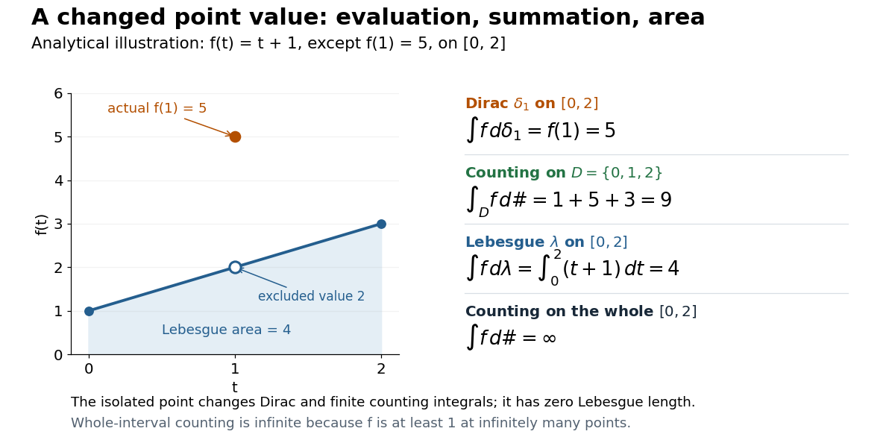
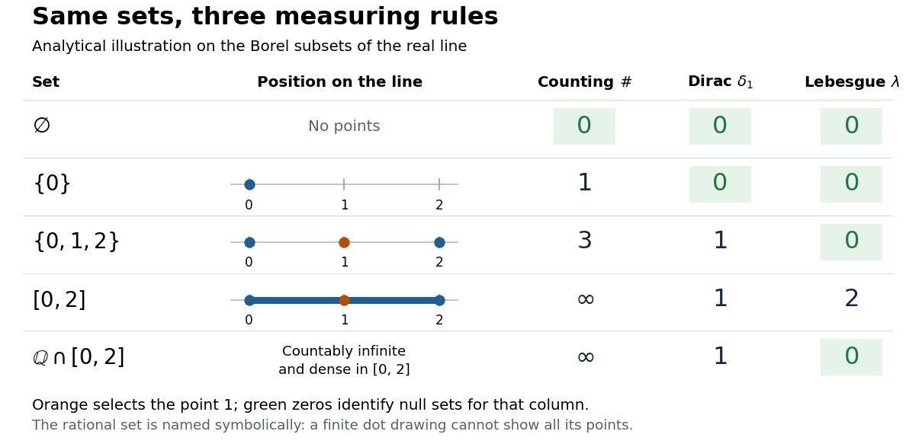

# Measure

↑ **Parent:** [Measure theory](measure-theory.md)  
ⓦ [Wiki](https://en.wikipedia.org/wiki/Measure)

On a [measurable space](measure-theory.md#measurable-space) $(X,\mathcal F)$, a measure is a [function](function.md) $\mu:\mathcal F\to[0,\infty]$ with $\mu(\varnothing)=0$ and [countable additivity](#countable-additivity): for pairwise disjoint [measurable sets](measure-theory.md#measurable-set) $A_n$,

$$
\mu\left(\bigcup_{n=1}^{\infty}A_n\right)=\sum_{n=1}^{\infty}\mu(A_n).
$$

Infinite size is permitted. Nonnegativity implies that if [measurable sets](measure-theory.md#measurable-set) satisfy $A\subseteq B$, then $\mu(A)\leq\mu(B)$: decompose $B$ into $A$ and $B\setminus A$. For overlapping [measurable sets](measure-theory.md#measurable-set), use [countable subadditivity](#countable-subadditivity-of-a-measure) rather than adding their full sizes twice.

For example, [counting measure](#counting-measure) gives $\mu(\{a,b,c\})=3$, while a [Dirac measure](#dirac-measure) $\delta_a$ gives that same [set](set.md) size $1$ if it contains $a$. Under [Lebesgue measure](measure-theory.md#lebesgue-measure), $[0,1/4]\cup[3/4,1]$ has size $1/4+1/4=1/2$. These are all [measures](measure.md), but they answer different questions: how many objects, whether a distinguished object is present, or how much length is occupied.

**Table of contents**

- [Inner regular measure](#inner-regular-measure)
- [p-adic measure](#p-adic-measure)
  - [Mahler expansion of continuous p-adic functions](#mahler-expansion-of-continuous-p-adic-functions)
  - [Amice transform](#amice-transform)
  - [Convolution of p-adic measures](#convolution-of-p-adic-measures)
- [Stieltjes transform of a measure](#stieltjes-transform-of-a-measure)
- [Outer regular measure](#outer-regular-measure)
- [Complex measure](#complex-measure)
- [Countable subadditivity of a measure](#countable-subadditivity-of-a-measure)
- [Complete measure](#complete-measure)
  - [Completion of a measure](#completion-of-a-measure)
- [Variation measure](#variation-measure)
  - [Total variation norm of a measure](#total-variation-norm-of-a-measure)
- [Signed measure](#signed-measure)
- [Dirac measure](#dirac-measure)
- [Atom (measure theory)](#atom-measure-theory)
  - [Non-atomic measure](#non-atomic-measure)
    - [Lyapunov convexity theorem](#lyapunov-convexity-theorem)
- [Counting measure](#counting-measure)
  - [Series as a Lebesgue integral against counting measure](#series-as-a-lebesgue-integral-against-counting-measure)
- [Premeasure](#premeasure)
  - [Cylinder premeasure from a positive functional](#cylinder-premeasure-from-a-positive-functional)
  - [Carathéodory's extension theorem](#caratheodory-s-extension-theorem)
- [Positive measure](#positive-measure)
- [Borel measure](#borel-measure)
  - [Support of a measure](#support-of-a-measure)
    - [Support under a continuous map](#support-under-a-continuous-map)
  - [Borel probability measure](#borel-probability-measure)
    - [Continuous approximation of Borel indicators on a compact metric space](#continuous-approximation-of-borel-indicators-on-a-compact-metric-space)
  - [Regular Borel measure](#regular-borel-measure)
  - [Radon measure](#radon-measure)
    - [Regularity of finite Borel measures on Euclidean space](#regularity-of-finite-borel-measures-on-euclidean-space)
- [Measure space](#measure-space)
- [Pushforward measure](#pushforward-measure)
  - [Probability pushforward embedding theorem](#probability-pushforward-embedding-theorem)
- [Change of measure](#change-of-measure)
  - [Density process](#density-process)
- [Haar measure](#haar-measure)
  - [Haar measure from a left-invariant coframe](#haar-measure-from-a-left-invariant-coframe)
  - [Haar measure from normalized covering functionals](#haar-measure-from-normalized-covering-functionals)
  - [Compact-group invariant probability by finite averaging](#compact-group-invariant-probability-by-finite-averaging)
  - [Haar integral](#haar-integral)
  - [Weyl integration formula for SU(2)](#weyl-integration-formula-for-su-2)
  - [Pauli-coordinate Haar measure on SU(2)](#pauli-coordinate-haar-measure-on-su-2)
  - [Minimal left covering net of a compact group](#minimal-left-covering-net-of-a-compact-group)
    - [Matching minimal covering nets of a compact group](#matching-minimal-covering-nets-of-a-compact-group)
- [Countable additivity](#countable-additivity)
  - [Continuity from below of a measure](#continuity-from-below-of-a-measure)
  - [Continuity from above of a measure](#continuity-from-above-of-a-measure)
- [Finite measure](#finite-measure)
  - [Finite-measure set](#finite-measure-set)
- [Sigma-finite measure](#sigma-finite-measure)

## Inner regular measure

↑ **Parent:** [Measure](measure.md)

A [measure](measure.md) is inner regular on its measurable sets if their measures are suprema of the measures of contained [compact sets](topology.md#compact-space). Every [Borel probability measure](#borel-probability-measure) on a [compact metric space](topological-analysis.md#compact-metric-space) is inner regular and has [outer regularity](#outer-regular-measure). Combining the two properties allows approximation of an [indicator function](measure-theory.md#indicator-function) by a [continuous function](calculus.md#continuous-function) in the $L^1$ norm.

## p-adic measure

↑ **Parent:** [Measure](measure.md)

For a [profinite group](topological-group.md#profinite-group) $G$ and a complete [discrete valuation ring](commutative-algebra.md#discrete-valuation-ring) $I$ with a continuous $\mathbb Z_p$-algebra structure, an $I$-valued measure is a bounded $I$-linear functional on continuous $I$-valued functions, with the [uniform norm](normed-vector-space.md#supremum-norm). Equivalently it assigns finitely additive values in $I$ to [clopen sets](topology.md#clopen-set). [Locally constant functions](calculus.md#locally-constant-function) are uniformly dense, so [integration](integral.md) extends uniquely from finite sums. [Countable additivity](#countable-additivity) in the usual real-measure sense is not imposed. The coefficient ring may have infinite [residue field](commutative-algebra.md#residue-field) and need not be compact.

### Mahler expansion of continuous p-adic functions

↑ **Parent:** [p-adic measure](#p-adic-measure)

Let $I$ be a complete [discrete valuation ring](commutative-algebra.md#discrete-valuation-ring) with a continuous $\mathbb Z_p$-algebra structure. Every [continuous function](calculus.md#continuous-function) on $\mathbb Z_p$ with values in $I$ has a unique uniformly convergent expansion in the [binomial polynomials](commutative-algebra.md#binomial-polynomial), with $a_n=\Delta^nf(0)$. This is the coefficient-ring version of the [Mahler theorem](non-archimedean-analysis.md#mahler-s-theorem). To see that $a_n\to0$, approximate the function modulo any power of the [maximal ideal](commutative-algebra.md#maximal-ideal) by a function of period $p^k$. In the expansion of $(E-1)^{p^k}$, all intermediate [binomial coefficients](binomial-coefficient.md) are divisible by $p$, while $(E^{p^k}-1)$ kills the periodic function. Iterating makes its differences vanish modulo the prescribed ideal power. [Finite differences](finite-difference.md) do not increase the [uniform norm](normed-vector-space.md#supremum-norm), so the same conclusion holds for the original function. [Binomial inversion](binomial-coefficient.md#binomial-inversion) gives agreement at the nonnegative [integers](integer.md), and their density in the [p-adic integers](number-theory.md#p-adic-integer) gives the expansion everywhere. This gives the dual description of [p-adic measures](#p-adic-measure) by arbitrary bounded sequences of binomial moments, and hence the [Amice transform](#amice-transform).

### Amice transform

↑ **Parent:** [p-adic measure](#p-adic-measure)

The coefficient of $T^n$ is $\int\binom{x}{n}\,d\mu(x)$. The [Mahler expansion of continuous p-adic functions](#mahler-expansion-of-continuous-p-adic-functions) identifies $I$-valued [p-adic measures](#p-adic-measure) on $\mathbb Z_p$ with $I[[T]]$. If $D=(1+T)d/dT$, then $D^k\mathcal A_\mu(0)=\int x^k\,d\mu(x)$. A measure supported on $\mathbb Z_p^\times$ has $\sum_{\zeta^p=1}\mathcal A_\mu(\zeta(1+T)-1)=0$, because the sum of $\zeta^x$ is zero for $p\nmid x$.

### Convolution of p-adic measures

↑ **Parent:** [p-adic measure](#p-adic-measure)

On a [profinite group](topological-group.md#profinite-group), convolution is first defined for functions on a finite quotient by summing products of the two measures' coset coefficients, then extended by uniform approximation. Finite-quotient associativity proves associativity. For an abelian [group](group.md) it is commutative; the Dirac measure at the identity is the identity element. Under the [measure realization of an Iwasawa algebra](associative-algebra.md#measure-realization-of-an-iwasawa-algebra), it becomes group-algebra multiplication.

## Stieltjes transform of a measure

↑ **Parent:** [Measure](measure.md)

For a finite positive [measure](measure.md) on the real line, this convention for its Stieltjes transform is analytic off the real line and has positive imaginary part in the upper half-plane if the measure is nonzero. Some sources use $(z-x)^{-1}$ instead, changing the sign. The transform of an [empirical spectral measure](probability-theory.md#empirical-spectral-measure) equals the normalized trace of the [Stieltjes matrix resolvent](functional-analysis.md#stieltjes-matrix-resolvent).

## Outer regular measure

↑ **Parent:** [Measure](measure.md)

A [measure](measure.md) on a topological space is outer regular on its measurable sets when the displayed open-cover identity holds. [Lebesgue measure](measure-theory.md#lebesgue-measure) has this property. It allows a null set to be placed in arbitrarily small open neighborhoods, and a compact small set to receive a smooth cutoff of similarly small integral.

## Complex measure

↑ **Parent:** [Measure](measure.md)  
ⓦ [Wiki](https://en.wikipedia.org/wiki/Complex_measure)

A complex measure is a countably additive complex-valued set function on a [sigma-algebra](measure-theory.md#sigma-algebra). Its [total variation norm of a measure](#total-variation-norm-of-a-measure) is obtained by taking the supremum of sums $\sum_j|\nu(E_j)|$ over finite measurable partitions. For finite variation and [absolute continuity of measures](measure-theory.md#absolute-continuity-of-measures) with respect to a sigma-finite positive measure, the [Radon-Nikodym theorem](measure-theory.md#radon-nikodym-theorem) supplies an integrable complex density.

## Countable subadditivity of a measure

↑ **Parent:** [Measure](measure.md)

For measurable [sets](set.md) $E_n$, a [measure](measure.md) satisfies

$$
\mu\left(\bigcup_{n\ge1}E_n\right)\le\sum_{n\ge1}\mu(E_n).
$$

Replace $E_n$ by the disjoint [sets](set.md) $E_n\setminus\bigcup_{j<n}E_j$, use [countable additivity](#countable-additivity), and then monotonicity. The same property is an axiom for an [outer measure](measure-theory.md#outer-measure) on arbitrary [sets](set.md).

## Complete measure

↑ **Parent:** [Measure](measure.md)  
ⓦ [Wiki](https://en.wikipedia.org/wiki/Complete_measure)

A [measure](measure.md) is complete when every [subset](set.md#subset) of each [null set](measure-theory.md#null-set) is a [measurable set](measure-theory.md#measurable-set). Such a subset also has measure zero by monotonicity. The [completion of a measure](#completion-of-a-measure) extends it to a complete measure by adjoining all subsets of measurable null sets to its [sigma-algebra](measure-theory.md#sigma-algebra).

### Completion of a measure

↑ **Parent:** [Complete measure](#complete-measure)

The completion of a measure space adjoins every [subset](set.md#subset) of every measurable [null set](measure-theory.md#null-set) to its [sigma-algebra](measure-theory.md#sigma-algebra). A statement that two events or σ-algebras agree modulo null sets becomes literal after passing to the corresponding measure-algebra completion.

## Variation measure

↑ **Parent:** [Measure](measure.md)

For a finite signed or complex [measure](measure.md) $\mu$, its variation is the positive [measure](measure.md)

$$
|\mu|(E)=\sup\left\{\sum_j|\mu(E_j)|:(E_j)\text{ is a finite measurable partition of }E\right\}.
$$

It controls integration by $|\int f\,d\mu|\leq\int|f|\,d|\mu|$.

### Total variation norm of a measure

↑ **Parent:** [Variation measure](#variation-measure)

The total variation norm of a finite signed or complex [measure](measure.md) is the total mass of its [variation measure](#variation-measure). Under the [Riesz-Markov-Kakutani representation theorem](functional-analysis.md#riesz-markov-kakutani-representation-theorem), it equals the norm of the corresponding member of $C(K)^*$.

## Signed measure

↑ **Parent:** [Measure](measure.md)  
ⓦ [Wiki](https://en.wikipedia.org/wiki/Signed_measure)

A signed measure is a countably additive real-valued set function, allowing negative values. A finite signed measure has a [variation measure](#variation-measure), whose total mass is its [total variation norm of a measure](#total-variation-norm-of-a-measure).

## Dirac measure

↑ **Parent:** [Measure](measure.md)  
ⓦ [Wiki](https://en.wikipedia.org/wiki/Dirac_measure)

On a [measurable space](measure-theory.md#measurable-space) $(X,\mathcal F)$, the [Dirac measure](#dirac-measure) at $x\in X$ assigns unit mass according to whether a [measurable set](measure-theory.md#measurable-set) contains that point:

$$
\delta_x(A)=\mathbf1_A(x)=\begin{cases}1,&x\in A,\\0,&x\notin A,\end{cases}\qquad A\in\mathcal F.
$$

Here $\mathbf1_A$ is the [indicator function](measure-theory.md#indicator-function). This is a [probability measure](probability-space.md#probability-measure), since $\delta_x(X)=1$. For pairwise disjoint [measurable sets](measure-theory.md#measurable-set) $A_n$, at most one contains $x$, so $\delta_x(\bigcup_nA_n)=\sum_n\delta_x(A_n)$: [countable additivity](#countable-additivity) reduces to a membership test. The definition works even when the [singleton](set.md#singleton-mathematics) $\{x\}$ is not a [measurable set](measure-theory.md#measurable-set). [Terence Tao, 245B notes 0, Example 7: Dirac measures](https://terrytao.wordpress.com/2009/01/01/245b-notes-0-a-quick-review-of-measure-and-integration-theory/)

To assert that its [support of a measure](#support-of-a-measure) is exactly $\{x\}$, assume that $X$ is a [metric space](topological-analysis.md#metric-space) and $\mathcal F$ is its [Borel sigma-algebra](measure-theory.md#borel-sigma-algebra). The [singleton](set.md#singleton-mathematics) $\{x\}$ is then a [closed set](topology.md#closed-set) and a [Borel set](measure-theory.md#borel-set), with $\delta_x(\{x\})=1$. Every open [neighbourhood](topology.md#neighbourhood-mathematics) of $x$ has mass one; every other point $y$ has an open [ball](topological-analysis.md#ball-mathematics) of radius less than its distance from $x$, with mass zero. Thus $\operatorname{supp}\delta_x=\{x\}$. An abstract [measurable space](measure-theory.md#measurable-space) has no specified [topology](topology.md), so this topological conclusion is not part of the bare definition. Indeed, on the [sigma-algebra](measure-theory.md#sigma-algebra) $\{\varnothing,X\}$, all [Dirac measures](#dirac-measure) coincide: the available [measurable sets](measure-theory.md#measurable-set) cannot distinguish points.

The [Lebesgue integral](measure-theory.md#lebesgue-integral) against a [Dirac measure](#dirac-measure) is evaluation:

$$
\int_X f\,d\delta_x=f(x).
$$

This holds for every nonnegative [measurable function](measure-theory.md#measurable-function), allowing an infinite value, and for real or complex [measurable functions](measure-theory.md#measurable-function) satisfying $|f(x)|<\infty$, which are precisely the [integrable functions](measure-theory.md#lebesgue-integrable-function) for $\delta_x$. For a nonnegative [simple function](measure-theory.md#simple-function), only the cell containing $x$ contributes to its [integral](integral.md); increasing [simple functions](measure-theory.md#simple-function) and the [monotone convergence theorem](measure-theory.md#monotone-convergence-theorem) extend the identity. Splitting into positive and negative parts, and then real and imaginary parts, gives the remaining cases. This is why a [Dirac measure](#dirac-measure) turns [integration](integral.md) into a point query.

For a [measurable function](measure-theory.md#measurable-function) $T:(X,\mathcal F)\to(Y,\mathcal G)$, its [pushforward measure](#pushforward-measure) satisfies

$$
(T_*\delta_x)(B)=\delta_x(T^{-1}(B))=\mathbf1_B(T(x)),\qquad T_*\delta_x=\delta_{T(x)}.
$$

Consequently $\int_Y g\,d(T_*\delta_x)=g(T(x))$ for nonnegative or integrable [measurable functions](measure-theory.md#measurable-function) $g$. For example, on the [real numbers](arithmetic.md#real-number) with their [Borel sigma-algebra](measure-theory.md#borel-sigma-algebra), $T(t)=2t+1$ sends $\delta_1$ to $\delta_3$, so integrating $g(y)=y^2$ against that [pushforward measure](#pushforward-measure) gives $9$. [Terence Tao, 245B notes 0, Example 10 and Theorem 2(8): pushforward and change of variables](https://terrytao.wordpress.com/2009/01/01/245b-notes-0-a-quick-review-of-measure-and-integration-theory/)

Finite weighted sums of [Dirac measures](#dirac-measure) give useful [measures](measure.md) with finitely many point masses. For finite nonnegative weights $w_j$,

$$
\mu=\sum_{j=1}^m w_j\delta_{x_j},\qquad\mu(A)=\sum_{j=1}^m w_j\mathbf1_A(x_j),\qquad\int f\,d\mu=\sum_{j=1}^m w_jf(x_j)
$$

for nonnegative [measurable functions](measure-theory.md#measurable-function) $f$, or whenever $\sum_jw_j|f(x_j)|<\infty$, with zero-weight terms omitted. Repeated locations have their weights added. On the [real numbers](arithmetic.md#real-number), this is the finite version of the [measure](measure.md) underlying the [left-continuous cumulative function of an atomic measure](calculus.md#left-continuous-cumulative-function-of-an-atomic-measure); a positive-weight [singleton](set.md#singleton-mathematics) is an [atom of a measure](#atom-measure-theory). Unit weights at the distinct points of a [finite set](set.md#finite-set) recover [counting measure](#counting-measure) on that [set](set.md). [Terence Tao, 245A notes 3, Exercises 21 and 25: representation by weighted Dirac measures](https://terrytao.wordpress.com/2010/09/25/245a-notes-3-integration-on-abstract-measure-spaces-and-the-convergence-theorems/)

The same [function](function.md) can have sharply different [integrals](integral.md) for different [measures](measure.md). On $[0,2]$ with its [Borel sigma-algebra](measure-theory.md#borel-sigma-algebra), define

$$
f(t)=\begin{cases}5,&t=1,\\t+1,&t\ne1.\end{cases}\qquad\int_{[0,2]}f\,d\delta_1=5,\qquad\int_{[0,2]}f\,d\lambda=4,\qquad\int_{[0,2]}f\,d\#=\infty.
$$

Here $\lambda$ is [Lebesgue measure](measure-theory.md#lebesgue-measure) and $\#$ is [counting measure](#counting-measure). The [singleton](set.md#singleton-mathematics) $\{1\}$ is a [Lebesgue null set](measure-theory.md#lebesgue-null-set), so its changed value leaves the [Lebesgue integral](measure-theory.md#lebesgue-integral) equal to $\int_0^2(t+1)\,dt=4$. For [counting measure](#counting-measure) on the whole [interval](real-analysis.md#interval-mathematics), $f\geq1$ on an [infinite set](set.md#infinite-set), forcing an infinite [integral](integral.md). On the smaller [measure space](#measure-space) $D=\{0,1,2\}$ with its [power set](set.md#power-set) and [counting measure](#counting-measure), the restricted [function](function.md) instead has [integral](integral.md) $1+5+3=9$.

**[Figure 1](#image-an-isolated-value-contributes-differently-to-dirac-measure-counting-measure-and-lebesgue-measure). An isolated value contributes differently to Dirac measure, counting measure, and Lebesgue measure**. Original analytical illustration of the specified [function](function.md), with an open circle at the excluded value $2$ and a filled point at the actual value $f(1)=5$. The finite sum uses $D=\{0,1,2\}$; the other three [integrals](integral.md) use the same ambient [interval](real-analysis.md#interval-mathematics) $[0,2]$. The drawn area is the [Lebesgue integral](measure-theory.md#lebesgue-integral), and no density curve is assigned to the [Dirac measure](#dirac-measure).

This also explains the [almost everywhere](measure-theory.md#almost-everywhere) convention in [Lp spaces](measure-theory.md#lp-space): equality [almost everywhere](measure-theory.md#almost-everywhere) for $\delta_x$ requires equality at $x$, whereas equality [almost everywhere](measure-theory.md#almost-everywhere) for [Lebesgue measure](measure-theory.md#lebesgue-measure) allows different values at that [singleton](set.md#singleton-mathematics). A point value therefore cannot be read unambiguously from an equivalence class in an [Lp space](measure-theory.md#lp-space) formed using [Lebesgue measure](measure-theory.md#lebesgue-measure).

On the [real numbers](arithmetic.md#real-number), a [Dirac measure](#dirac-measure) gives the [Dirac delta distribution](distribution-theory.md#dirac-delta-function) by $\langle\delta_x,\varphi\rangle=\int\varphi\,d\delta_x=\varphi(x)$ for every [test function](distribution-theory.md#test-function). The name [Dirac delta function](distribution-theory.md#dirac-delta-function) does not mean an ordinary [function](function.md) that is zero away from $x$ and infinitely high at $x$. Such a nonnegative [measurable function](measure-theory.md#measurable-function) still has [Lebesgue integral](measure-theory.md#lebesgue-integral) zero, because its nonzero values occur on a [Lebesgue null set](measure-theory.md#lebesgue-null-set). More generally, no nonnegative density $h$ with respect to [Lebesgue measure](measure-theory.md#lebesgue-measure) can represent $\delta_x$: it would give $\delta_x(\{x\})=\int_{\{x\}}h\,d\lambda=0$, contradicting unit mass. The [measure](measure.md) and its associated [distribution](distribution-theory.md#distribution-mathematical-analysis) act on different kinds of inputs, namely [measurable sets](measure-theory.md#measurable-set) and [test functions](distribution-theory.md#test-function), but express the same point evaluation. [Terence Tao, 245C notes 3: Radon measures, test functions, and the Dirac delta distribution](https://terrytao.wordpress.com/2009/04/19/245c-notes-3-distributions/)

## Atom (measure theory)

↑ **Parent:** [Measure](measure.md)  
ⓦ [Wiki](https://en.wikipedia.org/wiki/Atom_(measure_theory))

An atom of a [measure](measure.md) $\mu$ is a measurable set $A$ of positive measure for which every measurable $B\subseteq A$ has either $\mu(B)=0$ or $\mu(B)=\mu(A)$. A singleton of positive mass is an example. A [transport map](mathematical-optimization.md#transport-map) cannot split the mass of a singleton among several destinations.

### Non-atomic measure

↑ **Parent:** [Atom (measure theory)](#atom-measure-theory)

A non-atomic [measure](measure.md) contains no [atom of a measure](#atom-measure-theory). For a finite [Borel measure](#borel-measure) on a [Polish space](topological-analysis.md#polish-space), this is equivalent to giving every singleton mass zero. For a [probability measure](probability-space.md#probability-measure) on $\mathbb R$, it is also equivalent to continuity of its [cumulative distribution function](probability-distribution.md#cumulative-distribution-function).

#### Lyapunov convexity theorem

↑ **Parent:** [Non-atomic measure](#non-atomic-measure)

The range of a finite-dimensional, finite, countably additive, atomless vector measure is [compact](topology.md#compact-space) and [convex](real-analysis.md#convex-function). In particular, an [atomless measure](#non-atomic-measure) restricted to a measurable set $E$ can realize every mass between zero and $\mu(E)$. This allows exact balancing by small disjoint consumer cohorts in an [exchange economy](mathematics.md#exchange-economy).

## Counting measure

↑ **Parent:** [Measure](measure.md)  
ⓦ [Wiki](https://en.wikipedia.org/wiki/Counting_measure)

[Counting measure](#counting-measure) makes [integration](integral.md) into [summation](arithmetic.md#summation) by giving every measurable [singleton](set.md#singleton-mathematics) unit weight. On any [measurable space](measure-theory.md#measurable-space) $(X,\mathcal F)$, it is the [measure](measure.md) $\#$ defined by

$$
\#(A)=\begin{cases}|A|,&A\text{ is finite},\\\infty,&A\text{ is infinite},\end{cases}\qquad A\in\mathcal F.
$$

Thus $\#(\varnothing)=0$, a [finite set](set.md#finite-set) has its usual [cardinality](cardinal-number.md#cardinality), and every [infinite set](set.md#infinite-set) has the same value $\infty$ in the [extended real number line](arithmetic.md#extended-real-number-line). In particular, [countably infinite sets](cardinal-number.md#countably-infinite-set) and [uncountable sets](cardinal-number.md#uncountable-set) are not distinguished by their [counting measure](#counting-measure). Taking $\mathcal F$ to be the [power set](set.md#power-set) makes every [subset](set.md#subset) measurable; restricting the same rule to a smaller [sigma-algebra](measure-theory.md#sigma-algebra) is also allowed. [John K. Hunter, Measure Theory, Example 1.11: counting measure](https://www.math.ucdavis.edu/~hunter/measure_theory/measure_notes_ch1.pdf)

Why is this a [countably additive](#countable-additivity) [measure](measure.md)? For pairwise disjoint [measurable sets](measure-theory.md#measurable-set) $A_n$,

$$
\#\left(\bigcup_{n=1}^{\infty}A_n\right)=\sum_{n=1}^{\infty}\#(A_n).
$$

If the [union](set.md#set-union) is finite, only finitely many $A_n$ are nonempty, and finite [cardinality](cardinal-number.md#cardinality) adds. If the [union](set.md#set-union) is infinite, either one $A_n$ is infinite or infinitely many $A_n$ are nonempty; in both cases the nonnegative [series](sequence-and-series.md#series-mathematics) on the right is infinite. For example, $\{0,2\}$ and $\{1\}$ have [counting measures](#counting-measure) $2$ and $1$, and their [union](set.md#set-union) has [counting measure](#counting-measure) $3$. The [singletons](set.md#singleton-mathematics) $\{n\}$ for positive [natural numbers](arithmetic.md#natural-number) give the infinite case: $\#(\mathbb N)=\sum_{n=1}^{\infty}1=\infty$.

With the [power set](set.md#power-set) as [sigma-algebra](measure-theory.md#sigma-algebra), [counting measure](#counting-measure) is a [finite measure](#finite-measure) exactly when $X$ is finite, and a [sigma-finite measure](#sigma-finite-measure) exactly when $X$ is at most [countable](cardinal-number.md#countable-set). For the latter assertion, enumerate $X$ by measurable [singletons](set.md#singleton-mathematics); conversely, every finite-measure [set](set.md) is finite, and a [countable union](set.md#countable-union) of [finite sets](set.md#finite-set) is [countable](cardinal-number.md#countable-set). Specifying the [sigma-algebra](measure-theory.md#sigma-algebra) matters: if $X=\mathbb N$ and $\mathcal F=\{\varnothing,\mathbb N\}$, [counting measure](#counting-measure) is not a [sigma-finite measure](#sigma-finite-measure), since the only measurable finite-measure [set](set.md) is the [empty set](set.md#empty-set).

For a finite or [countably infinite set](cardinal-number.md#countably-infinite-set) $X$ equipped with its [power set](set.md#power-set), every nonnegative [function](function.md) is a [measurable function](measure-theory.md#measurable-function), and

$$
\int_X f\,d\#=\sum_{x\in X}f(x):=\sup_{F\subseteq X\text{ finite}}\sum_{x\in F}f(x).
$$

The [supremum](real-analysis.md#supremum) allows an infinite result and avoids choosing an order for the terms. On a [finite set](set.md#finite-set), expand $f$ as a [simple function](measure-theory.md#simple-function) using [singleton](set.md#singleton-mathematics) [indicator functions](measure-theory.md#indicator-function). On a [countably infinite set](cardinal-number.md#countably-infinite-set), enumerate the points and apply the [monotone convergence theorem](measure-theory.md#monotone-convergence-theorem) to finite truncations. Real or complex [functions](function.md) are [integrable functions](measure-theory.md#lebesgue-integrable-function) for [counting measure](#counting-measure) exactly when $\sum_{x\in X}|f(x)|<\infty$; then their [integral](integral.md) equals the absolutely convergent sum. This is the discrete counterpart of [Lebesgue integration](integral.md#lebesgue-integration), developed further in [series as a Lebesgue integral against counting measure](#series-as-a-lebesgue-integral-against-counting-measure). [John K. Hunter, Measure Theory, Example 4.10: absolutely convergent series as integrals](https://www.math.ucdavis.edu/~hunter/measure_theory/measure_notes_ch4.pdf)

For example, $f(n)=2^{-n}$ on the positive [natural numbers](arithmetic.md#natural-number) has [counting measure](#counting-measure) [integral](integral.md) one, by the [geometric series](sequence-and-series.md#geometric-series). The [alternating harmonic series](sequence-and-series.md#alternating-harmonic-series) has a finite ordered sum but is not the [integral](integral.md) of an [integrable function](measure-theory.md#lebesgue-integrable-function) for [counting measure](#counting-measure): its positive and negative parts both have infinite sums. [Absolute convergence](sequence-and-series.md#absolute-convergence) is what makes the finite [integral](integral.md) independent of enumeration. In particular, the [Lp spaces](measure-theory.md#lp-space) for [counting measure](#counting-measure) on $\mathbb N$ are the [l-p sequence spaces](banach-space.md#l-p-sequence-space), with their sums replacing continuous [integrals](integral.md).

Compare three [measures](measure.md) on the same [Borel sigma-algebra](measure-theory.md#borel-sigma-algebra) of the [real numbers](arithmetic.md#real-number): [counting measure](#counting-measure) $\#$, [Dirac measure](#dirac-measure) $\delta_1$, and [Lebesgue measure](measure-theory.md#lebesgue-measure) $\lambda$.

$$
\begin{array}{c|ccc}
A&\#(A)&\delta_1(A)&\lambda(A)\\\hline
\varnothing&0&0&0\\
\{0\}&1&0&0\\
\{0,1,2\}&3&1&0\\
[0,2]&\infty&1&2\\
\mathbb Q\cap[0,2]&\infty&1&0
\end{array}
$$

The [rational numbers](number-theory.md#rational-number) in the last row form a [countably infinite set](cardinal-number.md#countably-infinite-set); their [Lebesgue measure](measure-theory.md#lebesgue-measure) is zero by [countable additivity](#countable-additivity) applied to [singletons](set.md#singleton-mathematics), even though they are [dense](topology.md#dense-set) in the [interval](real-analysis.md#interval-mathematics).

**[Figure 2](#image-the-same-borel-sets-have-different-sizes-under-counting-measure-dirac-measure-and-lebesgue-measure). The same Borel sets have different sizes under counting measure, Dirac measure, and Lebesgue measure**. Original analytical comparison on the [real numbers](arithmetic.md#real-number), with the selected point $1$ marked in orange. Drawings show the finite [sets](set.md) and the [interval](real-analysis.md#interval-mathematics); the [rational numbers](number-theory.md#rational-number) are named symbolically because finitely many plotted points cannot depict that infinite dense [set](set.md). Green zero entries mark the [null sets](measure-theory.md#null-set) for each column's [measure](measure.md).

These are different answers to different questions: [counting measure](#counting-measure) asks how many points occur, [Dirac measure](#dirac-measure) asks whether the selected point occurs, and [Lebesgue measure](measure-theory.md#lebesgue-measure) asks how much [length](physics.md#length) occurs. A [null set](measure-theory.md#null-set) therefore depends on its [measure](measure.md). For [counting measure](#counting-measure), the only [null set](measure-theory.md#null-set) is the [empty set](set.md#empty-set), so equality [almost everywhere](measure-theory.md#almost-everywhere) is equality everywhere. For $\delta_1$, a [measurable set](measure-theory.md#measurable-set) is a [null set](measure-theory.md#null-set) exactly when it misses $1$; for [Lebesgue measure](measure-theory.md#lebesgue-measure), even the [infinite set](set.md#infinite-set) $\mathbb Q\cap[0,2]$ is a [null set](measure-theory.md#null-set). Integrating an [indicator function](measure-theory.md#indicator-function) recovers each table entry through $\int\mathbf1_A\,d\mu=\mu(A)$. This lets the same [Lebesgue integral](measure-theory.md#lebesgue-integral) framework handle point counts, point evaluation, and geometric [length](physics.md#length).

### Series as a Lebesgue integral against counting measure

↑ **Parent:** [Counting measure](#counting-measure)

For $f:\mathbb N\to[0,\infty]$,

$$
\int_{\mathbb N}f\,d\#
=\sum_{n=1}^{\infty}f(n)
:=\sup_{F\subseteq\mathbb N\text{ finite}}\sum_{n\in F}f(n).
$$

A complex-valued function is integrable for counting measure exactly when its series is absolutely convergent.

## Premeasure

↑ **Parent:** [Measure](measure.md)  
ⓦ [Wiki](https://en.wikipedia.org/wiki/Premeasure)

A premeasure is a countably additive nonnegative set function on an algebra of sets, with countable additivity required whenever the union remains in that algebra.

### Cylinder premeasure from a positive functional

↑ **Parent:** [Premeasure](#premeasure)

A normalized [positive linear functional](continuous-dual-space.md#positive-linear-functional) on $C(\Omega)$ for [Cantor space](geometry-and-topology.md#cantor-space) gives a finitely additive set function on the algebra of [clopen sets](topology.md#clopen-set). If a countable disjoint union of such sets is itself clopen, [compactness](topology.md#compact-space) gives a finite subcover; all other terms are empty. Finite additivity therefore gives the required [countable additivity](#countable-additivity), making $\ell$ a [premeasure](#premeasure). The [Caratheodory extension theorem](#caratheodory-s-extension-theorem) produces a unique [Borel probability measure](#borel-probability-measure).

<h3 id="caratheodory-s-extension-theorem">Carathéodory's extension theorem</h3>

↑ **Parent:** [Premeasure](#premeasure)  
ⓦ [Wiki](https://en.wikipedia.org/wiki/Carathéodory's_extension_theorem)

A premeasure on an algebra of sets extends to a measure on the generated [sigma-algebra](measure-theory.md#sigma-algebra). The extension is unique when the premeasure is [sigma-finite](#sigma-finite-measure).

## Positive measure

↑ **Parent:** [Measure](measure.md)

A positive measure takes values in $[0,\infty]$, in contrast with signed and complex measures.

## Borel measure

↑ **Parent:** [Measure](measure.md)  
ⓦ [Wiki](https://en.wikipedia.org/wiki/Borel_measure)

A Borel measure on a [topological space](topology.md#topological-space) is a [measure](measure.md) defined on the [sigma-algebra](measure-theory.md#sigma-algebra) generated by the [open sets](topology.md#open-set), equivalently on the [Borel sets](measure-theory.md#borel-set).

### Support of a measure

↑ **Parent:** [Borel measure](#borel-measure)

For a positive Borel measure on a topological space, the support consists of the points whose every open neighborhood has positive measure. For a finite regular [complex measure](#complex-measure) use its [variation measure](#variation-measure). Regularity makes the complement of the support null: compact subsets of that open complement have finite covers by null neighborhoods. A regular probability measure on a compact Hausdorff space whose support is a single point is therefore a [Dirac measure](#dirac-measure).

#### Support under a continuous map

↑ **Parent:** [Support of a measure](#support-of-a-measure)

For a [Borel probability measure](#borel-probability-measure) on a [Polish space](topological-analysis.md#polish-space) and a continuous map to another Polish space, the image measure has the displayed support. Every neighborhood of an image of a support point has an open inverse image of positive measure. Conversely, the closed image closure has full image measure because the original support has full measure. This transfers a support description for a driving [rough path](analysis.md#rough-path) to the solution of a [rough differential equation](analysis.md#rough-differential-equation).

### Borel probability measure

↑ **Parent:** [Borel measure](#borel-measure)

A Borel probability measure is a [Borel measure](#borel-measure) with total mass one. On a compact [metric space](topological-analysis.md#metric-space) it is determined by its integrals against continuous functions. On that compact [metric space](topological-analysis.md#metric-space), the family of [Borel probability measures](#borel-probability-measure) is compact for [weak convergence of probability measures](convergence-of-random-variables.md#weak-convergence-of-probability-measures).

#### Continuous approximation of Borel indicators on a compact metric space

↑ **Parent:** [Borel probability measure](#borel-probability-measure)

For a [Borel probability measure](#borel-probability-measure) on a [compact metric space](topological-analysis.md#compact-metric-space), [inner regularity](#inner-regular-measure) and [outer regularity](#outer-regular-measure) give $K\subseteq B\subseteq U$ with $K$ compact, $U$ open and $\mu(U\setminus K)<\epsilon$. The [Urysohn lemma](topology.md#urysohn-s-lemma) supplies a [continuous function](calculus.md#continuous-function) $\varphi$ equal to one on $K$ and zero outside $U$, with values in $[0,1]$. Its difference from the [indicator function](measure-theory.md#indicator-function) of $B$ is supported in $U\setminus K$ and bounded by one, proving the displayed estimate. This transfers identities established for continuous test functions to measurable sets.

### Regular Borel measure

↑ **Parent:** [Borel measure](#borel-measure)

A finite positive [Borel measure](#borel-measure) on a [compact Hausdorff space](topology.md#compact-hausdorff-space) is regular when its values on Borel sets can be approximated from inside by compact sets and from outside by open sets. For signed or complex measures require this property of the [variation measure](#variation-measure). These are the measures representing the [continuous dual space](continuous-dual-space.md) of $C(K)$ in the [Riesz-Markov-Kakutani representation theorem](functional-analysis.md#riesz-markov-kakutani-representation-theorem).

### Radon measure

↑ **Parent:** [Borel measure](#borel-measure)  
ⓦ [Wiki](https://en.wikipedia.org/wiki/Radon_measure)

A Radon measure is a Borel measure that is finite on compact sets and is inner regular, so the measure of a Borel set can be approximated from below by compact subsets. On a locally compact Hausdorff space one also usually includes outer regularity.

#### Regularity of finite Borel measures on Euclidean space

↑ **Parent:** [Radon measure](#radon-measure)

Every finite positive [Borel measure](#borel-measure) on Euclidean space is inner regular by [compact sets](topology.md#compact-space) and outer regular by open sets. For an [open set](topology.md#open-set) $U$, the [compact sets](topology.md#compact-space) $\{x:|x|\le n,\ \operatorname{dist}(x,U^c)\ge1/n\}$ increase to $U$, so [continuity from below of a measure](#continuity-from-below-of-a-measure) gives inner approximation. The empty complement is handled by compact balls. The class of Borel sets admitting both approximations is closed under complements: interchange inner and outer approximations, then truncate the inner closed set by a large compact ball, using finiteness of the [measure](measure.md). For a countable union, approximate its components from outside with summable errors, and approximate finitely many components from inside after making the remaining union's [measure](measure.md) small. Thus this class is a [sigma-algebra](measure-theory.md#sigma-algebra) containing the open sets. In particular, a finite [measure](measure.md) carried by a Borel [null set](measure-theory.md#null-set) has [compact subsets](topology.md#compact-space) of that carrier capturing arbitrarily nearly all its mass.

## Measure space

↑ **Parent:** [Measure](measure.md)  
ⓦ [Wiki](https://en.wikipedia.org/wiki/Measure_space)

A measure space is a [set](set.md) $X$, a [sigma-algebra](measure-theory.md#sigma-algebra) $\mathcal M$ of its [subsets](set.md#subset), and a [measure](measure.md) $\mu$ defined on $\mathcal M$. Specifying only $X$ leaves both the measurable questions and their weights undetermined.

For a concrete [probability space](probability-space.md), take $X=\{a,b,c\}$, $\mathcal M$ its [power set](set.md#power-set), and weights $1/2,1/3,1/6$. Define $\mu(A)$ by adding the weights of the elements in $A$. Then

$$
\mu(X)=\frac12+\frac13+\frac16=1,\qquad
\mu(\{b,c\})=\frac12.
$$

A [probability measure](probability-space.md#probability-measure) is exactly a [measure](measure.md) normalized by $\mu(X)=1$, usually written $\mathbb P(\Omega)=1$. An [indicator function](measure-theory.md#indicator-function) has [expected value](expected-value.md) equal to its [event](probability-space.md#event)'s [probability](probability-theory.md#probability). For a different continuous example, $[0,1]$ with the restricted [Lebesgue measure](measure-theory.md#lebesgue-measure) is a [probability space](probability-space.md); the [event](probability-space.md#event) $[0,1/4]$ has [probability](probability-theory.md#probability) $1/4$.

## Pushforward measure

↑ **Parent:** [Measure](measure.md)  
ⓦ [Wiki](https://en.wikipedia.org/wiki/Pushforward_measure)

For a measurable map $f:X\to Y$, the pushforward of $\mu$ is the measure

$$
(f_*\mu)(B)=\mu(f^{-1}(B)).
$$

It is the distribution induced on $Y$ by mapping points distributed according to $\mu$ through $f$.

### Probability pushforward embedding theorem

↑ **Parent:** [Pushforward measure](#pushforward-measure)

A homeomorphic embedding of a [metric](topological-analysis.md#metric) space induces a homeomorphic embedding of its [probability measures](probability-space.md#probability-measure) for their weak topologies. The inverse continuity follows from the open-set [Portmanteau theorem](convergence-of-random-variables.md#portmanteau-theorem), since every relatively [open set](topology.md#open-set) is the trace of an ambient [open set](topology.md#open-set). This does not give surjectivity onto $P(Z)$ when points of $Z$ are outside the embedded image.

## Change of measure

↑ **Parent:** [Measure](measure.md)  
ⓦ [Wiki](https://en.wikipedia.org/wiki/Change_of_measure)

If a measure $\nu$ has density $w=d\nu/d\mu$ with respect to $\mu$, then

$$
\int g\,d\nu=\int gw\,d\mu.
$$

This identity is the basis of likelihood ratios and [importance sampling](monte-carlo-method.md#importance-sampling).

### Density process

↑ **Parent:** [Change of measure](#change-of-measure)

For a [Radon-Nikodym derivative](measure-theory.md#radon-nikodym-derivative) $L_T\geq0$ with $\mathbb EL_T=1$, its conditional-expectation process is a nonnegative [martingale](martingale.md). If $L_T>0$ [almost surely](convergence-of-random-variables.md#almost-sure-convergence), it defines an [equivalent probability measure](measure-theory.md#equivalent-probability-measure). A [stochastic exponential](stochastic-calculus.md#doleans-dade-exponential) satisfying the [Novikov condition](stochastic-calculus.md#novikov-s-condition) is a common positive density process.

## Haar measure

↑ **Parent:** [Measure](measure.md)  
ⓦ [Wiki](https://en.wikipedia.org/wiki/Haar_measure)

A left [Haar measure](#haar-measure) on a [locally compact group](topological-group.md#locally-compact-group) that is a [Hausdorff space](topology.md#hausdorff-space) is a nonzero regular [Borel measure](#borel-measure), finite on [compact sets](topology.md#compact-space), satisfying $\mu(gA)=\mu(A)$ for every [Borel set](measure-theory.md#borel-set) $A$. Such a [measure](measure.md) exists and is unique up to a positive scalar. Right [Haar measure](#haar-measure) instead satisfies $\mu(Ag)=\mu(A)$; the two need not coincide. On a [compact group](topological-group.md#compact-group), normalization gives total mass one and invariance on both sides. See [Tornier, Haar Measures, Definition 2.1 and Theorem 2.2](https://arxiv.org/html/2006.10956v1#S2).

For a [finite group](group.md#finite-group), normalized [Haar measure](#haar-measure) is uniform counting; for the [circle group](lie-theory.md#circle-group), it is [normalized angle integration on the circle](topological-group.md#normalized-angle-integration-on-the-circle). These examples turn symmetry into a rule for averaging.

### Haar measure from a left-invariant coframe

↑ **Parent:** [Haar measure](#haar-measure)

On a $d$-dimensional [Lie group](lie-theory.md#lie-group), take the [coframe](vector-bundle.md#coframe) dual to a basis of [left-invariant vector fields](lie-theory.md#left-invariant-vector-field). Its top wedge is nonvanishing and invariant under left translations, so its absolute density defines a left [Haar measure](#haar-measure). If the frame has coordinate matrix $A(x)$, the density is $|\det A(x)|^{-1}dx^1\cdots dx^d$. This makes explicit computation of Haar measure a determinant calculation.

### Haar measure from normalized covering functionals

↑ **Parent:** [Haar measure](#haar-measure)

For nonzero nonnegative $u,h\in C_c(G)$, let $(f:u)$ be the infimum of $\sum_j a_j$ over finite dominations $f\leq\sum_j a_j u(x_j^{-1}\,\cdot)$ with $a_j>0$. Composition of covers gives $(f:u)\leq(f:h)(h:u)$, so $I_u(f)$ is uniformly bounded while $I_u(h)=1$. It is invariant under left translation, homogeneous, monotone and subadditive. As the support of $u$ shrinks to the identity, its additivity defect tends to zero: use the continuous proportions $f_i/(f_1+f_2+\delta p)$, with a cutoff $p$ positive on both supports, whose oscillations are small on every translate of that small support. In a locally compact sigma-compact metrizable group, diagonal convergence on a countable dense family, followed by uniform approximation on fixed compact supports, gives a positive invariant linear functional on all $C_c(G)$. The [Riesz representation on compactly supported continuous functions](functional-analysis.md#riesz-representation-on-compactly-supported-continuous-functions) turns it into [Haar measure](#haar-measure). Local compactness is essential for the compactly supported cutoffs and small-support test functions.

### Compact-group invariant probability by finite averaging

↑ **Parent:** [Haar measure](#haar-measure)

For a [compact group](topological-group.md#compact-group) $G$, positive normalized [linear functionals](dual-space.md#linear-functional) on $C(G)$ form a nonempty [weak-star topology](weak-topology.md#weak-star-topology) compact convex set. For finitely many translations, apply the [Schauder-Tychonoff fixed-point theorem](analysis.md#schauder-tychonoff-fixed-point-theorem) to the average of their induced affine dual maps. A fixed functional is stationary under this average. For each real continuous $f$, its orbit function $h(g)=\phi(l_gf)$ is continuous on the compact subgroup generated by those translations and satisfies a finite averaging identity. At a maximum, every summand must attain that same maximum; iteration and density of the positive-word semigroup force $h$ to be constant. Thus the functional is fixed by each of the finitely many translations. Compactness and the [finite intersection property](topology.md#finite-intersection-property) now give a functional invariant under every translation. The [Riesz-Markov-Kakutani representation theorem](functional-analysis.md#riesz-markov-kakutani-representation-theorem) turns it into a normalized [Haar measure](#haar-measure), without assuming commutativity of the group.

### Haar integral

↑ **Parent:** [Haar measure](#haar-measure)

A Haar integral integrates a function against [Haar measure](#haar-measure). On a compact [group](group.md), normalizing the measure to total mass one makes it an averaging operation. Translation invariance then implies that the average of a nontrivial continuous unitary character is zero: translating the integral multiplies it by a character value different from one.

<h3 id="weyl-integration-formula-for-su-2">Weyl integration formula for SU(2)</h3>

↑ **Parent:** [Haar measure](#haar-measure)

For a [class function](representation-theory.md#class-function) on [SU(2)](topological-group.md#su-2-group) and normalized [Haar measure](#haar-measure), the displayed formula reduces a group integral to its conjugacy-class angle. The weight follows by identifying [SU(2)](topological-group.md#su-2-group) with the unit sphere in four real dimensions: writing a unit quaternion as $\cos\theta+\mathbf n\sin\theta$ gives spherical volume proportional to $\sin^2\theta\,d\theta\,d\mathbf n$. Since $\int_0^\pi\sin^2\theta\,d\theta=\pi/2$, normalization gives $2/\pi$.

<h3 id="pauli-coordinate-haar-measure-on-su-2">Pauli-coordinate Haar measure on SU(2)</h3>

↑ **Parent:** [Haar measure](#haar-measure)

The hemisphere graph $u_0=\pm\sqrt{1-|\mathbf u|^2}$ of [SU(2) as the three-sphere](topological-group.md#su-2-as-the-three-sphere) has induced metric $g_{ij}=\delta_{ij}+u_iu_j/u_0^2$, whose [determinant](multilinear-algebra.md#determinant) is $1/u_0^2$. Its volume density is therefore $d^3u/|u_0|$. Fixed left or right multiplication preserves the Euclidean norm on the four Pauli coefficients, so the round volume is [Haar measure](#haar-measure). Both hemispheres have volume $\pi^2$, giving total volume $2\pi^2$ and normalized density $d^3u/(2\pi^2|u_0|)$ on each hemisphere. The apparent equatorial divergence is an integrable coordinate singularity.

### Minimal left covering net of a compact group

↑ **Parent:** [Haar measure](#haar-measure)

For an open identity neighbourhood $V$ in a compact [topological group](topological-group.md), a finite left covering net is a finite set $F$ such that the left translates $fV$, $f\in F$, cover the group. Compactness gives such finite sets; minimum cardinality gives a minimal one. Left translation preserves minimality because $G=FV$ implies $G=gFV$.

#### Matching minimal covering nets of a compact group

↑ **Parent:** [Minimal left covering net of a compact group](#minimal-left-covering-net-of-a-compact-group)

Two minimal left covering nets for the same identity neighbourhood $V$ can be matched bijectively so that paired translates intersect. Join $f\in F$ to $f'\in F'$ when $fV\cap f'V\ne\varnothing$. For $S\subseteq F$, its neighbours $N(S)$ cover every point covered by $S$, so $(F\setminus S)\cup N(S)$ still covers the group. Minimality forces $|N(S)|\geq|S|$. [Hall's marriage theorem](matching-graph-theory.md#hall-s-marriage-theorem) supplies the matching, and an intersection $fv=f'v'$ gives $f^{-1}f'=vv'^{-1}\in VV^{-1}$. Averaging a continuous function over matched nets therefore gives values differing by at most its uniform oscillation on right displacements in $VV^{-1}$. This is the finite combinatorial step in constructing [Haar measure](#haar-measure) on a compact group.

## Countable additivity

↑ **Parent:** [Measure](measure.md)

For pairwise disjoint [measurable sets](measure-theory.md#measurable-set) $E_n$, countable additivity means

$$
\mu\!\left(\bigcup_{n=1}^{\infty}E_n\right)
=\sum_{n=1}^{\infty}\mu(E_n).
$$

The infinite [series](sequence-and-series.md#series-mathematics) is the [limit](calculus.md#limit-of-a-function) of its nonnegative partial sums. This controls an entire [countable union](set.md#countable-union), not merely each finite stage. If $q_1,q_2,\ldots$ enumerate the [rational numbers](number-theory.md#rational-number) in $[0,1]$, their finite collections have [Lebesgue measure](measure-theory.md#lebesgue-measure) zero, and [countable additivity](#countable-additivity) gives their whole [union](set.md#set-union) [Lebesgue measure](measure-theory.md#lebesgue-measure) zero. Their being a [dense set](topology.md#dense-set) does not change this calculation.

The axiom makes no assertion about an arbitrary [uncountable set](cardinal-number.md#uncountable-set) of disjoint pieces. In particular, $[0,1]$ is the [union](set.md#set-union) of its [singletons](set.md#singleton-mathematics), each of [Lebesgue measure](measure-theory.md#lebesgue-measure) zero, yet its [Lebesgue measure](measure-theory.md#lebesgue-measure) is one. Extending additivity to all such [unions](set.md#set-union) would contradict interval length.

### Continuity from below of a measure

↑ **Parent:** [Countable additivity](#countable-additivity)

If $E_n\uparrow E$, then [countable additivity](#countable-additivity) gives $\mu(E_n)\uparrow\mu(E)$, even when the limiting measure is infinite.

### Continuity from above of a measure

↑ **Parent:** [Countable additivity](#countable-additivity)

If $E_n\downarrow E$ and $\mu(E_1)<\infty$, then $\mu(E_n)\downarrow\mu(E)$. Apply [continuity from below of a measure](#continuity-from-below-of-a-measure) to the increasing differences $E_1\setminus E_n$.

## Finite measure

↑ **Parent:** [Measure](measure.md)  
ⓦ [Wiki](https://en.wikipedia.org/wiki/Finite_measure)

A measure $\mu$ on $X$ is finite when $\mu(X)<\infty$.

### Finite-measure set

↑ **Parent:** [Finite measure](#finite-measure)

A finite-measure set is a [measurable set](measure-theory.md#measurable-set) on which the ambient [measure](measure.md) is finite. Restricting to such a set makes its [indicator function](measure-theory.md#indicator-function) belong to every [Lp space](measure-theory.md#lp-space) with finite exponent, enabling local [Radon-Nikodym theorem](measure-theory.md#radon-nikodym-theorem) arguments even when the whole [measure space](#measure-space) is not sigma-finite.

## Sigma-finite measure

↑ **Parent:** [Measure](measure.md)  
ⓦ [Wiki](https://en.wikipedia.org/wiki/Sigma-finite_measure)

A [measure](measure.md) is sigma-finite when its space is a countable [union](set.md#set-union) of measurable sets of finite measure.

## ↑ Ancestors (6)

1. [Measure theory](measure-theory.md)
2. [Real analysis](real-analysis.md)
3. [Analysis](analysis.md)
4. [Area of mathematics](mathematics.md#area-of-mathematics)
5. [Mathematics](mathematics.md)
6. [Codex Wiki](README.md)

## ← Incoming links (140)

- [Almost everywhere](measure-theory.md#almost-everywhere)
- [Approximate mean limit of a function](inverse-problem.md#approximate-mean-limit-of-a-function)
- [Atom (measure theory)](#atom-measure-theory)
- [Availability curvature and equilibrium fluctuations](thermodynamic-potential.md#availability-curvature-and-equilibrium-fluctuations)
- [Barycenter](topological-vector-space.md#barycenter)
- [Borel measure](#borel-measure)
- [Bounded BV extension operator](inverse-problem.md#bounded-bv-extension-operator)
- [Brunn-Minkowski theorem](geometry-and-topology.md#brunn-minkowski-theorem)
- [BV mollification error estimate](inverse-problem.md#bv-mollification-error-estimate)
- [Cantor part of a bounded-variation derivative](inverse-problem.md#cantor-part-of-a-bounded-variation-derivative)
- [Cantor-space representation of positive functionals](functional-analysis.md#cantor-space-representation-of-positive-functionals)
- [Choquet's theorem by strict convexity](topological-vector-space.md#choquet-s-theorem-by-strict-convexity)
- [Coarea formula for BV functions](inverse-problem.md#coarea-formula-for-bv-functions)
- [Complete measure](#complete-measure)
- [Conditional expectation from finite-measure densities](measure-theory.md#conditional-expectation-from-finite-measure-densities)
- [Conservation of etendue](geometrical-optics.md#conservation-of-etendue)
- [Continuity of probability](probability-space.md#continuity-of-probability)
- [Continuum Gaussian free field](gaussian-process.md#continuum-gaussian-free-field)
- [Countable subadditivity of a measure](#countable-subadditivity-of-a-measure)
- [Counting measure](#counting-measure)
- [Density level sets separate a singular measure](measure-theory.md#density-level-sets-separate-a-singular-measure)
- [Density ratio](continuous-probability-distribution.md#density-ratio)
- [Dirac measure](#dirac-measure)
- [Divisibility of Lebesgue measure](measure-theory.md#divisibility-of-lebesgue-measure)
- [Dyadic density martingale](measure-theory.md#dyadic-density-martingale)
- [Essential closedness of Mumford–Shah jump sets](computer-science.md#essential-closedness-of-mumford-shah-jump-sets)
- [Essential infimum](real-analysis.md#essential-infimum)
- [Essential infimum and essential supremum](real-analysis.md#essential-infimum-and-essential-supremum)
- [Essential range](measure-theory.md#essential-range)
- [Essential supremum](measure-theory.md#essential-supremum)
- [Exponential void probabilities characterize a Poisson random measure](poisson-point-process.md#exponential-void-probabilities-characterize-a-poisson-random-measure)
- [Extreme-point criterion for the L-infinity unit ball](convex-set.md#extreme-point-criterion-for-the-l-infinity-unit-ball)
- [Finite-cost optimal transport converse](mathematical-optimization.md#finite-cost-optimal-transport-converse)
- [Finite-measure set](#finite-measure-set)
- [Geometric measure theory](measure-theory.md#geometric-measure-theory)
- [Haar measure](#haar-measure)
- [Hausdorff measure](measure-theory.md#hausdorff-measure)
- [Image-length measure of a strictly increasing continuous function](measure-theory.md#image-length-measure-of-a-strictly-increasing-continuous-function)
- [Inner regular measure](#inner-regular-measure)
- [Integrability](measure-theory.md#integrability)
- [Intensity measure of a point process](probability-theory.md#intensity-measure-of-a-point-process)
- [Invariant measure](ergodic-theory.md#invariant-measure)
- [Killed geometric Brownian heat kernel](stochastic-calculus.md#killed-geometric-brownian-heat-kernel)
- [Kullback-Leibler divergence](f-divergence.md#kullback-leibler-divergence)
- [L-infinity norm](real-analysis.md#l-infinity-norm)
- [Lebesgue integral](measure-theory.md#lebesgue-integral)
- [Linearity of integration](integral.md#linearity-of-integration)
- [Logarithmic scoring rule](statistical-inference.md#logarithmic-scoring-rule)
- [Lp norm](real-analysis.md#lp-norm)
- [Martingale construction of Lebesgue decomposition](measure-theory.md#martingale-construction-of-lebesgue-decomposition)
- [Mass distribution](classical-mechanics.md#mass-distribution)
- [Mass distribution principle](measure-theory.md#mass-distribution-principle)
- [Measurable set](measure-theory.md#measurable-set)
- [Measurable space](measure-theory.md#measurable-space)
- [Measure](measure.md)
- [Measure-preserving parametrization of one-dimensional transport maps](mathematical-optimization.md#measure-preserving-parametrization-of-one-dimensional-transport-maps)
- [Measure space](#measure-space)
- [Measure theory](measure-theory.md)
- [Minkowski inequality](real-analysis.md#minkowski-inequality)
- [Non-atomic measure](#non-atomic-measure)
- [Noncontact of ROF level boundaries](inverse-problem.md#noncontact-of-rof-level-boundaries)
- [Normalized angle integration on the circle](topological-group.md#normalized-angle-integration-on-the-circle)
- [Null set](measure-theory.md#null-set)
- [Outer regular measure](#outer-regular-measure)
- [Solution](past-exam-of-the-mathematics-course-of-the-university-of-cambridge/2001/iii/paper-24.md#5/solution)
- [Solution](past-exam-of-the-mathematics-course-of-the-university-of-cambridge/2003/iii/paper-31.md#2/solution)
- [Solution](past-exam-of-the-mathematics-course-of-the-university-of-cambridge/2003/iii/paper-31.md#3/solution)
- [Solution](past-exam-of-the-mathematics-course-of-the-university-of-cambridge/2005/iii/paper-16.md#3/c/solution)
- [Solution](past-exam-of-the-mathematics-course-of-the-university-of-cambridge/2005/iii/paper-16.md#5/ii/solution)
- [Solution](past-exam-of-the-mathematics-course-of-the-university-of-cambridge/2005/iii/paper-16.md#5/solution)
- [Solution](past-exam-of-the-mathematics-course-of-the-university-of-cambridge/2005/iii/paper-5.md#3/ii/solution)
- [Solution](past-exam-of-the-mathematics-course-of-the-university-of-cambridge/2006/ii/paper-2.md#13b/a/solution)
- [Solution](past-exam-of-the-mathematics-course-of-the-university-of-cambridge/2006/ii/paper-2.md#25j/b/solution)
- [Solution](past-exam-of-the-mathematics-course-of-the-university-of-cambridge/2006/ii/paper-2.md#28i/a/solution)
- [Solution](past-exam-of-the-mathematics-course-of-the-university-of-cambridge/2006/ii/paper-2.md#28i/b/solution)
- [Solution](past-exam-of-the-mathematics-course-of-the-university-of-cambridge/2007/iii/paper-33.md#1/a/solution)
- [Solution](past-exam-of-the-mathematics-course-of-the-university-of-cambridge/2007/iii/paper-33.md#1/b/solution)
- [Solution](past-exam-of-the-mathematics-course-of-the-university-of-cambridge/2007/iii/paper-33.md#1/c/i/solution)
- [Solution](past-exam-of-the-mathematics-course-of-the-university-of-cambridge/2007/iii/paper-33.md#6/c/solution)
- [Solution](past-exam-of-the-mathematics-course-of-the-university-of-cambridge/2008/iii/paper-11.md#2/solution)
- [Solution](past-exam-of-the-mathematics-course-of-the-university-of-cambridge/2008/iii/paper-11.md#3/solution)
- [Solution](past-exam-of-the-mathematics-course-of-the-university-of-cambridge/2012/iii/paper-33.md#3/a/solution)
- [Solution](past-exam-of-the-mathematics-course-of-the-university-of-cambridge/2012/iii/paper-5.md#2/solution)
- [Solution](past-exam-of-the-mathematics-course-of-the-university-of-cambridge/2012/iii/paper-5.md#3/solution)
- [Solution](past-exam-of-the-mathematics-course-of-the-university-of-cambridge/2012/iii/paper-5.md#4/solution)
- [Solution](past-exam-of-the-mathematics-course-of-the-university-of-cambridge/2014/iii/paper-64.md#2/i/solution)
- [Solution](past-exam-of-the-mathematics-course-of-the-university-of-cambridge/2014/iii/paper-64.md#3/i/solution)
- [Solution](past-exam-of-the-mathematics-course-of-the-university-of-cambridge/2014/iii/paper-64.md#3/ii/solution)
- [Solution](past-exam-of-the-mathematics-course-of-the-university-of-cambridge/2014/iii/paper-64.md#3/iii/solution)
- [Solution](past-exam-of-the-mathematics-course-of-the-university-of-cambridge/2014/iii/paper-68.md#1/solution)
- [Solution](past-exam-of-the-mathematics-course-of-the-university-of-cambridge/2014/iii/paper-68.md#3/solution)
- [Solution](past-exam-of-the-mathematics-course-of-the-university-of-cambridge/2014/iii/paper-8.md#2/solution)
- [Solution](past-exam-of-the-mathematics-course-of-the-university-of-cambridge/2014/iii/paper-8.md#3/a/solution)
- [Solution](past-exam-of-the-mathematics-course-of-the-university-of-cambridge/2014/iii/paper-8.md#3/solution)
- [Solution](past-exam-of-the-mathematics-course-of-the-university-of-cambridge/2014/iii/paper-8.md#4/solution)
- [Solution](past-exam-of-the-mathematics-course-of-the-university-of-cambridge/2016/iii/paper-202.md#1/c/solution)
- [Solution](past-exam-of-the-mathematics-course-of-the-university-of-cambridge/2017/ib/paper-4.md#19h/a/solution)
- [Solution](past-exam-of-the-mathematics-course-of-the-university-of-cambridge/2017/ii/paper-4.md#25j/a/solution)
- [Solution](past-exam-of-the-mathematics-course-of-the-university-of-cambridge/2017/ii/paper-4.md#25j/b/solution)
- [Solution](past-exam-of-the-mathematics-course-of-the-university-of-cambridge/2017/ii/paper-4.md#25j/d/i/solution)
- [Solution](past-exam-of-the-mathematics-course-of-the-university-of-cambridge/2017/ii/paper-4.md#25j/d/ii/solution)
- [Solution](past-exam-of-the-mathematics-course-of-the-university-of-cambridge/2017/ii/paper-4.md#28j/a/solution)
- [Solution](past-exam-of-the-mathematics-course-of-the-university-of-cambridge/2017/iii/paper-109.md#1/solution)
- [Solution](past-exam-of-the-mathematics-course-of-the-university-of-cambridge/2020/ii/paper-2.md#26k/a/solution)
- [Solution](past-exam-of-the-mathematics-course-of-the-university-of-cambridge/2023/ii/paper-2.md#23f/a/solution)
- [Solution](past-exam-of-the-thermal-and-statistical-physics-course-of-the-university-of-cambridge/2019.md#section-b/4/solution)
- [Solution](past-exam-of-the-thermal-and-statistical-physics-course-of-the-university-of-cambridge/2019.md#section-b/5/solution)
- [Point process](probability-theory.md#point-process)
- [Poisson factorial moment measure](poisson-point-process.md#poisson-factorial-moment-measure)
- [Poisson line process](poisson-point-process.md#poisson-line-process)
- [Polar decomposition of a vector measure](measure-theory.md#polar-decomposition-of-a-vector-measure)
- [Probability measure](probability-space.md#probability-measure)
- [Probability space](probability-space.md)
- [Quadratic-variation measure](stochastic-calculus.md#quadratic-variation-measure)
- [Random measure](measure-theory.md#random-measure)
- [Random variable](random-variable.md)
- [Regularity of finite Borel measures on Euclidean space](#regularity-of-finite-borel-measures-on-euclidean-space)
- [SBV compactness theorem](inverse-problem.md#sbv-compactness-theorem)
- [Set of finite perimeter](inverse-problem.md#set-of-finite-perimeter)
- [Sigma-algebra](measure-theory.md#sigma-algebra)
- [Sigma-finite measure](#sigma-finite-measure)
- [Simple locally finite point measure](probability-theory.md#simple-locally-finite-point-measure)
- [Spherical derivative of a measure](measure-theory.md#spherical-derivative-of-a-measure)
- [Spherical derivative of a singular measure vanishes](measure-theory.md#spherical-derivative-of-a-singular-measure-vanishes)
- [Stationary point process](probability-theory.md#stationary-point-process)
- [Stieltjes transform of a measure](#stieltjes-transform-of-a-measure)
- [Strong c-monotonicity](mathematical-optimization.md#strong-c-monotonicity)
- [Structure tensor](computer-science.md#structure-tensor)
- [Threshold Choquet representation in L-infinity](topological-vector-space.md#threshold-choquet-representation-in-l-infinity)
- [Total variation distance on a finite set](probability-and-statistics.md#total-variation-distance-on-a-finite-set)
- [Total variation norm of a measure](#total-variation-norm-of-a-measure)
- [Uniform tightness](probability-space.md#uniform-tightness)
- [Variation measure](#variation-measure)
- [Vector measure](measure-theory.md#vector-measure)
- [Vector Radon measure](measure-theory.md#vector-radon-measure)
- [Void probability functional](probability-theory.md#void-probability-functional)
- [Weak-star convergence in BV](inverse-problem.md#weak-star-convergence-in-bv)
- [Weak topology of probability measures](convergence-of-random-variables.md#weak-topology-of-probability-measures)
- [Weighted norm](inner-product.md#weighted-norm)
- [Window count of a point process](probability-theory.md#window-count-of-a-point-process)
