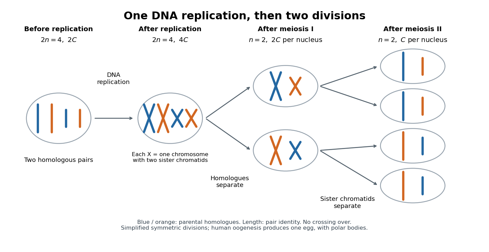

# Meiosis

↑ **Parent:** [Genetics](genetics.md)  
ⓦ [Wiki](https://en.wikipedia.org/wiki/Meiosis)

[Meiosis](meiosis.md) reduces two sets of [chromosomes](chromosome.md) to one. In the ordinary [diploid](diploid.md) life cycle, this makes it possible for [fertilization](fertilization.md) of two [haploid](haploid.md) [gametes](gamete.md) to restore the [diploid](diploid.md) state rather than double the number of sets in every generation. Its two divisions perform different tasks: [meiosis I](meiosis-i.md) separates [homologous chromosomes](homologous-chromosome.md), whereas [meiosis II](meiosis-ii.md) separates [sister chromatids](sister-chromatids.md). One round of [DNA replication](dna-replication.md) precedes both divisions; there is no second round between them. See [Meiosis, “Duplicated Homologous Chromosomes Pair During Meiosis” and “Gametes Are Produced by Two Meiotic Cell Divisions”, Figures 20-6–20-7](molecular-biology-of-the-cell-4th-edition-by-bruce-alberts-and-others.md).

Two [homologous chromosomes](homologous-chromosome.md) carry corresponding [genetic loci](genetic-locus.md), potentially with different [alleles](allele.md); two [sister chromatids](sister-chromatids.md) originate by [DNA replication](dna-replication.md) of one [chromosome](chromosome.md). After [chromosomal crossover](chromosomal-crossover.md) between nonsister [chromatids](chromatid.md), the [sister chromatids](sister-chromatids.md) need not carry identical [alleles](allele.md) everywhere. Separating the two relationships explains why a [haploid](haploid.md) product of [meiosis I](meiosis-i.md) still contains replicated [chromosomes](chromosome.md).

**[Figure 81](#image-one-dna-replication-followed-by-homologous-chromosome-separation-and-separation-of-sister-chromatids). One DNA replication followed by homologous chromosome separation and separation of sister chromatids**. Original simplified model with two [homologous chromosome](homologous-chromosome.md) pairs, no [chromosomal crossover](chromosomal-crossover.md), and symmetric divisions. The four final compartments represent [haploid](haploid.md) products, not four functional [ova](ovum.md). Human [oogenesis](oogenesis.md) uses unequal divisions, retaining most [cytoplasm](cytoplasm.md) in one developing [ovum](ovum.md) and producing [polar bodies](polar-body.md).

The two divisions explain [Mendelian segregation](mendelian-segregation.md); variable orientation of different [homologous chromosome](homologous-chromosome.md) pairs connects it to [independent assortment](independent-assortment.md). [Genetic recombination](genetic-recombination.md) adds another source of [allele](allele.md) combinations. These mechanisms reshuffle inherited material without requiring a new [mutation](mutation.md).

The symmetric diagram is useful for counting, but human [oogenesis](oogenesis.md) produces one functional [ovum](ovum.md) rather than four. The [polar bodies](polar-body.md) receive discarded [chromosomes](chromosome.md) and little [cytoplasm](cytoplasm.md). See [Human Reproductive Anatomy and Gametogenesis](biology-2e-by-mary-ann-clark-and-others/human-reproductive-anatomy-and-gametogenesis.md) (§43.3, Oogenesis and Figure 43.13: unequal divisions and polar bodies).

**Table of contents**

- [Meiosis I](meiosis-i.md)
- [Meiosis II](meiosis-ii.md)
- [Meiotic DNA content](meiotic-dna-content.md)

## ↑ Ancestors (3)

1. [Genetics](genetics.md)
2. [Biology](biology-split.md)
3. [Codex Wiki](split.md)

## ← Incoming links (14)

- [Chromatid](chromatid.md)
- [Chromosomal crossover](chromosomal-crossover.md)
- [Experimental tractability](experimental-tractability.md)
- [Genetic linkage](genetic-linkage.md)
- [Genetic recombination](genetic-recombination.md)
- [Genetics](genetics.md)
- [Haldane mapping function](haldane-mapping-function.md)
- [Linkage disequilibrium](linkage-disequilibrium.md)
- [Meiosis](meiosis.md)
- [Meiosis I](meiosis-i.md)
- [Meiosis II](meiosis-ii.md)
- [Mendelian segregation](mendelian-segregation.md)
- [Oogenesis](oogenesis.md)
- [Saccharomyces cerevisiae](saccharomyces-cerevisiae.md)
