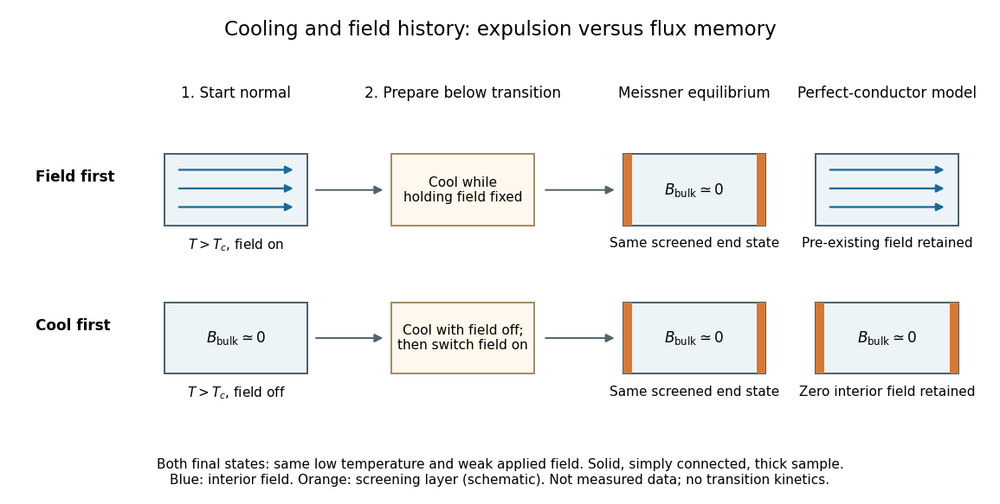

# Meissner effect and flux history

↑ **Parent:** [Meissner effect](meissner-effect.md)

Compare two ideal models for a stationary, solid, [simply connected](simply-connected-space.md) sample. In the [perfect conductor](perfect-conductor.md) flux-history model the interior [electric field](electric-field-split.md) is constrained to zero from the moment perfect conduction starts. [Faraday's law of induction](faraday-s-law-of-induction.md) then gives

$$
\partial_t\mathbf B=-\nabla\times\mathbf E=0.
$$

Consequently the interior [magnetic field](magnetic-field-split.md) retains its value at that moment. Cooling in an already applied [magnetic field](magnetic-field-split.md) freezes a nonzero interior value; starting perfect conduction in zero [magnetic field](magnetic-field-split.md) and then applying a [magnetic field](magnetic-field-split.md) preserves zero. The zero initial interior [magnetic field](magnetic-field-split.md) often assumed in [perfect conductor](perfect-conductor.md) wave-reflection problems is one particular preparation, not a general prediction of expulsion. [§9.8, Eq. (9.38) and the argument that zero resistivity conserves existing flux rather than expelling it](university-physics-volume-3-by-samuel-j-ling-and-others/9-8-superconductivity.md)

**[Figure 4](#image-two-preparation-histories-distinguish-the-meissner-state-from-perfect-conductor-flux-memory). Two preparation histories distinguish the Meissner state from perfect conductor flux memory**. Original schematic end states for a solid sample much thicker than its [London penetration depth](london-penetration-depth.md), not measured data or transition kinetics. Both rows end at the same low [temperature](temperature-split.md) and applied weak [magnetic field](magnetic-field-split.md). Blue arrows indicate interior [magnetic field](magnetic-field-split.md); orange edges represent screening [electric currents](electric-current.md). The near-zero interior in the [Meissner state](meissner-state.md) omits its finite penetration layer. The [perfect conductor](perfect-conductor.md) panel uses the ideal zero-interior-[electric field](electric-field-split.md) constraint.

The [Meissner state](meissner-state.md) instead selects the screened equilibrium after either preparation, provided that equilibrium is accessible and the applied [magnetic field](magnetic-field-split.md) lies in the [Meissner state](meissner-state.md) regime. The first [London equation](london-equations.md) alone illustrates the missing information: at fixed $\lambda_L$, combining it with [Faraday's law of induction](faraday-s-law-of-induction.md) gives

$$
\partial_t\!\left(\nabla\times\mathbf J+\frac{\mathbf B}{\mu_0\lambda_L^2}\right)=0.
$$

This permits an arbitrary time-independent integration field. The second [London equation](london-equations.md) imposes the additional zero value of that bracket in the vortex-free local model.[§2, pp. 12–13, Eqs. (64), (66)–(68): time-independent freedom and the second London equation](lecture-notes-on-the-electrodynamics-of-metals-and-superconductors.md) Establishing [superconductivity](superconductivity-split.md) during cooling is not the fixed-parameter, zero-[electric field](electric-field-split.md) model: transient [electric fields](electric-field-split.md) accompany changing [magnetic flux](magnetic-flux.md), and $\lambda_L$ itself depends on [temperature](temperature-split.md). The equilibrium [London equations](london-equations.md) predict final spatial screening, not the cooling rate or the time-resolved expulsion pulse.

## ↑ Ancestors (7)

1. [Meissner effect](meissner-effect.md)
2. [London equations](london-equations.md)
3. [Magnetic field](magnetic-field-split.md)
4. [Electromagnetism](electromagnetism-split.md)
5. [Branches of physics](branches-of-physics.md)
6. [Physics](physics-split.md)
7. [Codex Wiki](split.md)
