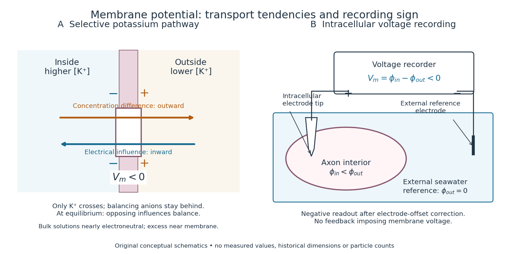

# Membrane potential

↑ **Parent:** [Biological cell](biological-cell-split.md)  
ⓦ [Wiki](https://en.wikipedia.org/wiki/Membrane_potential)

A [membrane potential](membrane-potential-split.md) is an [electric potential difference](electric-potential-difference.md) across a [cell membrane](cell-membrane-split.md). We use the convention

$$
V_m=\phi_{\mathrm{inside}}-\phi_{\mathrm{outside}}.
$$

Taking the external [electric potential](electric-potential.md) as zero makes $V_m<0$ mean that the inside is at lower [electric potential](electric-potential.md). “Negative inside” describes a difference, not an absolute [electric potential](electric-potential.md), and does not imply that the entire [cytosol](cytosol.md) has a large net negative [electric charge](electric-charge-split.md).

Consider a [cell membrane](cell-membrane-split.md) permeable only to [potassium](potassium.md) [ions](ion.md), with higher [potassium](potassium.md) [concentration](concentration.md) inside. [Diffusion](diffusion.md) initially favors outward transport. If balancing negative [ions](ion.md) cannot follow, that loss of positive [electric charge](electric-charge-split.md) produces a small inner excess of negative [electric charge](electric-charge-split.md) and an outer positive excess. The resulting [electric field](electric-field-split.md) favors inward [potassium](potassium.md) transport. At the [Nernst equilibrium potential](nernst-equilibrium-potential.md), chemical and electrical contributions to [electrochemical potential](electrochemical-potential.md) balance; [ions](ion.md) still cross both ways, with zero net transport.[Molecular Biology of the Cell, 4th edition by Bruce Alberts and others; The Resting Membrane Potential Is Determined Mainly by K+ Leak Channels in Most Animal Cells: selective potassium passage and opposing electrical influence](molecular-biology-of-the-cell-4th-edition-by-bruce-alberts-and-others/ion-channels-and-the-electrical-properties-of-membranes.md)

**[Figure 1](#image-opposing-influences-on-potassium-transport-and-the-sign-of-an-intracellular-voltage-recording). Opposing influences on potassium transport and the sign of an intracellular voltage recording**. Original conceptual diagrams: a selective [cell membrane](cell-membrane-split.md) with $V_m<0$, and an intracellular [electrode](electrode.md) compared with an external [reference electrode](reference-electrode.md) in seawater. The recording diagram illustrates connections and sign, not a historical apparatus reconstruction or a measured trace. Arrows indicate transport tendencies; particle numbers and distances are schematic.

In living [biological cells](biological-cell-split.md), several [ions](ion.md) can permeate and pumps maintain their [concentration](concentration.md) differences through [active transport](active-transport.md). Pumps transporting net [electric charge](electric-charge-split.md) also contribute [electric current](electric-current.md). Thus $V_m=E_{\mathrm K}$ is a special limit, not a universal rule; [membrane potential](membrane-potential-split.md) need not always be negative.[Molecular Biology of the Cell, 4th edition by Bruce Alberts and others; K+ leak-channel discussion; The Resting Potential Decays Only Slowly When the Na+-K+ Pump Is Stopped; action-potential discussion](molecular-biology-of-the-cell-4th-edition-by-bruce-alberts-and-others/ion-channels-and-the-electrical-properties-of-membranes.md) The existing [reversal potential](reversal-potential.md) example shows how opposing [electric currents](electric-current.md) can balance without each [ion](ion.md) reaching [thermodynamic equilibrium](thermodynamic-equilibrium.md). This makes [selective permeability](selective-permeability.md) a way to convert chemical differences into electrical signals: changing the available [ion channels](ion-channel.md) changes which [electrochemical gradients](electrochemical-gradient.md) influence the voltage.

**Table of contents**

- [Repolarization](repolarization.md)
- [Selective potassium equilibrium](selective-potassium-equilibrium.md)
- [Membrane charge separation](membrane-charge-separation.md)
- [Intracellular recording of membrane potential](intracellular-recording-of-membrane-potential.md)
- [Depolarization](depolarization.md)
- [Hyperpolarization](hyperpolarization.md)
- [Reversal potential](reversal-potential.md)
  - [Nernst equilibrium potential](nernst-equilibrium-potential.md)
- [Voltage-gated ion channel](voltage-gated-ion-channel.md)
  - [Ion-channel deactivation](ion-channel-deactivation.md)
  - [Ion-channel gating current](ion-channel-gating-current.md)
    - [Ion-channel gating charge](ion-channel-gating-charge.md)
  - [Voltage-gated sodium channel](voltage-gated-sodium-channel.md)
  - [Voltage-sensing domain](voltage-sensing-domain.md)
  - [Voltage-gated potassium channel](voltage-gated-potassium-channel.md)
  - [Voltage-gated calcium channel](voltage-gated-calcium-channel.md)
  - [Ion-channel inactivation](ion-channel-inactivation.md)
    - [C-type inactivation](c-type-inactivation.md)
    - [Ball-and-chain inactivation](ball-and-chain-inactivation.md)
  - [Two-state ion-channel gating](two-state-ion-channel-gating.md)
    - [Equal open probability with unequal ion-channel relaxation times](equal-open-probability-with-unequal-ion-channel-relaxation-times.md)
    - [Independent permissive gates in an ion channel](independent-permissive-gates-in-an-ion-channel.md)

## ↑ Ancestors (3)

1. [Biological cell](biological-cell-split.md)
2. [Biology](biology-split.md)
3. [Codex Wiki](split.md)

## ← Incoming links (85)

- [Absolute neuronal refractory period](absolute-neuronal-refractory-period.md)
- [Action potential](action-potential.md)
- [Alan Hodgkin](alan-hodgkin.md)
- [Andrew Huxley](andrew-huxley.md)
- [ATP synthesis by chemiosmosis](atp-synthesis-by-chemiosmosis.md)
- [Biology](biology-split.md)
- [Cell-attached recording](cell-attached-recording.md)
- [Cell membrane](cell-membrane-split.md)
- [Chemical synapse](chemical-synapse.md)
- [Current clamp](current-clamp.md)
- [Depolarization](depolarization.md)
- [Depolarization block](depolarization-block.md)
- [Electrical synapse](electrical-synapse.md)
- [Extracellular single-unit recording](extracellular-single-unit-recording.md)
- [Hodgkin-Huxley model](hodgkin-huxley-model.md)
- [Hyperpolarization](hyperpolarization.md)
- [Independent permissive gates in an ion channel](independent-permissive-gates-in-an-ion-channel.md)
- [Intracellular recording of membrane potential](intracellular-recording-of-membrane-potential.md)
- [Ion channel](ion-channel.md)
- [Ion-channel gating current](ion-channel-gating-current.md)
- [Ion-channel inactivation](ion-channel-inactivation.md)
- [Ionotropic receptor](ionotropic-receptor.md)
- [Leaky integrate-and-fire model](leaky-integrate-and-fire-model.md)
- [Membrane capacitive ion budget](membrane-capacitive-ion-budget.md)
- [Membrane charge separation](membrane-charge-separation.md)
- [Membrane potential](membrane-potential-split.md)
- [Membrane transport](membrane-transport.md)
- [Metabotropic receptor](metabotropic-receptor.md)
- [Mitochondrial oxygen electrode assay](mitochondrial-oxygen-electrode-assay.md)
- [Nernst equilibrium potential](nernst-equilibrium-potential.md)
- [Neuron](neuron-split.md)
- [Neuronal firing threshold](neuronal-firing-threshold.md)
- [Neuronal paired-pulse recovery](neuronal-paired-pulse-recovery.md)
- [Neuronal refractory period](neuronal-refractory-period.md)
- [Passive spatial and conductance integration](passive-spatial-and-conductance-integration.md)
- [Passive transport](passive-transport.md)
- [Solution](past-exam-of-the-biochemistry-and-molecular-biology-course-of-the-university-of-cambridge/2025/paper-1/section-d/10/solution.md)
- [Solution](past-exam-of-the-biochemistry-course-of-the-university-of-cambridge/2025/paper-1/section-i/2/solution.md)
- [Solution](past-exam-of-the-biochemistry-course-of-the-university-of-cambridge/2025/paper-1/section-ii/6/solution.md)
- [Solution](past-exam-of-the-biochemistry-course-of-the-university-of-cambridge/2025/paper-4/section-ii/5/solution.md)
- [Solution](past-exam-of-the-biological-physics-course-of-the-university-of-oxford/2015/2/a/solution.md)
- [Solution](past-exam-of-the-biological-physics-course-of-the-university-of-oxford/2015/2/b/solution.md)
- [Solution](past-exam-of-the-biological-physics-course-of-the-university-of-oxford/2015/2/c/solution.md)
- [Solution](past-exam-of-the-biological-physics-course-of-the-university-of-oxford/2015/2/d/solution.md)
- [Solution](past-exam-of-the-biological-physics-course-of-the-university-of-oxford/2015/7/a/solution.md)
- [Solution](past-exam-of-the-biological-physics-course-of-the-university-of-oxford/2015/7/b/solution.md)
- [Solution](past-exam-of-the-biological-physics-course-of-the-university-of-oxford/2015/7/c/solution.md)
- [Solution](past-exam-of-the-biological-physics-course-of-the-university-of-oxford/2015/8/ii/solution.md)
- [Solution](past-exam-of-the-biological-physics-course-of-the-university-of-oxford/2016/1/a/solution.md)
- [Solution](past-exam-of-the-biological-physics-course-of-the-university-of-oxford/2016/1/c/solution.md)
- [Solution](past-exam-of-the-biological-physics-course-of-the-university-of-oxford/2021/1/a/solution.md)
- [Solution](past-exam-of-the-biological-physics-course-of-the-university-of-oxford/2021/1/d/solution.md)
- [Solution](past-exam-of-the-biological-physics-course-of-the-university-of-oxford/2021/5/b/solution.md)
- [Solution](past-exam-of-the-biological-physics-course-of-the-university-of-oxford/2021/6/c/solution.md)
- [Solution](past-exam-of-the-biological-physics-course-of-the-university-of-oxford/2022/3/b/solution.md)
- [Solution](past-exam-of-the-biological-physics-course-of-the-university-of-oxford/2022/3/e/solution.md)
- [Solution](past-exam-of-the-biological-physics-course-of-the-university-of-oxford/2022/6/c/solution.md)
- [Solution](past-exam-of-the-further-mathematical-biology-course-of-the-university-of-oxford/2023/2/a/ii/solution.md)
- [Solution](past-exam-of-the-mathematical-physiology-course-of-the-university-of-oxford/2011/1/a/solution.md)
- [Solution](past-exam-of-the-mathematical-physiology-course-of-the-university-of-oxford/2023/2/a/solution.md)
- [Solution](past-exam-of-the-mathematics-and-the-environment-and-mathematical-physiology-course-of-the-university-of-oxford/2010/b/6/a/solution.md)
- [Solution](past-exam-of-the-mathematics-course-of-the-university-of-cambridge/2006/iii/paper-84/3/a/solution.md)
- [Solution](past-exam-of-the-mathematics-course-of-the-university-of-cambridge/2006/iii/paper-84/3/b/solution.md)
- [Solution](past-exam-of-the-mathematics-course-of-the-university-of-cambridge/2007/iii/paper-73/1/a/solution.md)
- [Solution](past-exam-of-the-plant-sciences-course-of-the-university-of-cambridge/2024/paper-plm1/2/solution.md)
- [Solution](past-exam-of-the-short-options-paper-shared-by-prelims-and-parts-a-and-b-of-the-physics-course-of-the-university-of-oxford/2015/s12/3/1/solution.md)
- [Solution](past-exam-of-the-short-options-paper-shared-by-prelims-and-parts-a-and-b-of-the-physics-course-of-the-university-of-oxford/2015/s12/3/2/solution.md)
- [Solution](past-exam-of-the-short-options-paper-shared-by-prelims-and-parts-a-and-b-of-the-physics-course-of-the-university-of-oxford/2015/s12/3/3/solution.md)
- [Patch clamp](patch-clamp.md)
- [Phenomenological paired-pulse recovery](phenomenological-paired-pulse-recovery.md)
- [Repolarization](repolarization.md)
- [Reversal potential](reversal-potential.md)
- [Shunting inhibition](shunting-inhibition.md)
- [Single-channel current-voltage relation](single-channel-current-voltage-relation.md)
- [Sodium export cost from a capacitive vesicle](sodium-export-cost-from-a-capacitive-vesicle.md)
- [Space clamp](space-clamp.md)
- [Spatial summation](spatial-summation.md)
- [Synapse](synapse.md)
- [Synaptic integration](synaptic-integration.md)
- [Synaptic potential](synaptic-potential.md)
- [Temporal summation](temporal-summation.md)
- [Two-state ion-channel gating](two-state-ion-channel-gating.md)
- [Voltage clamp](voltage-clamp.md)
- [Voltage-gated ion channel](voltage-gated-ion-channel.md)
- [Whole-cell recording](whole-cell-recording.md)
