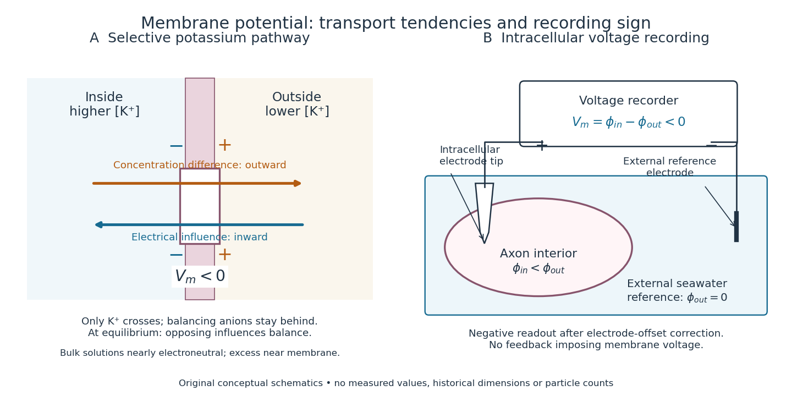
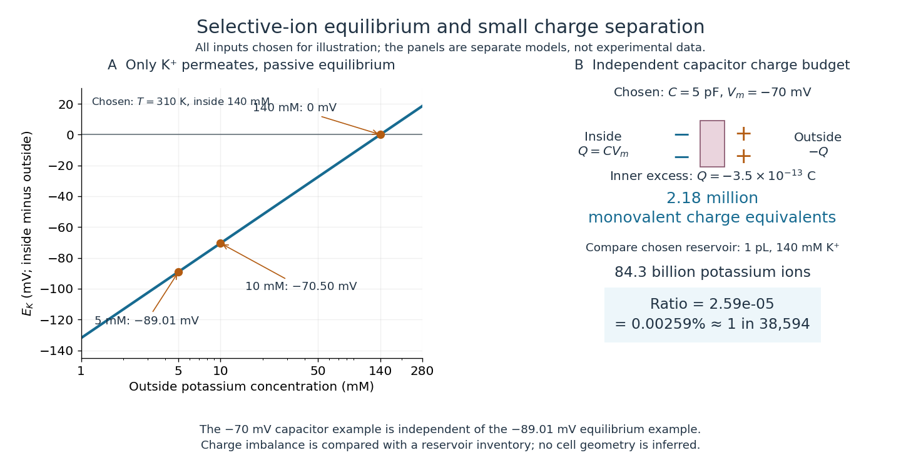
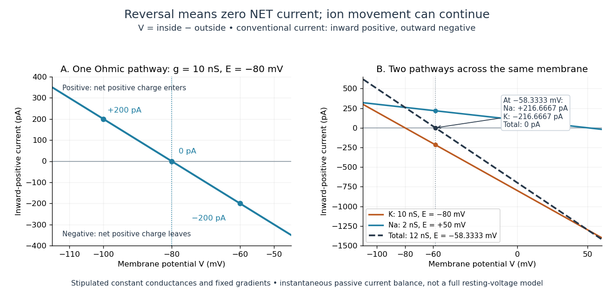
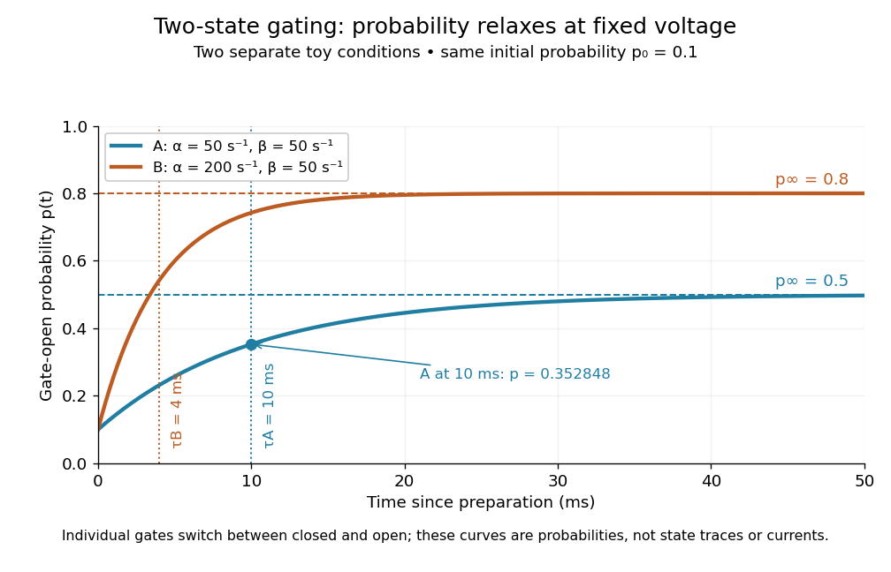
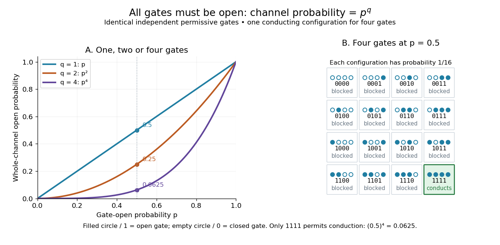

# Membrane potential

↑ **Parent:** [Biological cell](biological-cell.md)  
ⓦ [Wiki](https://en.wikipedia.org/wiki/Membrane_potential)

A [membrane potential](membrane-potential.md) is an [electric potential difference](electric-field.md#electric-potential-difference) across a [cell membrane](cell-membrane.md). We use the convention

$$
V_m=\phi_{\mathrm{inside}}-\phi_{\mathrm{outside}}.
$$

Taking the external [electric potential](electric-field.md#electric-potential) as zero makes $V_m<0$ mean that the inside is at lower [electric potential](electric-field.md#electric-potential). “Negative inside” describes a difference, not an absolute [electric potential](electric-field.md#electric-potential), and does not imply that the entire [cytosol](biological-cell.md#cytosol) has a large net negative [electric charge](electric-charge.md).

Consider a [cell membrane](cell-membrane.md) permeable only to [potassium](chemical-substance.md#potassium) [ions](chemistry.md#ion), with higher [potassium](chemical-substance.md#potassium) [concentration](mathematical-physics.md#concentration) inside. [Diffusion](thermodynamics.md#diffusion) initially favors outward transport. If balancing negative [ions](chemistry.md#ion) cannot follow, that loss of positive [electric charge](electric-charge.md) produces a small inner excess of negative [electric charge](electric-charge.md) and an outer positive excess. The resulting [electric field](electric-field.md) favors inward [potassium](chemical-substance.md#potassium) transport. At the [Nernst equilibrium potential](#nernst-equilibrium-potential), chemical and electrical contributions to [electrochemical potential](chemical-potential.md#electrochemical-potential) balance; [ions](chemistry.md#ion) still cross both ways, with zero net transport.[Molecular Biology of the Cell, 4th edition by Bruce Alberts and others; The Resting Membrane Potential Is Determined Mainly by K+ Leak Channels in Most Animal Cells: selective potassium passage and opposing electrical influence](biology-bibliography.md#molecular-biology-of-the-cell-4th-edition-by-bruce-alberts-and-others/ion-channels-and-the-electrical-properties-of-membranes)

**[Figure 1](#image-opposing-influences-on-potassium-transport-and-the-sign-of-an-intracellular-voltage-recording). Opposing influences on potassium transport and the sign of an intracellular voltage recording**. Original conceptual diagrams: a selective [cell membrane](cell-membrane.md) with $V_m<0$, and an intracellular [electrode](electrochemistry.md#electrode) compared with an external [reference electrode](acid-base-chemistry.md#reference-electrode) in seawater. The recording diagram illustrates connections and sign, not a historical apparatus reconstruction or a measured trace. Arrows indicate transport tendencies; particle numbers and distances are schematic.

In living [biological cells](biological-cell.md), several [ions](chemistry.md#ion) can permeate and pumps maintain their [concentration](mathematical-physics.md#concentration) differences through [active transport](cell-membrane.md#active-transport). Pumps transporting net [electric charge](electric-charge.md) also contribute [electric current](electric-charge.md#electric-current). Thus $V_m=E_{\mathrm K}$ is a special limit, not a universal rule; [membrane potential](membrane-potential.md) need not always be negative.[Molecular Biology of the Cell, 4th edition by Bruce Alberts and others; K+ leak-channel discussion; The Resting Potential Decays Only Slowly When the Na+-K+ Pump Is Stopped; action-potential discussion](biology-bibliography.md#molecular-biology-of-the-cell-4th-edition-by-bruce-alberts-and-others/ion-channels-and-the-electrical-properties-of-membranes) The existing [reversal potential](#reversal-potential) example shows how opposing [electric currents](electric-charge.md#electric-current) can balance without each [ion](chemistry.md#ion) reaching [thermodynamic equilibrium](thermodynamics.md#thermodynamic-equilibrium). This makes [selective permeability](cell-membrane.md#selective-permeability) a way to convert chemical differences into electrical signals: changing the available [ion channels](cell-membrane.md#ion-channel) changes which [electrochemical gradients](chemical-potential.md#electrochemical-gradient) influence the voltage.

**Table of contents**

- [Selective potassium equilibrium](#selective-potassium-equilibrium)
- [Membrane charge separation](#membrane-charge-separation)
- [Intracellular recording of membrane potential](#intracellular-recording-of-membrane-potential)
- [Depolarization](#depolarization)
- [Hyperpolarization](#hyperpolarization)
- [Reversal potential](#reversal-potential)
  - [Nernst equilibrium potential](#nernst-equilibrium-potential)
- [Voltage-gated ion channel](#voltage-gated-ion-channel)
  - [Voltage-gated sodium channel](#voltage-gated-sodium-channel)
  - [Voltage-sensing domain](#voltage-sensing-domain)
  - [Voltage-gated potassium channel](#voltage-gated-potassium-channel)
  - [Voltage-gated calcium channel](#voltage-gated-calcium-channel)
  - [Ion-channel inactivation](#ion-channel-inactivation)
  - [Two-state ion-channel gating](#two-state-ion-channel-gating)
    - [Independent permissive gates in an ion channel](#independent-permissive-gates-in-an-ion-channel)

## Selective potassium equilibrium

↑ **Parent:** [Membrane potential](membrane-potential.md)

For an ideal dilute [chemical solution](mixture.md#solution-chemistry), moving one [mole](physics.md#mole-unit) of a species with signed [ion](chemistry.md#ion) charge number $z$ from outside to inside changes its [electrochemical potential](chemical-potential.md#electrochemical-potential) by

$$
\Delta\widetilde\mu=RT\ln\!\left(\frac{c_{\mathrm{in}}}{c_{\mathrm{out}}}\right)+zFV_m.
$$

Here $R$ is the [molar gas constant](ideal-gas.md#molar-gas-constant), $T$ the uniform absolute [temperature](temperature.md), $F$ the [Faraday constant](physics.md#faraday-constant), and $c$ the [concentration](mathematical-physics.md#concentration). This assumes the same reference [chemical potential](chemical-potential.md) on both sides. At [thermodynamic equilibrium](thermodynamics.md#thermodynamic-equilibrium), $\Delta\widetilde\mu=0$, hence

$$
E_{\mathrm{ion}}=\frac{RT}{zF}\ln\!\left(\frac{c_{\mathrm{out}}}{c_{\mathrm{in}}}\right).
$$

The [Nernst equilibrium potential](#nernst-equilibrium-potential) uses [thermodynamic activities](chemical-potential.md#thermodynamic-activity) in the general case; replacing them by [concentrations](mathematical-physics.md#concentration) is an ideal-solution approximation.

Choose an original passive model: only $\mathrm K^+$ permeates ($z=+1$), other [ions](chemistry.md#ion) cannot cross, there are no pumps or imposed [electric currents](electric-charge.md#electric-current), and there is no net [water](chemical-substance.md#water) transfer. Stipulate reservoir [concentrations](mathematical-physics.md#concentration) $c_{\mathrm{in}}=140\,\mathrm{mM}$ and $c_{\mathrm{out}}=5\,\mathrm{mM}$, with $T=310\,\mathrm K$, $R=8.314\,\mathrm{J\,mol^{-1}\,K^{-1}}$ and $F=96485\,\mathrm{C\,mol^{-1}}$. Treat reservoir [concentrations](mathematical-physics.md#concentration) as effectively unchanged by charging. Then

$$
E_{\mathrm K}=\frac{8.314\times310}{96485}\ln\!\left(\frac5{140}\right)\,\mathrm V
\approx-0.08901\,\mathrm V=-89.01\,\mathrm{mV}.
$$

The [concentration](mathematical-physics.md#concentration) ratio is dimensionless; $\mathrm{J/C}=\mathrm V$ supplies the voltage unit. At $V_m=0$, $\Delta\widetilde\mu>0$ for inward transport, so outward transport is favored. At $V_m=E_{\mathrm K}$ it vanishes. A more negative $V_m$ favors inward transport. These sign checks explain the result physically.

Keeping the other chosen inputs fixed, doubling $c_{\mathrm{out}}$ to $10\,\mathrm{mM}$ raises $E_{\mathrm K}$ by $(RT/F)\ln2\approx18.52\,\mathrm{mV}$. Equal inside and outside [concentrations](mathematical-physics.md#concentration) give $E_{\mathrm K}=0$; reversing their ratio reverses its sign. In finite reservoirs, transport changes both [concentrations](mathematical-physics.md#concentration); the exact final [thermodynamic equilibrium](thermodynamics.md#thermodynamic-equilibrium) must also satisfy material conservation. The fixed-reservoir calculation is useful when only a small fraction of the available [ions](chemistry.md#ion) moves.

## Membrane charge separation

↑ **Parent:** [Membrane potential](membrane-potential.md)

A [membrane potential](membrane-potential.md) can coexist with near [electroneutrality](electrochemistry.md#electroneutrality) in the bulk [cytosol](biological-cell.md#cytosol) and external [chemical solution](mixture.md#solution-chemistry). The small imbalance producing the voltage lies near the [cell membrane](cell-membrane.md); most positive and negative [electric charges](electric-charge.md) balance in the bulk.[Molecular Biology of the Cell, 4th edition by Bruce Alberts and others; The Resting Potential Decays Only Slowly When the Na+-K+ Pump Is Stopped; Figure 11-22: minute charge redistribution and interfacial excess](biology-bibliography.md#molecular-biology-of-the-cell-4th-edition-by-bruce-alberts-and-others/ion-channels-and-the-electrical-properties-of-membranes)

For a separate original [capacitor](electromagnetism.md#capacitor) model, choose a total [membrane capacitance](neuroscience.md#membrane-capacitance) $C=5\,\mathrm{pF}$ and $V_m=-70\,\mathrm{mV}$. These are stipulated parameters, not measured properties of a particular [biological cell](biological-cell.md), and this voltage is not asserted to equal the preceding $E_{\mathrm K}$. Model the separated [electric charge](electric-charge.md) relative to an uncharged reference by

$$
Q_{\mathrm{inside}}=CV_m=(5\times10^{-12})(-70\times10^{-3})\,\mathrm C=-3.5\times10^{-13}\,\mathrm C,\qquad Q_{\mathrm{outside}}=-Q_{\mathrm{inside}}.
$$

Using the [elementary charge](electric-charge.md#elementary-charge) $e=1.602176634\times10^{-19}\,\mathrm C$, this represents

$$
N_{\mathrm{excess}}=\frac{|Q_{\mathrm{inside}}|}{e}\approx2.18\times10^6
$$

excess monovalent negative-charge equivalents inside. These can represent a deficit of positive [ions](chemistry.md#ion), rather than the arrival of that many negative [ions](chemistry.md#ion).

Independently choose an internal reservoir [volume](thermodynamics.md#volume-thermodynamics) $\mathcal V=1\,\mathrm{pL}=10^{-12}\,\mathrm L$ containing $140\,\mathrm{mM}=0.140\,\mathrm{mol\,L^{-1}}$ [potassium](chemical-substance.md#potassium), with balancing negative [electric charge](electric-charge.md). With the [Avogadro constant](physics.md#avogadro-constant) $N_A=6.02214076\times10^{23}\,\mathrm{mol^{-1}}$, its [potassium](chemical-substance.md#potassium) inventory is

$$
N_{\mathrm K}=c\mathcal V N_A\approx8.43\times10^{10},\qquad
\frac{N_{\mathrm{excess}}}{N_{\mathrm K}}\approx2.59\times10^{-5}=0.00259\%.
$$

Thus, if charging were entirely due to outward monovalent [potassium](chemical-substance.md#potassium) transport, about one in $38\,600$ of these [potassium](chemical-substance.md#potassium) [ions](chemistry.md#ion) would suffice. This is a comparison with the chosen [potassium](chemical-substance.md#potassium) inventory, not a fraction of all charged particles or a measurement of spatial [charge density](electric-charge.md#charge-density). No shape, surface area or thickness has been inferred from the chosen [capacitance](electromagnetism.md#capacitance) and [volume](thermodynamics.md#volume-thermodynamics). The calculation illustrates why substantial voltage does not require a strongly charged bulk [cytosol](biological-cell.md#cytosol).

**[Figure 2](#image-chosen-models-potassium-equilibrium-and-the-small-charge-budget-of-a-membrane-capacitor). Chosen models: potassium equilibrium and the small charge budget of a membrane capacitor**. Original computed [Nernst equilibrium potential](#nernst-equilibrium-potential) curve at $T=310\,\mathrm K$ with $c_{\mathrm{in}}=140\,\mathrm{mM}$, and an independent [capacitor](electromagnetism.md#capacitor) calculation using $C=5\,\mathrm{pF}$, $V_m=-70\,\mathrm{mV}$, and a $1\,\mathrm{pL}$ reservoir containing $140\,\mathrm{mM}$ [potassium](chemical-substance.md#potassium). All numerical inputs are chosen model stipulations. The two panels describe separate examples; neither is an experimental record.

## Intracellular recording of membrane potential

↑ **Parent:** [Membrane potential](membrane-potential.md)

In 1939, [Alan Hodgkin](physiology.md#alan-hodgkin) and [Andrew Huxley](physiology.md#andrew-huxley) reported intracellular [action potential](neuroscience.md#action-potential) recordings from squid giant [axons](neuroscience.md#axon) at Plymouth.[Action Potentials Recorded from Inside a Nerve Fibre, Nature 144 (1939), pp. 710–711: inspected publisher abstract, preparation and intracellular recording](biology-bibliography.md#action-potentials-recorded-from-inside-a-nerve-fibre-by-alan-hodgkin-and-andrew-huxley)

[Alan Hodgkin](physiology.md#alan-hodgkin)'s later account describes advancing a capillary [electrode](electrochemistry.md#electrode) from a cut end into intact [axon](neuroscience.md#axon), avoiding scraping the [cell membrane](cell-membrane.md). Its Figure 3 uses a seawater-filled capillary internally, with external seawater as zero: the readout is internal relative to external [electric potential](electric-field.md#electric-potential). This supports a voltage across the surface [cell membrane](cell-membrane.md). As a separate ionic control, the account reports that raising external [potassium](chemical-substance.md#potassium) toward its internal [concentration](mathematical-physics.md#concentration) reversibly abolished resting voltage; this was later work, not a control asserted for the 1939 recording. Injury and electrode-solution junction potentials limit interpretation. Voltage recording alone does not identify every conducting [ion](chemistry.md#ion). A [voltage clamp](neuroscience.md#voltage-clamp) additionally uses feedback to impose voltage and measures the required [electric current](electric-charge.md#electric-current).[Alan Lloyd Hodgkin, The ionic basis of nervous conduction, Nobel Lecture (11 December 1963), pp. 34–36, Figures 2–3: placement, seawater reference and later potassium control; p. 42: voltage clamp](biology-bibliography.md#the-ionic-basis-of-nervous-conduction-by-alan-hodgkin)

In the schematic, connect the intracellular [electrode](electrochemistry.md#electrode) to the positive input and the external [reference electrode](acid-base-chemistry.md#reference-electrode) to the negative input of a voltage recorder. After electrode-offset correction, a negative reading means $\phi_{\mathrm{inside}}<\phi_{\mathrm{outside}}$. A useful baseline check is to compare both [electrodes](electrochemistry.md#electrode) in the same external [chemical solution](mixture.md#solution-chemistry) before insertion; this is a measurement check, not an additional historical observation claimed here. Swapping inputs reverses the readout sign without changing the [biological cell](biological-cell.md)'s [membrane potential](membrane-potential.md).

## Depolarization

↑ **Parent:** [Membrane potential](membrane-potential.md)  
ⓦ [Wiki](https://en.wikipedia.org/wiki/Depolarization)

For a negative neuronal [membrane potential](membrane-potential.md), [depolarization](#depolarization) raises it toward zero or beyond, making the interior less negative relative to the exterior. This describes a voltage change, not necessarily increased [action potential](neuroscience.md#action-potential) generation; see the depolarizing inhibition example under [synaptic potential](neuroscience.md#synaptic-potential).

## Hyperpolarization

↑ **Parent:** [Membrane potential](membrane-potential.md)

[Hyperpolarization](#hyperpolarization) makes a neuronal [membrane potential](membrane-potential.md) more negative relative to the exterior. It is a voltage description; inhibition need not produce [hyperpolarization](#hyperpolarization), as [shunting inhibition](neuroscience.md#shunting-inhibition) illustrates.

## Reversal potential

↑ **Parent:** [Membrane potential](membrane-potential.md)  
ⓦ [Wiki](https://en.wikipedia.org/wiki/Reversal_potential)

A [reversal potential](#reversal-potential) $E_{\mathrm{rev}}$ is a [membrane potential](membrane-potential.md) at which a specified open [ion channel](cell-membrane.md#ion-channel), or specified combination of [ion channels](cell-membrane.md#ion-channel), carries zero net [electric current](electric-charge.md#electric-current), with the surrounding conditions fixed; the [electric current](electric-charge.md#electric-current) changes sign across that voltage. Specifying which current matters: an individual [ion](chemistry.md#ion) contribution and a sum of several contributions can reverse at different voltages. Zero net [electric current](electric-charge.md#electric-current) does not mean that all [ions](chemistry.md#ion) have stopped moving. See [Purves et al., Neuroscience, 2nd edition (2001): reversal of a mixed-ion channel current](https://www.ncbi.nlm.nih.gov/books/NBK11013/).

Throughout these examples, [membrane potential](membrane-potential.md) is $V=V_{\mathrm{inside}}-V_{\mathrm{outside}}$, and **[conventional current](electric-charge.md#conventional-current) is inward-positive**. Positive [electric current](electric-charge.md#electric-current) corresponds to net positive [electric charge](electric-charge.md) entering or net negative [electric charge](electric-charge.md) leaving. Negative [electric current](electric-charge.md#electric-current) corresponds to the reverse charge transfer. A convenient Ohmic approximation is

$$
I_{\mathrm{in}}=g(E_{\mathrm{rev}}-V),\qquad g\geq0,
$$

where $g$ is the available [electrical conductance](electric-charge.md#electrical-conductance). For fixed $g>0$, $V<E_{\mathrm{rev}}$ gives positive [electric current](electric-charge.md#electric-current), $V=E_{\mathrm{rev}}$ gives zero, and $V>E_{\mathrm{rev}}$ gives negative [electric current](electric-charge.md#electric-current); the line has slope $-g$. If $g=0$, the modeled pathway carries zero [electric current](electric-charge.md#electric-current) at every voltage: closing it does not locate its [reversal potential](#reversal-potential). [3.1 Synapses](biology-bibliography.md#neuronal-dynamics-from-single-neurons-to-networks-and-models-of-cognition-by-wulfram-gerstner-and-others/3-1-synapses) (§3.1: conductance-based synaptic current) uses outward-positive $g(V-E)$; the formula here reverses that sign to match this wiki's inward-positive convention.

For the stipulated single-pathway example from [ion channel](cell-membrane.md#ion-channel), $E_{\mathrm{rev}}=-80\,\mathrm{mV}$ and $g=10\,\mathrm{nS}$ give

$$
\begin{array}{c|rrr}
V\ (\mathrm{mV})&-100&-80&-60\\
E_{\mathrm{rev}}-V\ (\mathrm{mV})&20&0&-20\\
I_{\mathrm{in}}\ (\mathrm{pA})&200&0&-200
\end{array}
$$

The open [ion channel](cell-membrane.md#ion-channel) carries zero net [electric current](electric-charge.md#electric-current) at $-80\,\mathrm{mV}$ even though $g$ remains positive. Near that point a change of [membrane potential](membrane-potential.md) changes the [electric current](electric-charge.md#electric-current), which is why zero current at one voltage does not make an open pathway electrically irrelevant; see [shunting inhibition](neuroscience.md#shunting-inhibition).

**[Figure 3](#image-inward-positive-electric-current-one-reversal-and-two-channel-cancellation). Inward-positive electric current: one reversal and two-channel cancellation**. Original computed curves for stipulated constant [electrical conductances](electric-charge.md#electrical-conductance) and fixed [reversal potentials](#reversal-potential). Left: $g=10\,\mathrm{nS}$, $E_{\mathrm{rev}}=-80\,\mathrm{mV}$. Right: a [potassium](chemical-substance.md#potassium) pathway with $g_{\mathrm K}=10\,\mathrm{nS}$, $E_{\mathrm K}=-80\,\mathrm{mV}$ and a [sodium](chemical-substance.md#sodium) pathway with $g_{\mathrm{Na}}=2\,\mathrm{nS}$, $E_{\mathrm{Na}}=+50\,\mathrm{mV}$. Their net [electric current](electric-charge.md#electric-current) vanishes at $-58.3333\,\mathrm{mV}$ while both individual [electric currents](electric-charge.md#electric-current) remain nonzero. These are model values, not empirical measurements.

For an [ion channel](cell-membrane.md#ion-channel) passing only one [ion](chemistry.md#ion) species by [passive transport](cell-membrane.md#passive-transport), its [reversal potential](#reversal-potential) can equal that species' [Nernst equilibrium potential](#nernst-equilibrium-potential), where the chemical and electrical contributions to [electrochemical potential](chemical-potential.md#electrochemical-potential) balance. At that [thermodynamic equilibrium](thermodynamics.md#thermodynamic-equilibrium), passage in both directions can continue with no net transport. For an [ion channel](cell-membrane.md#ion-channel) admitting several [ion](chemistry.md#ion) species, opposing contributions can cancel while each species continues to have net transport. Such a [reversal potential](#reversal-potential) is not generally any one species' [Nernst equilibrium potential](#nernst-equilibrium-potential). See the Purves reference above.

To work out that cancellation explicitly, put two Ohmic [ion channel](cell-membrane.md#ion-channel) populations across the same [cell membrane](cell-membrane.md). Stipulate constant [electrical conductances](electric-charge.md#electrical-conductance) and fixed [reversal potentials](#reversal-potential):

$$
g_{\mathrm K}=10\,\mathrm{nS},\quad E_{\mathrm K}=-80\,\mathrm{mV},\qquad g_{\mathrm{Na}}=2\,\mathrm{nS},\quad E_{\mathrm{Na}}=+50\,\mathrm{mV}.
$$

The [potassium](chemical-substance.md#potassium) and [sodium](chemical-substance.md#sodium) contributions add because both pathways experience the same [membrane potential](membrane-potential.md):

$$
\begin{aligned}
I_{\mathrm{total}}&=g_{\mathrm K}(E_{\mathrm K}-V)+g_{\mathrm{Na}}(E_{\mathrm{Na}}-V)\\
&=(g_{\mathrm K}+g_{\mathrm{Na}})(E_{\mathrm{eff}}-V),\\
E_{\mathrm{eff}}&=\frac{g_{\mathrm K}E_{\mathrm K}+g_{\mathrm{Na}}E_{\mathrm{Na}}}{g_{\mathrm K}+g_{\mathrm{Na}}}
=\frac{-700}{12}\,\mathrm{mV}\approx-58.3333\,\mathrm{mV}.
\end{aligned}
$$

Thus $I_{\mathrm{total}}=12\,\mathrm{nS}(E_{\mathrm{eff}}-V)$. This [weighted mean](arithmetic.md#weighted-arithmetic-mean) follows simply by expanding and regrouping the two current terms; it assumes additive Ohmic contributions and a positive total [electrical conductance](electric-charge.md#electrical-conductance). At $V=E_{\mathrm{eff}}$, the inward-positive individual [electric currents](electric-charge.md#electric-current) are

$$
I_{\mathrm K}=-\frac{650}{3}\,\mathrm{pA}\approx-216.6667\,\mathrm{pA},\qquad
I_{\mathrm{Na}}=+\frac{650}{3}\,\mathrm{pA}\approx+216.6667\,\mathrm{pA}.
$$

The [potassium](chemical-substance.md#potassium) contribution is outward and the [sodium](chemical-substance.md#sodium) contribution inward. Equal and opposite [electric currents](electric-charge.md#electric-current) give $I_{\mathrm{total}}=0$; neither pathway has stopped transporting its [ions](chemistry.md#ion). The calculation treats two distinct pathways. Applying it to one mixed-species [ion channel](cell-membrane.md#ion-channel) would additionally require a justified decomposition into independent Ohmic contributions; a general mixed-channel [reversal potential](#reversal-potential) cannot be obtained by assuming those hypotheses silently.

This is an instantaneous balance of the specified passive [electric currents](electric-charge.md#electric-current). It would be the stationary voltage of a passive [capacitance](electromagnetism.md#capacitance) model containing only these constant pathways and no applied [electric current](electric-charge.md#electric-current), but it is not a complete prediction of a living cell's resting [membrane potential](membrane-potential.md). Other [electric currents](electric-charge.md#electric-current), voltage-dependent gating, and pumps involved in [active transport](cell-membrane.md#active-transport) can matter. Pumps that transfer net [electric charge](electric-charge.md) are electrogenic and contribute their own [electric current](electric-charge.md#electric-current). See [Purves et al.: functional properties of the sodium/potassium pump](https://www.ncbi.nlm.nih.gov/books/NBK10857/).

The toy model holds [ion](chemistry.md#ion) [concentrations](mathematical-physics.md#concentration) and therefore the stipulated [reversal potentials](#reversal-potential) fixed. Continuing inward [sodium](chemical-substance.md#sodium) and outward [potassium](chemical-substance.md#potassium) transport would change finite reservoirs unless [active transport](cell-membrane.md#active-transport) or external control maintained them. Transport can be a small fraction of the reservoir's [ions](chemistry.md#ion) over a short interval, making fixed [concentrations](mathematical-physics.md#concentration) a useful approximation; it is not a claim that the reservoirs never change. See [Gerstner et al., Neuronal Dynamics (2014), §2.1: equilibrium potentials, channel currents and maintained gradients](https://neuronaldynamics.epfl.ch/online/Ch2.S1.html).

A [reversal potential](#reversal-potential) makes the effect of opening an [ion channel](cell-membrane.md#ion-channel) predictable from the present [membrane potential](membrane-potential.md). The same open pathway can carry inward or outward [electric current](electric-charge.md#electric-current) as $V$ crosses its [reversal potential](#reversal-potential). The two-pathway example reveals a particularly useful distinction: zero net charge transfer can coexist with continuing exchange of different substances. That distinction connects [membrane transport](cell-membrane.md#membrane-transport) to [electric current](electric-charge.md#electric-current) measurements without mistaking electrical balance for [thermodynamic equilibrium](thermodynamics.md#thermodynamic-equilibrium).

### Nernst equilibrium potential

↑ **Parent:** [Reversal potential](#reversal-potential)

The [Nernst equilibrium potential](#nernst-equilibrium-potential) is the inside-minus-outside [membrane potential](membrane-potential.md) at which one [ion](chemistry.md#ion) species has equal [electrochemical potential](chemical-potential.md#electrochemical-potential) on both sides of a [cell membrane](cell-membrane.md). At uniform [temperature](temperature.md) $T$, using the same reference [chemical potential](chemical-potential.md) on both sides, $z\neq0$ is the signed [ion](chemistry.md#ion) charge number, $R$ the [molar gas constant](ideal-gas.md#molar-gas-constant), $F$ the [Faraday constant](physics.md#faraday-constant), and $a$ the dimensionless [thermodynamic activity](chemical-potential.md#thermodynamic-activity) of that [ion](chemistry.md#ion). For an ideal dilute [chemical solution](mixture.md#solution-chemistry), the activity ratio becomes the [concentration](mathematical-physics.md#concentration) ratio. See [Purves et al.: the forces that create membrane potentials and the Nernst equation](https://www.ncbi.nlm.nih.gov/books/NBK11102/).

The short derivation is to set the outside-to-inside [electrochemical potential](chemical-potential.md#electrochemical-potential) change from [membrane transport](cell-membrane.md#membrane-transport) to zero: $RT\ln(a_{\mathrm{inside}}/a_{\mathrm{outside}})+zFV=0$, and solve for $V$. An open pathway carrying only this species by [passive transport](cell-membrane.md#passive-transport) then has this [reversal potential](#reversal-potential). A balance of several nonzero [ion](chemistry.md#ion) [electric currents](electric-charge.md#electric-current) does not establish this equilibrium condition for each species.

## Voltage-gated ion channel

↑ **Parent:** [Membrane potential](membrane-potential.md)  
ⓦ [Wiki](https://en.wikipedia.org/wiki/Voltage-gated_ion_channel)

A membrane channel whose opening depends on [membrane potential](membrane-potential.md). Regenerative activation and subsequent inactivation or opposing currents help produce an [action potential](neuroscience.md#action-potential).

### Voltage-gated sodium channel

↑ **Parent:** [Voltage-gated ion channel](#voltage-gated-ion-channel)

A [voltage-gated sodium channel](#voltage-gated-sodium-channel) couples voltage-sensor movement to a sodium-permeable pore. Activation and inactivation are distinct transitions, and loss of current must be separated from altered expression or membrane delivery.

### Voltage-sensing domain

↑ **Parent:** [Voltage-gated ion channel](#voltage-gated-ion-channel)

A [voltage-sensing domain](#voltage-sensing-domain) changes conformation in response to membrane voltage. Charged residues, often in an S4 helix, redistribute in the electric field and couple to other functional parts of the protein.

### Voltage-gated potassium channel

↑ **Parent:** [Voltage-gated ion channel](#voltage-gated-ion-channel)

A [voltage-gated potassium channel](#voltage-gated-potassium-channel) couples a voltage-sensing region to a potassium-selective pore. The sensor determines voltage-dependent opening, whereas filter coordination chemistry contributes to which ions permeate.

### Voltage-gated calcium channel

↑ **Parent:** [Voltage-gated ion channel](#voltage-gated-ion-channel)

A [voltage-gated calcium channel](#voltage-gated-calcium-channel) couples membrane voltage to a calcium-permeable pore. In a pancreatic beta cell, depolarization-dependent calcium entry can connect metabolic sensing to insulin-granule exocytosis.

### Ion-channel inactivation

↑ **Parent:** [Voltage-gated ion channel](#voltage-gated-ion-channel)

[Ion-channel inactivation](#ion-channel-inactivation) is loss of availability for conduction, distinct from simply closing an otherwise activatable [ion channel](cell-membrane.md#ion-channel). Recovery depends on channel type and [membrane potential](membrane-potential.md); incomplete recovery of [sodium](chemical-substance.md#sodium)-selective [voltage-gated ion channels](#voltage-gated-ion-channel) contributes to a [neuronal refractory period](neuroscience.md#neuronal-refractory-period).

### Two-state ion-channel gating

↑ **Parent:** [Voltage-gated ion channel](#voltage-gated-ion-channel)

[Two-state ion-channel gating](#two-state-ion-channel-gating) models an individual gate as a random switch between closed and open states. Write $p(t)$ for its open [probability](probability-theory.md#probability); this is the $X$ in the header equation. An individual gate's state is always closed or open, rather than partly open. A population of identical gates can have a fraction open near $p(t)$, and averaging repeated identically prepared trials estimates the same [probability](probability-theory.md#probability). A finite population's observed fraction fluctuates. See [Purves and colleagues, Neuroscience, 2nd edition (2001): Ion Channels Underlying Action Potentials](https://www.ncbi.nlm.nih.gov/books/NBK10841/) for single-channel steps and their population averages.

At fixed [membrane potential](membrane-potential.md) $V$, let constant rates $\alpha,\beta>0$ govern closed-to-open and open-to-closed transitions respectively, in $\mathrm{s}^{-1}$. This is a two-state [continuous-time Markov chain](continuous-time-markov-chain.md). Over a short interval $\Delta t$, an initially closed gate opens with [probability](probability-theory.md#probability) $\alpha\Delta t+o(\Delta t)$, and an initially open gate closes with [probability](probability-theory.md#probability) $\beta\Delta t+o(\Delta t)$. Gain minus loss gives the deterministic [ordinary differential equation](differential-equation.md#ordinary-differential-equation) for the [probability](probability-theory.md#probability):

$$
\frac{dp}{dt}=\alpha(1-p)-\beta p=\frac{p_\infty-p}{\tau},\qquad
p_\infty=\frac{\alpha}{\alpha+\beta},\qquad \tau=\frac{1}{\alpha+\beta}.
$$

Here $p_\infty$ is the fixed-voltage limiting open [probability](probability-theory.md#probability), and $\tau$ is a [time constant](analysis.md#time-constant). The ratio of the rates fixes the limit, while their sum fixes the speed. With initial [probability](probability-theory.md#probability) $p(0)=p_0\in[0,1]$,

$$
p(t)=p_\infty+(p_0-p_\infty)e^{-t/\tau}.
$$

For a short derivation, subtract $p_\infty$: the deviation obeys $d(p-p_\infty)/dt=-(p-p_\infty)/\tau$, yielding the [exponential function](calculus.md#exponential-function). After one [time constant](analysis.md#time-constant), $1/e$ of the initial deviation remains. The solution stays between $p_0$ and $p_\infty$, so it remains a valid [probability](probability-theory.md#probability). The rate and [time constant](analysis.md#time-constant) formulations are described in [Gerstner and colleagues, Neuronal Dynamics, §2.2.2: transition rates and channel kinetics](https://neuronaldynamics.epfl.ch/online/Ch2.S2.html).

For a worked toy condition A, choose $\alpha=\beta=50\,\mathrm{s}^{-1}$ and $p_0=0.1$. Then $p_\infty=0.5$, $\tau=0.01\,\mathrm{s}=10\,\mathrm{ms}$, and

$$
p(10\,\mathrm{ms})=0.5-0.4e^{-1}\approx0.352848.
$$

In a separately prepared condition B, choose $\alpha=200\,\mathrm{s}^{-1}$, $\beta=50\,\mathrm{s}^{-1}$ and the same $p_0=0.1$. Now $p_\infty=0.8$, $\tau=4\,\mathrm{ms}$, and $p(10\,\mathrm{ms})=0.8-0.7e^{-2.5}\approx0.742540$. Condition B approaches a higher limit more quickly. These are two stipulated constant-rate conditions with $V$ held fixed in each experiment, not an empirical function relating rates to voltage or a sequential switch between conditions. The initial $p_0=0.1$ need not be the limiting [probability](probability-theory.md#probability) at the newly imposed voltage.

**[Figure 4](#image-two-state-ion-channel-gating-two-constant-rate-relaxation-conditions). Two-state ion-channel gating: two constant-rate relaxation conditions**. Original computed [probability](probability-theory.md#probability) curves, both starting at $p_0=0.1$. Dashed lines show the limiting open [probabilities](probability-theory.md#probability) $0.5$ and $0.8$; dotted lines mark [time constants](analysis.md#time-constant) $10$ and $4\,\mathrm{ms}$. The dot marks condition A at $10\,\mathrm{ms}$, where $p\approx0.352848$. Smooth curves represent open [probability](probability-theory.md#probability) or population averages, not an individual gate's random state trace or an ionic [electric current](electric-charge.md#electric-current).

In the [Hodgkin-Huxley model](neuroscience.md#hodgkin-huxley-model), the rates depend on [membrane potential](membrane-potential.md): $\alpha_X(V)$ and $\beta_X(V)$. Its $X_\infty(V)=\alpha_X(V)/(\alpha_X(V)+\beta_X(V))$ is the limit for voltage held at that $V$. During an [action potential](neuroscience.md#action-potential), changing $V$ changes the rates and gates feed back onto $V$ through ionic [electric currents](electric-charge.md#electric-current); substituting the present voltage into the constant-rate solution does not solve that coupled system. Gating describes availability of a conducting pathway. Even an open [ion channel](cell-membrane.md#ion-channel) carries zero net ionic [electric current](electric-charge.md#electric-current) at its [reversal potential](#reversal-potential).

The useful bridge is from abrupt random molecular events to a smooth population prediction. A channel requiring several [independent permissive gates in an ion channel](#independent-permissive-gates-in-an-ion-channel) has an open [probability](probability-theory.md#probability) equal to their product; this can make channel availability much smaller than each gate's availability. The [Hodgkin-Huxley model](neuroscience.md#hodgkin-huxley-model) uses $\bar g_{\mathrm{Na}}m^3h$ and $\bar g_{\mathrm K}n^4$ for [sodium](chemical-substance.md#sodium) and [potassium](chemical-substance.md#potassium) [electrical conductances](electric-charge.md#electrical-conductance), respectively.

#### Independent permissive gates in an ion channel

↑ **Parent:** [Two-state ion-channel gating](#two-state-ion-channel-gating)

A permissive gate allows conduction when it is open. Suppose an [ion channel](cell-membrane.md#ion-channel) conducts only when all $q$ gates are open, where $q$ is a positive [integer](integer.md). If the gate-open [events](probability-space.md#event) are mutually [independent events](probability-theory.md#independent-events) and each has the same open [probability](probability-theory.md#probability) $p$ at the time considered, then

$$
P_{\mathrm{open}}=\prod_{j=1}^q p=p^q.
$$

This follows from the multiplication rule for [independent events](probability-theory.md#independent-events). Identical transition rates alone do not guarantee independence: the initial gate states must also be independently prepared, and the model must not couple their transitions. Gates sharing a fluctuating [membrane potential](membrane-potential.md) can be correlated; the simple product requires an appropriate independence assumption, for example independent gates at an externally fixed voltage.

At $p=0.5$, channels requiring $q=1,2,4$ permissive gates have open [probabilities](probability-theory.md#probability) $0.5$, $0.25$ and $0.0625$. For four independent gates there are $2^4=16$ possible open/closed configurations, equally probable at $p=0.5$; only the all-open configuration conducts. Thus $0.5$ is the gate-open [probability](probability-theory.md#probability), while $0.0625$ is the whole-channel open [probability](probability-theory.md#probability). Neither is a fractional state of one observed channel. Among $160$ independently prepared identical four-gate channels, the [expected value](expected-value.md) of the open count is $160/16=10$, although an actual count fluctuates.

**[Figure 5](#image-independent-permissive-gates-in-an-ion-channel-an-all-open-requirement). Independent permissive gates in an ion channel: an all-open requirement**. Left: whole-channel open [probability](probability-theory.md#probability) $p^q$ for one, two and four identical independent permissive gates. Right: all sixteen configurations of four gates at $p=0.5$, each with [probability](probability-theory.md#probability) $1/16$; filled circles are open gates and empty circles closed gates. Only the highlighted all-open configuration permits conduction. This is an illustrative model, not a molecular structure or an ionic [electric current](electric-charge.md#electric-current) measurement.

For unequal independent gate-open [probabilities](probability-theory.md#probability) $p_j$, use $P_{\mathrm{open}}=\prod_j p_j$ rather than $p^q$. This is the distinction behind the [Hodgkin-Huxley model](neuroscience.md#hodgkin-huxley-model)'s $m^3h$: $m$ and $h$ are different activation and inactivation-availability variables, rather than one common $p$. Its $n^4$ uses four identical activation factors. Independence and the all-open requirement are model assumptions; correlated gates or alternative conducting configurations require a different calculation. The simple product is useful because a modest gate-open [probability](probability-theory.md#probability) can produce sharply suppressed whole-channel availability without any additional gate interaction.

## ↑ Ancestors (3)

1. [Biological cell](biological-cell.md)
2. [Biology](biology.md)
3. [Codex Wiki](README.md)

## ← Incoming links (55)

- [Absolute neuronal refractory period](neuroscience.md#absolute-neuronal-refractory-period)
- [Action potential](neuroscience.md#action-potential)
- [Alan Hodgkin](physiology.md#alan-hodgkin)
- [Andrew Huxley](physiology.md#andrew-huxley)
- [Biology](biology.md)
- [Cell-attached recording](neuroscience.md#cell-attached-recording)
- [Cell membrane](cell-membrane.md)
- [Chemical synapse](neuroscience.md#chemical-synapse)
- [Current clamp](neuroscience.md#current-clamp)
- [Depolarization](#depolarization)
- [Electrical synapse](neuroscience.md#electrical-synapse)
- [Extracellular single-unit recording](neuroscience.md#extracellular-single-unit-recording)
- [Hodgkin-Huxley model](neuroscience.md#hodgkin-huxley-model)
- [Hyperpolarization](#hyperpolarization)
- [Independent permissive gates in an ion channel](#independent-permissive-gates-in-an-ion-channel)
- [Intracellular recording of membrane potential](#intracellular-recording-of-membrane-potential)
- [Ion channel](cell-membrane.md#ion-channel)
- [Ion-channel inactivation](#ion-channel-inactivation)
- [Ionotropic receptor](protein.md#ionotropic-receptor)
- [Leaky integrate-and-fire model](neuroscience.md#leaky-integrate-and-fire-model)
- [Membrane charge separation](#membrane-charge-separation)
- [Membrane potential](membrane-potential.md)
- [Membrane transport](cell-membrane.md#membrane-transport)
- [Metabotropic receptor](protein.md#metabotropic-receptor)
- [Mitochondrial oxygen electrode assay](biochemistry.md#mitochondrial-oxygen-electrode-assay)
- [Nernst equilibrium potential](#nernst-equilibrium-potential)
- [Neuron](neuroscience.md#neuron)
- [Neuronal firing threshold](neuroscience.md#neuronal-firing-threshold)
- [Neuronal paired-pulse recovery](neuroscience.md#neuronal-paired-pulse-recovery)
- [Neuronal refractory period](neuroscience.md#neuronal-refractory-period)
- [Passive spatial and conductance integration](neuroscience.md#passive-spatial-and-conductance-integration)
- [Passive transport](cell-membrane.md#passive-transport)
- [Solution](past-exam-of-the-biochemistry-and-molecular-biology-course-of-the-university-of-cambridge/2025/paper-1.md#section-d/10/solution)
- [Solution](past-exam-of-the-biochemistry-course-of-the-university-of-cambridge/2025/paper-1.md#section-i/2/solution)
- [Solution](past-exam-of-the-biochemistry-course-of-the-university-of-cambridge/2025/paper-1.md#section-ii/6/solution)
- [Solution](past-exam-of-the-biochemistry-course-of-the-university-of-cambridge/2025/paper-4.md#section-ii/5/solution)
- [Solution](past-exam-of-the-mathematics-course-of-the-university-of-cambridge/2006/iii/paper-84.md#3/a/solution)
- [Solution](past-exam-of-the-mathematics-course-of-the-university-of-cambridge/2006/iii/paper-84.md#3/b/solution)
- [Solution](past-exam-of-the-mathematics-course-of-the-university-of-cambridge/2007/iii/paper-73.md#1/a/solution)
- [Solution](past-exam-of-the-plant-sciences-course-of-the-university-of-cambridge/2024/paper-plm1.md#2/solution)
- [Patch clamp](neuroscience.md#patch-clamp)
- [Phenomenological paired-pulse recovery](neuroscience.md#phenomenological-paired-pulse-recovery)
- [Reversal potential](#reversal-potential)
- [Shunting inhibition](neuroscience.md#shunting-inhibition)
- [Single-channel current-voltage relation](neuroscience.md#single-channel-current-voltage-relation)
- [Space clamp](neuroscience.md#space-clamp)
- [Spatial summation](neuroscience.md#spatial-summation)
- [Synapse](neuroscience.md#synapse)
- [Synaptic integration](neuroscience.md#synaptic-integration)
- [Synaptic potential](neuroscience.md#synaptic-potential)
- [Temporal summation](neuroscience.md#temporal-summation)
- [Two-state ion-channel gating](#two-state-ion-channel-gating)
- [Voltage clamp](neuroscience.md#voltage-clamp)
- [Voltage-gated ion channel](#voltage-gated-ion-channel)
- [Whole-cell recording](neuroscience.md#whole-cell-recording)
