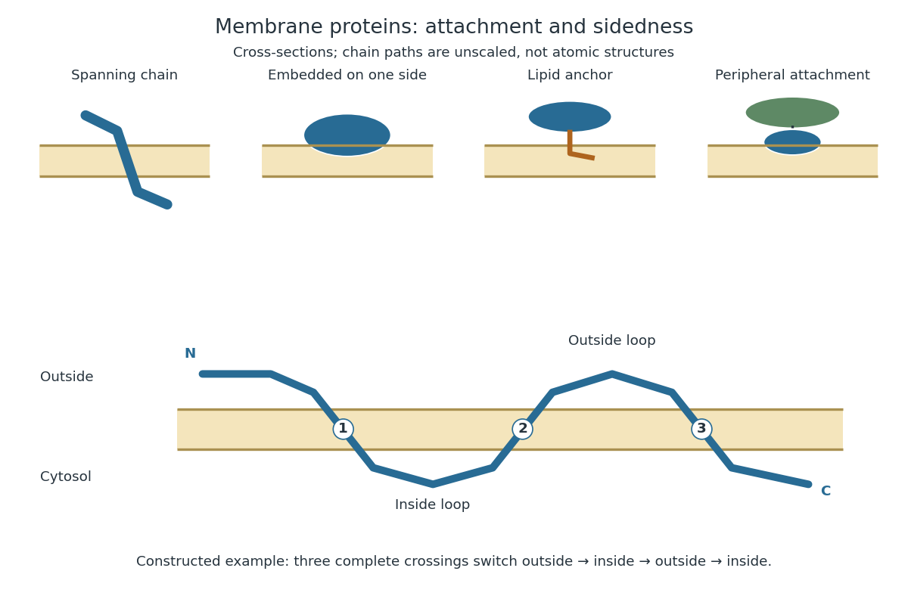

# Membrane protein

↑ **Parent:** [Cell membrane](cell-membrane-split.md)  
ⓦ [Wiki](https://en.wikipedia.org/wiki/Membrane_protein)

A [membrane protein](membrane-protein.md) is a [protein](protein-split.md) associated with a biological membrane. Its association, orientation and mobility are separate properties: being embedded does not imply spanning, and spanning does not imply moving freely. [Membrane proteins](membrane-protein.md) supply routes for [membrane transport](membrane-transport.md) and recognition for [signal transduction](signal-transduction-split.md).[Cooper, The Cell: A Molecular Approach, 2nd edition, Cell Membranes, opening paragraph and Membrane Proteins](the-cell-a-molecular-approach-2nd-edition-by-geoffrey-m-cooper/cell-membranes.md)

An [ion channel](ion-channel.md) supplies a pathway for [ions](ion.md); a [carrier protein](carrier-protein.md) changes which side can reach a bound [solute](solute.md); a [cell-surface receptor](cell-surface-receptor.md) connects an external [ligand](ligand-biochemistry.md) to intracellular [signal transduction](signal-transduction-split.md). These examples distinguish passage from communication: a signal can cross the boundary as a change of [protein](protein-split.md) activity without the [ligand](ligand-biochemistry.md) itself crossing.[Alberts and others, Molecular Biology of the Cell, 4th edition, Membrane Proteins Can Be Associated with the Lipid Bilayer in Various Ways: association reflects function](molecular-biology-of-the-cell-4th-edition-by-bruce-alberts-and-others/membrane-proteins.md)

**[Figure 2](#image-membrane-association-and-the-orientation-of-a-spanning-chain). Membrane association and the orientation of a spanning chain**. Original schematic cross-sections of a [lipid bilayer](lipid-bilayer.md), followed by a constructed three-crossing [polypeptide chain](polypeptide.md). Colored paths represent placement, not atomic [protein structures](protein-structure.md). The [N-terminus](n-terminus.md) starts outside; each complete crossing switches sides, leaving the [C-terminus](c-terminus.md) inside. Drawn dimensions are unscaled.

The same boundary can therefore retain substances and communicate selectively with its surroundings. [Membrane topology](membrane-topology.md) tells us which parts can meet a given [ligand](ligand-biochemistry.md); [lateral mobility of membrane proteins](lateral-mobility-of-membrane-proteins.md) tells us whether two parts can approach each other along the boundary. A diagram of a [cell membrane](cell-membrane-split.md) becomes more useful when it answers both questions.

**Table of contents**

- [Ferroportin](ferroportin.md)
- [Transferrin receptor 1](transferrin-receptor-1.md)
- [OmpX](ompx.md)
- [Membrane mimic](membrane-mimic.md)
- [Nephrin](nephrin.md)
- [Cargo receptor](cargo-receptor.md)
- [Integrin](integrin.md)
- [Hydrophobic mismatch](hydrophobic-mismatch.md)
- [Integral membrane protein](integral-membrane-protein.md)
  - [Transmembrane protein](transmembrane-protein.md)
    - [Tail-anchored protein](tail-anchored-protein.md)
- [Peripheral membrane protein](peripheral-membrane-protein.md)
- [Lipid-anchored protein](lipid-anchored-protein.md)
- [Membrane topology](membrane-topology.md)
- [Lateral mobility of membrane proteins](lateral-mobility-of-membrane-proteins.md)
  - [Mouse-human heterokaryon membrane-mixing experiment](mouse-human-heterokaryon-membrane-mixing-experiment.md)
- [Membrane transport protein](membrane-transport-protein.md)
  - [Nucleotide-sugar transporter](nucleotide-sugar-transporter.md)
  - [Scramblase](scramblase.md)
  - [Flippase](flippase.md)
  - [ATP-binding cassette transporter](atp-binding-cassette-transporter.md)
  - [AcrB](acrb.md)
  - [Multidrug efflux pump](multidrug-efflux-pump.md)
  - [GLUT4](glut4.md)
  - [Carrier protein](carrier-protein.md)

## ↑ Ancestors (4)

1. [Cell membrane](cell-membrane-split.md)
2. [Biological cell](biological-cell-split.md)
3. [Biology](biology-split.md)
4. [Codex Wiki](split.md)

## ← Incoming links (18)

- [Cell membrane](cell-membrane-split.md)
- [Fluid mosaic model](fluid-mosaic-model.md)
- [Golgi apparatus](golgi-apparatus.md)
- [Golgi lumen](golgi-lumen.md)
- [Ion channel](ion-channel.md)
- [Lateral mobility of membrane proteins](lateral-mobility-of-membrane-proteins.md)
- [Membrane protein](membrane-protein.md)
- [Mouse-human heterokaryon membrane-mixing experiment](mouse-human-heterokaryon-membrane-mixing-experiment.md)
- [Solution](past-exam-of-the-biochemistry-and-molecular-biology-course-of-the-university-of-cambridge/2025/paper-1/section-a/1/solution.md)
- [Solution](past-exam-of-the-biochemistry-course-of-the-university-of-cambridge/2024/paper-1/section-ii/5/solution.md)
- [Solution](past-exam-of-the-biochemistry-course-of-the-university-of-cambridge/2025/paper-1/section-i/1/solution.md)
- [Solution](past-exam-of-the-biochemistry-course-of-the-university-of-cambridge/2025/paper-1/section-i/2/solution.md)
- [Solution](past-exam-of-the-biochemistry-course-of-the-university-of-cambridge/2025/paper-1/section-ii/7/solution.md)
- [Solution](past-exam-of-the-biochemistry-course-of-the-university-of-cambridge/2025/paper-4/section-iii/6/solution.md)
- [Peripheral membrane protein](peripheral-membrane-protein.md)
- [Secretory protein routing](secretory-protein-routing.md)
- [Selective permeability](selective-permeability.md)
- [Thylakoid](thylakoid.md)
