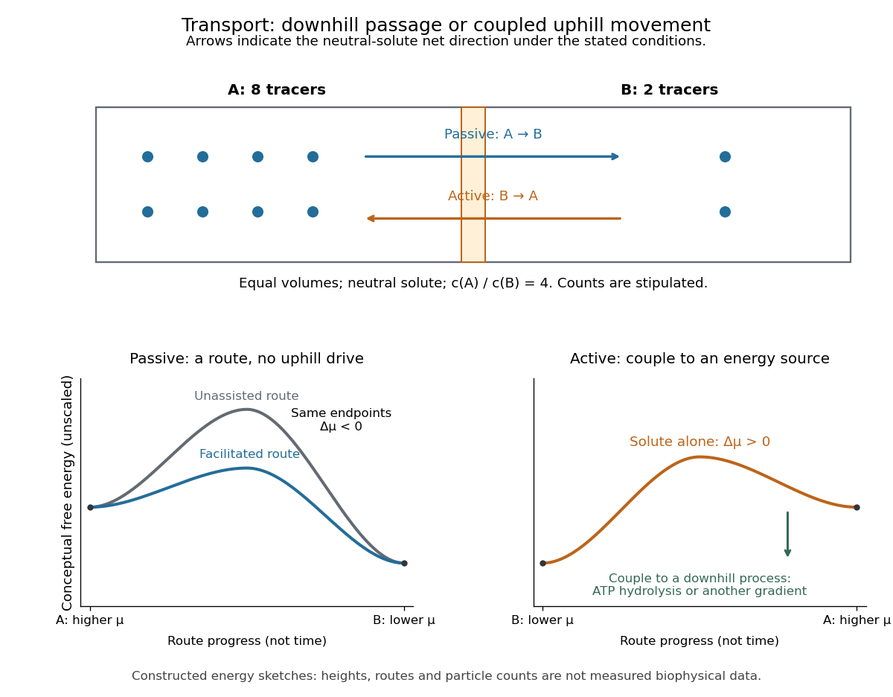

# Membrane transport

↑ **Parent:** [Cell membrane](cell-membrane.md)  
ⓦ [Wiki](https://en.wikipedia.org/wiki/Membrane_transport)

[Membrane transport](membrane-transport.md) is the passage of substances across a [cell membrane](cell-membrane.md). For the small [solutes](solute.md) considered here, distinguish the available route from its driving force: a [lipid bilayer](lipid-bilayer.md), [ion channel](ion-channel.md), or [carrier protein](carrier-protein.md) determines how passage can occur, while differences in [chemical potential](chemical-potential.md) and [membrane potential](membrane-potential.md) determine which direction is energetically downhill. A large driving force cannot make an unavailable route conduct. See [Alberts et al.: principles of membrane transport](https://www.ncbi.nlm.nih.gov/books/NBK26815/).

For an ideal dilute [chemical solution](solution-chemistry.md) at uniform [temperature](temperature.md) and [pressure](pressure.md), with the same reference molar [chemical potential](chemical-potential.md) on both sides, the molar [electrochemical potential](electrochemical-potential.md) change for transferring a [solute](solute.md) from compartment A to B is

$$
\Delta\widetilde\mu_{\mathrm{A}\to\mathrm{B}}=RT\ln\!\left(\frac{c_{\mathrm B}}{c_{\mathrm A}}\right)+zF(V_{\mathrm B}-V_{\mathrm A}).
$$

Here $c_{\mathrm A},c_{\mathrm B}$ are [concentrations](concentration.md), $T$ is absolute [temperature](temperature.md), $R$ is the [molar gas constant](molar-gas-constant.md), $z$ is signed [ion](ion.md) charge number, $F$ is the [Faraday constant](faraday-constant.md), and $V_{\mathrm B}-V_{\mathrm A}$ is the [electric potential](electric-potential.md) difference. The [natural logarithm](natural-logarithm.md) contains a dimensionless ratio. The electrical term vanishes for an uncharged [solute](solute.md). More generally, use [thermodynamic activities](thermodynamic-activity.md) in place of the ideal [concentration](concentration.md) ratio. This combines the ideal-solution [chemical potential](chemical-potential.md) difference with electrical [energy](energy.md) per mole; see [IUPAC Gold Book: electrochemical potential](https://goldbook.iupac.org/terms/view/E01945). For a [biological cell](biological-cell.md), taking B inside and A outside makes the voltage term use the existing [membrane potential](membrane-potential.md) convention.

**[Figure 69](#image-passive-transport-and-active-transport-for-a-stipulated-concentration-difference). Passive transport and active transport for a stipulated concentration difference**. Ten illustrative neutral [solute](solute.md) tracers are split 8:2 between equal fixed-[volume](volume.md) compartments. The lower sketches compare conceptual [free energy](thermodynamic-free-energy.md) profiles for [passive transport](passive-transport.md) and the [solute](solute.md) part of [active transport](active-transport.md). Heights are unscaled and are not experimental barriers; the lower-right curve excludes the driving process, so it is not a full coupled-cycle [free energy](thermodynamic-free-energy.md) profile.

**Table of contents**

- [Passive transport](passive-transport.md)
  - [Facilitated diffusion](facilitated-diffusion.md)
  - [Osmosis](osmosis.md)
    - [Tonicity](tonicity.md)
      - [Hypotonic solution](hypotonic-solution.md)
      - [Hypertonic solution](hypertonic-solution.md)
      - [Isotonic solution](isotonic-solution.md)
    - [Cytolysis](cytolysis.md)
- [Active transport](active-transport.md)
- [Exocytosis](exocytosis.md)
- [Endocytosis](endocytosis.md)

## ↑ Ancestors (4)

1. [Cell membrane](cell-membrane.md)
2. [Biological cell](biological-cell.md)
3. [Biology](biology-split.md)
4. [Codex Wiki](split.md)

## ← Incoming links (9)

- [Cell membrane](cell-membrane.md)
- [Electrochemical potential](electrochemical-potential.md)
- [Endosymbiotic theory](endosymbiotic-theory.md)
- [Eukaryote](eukaryote.md)
- [Membrane transport](membrane-transport.md)
- [Nernst equilibrium potential](nernst-equilibrium-potential.md)
- [Phospholipid](phospholipid.md)
- [Reversal potential](reversal-potential.md)
- [Unicellular organism](unicellular-organism.md)
