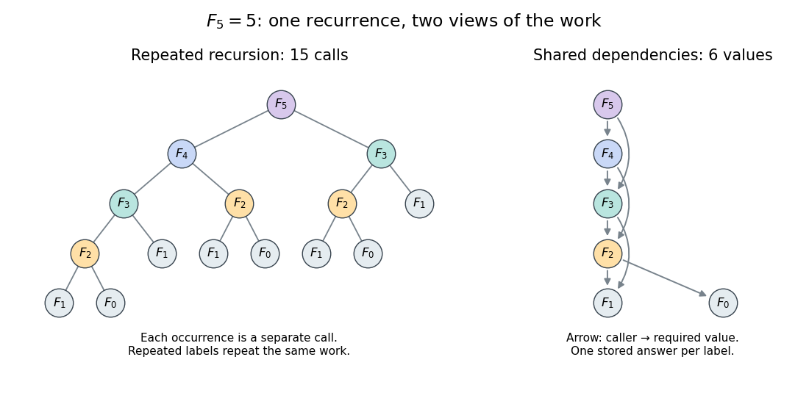
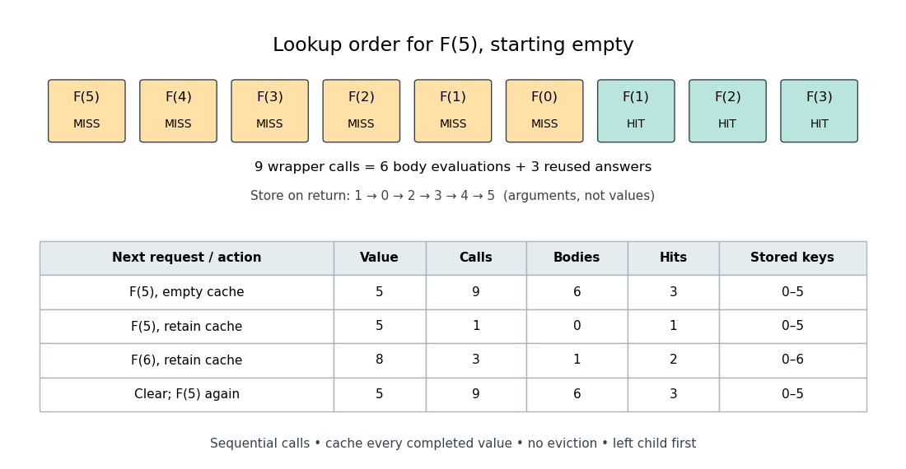

# Memoized Fibonacci evaluation

↑ **Parent:** [Memoization](memoization.md)

The [Fibonacci numbers](fibonacci-number.md) give an exact example. For a nonnegative [integer](integer-split.md) $n$, their [recurrence relation](recurrence-relation.md) is

$$
F_0=0,\qquad F_1=1,\qquad F_n=F_{n-1}+F_{n-2}\quad(n\geq2).
$$

To obtain $F_5=5$ by direct [recursion](recursion-computer-science.md), evaluate $F_4$ and $F_3$ separately; computing $F_4$ also evaluates $F_3$. The full call [tree](tree-graph-theory-split.md) has 15 occurrences but just six distinct arguments, $0,1,2,3,4,5$. Shared dependencies form a [Directed acyclic graph](directed-acyclic-graph.md) because every [directed edge](directed-edge.md) goes to a strictly smaller argument. [Memoization](memoization.md) evaluates a distinct argument on first demand; filling values in increasing argument order is the corresponding bottom-up [dynamic programming](dynamic-programming.md) calculation.[MIT 6.006 Spring 2020, Lecture 15: Recursive Algorithms, printed pp. 2–3, Fibonacci Numbers and Re-using Subproblem Solutions](lecture-15-recursive-algorithms-6-006-spring-2020-by-massachusetts-institute-of-technology-6-006-course-staff.md)

<a id="image-repeated-calls-for-fibonacci-numbers-and-their-shared-directed-acyclic-graph-of-dependencies"></a>


**[Figure 12](#image-repeated-calls-for-fibonacci-numbers-and-their-shared-directed-acyclic-graph-of-dependencies). Repeated calls for Fibonacci numbers and their shared Directed acyclic graph of dependencies**. The call [tree](tree-graph-theory-split.md) contains 15 occurrences for $F_5$. The dependency [graph](graph-split.md) contains six distinct arguments and eight [directed edges](directed-edge.md). Equal labels have equal colors; arrows in the right panel point from a caller to the value it requires.

Use an initially empty [hash table](hash-table.md) `memo`, shared by every recursive call. Count even the first evaluations of the two base cases, store only completed results, evaluate the left term first, and retain all entries. The following original procedure assumes a nonnegative [integer](integer-split.md) argument:

```
def cached_fib(n, memo):
    if n in memo:
        return memo[n]
    if n < 2:
        value = n
    else:
        value = cached_fib(n - 1, memo) + cached_fib(n - 2, memo)
    memo[n] = value
    return value
```

Every self-call must pass through the [memoization](memoization.md) lookup. Wrapping only the outer call while leaving inner calls uncached retains the repeated work. Test membership rather than whether the stored value is nonzero: $F_0=0$ is a valid completed result.

For cold $F_5$, the lookup arguments are $5,4,3,2,1,0,1,2,3$. The first six are absent; the last three reuse completed answers. Results are stored on return in argument order $1,0,2,3,4,5$, with values $1,0,1,2,3,5$. Thus there are nine wrapper calls, six body evaluations and four [additions](addition.md). Repeating $F_5$ with the same table takes one wrapper call and no body evaluation. Requesting $F_6$ next evaluates only its body, reuses $F_5$ and $F_4$, and stores $F_6=8$: three wrapper calls, one body evaluation and two hits.

<a id="image-an-exact-memoization-lookup-trace-and-the-effect-of-retaining-or-clearing-its-table"></a>


**[Figure 13](#image-an-exact-memoization-lookup-trace-and-the-effect-of-retaining-or-clearing-its-table). An exact memoization lookup trace and the effect of retaining or clearing its table**. The first row records cold $F_5$ lookup order. The table records successive requests with one retained table; clearing it before the final request restores the cold counts. Calls include lookups that immediately return stored values; bodies count only first evaluations.

The direct-call count satisfies $C_0=C_1=1$ and $C_n=1+C_{n-1}+C_{n-2}$. Its exact solution is $C_n=2F_{n+1}-1$, as substitution into this [recurrence relation](recurrence-relation.md) verifies. With the specified [memoization](memoization.md) procedure, a cold call at $n\geq2$ evaluates $n+1$ distinct bodies, makes $n-1$ [additions](addition.md) and makes $2n-1$ wrapper calls. There are $n-2$ hits: each of the $n-1$ nonbase bodies issues two recursive calls, in addition to the initial call. The difference is between the number of occurrences and the number of distinct subproblems.

## ↑ Ancestors (4)

1. [Memoization](memoization.md)
2. [Algorithm](algorithm-split.md)
3. [Computer science](computer-science-split.md)
4. [Codex Wiki](split.md)

## ← Incoming links (1)

- [Memoization arithmetic and stack costs](memoization-arithmetic-and-stack-costs.md)
