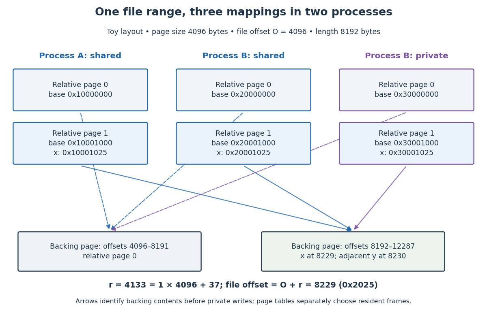

# Memory-mapped file offset translation

↑ **Parent:** [Memory-mapped file](memory-mapped-file.md)

Let $P$ be the [memory page](memory-page.md) size, $O$ the aligned starting [file offset](file-offset.md), $L$ the mapping length and $B$ its base [virtual address](virtual-address.md). A valid displacement $r=v-B$ with $0\leq r<L$ corresponds to [file offset](file-offset.md)

$$
o=O+r,\qquad j=\left\lfloor\frac{r}{P}\right\rfloor,\qquad d=r\bmod P.
$$

Here $j$ is the relative [memory page](memory-page.md) index, the [floor function](floor-function.md) selects its [integer](integer-split.md) part, and [Euclidean division](euclidean-division.md) gives the within-page displacement $d$. The backing page begins at $O+jP$. This identifies [file](computer-file.md) contents; the [page table](page-table.md) separately selects a resident [page frame](page-frame.md) and enforces permissions.

Take $P=4096$, $O=4096$ and $L=8192$ [bytes](byte.md) in a [file](computer-file.md) of at least 12288 [bytes](byte.md). A has a [shared file mapping](shared-file-mapping.md) at $B_A=\mathtt{0x10000000}$. B has a [shared file mapping](shared-file-mapping.md) at $B_B=\mathtt{0x20000000}$ and a [private file mapping](private-file-mapping.md) at $B_C=\mathtt{0x30000000}$. These bases are illustrative chosen results, not requested fixed addresses. All three mappings cover the same two backing pages: [file offsets](file-offset.md) 4096–8191 and 8192–12287. Displacement $r=4133=4096+37$ selects relative page 1, within-page displacement 37 and [file offset](file-offset.md) $o=8229=\mathtt{0x2025}$. Thus A's `0x10001025`, B's shared `0x20001025` and B's private `0x30001025` initially identify the same [byte](byte.md). The adjacent displacement 4134 identifies [file offset](file-offset.md) 8230. Different [virtual addresses](virtual-address.md) can reach the same backing contents.

**[Figure 7](#image-two-operating-system-processes-map-two-backing-pages-at-different-virtual-addresses-displacement-4133-identifies-file-offset-8229). Two operating-system processes map two backing pages at different virtual addresses; displacement 4133 identifies file offset 8229**.

To access a requested [file offset](file-offset.md) $q$ that is not aligned, choose $O=P\lfloor q/P\rfloor$ and displacement $q-O$. Mapping enough [bytes](byte.md) to cover that displacement plus the requested length makes the desired data start inside the aligned mapping. Do not pass the unaligned $q$ directly as the [Linux kernel](linux-kernel.md) `mmap` offset. For example, $q=8229$ uses $O=8192$ and displacement 37; that one-page start differs from our two-page mapping's $O=4096$.

## ↑ Ancestors (5)

1. [Memory-mapped file](memory-mapped-file.md)
2. [Virtual memory](virtual-memory-split.md)
3. [Operating system](operating-system-split.md)
4. [Computer science](computer-science-split.md)
5. [Codex Wiki](split.md)

## ← Incoming links (1)

- [Memory-mapped file](memory-mapped-file.md)
