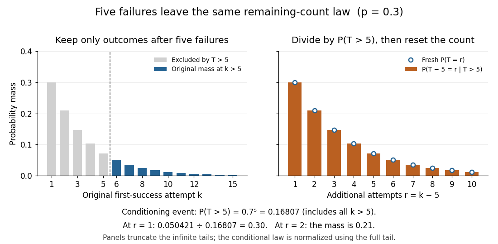

# Memorylessness of the geometric distribution

↑ **Parent:** [Geometric distribution](geometric-distribution.md)

For the positive-integer [geometric distribution](geometric-distribution.md) with success [probability](probability.md) $0<p\leq1$, the displayed identity holds for nonnegative [integers](integer-split.md) $m,r$ whenever the conditioning [event](event.md) has positive [probability](probability.md). The first $m$ attempts have failed; future [independent](independent-random-variables.md) attempts use the same success [probability](probability.md). Equivalently, divide the tail $(1-p)^{m+r}$ by $(1-p)^m$. For a zero-based failures count $F=T-1$, use $\mathbb P(F\geq m+r\mid F\geq m)=\mathbb P(F\geq r)$. Constant success [probability](probability.md) and [independence](independent-random-variables.md) are essential: accumulated wear or learning would require a different model.

The full remaining-count law is unchanged, not only one tail [probability](probability.md). With $0<p<1$, after $m$ failures set $R=T-m$ on the [event](event.md) $T>m$. For $r=1,2,\ldots$, its [probability mass function](probability-mass-function.md) under this [conditional probability](conditional-probability.md) is

$$
\mathbb P(R=r\mid T>m)=\frac{q^{m+r-1}p}{q^m}=q^{r-1}p.
$$

Here [independence](independent-random-variables.md) makes the future trials unaffected by the observed failures, and the unchanged success [probability](probability.md) makes their law identical to the original one. Consequently $\mathbb E[T-m\mid T>m]=1/p$, while $\mathbb E[T\mid T>m]=m+1/p$. For the constructed $p=0.3$ mechanism, five failures leave a [mean](expected-value-split.md) of $10/3$ more attempts, making the conditional [mean](expected-value-split.md) total $25/3$; the five already spent are still counted.

**[Figure 6](#image-conditioning-on-five-failures-renormalizing-and-resetting-the-count-gives-the-original-geometric-law). Conditioning on five failures, renormalizing, and resetting the count gives the original geometric law**.

The same mechanism has constant [discrete hazard](discrete-hazard.md):

$$
\mathbb P(T=k\mid T\geq k)=\frac{q^{k-1}p}{q^{k-1}}=p,\qquad k\geq1.
$$

Thus each reached attempt has the same chance of success. This differs from the decreasing unconditional [probability](probability.md) $\mathbb P(T=k)$: later success requires surviving earlier attempts. At $p=1$, only conditioning on an [event](event.md) of positive [probability](probability.md) is allowed: $T>m$ permits only $m=0$, and $T\geq k$ only $k=1$.

Among proper laws on the positive [integers](integer-split.md), [memorylessness of the geometric distribution](memorylessness-of-the-geometric-distribution.md) also characterizes the [geometric distribution](geometric-distribution.md). Write $S(n)=\mathbb P(T>n)$. The identity gives $S(m+r)=S(m)S(r)$; if $S(m)=0$, both sides vanish anyway. Since $S(0)=1$, [induction](mathematical-induction.md) yields $S(n)=S(1)^n$. Properness excludes $S(1)=1$, so setting $p=1-S(1)>0$ recovers the [geometric distribution](geometric-distribution.md), including $p=1$.[Random: Probability, Mathematical Statistics, Stochastic Processes by Kyle Siegrist; Basic Theory, Distribution Functions and the Memoryless Property: conditional remaining-count identity and its converse](random-probability-mathematical-statistics-stochastic-processes-by-kyle-siegrist/the-geometric-distribution.md)

The retry example stipulates [independent](independent-random-variables.md) [Bernoulli trials](bernoulli-trial.md) with a known constant $p$; it is not evidence that a real retry system behaves this way. Shared changing conditions or adapting attempts can alter the next success [probability](probability.md). Even constant individual success [probabilities](probability.md) alone do not imply [independence](independent-random-variables.md).

For an original contrasting model, uniformly shuffle one success card and three failure cards, then draw by [sampling without replacement](sampling-without-replacement.md). Its success position $U$ has the [discrete uniform distribution](discrete-uniform-distribution.md) on $\{1,2,3,4\}$. Initially the success [probability](probability.md) is $1/4$; after one failure it is $1/3$. In particular,

$$
\mathbb P(U>2\mid U>1)=\frac{2/4}{3/4}=\frac23
\ne\frac34=\mathbb P(U>1).
$$

This shows concretely why [sampling without replacement need not be independent](sampling-without-replacement-need-not-be-independent.md) and why the remaining wait can change. Every draw still has unconditional success [probability](probability.md) $1/4$ when all four positions are considered; the relevant [discrete hazard](discrete-hazard.md) changes after failures.

## ↑ Ancestors (8)

1. [Geometric distribution](geometric-distribution.md)
2. [Discrete probability distribution](discrete-probability-distribution-split.md)
3. [Probability distribution](probability-distribution-split.md)
4. [Probability theory](probability-theory-split.md)
5. [Probability and statistics](probability-and-statistics-split.md)
6. [Area of mathematics](area-of-mathematics.md)
7. [Mathematics](mathematics-split.md)
8. [Codex Wiki](split.md)

## ← Incoming links (4)

- [Geometric distribution](geometric-distribution.md)
- [Memorylessness of the geometric distribution](memorylessness-of-the-geometric-distribution.md)
- [Solution](past-exam-of-the-mathematics-course-of-the-year-1-of-the-natural-sciences-course-of-the-university-of-cambridge/2007/paper-2/section-b/3/a/solution.md)
- [Return period](return-period.md)
