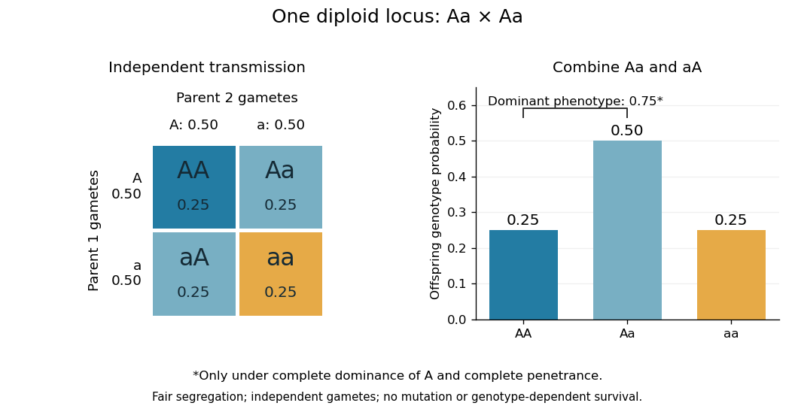

# Mendelian segregation

↑ **Parent:** [Genetics](genetics-split.md)

In ordinary [diploid](diploid.md) [meiosis](meiosis.md), the two copies at a [genetic locus](genetic-locus.md) separate: each [gamete](gamete.md) receives one copy. With fair transmission, a [heterozygote](heterozygote.md) $Aa$ produces [gametes](gamete.md) carrying $A$ or $a$ with [probability](probability.md) $1/2$ each. This is a transmission mechanism conditional on a parental [genotype](genotype.md), rather than a statement about how common either [allele](allele.md) is in a population.

For the one-locus cross $Aa\times Aa$, assume independent parental transmissions, no new [mutation](mutation.md), and no differences in [fertilization](fertilization.md) or survival between the resulting [genotypes](genotype.md). Multiplying the two [gamete](gamete.md) [probabilities](probability.md) gives four equally likely ordered outcomes: $AA,Aa,aA,aa$, each with [probability](probability.md) $1/4$. Combining the two orders of the [heterozygote](heterozygote.md) gives

$$
P(AA)=0.25,\qquad P(Aa)=0.50,\qquad P(aa)=0.25.
$$

Only under the additional ideal model of [complete dominance](complete-dominance.md) of $A$, complete [penetrance](penetrance.md), and no environmental changes to the scored characteristic do $AA$ and $Aa$ share the dominant [phenotype](phenotype.md). Its [probability](probability.md) is then $0.25+0.50=0.75$. The inheritance calculation alone does not determine a [phenotype](phenotype.md) or predict a generic [disease](disease.md) risk.

**[Figure 6](#image-fair-mendelian-transmission-in-an-aa-×-aa-cross-with-phenotype-grouping-under-complete-dominance-and-penetrance). Fair Mendelian transmission in an Aa × Aa cross, with phenotype grouping under complete dominance and penetrance**.

These are [probabilities](probability.md), not a requirement that every four offspring contain one $AA$, two $Aa$ and one $aa$. For 100 independent offspring under the ideal model, the [expected values](expected-value-split.md) of the three counts are $25,50,25$; the $aa$ count has a [binomial distribution](binomial-distribution.md) with [standard deviation](standard-deviation.md) $\sqrt{100(0.25)(0.75)}\approx4.33$. Each new transmission keeps the same [conditional probabilities](conditional-probability.md) given the parental [genotypes](genotype.md).

In his paper published in 1866, Mendel reported 5,474 round and 1,850 wrinkled pea seeds: $5474/7324\approx0.7474$ round, close to the ideal $0.75$. Following descendants also distinguished two inherited classes within the round [phenotype](phenotype.md), illustrating why [genotype](genotype.md) cannot always be read from appearance.[sections 5–6](experiments-in-plant-hybridization-by-gregor-mendel.md) At several [genetic loci](genetic-locus.md), transmission patterns additionally depend on [genetic linkage](genetic-linkage.md) and [genetic recombination](genetic-recombination.md).

**Table of contents**

- [Independent assortment](independent-assortment.md)
- [Test cross](test-cross.md)

## ↑ Ancestors (3)

1. [Genetics](genetics-split.md)
2. [Biology](biology-split.md)
3. [Codex Wiki](split.md)

## ← Incoming links (35)

- [Disease-ascertained transmission probability](disease-ascertained-transmission-probability.md)
- [Fertilization](fertilization.md)
- [Functional plastid-to-nucleus gene transfer experiment](functional-plastid-to-nucleus-gene-transfer-experiment.md)
- [Genetic carrier](genetic-carrier.md)
- [Genetic linkage](genetic-linkage.md)
- [Genetics](genetics-split.md)
- [Hardy-Weinberg principle](hardy-weinberg-principle.md)
- [Independent assortment](independent-assortment.md)
- [Jacquard identity coefficients](jacquard-identity-coefficients.md)
- [Kinship coefficient](kinship-coefficient.md)
- [Linkage disequilibrium](linkage-disequilibrium.md)
- [Linkage-disequilibrium decay under recombination](linkage-disequilibrium-decay-under-recombination.md)
- [Meiosis](meiosis.md)
- [Nonparametric linkage analysis](nonparametric-linkage-analysis.md)
- [One-generation random-mating equilibrium](one-generation-random-mating-equilibrium.md)
- [Solution](past-exam-of-the-mathematics-course-of-the-university-of-cambridge/2001/iii/paper-29/5/b/solution.md)
- [Solution](past-exam-of-the-mathematics-course-of-the-university-of-cambridge/2002/iii/paper-37/5/ii/solution.md)
- [Solution](past-exam-of-the-mathematics-course-of-the-university-of-cambridge/2002/iii/paper-37/5/iii/solution.md)
- [Solution](past-exam-of-the-mathematics-course-of-the-university-of-cambridge/2002/iii/paper-57/6/b/solution.md)
- [Solution](past-exam-of-the-mathematics-course-of-the-university-of-cambridge/2003/iii/paper-40/5/i/solution.md)
- [Solution](past-exam-of-the-mathematics-course-of-the-university-of-cambridge/2003/iii/paper-40/6/a/solution.md)
- [Solution](past-exam-of-the-mathematics-course-of-the-university-of-cambridge/2004/iii/paper-39/3/d/i/solution.md)
- [Solution](past-exam-of-the-mathematics-course-of-the-university-of-cambridge/2004/iii/paper-39/3/d/ii/solution.md)
- [Solution](past-exam-of-the-mathematics-course-of-the-university-of-cambridge/2004/iii/paper-39/4/iv/solution.md)
- [Solution](past-exam-of-the-mathematics-course-of-the-university-of-cambridge/2005/iii/paper-45/1/i/solution.md)
- [Solution](past-exam-of-the-mathematics-course-of-the-university-of-cambridge/2005/iii/paper-45/1/ii/solution.md)
- [Solution](past-exam-of-the-mathematics-course-of-the-university-of-cambridge/2005/iii/paper-45/2/a/solution.md)
- [Solution](past-exam-of-the-mathematics-course-of-the-university-of-cambridge/2005/iii/paper-45/2/d/solution.md)
- [Solution](past-exam-of-the-mathematics-course-of-the-university-of-cambridge/2006/iii/paper-45/1/c/solution.md)
- [Solution](past-exam-of-the-systems-biology-course-of-the-university-of-cambridge/2024/paper-1/section-i/1-1/solution.md)
- [Solution](past-exam-of-the-zoology-course-of-the-university-of-cambridge/2024/paper-zl3/3/solution.md)
- [Solution](past-exam-of-the-zoology-course-of-the-university-of-cambridge/2025/paper-zm5/1/solution.md)
- [Pedigree graphical model](pedigree-graphical-model.md)
- [Recombination fraction](recombination-fraction.md)
- [Sibling recurrence risk](sibling-recurrence-risk.md)
