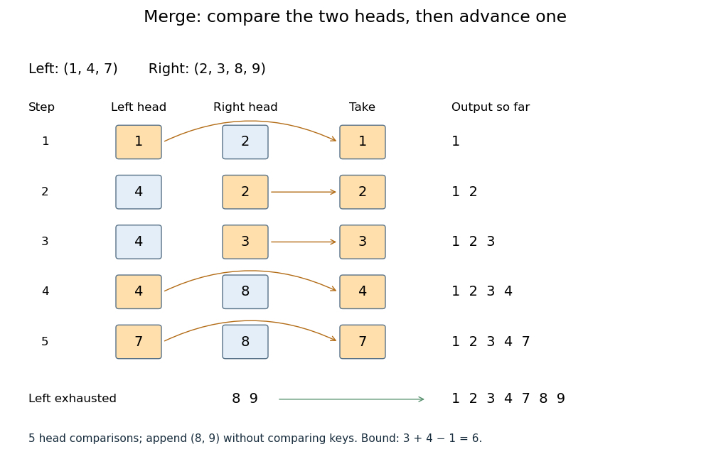

# Merge algorithm

↑ **Parent:** [Algorithm](algorithm.md)  
ⓦ [Wiki](https://en.wikipedia.org/wiki/Merge_algorithm)

The [merge algorithm](merge-algorithm.md) combines two finite sorted [sequences](sequence.md) under the same [total order](total-order.md), retaining every entry exactly once. Keep a position at the first unconsumed entry, or "head", of each [input](input-computer-science.md). While both heads exist, compare their keys, append the smaller head to the [output](output-computing.md), and advance only that head's position. On equality take the left head. Once either [sequence](sequence.md) is exhausted, append the other remainder without further key comparisons. Empty [inputs](input-computer-science.md) therefore require no head comparisons. The MIT notes illustrate this two-head combination step.[MIT 6.006 (2011), lecture 3: merging sorted arrays](https://ocw.mit.edu/courses/6-006-introduction-to-algorithms-fall-2011/90a37c49b07b105ea7a027abc67eddc6_MIT6_006F11_lec03.pdf)

For example, the [merge algorithm](merge-algorithm.md) applied to $(1,4,7)$ and $(2,3,8,9)$ returns $(1,2,3,4,7,8,9)$:

**[Figure 69](#image-five-head-comparisons-in-the-merge-algorithm). Five head comparisons in the merge algorithm**. Orange heads are chosen and arrows lead to the next [output](output-computing.md) entry. The compared head pairs are (1,2), (4,2), (4,3), (4,8) and (7,8). The left [sequence](sequence.md) then runs out; append (8,9) without further key comparisons.

The head pairs $(1,2)$, $(4,2)$, $(4,3)$, $(4,8)$ and $(7,8)$ select $1,2,3,4,7$ respectively. After the fifth comparison the left [sequence](sequence.md) is empty, so $(8,9)$ is appended. Seven entries are written, but only five head comparisons occur: tests for exhaustion and appending the remainder are separate operations. This distinction makes the example's count smaller than the bound $3+4-1=6$.

For nonempty [inputs](input-computer-science.md) of lengths $m,n$, each head comparison consumes exactly one entry. After $m+n-1$ such removals at most one entry remains, so both heads cannot still exist. Hence the [merge algorithm](merge-algorithm.md) uses at most $m+n-1$ head comparisons. The bound can be attained: $(1,3,5)$ and $(2,4,6,7)$ require six head comparisons before the left [sequence](sequence.md) is exhausted. With constant-cost comparisons, access and copying, writing all $m+n$ entries gives [time complexity](time-complexity.md) $O(m+n)$ in [Big O notation](big-o-notation.md). Writing a separate [output](output-computing.md) [array](array-data-structure.md) needs $m+n$ entry slots; the two positions require only constant additional storage.

The [merge algorithm](merge-algorithm.md) is useful whenever two already ordered collections must become one: it reads each [input](input-computer-science.md) only forwards. This works with [arrays](array-data-structure.md) and [linked lists](linked-list.md), without needing access to arbitrary middle positions. Choosing left on ties preserves each [input](input-computer-science.md)'s internal order and places equal left entries before equal right entries, which is the combination rule needed for [stable sorting](stable-sorting.md) in [merge sort](merge-sort.md).

The [loop invariant](loop-invariant.md) behind [algorithm correctness](algorithm-correctness.md) is that the emitted prefix is sorted, contains exactly the consumed entries, and every emitted key is at most every unconsumed key. Each sorted [sequence](sequence.md) has its smallest remaining key at its head, so the smaller of the two heads is safe to append. The invariant survives each removal; when one [sequence](sequence.md) ends, the other sorted remainder is safe to append in full. Each comparison removes an entry, so termination follows from the finite [input](input-computer-science.md) lengths.

// Target: computer-science.bigb

## ↑ Ancestors (3)

1. [Algorithm](algorithm.md)
2. [Computer science](computer-science-split.md)
3. [Codex Wiki](split.md)

## ← Incoming links (7)

- [Divide-and-conquer algorithm](divide-and-conquer-algorithm.md)
- [Merge algorithm](merge-algorithm.md)
- [Merge sort](merge-sort.md)
- [Solution](past-exam-of-the-mathematics-course-of-the-university-of-cambridge/2006/ia/paper-5/1/c/solution.md)
- [Solution](past-exam-of-the-mathematics-course-of-the-university-of-cambridge/2007/ia/paper-5/1/a/solution.md)
- [Solution](past-exam-of-the-mathematics-course-of-the-university-of-cambridge/2007/ia/paper-5/1/b/solution.md)
- [Solution](past-exam-of-the-mathematics-course-of-the-university-of-cambridge/2007/ia/paper-5/1/c/solution.md)
