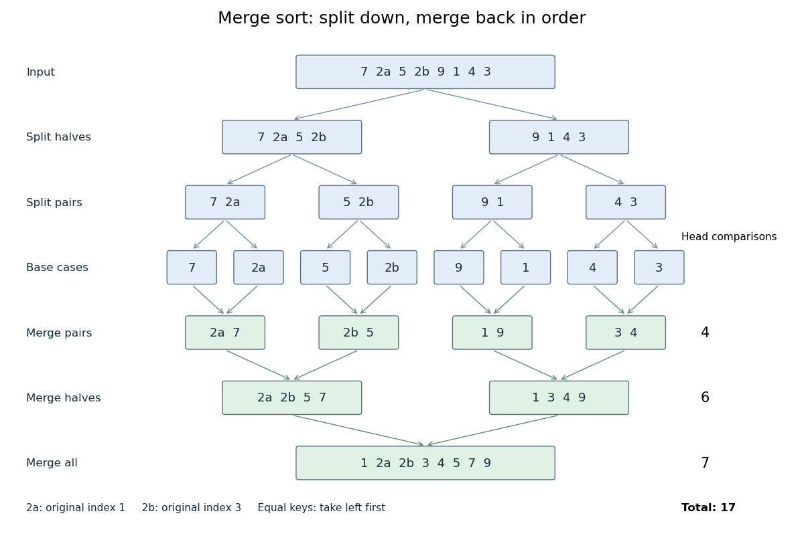

# Merge sort

↑ **Parent:** [Sorting algorithm](sorting-algorithm.md)  
ⓦ [Wiki](https://en.wikipedia.org/wiki/Merge_sort)

[Merge sort](merge-sort.md) is a [divide-and-conquer algorithm](divide-and-conquer-algorithm.md) that sorts a finite [array](array-data-structure.md) by splitting it into contiguous halves, sorting each half using [recursion](recursion-computer-science.md), and combining the two [sorted arrays](sorted-array.md) with the [merge algorithm](merge-algorithm.md). An empty or one-entry [array](array-data-structure.md) is returned immediately. For length $n\geq2$, put the first $\lfloor n/2\rfloor$ entries on the left and the remaining $\lceil n/2\rceil$ on the right; the brackets are the [floor function](floor-function.md) and [ceiling function](ceiling-function.md). Always choose the left head on equal keys to obtain [stable sorting](stable-sorting.md). This is the split, sort, combine structure taught in the MIT lecture notes.[MIT 6.006 (2011), lecture 3: merge sort](https://ocw.mit.edu/courses/6-006-introduction-to-algorithms-fall-2011/90a37c49b07b105ea7a027abc67eddc6_MIT6_006F11_lec03.pdf)

Take the concrete [input](input-computer-science.md) [array](array-data-structure.md)

$$
A=(7,2_a,5,2_b,9,1,4,3).
$$

The tags identify the entries originally at indices $1$ and $3$, counting from zero. Both keys are $2$; the tags are never compared. Reading downward in the figure follows the splits, then the returned [sorted arrays](sorted-array.md). Arrows show dependencies; the level layout groups independent calls rather than giving their chronological execution order.

**[Figure 68](#image-merge-sort-splits-into-base-cases-and-returns-sorted-arrays). Merge sort splits into base cases and returns sorted arrays**. The tagged keys 2a and 2b retain their original order through [stable sorting](stable-sorting.md). The [merge algorithm](merge-algorithm.md) makes 4, 6 and 7 head comparisons on the three returning levels, for 17 in total.

The first two halves are $(7,2_a,5,2_b)$ and $(9,1,4,3)$. Their pairs split into one-entry base cases. Applying the [merge algorithm](merge-algorithm.md) gives the following fully worked return levels; each number in the last column counts only comparisons between two available heads.

| Returning level | Resulting [sorted arrays](sorted-array.md) | Head comparisons |
| --- | --- | --- |
| Pairs | $(2_a,7)$, $(2_b,5)$, $(1,9)$, $(3,4)$ | $1+1+1+1=4$ |
| Halves | $(2_a,2_b,5,7)$, $(1,3,4,9)$ | $3+3=6$ |
| Whole [array](array-data-structure.md) | $(1,2_a,2_b,3,4,5,7,9)$ | $7$ |

In the left-half [merge algorithm](merge-algorithm.md), the head pairs are $(2_a,2_b)$, $(7,2_b)$ and $(7,5)$; it takes $2_a,2_b,5$, then appends $7$. In the final [merge algorithm](merge-algorithm.md), the head pairs are $(2_a,1)$, $(2_a,3)$, $(2_b,3)$, $(5,3)$, $(5,4)$, $(5,9)$ and $(7,9)$. It takes $1,2_a,2_b,3,4,5,7$, then appends $9$. Thus this precise version makes $4+6+7=17$ head comparisons and, ignoring identity tags, returns $(1,2,2,3,4,5,7,9)$.

The elegance of [merge sort](merge-sort.md) is that it creates exactly the structure its next step needs: two smaller [sorted arrays](sorted-array.md) make the larger ordering inexpensive. Once the whole [array](array-data-structure.md) is sorted, equal keys are adjacent and [binary search](binary-search.md) can serve repeated queries. [Stable sorting](stable-sorting.md) also retains information that the keys alone do not express. If the left-half [merge algorithm](merge-algorithm.md) instead takes the right head on the $2_a=2_b$ tie, it returns $(2_b,2_a,5,7)$; the keys are sorted but [stable sorting](stable-sorting.md) has failed.

For [time complexity](time-complexity.md), assume each key comparison, entry access and entry copy has constant cost. The [merge algorithm](merge-algorithm.md) processes $n$ entries in $O(n)$ time. In [Big O notation](big-o-notation.md), the resulting [recurrence relation](recurrence-relation.md) is

$$
T(0),T(1)=O(1),\qquad T(n)=T(\lfloor n/2\rfloor)+T(\lceil n/2\rceil)+O(n)\quad(n\geq2).
$$

For $n=2^k$, the balanced levels contain $n$ entries each and there are $k=\log_2 n$ returning levels. Each costs $O(n)$, so the worst-case [time complexity](time-complexity.md) is $O(n\log n)$. For arbitrary $n$, there are at most $\lceil\log_2 n\rceil$ returning levels, each processing at most $n$ entries, giving the same bound. The worst-case number of head comparisons is also $O(n\log n)$. Here $\log_2$ is the base-two [logarithm](logarithm.md). The MIT notes give this level-by-level analysis for [merge sort](merge-sort.md).[MIT 6.006 (2020), lecture 3, page 5: merge sort analysis](https://ocw.mit.edu/courses/6-006-introduction-to-algorithms-spring-2020/6d1ae5278d02bbecb5c4428928b24194_MIT6_006S20_lec3.pdf)

The conventional [array](array-data-structure.md) implementation uses a reusable buffer of $n$ entries for the [merge algorithm](merge-algorithm.md), together with $O(\log n)$ pending calls for [recursion](recursion-computer-science.md). Its auxiliary [space complexity](space-complexity.md) is therefore $O(n)$, beyond the original [array](array-data-structure.md). This bound describes that implementation. A [linked list](linked-list.md) permits a [merge algorithm](merge-algorithm.md) that reconnects existing nodes; its storage accounting differs from copying [array](array-data-structure.md) entries into a buffer.

For a short [algorithm correctness](algorithm-correctness.md) outline, the empty and one-entry base cases are sorted. Assuming [recursion](recursion-computer-science.md) correctly sorts both shorter halves, the [merge algorithm](merge-algorithm.md) returns all their entries in order. Equal keys within a half keep their relative order by the same argument applied to the smaller call; across halves, every left entry originally preceded every right entry, so taking left first preserves [stable sorting](stable-sorting.md). Both half-lengths decrease for $n\geq2$, establishing termination.

## ↑ Ancestors (4)

1. [Sorting algorithm](sorting-algorithm.md)
2. [Algorithm](algorithm.md)
3. [Computer science](computer-science-split.md)
4. [Codex Wiki](split.md)

## ← Incoming links (11)

- [Comparison sort](comparison-sort.md)
- [Comparison sorting lower bound](comparison-sorting-lower-bound.md)
- [Divide-and-conquer algorithm](divide-and-conquer-algorithm.md)
- [Merge algorithm](merge-algorithm.md)
- [Merge sort](merge-sort.md)
- [Solution](past-exam-of-the-mathematics-course-of-the-university-of-cambridge/2006/ia/paper-5/1/c/solution.md)
- [Solution](past-exam-of-the-mathematics-course-of-the-university-of-cambridge/2007/ia/paper-5/1/b/solution.md)
- [Solution](past-exam-of-the-mathematics-course-of-the-university-of-cambridge/2007/ia/paper-5/1/c/solution.md)
- [Recursion (computer science)](recursion-computer-science.md)
- [Sorting algorithm](sorting-algorithm.md)
- [Time complexity](time-complexity.md)
