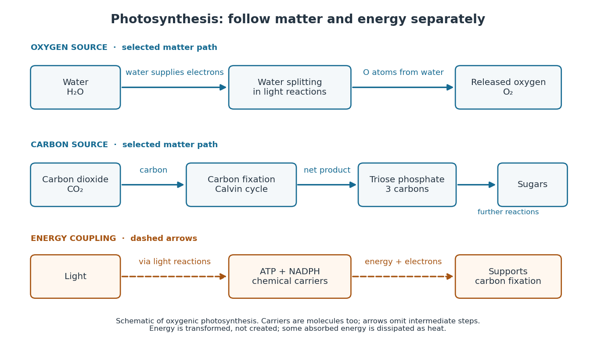
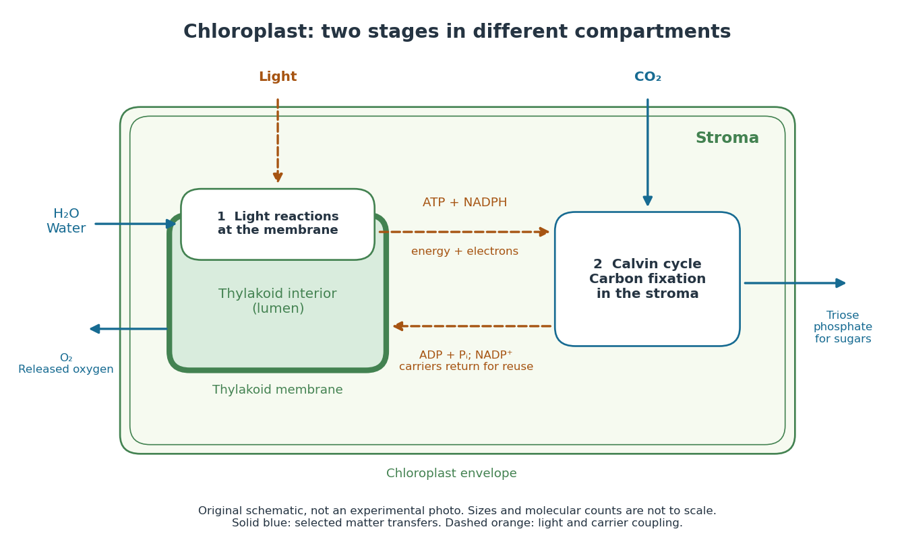
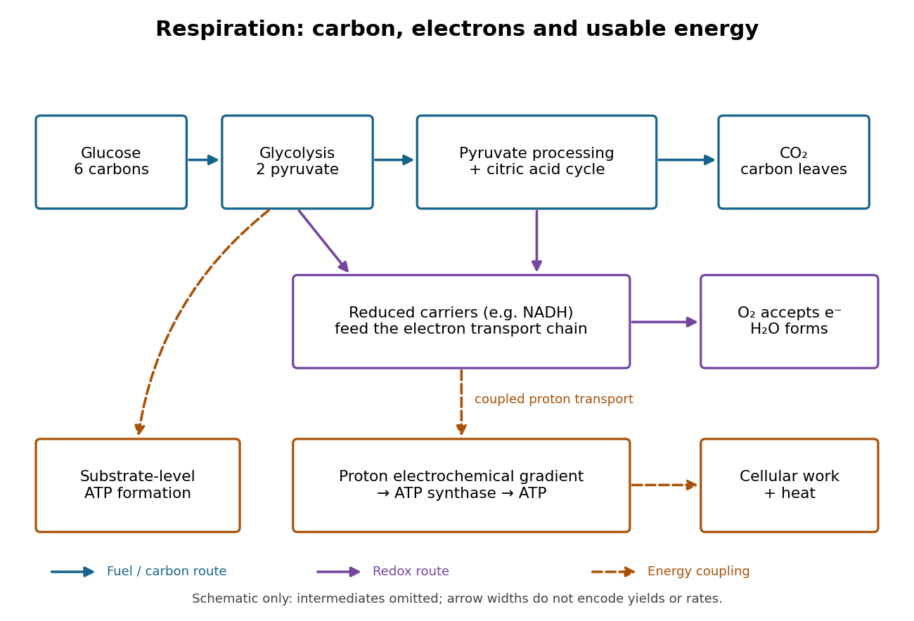
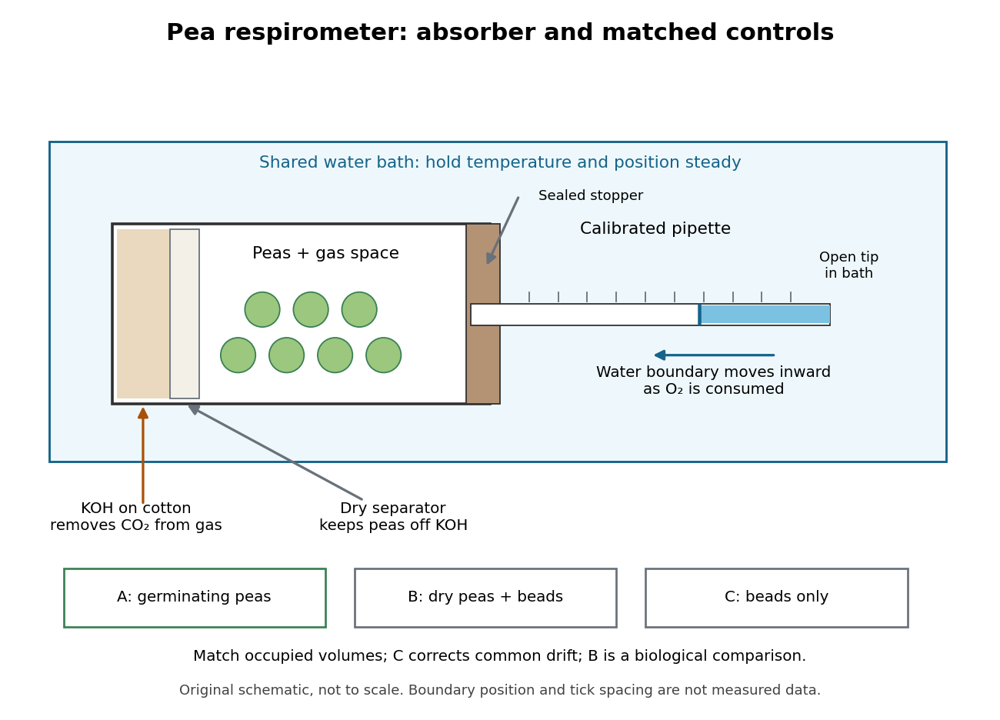

# Metabolism

↑ **Parent:** [Biology](biology.md)  
ⓦ [Wiki](https://en.wikipedia.org/wiki/Metabolism)

The network of [chemical reactions](chemical-reaction.md) that maintains a living system, supplies energy and builds or processes its material. Gas emissions can arise as [primary metabolic byproducts](#primary-metabolic-byproduct) or [secondary metabolic byproducts](#secondary-metabolic-byproduct), with different implications for an [atmospheric biosignature gas](exoplanet.md#atmospheric-biosignature-gas).

[Enzymes](enzyme.md) make this network operate on biologically useful timescales. Following material through successive [substrates](enzyme.md#substrate-biochemistry) and [reaction products](chemical-reaction.md#product-chemistry) explains why a single fast [enzyme](enzyme.md) need not make the entire network fast: another step may constrain the flow. Changing [enzyme](enzyme.md) amounts or activity therefore changes which routes can carry material, connecting molecular [chemical kinetics](chemical-kinetics.md) to the maintenance and growth of a [biological cell](biological-cell.md). See [Alberts et al., Molecular Biology of the Cell: multienzyme complexes and cell metabolism](https://www.ncbi.nlm.nih.gov/books/NBK26911/).

**Table of contents**

- [Catabolism](#catabolism)
- [Anabolism](#anabolism)
- [Uric acid](#uric-acid)
- [Glucose metabolism](#glucose-metabolism)
  - [Glucose production](#glucose-production)
- [Ketogenesis](#ketogenesis)
- [Biotransformation](#biotransformation)
- [Amino acid metabolism](#amino-acid-metabolism)
  - [Urea cycle](#urea-cycle)
  - [Deamination](#deamination)
  - [Transamination](#transamination)
- [Lipid metabolism](#lipid-metabolism)
  - [Lipoprotein](#lipoprotein)
    - [Chylomicron](#chylomicron)
  - [Ketone body](#ketone-body)
- [Carbohydrate metabolism](#carbohydrate-metabolism)
- [Chemolithotrophy](#chemolithotrophy)
- [Biosynthesis](#biosynthesis)
  - [Phenazine biosynthesis](#phenazine-biosynthesis)
- [Basal metabolic rate](#basal-metabolic-rate)
- [Glycerol phosphate shuttle](#glycerol-phosphate-shuttle)
- [Malate-aspartate shuttle](#malate-aspartate-shuttle)
- [Diauxic growth](#diauxic-growth)
- [Endothermy](#endothermy)
- [Metabolic control analysis](#metabolic-control-analysis)
  - [Flux summation theorem](#flux-summation-theorem)
  - [Flux control coefficient](#flux-control-coefficient)
- [Sulfate activation](#sulfate-activation)
- [Ethanol](#ethanol)
- [Fermentation](#fermentation)
  - [Viscous fermentation](#viscous-fermentation)
  - [Acetic acid fermentation](#acetic-acid-fermentation)
  - [Butyric acid fermentation](#butyric-acid-fermentation)
  - [Lactic acid fermentation](#lactic-acid-fermentation)
  - [Hindgut fermentation](#hindgut-fermentation)
    - [Cecotrophy](#cecotrophy)
  - [Foregut fermentation](#foregut-fermentation)
    - [Rumination](#rumination)
  - [Ethanol fermentation](#ethanol-fermentation)
- [Glycogen](#glycogen)
- [Glycogenesis](#glycogenesis)
- [Glycogenolysis](#glycogenolysis)
- [Gluconeogenesis](#gluconeogenesis)
- [Lipolysis](#lipolysis)
- [Photosynthesis](#photosynthesis)
  - [Photosynthetically active radiation](#photosynthetically-active-radiation)
  - [Photosynthetic acclimation](#photosynthetic-acclimation)
  - [Photoinhibition](#photoinhibition)
  - [Photoprotection](#photoprotection)
    - [Chloroplast relocation](#chloroplast-relocation)
  - [Photosynthetic reaction centre](#photosynthetic-reaction-centre)
  - [Light-harvesting complex](#light-harvesting-complex)
  - [Stomatal conductance](#stomatal-conductance)
  - [Gross primary production](#gross-primary-production)
  - [Chlorophyll fluorescence](#chlorophyll-fluorescence)
  - [Photosynthetic state transition](#photosynthetic-state-transition)
  - [Photorespiration](#photorespiration)
  - [Cyclic electron flow around photosystem I](#cyclic-electron-flow-around-photosystem-i)
  - [Photosynthetic control](#photosynthetic-control)
  - [Xanthophyll cycle](#xanthophyll-cycle)
  - [Non-photochemical quenching](#non-photochemical-quenching)
  - [Oxygenic photosynthesis](#oxygenic-photosynthesis)
  - [Anoxygenic photosynthesis](#anoxygenic-photosynthesis)
  - [Light-dependent reactions](#light-dependent-reactions)
    - [Photosystem](#photosystem)
      - [Photosystem I](#photosystem-i)
      - [Photosystem II](#photosystem-ii)
        - [Oxygen-evolving complex](#oxygen-evolving-complex)
        - [LHCII](#lhcii)
        - [PsbS](#psbs)
        - [Photosystem II repair](#photosystem-ii-repair)
        - [D1 protein](#d1-protein)
    - [Chlorophyll](#chlorophyll)
      - [Chlorophyll a](#chlorophyll-a)
- [Carbon fixation](#carbon-fixation)
  - [Calvin cycle](#calvin-cycle)
    - [RuBisCO](#rubisco)
- [Cellular respiration](#cellular-respiration)
  - [Heterotrophic respiration](#heterotrophic-respiration)
  - [Autotrophic respiration](#autotrophic-respiration)
  - [Aerobic respiration](#aerobic-respiration)
    - [Respiration and ATP coupling](#respiration-and-atp-coupling)
  - [Anaerobic respiration](#anaerobic-respiration)
  - [Respirometer](#respirometer)
    - [Respirometry](#respirometry)
      - [Respiratory exchange ratio](#respiratory-exchange-ratio)
    - [Pea seed respirometry](#pea-seed-respirometry)
    - [Respirometer gas balance](#respirometer-gas-balance)
      - [Respiratory quotient](#respiratory-quotient)
- [Secondary metabolic byproduct](#secondary-metabolic-byproduct)
- [Primary metabolic byproduct](#primary-metabolic-byproduct)

## Catabolism

↑ **Parent:** [Metabolism](metabolism.md)

## Anabolism

↑ **Parent:** [Metabolism](metabolism.md)

## Uric acid

↑ **Parent:** [Metabolism](metabolism.md)

## Glucose metabolism

↑ **Parent:** [Metabolism](metabolism.md)

### Glucose production

↑ **Parent:** [Glucose metabolism](#glucose-metabolism)

## Ketogenesis

↑ **Parent:** [Metabolism](metabolism.md)

## Biotransformation

↑ **Parent:** [Metabolism](metabolism.md)

## Amino acid metabolism

↑ **Parent:** [Metabolism](metabolism.md)

### Urea cycle

↑ **Parent:** [Amino acid metabolism](#amino-acid-metabolism)

### Deamination

↑ **Parent:** [Amino acid metabolism](#amino-acid-metabolism)

### Transamination

↑ **Parent:** [Amino acid metabolism](#amino-acid-metabolism)

## Lipid metabolism

↑ **Parent:** [Metabolism](metabolism.md)

### Lipoprotein

↑ **Parent:** [Lipid metabolism](#lipid-metabolism)

#### Chylomicron

↑ **Parent:** [Lipoprotein](#lipoprotein)

A large lipoprotein particle assembled by [enterocytes](biological-cell.md#enterocyte) to transport dietary long-chain [lipids](chemical-substance.md#lipid) through intestinal [lymph](physiology.md#lymph).

### Ketone body

↑ **Parent:** [Lipid metabolism](#lipid-metabolism)

## Carbohydrate metabolism

↑ **Parent:** [Metabolism](metabolism.md)

## Chemolithotrophy

↑ **Parent:** [Metabolism](metabolism.md)

Use of inorganic electron donors as a source of metabolic [free energy](thermodynamic-potential.md#thermodynamic-free-energy). It does not by itself specify the source of cellular [carbon](chemical-substance.md#carbon).

## Biosynthesis

↑ **Parent:** [Metabolism](metabolism.md)

Formation of biological molecules through [enzyme](enzyme.md)-catalysed metabolic reactions.

### Phenazine biosynthesis

↑ **Parent:** [Biosynthesis](#biosynthesis)

Formation and modification of phenazine metabolites. In Pseudomonas aeruginosa, two core phz loci generate precursors modified by additional enzymes.

## Basal metabolic rate

↑ **Parent:** [Metabolism](metabolism.md)

A standardized minimum metabolic rate measured under stated resting, postabsorptive and thermal conditions; it is not interchangeable with maximum aerobic performance.

## Glycerol phosphate shuttle

↑ **Parent:** [Metabolism](metabolism.md)

A route transferring cytosolic reducing equivalents through glycerol-phosphate dehydrogenases to mitochondrial electron transport. Its entry point differs from matrix NADH oxidation.

## Malate-aspartate shuttle

↑ **Parent:** [Metabolism](metabolism.md)

A coupled reaction and transport system transferring reducing equivalents between cytosol and mitochondrial matrix without transporting NADH itself across the inner membrane.

## Diauxic growth

↑ **Parent:** [Metabolism](metabolism.md)

A growth pattern with successive utilization of substrates separated by an adaptation interval. Glucose followed by lactose is a classic example, but timing depends on culture conditions and transport regulation.

## Endothermy

↑ **Parent:** [Metabolism](metabolism.md)

Production of metabolic heat sufficient to contribute substantially to body-temperature regulation. It is not synonymous with constant [temperature](temperature.md), and similar thermophysiology does not by itself identify a [clade](evolution.md#clade).

## Metabolic control analysis

↑ **Parent:** [Metabolism](metabolism.md)

Quantitative analysis of how local changes in reaction capacities alter steady-state metabolic fluxes and concentrations. Its sensitivities depend on the operating condition rather than identifying one invariant limiting step.

### Flux summation theorem

↑ **Parent:** [Metabolic control analysis](#metabolic-control-analysis)

Under the scaling assumptions of [metabolic control analysis](#metabolic-control-analysis), the complete set of independently scaled reaction-capacity [flux control coefficients](#flux-control-coefficient) for one steady-state flux sums to one. Uniformly scaling all capacities scales the flux, and differentiation with respect to the scale factor gives the sum.

### Flux control coefficient

↑ **Parent:** [Metabolic control analysis](#metabolic-control-analysis)

A local logarithmic sensitivity of a steady-state flux to a specified reaction capacity: $C_i^J=\partial\ln J/\partial\ln E_i$. It is not the fraction of flux physically passing through that step; a zero value does not make an essential step dispensable.

## Sulfate activation

↑ **Parent:** [Metabolism](metabolism.md)

Conversion of [sulfate](chemistry.md#sulfate) to activated derivatives used in subsequent metabolic reactions. Its compartmentalization in [Entamoeba histolytica](organism.md#entamoeba-histolytica) [mitosomes](biological-cell.md#mitosome) demonstrates lineage-specific retention of organellar function.

## Ethanol

↑ **Parent:** [Metabolism](metabolism.md)  
🏷️ **Tags:** [Chemical compound](chemical-substance.md#chemical-compound)  
ⓦ [Wiki](https://en.wikipedia.org/wiki/Ethanol)

[Ethanol](#ethanol) is the [chemical compound](chemical-substance.md#chemical-compound) produced by the [alcoholic fermentation](#ethanol-fermentation) described under [Saccharomyces cerevisiae](organism.md#saccharomyces-cerevisiae). Its two [carbon](chemical-substance.md#carbon) [chemical atoms](physics.md#atom-physics) explain the product bookkeeping there. See [NIST Chemistry WebBook: ethanol formula and identity](https://webbook.nist.gov/cgi/cbook.cgi?ID=C64175&Mask=4); the Biology 2e section cited under [Saccharomyces cerevisiae](organism.md#saccharomyces-cerevisiae) identifies [ethanol](#ethanol) as the alcohol product.

## Fermentation

↑ **Parent:** [Metabolism](metabolism.md)  
ⓦ [Wiki](https://en.wikipedia.org/wiki/Fermentation)

In its biochemical sense, [fermentation](#fermentation) is [metabolism](metabolism.md) that obtains [ATP](molecule.md#adenosine-triphosphate) from breakdown of organic [substrates](enzyme.md#substrate-biochemistry) without a respiratory electron transport chain. The alcoholic route is one example; not every [fermentation](#fermentation) produces [ethanol](#ethanol). See [Clark, Douglas and Choi, Biology 2e, 7.5: fermentation versus anaerobic respiration](https://openstax.org/books/biology-2e/pages/7-5-metabolism-without-oxygen).

### Viscous fermentation

↑ **Parent:** [Fermentation](#fermentation)

A historical operational grouping of transformations producing gum-like material and sometimes [mannitol](chemical-substance.md#mannitol), rather than one universal stoichiometric reaction.

### Acetic acid fermentation

↑ **Parent:** [Fermentation](#fermentation)

The historical name for microbial oxidation of [ethanol](#ethanol) into [acetic acid](chemical-substance.md#acetic-acid) with [oxygen](chemical-substance.md#oxygen). Its aerobic metabolism differs from the narrow biochemical definition of [fermentation](#fermentation).

### Butyric acid fermentation

↑ **Parent:** [Fermentation](#fermentation)

Microbial production of [butyric acid](chemical-substance.md#butyric-acid) or [butyrate](chemical-substance.md#butyrate) from suitable organic substrates, sometimes accompanied by [carbon dioxide](chemical-substance.md#carbon-dioxide) and [hydrogen](chemical-substance.md#hydrogen).

### Lactic acid fermentation

↑ **Parent:** [Fermentation](#fermentation)

Microbial conversion of suitable substrates into [lactate](chemical-substance.md#lactate) or [lactic acid](chemical-substance.md#lactic-acid), with pathways and accompanying products depending on the organism.

### Hindgut fermentation

↑ **Parent:** [Fermentation](#fermentation)

Microbial digestion in enlarged caecal or colonic regions after the principal small-intestinal digestive region. Intake, particle sorting and retention affect its consequences for nutrition.

#### Cecotrophy

↑ **Parent:** [Hindgut fermentation](#hindgut-fermentation)

Reingestion of selected caecal material, allowing a later digestive passage to recover nutrients including microbial products. It is more specific than indiscriminate faeces consumption.

### Foregut fermentation

↑ **Parent:** [Fermentation](#fermentation)

Microbial digestion in an enlarged compartment before the principal acid and enzymatic digestive regions. Independent specializations occur in [ruminants](organism.md#ruminant), [colobine monkeys](organism.md#colobine-monkey) and [macropods](organism.md#macropod).

#### Rumination

↑ **Parent:** [Foregut fermentation](#foregut-fermentation)

Return of previously swallowed material to the mouth for further chewing, followed by reswallowing. It helps expose plant material to microbial attack.

### Ethanol fermentation

↑ **Parent:** [Fermentation](#fermentation)  
ⓦ [Wiki](https://en.wikipedia.org/wiki/Ethanol_fermentation)

[Alcoholic fermentation](#ethanol-fermentation) produces [ethanol](#ethanol) and [carbon dioxide](chemical-substance.md#carbon-dioxide) from [sugars](chemical-substance.md#sugar) through an [enzyme](enzyme.md)-catalyzed pathway. See [Saccharomyces cerevisiae](organism.md#saccharomyces-cerevisiae) for its ideal [glucose](chemical-substance.md#glucose) balance and [yeast](organism.md#yeast) for the distinction between living cells and active extracts.

## Glycogen

↑ **Parent:** [Metabolism](metabolism.md)  
ⓦ [Wiki](https://en.wikipedia.org/wiki/Glycogen)

[Glycogen](#glycogen) is a highly branched [polysaccharide](chemical-substance.md#polysaccharide) of [glucose](chemical-substance.md#glucose) units, serving as a storage form of [glucose](chemical-substance.md#glucose) in animals. Liver and muscle provide familiar examples. The classical [second messenger](signal-transduction.md#second-messenger) experiments measured regulation of an [enzyme](enzyme.md) involved in [glycogen](#glycogen) breakdown, [glycogen phosphorylase](enzyme.md#glycogen-phosphorylase). [Clark, Douglas and Choi, Biology 2e, 3.2: glycogen](https://openstax.org/books/biology-2e/pages/3-2-carbohydrates)

## Glycogenesis

↑ **Parent:** [Metabolism](metabolism.md)  
ⓦ [Wiki](https://en.wikipedia.org/wiki/Glycogenesis)

[Glycogenesis](#glycogenesis) builds [glycogen](#glycogen); [glycogenolysis](#glycogenolysis) breaks it down. Their opposing directions matter in the [insulin](protein.md#insulin) and [glucagon](signal-transduction.md#glucagon) circuit.

## Glycogenolysis

↑ **Parent:** [Metabolism](metabolism.md)  
ⓦ [Wiki](https://en.wikipedia.org/wiki/Glycogenolysis)

## Gluconeogenesis

↑ **Parent:** [Metabolism](metabolism.md)  
ⓦ [Wiki](https://en.wikipedia.org/wiki/Gluconeogenesis)

[Gluconeogenesis](#gluconeogenesis) synthesizes [glucose](chemical-substance.md#glucose) from non-[carbohydrate](chemical-substance.md#carbohydrate) precursors. It is distinct from [glycogenolysis](#glycogenolysis), which mobilizes an existing [glycogen](#glycogen) store.

## Lipolysis

↑ **Parent:** [Metabolism](metabolism.md)  
ⓦ [Wiki](https://en.wikipedia.org/wiki/Lipolysis)

## Photosynthesis

↑ **Parent:** [Metabolism](metabolism.md)  
ⓦ [Wiki](https://en.wikipedia.org/wiki/Photosynthesis)

[Photosynthesis](#photosynthesis) captures [light](optics.md#light) [energy](energy.md) and transforms it into chemical forms that a [biological cell](biological-cell.md) can use. In [plants](organism.md#plant), [algae](organism.md#algae) and [cyanobacteria](organism.md#cyanobacteria), this supports [carbon fixation](#carbon-fixation): incorporation of [carbon](chemical-substance.md#carbon) from [carbon dioxide](chemical-substance.md#carbon-dioxide) into [chemical compounds](chemical-substance.md#chemical-compound) used to build living material. Capturing [light](optics.md#light) and incorporating [carbon](chemical-substance.md#carbon) are distinct processes coupled through [metabolism](metabolism.md). See [OpenStax Biology 2e, 8.1: overview of photosynthesis](https://openstax.org/books/biology-2e/pages/8-1-overview-of-photosynthesis).

For [oxygenic photosynthesis](#oxygenic-photosynthesis), a simplified net equation writes a six-[carbon](chemical-substance.md#carbon) [sugar](chemical-substance.md#sugar), [glucose](chemical-substance.md#glucose), as the representative product:

$$
6\mathrm{CO}_2+6\mathrm{H}_2\mathrm{O}+\text{light}\longrightarrow\mathrm{C}_6\mathrm{H}_{12}\mathrm{O}_6+6\mathrm{O}_2.
$$

This is net [stoichiometry](chemical-reaction.md#stoichiometry), not a one-step mechanism. A worked bookkeeping check counts six [carbon](chemical-substance.md#carbon) [chemical atoms](physics.md#atom-physics), twelve [hydrogen](chemical-substance.md#hydrogen) [chemical atoms](physics.md#atom-physics), and eighteen [oxygen](chemical-substance.md#oxygen) [chemical atoms](physics.md#atom-physics) on each side: the product side has six [oxygen](chemical-substance.md#oxygen) [chemical atoms](physics.md#atom-physics) in the [sugar](chemical-substance.md#sugar) and twelve in [molecular oxygen](chemical-substance.md#molecular-oxygen). The [light](optics.md#light) label supplies [energy](energy.md), not additional [chemical atoms](physics.md#atom-physics).

Crucially, the released [molecular oxygen](chemical-substance.md#molecular-oxygen) comes from [water](chemical-substance.md#water), not [carbon dioxide](chemical-substance.md#carbon-dioxide). Cancelling [water](chemical-substance.md#water) made and consumed in different steps hides this distinction in the net equation. The [Calvin cycle](#calvin-cycle) supplies a net three-[carbon](chemical-substance.md#carbon) [triose phosphate](chemical-substance.md#triose-phosphate), such as [glyceraldehyde 3-phosphate](chemical-substance.md#glyceraldehyde-3-phosphate), for subsequent [sugar](chemical-substance.md#sugar) synthesis; it does not directly export [glucose](chemical-substance.md#glucose). See [OpenStax Biology 2e, 8.2: light-dependent reactions](https://openstax.org/books/biology-2e/pages/8-2-the-light-dependent-reactions-of-photosynthesis) and [OpenStax Biology 2e, 8.3: using light energy to make organic molecules](https://openstax.org/books/biology-2e/pages/8-3-using-light-energy-to-make-organic-molecules).

**[Figure 1](#image-photosynthesis-water-supplies-released-molecular-oxygen-carbon-dioxide-supplies-sugar-carbon). Photosynthesis: water supplies released molecular oxygen; carbon dioxide supplies sugar carbon**. Original schematic of [oxygenic photosynthesis](#oxygenic-photosynthesis). Solid blue arrows trace selected material transfers; dashed orange arrows show [energy](energy.md) transfer and the coupling through [ATP](molecule.md#adenosine-triphosphate) and [NADPH](chemical-substance.md#nadph). These carriers are also [molecules](molecule.md), not pure [energy](energy.md). Arrows omit intermediate [chemical reactions](chemical-reaction.md) and do not specify rates or yields.

The useful achievement is connecting incoming [light](optics.md#light) to both usable [energy](energy.md) and new biological material. [ATP](molecule.md#adenosine-triphosphate) is an immediate [energy](energy.md) currency; [NADPH](chemical-substance.md#nadph) supplies [electrons](physics.md#electron) for synthesis; [carbon dioxide](chemical-substance.md#carbon-dioxide) supplies the [carbon](chemical-substance.md#carbon) incorporated into [carbohydrates](chemical-substance.md#carbohydrate). These roles are complementary. [Conservation of energy](mathematical-physics.md#conservation-of-energy) still holds: [photosynthesis](#photosynthesis) transforms [energy](energy.md), never creates it, and some absorbed [energy](energy.md) is dissipated as [heat](heat.md). A [plant](organism.md#plant) also carries out [cellular respiration](#cellular-respiration), including in [biological cells](biological-cell.md) that perform [photosynthesis](#photosynthesis). Gas exchange reflects both processes. [Oxygenic photosynthesis](#oxygenic-photosynthesis) remains central to interpreting terrestrial [molecular oxygen](chemical-substance.md#molecular-oxygen) as an [atmospheric biosignature gas](exoplanet.md#atmospheric-biosignature-gas). See [OpenStax Biology 2e, 8.3: photosynthesis and respiration](https://openstax.org/books/biology-2e/pages/8-3-using-light-energy-to-make-organic-molecules).

### Photosynthetically active radiation

↑ **Parent:** [Photosynthesis](#photosynthesis)

Radiation in the approximate 400–700 nm interval conventionally counted for [photosynthesis](#photosynthesis). Organisms differ in spectral use, so equal integrated light does not imply equal biological utility.

### Photosynthetic acclimation

↑ **Parent:** [Photosynthesis](#photosynthesis)

Adjustment of the composition, capacity or organization of photosynthetic machinery to prevailing conditions. It acts alongside faster regulation of existing components.

### Photoinhibition

↑ **Parent:** [Photosynthesis](#photosynthesis)

A light-associated reduction in photosynthetic capacity, often involving damage and recovery processes. It should be distinguished from rapidly reversible protective energy dissipation.

### Photoprotection

↑ **Parent:** [Photosynthesis](#photosynthesis)

Processes limiting light-induced damage when absorbed excitation exceeds safe photochemical use. Energy dissipation, regulated electron flow and repair have complementary roles.

#### Chloroplast relocation

↑ **Parent:** [Photoprotection](#photoprotection)

Light-dependent movement of chloroplasts within plant cells. Accumulation can increase interception under weak light, whereas avoidance can reduce exposure under strong light.

### Photosynthetic reaction centre

↑ **Parent:** [Photosynthesis](#photosynthesis)

The pigment–protein machinery converting excitation into separated redox equivalents. Productive charge separation competes with decay of the excited state.

### Light-harvesting complex

↑ **Parent:** [Photosynthesis](#photosynthesis)

A pigment–protein assembly collecting light and transferring excitation towards a photosynthetic reaction centre. Excitation transfer between pigments differs from electron transfer after charge separation.

### Stomatal conductance

↑ **Parent:** [Photosynthesis](#photosynthesis)

Conductance for gas exchange through [stomata](organism.md#stoma), influencing carbon uptake and water loss. Responses to carbon dioxide and atmospheric dryness can affect growth and water-use efficiency.

### Gross primary production

↑ **Parent:** [Photosynthesis](#photosynthesis)

Total photosynthetic carbon uptake over the stated area and interval, before subtraction of producer respiration.

### Chlorophyll fluorescence

↑ **Parent:** [Photosynthesis](#photosynthesis)

A measurable signal used to investigate the state of the photosynthetic machinery. Recovery after drying can be informative, but should be complemented by measurements of growth and reproductive success.

### Photosynthetic state transition

↑ **Parent:** [Photosynthesis](#photosynthesis)

A [photosynthetic state transition](#photosynthetic-state-transition) redistributes excitation between photosystems in response to their relative activity. In plants, regulated phosphorylation of a mobile LHCII fraction helps alter its functional association with the two photosystems.

### Photorespiration

↑ **Parent:** [Photosynthesis](#photosynthesis)

[Photorespiration](#photorespiration) is the metabolic route processing products of Rubisco oxygenation and recovering part of their carbon. It consumes energy and releases some carbon dioxide; under particular conditions it also provides a sink for energy and reducing power.

### Cyclic electron flow around photosystem I

↑ **Parent:** [Photosynthesis](#photosynthesis)

[Cyclic electron flow around photosystem I](#cyclic-electron-flow-around-photosystem-i) returns photosystem-I-derived electrons to the intersystem electron-transport chain. It can support proton-gradient formation without net NADPH production, helping adjust ATP supply and photoprotection.

### Photosynthetic control

↑ **Parent:** [Photosynthesis](#photosynthesis)

[Photosynthetic control](#photosynthetic-control) refers to regulation of electron flow, especially lumen-pH-dependent restriction at the cytochrome b6f complex. Slowing electron delivery can protect downstream acceptors from excessive reduction.

### Xanthophyll cycle

↑ **Parent:** [Photosynthesis](#photosynthesis)

The [xanthophyll cycle](#xanthophyll-cycle) reversibly changes antenna-associated xanthophyll composition with light conditions. Lumen-acidification-dependent de-epoxidation towards zeaxanthin can support photoprotective quenching in plants.

### Non-photochemical quenching

↑ **Parent:** [Photosynthesis](#photosynthesis)

[Non-photochemical quenching](#non-photochemical-quenching) describes pathways that reduce chlorophyll fluorescence through routes other than photochemical charge separation. Rapid protective components can dissipate excitation as heat, but a fluorescence decrease alone does not uniquely identify the pathway.

### Oxygenic photosynthesis

↑ **Parent:** [Photosynthesis](#photosynthesis)

[Oxygenic photosynthesis](#oxygenic-photosynthesis) uses [water](chemical-substance.md#water) as an [electron](physics.md#electron) source and releases [molecular oxygen](chemical-substance.md#molecular-oxygen). [Plants](organism.md#plant), [algae](organism.md#algae) and [cyanobacteria](organism.md#cyanobacteria) provide examples. The defining distinction from [anoxygenic photosynthesis](#anoxygenic-photosynthesis) is [molecular oxygen](chemical-substance.md#molecular-oxygen) release, not merely capture of [light](optics.md#light).

### Anoxygenic photosynthesis

↑ **Parent:** [Photosynthesis](#photosynthesis)  
ⓦ [Wiki](https://en.wikipedia.org/wiki/Anoxygenic_photosynthesis)

[Anoxygenic photosynthesis](#anoxygenic-photosynthesis) captures [light](optics.md#light) without producing [molecular oxygen](chemical-substance.md#molecular-oxygen). It occurs in some [bacteria](organism.md#bacteria) and uses [electron](physics.md#electron) sources other than [water](chemical-substance.md#water). Whether [carbon fixation](#carbon-fixation) accompanies this [light](optics.md#light) capture depends on the [organism](organism.md) and conditions; [photosynthesis](#photosynthesis) does not imply one universal [carbon](chemical-substance.md#carbon)-assimilation pathway. See [Alberts et al.: chloroplasts and photosynthetic bacteria](https://www.ncbi.nlm.nih.gov/books/NBK26819/).

### Light-dependent reactions

↑ **Parent:** [Photosynthesis](#photosynthesis)  
ⓦ [Wiki](https://en.wikipedia.org/wiki/Light-dependent_reactions)

In a [chloroplast](biological-cell.md#chloroplast), [light-dependent reactions](#light-dependent-reactions) take place at [thylakoid](biological-cell.md#thylakoid) membranes. [Chlorophyll](#chlorophyll) captures [light](optics.md#light); [electron](physics.md#electron) transfer helps establish an [electrochemical gradient](chemical-potential.md#electrochemical-gradient) across the [thylakoid](biological-cell.md#thylakoid) membrane, enabling formation of [ATP](molecule.md#adenosine-triphosphate). The [oxygenic photosynthesis](#oxygenic-photosynthesis) pathway also forms [NADPH](chemical-substance.md#nadph) and releases [molecular oxygen](chemical-substance.md#molecular-oxygen) from [water](chemical-substance.md#water). [ATP](molecule.md#adenosine-triphosphate) and [NADPH](chemical-substance.md#nadph) become available in the [chloroplast stroma](biological-cell.md#chloroplast-stroma) for the [Calvin cycle](#calvin-cycle). See [Alberts et al.: chloroplast light reactions](https://www.ncbi.nlm.nih.gov/books/NBK26819/).

**[Figure 2](#image-thylakoid-membranes-and-chloroplast-stroma-couple-two-stages-of-photosynthesis). Thylakoid membranes and chloroplast stroma couple two stages of photosynthesis**. Original [chloroplast](biological-cell.md#chloroplast) schematic, not an experimental photograph or a scale drawing. [Light-dependent reactions](#light-dependent-reactions) supply [ATP](molecule.md#adenosine-triphosphate) and [NADPH](chemical-substance.md#nadph) to the stromal [Calvin cycle](#calvin-cycle); depleted carriers return for reuse. The [molecular oxygen](chemical-substance.md#molecular-oxygen) arrow leaves the [water](chemical-substance.md#water)-using stage, while [carbon dioxide](chemical-substance.md#carbon-dioxide) enters [carbon fixation](#carbon-fixation).

#### Photosystem

↑ **Parent:** [Light-dependent reactions](#light-dependent-reactions)

An organized light-harvesting and reaction-center assembly supporting photosynthetic energy conversion.

##### Photosystem I

↑ **Parent:** [Photosystem](#photosystem)

[Photosystem I](#photosystem-i) is a light-driven reaction-centre complex in oxygenic photosynthesis. Excitation supports electron transfer to acceptors including ferredoxin; the balance between linear and cyclic routes affects reductant and ATP supply.

##### Photosystem II

↑ **Parent:** [Photosystem](#photosystem)

A [photosystem](#photosystem) involved in water oxidation during [oxygenic photosynthesis](#oxygenic-photosynthesis). Its reaction-center components include [D1 protein](#d1-protein).

###### Oxygen-evolving complex

↑ **Parent:** [Photosystem II](#photosystem-ii)

The manganese–calcium-containing catalytic machinery that extracts electrons from water in oxygenic photosynthesis. Four oxidizing equivalents permit formation of one oxygen molecule from two water molecules.

###### LHCII

↑ **Parent:** [Photosystem II](#photosystem-ii)

[LHCII](#lhcii) is a major light-harvesting antenna complex in plants. A regulated mobile fraction participates in photosynthetic state transitions; antenna redistribution is distinct from simply dissipating excitation.

###### PsbS

↑ **Parent:** [Photosystem II](#photosystem-ii)

[PsbS](#psbs) participates in rapid proton-dependent regulation of photosynthetic antenna quenching in plants. Loss of PsbS-dependent quenching can be separated experimentally from loss of light-harvesting capacity.

###### Photosystem II repair

↑ **Parent:** [Photosystem II](#photosystem-ii)

Processes replacing damaged [photosystem II](#photosystem-ii) components and restoring functional complexes. Regulated [D1 protein](#d1-protein) synthesis is one part of this cycle.

###### D1 protein

↑ **Parent:** [Photosystem II](#photosystem-ii)

A reaction-center [protein](protein.md) of [photosystem II](#photosystem-ii), encoded by [psbA messenger RNA](polymer.md#psba-messenger-rna) in chloroplast expression systems. Damage creates demand for replacement during [photosystem II repair](#photosystem-ii-repair).

#### Chlorophyll

↑ **Parent:** [Light-dependent reactions](#light-dependent-reactions)  
ⓦ [Wiki](https://en.wikipedia.org/wiki/Chlorophyll)

[Chlorophyll](#chlorophyll) is a family of [molecules](molecule.md) that absorb [light](optics.md#light) for [photosynthesis](#photosynthesis). In [chloroplasts](biological-cell.md#chloroplast), [chlorophyll](#chlorophyll) works with [proteins](protein.md) in [thylakoid](biological-cell.md#thylakoid) membranes; absorbing [light](optics.md#light) initiates [energy](energy.md) capture rather than directly constructing a [sugar](chemical-substance.md#sugar). See [OpenStax Biology 2e, 8.2: photosynthetic pigments](https://openstax.org/books/biology-2e/pages/8-2-the-light-dependent-reactions-of-photosynthesis).

##### Chlorophyll a

↑ **Parent:** [Chlorophyll](#chlorophyll)  
ⓦ [Wiki](https://en.wikipedia.org/wiki/Chlorophyll_a)

A widespread [photosynthetic pigment](chemical-substance.md#photosynthetic-pigment) with prominent blue and red absorption bands. Its concentration is a useful index of [phytoplankton biomass](ecology.md#phytoplankton-biomass), but pigment per unit carbon varies with light acclimation and physiological condition.

## Carbon fixation

↑ **Parent:** [Metabolism](metabolism.md)  
ⓦ [Wiki](https://en.wikipedia.org/wiki/Carbon_fixation)

[Carbon fixation](#carbon-fixation) incorporates [carbon](chemical-substance.md#carbon) from [carbon dioxide](chemical-substance.md#carbon-dioxide) into organic [chemical compounds](chemical-substance.md#chemical-compound). It identifies a material transformation, rather than a particular source of [energy](energy.md): [carbon fixation](#carbon-fixation) can be supported by [photosynthesis](#photosynthesis) or by other [metabolism](metabolism.md). The [Calvin cycle](#calvin-cycle) is one pathway, not the definition of all [carbon fixation](#carbon-fixation).

### Calvin cycle

↑ **Parent:** [Carbon fixation](#carbon-fixation)  
ⓦ [Wiki](https://en.wikipedia.org/wiki/Calvin_cycle)

The [Calvin cycle](#calvin-cycle) couples [carbon fixation](#carbon-fixation) to use of [ATP](molecule.md#adenosine-triphosphate) and [NADPH](chemical-substance.md#nadph). In a [chloroplast](biological-cell.md#chloroplast) it takes place in the [chloroplast stroma](biological-cell.md#chloroplast-stroma). Its [chemical reactions](chemical-reaction.md) incorporate [carbon dioxide](chemical-substance.md#carbon-dioxide), use [NADPH](chemical-substance.md#nadph)-supplied [electrons](physics.md#electron), and regenerate the [molecules](molecule.md) that accept further [carbon dioxide](chemical-substance.md#carbon-dioxide).

In the standard [Calvin cycle](#calvin-cycle) bookkeeping, three [carbon dioxide](chemical-substance.md#carbon-dioxide) [molecules](molecule.md) require nine [ATP](molecule.md#adenosine-triphosphate) and six [NADPH](chemical-substance.md#nadph) for one net three-[carbon](chemical-substance.md#carbon) [triose phosphate](chemical-substance.md#triose-phosphate). A six-[carbon](chemical-substance.md#carbon) [sugar](chemical-substance.md#sugar) equivalent therefore corresponds to six [carbon dioxide](chemical-substance.md#carbon-dioxide), eighteen [ATP](molecule.md#adenosine-triphosphate) and twelve [NADPH](chemical-substance.md#nadph); subsequent [sugar](chemical-substance.md#sugar) synthesis is separate. These are pathway requirements, not a universal measured [photosynthesis](#photosynthesis) yield. See [OpenStax Biology 2e, 8.3: Calvin cycle bookkeeping](https://openstax.org/books/biology-2e/pages/8-3-using-light-energy-to-make-organic-molecules).

Calling the [Calvin cycle](#calvin-cycle) light-independent means its individual [chemical reactions](chemical-reaction.md) do not directly capture [light](optics.md#light); it does not mean the [Calvin cycle](#calvin-cycle) runs only at night or independently of the supplies from [light-dependent reactions](#light-dependent-reactions).

#### RuBisCO

↑ **Parent:** [Calvin cycle](#calvin-cycle)

Ribulose-1,5-bisphosphate carboxylase/oxygenase, the enzyme catalysing carbon-dioxide addition to ribulose bisphosphate in the Calvin cycle. Its competing oxygenase reaction links carbon assimilation to photorespiration.

## Cellular respiration

↑ **Parent:** [Metabolism](metabolism.md)  
ⓦ [Wiki](https://en.wikipedia.org/wiki/Cellular_respiration)

[Cellular respiration](#cellular-respiration) transfers [energy](energy.md) from chemical fuels into usable forms including [ATP](molecule.md#adenosine-triphosphate). [Oxidation](chemical-reaction.md#oxidation) of the fuel is coupled to [reduction](chemical-reaction.md#reduction-chemistry) of an [electron acceptor](chemical-reaction.md#electron-acceptor); the [energy](energy.md) transfer can support [ATP](molecule.md#adenosine-triphosphate) synthesis. [Plants](organism.md#plant) carry out [cellular respiration](#cellular-respiration) as well as [photosynthesis](#photosynthesis). Their [biological cells](biological-cell.md) need usable [energy](energy.md) in darkness too, and a [seed](organism.md#seed) can draw on stored fuel during [germination](organism.md#germination).[Biology 2e, §7.1, Electrons and Energy and ATP in Living Systems: redox and energy carriers](biology-bibliography.md#biology-2e-by-mary-ann-clark-and-others)[Biology 2e, §8.3, The Energy Flow, Figures 8.21–8.22: plant respiration and energy transfer](biology-bibliography.md#biology-2e-by-mary-ann-clark-and-others)

Follow three different accounts: [carbon](chemical-substance.md#carbon) moving from fuel to products, [electrons](physics.md#electron) moving to an [electron acceptor](chemical-reaction.md#electron-acceptor), and [energy](energy.md) becoming available for cellular work. They are connected, but an [oxygen](chemical-substance.md#oxygen) uptake measurement alone does not identify the fuel or count the [ATP](molecule.md#adenosine-triphosphate) made. The [pea seed respirometry](#pea-seed-respirometry) experiment makes this distinction visible with simple apparatus.

### Heterotrophic respiration

↑ **Parent:** [Cellular respiration](#cellular-respiration)

Respiratory carbon loss by organisms using organic matter produced by others. It includes important decomposer fluxes and must be distinguished from [autotrophic respiration](#autotrophic-respiration).

### Autotrophic respiration

↑ **Parent:** [Cellular respiration](#cellular-respiration)

Respiratory carbon loss by primary producers. Subtracting it from [gross primary production](#gross-primary-production) gives [net primary production](ecology.md#net-primary-production).

### Aerobic respiration

↑ **Parent:** [Cellular respiration](#cellular-respiration)

[Aerobic respiration](#aerobic-respiration) uses [molecular oxygen](chemical-substance.md#molecular-oxygen) as the final [electron acceptor](chemical-reaction.md#electron-acceptor). For complete [oxidation](chemical-reaction.md#oxidation) of [glucose](chemical-substance.md#glucose), the net material balance is

$$
\mathrm{C}_6\mathrm{H}_{12}\mathrm{O}_6+6\mathrm{O}_2\longrightarrow6\mathrm{CO}_2+6\mathrm{H}_2\mathrm{O}.
$$

This records the overall conversion of [glucose](chemical-substance.md#glucose), [molecular oxygen](chemical-substance.md#molecular-oxygen), [carbon dioxide](chemical-substance.md#carbon-dioxide) and [water](chemical-substance.md#water); it is not one [enzyme](enzyme.md)-catalyzed step, and it omits the separate [ATP](molecule.md#adenosine-triphosphate) accounting. For an original [stoichiometry](chemical-reaction.md#stoichiometry) check, each side contains six [carbon](chemical-substance.md#carbon), twelve [hydrogen](chemical-substance.md#hydrogen) and eighteen [oxygen](chemical-substance.md#oxygen) [chemical atoms](physics.md#atom-physics). If exactly $1\,\mathrm{mmol}$ of [glucose](chemical-substance.md#glucose) undergoes this complete conversion, the equation requires $6\,\mathrm{mmol}$ of [molecular oxygen](chemical-substance.md#molecular-oxygen) and yields $6\,\mathrm{mmol}$ each of [carbon dioxide](chemical-substance.md#carbon-dioxide) and net [water](chemical-substance.md#water). This is an equation-based calculation, not an observed seed measurement.

The [molecular oxygen](chemical-substance.md#molecular-oxygen) is reduced to [water](chemical-substance.md#water), rather than being the source of the [carbon dioxide](chemical-substance.md#carbon-dioxide)'s [carbon](chemical-substance.md#carbon). A formal [redox electron balance](chemical-reaction.md#redox-electron-balance), using acidic half-reaction notation, makes the roles explicit:

$$
\begin{aligned}
\mathrm{C}_6\mathrm{H}_{12}\mathrm{O}_6+6\mathrm{H}_2\mathrm{O}&\longrightarrow6\mathrm{CO}_2+24\mathrm{H}^{+}+24e^{-},\\
6\mathrm{O}_2+24\mathrm{H}^{+}+24e^{-}&\longrightarrow12\mathrm{H}_2\mathrm{O}.
\end{aligned}
$$

Adding and cancelling gives the net equation above. Both half-reactions conserve [chemical atoms](physics.md#atom-physics) and [electric charge](electric-charge.md). The $24$ [electrons](physics.md#electron) balance a net transfer; they are carried through cellular intermediates, rather than released as a pool of free [electrons](physics.md#electron). The final respiratory [reduction](chemical-reaction.md#reduction-chemistry) can be written $\mathrm{O}_2+4\mathrm{H}^{+}+4e^{-}\longrightarrow2\mathrm{H}_2\mathrm{O}$. These equations are bookkeeping, not a tracing experiment that assigns every product [oxygen](chemical-substance.md#oxygen) [chemical atom](physics.md#atom-physics) to its original [molecule](molecule.md).[Biology 2e, §7.4, Electron Transport Chain, Figure 7.12: oxygen reduction to water](biology-bibliography.md#biology-2e-by-mary-ann-clark-and-others)

#### Respiration and ATP coupling

↑ **Parent:** [Aerobic respiration](#aerobic-respiration)

[Glycolysis](biochemistry.md#glycolysis) converts [glucose](chemical-substance.md#glucose) into two [pyruvate](chemical-substance.md#pyruvate) [molecules](molecule.md), with a net two [ATP](molecule.md#adenosine-triphosphate) and reduced [NADH](chemical-substance.md#nadh); it does not directly consume [molecular oxygen](chemical-substance.md#molecular-oxygen). [Pyruvate](chemical-substance.md#pyruvate) processing and the [citric acid cycle](biochemistry.md#citric-acid-cycle), also called the [TCA cycle](biochemistry.md#citric-acid-cycle), release [carbon dioxide](chemical-substance.md#carbon-dioxide) and supply reduced carriers. Thus releasing [carbon dioxide](chemical-substance.md#carbon-dioxide) and consuming [molecular oxygen](chemical-substance.md#molecular-oxygen) occur at different stages.[Biology 2e, §7.2, Outcomes of Glycolysis; §7.3, Breakdown of Pyruvate and Citric Acid Cycle](biology-bibliography.md#biology-2e-by-mary-ann-clark-and-others)

**[Figure 3](#image-cellular-respiration-separate-carbon-electron-and-energy-accounts). Cellular respiration: separate carbon, electron and energy accounts**. Original pathway schematic. Blue arrows trace the fuel pathway and [carbon dioxide](chemical-substance.md#carbon-dioxide) release; purple arrows indicate reduced-carrier delivery and terminal [molecular oxygen](chemical-substance.md#molecular-oxygen) [reduction](chemical-reaction.md#reduction-chemistry); orange dashed arrows denote [energy coupling](chemical-reaction.md#energy-coupling). Carrier chemistry and intermediate steps are abbreviated. Arrow widths encode no rates or yields.

An [electron transport chain](biochemistry.md#electron-transport-chain) reoxidizes carriers such as [NADH](chemical-substance.md#nadh). Coupling some of its [redox](chemical-reaction.md#redox) steps to [proton](physics.md#proton) transport establishes an [electrochemical gradient](chemical-potential.md#electrochemical-gradient); [ATP synthase](enzyme.md#atp-synthase) can use that gradient to form [ATP](molecule.md#adenosine-triphosphate) from [adenosine diphosphate](molecule.md#adenosine-diphosphate) and [inorganic phosphate](chemical-substance.md#inorganic-phosphate). This is [oxidative phosphorylation](biochemistry.md#oxidative-phosphorylation). A separate route, [substrate-level phosphorylation](biochemistry.md#substrate-level-phosphorylation), transfers a [phosphate](chemical-substance.md#phosphate) group from a reacting [substrate](enzyme.md#substrate-biochemistry) to [adenosine diphosphate](molecule.md#adenosine-diphosphate). In typical [eukaryotic](organism.md#eukaryote) [biological cells](biological-cell.md), the respiratory chain occupies the inner membrane of a [mitochondrion](biological-cell.md#mitochondria).[Biology 2e, §7.1, Substrate Phosphorylation; §7.4, Electron Transport Chain and Chemiosmosis, Figures 7.12–7.14](biology-bibliography.md#biology-2e-by-mary-ann-clark-and-others)

The useful achievement is controlled transfer: fuel [oxidation](chemical-reaction.md#oxidation) can replenish an [ATP](molecule.md#adenosine-triphosphate) supply that supports [active transport](cell-membrane.md#active-transport) and synthesis. [ATP](molecule.md#adenosine-triphosphate) is a reusable chemical carrier, not newly created [energy](energy.md); [ATP](molecule.md#adenosine-triphosphate) [hydrolysis](chemical-reaction.md#hydrolysis) and the coupled cellular process have their own net [free energy](thermodynamic-potential.md#thermodynamic-free-energy) balance. Some fuel [energy](energy.md) is dissipated as [heat](heat.md).[Biology 2e, §7.1, ATP in Living Systems and Energy from ATP; §7.4, ATP Yield](biology-bibliography.md#biology-2e-by-mary-ann-clark-and-others)

There is no universal yield of $36$ or $38$ [ATP](molecule.md#adenosine-triphosphate) per [glucose](chemical-substance.md#glucose). Actual [ATP](molecule.md#adenosine-triphosphate) recovery depends on carrier transfer routes, coupling and diversion of intermediates to other [metabolism](metabolism.md). In particular, an [oxygen](chemical-substance.md#oxygen) uptake rate cannot be converted into an [ATP](molecule.md#adenosine-triphosphate) production rate by assuming one fixed multiplier.[Biology 2e, §7.4, ATP Yield: shuttle differences and use of intermediates](biology-bibliography.md#biology-2e-by-mary-ann-clark-and-others)

### Anaerobic respiration

↑ **Parent:** [Cellular respiration](#cellular-respiration)  
ⓦ [Wiki](https://en.wikipedia.org/wiki/Anaerobic_respiration)

[Anaerobic respiration](#anaerobic-respiration) uses a respiratory [electron transport chain](biochemistry.md#electron-transport-chain) with a final [electron acceptor](chemical-reaction.md#electron-acceptor) other than [molecular oxygen](chemical-substance.md#molecular-oxygen). External acceptors can include [sulfate](chemistry.md#sulfate), depending on the [organism](organism.md). “External” distinguishes a supplied terminal acceptor from the fuel-derived organic intermediates used in [fermentation](#fermentation); it does not mean that the [reduction](chemical-reaction.md#reduction-chemistry) must take place outside the [biological cell](biological-cell.md). In [fermentation](#fermentation), regeneration of carriers such as [NADH](chemical-substance.md#nadh) to their oxidized form permits [glycolysis](biochemistry.md#glycolysis) to continue without a respiratory [electron transport chain](biochemistry.md#electron-transport-chain). Both routes can operate without [molecular oxygen](chemical-substance.md#molecular-oxygen), but they are different mechanisms.[Biology 2e, §7.5, opening distinction, Anaerobic Cellular Respiration and Figure 7.16](biology-bibliography.md#biology-2e-by-mary-ann-clark-and-others)

### Respirometer

↑ **Parent:** [Cellular respiration](#cellular-respiration)  
ⓦ [Wiki](https://en.wikipedia.org/wiki/Respirometer)

A [respirometer](#respirometer) measures gas changes associated with [cellular respiration](#cellular-respiration). In the absorber-based [pea seed respirometry](#pea-seed-respirometry) apparatus, the changing gas inventory is inferred from a liquid boundary's displacement. A [respirometer](#respirometer) is therefore a physical measurement coupled to a biological process, not a direct [ATP](molecule.md#adenosine-triphosphate) counter.

#### Respirometry

↑ **Parent:** [Respirometer](#respirometer)  
ⓦ [Wiki](https://en.wikipedia.org/wiki/Respirometry)

##### Respiratory exchange ratio

↑ **Parent:** [Respirometry](#respirometry)

The ratio of outward [carbon dioxide](chemical-substance.md#carbon-dioxide) transfer to inward [oxygen](chemical-substance.md#oxygen) transfer measured at the mouth. It can differ from the cellular [respiratory quotient](#respiratory-quotient) during transient changes in body gas stores.

#### Pea seed respirometry

↑ **Parent:** [Respirometer](#respirometer)

The University of Oklahoma K20 Center's handout describes three sealed vial-and-pipette [respirometers](#respirometer) in each [temperature](temperature.md) bath: soaked, germinating [peas](organism.md#pea); nongerminating [peas](organism.md#pea) plus inert plastic beads; and beads alone. Displaced [water](chemical-substance.md#water) establishes equal occupied [volumes](geometry-and-topology.md#volume). Absorbent cotton holds [potassium hydroxide](chemical-substance.md#potassium-hydroxide), which removes [carbon dioxide](chemical-substance.md#carbon-dioxide); nonabsorbent cotton separates it from the [peas](organism.md#pea). The source equilibrates the vials before submersion and again before the initial reading. Colored [water](chemical-substance.md#water) makes the boundary visible in each calibrated pipette. Readers then record positions every five minutes for twenty minutes.[Cell Respiration, K20 Center handout adapted from AP Biology Lab Manual, pp. 3–4, procedure 1–16: preparation, equilibration and readings](cell-biology-bibliography.md#cell-respiration-by-the-k20-center)

**[Figure 4](#image-pea-seed-respirometry-absorber-gas-readout-and-matched-controls). Pea seed respirometry: absorber, gas readout and matched controls**. Original schematic of the university handout's vial-and-pipette apparatus. [Carbon dioxide](chemical-substance.md#carbon-dioxide) is removed from the gas; [molecular oxygen](chemical-substance.md#molecular-oxygen) consumption draws the [water](chemical-substance.md#water) boundary toward the vial. The three sample groups share a bath and matched occupied [volumes](geometry-and-topology.md#volume). Geometry, particle counts and boundary position are illustrative; no measured readings are plotted.

Bath [temperature](temperature.md), vial position and seal integrity matter. The beads-only [respirometer](#respirometer) detects common [temperature](temperature.md) or atmospheric [pressure](pressure.md) drift; its change is subtracted from each pea reading. Nongerminating [peas](organism.md#pea) provide a biological comparison, not an assumption of zero [cellular respiration](#cellular-respiration). A larger corrected uptake slope for germinating [peas](organism.md#pea) would support greater [molecular oxygen](chemical-substance.md#molecular-oxygen) consumption by that sample under the tested conditions.[Cell Respiration, pp. 1, 3–4 and 6: living dormant seeds, position/leaks, corrected differences and slope](cell-biology-bibliography.md#cell-respiration-by-the-k20-center)

Equal displaced [volumes](geometry-and-topology.md#volume) help match the gas spaces; they do not establish equal living [mass](classical-mechanics.md#mass) or equal developmental state. Comparing uptake per [seed](organism.md#seed) and uptake per dry [mass](classical-mechanics.md#mass) asks different questions. Leaks, incomplete [carbon dioxide](chemical-substance.md#carbon-dioxide) absorption, gas dissolution and changing water-vapour contributions can distort the [respirometer](#respirometer) inference. A blank correction cannot repair a sample-specific leak. These are consequences of the [respirometer gas balance](#respirometer-gas-balance), rather than measurements reported in the handout.

#### Respirometer gas balance

↑ **Parent:** [Respirometer](#respirometer)

For an original idealized [mathematical model](mathematics.md#mathematical-model), let $n_{\mathrm O_2}(t)$ be the [amount of substance](physics.md#amount-of-substance) of [molecular oxygen](chemical-substance.md#molecular-oxygen) consumed since the initial reading and $n_{\mathrm{CO}_2}(t)$ the [carbon dioxide](chemical-substance.md#carbon-dioxide) produced. Suppose a fraction $f$ of that [carbon dioxide](chemical-substance.md#carbon-dioxide) is removed from the gas, all other gas inventories remain fixed, and [temperature](temperature.md) $T$ and gas [pressure](pressure.md) $P$ stay constant. The [ideal gas law](ideal-gas.md#ideal-gas-law) gives the positive gas contraction

$$
D(t)=V(0)-V(t)=\frac{RT}{P}\left[n_{\mathrm O_2}(t)-(1-f)n_{\mathrm{CO}_2}(t)\right],
$$

where $R$ is the [molar gas constant](ideal-gas.md#molar-gas-constant) and $V$ the gas [volume](geometry-and-topology.md#volume). With complete absorption, $f=1$, the contraction reflects [molecular oxygen](chemical-substance.md#molecular-oxygen) uptake regardless of the amount of [carbon dioxide](chemical-substance.md#carbon-dioxide) made. For a uniform pipette bore of [area](differential-geometry.md#surface-area) $A$, an inward boundary displacement $x$ gives $D=Ax$. A graduated pipette can instead supply the displaced [volume](geometry-and-topology.md#volume) directly.

Let $D_s$ denote sample contraction and $D_b$ the matched blank contraction. Define $D_{\mathrm{corr}}=D_s-D_b$ with both taken relative to their own initial readings. Under the preceding assumptions,

$$
n_{\mathrm O_2}(t)\simeq\frac{P D_{\mathrm{corr}}(t)}{RT},\qquad
\overline{r}_{\mathrm O_2}=\frac{P}{RT}\frac{D_{\mathrm{corr}}(t_2)-D_{\mathrm{corr}}(t_1)}{t_2-t_1}.
$$

The [slope](euclidean-geometry.md#slope) of corrected [volume](geometry-and-topology.md#volume) against [time](classical-mechanics.md#time-in-physics) estimates uptake over the chosen interval. The approximate sign acknowledges that a liquid boundary also responds to hydrostatic and capillary [pressure](pressure.md), while the gas can exchange [water](chemical-substance.md#water) vapour. A fixed-[volume](geometry-and-topology.md#volume) apparatus would instead show a [pressure](pressure.md) decrease; its ideal conversion is $n_{\mathrm O_2}\simeq V\bigl(P(0)-P(t)\bigr)/(RT)$ after complete absorption and appropriate blank correction.

The [ideal gas law](ideal-gas.md#ideal-gas-law) also exposes drift without any biology: for fixed gas inventory, $V\propto T/P$. A one-percent rise in absolute [temperature](temperature.md) at fixed [pressure](pressure.md) produces a one-percent expansion. Matching the initial gas spaces makes such common changes easier to subtract. Subtracting unmatched blanks can leave a physical signal that looks biological.

##### Respiratory quotient

↑ **Parent:** [Respirometer gas balance](#respirometer-gas-balance)  
ⓦ [Wiki](https://en.wikipedia.org/wiki/Respiratory_quotient)

The [respiratory quotient](#respiratory-quotient) compares [carbon dioxide](chemical-substance.md#carbon-dioxide) production with [molecular oxygen](chemical-substance.md#molecular-oxygen) consumption over the same interval. Complete [glucose](chemical-substance.md#glucose) [oxidation](chemical-reaction.md#oxidation) in the net equation above gives $\mathrm{RQ}=6/6=1$. In the ideal [respirometer gas balance](#respirometer-gas-balance) with no absorber, $f=0$, that conversion gives $D=0$: substantial [cellular respiration](#cellular-respiration) can occur without any net gas contraction. A zero contraction therefore does not by itself demonstrate zero [metabolism](metabolism.md).

Other fuels, incomplete conversion and concurrent synthesis can alter the ratio. Absorber-based [respirometry](#respirometry) isolates [molecular oxygen](chemical-substance.md#molecular-oxygen) uptake by deliberately removing the other gas signal; it cannot independently determine the [respiratory quotient](#respiratory-quotient) or identify [glucose](chemical-substance.md#glucose) as the consumed fuel. Separate [carbon dioxide](chemical-substance.md#carbon-dioxide) measurement would supply the missing account.

## Secondary metabolic byproduct

↑ **Parent:** [Metabolism](metabolism.md)

A compound released through specialized functions such as signaling, defense or stress adaptation rather than the core reactions needed for energy and biomass. [Dimethyl sulfide](chemical-substance.md#dimethyl-sulfide) and [chloromethane](chemical-substance.md#chloromethane) are examples discussed as atmospheric biosignatures. Their specialized origins may improve specificity while lowering the global emission flux.

## Primary metabolic byproduct

↑ **Parent:** [Metabolism](metabolism.md)

A product released by reactions needed for energy acquisition, growth or biomass construction. [Methane](chemical-substance.md#methane) from energy-yielding microbial reactions and [molecular oxygen](chemical-substance.md#molecular-oxygen) from oxygenic [photosynthesis](#photosynthesis) are examples. Abiotic chemistry can make some of the same molecules, so production mechanism and environmental abundance matter.

## 🏷️ Tagged (1)

- [Energy metabolism](biochemistry.md#energy-metabolism)

## ↑ Ancestors (2)

1. [Biology](biology.md)
2. [Codex Wiki](README.md)

## ← Incoming links (43)

- [Aerobic capacity](physiology.md#aerobic-capacity)
- [Archaea](organism.md#archaea)
- [ATP-driven sugar phosphorylation](biochemistry.md#atp-driven-sugar-phosphorylation)
- [Bacteria](organism.md#bacteria)
- [Biochemistry](biochemistry.md)
- [Biological cell](biological-cell.md)
- [Biology](biology.md)
- [Carbohydrate](chemical-substance.md#carbohydrate)
- [Carbon fixation](#carbon-fixation)
- [Citric acid cycle carbon and carrier balance](biochemistry.md#citric-acid-cycle-carbon-and-carrier-balance)
- [Cytoplasm](biological-cell.md#cytoplasm)
- [Energy coupling](chemical-reaction.md#energy-coupling)
- [Energy flow (ecology)](ecology.md#energy-flow-ecology)
- [Enzyme](enzyme.md)
- [Fermentation](#fermentation)
- [G0 phase](cell-cycle.md#g0-phase)
- [Glucose](chemical-substance.md#glucose)
- [Insulin](protein.md#insulin)
- [Lysosomal lumen](biological-cell.md#lysosomal-lumen)
- [Metabolic pathway](biochemistry.md#metabolic-pathway)
- [Multicellular organism](organism.md#multicellular-organism)
- [Nicotinamide adenine dinucleotide phosphate](chemical-substance.md#nicotinamide-adenine-dinucleotide-phosphate)
- [Organism](organism.md)
- [Solution](past-exam-of-the-medicine-course-of-the-university-of-oxford/1864/first-examination/anatomy-and-physiology.md#10/solution)
- [Solution](past-exam-of-the-medicine-course-of-the-university-of-oxford/1864/first-examination/anatomy-and-physiology.md#3/solution)
- [Solution](past-exam-of-the-medicine-course-of-the-university-of-oxford/1864/first-examination/anatomy-and-physiology.md#4/solution)
- [Solution](past-exam-of-the-medicine-course-of-the-university-of-oxford/1864/first-examination/anatomy-and-physiology.md#7/solution)
- [Solution](past-exam-of-the-medicine-course-of-the-university-of-oxford/1864/first-examination/anatomy-and-physiology.md#9/solution)
- [Solution](past-exam-of-the-medicine-course-of-the-university-of-oxford/1865/first-examination/anatomy-and-physiology.md#3/solution)
- [Solution](past-exam-of-the-medicine-course-of-the-university-of-oxford/1867/first-examination/anatomy-and-physiology.md#3/solution)
- [Solution](past-exam-of-the-plate-tectonics-course-of-the-university-of-oxford/2023.md#question-2/a/solution)
- [Solution](past-exam-of-the-plate-tectonics-course-of-the-university-of-oxford/2023.md#question-2/b/solution)
- [Solution](past-exam-of-the-systems-biology-course-of-the-university-of-cambridge/2024/paper-1.md#section-i/1-1/solution)
- [Solution](past-exam-of-the-zoology-course-of-the-university-of-cambridge/2024/paper-zl1.md#2/solution)
- [Photosynthesis](#photosynthesis)
- [Respiration and ATP coupling](#respiration-and-atp-coupling)
- [Respiratory quotient](#respiratory-quotient)
- [Saccharomyces cerevisiae](organism.md#saccharomyces-cerevisiae)
- [Seed imbibition](organism.md#seed-imbibition)
- [Smooth endoplasmic reticulum](biological-cell.md#smooth-endoplasmic-reticulum)
- [Trypan blue exclusion test](biological-cell.md#trypan-blue-exclusion-test)
- [Unicellular organism](organism.md#unicellular-organism)
- [Yeast cross-species complementation experiment](biology.md#yeast-cross-species-complementation-experiment)
