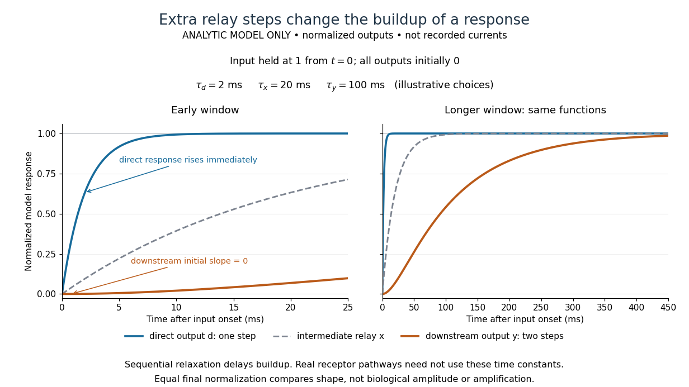

# Metabotropic receptor

↑ **Parent:** [Receptor (biochemistry)](receptor-biochemistry.md)  
ⓦ [Wiki](https://en.wikipedia.org/wiki/Metabotropic_receptor)

A [metabotropic receptor](metabotropic-receptor.md) couples [ligand](ligand-biochemistry.md) recognition to intracellular [signal transduction](signal-transduction.md), which can regulate a separate [ion channel](ion-channel.md), alter [enzyme](enzyme.md) activity or change [gene expression](gene-expression.md). In the usual [neurotransmitter](neurotransmitter.md) context, [metabotropic receptors](metabotropic-receptor.md) are [G protein-coupled receptors](g-protein-coupled-receptor.md): receptor activation is relayed by a [G protein](g-protein.md). There need not be a change in [membrane potential](membrane-potential.md) at all. [Two Families of Postsynaptic Receptors](neuroscience-2nd-edition-edited-by-d-purves-and-others/two-families-of-postsynaptic-receptors.md)

Two routes should be distinguished. An activated [G protein](g-protein.md) can regulate an [ion channel](ion-channel.md) locally at the [cell membrane](cell-membrane.md), without an obligatory diffusible [second messenger](second-messenger.md). Alternatively, it can regulate an [enzyme](enzyme.md) that changes the availability of a [second messenger](second-messenger.md), such as [cAMP](cyclic-adenosine-monophosphate.md) or [inositol trisphosphate](inositol-trisphosphate.md). Downstream [proteins](protein.md) then change channel opening, [phosphorylation](phosphorylation.md) or other cellular activities. The [receptor](receptor-biochemistry.md), [G protein](g-protein.md), [second messenger](second-messenger.md) and final target are distinct components; an activated [G protein](g-protein.md) is a relay [protein](protein.md), rather than itself a small-molecule [second messenger](second-messenger.md).[Figure 15-15](molecular-biology-of-the-cell-4th-edition-by-bruce-alberts-and-others/general-principles-of-cell-communication.md)

Do not turn this useful [chemical synapse](chemical-synapse.md) classification into the claim that every [receptor](receptor-biochemistry.md) is a [GPCR](g-protein-coupled-receptor.md), or that every indirect response must pass through a [G protein](g-protein.md). For example, the [insulin](insulin.md) [receptor](receptor-biochemistry.md) is an [enzyme](enzyme.md)-linked [cell-surface receptor](cell-surface-receptor.md) whose intracellular catalytic activity initiates [protein](protein.md) [phosphorylation](phosphorylation.md). [Intracellular receptors](intracellular-receptor.md) supply another category. “Metabotropic” commonly names the [GPCR](g-protein-coupled-receptor.md) branch in [neuroscience](neuroscience.md); the broader idea of biochemical coupling does not make all non-channel [receptors](receptor-biochemistry.md) structurally identical. [Signaling through Enzyme-Linked Cell-Surface Receptors](molecular-biology-of-the-cell-4th-edition-by-bruce-alberts-and-others/signaling-through-enzyme-linked-cell-surface-receptors.md)

Separating recognition from execution allows [signal amplification](signal-amplification.md) and branching. A persistently activated [receptor](receptor-biochemistry.md) can activate several relay [proteins](protein.md); a regulated [enzyme](enzyme.md) can produce many [second messenger](second-messenger.md) [molecules](molecule.md). As an explicitly invented count example, suppose one activated [receptor](receptor-biochemistry.md) activates four relay [proteins](protein.md) during one interval, and each relay activates a distinct [enzyme](enzyme.md) that produces fifteen [second messenger](second-messenger.md) [molecules](molecule.md) during the next interval. With sufficient substrates and no loss, this gives $4\times15=60$ [molecules](molecule.md). Those counts do not specify a physiological gain or response duration. A directly gated [ion channel](ion-channel.md) also passes many [ions](ion.md) while open, so amplification is not an exclusive property of [metabotropic receptors](metabotropic-receptor.md): always name the input and output being compared. [Pathways of Intracellular Signal Transduction](the-cell-a-molecular-approach-2nd-edition-by-geoffrey-m-cooper/pathways-of-intracellular-signal-transduction.md)

A particularly instructive electrophysiology experiment separated a chemical trigger from the [ion channel](ion-channel.md) carrying its eventual [electric current](electric-current.md). In 1987, Hirono, Ito and Sugiyama injected [messenger RNA](messenger-rna.md) from rat brain into frog egg cells, then tested acquired responses to neurotensin and muscarinic [acetylcholine](acetylcholine.md) stimulation. Under [voltage clamp](voltage-clamp.md) at $-60\,\mathrm{mV}$, neurotensin elicited transient, oscillatory inward [electric currents](electric-current.md) after a delay of several tens of seconds. This delay refers to that response and preparation. [Reversal potential](reversal-potential.md) measurements implicated increased permeability to chloride [anions](anion.md), rather than a pore specific to the applied [ligand](ligand-biochemistry.md). Both neurotensin and [acetylcholine](acetylcholine.md) responses were inhibited by pertussis toxin, which interferes with susceptible [G proteins](g-protein.md), and by intracellular EGTA, which binds free [calcium](calcium.md). Injecting [inositol trisphosphate](inositol-trisphosphate.md) mimicked the responses; a large prior dose of [inositol trisphosphate](inositol-trisphosphate.md) reduced subsequent responses to either extracellular signal. These interventions implicate a shared intracellular relay and [calcium](calcium.md)-dependent channel opening.[abstract](neurotensin-and-acetylcholine-evoke-common-responses-in-frog-oocytes-injected-with-rat-brain-messenger-ribonucleic-acid-by-c-hirono-and-others.md)

The informative comparison with the nicotinic [acetylcholine](acetylcholine.md) [receptor](receptor-biochemistry.md) experiment is mechanistic: an extracellular [ligand](ligand-biochemistry.md) can produce an inward [electric current](electric-current.md) either by directly gating the pore or by mobilizing an intracellular [second messenger](second-messenger.md) and stored [calcium](calcium.md) that activate another pore. Intracellular [inositol trisphosphate](inositol-trisphosphate.md) bypasses reception, whereas EGTA tests the need for free [calcium](calcium.md). However, neither inhibition nor mimicry alone identifies every molecular connection: a perturbation can affect several targets, and an injected mediator can activate a pathway without proving that it is the only natural route. The egg cell's endogenous machinery and the mixed [messenger RNA](messenger-rna.md) preparation also limit extrapolation to an intact [neuron](neuron.md). The experiment establishes functional coupling in its preparation, rather than the exact molecular composition or timing of every [metabotropic receptor](metabotropic-receptor.md).

Even [G protein](g-protein.md)-dependent channel regulation need not involve a lengthy [second messenger](second-messenger.md) cascade. Pfaffinger and colleagues reported in 1985 that [acetylcholine](acetylcholine.md)-evoked [potassium](potassium.md) channel activation in embryonic chick atrial cells required intracellular GTP, a [guanine](guanine.md)-containing [nucleotide](nucleotide.md), and was abolished by pertussis-toxin pretreatment. Changes in cyclic [nucleotides](nucleotide.md), including [cAMP](cyclic-adenosine-monophosphate.md), did not account for the channel response. The report discusses intrinsic activation delays of roughly $30$–$100\,\mathrm{ms}$, illustrating relatively rapid [metabotropic receptor](metabotropic-receptor.md) action. These observations support a [G protein](g-protein.md) coupling step without cyclic-nucleotide [second messengers](second-messenger.md); they do not by themselves exclude every possible intermediary or prove the specific subunit-channel interaction.[abstract](gtp-binding-proteins-couple-cardiac-muscarinic-receptors-to-a-k-channel-by-p-j-pfaffinger-and-others.md)

A small timing model makes the extra steps visible without inventing an experimental trace. Let $u(t)$ jump from zero to one at $t=0$ and remain on. For a direct-gating model output $d$, one relay variable $x$, and its downstream output $y$, take zero [initial conditions](initial-condition.md) and

$$
\tau_d\frac{dd}{dt}=u-d,\qquad \tau_x\frac{dx}{dt}=u-x,\qquad \tau_y\frac{dy}{dt}=x-y.
$$

All outputs are normalized [dimensionless variables](dimensionless-variable.md); they are neither recorded [electric currents](electric-current.md) nor fitted [concentrations](concentration.md). With illustrative [time constants](time-constant.md) $\tau_d=2\,\mathrm{ms}$, $\tau_x=20\,\mathrm{ms}$ and $\tau_y=100\,\mathrm{ms}$, their [exponential function](exponential-function.md) solutions for $t\geq0$ are

$$
d(t)=1-e^{-t/\tau_d},\qquad x(t)=1-e^{-t/\tau_x},\qquad y(t)=1-\frac{\tau_y e^{-t/\tau_y}-\tau_x e^{-t/\tau_x}}{\tau_y-\tau_x}.
$$

Initially $d'(0)=1/\tau_d$, while $y'(0)=0$ because its relay must first build up. Both outputs eventually approach one. Equal normalized final values do not imply equal biological amplitudes or absence of [signal amplification](signal-amplification.md); normalization deliberately removes that question.

**[Figure 39](#image-one-step-and-two-step-responses-to-a-sustained-input-an-illustrative-timing-model). One-step and two-step responses to a sustained input: an illustrative timing model**. Original analytic model curves with stipulated [time constants](time-constant.md) of $2$, $20$ and $100\,\mathrm{ms}$ and zero [initial conditions](initial-condition.md). Both panels show the same functions on different time windows; the dashed curve is the intermediate relay. Values are normalized and do not represent measured [electric currents](electric-current.md), physiological receptor-specific timings, or universal boundaries between [ionotropic receptors](ionotropic-receptor.md) and [metabotropic receptors](metabotropic-receptor.md). The model omits [signaling feedback](signaling-feedback.md), saturation and input removal.

The model's useful feature is the delayed buildup created by sequential relaxation, not its arbitrary numbers. Actual kinetics also depend on [ligand](ligand-biochemistry.md) delivery, relay deactivation, [neurotransmitter clearance](neurotransmitter-clearance.md) and the final target. A local [G protein](g-protein.md) route can act promptly, while an [ionotropic receptor](ionotropic-receptor.md) can remain active during continued exposure or feed a longer-lasting intracellular response. The beauty of [metabotropic receptor](metabotropic-receptor.md) coupling is its flexibility: the same recognition event can adjust electrical responsiveness and other cellular tasks through different targets. To classify an observed response, combine timing with molecular identity and controlled perturbations.

**Table of contents**

- [G protein-coupled receptor](g-protein-coupled-receptor.md)
  - [Glucagon receptor](glucagon-receptor.md)
  - [Glucagon-like peptide-1 receptor](glucagon-like-peptide-1-receptor.md)

## ↑ Ancestors (4)

1. [Receptor (biochemistry)](receptor-biochemistry.md)
2. [Protein](protein.md)
3. [Biology](biology-split.md)
4. [Codex Wiki](split.md)

## ← Incoming links (7)

- [Acetylcholine](acetylcholine.md)
- [Chemical synapse](chemical-synapse.md)
- [G protein-coupled receptor](g-protein-coupled-receptor.md)
- [Inositol trisphosphate](inositol-trisphosphate.md)
- [Ionotropic receptor](ionotropic-receptor.md)
- [Metabotropic receptor](metabotropic-receptor.md)
- [Receptor (biochemistry)](receptor-biochemistry.md)
