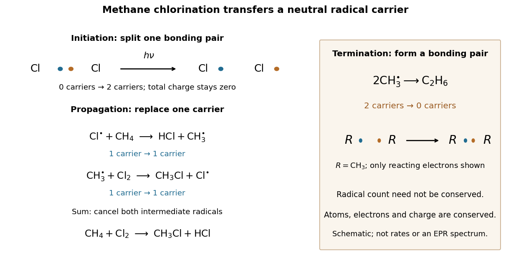

# Methane chlorination chain

↑ **Parent:** [Radical chain reaction](radical-chain-reaction.md)

Light initiates [methane](methane.md) chlorination by [photodissociation](photodissociation.md) of $\mathrm{Cl_2}$ through [homolysis](homolysis.md). The elementary bookkeeping is

$$
\begin{aligned}
\text{initiation:}\quad &\mathrm{Cl_2}\xrightarrow{h\nu}2\mathrm{Cl}^{\bullet},\\
\text{propagation:}\quad &\mathrm{Cl}^{\bullet}+\mathrm{CH_4}\longrightarrow\mathrm{HCl}+\mathrm{CH_3}^{\bullet},\\
&\mathrm{CH_3}^{\bullet}+\mathrm{Cl_2}\longrightarrow\mathrm{CH_3Cl}+\mathrm{Cl}^{\bullet}.
\end{aligned}
$$

Here $h\nu$ denotes the [photon](photon.md) [energy](energy.md). The first propagation step replaces a [chlorine](chlorine.md) [radical](radical-chemistry.md) with a [methyl radical](methyl-radical.md); the second regenerates a [chlorine](chlorine.md) [radical](radical-chemistry.md). Adding the two propagation equations cancels both [free radicals](radical-chemistry.md) and gives $\mathrm{CH_4+Cl_2\longrightarrow CH_3Cl+HCl}$: [chloromethane](chloromethane.md) and [hydrogen chloride](hydrogen-chloride.md) are made while the chain carrier is regenerated.[Organic Chemistry by John McMurry, §6.6: chlorine photolysis and the two-step methane chlorination cycle](organic-chemistry-by-john-mcmurry/6-6-radical-reactions.md)

**[Figure 2](#image-methane-chlorination-radical-bookkeeping). Methane chlorination: initiation supplies carriers, propagation replaces them, termination removes them**. The left panel follows the reacting [electron pair](electron-pair.md) in [homolysis](homolysis.md), then counts chain carriers through two propagation steps. The right panel shows recombination termination. Every [chemical species](chemical-species.md) in this example is neutral. Electron marks are bookkeeping, not a measured electronic [wavefunction](wave-function.md) or a reaction-rate plot.

For example, recombination $2\mathrm{CH_3}^{\bullet}\longrightarrow\mathrm{C_2H_6}$ of [methyl radicals](methyl-radical.md) makes [ethane](ethane.md) and a [covalent bond](covalent-bond.md) from two unpaired [Electrons](electron.md), removing two carriers. Recombination of two $\mathrm{Cl}^{\bullet}$ also terminates carriers; in the gas phase, stabilization of the product requires disposal of released [energy](energy.md), for example to a third collision partner. The figure omits that partner. Termination competes with propagation, and further chlorination can consume [chloromethane](chloromethane.md), so this cycle alone does not predict a pure product or a measured [reaction rate](reaction-rate.md).[Organic Chemistry by John McMurry, §10.2, Figure 10.2 and following paragraphs: radical combination terminates the chain; further substitution gives product mixtures](organic-chemistry-by-john-mcmurry/10-2-preparing-alkyl-halides-from-alkanes-radical-halogenation.md)

## ↑ Ancestors (4)

1. [Radical chain reaction](radical-chain-reaction.md)
2. [Radical (chemistry)](radical-chemistry.md)
3. [Chemistry](chemistry-split.md)
4. [Codex Wiki](split.md)

## ← Incoming links (1)

- [Methyl radical](methyl-radical.md)
