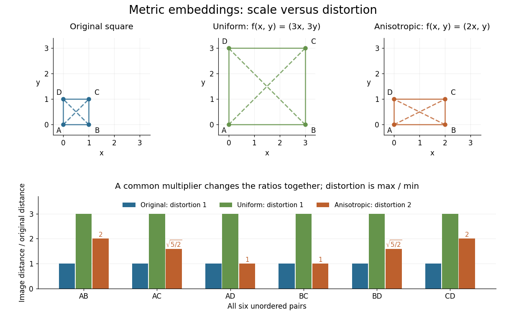
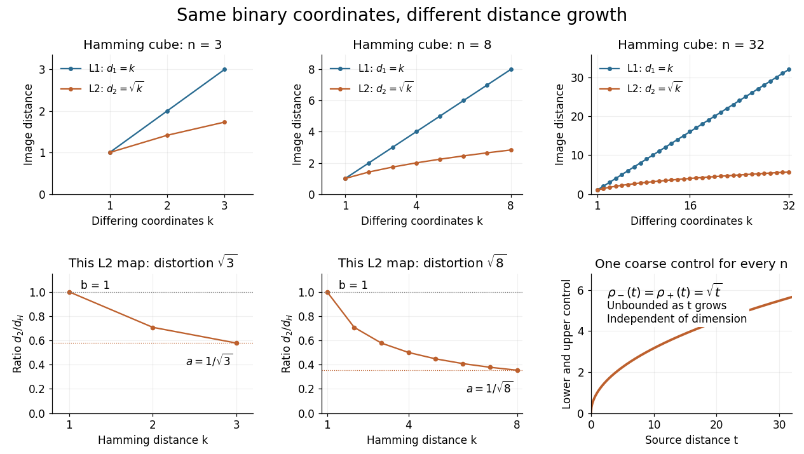
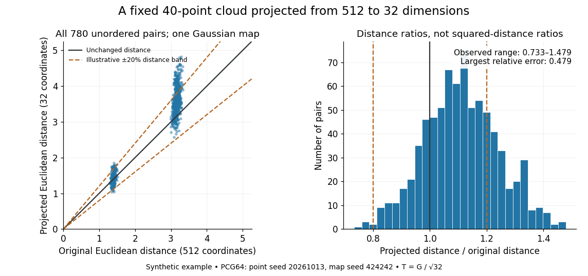
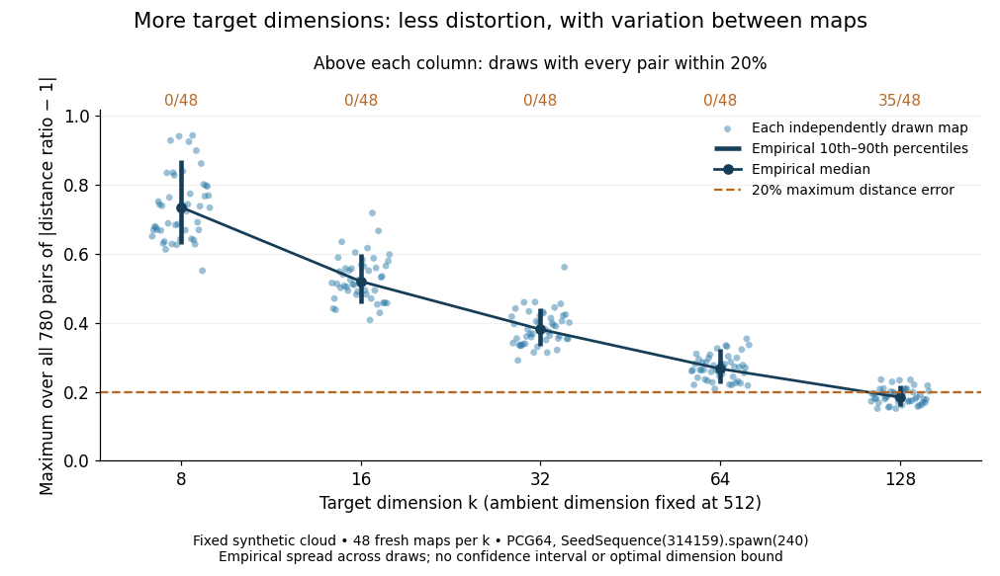

# Metric embedding

↑ **Parent:** [Functional analysis](functional-analysis.md)  
ⓦ [Wiki](https://en.wikipedia.org/wiki/Metric_embedding)

A [metric embedding](metric-embedding.md) represents the points of one [metric space](topological-analysis.md#metric-space) $(X,d_X)$ inside another $(Y,d_Y)$ by an [injective function](algebra.md#injective-function) $f:X\to Y$. The geometric question is how faithfully the representation preserves pairwise distances. For example, [binary strings](theoretical-computer-science.md#binary-string) can be treated as [vectors](vector-space.md#vector) so that tools from [linear algebra](linear-algebra.md) become available, but the chosen [norm](normed-vector-space.md#norm) determines what their separation means. A drawing of the points alone does not specify a [metric embedding](metric-embedding.md): both [metrics](topological-analysis.md#metric) matter.

An [isometric embedding](riemannian-geometry.md#isometric-embedding) preserves every distance exactly. A [metric embedding](metric-embedding.md) that is a [bi-Lipschitz map](real-analysis.md#bi-lipschitz-map) allows multiplicative error while keeping its [bi-Lipschitz distortion](#bi-lipschitz-distortion) bounded over all pairs. A [coarse embedding](#coarse-embedding) instead controls separation through possibly nonlinear functions of distance. These are different requirements: the [Hamming cube as an L1 and L2 metric](#hamming-cube-as-an-l1-and-l2-metric) below preserves [Hamming distance](coding-theory.md#hamming-distance) exactly in one representation and takes its [square root](algebra.md#square-root) in another.

The usefulness is that a complicated distance comparison becomes a calculation with familiar [vectors](vector-space.md#vector) and [norms](normed-vector-space.md#norm). This also helps assess a visualization: nearby points should not acquire arbitrarily large separations, and far-apart points should not collapse together. Matoušek's 2013 lecture notes describe how motivations from [computer science](computer-science.md), especially [approximation algorithms](mathematical-optimization.md#approximation-algorithm), accelerated the study of [metric embeddings](metric-embedding.md) from the 1990s onward. [Jiří Matoušek, Lecture notes on metric embeddings, preface and Section 1.1](mathematics-bibliography.md#lecture-notes-on-metric-embeddings-by-jiri-matousek)

**Table of contents**

- [Bi-Lipschitz distortion](#bi-lipschitz-distortion)
  - [Stretch factor](#stretch-factor)
- [Coarse embedding](#coarse-embedding)
  - [Uniform coarse embedding of a family of metric spaces](#uniform-coarse-embedding-of-a-family-of-metric-spaces)
- [Hamming cube as an L1 and L2 metric](#hamming-cube-as-an-l1-and-l2-metric)
- [Expander graph](#expander-graph)
  - [Zig-zag product](#zig-zag-product)
    - [Squaring and zig-zag iteration yields bounded-degree expanders](#squaring-and-zig-zag-iteration-yields-bounded-degree-expanders)
  - [L1 Poincare inequality for an expander graph](#l1-poincare-inequality-for-an-expander-graph)
    - [Layer cake representation](#layer-cake-representation)
      - [Lp bound from a tail domination inequality](#lp-bound-from-a-tail-domination-inequality)
    - [L1 distortion lower bound for an expander graph](#l1-distortion-lower-bound-for-an-expander-graph)
  - [Expander graph obstruction to uniform coarse embedding](#expander-graph-obstruction-to-uniform-coarse-embedding)
- [Finite representability of a Banach space](#finite-representability-of-a-banach-space)
  - [Superreflexive Banach space](#superreflexive-banach-space)
    - [Convex-block separation criterion for reflexivity](#convex-block-separation-criterion-for-reflexivity)
      - [James's theorem](#james-s-theorem)
        - [Principle of local reflexivity](#principle-of-local-reflexivity)
    - [Uniform finite convex-block criterion for superreflexivity](#uniform-finite-convex-block-criterion-for-superreflexivity)
    - [Diamond-graph characterization of superreflexivity](#diamond-graph-characterization-of-superreflexivity)
- [Bourgain embedding theorem](#bourgain-embedding-theorem)
  - [Fréchet embedding](#frechet-embedding)
  - [Low-dimensional Frechet embedding into linfinity](#low-dimensional-frechet-embedding-into-linfinity)
    - [Dimension lower bound for an expander embedded in linfinity](#dimension-lower-bound-for-an-expander-embedded-in-linfinity)
- [Johnson–Lindenstrauss lemma](#johnson-lindenstrauss-lemma)
  - [Gaussian Johnson–Lindenstrauss transform](#gaussian-johnson-lindenstrauss-transform)
    - [Finite-set example of the Johnson–Lindenstrauss lemma](#finite-set-example-of-the-johnson-lindenstrauss-lemma)
    - [Gaussian Johnson–Lindenstrauss concentration argument](#gaussian-johnson-lindenstrauss-concentration-argument)
  - [Net estimate for a linear operator](#net-estimate-for-a-linear-operator)
  - [Rademacher Johnson–Lindenstrauss transform](#rademacher-johnson-lindenstrauss-transform)
  - [Subgaussian concentration of the absolute Gaussian average](#subgaussian-concentration-of-the-absolute-gaussian-average)
    - [Almost-isometric Gaussian embedding from l2 into l1](#almost-isometric-gaussian-embedding-from-l2-into-l1)
      - [Low-dimensional L1 embedding of a finite metric space](#low-dimensional-l1-embedding-of-a-finite-metric-space)

## Bi-Lipschitz distortion

↑ **Parent:** [Metric embedding](metric-embedding.md)

For an [injective function](algebra.md#injective-function) between [metric spaces](topological-analysis.md#metric-space) with at least two source points, consider all distance ratios

$$
r_f(x,y)=\frac{d_Y(f(x),f(y))}{d_X(x,y)},\qquad x\ne y.
$$

If constants $0<a\leq b<\infty$ satisfy

$$
a\leq r_f(x,y)\leq b\qquad(x\ne y),
$$

then $f$ is a [bi-Lipschitz map](real-analysis.md#bi-lipschitz-map): both $f$ and its inverse on $f(X)$ are [Lipschitz maps](real-analysis.md#lipschitz-continuity). The bound $b/a$ compares the most expanded pair with the most contracted pair. To define the [bi-Lipschitz distortion](#bi-lipschitz-distortion) of this particular [metric embedding](metric-embedding.md), use the sharp bounds $a=\inf_{x\ne y}r_f(x,y)$ and $b=\sup_{x\ne y}r_f(x,y)$:

$$
\operatorname{dist}(f)=\frac ba
=\operatorname{Lip}(f)\operatorname{Lip}(f^{-1})\geq1.
$$

Here the [Lipschitz constant](real-analysis.md#lipschitz-constant) of $f^{-1}:f(X)\to X$ is $1/a$. If no positive finite bounds exist, the [bi-Lipschitz distortion](#bi-lipschitz-distortion) is infinite. For a finite source, every [injective function](algebra.md#injective-function) has finite [bi-Lipschitz distortion](#bi-lipschitz-distortion), but its size can depend on the source. Matoušek gives the equivalent definition using one scale factor and a multiplicative error bound. [Matoušek, Section 1.1: distortion and Lipschitz maps](mathematics-bibliography.md#lecture-notes-on-metric-embeddings-by-jiri-matousek)

Changing units is harmless: replacing $d_Y$ by $\lambda d_Y$, with $\lambda>0$, multiplies both $a$ and $b$ by $\lambda$ and leaves $b/a$ unchanged. In a [normed vector space](normed-vector-space.md) this can be achieved by multiplying every output [vector](vector-space.md#vector) by $\lambda$. Thus [bi-Lipschitz distortion](#bi-lipschitz-distortion) one means that all distances change by the same factor; an [isometric embedding](riemannian-geometry.md#isometric-embedding) additionally requires that factor to be one. A [stretch factor](#stretch-factor) with a specified normalization is a related quantity; when comparing sources, check which overall scale has been fixed.

Take the four corners $A=(0,0)$, $B=(1,0)$, $C=(1,1)$, $D=(0,1)$ of a [square](euclidean-geometry.md#square), with [Euclidean distance](topological-analysis.md#euclidean-distance) in both source and target. For the [linear map](vector-space.md#linear-map) $f(x,y)=(2x,y)$, the six unordered pairs exhaust the possibilities: the two vertical sides $AD,BC$ have ratio $1$, the two horizontal sides $AB,CD$ have ratio $2$, and the two diagonals $AC,BD$ have ratio $\sqrt5/\sqrt2=\sqrt{5/2}$. Consequently $a=1$, $b=2$, and $\operatorname{dist}(f)=2$. In contrast, $g(x,y)=(3x,3y)$, three times the [identity function](function.md#identity-function), gives ratio $3$ for every pair and has [bi-Lipschitz distortion](#bi-lipschitz-distortion) $3/3=1$.

**[Figure 1](#image-uniform-scaling-keeps-distortion-one-unequal-coordinate-scaling-gives-distortion-two). Uniform scaling keeps distortion one; unequal coordinate scaling gives distortion two**.

The ratio chart makes the reason visible: a common multiplier moves every ratio together, while unequal coordinate scaling spreads the ratios apart. More generally, in a [normed vector space](normed-vector-space.md), the ratio bounds give

$$
\frac1{b/a}d_X(x,y)\leq\left\|\frac{f(x)}b-\frac{f(y)}b\right\|\leq d_X(x,y).
$$

This normalization gives [Lipschitz constant](real-analysis.md#lipschitz-constant) one and inverse [Lipschitz constant](real-analysis.md#lipschitz-constant) $b/a$. It is only a change of scale, so it cannot improve the [bi-Lipschitz distortion](#bi-lipschitz-distortion).

The best possible [bi-Lipschitz distortion](#bi-lipschitz-distortion) of a source into a specified target is a separate quantity:

$$
c_Y(X)=\inf_{f:X\hookrightarrow Y}\operatorname{dist}(f).
$$

The [infimum](real-analysis.md#infimum) runs over all [injective functions](algebra.md#injective-function), and need not be attained. The notation $c_p(X)$ means the analogous [infimum](real-analysis.md#infimum) over [metric embeddings](metric-embedding.md) into an [Lp space](measure-theory.md#lp-space). A calculation for one chosen $f$ gives an upper bound for $c_Y(X)$; proving optimality also requires a lower bound for every possible $f$.

### Stretch factor

↑ **Parent:** [Bi-Lipschitz distortion](#bi-lipschitz-distortion)  
ⓦ [Wiki](https://en.wikipedia.org/wiki/Stretch_factor)

For an [injective function](algebra.md#injective-function) that does not increase distances, one stretch-factor convention measures the largest compression that must be undone:

$$
t(f)=\sup_{x\ne y}\frac{d_X(x,y)}{d_Y(f(x),f(y))}
=\operatorname{Lip}(f^{-1}).
$$

If the sharp [Lipschitz constant](real-analysis.md#lipschitz-constant) of $f$ is one, this equals [bi-Lipschitz distortion](#bi-lipschitz-distortion). Fixing the scale matters: uniform compression $f(x)=x/2$ has stretch factor two in this convention, but [bi-Lipschitz distortion](#bi-lipschitz-distortion) one. In a [geometric spanner](graph-theory.md#geometric-spanner), the corresponding stretch factor is the largest graph-route distance divided by direct [Euclidean distance](topological-analysis.md#euclidean-distance); the graph-to-Euclidean identification does not increase distances. [Gudmundsson, Narasimhan and Smid, Geometric Spanners, §1: the stretch-factor convention](https://people.scs.carleton.ca/~michiel/encyc_geometric_spanners.pdf).

## Coarse embedding

↑ **Parent:** [Metric embedding](metric-embedding.md)  
ⓦ [Wiki](https://en.wikipedia.org/wiki/Coarse_embedding)

A map $f:X\to Y$ between [metric spaces](topological-analysis.md#metric-space) is a [coarse embedding](#coarse-embedding) when nondecreasing control functions $\rho_-,\rho_+:[0,\infty)\to[0,\infty)$ satisfy

$$
\rho_-(d_X(x,y))\leq d_Y(f(x),f(y))\leq\rho_+(d_X(x,y)),
\qquad \rho_-(t)\longrightarrow\infty.
$$

The last condition means that distances tending to infinity in the source must also tend to infinity in the target. The upper control prevents bounded source distances from having unbounded image distances. Unlike a [metric embedding](metric-embedding.md) as defined here, a [coarse embedding](#coarse-embedding) need not be [injective](algebra.md#injective-function): its lower control may vanish at small distances. Finite [bi-Lipschitz distortion](#bi-lipschitz-distortion) implies a [coarse embedding](#coarse-embedding) by taking $\rho_-(t)=at$ and $\rho_+(t)=bt$, but nonlinear controls such as $\sqrt t$ allow much more compression.

### Uniform coarse embedding of a family of metric spaces

↑ **Parent:** [Coarse embedding](#coarse-embedding)

A family $(X_n)$ uniformly coarsely embeds into $Y$ when maps $f_n:X_n\to Y$ admit the same two control functions $\rho_-$ and $\rho_+$ from the definition of a [coarse embedding](#coarse-embedding), independent of $n$. For a single finite [metric space](topological-analysis.md#metric-space), the lower control can vanish up to its diameter and then grow without bound; this says little about its representation. For a family with unbounded diameters, common controls have real content: they cannot be chosen afresh after seeing each member's diameter. The [Hamming cube as an L1 and L2 metric](#hamming-cube-as-an-l1-and-l2-metric) supplies explicit common controls, in contrast with the [expander graph obstruction to uniform coarse embedding](#expander-graph-obstruction-to-uniform-coarse-embedding).

## Hamming cube as an L1 and L2 metric

↑ **Parent:** [Metric embedding](metric-embedding.md)

Use the $\{0,1\}^n$ convention for the [Hamming cube](coding-theory.md#hamming-cube) $H_n$. Its elements are length-$n$ [binary strings](theoretical-computer-science.md#binary-string), and their [Hamming distance](coding-theory.md#hamming-distance) counts the differing coordinates:

$$
k=d_H(x,y)=\sum_{j=1}^n|x_j-y_j|.
$$

Send each [binary string](theoretical-computer-science.md#binary-string) to the [vector](vector-space.md#vector) with the same coordinates, by $\iota_n:H_n\to\mathbb R^n$. Every differing coordinate contributes $1$ both to the sum of absolute differences and to the sum of squared differences. Therefore the [L1 norm](normed-vector-space.md#l1-norm) and [L2 norm](real-analysis.md#l2-norm) give, respectively,

$$
d_1(\iota_nx,\iota_ny)=k,\qquad
d_2(\iota_nx,\iota_ny)=\sqrt{k}.
$$

This short coordinate calculation proves that the [L1 norm](normed-vector-space.md#l1-norm) gives an [isometric embedding](riemannian-geometry.md#isometric-embedding), while [Euclidean distance](topological-analysis.md#euclidean-distance) grows like the [square root](algebra.md#square-root) of the number of changed [binary digits](integer.md#binary-digit). For example, $000$ and $101$ differ twice: their [Hamming distance](coding-theory.md#hamming-distance) and [Manhattan distance](topological-analysis.md#manhattan-distance) are $2$, but their [Euclidean distance](topological-analysis.md#euclidean-distance) is $\sqrt2$. Comparing [binary strings](theoretical-computer-science.md#binary-string) in these two geometric representations answers different questions even though the points have the same coordinates.

For distinct pairs $k$ ranges over every integer from $1$ to $n$. The [metric embedding](metric-embedding.md) into the [L2 norm](real-analysis.md#l2-norm) thus has sharp ratios

$$
\frac{d_2(\iota_nx,\iota_ny)}{d_H(x,y)}=\frac1{\sqrt{k}},\qquad
a=\frac1{\sqrt n},\quad b=1,\quad
\operatorname{dist}(\iota_n)=\sqrt n.
$$

Neighbors attain $b$ and opposite corners attain $a$. This computes the [bi-Lipschitz distortion](#bi-lipschitz-distortion) of this coordinate map; it does not prove that every [metric embedding](metric-embedding.md) into an [L2 space](measure-theory.md#l2-space-is-a-hilbert-space) has at least this [bi-Lipschitz distortion](#bi-lipschitz-distortion). Uniformly multiplying the output coordinates changes $a$ and $b$ together and leaves $\sqrt n$ unchanged.

**[Figure 2](#image-hamming-distances-become-k-in-l1-and-square-root-of-k-in-l2-with-controls-independent-of-dimension). Hamming distances become k in L1 and square root of k in L2, with controls independent of dimension**.

The important family distinction is that these coordinate maps have no dimension-independent bound on their [bi-Lipschitz distortion](#bi-lipschitz-distortion) into the [L2 norm](real-analysis.md#l2-norm), yet they do give a [uniform coarse embedding of a family of metric spaces](#uniform-coarse-embedding-of-a-family-of-metric-spaces). Pad each output [vector](vector-space.md#vector) with zero coordinates to view all maps in the single [l2 sequence space](banach-space.md#l2-sequence-space), an [L2 space](measure-theory.md#l2-space-is-a-hilbert-space) for [counting measure](measure.md#counting-measure). Then the same functions

$$
\rho_-(t)=\rho_+(t)=\sqrt t\qquad(t\geq0)
$$

work for every $n$, and $\rho_-(t)\to\infty$. Similarly, padding into the [l1 sequence space](banach-space.md#absolutely-summable-sequence-space) gives common controls $\rho_-(t)=\rho_+(t)=t$ and exact preservation of [Hamming distance](coding-theory.md#hamming-distance). These claims use unnormalized [Hamming distance](coding-theory.md#hamming-distance); replacing it by [normalized Hamming distance](coding-theory.md#normalized-hamming-distance) changes the family of source [metrics](topological-analysis.md#metric).

The geometry has a practical origin: Hamming's 1950 paper uses the number of differing positions between [binary strings](theoretical-computer-science.md#binary-string) to study [error-correcting codes](coding-theory.md#error-correcting-code). Changing one [binary digit](integer.md#binary-digit) moves to a neighboring corner, so a question about corrupted messages becomes a question about separation in the [Hamming cube](coding-theory.md#hamming-cube). [R. W. Hamming, Error Detecting and Error Correcting Codes, 1950, Section 5](https://ineffectivetheory.com/edu/papers/hamming-codes-1950.pdf)

## Expander graph

↑ **Parent:** [Metric embedding](metric-embedding.md)  
ⓦ [Wiki](https://en.wikipedia.org/wiki/Expander_graph)

For a finite graph $G=(V,E)$, its edge-expansion constant is

$$
h(G)=\min_{0<|A|\leq|V|/2}\frac{|\partial_EA|}{|A|}.
$$

An expander family has uniformly bounded degrees, orders tending to infinity, and expansion constants bounded below by a positive constant.

### Zig-zag product

↑ **Parent:** [Expander graph](#expander-graph)  
ⓦ [Wiki](https://en.wikipedia.org/wiki/Zig-zag_product)

For a port-labeled $D$-regular [graph](graph.md) $G$ and a $d$-regular [graph](graph.md) $H$ on its $D$ port labels, replace every [vertex](graph.md#vertex-graph-theory) by a copy of $H$. An [edge](graph-theory.md#edge-of-a-graph) makes a step in $H$, crosses the corresponding [edge](graph-theory.md#edge-of-a-graph) of $G$, then makes another step in $H$. The result has $|G|D$ [vertices](graph.md#vertex-graph-theory) and degree $d^2$. Its normalized operator is $BRB$, where $B=I\otimes P_H$ and $R$ is the involutive [edge](graph-theory.md#edge-of-a-graph) rotation of $G$. Decomposing a mean-zero vector into cloud-constant and cloud-orthogonal parts proves the bound $\rho(G\mathbin{\mathrm{zigzag}}H)\leq\rho(G)+2\rho(H)+\rho(H)^2$.

#### Squaring and zig-zag iteration yields bounded-degree expanders

↑ **Parent:** [Zig-zag product](#zig-zag-product)

Choose $D=d^2$ and a fixed $d$-regular [graph](graph.md) $H$ on $D^2$ [vertices](graph.md#vertex-graph-theory) with absolute nonconstant [eigenvalues](linear-operator-theory.md#eigenvalue) at most $1/10$. Start with the loop-inclusive [complete graph](graph-theory.md#complete-graph) $G_0$ on $D$ [vertices](graph.md#vertex-graph-theory) and iterate $G_{t+1}=G_t^2\mathbin{\mathrm{zigzag}}H$. The degree stays $D$, [vertex](graph.md#vertex-graph-theory) counts are $D^{2t+1}$, and $\rho_{t+1}\leq\rho_t^2+21/100$. Since $\rho_0=0$, all $\rho_t\leq1/2$. The spectral cut bound gives multiplicity-counted [edge](graph-theory.md#edge-of-a-graph) expansion at least $D/4$. Removing loops and merging parallel [edges](graph-theory.md#edge-of-a-graph) loses at most a factor $D$, producing simple [expander graphs](#expander-graph) with maximum degree $D$ and [edge](graph-theory.md#edge-of-a-graph) expansion at least $1/4$.

### L1 Poincare inequality for an expander graph

↑ **Parent:** [Expander graph](#expander-graph)

If $G$ has adjacency matrix $A=(a_{xy})$ and expansion $h$, then every $L^1$-valued map on its $n$ vertices satisfies

$$
\sum_{x,y}a_{xy}\|f(x)-f(y)\|_1
\geq\frac hn\sum_{x,y}\|f(x)-f(y)\|_1.
$$

For scalar functions this follows from the layer-cake formula applied above and below a median; integration over the $L^1$ coordinate proves the vector-valued form.

#### Layer cake representation

↑ **Parent:** [L1 Poincare inequality for an expander graph](#l1-poincare-inequality-for-an-expander-graph)  
ⓦ [Wiki](https://en.wikipedia.org/wiki/Layer_cake_representation)

For a nonnegative measurable function $g$,

$$
\int g=\int_0^\infty\mu\{g>t\}\,dt.
$$

On a graph, applying this identity to $|g(x)-g(y)|$ expresses its total variation as the integral of the edge boundaries of the superlevel sets.

More generally, if $\varphi:[0,\infty)\to[0,\infty)$ is differentiable, increasing, and satisfies $\varphi(0)=0$, then [Tonelli theorem](measure-theory.md#tonelli-theorem) and the fundamental theorem of calculus give

$$
\int\varphi(g)\,d\mu
=\int_0^\infty\varphi'(s)\mu\{g>s\}\,ds.
$$

##### Lp bound from a tail domination inequality

↑ **Parent:** [Layer cake representation](#layer-cake-representation)

Let $F,G\geq0$, $1<p<\infty$, and $G\in L^p$. Assume the displayed tail inequality and finite positive-threshold superlevel measures. First split $G$ at $a/2$ to obtain $a\mu\{F>2a\}\leq\int_{\{G>a\}}G$. [Layer cake representation](#layer-cake-representation) and [Tonelli theorem](measure-theory.md#tonelli-theorem) imply $F\in L^p$. Integrating the original inequality against $pa^{p-2}$ then gives $\|F\|_p^p\leq q\int GF^{p-1}\leq q\|G\|_p\|F\|_p^{p-1}$, with $q=p/(p-1)$. This is the analytic estimate behind the [Doob Lp maximal inequality](martingale.md#doob-lp-maximal-inequality).

#### L1 distortion lower bound for an expander graph

↑ **Parent:** [L1 Poincare inequality for an expander graph](#l1-poincare-inequality-for-an-expander-graph)

If a $d$-regular graph on $n$ vertices has expansion $h$, its $L^1$ distortion obeys

$$
c_1(G)\geq\frac{h}{2d\log d}\left(\log\frac n2-1\right).
$$

The Poincare inequality controls average image distance by edge lengths, while bounded-degree ball growth makes the average graph distance comparable to $\log n/\log d$.

### Expander graph obstruction to uniform coarse embedding

↑ **Parent:** [Expander graph](#expander-graph)

An expander family does not uniformly coarsely embed into $L^1$ or $L^2$. Uniform upper control bounds every embedded edge, whereas the expander Poincare inequality bounds the average image distance. A fixed proportion of vertex pairs have graph distance tending to infinity, contradicting the lower control. The $L^2$ case also follows from the isometric Gaussian embedding of a Hilbert space into $L^1$.

## Finite representability of a Banach space

↑ **Parent:** [Metric embedding](metric-embedding.md)

A Banach space $X$ is finitely representable in $Y$ when, for every finite-dimensional subspace $E\subseteq X$ and every $\varepsilon>0$, there are a subspace $F\subseteq Y$ and an isomorphism $T:E\to F$ with $\|T\|\|T^{-1}\|<1+\varepsilon$.

### Superreflexive Banach space

↑ **Parent:** [Finite representability of a Banach space](#finite-representability-of-a-banach-space)

A Banach space is superreflexive when every Banach space finitely representable in it is a [reflexive Banach space](functional-analysis.md#reflexive-banach-space). Equivalently, it admits an equivalent uniformly convex norm, or every one of its ultrapowers is reflexive.

#### Convex-block separation criterion for reflexivity

↑ **Parent:** [Superreflexive Banach space](#superreflexive-banach-space)

A Banach space $X$ is reflexive exactly when, for every $\theta>0$ and every sequence $(x_i)$ in $B_X$, some convex combination of a finite initial segment lies within $\theta$ of a convex combination of the remaining tail. In a reflexive space both convex hulls approximate a common weak cluster point. The converse is the convex-block form of the James reflexivity criterion.

<h5 id="james-s-theorem">James's theorem</h5>

↑ **Parent:** [Convex-block separation criterion for reflexivity](#convex-block-separation-criterion-for-reflexivity)  
ⓦ [Wiki](https://en.wikipedia.org/wiki/James's_theorem)

James's theorem says that a Banach space is reflexive exactly when every continuous linear functional attains its supremum on the closed unit ball. Its separation proof also yields the equivalent convex-block criterion: nonreflexivity produces a bounded sequence whose initial and tail convex hulls remain uniformly separated.

###### Principle of local reflexivity

↑ **Parent:** [James's theorem](#james-s-theorem)

For finite-dimensional subspaces $E\subseteq X^{**}$ and $F\subseteq X^*$, the principle of local reflexivity gives an almost-isometric map $T:E\to X$ that fixes $E\cap X$ and preserves the pairings with $F$. It lets finite-dimensional bidual separation data be realized inside $X$.

#### Uniform finite convex-block criterion for superreflexivity

↑ **Parent:** [Superreflexive Banach space](#superreflexive-banach-space)

A Banach space $X$ is superreflexive exactly when, for every $\theta>0$, some $N$ forces every sequence $(x_i)_{i=1}^N\subseteq B_X$ to have two convex combinations, one before and one after a cut, at distance below $\theta$. Failure produces a nonreflexive ultrapower; finite representability transfers a violating finite sequence back from any nonreflexive space finitely representable in $X$.

#### Diamond-graph characterization of superreflexivity

↑ **Parent:** [Superreflexive Banach space](#superreflexive-banach-space)

A Banach space $X$ is superreflexive exactly when the distortions $c_X(D_n)$ of the finite diamond graphs tend to infinity. A uniformly separated convex-block sequence recursively realizes all branches of $D_n$ with bounded distortion, while uniform convexity forces quantitative collapse across repeated diamonds.

## Bourgain embedding theorem

↑ **Parent:** [Metric embedding](metric-embedding.md)

Every metric space with $n$ points admits an embedding into a Hilbert space with distortion $O(\log n)$. The usual random-subset construction gives an embedding into Euclidean dimension $O((\log n)^2)$.

<h3 id="frechet-embedding">Fréchet embedding</h3>

↑ **Parent:** [Bourgain embedding theorem](#bourgain-embedding-theorem)

Fix a point $x_0$ in a [metric space](topological-analysis.md#metric-space) $X$. The Fréchet embedding sends $x$ to the bounded function $a\mapsto d(x,a)-d(x_0,a)$ in $\ell^\infty(X)$. The [triangle inequality](topological-analysis.md#triangle-inequality) bounds each coordinate by $d(x,x_0)$ and gives $\|f_x-f_y\|_\infty\leq d(x,y)$. Taking $a=x$ gives equality, so the map is an [isometric embedding](riemannian-geometry.md#isometric-embedding). For a separable metric space a countable dense set of anchors suffices. Finite collections of distances to selected subsets instead give one-Lipschitz coordinates that need not be an exact Fréchet embedding.

### Low-dimensional Frechet embedding into linfinity

↑ **Parent:** [Bourgain embedding theorem](#bourgain-embedding-theorem)

For every integer $q\geq2$, every $n$-point metric space embeds into $\ell_\infty^k$ with distortion at most $2q-1$ and

$$
k\leq Cq n^{1/q}\log n.
$$

The coordinates are distance-to-subset functions. Randomly sampled subsets at $q$ density scales separate every pair at one scale; a union bound leaves the stated number of coordinates.

#### Dimension lower bound for an expander embedded in linfinity

↑ **Parent:** [Low-dimensional Frechet embedding into linfinity](#low-dimensional-frechet-embedding-into-linfinity)

If a fixed-degree expander on $n$ vertices embeds into $\ell_\infty^k$ with distortion $\alpha$, then

$$
k\geq n^{c/\alpha}.
$$

Indeed, $\ell_\infty^k\hookrightarrow\ell_p^k$ has distortion $k^{1/p}$, while $c_p(G)\gtrsim(\log n)/p$. Taking $p\asymp\log k$ gives $\log k\gtrsim(\log n)/\alpha$.

<h2 id="johnson-lindenstrauss-lemma">Johnson–Lindenstrauss lemma</h2>

↑ **Parent:** [Metric embedding](metric-embedding.md)  
ⓦ [Wiki](https://en.wikipedia.org/wiki/Johnson–Lindenstrauss_lemma)

For $0<\varepsilon<1$ and any $n$ points in a Hilbert space, there is a linear map into Euclidean dimension $O(\varepsilon^{-2}\log n)$ that multiplies every pairwise distance by a factor between $1-\varepsilon$ and $1+\varepsilon$.

The striking feature is that the target [dimension](vector-space.md#dimension-vector-space) depends on the number of points and the allowed error, independently of the ambient [dimension](vector-space.md#dimension-vector-space). Fix a [finite set](set.md#finite-set) $S=\{x_1,\ldots,x_n\}\subset\mathbb R^D$, with $n\geq2$, and $0<\varepsilon<1$. An equivalent sufficient statement uses squared [Euclidean distances](topological-analysis.md#euclidean-distance): a [linear map](vector-space.md#linear-map) $T:\mathbb R^D\to\mathbb R^k$ exists, with $k=O(\varepsilon^{-2}\log n)$, such that

$$
(1-\varepsilon)\|x_i-x_j\|_2^2
\leq\|Tx_i-Tx_j\|_2^2
\leq(1+\varepsilon)\|x_i-x_j\|_2^2
\qquad(1\leq i<j\leq n).
$$

The finite-set theorem cited here supplies an explicit sufficient target [dimension](vector-space.md#dimension-vector-space) for this squared-distance formulation. [An elementary proof of a theorem of Johnson and Lindenstrauss, Theorem 2.1, p. 61: bounds for squared distances](mathematics-bibliography.md#an-elementary-proof-of-a-theorem-of-johnson-and-lindenstrauss-by-sanjoy-dasgupta-and-anupam-gupta)

Taking [square roots](algebra.md#square-root) gives distance factors $\sqrt{1-\varepsilon}$ and $\sqrt{1+\varepsilon}$, which lie inside $[1-\varepsilon,1+\varepsilon]$. Conversely, bounds $1\pm\varepsilon$ on distances only give squared-distance bounds $(1\pm\varepsilon)^2$; the same numerical tolerance should not be silently used for both. Under the squared-distance bounds, the [bi-Lipschitz distortion](#bi-lipschitz-distortion) is at most $\sqrt{(1+\varepsilon)/(1-\varepsilon)}$.

The [Johnson–Lindenstrauss lemma](#johnson-lindenstrauss-lemma) preserves this fixed [finite set](set.md#finite-set), rather than every [vector](vector-space.md#vector) in the ambient [Euclidean space](normed-vector-space.md#euclidean-norm). A [linear map](vector-space.md#linear-map) with $k<D$ has a nonzero [kernel](kernel-of-a-linear-map.md) by the [rank-nullity theorem](kernel-of-a-linear-map.md#rank-nullity-theorem), so some nonzero [vectors](vector-space.md#vector) collapse completely. For finitely many points in a real [Hilbert space](hilbert-space.md), apply the finite-dimensional argument on their [linear span](vector-space.md#linear-span) and extend by [orthogonal projection](hilbert-space.md#orthogonal-projection) onto that [linear span](vector-space.md#linear-span). If the sufficient target [dimension](vector-space.md#dimension-vector-space) exceeds the ambient [dimension](vector-space.md#dimension-vector-space), the [identity map](function.md#identity-function) already preserves every [Euclidean distance](topological-analysis.md#euclidean-distance) exactly, with zero padding if a larger target is requested.

<h3 id="gaussian-johnson-lindenstrauss-transform">Gaussian Johnson–Lindenstrauss transform</h3>

↑ **Parent:** [Johnson–Lindenstrauss lemma](#johnson-lindenstrauss-lemma)

Draw a $k\times D$ [random matrix](probability-theory.md#random-matrix) $G$ whose entries are [independent random variables](random-variable.md#independent-random-variables) with the [standard normal distribution](probability-distribution.md#standard-normal-distribution), and set

$$
T(x)=\frac1{\sqrt k}Gx.
$$

The factor $1/\sqrt k$ makes the [expected value](expected-value.md) of the squared [L2 norm](real-analysis.md#l2-norm) equal to the original squared [L2 norm](real-analysis.md#l2-norm). This [Gaussian Johnson–Lindenstrauss transform](#gaussian-johnson-lindenstrauss-transform) is a [linear map](vector-space.md#linear-map), generally not an [orthogonal projection](hilbert-space.md#orthogonal-projection): its rows are not required to be [orthogonal vectors](inner-product.md#orthogonal-vectors). [Lecture notes on metric embeddings, §2.1(b), p. 21, and Lemma 2.3.1, p. 24: independent Gaussian coefficients and normalization](mathematics-bibliography.md#lecture-notes-on-metric-embeddings-by-jiri-matousek)

For the fixed [finite set](set.md#finite-set) $S$, let $0<\delta<1$ be an allowed failure [probability](probability-theory.md#probability), and define

$$
c(\varepsilon)=\frac{\varepsilon^2}{4}-\frac{\varepsilon^3}{6}>0.
$$

With $\log$ denoting the [natural logarithm](calculus.md#natural-logarithm), a sufficient [integer](integer.md) target [dimension](vector-space.md#dimension-vector-space) is

$$
k\geq\left\lceil\frac{\log\bigl(n(n-1)/\delta\bigr)}{c(\varepsilon)}\right\rceil.
$$

Then one draw of this specified [random matrix](probability-theory.md#random-matrix) satisfies all the squared [Euclidean distance](topological-analysis.md#euclidean-distance) bounds simultaneously with [probability](probability-theory.md#probability) at least $1-\delta$. Since $c(\varepsilon)\geq\varepsilon^2/12$, the simpler sufficient bound $k\geq\lceil12\varepsilon^{-2}\log(n(n-1)/\delta)\rceil$ also works. Both are sufficient bounds for this argument; they do not claim the smallest possible target [dimension](vector-space.md#dimension-vector-space).

This is a [probability](probability-theory.md#probability) statement about a map drawn independently of the fixed [finite set](set.md#finite-set). It implies existence because the success [probability](probability-theory.md#probability) is positive, but permits failed draws. The set cannot be chosen after inspecting the map with this same guarantee. In particular, no single draw preserves every possible [finite set](set.md#finite-set) in the ambient [Euclidean space](normed-vector-space.md#euclidean-norm) when $k<D$.

<h4 id="finite-set-example-of-the-johnson-lindenstrauss-lemma">Finite-set example of the Johnson–Lindenstrauss lemma</h4>

↑ **Parent:** [Gaussian Johnson–Lindenstrauss transform](#gaussian-johnson-lindenstrauss-transform)

Here is an original reproducible [finite set](set.md#finite-set) with 40 points and 512 coordinates. Let $e_1,\ldots,e_4$ be the first four [vectors](vector-space.md#vector) of the [standard basis](vector-space.md#standard-basis) of $\mathbb R^{512}$. With point indices $i=0,\ldots,39$, generate

$$
x_i=2e_{1+\lfloor i/10\rfloor}+\frac{z_i}{\sqrt{512}},
\qquad z_{ij}\sim N(0,1)\text{ independently}.
$$

The four groups have different centers, and the [standard normal random variables](probability-distribution.md#standard-normal-random-variable) perturb all 512 coordinates. Generate the coordinates in row order using NumPy's PCG64 [pseudorandom number generator](monte-carlo-method.md#pseudorandom-number-generator) with seed 20261013. Then keep this [finite set](set.md#finite-set) fixed. A second PCG64 stream with seed 424242 generates a $32\times512$ [matrix](vector-space.md#matrix) of [independent random variables](random-variable.md#independent-random-variables) with the [standard normal distribution](probability-distribution.md#standard-normal-distribution); divide it by $\sqrt{32}$ to obtain the [Gaussian Johnson–Lindenstrauss transform](#gaussian-johnson-lindenstrauss-transform).

For all 780 unordered pairs, compute the distance ratio $r_{ij}=\|Tx_i-Tx_j\|_2/\|x_i-x_j\|_2$. In this draw, its minimum is approximately $0.733010$ and its maximum $1.478785$, giving a maximum [relative error](numerical-analysis.md#relative-error) in [Euclidean distance](topological-analysis.md#euclidean-distance) of about $0.478785$. The squared-distance ratios $r_{ij}^2$ instead range from approximately $0.537304$ to $2.186806$: their maximum [relative error](numerical-analysis.md#relative-error) is about $1.186806$. Thus this particular draw fails a 20% distance tolerance. The [Johnson–Lindenstrauss lemma](#johnson-lindenstrauss-lemma) does not assert that every draw into 32 dimensions must succeed.

**[Figure 3](#image-all-780-pairwise-euclidean-distances-for-one-gaussian-map-from-512-to-32-dimensions). All 780 pairwise Euclidean distances for one Gaussian map from 512 to 32 dimensions**.

The two bands of original [Euclidean distances](topological-analysis.md#euclidean-distance) distinguish pairs within a group from pairs between groups. Their spread after the [linear map](vector-space.md#linear-map) shows why checking an average distance is insufficient: the [Johnson–Lindenstrauss lemma](#johnson-lindenstrauss-lemma) controls every pair. The dashed 20% distance band is an illustrative tolerance, not a [confidence interval](statistical-inference.md#confidence-interval) or a squared-distance band. The [affine hull](vector-space.md#affine-hull) of 40 points has [dimension](vector-space.md#dimension-vector-space) at most 39; 512 is the ambient coordinate count, and no full-dimensionality assumption is required. For this draw the [bi-Lipschitz distortion](#bi-lipschitz-distortion) is approximately $1.478785/0.733010=2.017414$.

Now keep the same points and draw 48 fresh [Gaussian Johnson–Lindenstrauss transforms](#gaussian-johnson-lindenstrauss-transform) for each target [dimension](vector-space.md#dimension-vector-space) $k\in\{8,16,32,64,128\}$. NumPy's `SeedSequence(314159).spawn(240)` supplies distinct PCG64 streams, ordered first by target [dimension](vector-space.md#dimension-vector-space), then by draw. Each stream generates a new $k\times512$ [random matrix](probability-theory.md#random-matrix), normalized by $1/\sqrt k$; no map is a row prefix of another map. Each plotted value is

$$
E(T)=\max_{i<j}\left|\frac{\|Tx_i-Tx_j\|_2}{\|x_i-x_j\|_2}-1\right|.
$$

**[Figure 4](#image-maximum-relative-distance-error-over-independently-drawn-gaussian-maps-at-five-target-dimensions). Maximum relative distance error over independently drawn Gaussian maps at five target dimensions**.

The observed [median](probability-distribution.md#median) maximum [relative errors](numerical-analysis.md#relative-error) in [Euclidean distance](topological-analysis.md#euclidean-distance) are approximately $0.735$, $0.520$, $0.381$, $0.267$, and $0.184$, respectively. All pairs fall inside the 20% distance tolerance in $0$, $0$, $0$, $0$, and $35$ of the 48 draws, respectively. These are computations on one synthetic [finite set](set.md#finite-set), rather than optimal dimension bounds or measured physical data. The displayed [quantiles](probability-distribution.md#quantile-function) describe the sampled maps; they do not certify a success [probability](probability-theory.md#probability) for other sets. Even at 128 dimensions, 13 of the sampled maps fail this tolerance.

The practical benefit is that each point acquires fewer coordinates while its pairwise [Euclidean distances](topological-analysis.md#euclidean-distance) can remain useful. The choice of target [dimension](vector-space.md#dimension-vector-space) balances compression, accuracy, and failure [probability](probability-theory.md#probability). For example, a conservative sufficient squared-distance tolerance $\varepsilon=0.2$ with $n=40$ and $\delta=0.05$ gives $k\geq1195$ by the explicit bound above. Here that exceeds the ambient [dimension](vector-space.md#dimension-vector-space), so the [identity map](function.md#identity-function) is better for a certified guarantee. The much smaller dimensions in the plots illustrate observed behavior without claiming that this sufficient bound is sharp.

<h4 id="gaussian-johnson-lindenstrauss-concentration-argument">Gaussian Johnson–Lindenstrauss concentration argument</h4>

↑ **Parent:** [Gaussian Johnson–Lindenstrauss transform](#gaussian-johnson-lindenstrauss-transform)

A short [concentration inequality](probability-inequality.md#concentration-inequality) argument explains the bound. For a fixed nonzero [vector](vector-space.md#vector) $u$, the normalized row products $\langle G_a,u\rangle/\|u\|_2$ are [independent random variables](random-variable.md#independent-random-variables) with the [standard normal distribution](probability-distribution.md#standard-normal-distribution), so

$$
R_u=\frac{\|Tu\|_2^2}{\|u\|_2^2}\ \sim\ \frac{\chi_k^2}{k},
\qquad\mathbb E R_u=1,\qquad\operatorname{Var}(R_u)=\frac2k.
$$

Use the [moment-generating function of a chi-squared distribution](probability-distribution.md#moment-generating-function-of-a-chi-squared-distribution) and the [Chernoff bound](probability-inequality.md#chernoff-bound) to obtain

$$
\begin{aligned}
\mathbb P(R_u\geq1+\varepsilon)
&\leq\exp\!\left[-\frac k2\bigl(\varepsilon-\log(1+\varepsilon)\bigr)\right],\\
\mathbb P(R_u\leq1-\varepsilon)
&\leq\exp\!\left[-\frac k2\bigl(-\varepsilon-\log(1-\varepsilon)\bigr)\right].
\end{aligned}
$$

For $0<\varepsilon<1$, elementary [logarithm](calculus.md#logarithm) inequalities bound their sum by $2e^{-kc(\varepsilon)}$. Apply the [union bound](probability-inequality.md#boole-s-inequality) to the $\binom n2$ nonzero pair differences to get failure [probability](probability-theory.md#probability) at most $n(n-1)e^{-kc(\varepsilon)}\leq\delta$. Independence of different pairs is unnecessary; they use the same map. This combines fixed-[vector](vector-space.md#vector) concentration with a finite-set [union bound](probability-inequality.md#boole-s-inequality). [Lecture notes on metric embeddings, §2.1, pp. 20–21, and proof of Lemma 2.3.1, pp. 25–26: fixed-vector concentration and union bound over pair differences](mathematics-bibliography.md#lecture-notes-on-metric-embeddings-by-jiri-matousek)

### Net estimate for a linear operator

↑ **Parent:** [Johnson–Lindenstrauss lemma](#johnson-lindenstrauss-lemma)

The unit sphere of an $n$-dimensional normed space has a $\delta$-net of size at most $(3/\delta)^n$. If $1-\delta\leq\|Tx\|\leq1+\delta$ on this net and $\delta<1/3$, then

$$
\|T\|\|T^{-1}\|\leq\frac{1+\delta}{1-3\delta}.
$$

<h3 id="rademacher-johnson-lindenstrauss-transform">Rademacher Johnson–Lindenstrauss transform</h3>

↑ **Parent:** [Johnson–Lindenstrauss lemma](#johnson-lindenstrauss-lemma)

If $A\in\{-1,1\}^{d\times p}$ has independent [Rademacher](probability-distribution.md#rademacher-distribution) entries, then for fixed $u\ne0$ and $0<t<1$,

$$
\mathbb P\left(\left|\frac{\lVert Au\rVert_2^2}{d\lVert u\rVert_2^2}-1\right|\geq t\right)
\leq2e^{-dt^2/136}.
$$

Applying a [union bound](probability-inequality.md#boole-s-inequality) to all pairwise differences embeds $n$ fixed points into dimension $O(t^{-2}\log(n/\varepsilon))$ while preserving every squared distance within a factor $1\pm t$ with probability at least $1-\varepsilon$.

### Subgaussian concentration of the absolute Gaussian average

↑ **Parent:** [Johnson–Lindenstrauss lemma](#johnson-lindenstrauss-lemma)

For a standard normal variable $Y$ and $\beta=\mathbb E|Y|=\sqrt{2/\pi}$,

$$
\mathbb E e^{\pm u(|Y|-\beta)}\leq e^{Cu^2},
\qquad u\geq0.
$$

The exponential Markov inequality consequently gives Gaussian concentration for averages of independent copies of $|Y|$.

#### Almost-isometric Gaussian embedding from l2 into l1

↑ **Parent:** [Subgaussian concentration of the absolute Gaussian average](#subgaussian-concentration-of-the-absolute-gaussian-average)

The random matrix

$$
(Tx)_i=\frac1{\beta k}\sum_{j=1}^nZ_{ij}x_j
$$

satisfies

$$
\mathbb P\bigl((1-\delta)\|x\|_2\leq\|Tx\|_1\leq(1+\delta)\|x\|_2\bigr)
\geq1-2e^{-c\delta^2k}.
$$

A net argument shows that $k\geq C_\varepsilon n$ permits a linear embedding of distortion below $1+\varepsilon$.

##### Low-dimensional L1 embedding of a finite metric space

↑ **Parent:** [Almost-isometric Gaussian embedding from l2 into l1](#almost-isometric-gaussian-embedding-from-l2-into-l1)

Every $n$-point metric space embeds into $\ell_1^{O(\log n)}$ with distortion $O(\log n)$. Apply the [Bourgain embedding theorem](#bourgain-embedding-theorem), reduce its Euclidean dimension to $O(\log n)$ with the [Johnson–Lindenstrauss lemma](#johnson-lindenstrauss-lemma), and use an [Almost-isometric Gaussian embedding from l2 into l1](#almost-isometric-gaussian-embedding-from-l2-into-l1).

## ↑ Ancestors (5)

1. [Functional analysis](functional-analysis.md)
2. [Analysis](analysis.md)
3. [Area of mathematics](mathematics.md#area-of-mathematics)
4. [Mathematics](mathematics.md)
5. [Codex Wiki](README.md)

## ← Incoming links (5)

- [Bi-Lipschitz distortion](#bi-lipschitz-distortion)
- [Bi-Lipschitz map](real-analysis.md#bi-lipschitz-map)
- [Coarse embedding](#coarse-embedding)
- [Hamming cube as an L1 and L2 metric](#hamming-cube-as-an-l1-and-l2-metric)
- [Metric embedding](metric-embedding.md)
