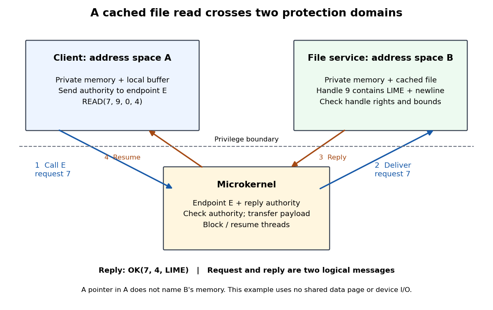

# Microkernel file-read example

↑ **Parent:** [Microkernel](microkernel.md)

Consider an original toy [file system](file-system-split.md) service in [address space](address-space.md) B and a client in [address space](address-space.md) A, on one [CPU](central-processing-unit.md). The service holds a five-[byte](byte.md) cached [file](computer-file.md) containing `LIME` followed by a newline. The client already has service handle `9`, permission to read that [file](computer-file.md), and a [security capability](capability-computer-security.md) to send requests to [IPC endpoint](ipc-endpoint.md) E. Handle `9` is interpreted by the service; it is neither a [virtual address](virtual-address.md) nor an [operating-system kernel](kernel-operating-system.md) object identifier. All relevant [memory pages](memory-page.md) are resident, and this read needs no [device driver](device-driver.md).

**[Figure 2](#image-a-cached-file-read-uses-ipc-between-separate-address-spaces-with-authority-checked-by-the-microkernel). A cached file read uses IPC between separate address spaces, with authority checked by the microkernel**.

- The client submits `READ(7, 9, 0, 4)`: request identifier `7`, handle `9`, [byte](byte.md) offset `0`, and requested length `4`. A [system call](system-call.md) enters the [microkernel](microkernel.md); the [security capability](capability-computer-security.md) is checked before delivery on [IPC endpoint](ipc-endpoint.md) E. The client waits for a reply.
- A waiting service [software thread](thread-computing.md) receives the request. The service checks the handle's read permission and the requested range, then obtains the first four [bytes](byte.md) from its cached [file](computer-file.md). The [microkernel](microkernel.md) transports the request; the service supplies its [file system](file-system-split.md) meaning.
- The service uses [reply capability](reply-capability.md) authority to return `OK(7, 4, LIME)`. The client resumes, checks the request identifier and returned length, and copies those four [bytes](byte.md) into its own local buffer. There were two logical [IPC](inter-process-communication.md) messages: request and reply. The four arrows show delivery stages, not four separate requests.

This protocol is an illustrative design, not an actual [seL4](sel4.md) [file system](file-system-split.md) interface. Its call/reply structure follows [seL4](sel4.md)'s documented [IPC](inter-process-communication.md): `seL4_Call` waits using reply authority, and small payloads can travel in [processor registers](processor-register.md). [IPC tutorial, Background: System calls; IPC Buffer; Data transfer](ipc-tutorial-by-sel4-project.md)

An ordinary pointer in A refers to A's [address space](address-space.md). Sending its numeric value does not make B's private [computer memory](computer-memory.md) appear there. This example explicitly transfers [bytes](byte.md). Sharing a mapped [memory page](memory-page.md) instead would require intentional [memory protection](memory-protection.md) permissions and a protocol for ownership and [synchronization](synchronization-computing.md); passing a pointer alone establishes neither.

The same [IPC](inter-process-communication.md) mechanism could carry `WRITE`, but this client could still be refused by the service's read-only handle policy. Conversely, possession of an [IPC endpoint](ipc-endpoint.md) [security capability](capability-computer-security.md) permits communication without automatically granting access to every [file](computer-file.md) the service manages. The [separation of mechanism and policy](separation-of-mechanism-and-policy.md) appears twice: endpoint authority gates delivery, and the service's handle policy gates the requested operation.

## ↑ Ancestors (5)

1. [Microkernel](microkernel.md)
2. [Kernel (operating system)](kernel-operating-system.md)
3. [Operating system](operating-system-split.md)
4. [Computer science](computer-science-split.md)
5. [Codex Wiki](split.md)

## ← Incoming links (3)

- [Formal specification](formal-specification.md)
- [Microkernel communication cost](microkernel-communication-cost.md)
- [seL4](sel4.md)
