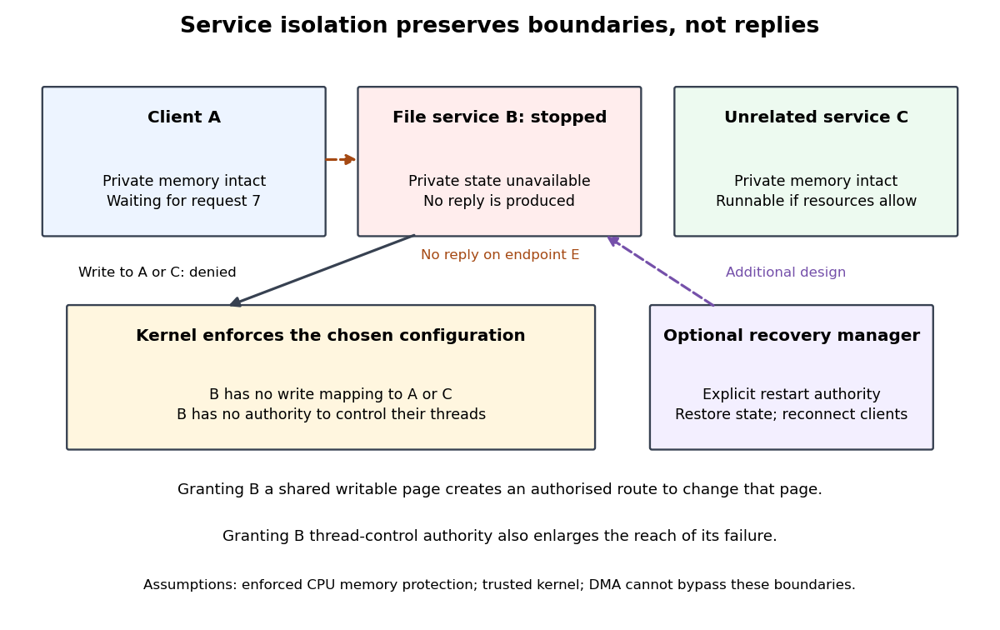

# Microkernel service failure isolation

↑ **Parent:** [Microkernel](microkernel.md)

Suppose the [user-space service](user-space-service.md) stops after receiving request `7`, before replying. Assume that its private [memory pages](memory-page.md) are not writable mappings of the client's or an unrelated service's [computer memory](computer-memory.md), and that it lacks [security capabilities](capability-computer-security.md) to change their [software threads](thread-computing.md). A failed store in the service cannot directly overwrite that private state through ordinary [CPU](central-processing-unit.md) [address translation](address-translation.md). Those assumptions establish a particular isolation boundary, not a successful read.

**[Figure 44](#image-memory-protection-and-security-capabilities-limit-a-stopped-service-s-reach-recovery-needs-an-additional-design). Memory protection and security capabilities limit a stopped service's reach; recovery needs an additional design**.

The client can remain blocked waiting for request `7`. An unrelated runnable service may continue if [process scheduling](process-scheduling.md) and resources permit, but clients that depend on the stopped service still lose access to its service. A separately authorized recovery manager would need to detect the failure, rebuild the service's state and arrange communication with its replacement. The [microkernel](microkernel.md) architecture by itself supplies none of those application-specific recovery decisions.

A missing reply also does not reveal whether a service crashed, is delayed by [process scheduling](process-scheduling.md), or entered an infinite computation. For a read, retrying after recovery may be straightforward; for a modifying operation, absence of a reply does not prove that the modification never happened. Recovery must account for ambiguous completed operations and any required [file-system crash consistency](file-system-crash-consistency.md).

The boundary changes with authority. A deliberately shared writable [memory page](memory-page.md) allows the service to change its shared contents; a [security capability](capability-computer-security.md) controlling another [software thread](thread-computing.md) permits the corresponding control operations. A [device driver](device-driver.md) with uncontrolled [DMA](direct-memory-access.md) can bypass ordinary [CPU](central-processing-unit.md) [memory protection](memory-protection.md). Thus service placement and actual permissions must be considered together. [What the Proofs Assume, The Assumptions: DMA and memory-mapped device registers](what-the-proofs-assume-by-sel4-project.md)

## ↑ Ancestors (5)

1. [Microkernel](microkernel.md)
2. [Kernel (operating system)](kernel-operating-system.md)
3. [Operating system](operating-system.md)
4. [Computer science](computer-science-split.md)
5. [Codex Wiki](split.md)
