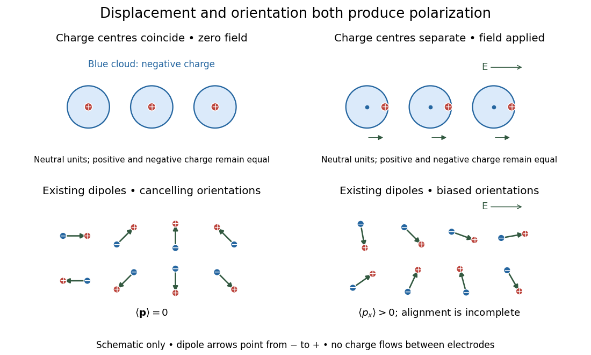

# Microscopic dielectric polarization

↑ **Parent:** [Dielectric](dielectric.md)

Two routes to [electric polarization](polarization-density.md) are displacement and reorientation. An [electric field](electric-field-split.md) can shift the centres of positive and negative [electric charge](electric-charge-split.md) in a neutral [chemical atom](atom-physics.md) or [molecule](molecule-split.md), inducing an [electric dipole moment](electric-dipole-moment.md). A [polar molecule](polar-molecule.md) already has an [electric dipole moment](electric-dipole-moment.md); a field biases its orientation. At finite [temperature](temperature-split.md), random molecular motion opposes complete alignment, so a nonzero average need not mean that every [electric dipole](electric-dipole.md) points the same way.[§8.5, Figures 8.19–8.20 and the thermal-fluctuation qualification following Figure 8.20](university-physics-volume-2-by-samuel-j-ling-and-others/8-5-molecular-model-of-a-dielectric.md)

For a single species with number per unit [volume](volume.md) $n$, the [electric polarization](polarization-density.md) is

$$
\mathbf P=n\langle\mathbf p\rangle.
$$

The brackets denote the local average [electric dipole moment](electric-dipole-moment.md), rather than its magnitude. Opposite orientations can cancel while individual [electric dipole moments](electric-dipole-moment.md) remain nonzero.[equation (803): number density times locally averaged molecular dipole moment](classical-electromagnetism-an-intermediate-level-course-by-richard-fitzpatrick/polarization.md) This averaging explains how an initially unpolarized material can respond strongly without acquiring net [electric charge](electric-charge-split.md).

**[Figure 2](#image-two-microscopic-routes-to-electric-polarization). Two microscopic routes to electric polarization**. Original schematic: upper panels show coincident charge centres becoming separated; lower panels show existing [electric dipoles](electric-dipole.md) changing from cancelling orientations to a biased distribution with incomplete alignment. Arrows run from negative to positive [electric charge](electric-charge-split.md). Positions, displacements and orientations are illustrative, not measurements or a simulation of a particular substance.

## ↑ Ancestors (6)

1. [Dielectric](dielectric.md)
2. [Permittivity](permittivity-split.md)
3. [Electromagnetism](electromagnetism-split.md)
4. [Branches of physics](branches-of-physics.md)
5. [Physics](physics-split.md)
6. [Codex Wiki](split.md)

## ← Incoming links (1)

- [Electric susceptibility](electric-susceptibility.md)
