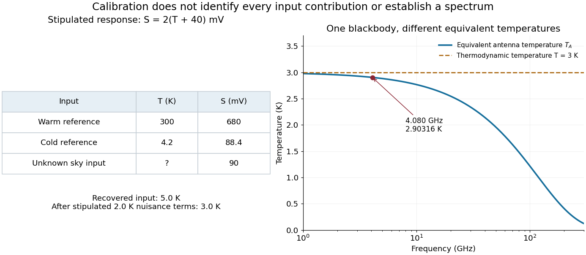

# Microwave radiometer calibration example

↑ **Parent:** [Penzias-Wilson microwave background experiment](penzias-wilson-microwave-background-experiment.md)

Consider an original idealized narrow-band model for one matched spatial mode and one [polarization of waves](polarization-waves.md). In the classical [Rayleigh-Jeans law](rayleigh-jeans-law.md) regime, an available thermal [power](power.md) can be written $P=k_BT\Delta\nu$, where $\Delta\nu$ is the effective [bandwidth](bandwidth-signal-processing.md) and $T$ the equivalent input [noise temperature](noise-temperature.md). Assume a linear detector with stable positive gain and absorb its [bandwidth](bandwidth-signal-processing.md), [Boltzmann constant](boltzmann-constant.md) and response factor into $g$. Then the output is $S=g(T+T_r)$, with input-referred [receiver noise temperature](receiver-noise-temperature.md) $T_r$. These are model assumptions, not a reconstruction of the historical electronics.

Two references with known [noise temperatures](noise-temperature.md) $T_h\ne T_c$ give

$$
S_h=g(T_h+T_r),\qquad S_c=g(T_c+T_r),
$$

so the [two-load radiometer calibration](two-load-radiometer-calibration.md) yields

$$
g=\frac{S_h-S_c}{T_h-T_c},\qquad
T_r=\frac{T_hS_c-T_cS_h}{S_h-S_c},\qquad
T_s=T_c+(T_h-T_c)\frac{S_s-S_c}{S_h-S_c}.
$$

Subtracting the reference equations eliminates the unknown receiver term; substituting back determines it. An arbitrary stable output offset can likewise be eliminated from the interpolation for $T_s$, although separating that offset from $T_r$ then requires additional information.

For deliberately chosen inputs, set $T_h=300\,\mathrm K$, $T_c=4.2\,\mathrm K$, $T_r=40\,\mathrm K$ and $g=2\,\mathrm{mV/K}$. These are equivalent [noise temperatures](noise-temperature.md); physical load thermometry must be converted consistently at the observing [frequency](frequency.md). The reference outputs are $S_h=680\,\mathrm{mV}$ and $S_c=88.4\,\mathrm{mV}$. A sky-input output $S_s=90\,\mathrm{mV}$ gives $T_s=5.0\,\mathrm K$. If independent estimates assign $1.4\,\mathrm K$ to atmosphere, $0.5\,\mathrm K$ to antenna loss and $0.1\,\mathrm K$ to ground pickup in this lumped additive model, the residual is $3.0\,\mathrm K$.

**[Figure 2](#image-original-calibration-arithmetic-and-the-distinction-between-an-antenna-temperature-and-a-thermodynamic-temperature). Original calibration arithmetic and the distinction between an antenna temperature and a thermodynamic temperature**. Chosen reference temperatures, receiver response and additive contributions; none are fitted historical measurements. The final panel calculates the [Rayleigh-Jeans law](rayleigh-jeans-law.md) equivalent [antenna temperature](antenna-temperature.md) of a stipulated $3\,\mathrm K$ [blackbody](blackbody.md). A change in [frequency](frequency.md) changes that equivalent temperature even though the underlying thermodynamic temperature is fixed.

The subtraction exposes what a noise budget must achieve. A $1\,\mathrm K$ error in the assigned atmospheric term becomes a $1\,\mathrm K$ error in the residual, even with exact detector calibration. Multiplicative attenuation requires a different correction: if an isothermal atmosphere has transmission $t$, its ideal contribution is $tT_{\rm cosmic}+(1-t)T_{\rm atm}$ in the same classical equivalent-temperature convention. Recovering $T_{\rm cosmic}$ then requires both subtracting atmospheric emission and dividing by $t$. The additive toy budget applies when its terms already refer to the same receiver input.

There is also a conditioning issue. If $S_h-S_c$ is small, a fixed output error strongly changes the inferred [temperature](temperature-split.md). Widely separated reference temperatures improve the scale determination only if the receiver remains linear over that range; measuring the reference repeatedly tests stability rather than proving linearity. The experiment therefore motivates a model, a calibration and a set of independent checks, each with its own assumptions.

**Table of contents**

- [Thermodynamic and Rayleigh-Jeans antenna temperatures](thermodynamic-and-rayleigh-jeans-antenna-temperatures.md)

## ↑ Ancestors (6)

1. [Penzias-Wilson microwave background experiment](penzias-wilson-microwave-background-experiment.md)
2. [Cosmic microwave background](cosmic-microwave-background-split.md)
3. [Cosmology](cosmology-split.md)
4. [Branches of physics](branches-of-physics.md)
5. [Physics](physics-split.md)
6. [Codex Wiki](split.md)
