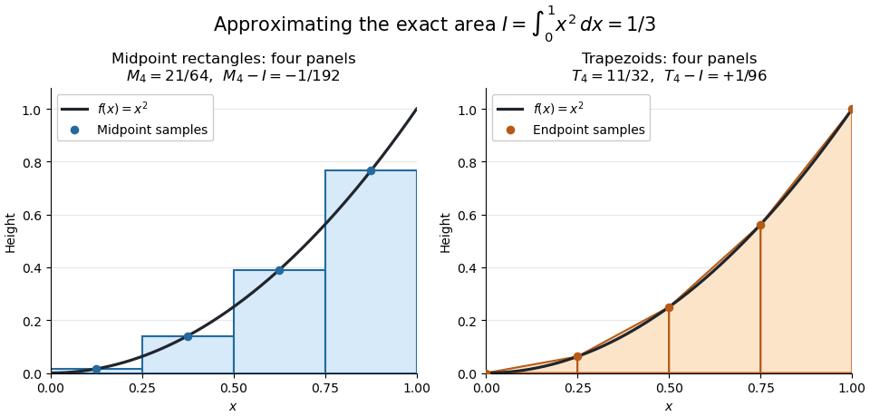

# Midpoint quadrature rule

↑ **Parent:** [Numerical analysis](numerical-analysis-split.md)

The [midpoint quadrature rule](midpoint-quadrature-rule.md) replaces the [integrand](integrand.md) on $[a,b]$, $a<b$, by its value halfway across the interval:

$$
I(f)=\int_a^bf(x)\,dx\approx M(f)=(b-a)f\left(\frac{a+b}{2}\right).
$$

Geometrically, $M(f)$ is the signed area of a [rectangle](rectangle.md) with width $b-a$ and height $f((a+b)/2)$. Its single [quadrature node](quadrature-node.md) is $(a+b)/2$ and its [quadrature weight](quadrature-weight.md) is $b-a$. Sampling in the interior is useful when endpoint evaluation is inconvenient, although an endpoint singularity can invalidate the [quadrature error](quadrature-error.md) estimates below.

The [midpoint quadrature rule](midpoint-quadrature-rule.md) is exact for every [affine function](affine-function.md) $f(x)=\alpha x+\beta$: the average height over an interval equals its midpoint height. For example, on $[0,2]$, $f(x)=2x+1$ gives $I(f)=6$ and $M(f)=2f(1)=6$. Positive and negative area discrepancies cancel for a sloping straight line. For the [polynomial](polynomial-split.md) $f(x)=x^2$ on $[0,1]$, however, $I(f)=1/3$ and $M(f)=1/4$, giving [approximation error](approximation-error.md) $M(f)-I(f)=-1/12$. Thus its [degree of precision of a quadrature rule](degree-of-precision-of-a-quadrature-rule.md) is exactly one.[§5.8, printed p. 223: midpoint rectangles, linear exactness and signed quadratic errors](calculus-by-gilbert-strang/5-8-numerical-integration.md)

**[Figure 24](#image-midpoint-rectangles-and-trapezoids-approximate-the-area-under-a-quadratic). Midpoint rectangles and trapezoids approximate the area under a quadratic**.

For the [polynomial](polynomial-split.md) $f(x)=x^2$ on $[0,1]$, four panels give [composite midpoint quadrature rule](composite-midpoint-quadrature-rule.md) value $21/64$ and [composite trapezoidal rule](composite-trapezoidal-rule.md) value $11/32$, bracketing the exact [integral](integral.md) $1/3$. Individual midpoint rectangles can cross the curve; it is their total signed area that underestimates the [integral](integral.md).

For $f\in C^2[a,b]$, meaning that its first two [derivatives](derivative.md) exist and are [continuous functions](continuous-function.md) on the closed interval, the signed [approximation error](approximation-error.md) has the form

$$
M(f)-I(f)=-\frac{(b-a)^3}{24}f''(\xi_M),\qquad a<\xi_M<b.
$$

Hence a [convex function](convex-function.md) with $f''\geq0$ is underestimated, and a [concave function](concave-function.md) with $f''\leq0$ is overestimated. A short justification uses the [Taylor formula with integral remainder](taylor-formula-with-integral-remainder.md): writing $m=(a+b)/2$, it gives $I(f)-M(f)=\int_a^b k(t)f''(t)\,dt$, where $k(t)=(t-a)^2/2$ for $a\leq t\leq m$ and $k(t)=(b-t)^2/2$ for $m\leq t\leq b$. This nonnegative [Peano kernel](peano-kernel.md) has [integral](integral.md) $(b-a)^3/24$, so the [weighted mean value theorem for integrals](weighted-mean-value-theorem-for-integrals.md) gives the stated sign and coefficient.

**Table of contents**

- [Composite midpoint quadrature rule](composite-midpoint-quadrature-rule.md)

## ↑ Ancestors (5)

1. [Numerical analysis](numerical-analysis-split.md)
2. [Analysis](analysis-split.md)
3. [Area of mathematics](area-of-mathematics.md)
4. [Mathematics](mathematics-split.md)
5. [Codex Wiki](split.md)

## ← Incoming links (6)

- [Composite midpoint quadrature rule](composite-midpoint-quadrature-rule.md)
- [Composite trapezoidal rule](composite-trapezoidal-rule.md)
- [Midpoint quadrature rule](midpoint-quadrature-rule.md)
- [Solution](past-exam-of-the-mathematics-course-of-the-university-of-cambridge/2018/ib/paper-3/19d/solution.md)
- [Quadrature rule](quadrature-rule.md)
- [Trapezoidal rule](trapezoidal-rule.md)
