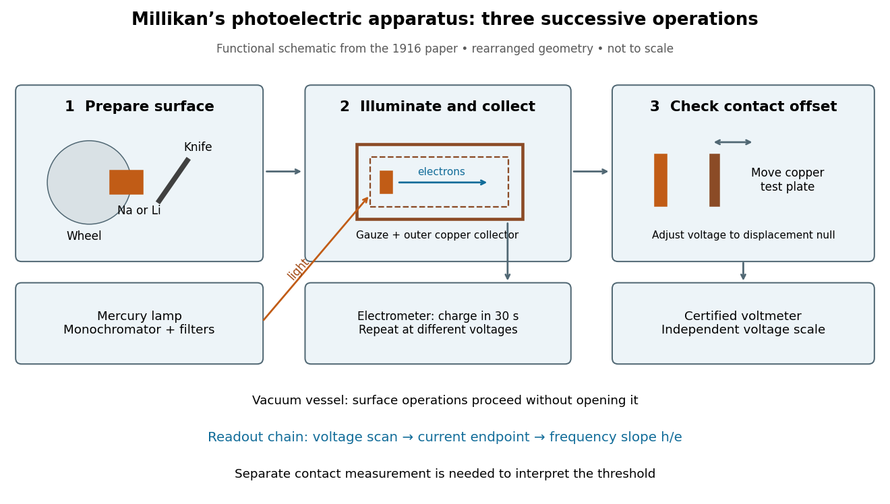

# Millikan photoelectric experiment

↑ **Parent:** [Photoelectric effect](photoelectric-effect.md)

[Robert Andrews Millikan](robert-andrews-millikan.md)'s 1916 experiment used a magnetically turned wheel and rotary knife to expose sodium or lithium in [vacuum](vacuum.md). A surrounding copper-gauze/solid-copper collector caught [electrons](electron.md); an [electrometer](electrometer.md) recorded accumulated [electric charge](electric-charge-split.md) over thirty seconds at each applied voltage. He located endpoints graphically from [photocurrent](photocurrent.md) curves. Mercury [spectral lines](spectral-line.md), selected by a monochromator and filters, controlled [frequency](frequency.md); rejecting shorter-[wavelength](wavelength.md) contamination protected the endpoint. An oxidized collector suppressed reverse emission for selected lines. A copper test plate measured the [contact potential difference](contact-potential-difference.md) by a displacement-null method; a certified [voltmeter](voltmeter.md) set the electrical scale. He compared stable-surface sweeps with rapid alternating-[frequency](frequency.md) measurements to control drift. The slope tested $h/e$; the threshold required the contact correction. His gauge did not measure mercury vapor. Confirmation of the equation coexisted with his continued skepticism about localized light quanta.[§§2–3, pp. 361–367, Figs. 1–3; §4, pp. 372–375, Figs. 5–6; §5, p. 380; Theories of photo emission, pp. 383–385; publication verified by Caltech record 45t7b-bvc23: March 1916, Physical Review 7(3), 355–388](a-direct-photoelectric-determination-of-planck-s-h-by-robert-andrews-millikan.md)

**[Figure 11](#image-what-millikan-photoelectric-experiment-controls-and-reads-out). What Millikan photoelectric experiment controls and reads out**. [Source](millikan-photoelectric-apparatus.py). Original functional reconstruction of the 1916 apparatus. Successive operations are separated and geometry rearranged; this is not a scale drawing.

For a modern repetition of the logic, first establish electrical zero with the illumination blocked, characterize leakage, and verify the [voltmeter](voltmeter.md) scale independently of the presumed [Planck constant](planck-constant.md). Scan several voltages near each endpoint rather than calling one noisy zero a cutoff. Hold the illuminated area and surface state fixed when varying [light intensity](light-intensity.md); vary [frequency](frequency.md) independently when testing the slope. Repeating a reference [frequency](frequency.md) between other readings reveals time-dependent offsets. Agreement of a slope with $h/e$ tests an [energy](energy-split.md) relation; it does not alone identify every microscopic step of [photon absorption](photon-absorption.md) and escape.

**Table of contents**

- [Contact potential difference](contact-potential-difference.md)
  - [Photoelectric contact-potential correction](photoelectric-contact-potential-correction.md)

## ↑ Ancestors (7)

1. [Photoelectric effect](photoelectric-effect.md)
2. [Photon absorption](photon-absorption.md)
3. [Photon](photon.md)
4. [Quantum mechanics](quantum-mechanics-split.md)
5. [Branches of physics](branches-of-physics.md)
6. [Physics](physics-split.md)
7. [Codex Wiki](split.md)

## ← Incoming links (6)

- [Albert Einstein](albert-einstein.md)
- [History of physics](history-of-physics.md)
- [Millikan photoelectric experiment](millikan-photoelectric-experiment.md)
- [Nobel Prize in Physics in 1921](nobel-prize-in-physics-in-1921.md)
- [Nobel Prize in Physics in 1923](nobel-prize-in-physics-in-1923.md)
- [Robert Andrews Millikan](robert-andrews-millikan.md)
