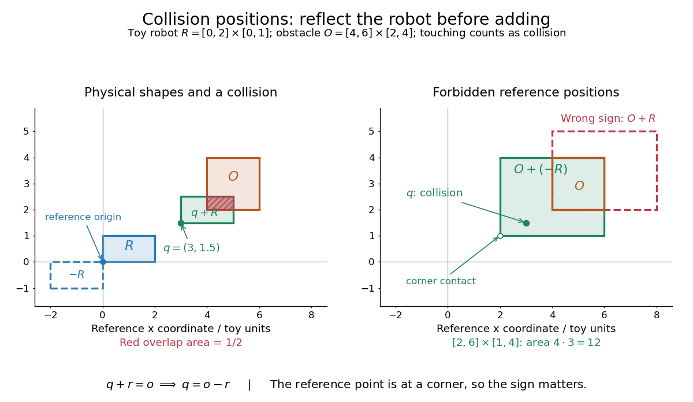

# Minkowski addition for collision detection

↑ **Parent:** [Minkowski addition](minkowski-addition.md)

Suppose a robot occupies a closed [set](set-split.md) $R\subseteq\mathbb R^n$ relative to its chosen reference point, and a closed obstacle occupies $O$. Keep the robot's orientation fixed and allow only [translations](translation-geometry.md). At reference [position](position.md) $q$, its occupied [set](set-split.md) is $q+R$. If touching counts as collision, the forbidden [positions](position.md) in this [configuration space](mechanical-configuration-space.md) are exactly

$$
\begin{aligned}
q\in C_{\mathrm{obs}}&\iff(q+R)\cap O\ne\varnothing\\
&\iff q+r=o\text{ for some }r\in R,\ o\in O\\
&\iff q\in O+(-R),\qquad -R=\{-r:r\in R\}.
\end{aligned}
$$

The minus sign reflects the robot through its reference origin: solving $q+r=o$ gives $q=o-r$. Thus collision checking for a moving shape becomes checking whether one point lies in a fixed [Minkowski sum](minkowski-addition.md). Steven M. LaValle derives this translational [configuration space](mechanical-configuration-space.md) construction in [Planning Algorithms, section 4.3.2, equation 4.37 and Example 4.13](https://msl.cs.uiuc.edu/planning/node161.html).

For a concrete toy example, take the robot [rectangle](rectangle.md) $R=[0,2]\times[0,1]$ with its reference point at the lower-left corner, and obstacle [rectangle](rectangle.md) $O=[4,6]\times[2,4]$. Their collision region is the [rectangle](rectangle.md)

$$
O+(-R)=[2,6]\times[1,4],\qquad \lambda_2(C_{\mathrm{obs}})=4\cdot3=12.
$$

For example, $q=(3,3/2)$ is forbidden: $q+R=[3,5]\times[3/2,5/2]$ meets $O$ in $[4,5]\times[2,5/2]$, of [area](surface-area.md) $1/2$. At $q=(2,1)$ there is just corner contact, which our convention also forbids. Using $O+R=[4,8]\times[2,5]$ instead would wrongly miss both reference [positions](position.md). Only when $R=-R$, as for an origin-centred [disk](disk-mathematics.md), does the reflection leave the robot [set](set-split.md) unchanged.

**[Figure 5](#image-toy-translational-collision-geometry-a-corner-referenced-robot-requires-o-plus-r-of-area-12-and-its-positive-minkowski-sum-o-plus-r-puts-forbidden-positions-on-the-wrong-side). Toy translational collision geometry: a corner-referenced robot requires $O+(-R)$, of area $12$, and its positive Minkowski sum $O+R$ puts forbidden positions on the wrong side**.

The same calculation handles bounded additive uncertainty. If the actual reference [position](position.md) is $q+e$ for any $e\in E$, the [union](set-union.md) of possible occupied [sets](set-split.md) is $q+(E+R)$. There exists an allowed error causing contact exactly when

$$
q\in O+(-(E+R))=O+(-R)+(-E).
$$

Consequently avoiding this [set](set-split.md) guarantees avoidance for every $e\in E$ in this model. For $E=[-\varepsilon,\varepsilon]^2$, the example's forbidden region becomes $[2-\varepsilon,6+\varepsilon]\times[1-\varepsilon,4+\varepsilon]$, with [area](surface-area.md) $(4+2\varepsilon)(3+2\varepsilon)$. Here $-E=E$ because the error bounds are symmetric; a one-sided error [set](set-split.md) must still be negated. This is a worst-case geometric bound, not a probability of collision. Rotating the robot requires an orientation-dependent [Minkowski sum](minkowski-addition.md) for each orientation.

## ↑ Ancestors (6)

1. [Minkowski addition](minkowski-addition.md)
2. [Convex geometry](convex-geometry.md)
3. [Geometry and topology](geometry-and-topology-split.md)
4. [Area of mathematics](area-of-mathematics.md)
5. [Mathematics](mathematics-split.md)
6. [Codex Wiki](split.md)
