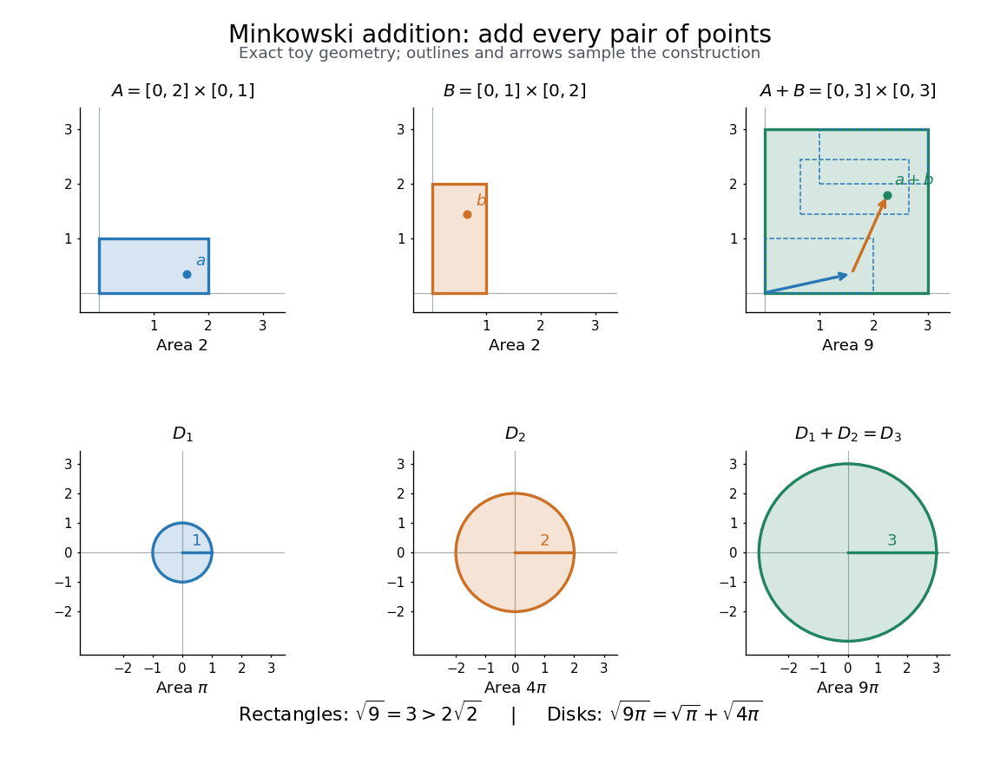

# Minkowski addition

↑ **Parent:** [Convex geometry](convex-geometry.md)  
ⓦ [Wiki](https://en.wikipedia.org/wiki/Minkowski_addition)

The [Minkowski sum](minkowski-addition.md) of [subsets](subset.md) $A,B$ of a [vector space](vector-space-split.md) collects the result of [vector addition](vector-addition.md) for every possible pair:

$$
A+B=\{a+b:a\in A,\ b\in B\}=\bigcup_{b\in B}(A+b).
$$

Think of fixing a point $b$ of $B$, making a [translation](translation-geometry.md) of the whole of $A$ by $b$, and then taking the [union](set-union.md) of these copies over every $b\in B$. The points of $B$ specify displacement [vectors](vector.md); they need not be the centre of a shape. [Minkowski addition](minkowski-addition.md) applies to nonconvex [sets](set-split.md) too. It is different from [set union](set-union.md): for $A=B=\{0,1\}$ on the real line, $A\cup B=\{0,1\}$ but $A+B=\{0,1,2\}$.

For axis-aligned [rectangles](rectangle.md) in the [Euclidean plane](euclidean-plane.md), the coordinate [intervals](interval-mathematics.md) add separately:

$$
([0,a]\times[0,b])+([0,c]\times[0,d])=[0,a+c]\times[0,b+d],\qquad a,b,c,d>0.
$$

Every coordinate between $0$ and $a+c$ can be split into one coordinate in $[0,a]$ and another in $[0,c]$, and likewise for the vertical coordinate. Thus a $2\times1$ [rectangle](rectangle.md) plus a $1\times2$ [rectangle](rectangle.md) gives a $3\times3$ [square](square.md) of [area](surface-area.md) $9$, although the two input [areas](surface-area.md) total only $4$. The [Minkowski sum](minkowski-addition.md) adds possible displacements, so its [area](surface-area.md) need not be the sum of input [areas](surface-area.md).

For closed [Euclidean disks](disk-mathematics.md) $D_r=\{x\in\mathbb R^2:\|x\|\leq r\}$ centred at the origin, the [triangle inequality](triangle-inequality.md) gives $D_r+D_s\subseteq D_{r+s}$. Conversely, if $r+s>0$, split any $x\in D_{r+s}$ as $x=rx/(r+s)+sx/(r+s)$. Therefore $D_r+D_s=D_{r+s}$, including the case $r=s=0$. Disks of [radii](radius.md) $1$ and $2$ give a [disk](disk-mathematics.md) of [radius](radius.md) $3$, with [areas](surface-area.md) $\pi,4\pi,9\pi$. For [disks](disk-mathematics.md) with centres $u,v$, the resulting centre is $u+v$. These two examples lead to the root-of-[area](surface-area.md) comparison in the [Brunn-Minkowski theorem](brunn-minkowski-theorem.md).

**[Figure 4](#image-minkowski-addition-of-two-rectangles-and-of-two-closed-disks-exact-toy-shapes-sample-displacement-arrows-and-the-square-root-of-area-comparison). Minkowski addition of two rectangles and of two closed disks: exact toy shapes, sample displacement arrows, and the square-root-of-area comparison**.

[Minkowski addition](minkowski-addition.md) is commutative and associative because [vector addition](vector-addition.md) is. Its identity is the [singleton](singleton-mathematics.md) $\{0\}$, and $A+\varnothing=\varnothing$. For displacement [vectors](vector.md) $u,v$ and $t>0$, [translations](translation-geometry.md) and [uniform dilations](uniform-dilation.md) satisfy

$$
(A+u)+(B+v)=(A+B)+(u+v),\qquad t(A+B)=tA+tB,
$$

where $tA=\{ta:a\in A\}$ uses [scalar multiplication](scalar-multiplication.md). A [Minkowski sum](minkowski-addition.md) of [convex sets](convex-set.md) is [convex](convex-function.md): a [line segment](line-segment.md) between $a_1+b_1$ and $a_2+b_2$ is obtained by adding the corresponding points of the [line segments](line-segment.md) in $A$ and $B$. Closure requires care; see [sum of two closed sets need not be closed](sum-of-two-closed-sets-need-not-be-closed.md) and [sum of a compact set and a closed set](sum-of-a-compact-set-and-a-closed-set.md).

**Table of contents**

- [Minkowski addition for collision detection](minkowski-addition-for-collision-detection.md)
- [Sum of two closed sets need not be closed](sum-of-two-closed-sets-need-not-be-closed.md)
- [Sum of a compact set and a closed set](sum-of-a-compact-set-and-a-closed-set.md)
- [Brunn-Minkowski theorem](brunn-minkowski-theorem.md)

## ↑ Ancestors (5)

1. [Convex geometry](convex-geometry.md)
2. [Geometry and topology](geometry-and-topology-split.md)
3. [Area of mathematics](area-of-mathematics.md)
4. [Mathematics](mathematics-split.md)
5. [Codex Wiki](split.md)

## ← Incoming links (2)

- [Homothetic convex bodies](homothetic-convex-bodies.md)
- [Minkowski addition](minkowski-addition.md)
