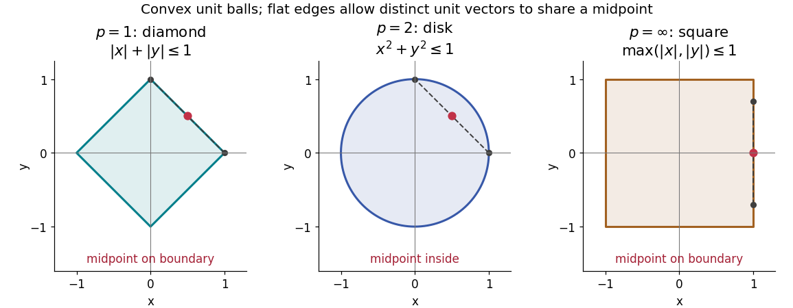

# Minkowski inequality

↑ **Parent:** [Lp norm](lp-norm.md)  
ⓦ [Wiki](https://en.wikipedia.org/wiki/Minkowski_inequality)

For [measurable functions](measurable-function.md) $f,g$ with values in the [real numbers](real-number.md) or [complex numbers](complex-number.md) on the same [measure space](measure-space.md) $(X,\mathcal A,\mu)$, and $1\leq p\leq\infty$, membership in the same [Lp space](lp-space.md) gives

$$
f,g\in L^p(\mu)\quad\Longrightarrow\quad f+g\in L^p(\mu),\qquad
\lVert f+g\rVert_p\leq\lVert f\rVert_p+\lVert g\rVert_p.
$$

Thus adding two [functions](function-split.md) cannot make their combined [Lp norm](lp-norm.md) exceed the sum of their separate [Lp norms](lp-norm.md). The [measure](measure-split.md) need not be finite or a [probability measure](probability-measure.md). The hypotheses require finite [Lp norms](lp-norm.md); $p=\infty$ uses the [essential supremum](essential-supremum.md) of the [absolute value](absolute-value.md), not an ordinary pointwise [supremum](supremum.md). For [complex numbers](complex-number.md), the [absolute value](absolute-value.md) is the [complex modulus](complex-modulus.md). As usual, [Lp spaces](lp-space.md) identify [functions](function-split.md) equal [almost everywhere](almost-everywhere.md). [Axler, Measure, Integration & Real Analysis, §7A, Definition 7.1, pp. 194–195, and Theorem 7.14, p. 199](measure-integration-and-real-analysis-by-sheldon-axler.md)

The [Minkowski inequality](minkowski-inequality.md) makes the [Lp norm](lp-norm.md) a workable notion of size: it supplies the [triangle inequality](triangle-inequality.md) needed to turn $d_p(f,g)=\lVert f-g\rVert_p$ into a [metric](metric.md) on [Lp space](lp-space.md). Applied to $(f-h)+(h-g)$, it says that travelling through an intermediate [function](function-split.md) $h$ cannot shorten the direct distance measured by this [metric](metric.md). Applied to two error [functions](function-split.md), it gives a bound on the total error even when the errors reinforce one another; [Minkowski inequality for error aggregation](minkowski-inequality-for-error-aggregation.md) gives explicit examples.

The geometry is already visible in the [Euclidean plane](euclidean-plane.md). Under [counting measure](counting-measure.md) on two coordinates, the closed [unit balls](unit-ball.md) for the [L1 norm](l1-norm.md), [Euclidean norm](euclidean-norm.md), and [L-infinity norm](l-infinity-norm.md) are respectively $|x|+|y|\leq1$, $x^2+y^2\leq1$, and $\max(|x|,|y|)\leq1$. Every one is a [convex set](convex-set-split.md): if $u,v$ have [Lp norm](lp-norm.md) at most one, the [Minkowski inequality](minkowski-inequality.md) and [absolute homogeneity of a norm](absolute-homogeneity-of-a-norm.md) give $\lVert tu+(1-t)v\rVert_p\leq t+(1-t)=1$ for $0\leq t\leq1$. The [Euclidean norm](euclidean-norm.md) has no flat boundary segments, whereas the other two [norms](norm.md) do. This is the distinction captured by a [strictly convex normed space](strictly-convex-normed-space.md) and developed in [equality in Minkowski inequality](equality-in-minkowski-inequality.md).

**[Figure 18](#image-closed-unit-balls-for-the-l1-norm-euclidean-norm-and-l-infinity-norm). Closed unit balls for the L1 norm, Euclidean norm, and L-infinity norm**. The red point is the midpoint of the two marked unit [vectors](vector.md). It lies inside the disk, but on the flat edge of the diamond or square. All three [unit balls](unit-ball.md) are [convex sets](convex-set-split.md); only the disk gives a [strictly convex normed space](strictly-convex-normed-space.md) among these planar examples.

A short [Hölder's inequality](holder-s-inequality.md) proof outline handles $1<p<\infty$. First $|f+g|^p\leq2^{p-1}(|f|^p+|g|^p)$, so $f+g$ has finite [Lp norm](lp-norm.md) before any division. With [conjugate exponents](conjugate-exponents.md) $p$ and $q=p/(p-1)$, set $h=|f+g|^{p-1}$; then $\lVert h\rVert_q=\lVert f+g\rVert_p^{p-1}$. The scalar [triangle inequality](triangle-inequality.md) followed by [Hölder's inequality](holder-s-inequality.md) gives

$$
\lVert f+g\rVert_p^p
\leq\int (|f|+|g|)|f+g|^{p-1}\,d\mu
\leq(\lVert f\rVert_p+\lVert g\rVert_p)\lVert f+g\rVert_p^{p-1}.
$$

Divide if $\lVert f+g\rVert_p>0$; otherwise the desired bound is immediate. For $p=1$, integrate $|f+g|\leq|f|+|g|$. For $p=\infty$, the [almost everywhere](almost-everywhere.md) bounds $|f|\leq\lVert f\rVert_\infty$ and $|g|\leq\lVert g\rVert_\infty$ give the result by the [essential supremum](essential-supremum.md). The same scalar [triangle inequality](triangle-inequality.md) works for [real numbers](real-number.md) and [complex numbers](complex-number.md).

**Table of contents**

- [Minkowski inequality for finite vectors](minkowski-inequality-for-finite-vectors.md)
- [Equality in Minkowski inequality](equality-in-minkowski-inequality.md)
- [Minkowski inequality for error aggregation](minkowski-inequality-for-error-aggregation.md)
- [Failure of Minkowski inequality below exponent one](failure-of-minkowski-inequality-below-exponent-one.md)

## ↑ Ancestors (6)

1. [Lp norm](lp-norm.md)
2. [Real analysis](real-analysis-split.md)
3. [Analysis](analysis-split.md)
4. [Area of mathematics](area-of-mathematics.md)
5. [Mathematics](mathematics-split.md)
6. [Codex Wiki](split.md)

## ← Incoming links (21)

- [Completeness of Lp spaces](completeness-of-lp-spaces.md)
- [Dual-exponent Clarkson inequality](dual-exponent-clarkson-inequality.md)
- [Equality in Minkowski inequality](equality-in-minkowski-inequality.md)
- [Failure of Minkowski inequality below exponent one](failure-of-minkowski-inequality-below-exponent-one.md)
- [Integrated second-order kernel bias bound](integrated-second-order-kernel-bias-bound.md)
- [Minkowski inequality](minkowski-inequality.md)
- [Minkowski inequality for error aggregation](minkowski-inequality-for-error-aggregation.md)
- [Minkowski inequality for finite vectors](minkowski-inequality-for-finite-vectors.md)
- [Minkowski integral inequality](minkowski-integral-inequality.md)
- [Solution](past-exam-of-the-mathematics-course-of-the-university-of-cambridge/2005/ii/paper-3/24j/b/solution.md)
- [Solution](past-exam-of-the-mathematics-course-of-the-university-of-cambridge/2005/iii/paper-5/4/iii/solution.md)
- [Solution](past-exam-of-the-mathematics-course-of-the-university-of-cambridge/2007/ii/paper-3/24j/b/solution.md)
- [Solution](past-exam-of-the-mathematics-course-of-the-university-of-cambridge/2008/ii/paper-1/22f/solution.md)
- [Solution](past-exam-of-the-mathematics-course-of-the-university-of-cambridge/2008/iii/paper-34/3/a/solution.md)
- [Solution](past-exam-of-the-mathematics-course-of-the-university-of-cambridge/2009/ii/paper-2/22h/b/solution.md)
- [Solution](past-exam-of-the-mathematics-course-of-the-university-of-cambridge/2011/ii/paper-1/26k/i/solution.md)
- [Solution](past-exam-of-the-mathematics-course-of-the-university-of-cambridge/2012/iii/paper-39/3/solution.md)
- [Solution](past-exam-of-the-mathematics-course-of-the-university-of-cambridge/2015/iii/paper-6/1/solution.md)
- [Solution](past-exam-of-the-mathematics-course-of-the-university-of-cambridge/2015/iii/paper-8/1/f/solution.md)
- [Solution](past-exam-of-the-mathematics-course-of-the-university-of-cambridge/2017/iii/paper-201/4/a/solution.md)
- [Quasi-norm](quasi-norm.md)
