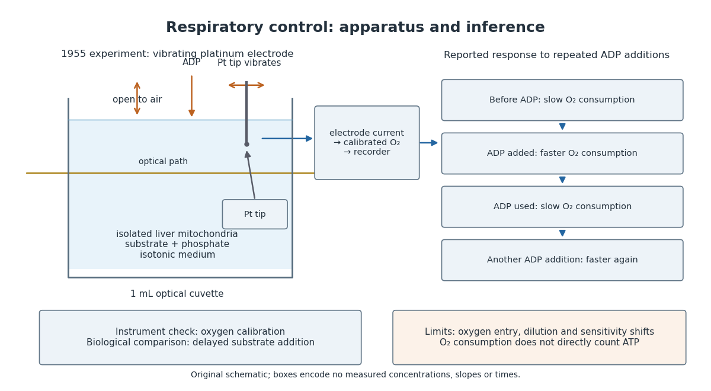

# Mitochondrial oxygen electrode assay

↑ **Parent:** [Respiratory control](respiratory-control.md)

In Respiratory enzymes in oxidative phosphorylation. I. Kinetics of oxygen utilization (1955), [Britton Chance](britton-chance.md) and [G. R. Williams](g-r-williams.md) examined isolated liver [mitochondria](mitochondria.md) in isotonic medium with [substrate](substrate-biochemistry.md) and [inorganic phosphate](inorganic-phosphate.md). A one-millilitre optical [cuvette](cuvette.md) held the suspension. A vibrating [platinum](platinum.md) [electrode](electrode.md) lay outside the light path; calibrated [electric current](electric-current.md) followed dissolved [oxygen](oxygen.md), with rapid changes recorded by a galvanometer oscillograph. Air-saturated and oxygen-depleted readings checked sensitivity. Their Figure 2 shows [ADP](adenosine-diphosphate.md) additions accelerating [oxygen](oxygen.md) consumption, followed by return to slow respiration; repeated additions restored acceleration. Figure 4B compares delayed [substrate](substrate-biochemistry.md) addition after [ADP](adenosine-diphosphate.md) incubation with the reverse order, supporting little unrelated [ADP](adenosine-diphosphate.md) loss in that preparation. These comparisons support coupling to [ADP](adenosine-diphosphate.md) utilization. The authors discuss dilution, sensitivity changes and atmospheric [oxygen](oxygen.md) entry, which especially biases slow respiration. The readout did not directly measure the [membrane potential](membrane-potential-split.md) or prove the later [chemiosmosis](chemiosmosis.md) mechanism.[pp. 383–386, Preparations and Method, Figures 1–2; pp. 387–389, Endogenous Substrate and Figure 4B; Figure 5: rapid recording](respiratory-enzymes-in-oxidative-phosphorylation-i-kinetics-of-oxygen-utilization-by-britton-chance-and-g-r-williams.md)

**[Figure 10](#image-an-oxygen-electrode-reveals-the-respiratory-response-to-adp). An oxygen electrode reveals the respiratory response to ADP**. Original schematic of an open [cuvette](cuvette.md), vibrating [platinum](platinum.md) [electrode](electrode.md) outside the optical path, and repeated [ADP](adenosine-diphosphate.md)-dependent [oxygen](oxygen.md) responses. Boxes encode no measured times, slopes or [concentrations](concentration.md).

A control can test either the instrument or the biology. Calibrating [electric current](electric-current.md) against [oxygen](oxygen.md) checks the former; comparing responses before and after an [ADP](adenosine-diphosphate.md) addition checks the latter. A valid calibration cannot by itself establish [ATP](adenosine-triphosphate.md) formation, and a repeatable biological response cannot by itself fix an instrument's sensitivity.

## ↑ Ancestors (6)

1. [Respiratory control](respiratory-control.md)
2. [Electron transport chain](electron-transport-chain.md)
3. [Energy metabolism](energy-metabolism.md)
4. [Biochemistry](biochemistry-split.md)
5. [Chemistry](chemistry-split.md)
6. [Codex Wiki](split.md)

## ← Incoming links (3)

- [Isolated mitochondria respiration experiment](isolated-mitochondria-respiration-experiment.md)
- [Pigeon breast muscle evidence for a metabolic cycle](pigeon-breast-muscle-evidence-for-a-metabolic-cycle.md)
- [Respiratory control](respiratory-control.md)
