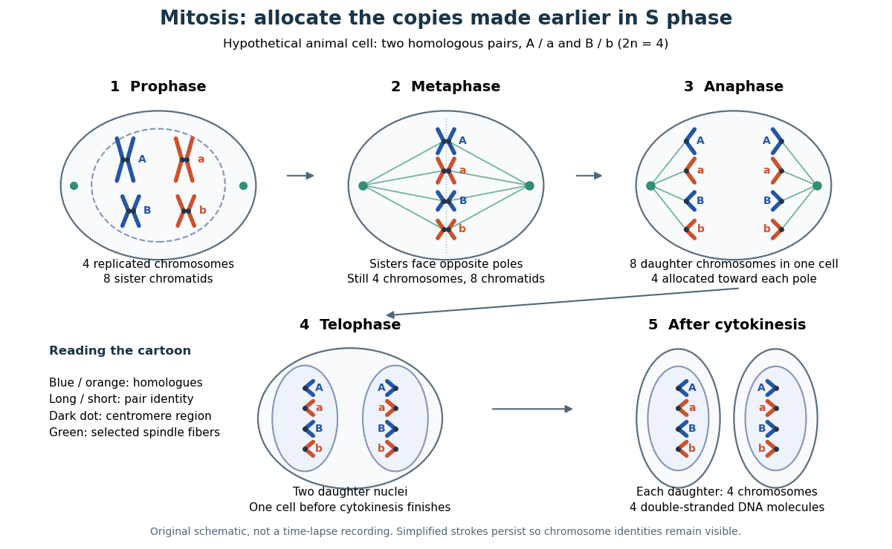

# Mitosis

↑ **Parent:** [M phase](m-phase.md)  
ⓦ [Wiki](https://en.wikipedia.org/wiki/Mitosis)

[Mitosis](mitosis.md) allocates copied [chromosomes](chromosome.md) to daughter [cell nuclei](cell-nucleus.md). The [spindle apparatus](spindle-apparatus.md) aligns [sister chromatids](sister-chromatids.md) before separation in [anaphase](anaphase.md).

The copying has already occurred during [S phase](s-phase.md), before [mitosis](mitosis.md). Nuclear [chromosome segregation](chromosome-segregation.md) and [cytokinesis](cytokinesis.md), the partition of the [cytoplasm](cytoplasm.md), are distinct processes: two daughter [cell nuclei](cell-nucleus.md) can form inside one undivided [biological cell](biological-cell-split.md).[Biology 2e by Mary Ann Clark and others; §10.2, Interphase and The Mitotic Phase; Figure 10.5: replication precedes nuclear division, which can occur without cytokinesis](biology-2e-by-mary-ann-clark-and-others/the-cell-cycle.md)

The original cartoon follows a hypothetical [diploid](diploid.md) [animal](animal.md) [biological cell](biological-cell-split.md) with $2n=4$. Its two [homologous chromosome](homologous-chromosome.md) pairs are $A,a$ and $B,b$; upper- and lower-case letters identify homologues, not dominant and recessive [alleles](allele.md). In [prophase](prophase.md) and [metaphase](metaphase.md), each replicated [chromosome](chromosome.md) contains two [sister chromatids](sister-chromatids.md): four replicated [chromosomes](chromosome.md) contain eight [chromatids](chromatid.md), rather than eight replicated [chromosomes](chromosome.md). The X shape depicts two associated copies, not the shape of every [chromosome](chromosome.md) throughout the [cell cycle](cell-cycle-split.md).

**[Figure 2](#image-mitosis-partitions-replicated-chromosomes-cytokinesis-separates-the-daughters). Mitosis partitions replicated chromosomes; cytokinesis separates the daughters**. Original schematic of a hypothetical $2n=4$ [animal](animal.md) [biological cell](biological-cell-split.md), drawn with open [mitosis](mitosis.md). Colors and letters follow the four original [chromosomes](chromosome.md); paired strokes represent [sister chromatids](sister-chromatids.md). Every [anaphase](anaphase.md) pole and each completed daughter receives $A,a,B,b$. Green lines represent selected [spindle apparatus](spindle-apparatus.md) [microtubules](microtubule.md); dark dots mark [centromere](centromere.md) regions. The intermediate [prometaphase](prometaphase.md) is described below. Geometry and arrow spacing are illustrative, not recorded images or elapsed times.

This open [mitosis](mitosis.md) cartoon shows [nuclear envelope](nuclear-envelope.md) breakdown and reassembly. Closed [mitosis](mitosis.md) in some [yeasts](yeast.md) retains the [nuclear envelope](nuclear-envelope.md) while daughter [chromosomes](chromosome.md) separate inside it; the cartoon is therefore not a universal cellular architecture.[Chapter 8, The Nucleus during Mitosis, Dissolution of the Nuclear Envelope; Figures 8.29–8.30: open and closed mitosis](the-cell-a-molecular-approach-2nd-edition-by-geoffrey-m-cooper.md)

**Table of contents**

- [Prophase](prophase.md)
- [Prometaphase](prometaphase.md)
- [Metaphase](metaphase.md)
- [Anaphase](anaphase.md)
- [Telophase](telophase.md)
- [Mitotic daughter chromosome accounting](mitotic-daughter-chromosome-accounting.md)
- [Spindle checkpoint](spindle-checkpoint.md)
  - [Bub3](bub3.md)
  - [BubR1](bubr1.md)
  - [Mad2](mad2.md)
  - [Mitotic checkpoint complex](mitotic-checkpoint-complex.md)
  - [Kinetochore ablation experiment](kinetochore-ablation-experiment.md)

## ↑ Ancestors (5)

1. [M phase](m-phase.md)
2. [Cell cycle](cell-cycle-split.md)
3. [Biological cell](biological-cell-split.md)
4. [Biology](biology-split.md)
5. [Codex Wiki](split.md)

## ← Incoming links (25)

- [Alexey Khodjakov](alexey-khodjakov.md)
- [Alternation of generations](alternation-of-generations.md)
- [Cell cycle](cell-cycle-split.md)
- [Chromosome](chromosome.md)
- [Chromosome segregation](chromosome-segregation.md)
- [Conly L. Rieder](conly-l-rieder.md)
- [Cyclin-dependent kinase](cyclin-dependent-kinase.md)
- [Cytokinesis](cytokinesis.md)
- [Flow cytometric DNA-content assay](flow-cytometric-dna-content-assay.md)
- [G2 phase](g2-phase.md)
- [Greenfield Sluder](greenfield-sluder.md)
- [M phase](m-phase.md)
- [Mitosis](mitosis.md)
- [Mitotic daughter chromosome accounting](mitotic-daughter-chromosome-accounting.md)
- [Solution](past-exam-of-the-biochemistry-and-molecular-biology-course-of-the-university-of-cambridge/2024/paper-1/section-d/11/solution.md)
- [Solution](past-exam-of-the-biochemistry-and-molecular-biology-course-of-the-university-of-cambridge/2025/paper-1/section-d/11/solution.md)
- [Solution](past-exam-of-the-biochemistry-course-of-the-university-of-cambridge/2024/paper-5/section-1/k/solution.md)
- [Solution](past-exam-of-the-biochemistry-course-of-the-university-of-cambridge/2024/paper-5/section-1/m/solution.md)
- [Solution](past-exam-of-the-biochemistry-course-of-the-university-of-cambridge/2025/paper-3/section-i/1/solution.md)
- [Solution](past-exam-of-the-biochemistry-course-of-the-university-of-cambridge/2025/paper-3/section-ii/3/solution.md)
- [Solution](past-exam-of-the-plant-sciences-course-of-the-university-of-cambridge/2025/paper-plm3/1/solution.md)
- [Solution](past-exam-of-the-zoology-course-of-the-university-of-cambridge/2025/paper-zl6/1/solution.md)
- [Prometaphase](prometaphase.md)
- [Richard W. Cole](richard-w-cole.md)
- [Telophase](telophase.md)
