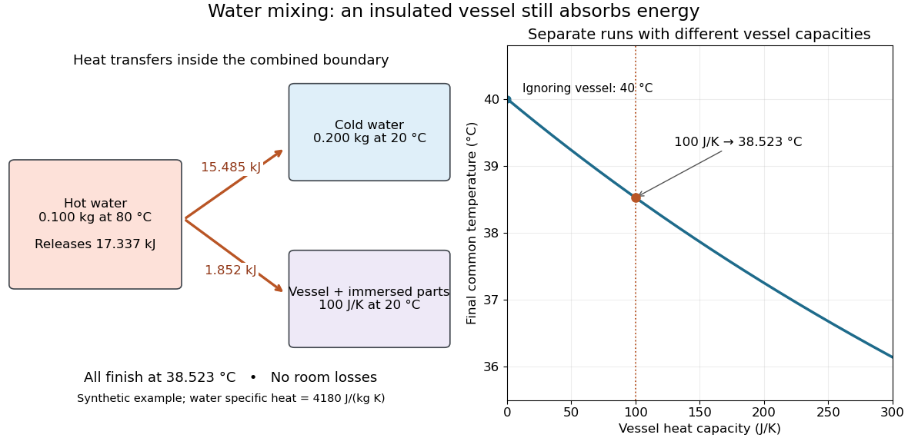

# Mixing calorimetry

↑ **Parent:** [Calorimetry](calorimetry.md)

Mixing calorimetry determines [heat capacities](heat-capacity.md) by bringing bodies at different [temperatures](temperature.md) into thermal contact. The striking feature is that the final [temperature](temperature.md) is a [weighted arithmetic mean](weighted-arithmetic-mean.md) with [heat capacities](heat-capacity.md) as weights, rather than weights given by [mass](mass.md). The vessel participates in the exchange even though it is not the sample being studied.

For a hot nonreacting sample of [mass](mass.md) $m_x$, initial [temperature](temperature.md) $T_x$ and unknown [specific heat capacity at constant pressure](specific-heat-capacity-at-constant-pressure.md) $c_x$, let receiving [water](water.md) have [mass](mass.md) $m_w$, initial [temperature](temperature.md) $T_w$ and known [specific heat capacity at constant pressure](specific-heat-capacity-at-constant-pressure.md) $c_w$. Let the vessel and immersed parts start at $T_w$ and have combined [heat capacity](heat-capacity.md) $C_{\rm cal}$, excluding that [water](water.md). Assume a common final [temperature](temperature.md) $T_f$, approximately constant [pressure](pressure.md) and [heat capacities](heat-capacity.md), no [phase transition](phase-transition.md), no [chemical reaction](chemical-reaction.md) and negligible external nonexpansion [work](work.md). For signed outward [heat](heat.md) loss $Q_{\rm loss,out}$, the combined [enthalpy](enthalpy.md) balance is

$$
m_xc_x(T_f-T_x)+(m_wc_w+C_{\rm cal})(T_f-T_w)=-Q_{\rm loss,out}.
$$

Hence

$$
c_x=\frac{(m_wc_w+C_{\rm cal})(T_f-T_w)+Q_{\rm loss,out}}{m_x(T_x-T_f)}.
$$

The loss is positive if the room receives net [heat](heat.md), negative if the room supplies it. If the vessel starts at a different [temperature](temperature.md) $T_{{\rm cal},i}$, replace its warming term by $C_{\rm cal}(T_f-T_{{\rm cal},i})$; do not assume the vessel shared the [water](water.md)'s initial [temperature](temperature.md). For variable material properties, replace each $mc\Delta T$ by the corresponding [integral](integral.md) $m\int c_p(T)\,dT$ and each vessel term by $\int C_{\rm cal}(T)\,dT$. The inferred constant $c_x$ then represents an average over the sample's cooling interval.[Figure 5.14 and Example 5.4: exchange between metal and water and inference of unknown specific heat](chemistry-2e-by-paul-flowers-and-others/5-2-calorimetry.md)

For a synthetic no-loss example, mix $0.100\,\mathrm{kg}$ of hot [water](water.md) at $80\,{}^\circ\mathrm C$ with $0.200\,\mathrm{kg}$ of cold [water](water.md) at $20\,{}^\circ\mathrm C$ in a vessel initially at $20\,{}^\circ\mathrm C$. Stipulate $c_w=4180\,\mathrm{J\,kg^{-1}\,K^{-1}}$ and $C_{\rm cal}=100\,\mathrm{J\,K^{-1}}$. The [enthalpy](enthalpy.md) balance gives

$$
T_f=\frac{(418)(80)+(836+100)(20)}{418+836+100}\,{}^\circ\mathrm C
\approx38.523\,{}^\circ\mathrm C.
$$

The hot [water](water.md) releases $17.337\,\mathrm{kJ}$: the cold [water](water.md) receives $15.485\,\mathrm{kJ}$ and the vessel $1.852\,\mathrm{kJ}$. Omitting the vessel predicts $40\,{}^\circ\mathrm C$, despite perfect insulation. These are computed numbers from stipulated properties, not laboratory observations.

**[Figure 5](#calorimetry-mixing-temperature-energy-balance). The vessel changes the mixing temperature by sharing the heat transfer**. Original computed no-loss [water](water.md) example. Left: transfers sum to the hot portion's released [heat](heat.md). Right: increasing the initially cold vessel's [heat capacity](heat-capacity.md) lowers the common final [temperature](temperature.md); the marked point uses $C_{\rm cal}=100\,\mathrm{J\,K^{-1}}$. Each vessel setting is a separate modeled experiment.

For an unknown-sample example using the same cold [water](water.md) and vessel, stipulate $m_x=0.100\,\mathrm{kg}$, $T_x=80\,{}^\circ\mathrm C$ and $c_x=450\,\mathrm{J\,kg^{-1}\,K^{-1}}$. With no loss, $T_f\approx22.752\,{}^\circ\mathrm C$. Inverting the full balance returns $450\,\mathrm{J\,kg^{-1}\,K^{-1}}$; ignoring vessel storage returns about $402\,\mathrm{J\,kg^{-1}\,K^{-1}}$. With a positive outward loss, ignoring that loss also biases the inferred $c_x$ downward under these hot-sample conditions. A small [water](water.md) [temperature](temperature.md) rise makes sensor offsets and loss estimates relatively influential; [propagation of uncertainty](propagation-of-uncertainty.md) must include the measured [temperatures](temperature.md), [masses](mass.md) and calibrated vessel term.

## ↑ Ancestors (6)

1. [Calorimetry](calorimetry.md)
2. [Thermodynamics](thermodynamics-split.md)
3. [Statistical physics](statistical-physics-split.md)
4. [Branches of physics](branches-of-physics.md)
5. [Physics](physics-split.md)
6. [Codex Wiki](split.md)

## ← Incoming links (3)

- [Calorimeter calibration](calorimeter-calibration.md)
- [Calorimeter heat-loss correction](calorimeter-heat-loss-correction.md)
- [Calorimetry](calorimetry.md)
