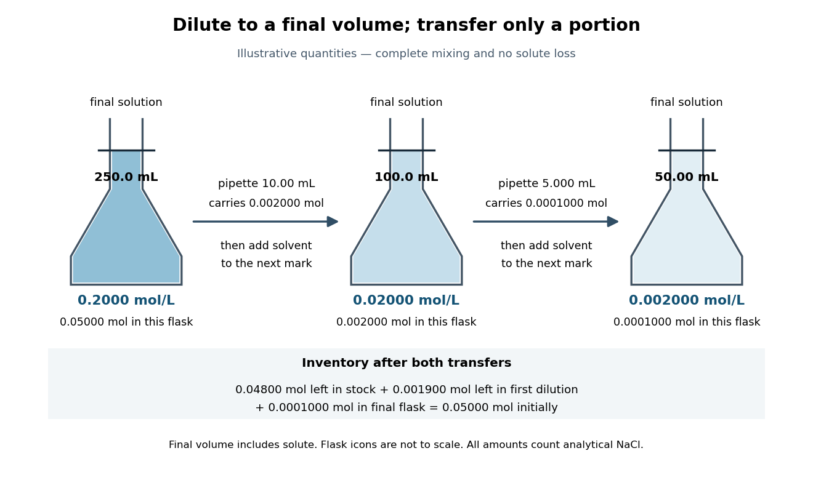

# Mixture

↑ **Parent:** [Chemistry](chemistry.md)  
ⓦ [Wiki](https://en.wikipedia.org/wiki/Mixture)

A [mixture](mixture.md) contains two or more [chemical substances](chemical-substance.md) combined in proportions that need not be fixed. A [chemical compound](chemical-substance.md#chemical-compound) instead has a definite composition: [water](chemical-substance.md#water) has two [hydrogen](chemical-substance.md#hydrogen) [chemical atoms](physics.md#atom-physics) per [oxygen](chemical-substance.md#oxygen) [chemical atom](physics.md#atom-physics), whereas a [sucrose](chemical-substance.md#sucrose) and [water](chemical-substance.md#water) [mixture](mixture.md) can contain different sugar proportions. A homogeneous [mixture](mixture.md) has uniform composition on the scale of representative samples; a heterogeneous [mixture](mixture.md) has distinguishable regions of different composition. A [chemical solution](#solution-chemistry) is homogeneous, whereas sand dispersed in [water](chemical-substance.md#water) is a [particle suspension](suspension-chemistry.md).[Chemistry 2e, §1.2, Classification of Matter: mixtures, variable composition, homogeneous and heterogeneous examples](chemistry-bibliography.md#chemistry-2e-by-paul-flowers-and-others/1-2-phases-and-classification-of-matter)

The distinction concerns the sample, not merely its ingredient list. A vessel with dissolved [sodium chloride](chemical-substance.md#sodium-chloride) and excess undissolved [sodium chloride](chemical-substance.md#sodium-chloride) contains a [chemical solution](#solution-chemistry) and an [ionic crystal](ionic-bonding.md#ionic-crystal) [thermodynamic phase](thermodynamics.md#thermodynamic-phase). The [liquid](thermodynamics.md#liquid) portion can be homogeneous while the whole vessel is heterogeneous. Similarly, [molecular oxygen](chemical-substance.md#molecular-oxygen) dissolved in [water](chemical-substance.md#water) is part of a [chemical solution](#solution-chemistry); visible [gas](thermodynamics.md#gas) bubbles introduce a separate [gas](thermodynamics.md#gas) [thermodynamic phase](thermodynamics.md#thermodynamic-phase).

**Table of contents**

- [Atomic fraction](#atomic-fraction)
- [Colloid](#colloid)
  - [Foam](#foam)
  - [Sol](#sol)
  - [Solvation force](#solvation-force)
    - [Hydration force](#hydration-force)
  - [Emulsion](#emulsion)
    - [Droplet coalescence](#droplet-coalescence)
    - [Emulsion stability versus molecular miscibility](#emulsion-stability-versus-molecular-miscibility)
    - [Pickering emulsion](#pickering-emulsion)
  - [Polymer bridging flocculation](#polymer-bridging-flocculation)
  - [Colloidal coagulation](#colloidal-coagulation)
  - [Particle size distribution](#particle-size-distribution)
    - [Polydispersity](#polydispersity)
      - [Molar-mass dispersity](#molar-mass-dispersity)
  - [Colloidal crystal](#colloidal-crystal)
  - [Colloidal stability](#colloidal-stability)
    - [Gravitational Peclet number](#gravitational-peclet-number)
      - [Sedimentation-Brownian crossover radius](#sedimentation-brownian-crossover-radius)
    - [Sedimentation length](#sedimentation-length)
  - [Derjaguin approximation](#derjaguin-approximation)
  - [Near-contact van der Waals attraction of spheres](#near-contact-van-der-waals-attraction-of-spheres)
  - [Particle aggregation](#particle-aggregation)
    - [Flocculation](#flocculation)
    - [Diffusion-limited aggregation](#diffusion-limited-aggregation)
    - [Reaction-limited cluster aggregation](#reaction-limited-cluster-aggregation)
    - [Diffusion-limited cluster aggregation](#diffusion-limited-cluster-aggregation)
      - [Smoluchowski diffusion-controlled encounter rate](#smoluchowski-diffusion-controlled-encounter-rate)
  - [Colloidal glass](#colloidal-glass)
  - [Colloidal gel](#colloidal-gel)
  - [Polymer bridging](#polymer-bridging)
  - [Steric stabilization](#steric-stabilization)
    - [Steric repulsion](#steric-repulsion)
    - [Electrosteric stabilization](#electrosteric-stabilization)
  - [Depletion force](#depletion-force)
    - [Asakura-Oosawa model](#asakura-oosawa-model)
  - [DLVO theory](#dlvo-theory)
    - [Primary and secondary DLVO minima](#primary-and-secondary-dlvo-minima)
    - [Debye screening of colloid repulsion](#debye-screening-of-colloid-repulsion)
    - [Charge stabilization of colloids](#charge-stabilization-of-colloids)
      - [Critical coagulation concentration](#critical-coagulation-concentration)
        - [Schulze-Hardy rule](#schulze-hardy-rule)
  - [Screened Coulomb pair potential](#screened-coulomb-pair-potential)
- [Diatomaceous earth](#diatomaceous-earth)
- [Solution (chemistry)](#solution-chemistry)
  - [Chemical speciation](#chemical-speciation)
  - [Regular solution](#regular-solution)
  - [Polymer solution](#polymer-solution)
    - [Polymer aggregation](#polymer-aggregation)
    - [Solvent quality](#solvent-quality)
    - [Semidilute polymer solution](#semidilute-polymer-solution)
      - [Semidilute osmotic pressure of a two-dimensional polymer solution](#semidilute-osmotic-pressure-of-a-two-dimensional-polymer-solution)
      - [Concentration blob](#concentration-blob)
        - [Good-solvent concentration-blob scaling](#good-solvent-concentration-blob-scaling)
        - [Concentration-blob size in a theta solvent](#concentration-blob-size-in-a-theta-solvent)
    - [Theta solvent](#theta-solvent)
    - [Polymer overlap concentration](#polymer-overlap-concentration)
      - [Polymer overlap volume fraction](#polymer-overlap-volume-fraction)
      - [Two-dimensional polymer overlap fraction](#two-dimensional-polymer-overlap-fraction)
    - [Poor solvent](#poor-solvent)
      - [Polymer globule](#polymer-globule)
    - [Theta temperature](#theta-temperature)
    - [Flory–Huggins solution theory](#flory-huggins-solution-theory)
      - [Binary Flory-Huggins polymer blend](#binary-flory-huggins-polymer-blend)
        - [Long-chain limit of polymer-blend miscibility](#long-chain-limit-of-polymer-blend-miscibility)
      - [Dilute-polymer free-energy expansion](#dilute-polymer-free-energy-expansion)
      - [Symmetric Flory-Huggins polymer blend](#symmetric-flory-huggins-polymer-blend)
        - [Polymer-blend interface width](#polymer-blend-interface-width)
      - [Osmotic pressure in Flory-Huggins solution theory](#osmotic-pressure-in-flory-huggins-solution-theory)
      - [Flory interaction parameter](#flory-interaction-parameter)
      - [Critical point of a Flory–Huggins polymer solution](#critical-point-of-a-flory-huggins-polymer-solution)
    - [Good solvent](#good-solvent)
  - [Solution mass and volume bookkeeping](#solution-mass-and-volume-bookkeeping)
  - [Solution preparation and volumetric calibration](#solution-preparation-and-volumetric-calibration)
    - [Meniscus (liquid surface)](#meniscus-liquid-surface)
  - [Ionic strength](#ionic-strength)
  - [Solute](#solute)
  - [Solvent](#solvent)
    - [Protic solvent](#protic-solvent)
    - [Polar aprotic solvent](#polar-aprotic-solvent)
  - [Hydrodynamic size](#hydrodynamic-size)
    - [Hydrodynamic radius](#hydrodynamic-radius)
      - [Effective-sphere polymer drag](#effective-sphere-polymer-drag)
  - [Dilution](#dilution)
    - [Serial dilution](#serial-dilution)
  - [Ideal solution](#ideal-solution)
    - [Raoult's law](#raoult-s-law)
      - [Ideal binary vapor composition](#ideal-binary-vapor-composition)
    - [Entropy of mixing](#entropy-of-mixing)
      - [Entropy of a two-species classical ideal gas](#entropy-of-a-two-species-classical-ideal-gas)
    - [Gibbs free energy of mixing](#gibbs-free-energy-of-mixing)
    - [Ideal-solution vapor-liquid equilibrium test](#ideal-solution-vapor-liquid-equilibrium-test)
  - [Filtration (chemistry)](#filtration-chemistry)
- [Mass fraction](#mass-fraction)

## Atomic fraction

↑ **Parent:** [Mixture](mixture.md)

The number of atoms of one constituent divided by the total number of atoms of the specified mixture.

## Colloid

↑ **Parent:** [Mixture](mixture.md)  
ⓦ [Wiki](https://en.wikipedia.org/wiki/Colloid)

A [colloid](#colloid) contains dispersed particles in a continuous medium. A fine [particle suspension](suspension-chemistry.md) can form a [colloid](#colloid); the particles in the [Perrin sedimentation experiment](brownian-motion.md#perrin-sedimentation-experiment) illustrate this case.

### Foam

↑ **Parent:** [Colloid](#colloid)

A dispersion of [gas](thermodynamics.md#gas) bubbles in a [liquid](thermodynamics.md#liquid) or solid matrix. Thin intervening films and interfacial forces govern stability; bubble diameter need not itself lie below a micrometre.

### Sol

↑ **Parent:** [Colloid](#colloid)

A fluid [colloidal](#colloid) system. A solid-in-liquid example is fine [silicon dioxide](chemical-substance.md#silicon-dioxide) dispersed in [water](chemical-substance.md#water). The term can also include other fluid [colloidal](#colloid) systems, so the dispersed and continuous constituents should be specified.

### Solvation force

↑ **Parent:** [Colloid](#colloid)

A force caused by confinement or restructuring of solvent near interfaces. It can depend on molecular layering and specific surface chemistry and need not have the range or sign of an electrostatic double-layer force.

#### Hydration force

↑ **Parent:** [Solvation force](#solvation-force)

A short-range solvent-mediated interaction associated with water organization and hydration near surfaces. It is distinct from an ideal point-ion double layer and can contribute repulsion at separations where continuum far-field models fail.

### Emulsion

↑ **Parent:** [Colloid](#colloid)

A dispersion of droplets of one liquid in another immiscible liquid. Its interfacial [energy](energy.md) and kinetic persistence depend on droplet size, [interfacial tension](critical-phenomenon.md#interfacial-tension) and stabilizing species.

#### Droplet coalescence

↑ **Parent:** [Emulsion](#emulsion)

Merging of droplets after their separating film fails. This differs from clustering of still-distinct droplets. Interfacial protection can delay merging without making the two bulk liquid phases molecularly miscible.

#### Emulsion stability versus molecular miscibility

↑ **Parent:** [Emulsion](#emulsion)

A surfactant-stabilized dispersion can remain macroscopically uniform while its two liquids remain distinct phases. Lower [interfacial tension](critical-phenomenon.md#interfacial-tension) reduces the [work](energy.md#work) of making droplets, and repulsive interfacial films can slow [droplet coalescence](#droplet-coalescence). Kinetic [emulsion](#emulsion) stability does not by itself establish [equilibrium](dynamical-systems.md#equilibrium-point-of-a-dynamical-system) molecular miscibility or a thermodynamically stable [microemulsion](critical-phenomenon.md#microemulsion).

#### Pickering emulsion

↑ **Parent:** [Emulsion](#emulsion)

An [emulsion](#emulsion) stabilized by particles adsorbed at the liquid–liquid interface. A partially wetting sphere has a detachment-energy scale $\pi r^2\gamma(1-|\cos\theta|)^2$, which can greatly exceed $k_BT$ for nanoparticles; complete wetting and insufficient coverage prevent a universal stability guarantee.

### Polymer bridging flocculation

↑ **Parent:** [Colloid](#colloid)

Aggregation caused when an adsorbing [polymer](polymer.md) chain binds more than one particle. Incomplete surface coverage can favour bridges, whereas a densely covered, well-solvated surface can instead be sterically stabilized.

### Colloidal coagulation

↑ **Parent:** [Colloid](#colloid)

Aggregation of colloidal particles when encounters lead to persistent sticking. Lowering an electrostatic barrier can change a suspension from reaction-limited to approximately diffusion-limited aggregation.

### Particle size distribution

↑ **Parent:** [Colloid](#colloid)

The distribution of particle dimensions in an ensemble, with number-, volume- or intensity-weighting specified. Broad size distributions can broaden a [melting](critical-phenomenon.md#melting) transition, frustrate colloidal crystallization and bias scattering-based size estimates. A mean size alone is then insufficient.

#### Polydispersity

↑ **Parent:** [Particle size distribution](#particle-size-distribution)

A spread of particle or molecular dimensions rather than a single size. A quantitative measure must state the weighting and statistic; particle-size variation and [polymer](polymer.md) chain-length variation are related examples but use different common indices.

##### Molar-mass dispersity

↑ **Parent:** [Polydispersity](#polydispersity)

The [weight-average molar mass](chemistry.md#weight-average-molar-mass) divided by the [number-average molar mass](chemistry.md#number-average-molar-mass). Its conventional written symbol is Đ. With number weighting it equals $1+\operatorname{Var}(M)/\langle M\rangle^2$, so it is at least one and equals one only for a uniform [molar mass](chemistry.md#molar-mass). It measures one aspect of distribution breadth, not the full shape of a [molar mass](chemistry.md#molar-mass) distribution.

### Colloidal crystal

↑ **Parent:** [Colloid](#colloid)

An ordered arrangement of colloidal particles. Nearly monodisperse hard-sphere-like particles can order through packing [entropy](entropy.md) at sufficient [concentration](mathematical-physics.md#concentration), while weak reversible attractions or templates can guide ordering. An irreversibly aggregated solid is not necessarily a [colloidal crystal](#colloidal-crystal).

### Colloidal stability

↑ **Parent:** [Colloid](#colloid)

Resistance of a dispersion to aggregation or irreversible separation. Electrostatic and steric interactions and solvent compatibility can all matter.

#### Gravitational Peclet number

↑ **Parent:** [Colloidal stability](#colloidal-stability)

For a sphere of radius $a$ and buoyant density difference $\Delta\rho$, define $\mathrm{Pe}_g=v_sa/D=m_bga/(k_BT)$ using radius as the transport length. With [Stokes law](stokes-flow.md#stokes-s-law) and Stokes–Einstein [diffusion](thermodynamics.md#diffusion), $\mathrm{Pe}_g=4\pi\Delta\rho ga^4/(3k_BT)$. Replacing radius by diameter changes the convention by a factor of two. This local criterion does not guarantee a uniform suspension over a macroscopic vessel.

##### Sedimentation-Brownian crossover radius

↑ **Parent:** [Gravitational Peclet number](#gravitational-peclet-number)

Setting the gravitational Péclet number to one gives the displayed particle-scale estimate. A macroscopic sample instead requires its height to be small compared with the [sedimentation scale height](brownian-motion.md#sedimentation-scale-height). These different observational criteria give different size thresholds; “no sedimentation” is not an exact universal cutoff.

#### Sedimentation length

↑ **Parent:** [Colloidal stability](#colloidal-stability)

For noninteracting particles with positive buoyant mass $m_b$ in a gravitational field, a dilute [thermodynamic equilibrium](thermodynamics.md#thermodynamic-equilibrium) profile is proportional to $e^{-z/\ell_g}$ with $\ell_g=k_BT/(m_bg)$. Uniformity over a vessel height $H$ requires $H\ll\ell_g$. Requiring only $\ell_g$ to exceed a particle radius is a weaker microscopic gravity-versus-diffusion condition.

### Derjaguin approximation

↑ **Parent:** [Colloid](#colloid)

For gently curved interacting surfaces whose range and closest gap are small compared with their radii, integrate the local planar interaction over nearly parallel surface elements. With $W(s)$ the planar interaction [free energy](thermodynamic-potential.md#thermodynamic-free-energy) per area and $\Pi(s)=-W'(s)$, the local gap for two spheres is $s\simeq h+r^2/(2R_{\rm eff})$, where $R_{\rm eff}^{-1}=a_1^{-1}+a_2^{-1}$. Thus $F=2\pi\int_0^\infty r\Pi(s)dr=2\pi R_{\rm eff}\int_h^\infty\Pi(s)ds=2\pi R_{\rm eff}W(h)$ when $W(\infty)=0$. Equal spheres have $R_{\rm eff}=a/2$; a sphere and plane have $R_{\rm eff}=a$. Use consistent surface boundary conditions when supplying the planar interaction.

### Near-contact van der Waals attraction of spheres

↑ **Parent:** [Colloid](#colloid)

For two equal spheres of radius $a$ separated by a surface gap $h\ll a$, a positive [Hamaker constant](mathematical-biology.md#hamaker-constant) $A_H$ gives the nonretarded [Van der Waals force](force.md#van-der-waals-force) approximation $U=-A_Ha/(12h)$ and $F=-dU/dh=-A_Ha/(12h^2)$. The [Derjaguin approximation](#derjaguin-approximation) derives the geometry factor from the planar interaction energy per area $W=-A_H/(12\pi h^2)$ and effective radius $a/2$. A sphere and plane instead have effective radius $a$, doubling the force at the same gap. Molecular repulsion, roughness and retardation limit these continuum formulas.

### Particle aggregation

↑ **Parent:** [Colloid](#colloid)  
ⓦ [Wiki](https://en.wikipedia.org/wiki/Particle_aggregation)

Particle aggregation is association of initially separate particles into larger clusters. For [colloids](#colloid), both the rate of [Brownian motion](brownian-motion.md) encounters and the probability that an encounter produces attachment matter. Strong attraction with negligible repulsive barriers can give [diffusion-limited cluster aggregation](#diffusion-limited-cluster-aggregation); a barrier that makes attachment unlikely can give [reaction-limited cluster aggregation](#reaction-limited-cluster-aggregation). Reversible association and bond rearrangement require additional kinetic assumptions.

#### Flocculation

↑ **Parent:** [Particle aggregation](#particle-aggregation)

Association of dispersed particles into larger clusters, often after repulsive stabilization is weakened. Salt screening, reduced surface charge, [polymer](polymer.md) bridging or [depletion force](#depletion-force) can promote it. Clusters may sediment rapidly; preventing aggregation and preventing gravitational separation are distinct stability requirements.

#### Diffusion-limited aggregation

↑ **Parent:** [Particle aggregation](#particle-aggregation)  
ⓦ [Wiki](https://en.wikipedia.org/wiki/Diffusion-limited_aggregation)

In the standard single-seed model, individual particles execute [random walks](random-walk.md) until first contact with a growing cluster, where they stick irreversibly. Exposed tips intercept more particles than screened inner regions, producing branched clusters. This differs from [diffusion-limited cluster aggregation](#diffusion-limited-cluster-aggregation), in which whole existing clusters move and join one another. The two models need not share the same [mass fractal dimension](geometry-and-topology.md#mass-fractal-dimension).

#### Reaction-limited cluster aggregation

↑ **Parent:** [Particle aggregation](#particle-aggregation)

In reaction-limited cluster aggregation, encounters occur frequently compared with successful attachment: an activation or interaction barrier gives a small sticking probability. Repeated unsuccessful approaches allow clusters to sample more relative configurations before bonding, commonly producing denser aggregates than [diffusion-limited cluster aggregation](#diffusion-limited-cluster-aggregation). Typical three-dimensional isotropic irreversible cluster models give [mass fractal dimension](geometry-and-topology.md#mass-fractal-dimension) around $2.1$. This structural contrast does not require previously formed bonds to break and restructure; it can arise from unsuccessful encounters alone. [Universality laws in coagulation: experimental comparison of diffusion-limited and reaction-limited aggregate dimensions](https://www.sciencedirect.com/science/article/pii/016974399180043P)

#### Diffusion-limited cluster aggregation

↑ **Parent:** [Particle aggregation](#particle-aggregation)

In diffusion-limited cluster aggregation, mobile clusters undergoing [Brownian motion](brownian-motion.md) attach with probability close to one when they encounter another cluster. Irreversible first-contact sticking tends to trap particles in exposed outer branches, producing open aggregates. In the common three-dimensional isotropic cluster model, the [mass fractal dimension](geometry-and-topology.md#mass-fractal-dimension) is roughly $1.8$. This is different from depositing individual random walkers onto one fixed cluster. Rotational motion, anisotropic attraction and bond restructuring can change the morphology.

##### Smoluchowski diffusion-controlled encounter rate

↑ **Parent:** [Diffusion-limited cluster aggregation](#diffusion-limited-cluster-aggregation)

For two dilute spherical species with absorbing contact and negligible interaction barriers, relative [diffusion](thermodynamics.md#diffusion) has coefficient $D=D_1+D_2$ and contact radius $R=a_1+a_2$. The steady concentration outside one target is $c(r)=c_\infty(1-R/r)$, solving the radial [Laplace equation](partial-differential-equation.md#laplace-equation) with zero contact concentration. Its inward diffusive flux is $4\pi DRc_\infty$, proving the displayed bimolecular rate coefficient. For identical particles, converting this encounter coefficient into a rate of loss of cluster number additionally needs the factor that prevents counting the same pair twice.

### Colloidal glass

↑ **Parent:** [Colloid](#colloid)

A [colloidal glass](#colloidal-glass) is a disordered dense particle assembly with structural relaxation too slow on the observation timescale. Crowding, repulsion or short-range attraction can impede rearrangement. Kinetic arrest must be distinguished from an equilibrium [phase transition](critical-phenomenon.md#phase-transition) to a [crystal](thermodynamics.md#crystal).

### Colloidal gel

↑ **Parent:** [Colloid](#colloid)

A [colloidal gel](#colloidal-gel) is a mechanically persistent, space-spanning particle network arrested on the observation timescale. Attractions can produce such a network during aggregation or arrested phase separation. A gel is a dynamical, often nonequilibrium state; its appearance does not establish an additional equilibrium [thermodynamic phase](thermodynamics.md#thermodynamic-phase).

### Polymer bridging

↑ **Parent:** [Colloid](#colloid)

[Polymer bridging](#polymer-bridging) occurs when one [polymer](polymer.md) chain attaches to more than one particle, producing an effective attraction or network connection. Surface affinity and incomplete coverage are essential to this mechanism. It should be distinguished from both [steric stabilization](#steric-stabilization) by densely coated particles and the [depletion force](#depletion-force) produced by nonadsorbing chains.

### Steric stabilization

↑ **Parent:** [Colloid](#colloid)

[Steric stabilization](#steric-stabilization) is resistance to particle aggregation supplied by attached or adsorbed molecular layers. Bringing two coated particles close compresses or overlaps the layers, increasing their [free energy](thermodynamic-potential.md#thermodynamic-free-energy) through conformational and osmotic effects. It differs from the [depletion force](#depletion-force) of nonadsorbing dissolved chains.

#### Steric repulsion

↑ **Parent:** [Steric stabilization](#steric-stabilization)

Repulsion associated with overlap of surface-bound layers, often through chain confinement and osmotic free-energy costs. Layer thickness, solvent quality and grafting/adsorption state matter; it is not simply a bare hard-sphere collision.

#### Electrosteric stabilization

↑ **Parent:** [Steric stabilization](#steric-stabilization)

Stabilization by a surface-bound [polymer](polymer.md) layer that supplies both conformational/osmotic repulsion and electrostatic repulsion. Chain coverage, solvent quality and screening determine the resulting interaction barrier.

### Depletion force

↑ **Parent:** [Colloid](#colloid)

A [depletion force](#depletion-force) is an effective interaction caused by exclusion of smaller particles or macromolecules from regions around larger objects. Overlap of the excluded regions increases the accessible [volume](geometry-and-topology.md#volume) for the smaller species. At fixed reservoir [osmotic pressure](cell-membrane.md#osmotic-pressure) $\Pi_p$, the associated pair [free energy](thermodynamic-potential.md#thermodynamic-free-energy) is $-\Pi_p$ times the overlap [volume](geometry-and-topology.md#volume) in the ideal dilute-depletant approximation. It is an entropic attraction for two large hard particles. Surface adsorption can introduce different interactions, so adding an arbitrary polymer does not by itself guarantee depletion attraction.

#### Asakura-Oosawa model

↑ **Parent:** [Depletion force](#depletion-force)

The [Asakura-Oosawa model](#asakura-oosawa-model) treats dilute nonadsorbing [polymer](polymer.md) coils as mutually interpenetrable ideal particles excluded from a layer around each [colloid](#colloid). For colloid radius $a$ and polymer exclusion thickness $R_g$, two exclusion spheres of radius $R_e=a+R_g$ overlap when $2a\leq R<2R_e$. Adding their two [spherical cap](euclidean-geometry.md#spherical-cap) volumes gives $V_{\mathrm{ov}}=\pi(4R_e+R)(2R_e-R)^2/12$. Multiplication by $-\Pi_p$ gives the displayed pair [free energy](thermodynamic-potential.md#thermodynamic-free-energy), with zero depletion interaction beyond $2R_e$. The range is controlled by polymer size and the depth by reservoir polymer concentration. At larger polymer concentration, polymer interactions and many-body overlap effects require care.

### DLVO theory

↑ **Parent:** [Colloid](#colloid)

[DLVO theory](#dlvo-theory) combines screened electrostatic repulsion from overlapping [electric double layers](electrostatics.md#electric-double-layer) with attractive [Van der Waals forces](force.md#van-der-waals-force) to model colloid stability. A repulsive barrier can inhibit aggregation even when a deep short-distance attractive minimum exists. Increasing electrolyte [concentration](mathematical-physics.md#concentration) reduces the screening length and can lower that barrier. Molecular surface forces and polymer-mediated interactions require additions to this description.

#### Primary and secondary DLVO minima

↑ **Parent:** [DLVO theory](#dlvo-theory)

A deep short-distance minimum can bind contacting particles, while a more distant shallow minimum can permit loose reversible aggregates. A repulsive barrier between them controls kinetic access to contact. Salt can lower that barrier through screening. Molecular-scale steric or hydration forces lie outside the simplest continuum dispersion-plus-double-layer model.

#### Debye screening of colloid repulsion

↑ **Parent:** [DLVO theory](#dlvo-theory)

For a symmetric monovalent reservoir with [number density](statistical-physics.md#number-density) $n$ of each species, linearizing Poisson-Boltzmann theory gives the displayed inverse screening length. A planar potential decays exponentially; a spherical far field also has a geometrical inverse-distance factor. Increasing salt reduces the range of repulsion. Fixed surface potential, fixed charge and charge regulation need not give identical interaction amplitudes.

#### Charge stabilization of colloids

↑ **Parent:** [DLVO theory](#dlvo-theory)

Like-charged [colloids](#colloid) can resist aggregation because bringing their [electric double layers](electrostatics.md#electric-double-layer) together costs [free energy](thermodynamic-potential.md#thermodynamic-free-energy). In [DLVO theory](#dlvo-theory), screened electrostatic repulsion competes with attractive [Van der Waals forces](force.md#van-der-waals-force). A repulsive barrier much larger than $k_BT$ suppresses thermally activated aggregation, although the dispersion can remain metastable. Lower [ionic strength](#ionic-strength) generally lengthens the [Debye–Hückel screening length](mathematical-biology.md#debye-huckel-screening-length), while multivalent [counterions](chemistry.md#counterion) or added salt shorten it and can lower the barrier. The surface charge, charge regulation and solvent-dependent attraction also matter; screening length alone does not guarantee stability.

##### Critical coagulation concentration

↑ **Parent:** [Charge stabilization of colloids](#charge-stabilization-of-colloids)

The critical coagulation concentration is the approximate electrolyte concentration separating slow, barrier-limited aggregation from rapid aggregation of a charge-stabilized [colloid](#colloid). In the simplest [DLVO theory](#dlvo-theory), increasing salt shortens the [Debye–Hückel screening length](mathematical-biology.md#debye-huckel-screening-length) and lowers the repulsive barrier until rapid aggregation is possible. It depends on particle charge, solvent, temperature and particularly counterion valence. It is a kinetic crossover, not a universal salt concentration or necessarily an equilibrium phase boundary. Aggregation just below this crossover can be reaction limited; exactly at or above the rapid-aggregation threshold, proximity to the threshold alone does not imply a small sticking probability.

###### Schulze-Hardy rule

↑ **Parent:** [Critical coagulation concentration](#critical-coagulation-concentration)

Strong sensitivity of a lyophobic [colloid](#colloid)'s [critical coagulation concentration](#critical-coagulation-concentration) to counterion valence. A high-surface-potential DLVO approximation gives $c_{\rm ccc}\propto z^{-6}$; specific adsorption and charge regulation can invalidate this simple scaling.

### Screened Coulomb pair potential

↑ **Parent:** [Colloid](#colloid)

A [screened Coulomb pair potential](#screened-coulomb-pair-potential) models the effective electrostatic interaction of particles in an electrolyte. For identical weakly charged spheres of radius $a$, charge $Q$, and [Debye–Hückel screening length](mathematical-biology.md#debye-huckel-screening-length) $\kappa^{-1}$, a common pairwise approximation is $U(R)=Q^2e^{-\kappa(R-2a)}/[4\pi\varepsilon(1+\kappa a)^2R]$ for $R\geq2a$. The near-contact interaction can require more detailed boundary conditions or nonlinear screening. Charge, screening length and [temperature](temperature.md) all matter to a resulting [phase diagram](thermodynamic-potential.md#phase-diagram).

## Diatomaceous earth

↑ **Parent:** [Mixture](mixture.md)  
ⓦ [Wiki](https://en.wikipedia.org/wiki/Diatomaceous_earth)

## Solution (chemistry)

↑ **Parent:** [Mixture](mixture.md)  
ⓦ [Wiki](https://en.wikipedia.org/wiki/Solution_(chemistry))

A [chemical solution](#solution-chemistry) is a homogeneous [mixture](mixture.md) in which designated [solutes](#solute) are distributed in a [solvent](#solvent). Representative equal-[volume](thermodynamics.md#volume-thermodynamics) samples have the same composition after mixing. Individual [molecules](molecule.md) and [ions](chemistry.md#ion) remain distinguishable. The [solute](#solute)/[solvent](#solvent) labels describe their roles in this [mixture](mixture.md).[Chemistry 2e, §3.3, Solutions: homogeneity and solvent/solute conventions](chemistry-bibliography.md#chemistry-2e-by-paul-flowers-and-others/3-3-molarity)

A dissolved [solute](#solute) is dispersed as [molecules](molecule.md), [chemical atoms](physics.md#atom-physics), or [ions](chemistry.md#ion), rather than as the larger [solid](thermodynamics.md#solid) particles of a [particle suspension](suspension-chemistry.md). For example, [sucrose](chemical-substance.md#sucrose) retains its [molecular formula](chemical-substance.md#molecular-formula) during [dissolution](ionic-bonding.md#dissolution) in [water](chemical-substance.md#water); a [chemical reaction](chemical-reaction.md) is not required. Dissolved [sodium chloride](chemical-substance.md#sodium-chloride) supplies [sodium](chemical-substance.md#sodium) [cations](chemistry.md#cation) and [chloride](chemistry.md#chloride) [anions](chemistry.md#anion), surrounded by [water](chemical-substance.md#water) [molecules](molecule.md) through [solvation](ionic-bonding.md#solvation). Dissolved does not mean chemically destroyed or converted into [water](chemical-substance.md#water).[Chemistry 2e, §11.1, opening molecular and ionic examples and defining traits of solutions](chemistry-bibliography.md#chemistry-2e-by-paul-flowers-and-others/11-1-the-dissolution-process)

**[Figure 1](#image-dissolution-particle-identity). Dissolution disperses particles while preserving their chemical elements**. Original schematic with invented particle positions, not a microscopy image. Top: four generic neutral [molecules](molecule.md) retain their identity. Bottom: four [sodium](chemical-substance.md#sodium) [cations](chemistry.md#cation) and four [chloride](chemistry.md#chloride) [anions](chemistry.md#anion) separate from an [ionic crystal](ionic-bonding.md#ionic-crystal). Pale dots represent [water](chemical-substance.md#water) [molecules](molecule.md); sizes, spacing, and counts are explanatory, not measured. [Solvation](ionic-bonding.md#solvation) surrounds each dissolved species; the diagram does not specify a [hydration shell](ionic-bonding.md#hydration-shell) geometry.

This makes a useful connection between microscopic identity and laboratory sampling. If a [chemical solution](#solution-chemistry) is well mixed, the [amount of substance](physics.md#amount-of-substance) in a measured portion follows from its [concentration](mathematical-physics.md#concentration) and [volume](thermodynamics.md#volume-thermodynamics). A scoop from a poorly mixed [particle suspension](suspension-chemistry.md) need not represent the whole vessel. Visual clarity alone cannot establish composition or exclude a fine dispersion; the quantitative claim needs representative sampling.

### Chemical speciation

↑ **Parent:** [Solution (chemistry)](#solution-chemistry)

The distribution of an element among chemical forms distinguished by [oxidation state](chemical-reaction.md#oxidation-state), [complexation](chemistry.md#complexation) or association with phases. Speciation affects solubility and partitioning.

### Regular solution

↑ **Parent:** [Solution (chemistry)](#solution-chemistry)  
ⓦ [Wiki](https://en.wikipedia.org/wiki/Regular_solution)

A regular solution keeps the ideal combinatorial [entropy of mixing](#entropy-of-mixing) while allowing a nonzero energetic preference for unlike contacts. For a symmetric binary [mixture](mixture.md) with equal molecular sizes, the displayed free energy per site combines mixing entropy with a contact penalty $\chi\phi(1-\phi)$. Its [spinodal](critical-phenomenon.md#spinodal) satisfies $1/\phi+1/(1-\phi)-2\chi=0$. At the symmetric [thermodynamic critical point](critical-phenomenon.md#thermodynamic-critical-point), the third composition derivative also vanishes, giving $\phi_c=1/2$ and $\chi_c=2$. If $\chi=A/T$, the critical temperature is $A/2$. This is the equal-size limit of [Flory–Huggins solution theory](#flory-huggins-solution-theory).

### Polymer solution

↑ **Parent:** [Solution (chemistry)](#solution-chemistry)

A [chemical solution](#solution-chemistry) with a [polymer](polymer.md) as a [solute](#solute). The [polymer](polymer.md) conformation and interactions depend on the [solvent](#solvent) and [concentration](mathematical-physics.md#concentration).

#### Polymer aggregation

↑ **Parent:** [Polymer solution](#polymer-solution)

Association of multiple [polymer](polymer.md) chains into a larger solution object.

#### Solvent quality

↑ **Parent:** [Polymer solution](#polymer-solution)

The extent to which a solvent favors [polymer](polymer.md)–solvent contacts relative to [polymer](polymer.md)–[polymer](polymer.md) contacts.

#### Semidilute polymer solution

↑ **Parent:** [Polymer solution](#polymer-solution)

A solution above the [polymer overlap concentration](#polymer-overlap-concentration) but below the concentrated regime, with interpenetrating chains. Local polymer structure is characterized by a [correlation length](critical-phenomenon.md#correlation-length) or concentration-blob size. Scaling formulas describe a broad semidilute regime most reliably when the concentration greatly exceeds overlap while remaining small compared with one in [volume fraction](continuum-mechanics.md#volume-fraction).

##### Semidilute osmotic pressure of a two-dimensional polymer solution

↑ **Parent:** [Semidilute polymer solution](#semidilute-polymer-solution)

In a planar good-solvent solution, a correlation blob of $g$ monomers has size $\xi\sim\ell g^{3/4}$. Its area fraction is $\phi\sim g\ell^2/\xi^2\sim g^{-1/2}$, giving $g\sim\phi^{-2}$ and $\xi\sim\ell\phi^{-3/2}$. Each blob contributes order $k_BT$ to the osmotic free energy, so the surface [osmotic pressure](cell-membrane.md#osmotic-pressure) is $\Pi\sim k_BT/\xi^2\sim(k_BT/\ell^2)\phi^3$. This regime requires many blobs per chain and area fraction below close packing. In the dilute regime entire chains are the independently translating objects and $\Pi\sim k_BT\phi/(N\ell^2)$. The two expressions match at the [two-dimensional polymer overlap fraction](#two-dimensional-polymer-overlap-fraction) $\phi^*\sim N^{-1/2}$.

##### Concentration blob

↑ **Parent:** [Semidilute polymer solution](#semidilute-polymer-solution)

A region of size $\xi$ containing a typical correlated chain segment whose internal monomer concentration matches the bulk concentration. If it contains $g$ statistical units with isolated size law $\xi\sim bg^\nu$ and unit volume $v_0$, concentration matching gives $\phi\sim gv_0/\xi^3$. Eliminating $g$ gives $\xi\sim b(\phi b^3/v_0)^{-\nu/(3\nu-1)}$. Numerical prefactors and distinctions among scattering, osmotic and geometric correlation lengths require additional definitions.

###### Good-solvent concentration-blob scaling

↑ **Parent:** [Concentration blob](#concentration-blob)

In a three-dimensional semidilute [good solvent](#good-solvent), take $g$ statistical segments per blob with size $\xi\sim ag^{3/5}$ and concentration matching $\phi\sim ga^3/\xi^3$. Eliminating $g$ gives the displayed relations. A developed blob regime requires $1\ll g\ll N$ and a [volume fraction](continuum-mechanics.md#volume-fraction) well below close packing. Within a blob the chain retains isolated swollen statistics; on larger scales interpenetrating chains screen excluded-volume effects. The exponents use $\nu=3/5$ and the site-volume assumption. For general $\nu$, $\xi\sim a\phi^{-\nu/(3\nu-1)}$.

###### Concentration-blob size in a theta solvent

↑ **Parent:** [Concentration blob](#concentration-blob)

For an [ideal chain](mathematical-biology.md#ideal-chain) inside a blob, $\nu=1/2$ and $\xi\sim b\sqrt g$. Together with $\phi\sim gv_0/\xi^3$, this gives the displayed concentration-blob size. Under the site-volume approximation $v_0\sim b^3$, $\xi\sim b/\phi$ and $g\sim\phi^{-2}$. The estimate describes local overlap rather than the full chain size and requires $1\ll g\ll N$ for a well-developed semidilute regime.

#### Theta solvent

↑ **Parent:** [Polymer solution](#polymer-solution)

A [solvent](#solvent) under conditions where the leading effective pair [excluded volume](statistical-physics.md#excluded-volume) of a long dilute [polymer](polymer.md) vanishes. In the simplest [Flory–Huggins solution theory](#flory-huggins-solution-theory) this means $\chi=1/2$. The chain is approximately an [ideal chain](mathematical-biology.md#ideal-chain), while three-segment interactions can still affect the [osmotic pressure](cell-membrane.md#osmotic-pressure) of a concentrated solution. A particular polymer-solvent pair often meets this condition only near its [theta temperature](#theta-temperature).

#### Polymer overlap concentration

↑ **Parent:** [Polymer solution](#polymer-solution)

The overlap concentration is the concentration at which distinct dilute [polymer](polymer.md) coils first substantially interpenetrate. It corresponds to roughly one chain per coil volume. If a chain contains $N$ [repeat units](polymer.md#repeat-unit), has [molar mass](chemistry.md#molar-mass) $M$ and occupies a coil volume $V_{\mathrm{coil}}$, then its chain [number density](statistical-physics.md#number-density) is approximately $1/V_{\mathrm{coil}}$, its repeat-unit [number density](statistical-physics.md#number-density) is $N/V_{\mathrm{coil}}$, and its mass concentration is $M/(N_AV_{\mathrm{coil}})$. A scaling convention uses $V_{\mathrm{coil}}\sim R^3$; a commonly chosen geometric convention uses $V_{\mathrm{coil}}=4\pi R_g^3/3$. These give different order-one prefactors because a coil has no sharp surface. For an [ideal chain](mathematical-biology.md#ideal-chain), $R\sim bN^{1/2}$ and a site-volume estimate $v_0\sim b^3$ gives overlap [volume fraction](continuum-mechanics.md#volume-fraction) $\phi^*\sim N^{-1/2}$. A [good solvent](#good-solvent) chain with the [Flory approximation](polymer.md#flory-approximation) $R\sim bN^{3/5}$ instead gives $\phi^*\sim N^{-4/5}$.

##### Polymer overlap volume fraction

↑ **Parent:** [Polymer overlap concentration](#polymer-overlap-concentration)

The [polymer overlap volume fraction](#polymer-overlap-volume-fraction) counts the segment [volume](geometry-and-topology.md#volume) of one chain divided by its coil [volume](geometry-and-topology.md#volume). If the segment [volume](geometry-and-topology.md#volume) is $v_0$ and $R\sim bN^\nu$, then $\phi^*\sim(v_0/b^3)N^{1-3\nu}$. The site-volume convention $v_0\sim b^3$ gives $N^{-4/5}$ for the three-dimensional [Flory approximation](polymer.md#flory-approximation) and $N^{-1/2}$ for an [ideal chain](mathematical-biology.md#ideal-chain). A geometric coil [volume](geometry-and-topology.md#volume) such as $4\pi R_g^3/3$ changes a prefactor; segment [length](physics.md#length) and segment [volume](geometry-and-topology.md#volume) are not generally interchangeable without a model convention.

##### Two-dimensional polymer overlap fraction

↑ **Parent:** [Polymer overlap concentration](#polymer-overlap-concentration)

For polymers restricted to an interface, overlap means roughly one coil per coil area, $n_cR^2\sim1$. A chain contains $N$ monomers with typical occupied area $\ell^2$, so its overlap area fraction is $\phi^*\sim N\ell^2/R^2$. With the planar good-solvent exponent $\nu=3/4$ from the [two-dimensional Flory approximation](polymer.md#two-dimensional-flory-approximation), this gives $\phi^*\sim N^{-1/2}$. The same exponent happens to occur for a three-dimensional ideal chain's volume fraction, but its geometric origin is different.

#### Poor solvent

↑ **Parent:** [Polymer solution](#polymer-solution)

A [poor solvent](#poor-solvent) favors effective attraction between [polymer](polymer.md) segments relative to solvent contacts. A dilute flexible chain tends to contract, and sufficiently unfavorable conditions produce a compact [polymer globule](#polymer-globule). Solvent quality depends on the polymer, solvent and [temperature](temperature.md). The simple [Flory–Huggins solution theory](#flory-huggins-solution-theory) identifies the poor-solvent side of the theta condition with $\chi>1/2$; this does not guarantee that every finite-density mixture is inside its spinodal.

##### Polymer globule

↑ **Parent:** [Poor solvent](#poor-solvent)

A [polymer globule](#polymer-globule) is a compact conformation favored by effective segment attractions in a [poor solvent](#poor-solvent). If its internal segment density is independent of chain length, its volume is proportional to $N$ and a size measure scales as $N^{1/3}$. The proportionality between physical volume and the cube of a [radius of gyration](polymer.md#radius-of-gyration) depends on shape and density profile. Compactness alone supplies scaling, not a uniquely determined numerical monomer volume.

#### Theta temperature

↑ **Parent:** [Polymer solution](#polymer-solution)

The [theta temperature](#theta-temperature) is the temperature at which the leading effective two-segment interaction of a dilute long [polymer](polymer.md) vanishes, so its large-scale size is approximately that of an [ideal chain](mathematical-biology.md#ideal-chain). In the simplest [Flory–Huggins solution theory](#flory-huggins-solution-theory) this is the condition $\chi=1/2$. It is the infinite-chain limit of the upper critical temperature in the usual energetic model, not the critical temperature of every finite chain.

<h4 id="flory-huggins-solution-theory">Flory–Huggins solution theory</h4>

↑ **Parent:** [Polymer solution](#polymer-solution)  
ⓦ [Wiki](https://en.wikipedia.org/wiki/Flory–Huggins_solution_theory)

[Flory–Huggins solution theory](#flory-huggins-solution-theory) is an incompressible lattice description of mixing a [polymer](polymer.md) with a [solvent](#solvent). A chain occupies $N$ connected sites, while a solvent molecule occupies one; the displayed mixing [free energy](thermodynamic-potential.md#thermodynamic-free-energy) is per site. The first two terms are translational [entropy of mixing](#entropy-of-mixing) contributions and the last is a mean-field excess contact interaction. A positive interaction parameter $\chi$ penalizes polymer–solvent contacts. If the site volume is $v_0$, the physical free-energy density is $f/v_0$ and the polymer [volume fraction](continuum-mechanics.md#volume-fraction) gives monomer [number density](statistical-physics.md#number-density) $\phi/v_0$. Composition-dependent interaction parameters require extra derivative terms in stability calculations.

##### Binary Flory-Huggins polymer blend

↑ **Parent:** [Flory–Huggins solution theory](#flory-huggins-solution-theory)

An incompressible, equal-site-volume [mean-field approximation](critical-phenomenon.md#mean-field-approximation) for two [polymers](polymer.md) of degrees of polymerization $N_A,N_B$. Here $f$ is mixing [free energy](thermodynamic-potential.md#thermodynamic-free-energy) per site and $\phi$ is the [volume fraction](continuum-mechanics.md#volume-fraction) of species $A$. For a composition-independent [Flory interaction parameter](#flory-interaction-parameter), local stability requires $1/(N_A\phi)+1/[N_B(1-\phi)]-2\chi>0$. The [thermodynamic critical point](critical-phenomenon.md#thermodynamic-critical-point) is $\phi_c=\sqrt{N_B}/(\sqrt{N_A}+\sqrt{N_B})$ and $\chi_c=(N_A^{-1/2}+N_B^{-1/2})^2/2$.

###### Long-chain limit of polymer-blend miscibility

↑ **Parent:** [Binary Flory-Huggins polymer blend](#binary-flory-huggins-polymer-blend)

Connecting segments into chains reduces their independent translational mixing [entropy](entropy.md) per segment by factors $1/N_A$ and $1/N_B$. Consequently the tolerable positive contact penalty tends to zero as both chains become long. Equal chain [lengths](physics.md#length) have $\chi_c=2/N$; favorable unlike interactions can still produce a miscible [polymer](polymer.md) pair.

##### Dilute-polymer free-energy expansion

↑ **Parent:** [Flory–Huggins solution theory](#flory-huggins-solution-theory)

For a single-site solvent and polymer length $N$, expand $(1-\phi)\ln(1-\phi)=-\phi+\phi^2/2+\phi^3/6+O(\phi^4)$ in [Flory–Huggins solution theory](#flory-huggins-solution-theory). The displayed result follows. Its linear term changes reference [chemical potentials](chemical-potential.md); its quadratic term sets the effective two-segment [excluded volume](statistical-physics.md#excluded-volume). The latter vanishes at the [theta temperature](#theta-temperature), while the positive cubic term remains. Taking $\phi f'-f$ yields the [osmotic pressure in Flory-Huggins solution theory](#osmotic-pressure-in-flory-huggins-solution-theory), whose cubic coefficient is $1/3$ rather than the free energy's $1/6$.

##### Symmetric Flory-Huggins polymer blend

↑ **Parent:** [Flory–Huggins solution theory](#flory-huggins-solution-theory)

For two equal-site-volume polymers of chain length $N$, the mixing [free energy](thermodynamic-potential.md#thermodynamic-free-energy) per lattice site is $f/(k_BT)=[\phi\ln\phi+(1-\phi)\ln(1-\phi)]/N+\chi\phi(1-\phi)$. Each chain is one translating object, reducing the [entropy of mixing](#entropy-of-mixing) per monomer by $N$ relative to the [regular solution model](#regular-solution). Its curvature is $f''/(k_BT)=1/[N\phi(1-\phi)]-2\chi$. The symmetric [thermodynamic critical point](critical-phenomenon.md#thermodynamic-critical-point) has $\phi_c=1/2$ and $\chi_c=2/N$. Long chains can therefore demix under a very small unfavorable [Flory interaction parameter](#flory-interaction-parameter).

###### Polymer-blend interface width

↑ **Parent:** [Symmetric Flory-Huggins polymer blend](#symmetric-flory-huggins-polymer-blend)

For a strongly segregated, symmetric long-chain [polymer](polymer.md) blend, take the square-gradient functional $F/(k_BT\rho_0)=\int[\chi\phi(1-\phi)+a^2(\phi')^2/(24\phi(1-\phi))]dz$. Its first integral equates the two terms, giving $\phi'=\sqrt{24\chi}\,\phi(1-\phi)/a$. Thus $\phi=[1+\tanh(z/\ell)]/2$ with $\ell=a/\sqrt{6\chi}$. The inverse-central-slope width $w=1/\phi'(0)=2\ell$ differs by a factor two from the tanh-argument scale. The [continuum approximation](continuum-mechanics.md#continuum-approximation) is marginal when these [lengths](physics.md#length) approach the statistical segment size. An observed width can additionally include roughness and instrument broadening.

##### Osmotic pressure in Flory-Huggins solution theory

↑ **Parent:** [Flory–Huggins solution theory](#flory-huggins-solution-theory)

Let $f(\phi)$ be the mixing [free energy](thermodynamic-potential.md#thermodynamic-free-energy) per lattice site in [Flory–Huggins solution theory](#flory-huggins-solution-theory), $v_0$ the site volume, and $\phi$ the polymer [volume fraction](continuum-mechanics.md#volume-fraction). The solvent mixing [chemical potential](chemical-potential.md) is $f-\phi f'$, so its balance against the pure-solvent pressure contribution gives $\Pi=(\phi f'-f)/v_0$. For composition-independent $\chi$,

$$
\frac{\Pi v_0}{k_BT}=\frac\phi N-\ln(1-\phi)-\phi-\chi\phi^2
=\frac\phi N+\left(\frac12-\chi\right)\phi^2+\frac{\phi^3}{3}+O(\phi^4).
$$

The first term is the ideal chain translational contribution; the second encodes the effective two-segment [excluded volume](statistical-physics.md#excluded-volume). At the [theta temperature](#theta-temperature) condition it vanishes but the positive third-order term remains. Treating $f$ as a free-energy density without dividing by $v_0$ loses the physical dimensions of [osmotic pressure](cell-membrane.md#osmotic-pressure).

##### Flory interaction parameter

↑ **Parent:** [Flory–Huggins solution theory](#flory-huggins-solution-theory)

The Flory interaction parameter measures the excess free-energy cost of unlike contacts in [Flory–Huggins solution theory](#flory-huggins-solution-theory). For a simple lattice of coordination number $z_c$ and contact energies $\epsilon_{ps}$, $\epsilon_{pp}$ and $\epsilon_{ss}$,

$$
\chi=\frac{z_c}{k_BT}\left[\epsilon_{ps}-\frac{\epsilon_{pp}+\epsilon_{ss}}2\right].
$$

Real effective parameters may also contain entropic contributions and composition dependence. With site volume $v_0$ and composition-independent $\chi$, the effective two-segment [excluded volume](statistical-physics.md#excluded-volume) is $v_{\mathrm{eff}}=v_0(1-2\chi)$. Positive, zero and negative $v_{\mathrm{eff}}$ correspond respectively to a [good solvent](#good-solvent), the [theta temperature](#theta-temperature) condition and a [poor solvent](#poor-solvent). In particular, $\chi=1/2$ means cancellation of leading repulsive and attractive contributions; it does not mean that every molecular interaction vanishes.

<h5 id="critical-point-of-a-flory-huggins-polymer-solution">Critical point of a Flory–Huggins polymer solution</h5>

↑ **Parent:** [Flory–Huggins solution theory](#flory-huggins-solution-theory)

For composition-independent $\chi$, the [spinodal](critical-phenomenon.md#spinodal) of [Flory–Huggins solution theory](#flory-huggins-solution-theory) is $2\chi=1/(N\phi)+1/(1-\phi)$. At its [thermodynamic critical point](critical-phenomenon.md#thermodynamic-critical-point), a second condition $-1/(N\phi^2)+1/(1-\phi)^2=0$ gives $1-\phi_c=\sqrt N\phi_c$, proving the displayed values. Hence $\phi_c\sim N^{-1/2}$ and $\chi_c-1/2\sim N^{-1/2}$. Under $\chi=C/T$, the [theta temperature](#theta-temperature) is $\Theta=2C$ and $T_c=\Theta/(1+N^{-1/2})^2$. Thus $T_c$ approaches a constant while $\Theta-T_c$ scales as $N^{-1/2}$. Converting $\chi_c$ to a temperature always requires a specified or inferred $\chi(T)$ law.

#### Good solvent

↑ **Parent:** [Polymer solution](#polymer-solution)

A [good solvent](#good-solvent) favors contact with [polymer](polymer.md) segments strongly enough that the effective [excluded volume](statistical-physics.md#excluded-volume) is positive. A long dilute flexible chain swells relative to an [ideal chain](mathematical-biology.md#ideal-chain); the three-dimensional size exponent is approximately $0.588$, often replaced by $3/5$ in a scaling estimate. This designation depends on the polymer, solvent and [temperature](temperature.md), rather than on the solvent alone.

### Solution mass and volume bookkeeping

↑ **Parent:** [Solution (chemistry)](#solution-chemistry)

The denominator of [molar concentration](mathematical-physics.md#molar-concentration) is the final [volume](thermodynamics.md#volume-thermodynamics) of the [chemical solution](#solution-chemistry), including the dissolved [solute](#solute). It is not the [volume](thermodynamics.md#volume-thermodynamics) of [solvent](#solvent) initially poured in. A [volumetric flask](acid-base-chemistry.md#volumetric-flask) fixes the final total [volume](thermodynamics.md#volume-thermodynamics); weighing the [solute](#solute) supplies its [mass](classical-mechanics.md#mass), and a specified [molar mass](chemistry.md#molar-mass) converts that [mass](classical-mechanics.md#mass) to [amount of substance](physics.md#amount-of-substance).[Chemistry 2e, §3.3, molarity definition and Example 3.16: mass converted to moles and divided by total solution volume](chemistry-bibliography.md#chemistry-2e-by-paul-flowers-and-others/3-3-molarity)

Consider an original illustrative account, not reported measurements. Suppose $2.922\,\mathrm g$ of pure dry [sodium chloride](chemical-substance.md#sodium-chloride), with stipulated [molar mass](chemistry.md#molar-mass) $58.44\,\mathrm{g\,mol^{-1}}$, is completely dissolved and quantitatively transferred into a [chemical solution](#solution-chemistry) whose final [volume](thermodynamics.md#volume-thermodynamics) is $250.0\,\mathrm{mL}$. Assume no losses, no additional [chemical reactions](chemical-reaction.md), and complete [dissociation of an ionic compound](ionic-bonding.md#dissociation-of-an-ionic-compound). Then

$$
n_{\mathrm{NaCl}}=\frac{2.922\,\mathrm g}{58.44\,\mathrm{g\,mol^{-1}}}=0.05000\,\mathrm{mol},\qquad
c_{\mathrm{NaCl,analytical}}=\frac{0.05000\,\mathrm{mol}}{0.2500\,\mathrm L}=0.2000\,\mathrm{mol\,L^{-1}}.
$$

Here [analytical concentration](acid-base-chemistry.md#analytical-concentration) counts the [sodium chloride](chemical-substance.md#sodium-chloride) inventory, not intact dissolved $\mathrm{NaCl}$ [molecules](molecule.md). Under these assumptions, the [amount of substance](physics.md#amount-of-substance) of [sodium](chemical-substance.md#sodium) [cations](chemistry.md#cation) and of [chloride](chemistry.md#chloride) [anions](chemistry.md#anion) is separately $0.05000\,\mathrm{mol}$; each has [molar concentration](mathematical-physics.md#molar-concentration) $0.2000\,\mathrm{mol\,L^{-1}}$. Their combined ionic [amount of substance](physics.md#amount-of-substance) is $0.1000\,\mathrm{mol}$, but this does not double either the salt inventory or the [mass](classical-mechanics.md#mass). Each [sodium](chemical-substance.md#sodium) [cation](chemistry.md#cation) still contains a [sodium](chemical-substance.md#sodium) [atomic nucleus](atomic-nucleus.md), and each [chloride](chemistry.md#chloride) [anion](chemistry.md#anion) a [chlorine](chemical-substance.md#chlorine) [atomic nucleus](atomic-nucleus.md). Counting [chemical elements](chemical-substance.md#chemical-element) survives [dissociation of an ionic compound](ionic-bonding.md#dissociation-of-an-ionic-compound).

The [mass](classical-mechanics.md#mass) ledger is different from the [volume](thermodynamics.md#volume-thermodynamics) ledger. If the final [chemical solution](#solution-chemistry) had an illustrative net [mass](classical-mechanics.md#mass) of $252.922\,\mathrm g$, the [water](chemical-substance.md#water) contribution would be $252.922-2.922=250.000\,\mathrm g$, assuming nothing entered or escaped except those two components. The ratio $2.922/252.922\approx0.011553$ expresses the solute share of total [mass](classical-mechanics.md#mass); the separate [mass density](fluid-mechanics.md#density) would be $252.922/250.0=1.011688\,\mathrm{g\,mL^{-1}}$ before rounding. These stipulated quantities are mutually consistent bookkeeping inputs, not a measured [mass density](fluid-mechanics.md#density) for saltwater. Neither establishes that $250.0\,\mathrm{mL}$ of [water](chemical-substance.md#water) was added.

More generally, with full transfer and conserved [solute](#solute), $n=m/M$ and $c=m/(MV)$. No additive [volume](thermodynamics.md#volume-thermodynamics) or ideal [chemical solution](#solution-chemistry) assumption is needed when $V$ is the measured final [volume](thermodynamics.md#volume-thermodynamics). If only a fraction $f$ of the weighed [solute](#solute) reaches the flask, the actual result is $c=fm/(MV)$. This short calculation explains why an undissolved residue or an incomplete rinse creates a systematic deficit even when the final calibration mark is read correctly.

### Solution preparation and volumetric calibration

↑ **Parent:** [Solution (chemistry)](#solution-chemistry)

A calibration mark can be tested against an independent [mass](classical-mechanics.md#mass) measurement. The Buffalo State-hosted Laboratory Experiment 1. Calibration of Volumetric Glassware uses a $25\,\mathrm{mL}$ [pipette](acid-base-chemistry.md#pipette), filler, [conical flask](chemistry.md#erlenmeyer-flask), weighing bottle, balance, and thermometer. It specifies clean, freely draining glassware, bubble-free filling, an eye-level [liquid meniscus](#meniscus-liquid-surface) reading, gravity drainage, and retaining the residual liquid allowed for by the [pipette](acid-base-chemistry.md#pipette)'s calibration. Degassed [water](chemical-substance.md#water) is delivered to a tared bottle; ten weighings and initial/final [temperature](temperature.md) readings give repeated delivered [volumes](geometry-and-topology.md#volume) using the [water](chemical-substance.md#water) [mass density](fluid-mechanics.md#density). Their [mean](expected-value.md) and [standard deviation](variance.md#standard-deviation) assess delivery and repeatability. The balance and thermometer must themselves be checked before claiming accuracy. The same handout describes weighing an empty [volumetric flask](acid-base-chemistry.md#volumetric-flask) and then weighing it filled to its mark.[Laboratory Experiment 1. Calibration of Volumetric Glassware, pp. 1–3: flask principle; Calibrating 25 mL pipette; Calibration Procedure, steps 1–8](chemistry-bibliography.md#calibration-of-volumetric-glassware-buffalo-state-laboratory-handout)

The independent inference is $V=m_{\mathrm{water}}/\rho_{\mathrm{water}}(T)$. Agreement between repeats constrains scatter; agreement with the nominal delivery additionally needs trustworthy [mass density](fluid-mechanics.md#density), [temperature](temperature.md), and balance readings. This experiment tests delivered or contained [volume](thermodynamics.md#volume-thermodynamics) under its conditions. It does not prove that a subsequent [solute](#solute) transfer is complete or a prepared [chemical solution](#solution-chemistry) is homogeneous.

The University of Wisconsin–Madison teaching module supplies the complementary preparation demonstration. Dissolved [solute](#solute) and vessel rinsings reach the [volumetric flask](acid-base-chemistry.md#volumetric-flask); the contents reach room [temperature](temperature.md) before a dropper adjusts the eye-level [liquid meniscus](#meniscus-liquid-surface) to the calibration mark. The module excludes a stirring bar during filling because its displaced [volume](thermodynamics.md#volume-thermodynamics) is absent from the calibration, and requires mixing the neck liquid with the bulk [chemical solution](#solution-chemistry). Its self-check identifies incomplete [dissolution](ionic-bonding.md#dissolution) and transfer as a cause of lower-than-intended [molar concentration](mathematical-physics.md#molar-concentration).[Volumetric Flask: Dissolving a Solute, transfer paragraph and incomplete-dissolution self-check](chemistry-bibliography.md#volumetric-flask-dissolving-a-solute-wisconsin-chemistry-teaching-module)[Volumetric Flask: Filling a Volumetric Flask, temperature, displaced volume, and eye-level mark reading](chemistry-bibliography.md#volumetric-flask-filling-a-volumetric-flask-wisconsin-chemistry-teaching-module)[Volumetric Flask: Mixing the Solution in a Volumetric Flask, neck/bulk concentration difference](chemistry-bibliography.md#volumetric-flask-mixing-the-solution-in-a-volumetric-flask-wisconsin-chemistry-teaching-module)

The observable endpoints are a liquid boundary at a mark and a delivered [mass](classical-mechanics.md#mass), not a direct count of [solute](#solute) particles. An overfilled flask has excessive final [volume](thermodynamics.md#volume-thermodynamics); removing some well-mixed [chemical solution](#solution-chemistry) also removes [solute](#solute), so it cannot recover the intended inventory merely by restoring the mark. [Measurement uncertainty](physics.md#measurement-uncertainty), contamination, incomplete transfer, and sampling before full mixing limit the inferred [molar concentration](mathematical-physics.md#molar-concentration). The apparatus demonstrates why the words “dilute to” refer to final [chemical solution](#solution-chemistry) [volume](thermodynamics.md#volume-thermodynamics).

#### Meniscus (liquid surface)

↑ **Parent:** [Solution preparation and volumetric calibration](#solution-preparation-and-volumetric-calibration)

A [liquid meniscus](#meniscus-liquid-surface) is the curved boundary where a [liquid](thermodynamics.md#liquid) meets a vessel wall. In the transparent [water](chemical-substance.md#water) examples above, the bottom of this curve is aligned with the calibration mark at eye level. Reading from above or below changes the apparent alignment without changing the contained [volume](thermodynamics.md#volume-thermodynamics).

### Ionic strength

↑ **Parent:** [Solution (chemistry)](#solution-chemistry)  
ⓦ [Wiki](https://en.wikipedia.org/wiki/Ionic_strength)

The concentration-based [ionic strength](#ionic-strength) is $I_c=\frac12\sum_i c_i z_i^2$, where $c_i$ is each dissolved [ion](chemistry.md#ion)'s [concentration](mathematical-physics.md#concentration) and $z_i$ its signed [electric charge](electric-charge.md) number. It has the same units as $c_i$; some formulas instead use the [dimensionless](physics.md#dimensionless-quantity) ratio $I_c/c^\circ$. All dissolved [ions](chemistry.md#ion) contribute, including those that balance the [electric charge](electric-charge.md) of a [buffer solution](acid-base-chemistry.md#buffer-solution)'s [conjugate base](acid-base-chemistry.md#conjugate-base). [Ionic strength](#ionic-strength) helps describe the interactions represented by [activity coefficients](chemical-potential.md#activity-coefficient). See [Hippler and Metcalfe, activity coefficients and dimensionless ionic strength](https://eprints.whiterose.ac.uk/id/eprint/167121/1/BM_5_2020_Unterricht_Hippler_Metcalfe.pdf).

### Solute

↑ **Parent:** [Solution (chemistry)](#solution-chemistry)

A [solute](#solute) is a component of a [chemical solution](#solution-chemistry) distinguished from its [solvent](#solvent), typically present in a smaller proportion. There can be several [solutes](#solute). A [concentration](mathematical-physics.md#concentration) must name both what is counted and the denominator: [molar concentration](mathematical-physics.md#molar-concentration) uses [amount of substance](physics.md#amount-of-substance) per final [chemical solution](#solution-chemistry) [volume](thermodynamics.md#volume-thermodynamics); a solute-to-solvent [mass](classical-mechanics.md#mass) ratio has another denominator.[Chemistry 2e, §3.3, Solutions: solute convention and molarity denominator](chemistry-bibliography.md#chemistry-2e-by-paul-flowers-and-others/3-3-molarity)

“Added [sodium chloride](chemical-substance.md#sodium-chloride)” and “dissolved [sodium](chemical-substance.md#sodium) [cations](chemistry.md#cation)” describe different levels of the same inventory. [Dissociation of an ionic compound](ionic-bonding.md#dissociation-of-an-ionic-compound) changes the grouping of the particles; it preserves their [chemical elements](chemical-substance.md#chemical-element). A dissolved [ion](chemistry.md#ion) remains an [ion](chemistry.md#ion), and dissolved [sucrose](chemical-substance.md#sucrose) remains molecular unless a separate [chemical reaction](chemical-reaction.md) occurs. Thus the name of the weighed [solute](#solute) need not be the name of every dissolved [chemical species](mathematical-biology.md#chemical-species).

### Solvent

↑ **Parent:** [Solution (chemistry)](#solution-chemistry)  
ⓦ [Wiki](https://en.wikipedia.org/wiki/Solvent)

A [solvent](#solvent) is the component designated as the medium of a [chemical solution](#solution-chemistry), commonly the component present in greatest proportion. [Water](chemical-substance.md#water) is a common [solvent](#solvent), not a necessary one. A [mixture](mixture.md) of mostly [ethanol](biology.md#ethanol) with a little [water](chemical-substance.md#water) can designate [ethanol](biology.md#ethanol) as [solvent](#solvent) and [water](chemical-substance.md#water) as [solute](#solute). [Chemical solutions](#solution-chemistry) can also be [gas](thermodynamics.md#gas) or [solid](thermodynamics.md#solid) [mixtures](mixture.md); [molecular nitrogen](chemical-substance.md#molecular-nitrogen) is the principal medium of ordinary well-mixed air. When proportions are comparable, state the convention explicitly.[Chemistry 2e, §11.1, paragraph beginning Water is used so often as a solvent; Table 11.1; solvent convention](chemistry-bibliography.md#chemistry-2e-by-paul-flowers-and-others/11-1-the-dissolution-process)

The [solvent](#solvent) is part of the final sample. Choosing it influences [solubility](ionic-bonding.md#solubility) and [solvation](ionic-bonding.md#solvation); measuring its added [volume](thermodynamics.md#volume-thermodynamics) alone does not determine the final [chemical solution](#solution-chemistry) [volume](thermodynamics.md#volume-thermodynamics). [Solvent](#solvent) and [solute](#solute) [masses](classical-mechanics.md#mass) add in a closed account, whereas the final [volume](thermodynamics.md#volume-thermodynamics) should be measured rather than inferred by adding pre-mixing [volumes](geometry-and-topology.md#volume).

#### Protic solvent

↑ **Parent:** [Solvent](#solvent)

A solvent containing an appropriate proton-donating group, often an O–H or N–H group. It can [hydrogen](chemical-substance.md#hydrogen) bond, shuttle [protons](physics.md#proton) and quench strongly basic organometallic reagents.

#### Polar aprotic solvent

↑ **Parent:** [Solvent](#solvent)

A polar solvent lacking an acidic hydrogen-bond-donor group. Relative to strongly protic solvation, it can leave anionic nucleophiles more reactive, while counterion and solubility effects still matter.

### Hydrodynamic size

↑ **Parent:** [Solution (chemistry)](#solution-chemistry)

[Hydrodynamic size](#hydrodynamic-size) describes the effective dimensions of a dissolved [molecule](molecule.md) moving with its surrounding [solvent](#solvent). It depends on [molecular geometry](molecule.md#molecular-geometry), internal shape, and [solvent](#solvent) conditions, rather than just [molar mass](chemistry.md#molar-mass). [SEC pore access](chromatography.md#sec-pore-access) probes size-dependent accessibility of the packing.

#### Hydrodynamic radius

↑ **Parent:** [Hydrodynamic size](#hydrodynamic-size)

The [hydrodynamic radius](#hydrodynamic-radius) is the radius of a hypothetical no-slip [sphere](euclidean-geometry.md#sphere) with the same translational [diffusion coefficient](brownian-motion.md#diffusion-coefficient) as the dissolved species. In the dilute continuum regime the [Stokes–Einstein relation](stokes-flow.md#stokes-einstein-relation) gives

$$
R_h=\frac{k_BT}{6\pi\eta D},
$$

where $k_B$ is the [Boltzmann constant](thermodynamics.md#boltzmann-constant), $T$ the absolute [temperature](temperature.md), $\eta$ the [dynamic viscosity](dynamic-viscosity.md) of the [solvent](#solvent), and $D$ the translational [diffusion coefficient](brownian-motion.md#diffusion-coefficient). This effective radius need not equal the [radius of gyration](polymer.md#radius-of-gyration) or a geometric molecular radius. It is a useful descriptor for [SEC molar mass calibration](chromatography.md#sec-molar-mass-calibration), rather than a complete specification of how every shape enters every pore.

##### Effective-sphere polymer drag

↑ **Parent:** [Hydrodynamic radius](#hydrodynamic-radius)

Approximating a dilute [polymer](polymer.md) coil as a hydrodynamic object of size $R$ gives $D\sim k_BT/(\eta R)$. If a stipulated model uses the theta-chain end-to-end distance $R=2a\sqrt N$ as a literal solid-sphere radius, [Stokes law](stokes-flow.md#stokes-s-law) gives $D=k_BT/(12\pi\eta a\sqrt N)$. The scaling matches theta-solvent hydrodynamic coupling, but a permeable coil's [hydrodynamic radius](#hydrodynamic-radius) is not generally equal to its end-to-end distance.

### Dilution

↑ **Parent:** [Solution (chemistry)](#solution-chemistry)

[Dilution](#dilution) lowers a [solute](#solute)'s [concentration](mathematical-physics.md#concentration) by adding [solvent](#solvent). For conserved [amount of substance](physics.md#amount-of-substance), [molar concentration](mathematical-physics.md#molar-concentration) satisfies

$$
n=c_1V_1=c_2V_2,\qquad c_2=c_1\frac{V_1}{V_2}.
$$

Both $V_1$ and $V_2$ are [chemical solution](#solution-chemistry) [volumes](geometry-and-topology.md#volume); $V_2$ is the final total, not the added [solvent](#solvent).[Chemistry 2e, §3.3, Dilution of Solutions: conserved moles and dilution equation](chemistry-bibliography.md#chemistry-2e-by-paul-flowers-and-others/3-3-molarity)

The proof is simply the definition $n=cV$ applied before and after. Its useful assumptions are full transfer of the selected portion, no loss or gain of the counted [solute](#solute), and complete mixing. An ideal [chemical solution](#solution-chemistry) approximation is not required for this inventory equation. If [chemical equilibrium](chemical-potential.md#chemical-equilibrium) redistributes dissolved [chemical species](mathematical-biology.md#chemical-species), use a conserved [analytical concentration](acid-base-chemistry.md#analytical-concentration) or [chemical element](chemical-substance.md#chemical-element) inventory rather than assuming each individual species is conserved. This conservation statement does not by itself preserve the [pH](acid-base-chemistry.md#ph): a [chemical equilibrium](chemical-potential.md#chemical-equilibrium) may change as the [chemical solution](#solution-chemistry) is diluted.

#### Serial dilution

↑ **Parent:** [Dilution](#dilution)

[Serial dilution](#serial-dilution) repeatedly transfers a measured portion of one well-mixed [chemical solution](#solution-chemistry) and dilutes that portion to a new final [volume](thermodynamics.md#volume-thermodynamics). With transferred [volume](thermodynamics.md#volume-thermodynamics) $v_j$ and final [volume](thermodynamics.md#volume-thermodynamics) $V_j$ at step $j$, conserved [solute](#solute) gives

$$
n_j=c_{j-1}v_j,\qquad c_j=\frac{n_j}{V_j}=c_{j-1}\frac{v_j}{V_j},\qquad
c_k=c_0\prod_{j=1}^k\frac{v_j}{V_j}.
$$

This [product](arithmetic.md#product-of-numbers) follows by repeated substitution. Each step conserves the [solute](#solute) in the portion transferred into its receiving flask, not the entire inventory in the preceding flask. Uniform mixing makes the selected fraction representative.

Continue the original [solution mass and volume bookkeeping](#solution-mass-and-volume-bookkeeping) example. A $10.00\,\mathrm{mL}$ portion of the $0.2000\,\mathrm{mol\,L^{-1}}$ stock contains $0.002000\,\mathrm{mol}$ of analytical [sodium chloride](chemical-substance.md#sodium-chloride), corresponding to $0.11688\,\mathrm g$ before rounding. After [dilution](#dilution) to $100.0\,\mathrm{mL}$, its [analytical concentration](acid-base-chemistry.md#analytical-concentration) is $0.02000\,\mathrm{mol\,L^{-1}}$. A new $5.000\,\mathrm{mL}$ portion of that mixed [chemical solution](#solution-chemistry) contains $0.0001000\,\mathrm{mol}$; [dilution](#dilution) to $50.00\,\mathrm{mL}$ gives $0.002000\,\mathrm{mol\,L^{-1}}$. The two factors $10.00/100.0$ and $5.000/50.00$ multiply to $1/100$.

**[Figure 2](#image-volumetric-solution-dilution-accounting). Final chemical solution volume and transferred solute in a serial dilution**. Original illustrative account, not experimental data. Calibration marks denote final contained [volumes](geometry-and-topology.md#volume); arrows denote measured portions transferred. The first arrow carries $0.002000\,\mathrm{mol}$; the second carries $0.0001000\,\mathrm{mol}$. Each receiving flask conserves the inventory in its incoming portion. Equal dilution factors give successively tenfold lower [analytical concentrations](acid-base-chemistry.md#analytical-concentration).

The remaining stock holds $0.05000-0.002000=0.04800\,\mathrm{mol}$; the remaining first [dilution](#dilution) holds $0.002000-0.0001000=0.001900\,\mathrm{mol}$. Including the final flask restores the starting inventory:

$$
0.04800+0.001900+0.0001000=0.05000\,\mathrm{mol}.
$$

This is a direct check that making a dilute final sample does not destroy the [solute](#solute). Most of it remains in earlier vessels.

[Serial dilution](#serial-dilution) makes a small final [concentration](mathematical-physics.md#concentration) accessible using measurable portions instead of a single extremely small transfer. Its limitation is that systematic errors propagate: if each transferred [volume](thermodynamics.md#volume-thermodynamics) is $1\%$ below its intended value while final [volumes](geometry-and-topology.md#volume) are correct, two steps give $0.99^2=0.9801$ times the intended [concentration](mathematical-physics.md#concentration), a $1.99\%$ deficit. Repeated readings alone do not remove that bias. The gain in manageable [volume](thermodynamics.md#volume-thermodynamics) therefore depends on calibrated transfer and representative mixing.

### Ideal solution

↑ **Parent:** [Solution (chemistry)](#solution-chemistry)  
ⓦ [Wiki](https://en.wikipedia.org/wiki/Ideal_solution)

An ideal solution is a [chemical solution](#solution-chemistry) whose component [chemical potentials](chemical-potential.md) depend on composition through

$$
\mu_i(T,P,\{x_j\})=\mu_i^*(T,P)+RT\ln x_i,
\qquad x_i=\frac{n_i}{\sum_j n_j}.
$$

Here $n_i$ is an [amount of substance](physics.md#amount-of-substance), $x_i$ its [mole fraction](mathematical-biology.md#mole-fraction), $R$ the [molar gas constant](ideal-gas.md#molar-gas-constant), and $\mu_i^*$ the pure-component [liquid](thermodynamics.md#liquid) reference at the same [temperature](temperature.md) $T$ and [pressure](pressure.md) $P$. This model applies to every component across the composition range; it is stronger than an approximation valid only near a pure [solvent](#solvent).[Second edition, version 10, §9.4.2, printed pp. 249–250, equations 9.4.5 and 9.4.8: pure-liquid reference and full composition range](physics-bibliography.md#thermodynamics-and-chemistry-by-howard-devoe)

With this pure-[liquid](thermodynamics.md#liquid) [standard state](chemical-potential.md#standard-state) convention, the [thermodynamic activity](chemical-potential.md#thermodynamic-activity) satisfies $\mu_i=\mu_i^*+RT\ln a_i$, so an [ideal solution](#ideal-solution) has $a_i=x_i$, or [activity coefficient](chemical-potential.md#activity-coefficient) $\gamma_i=a_i/x_i=1$.[IUPAC Compendium of Chemical Terminology, fifth edition (Gold Book) by International Union of Pure and Applied Chemistry; Ideal mixture, definition: activities equal mole fractions, equivalently unit activity coefficients; I02938, online version 5.0.0](chemistry-bibliography.md#iupac-compendium-of-chemical-terminology-fifth-edition-gold-book-by-international-union-of-pure-and-applied-chemistry/ideal-mixture) This statement concerns the [liquid](thermodynamics.md#liquid). Assuming that a coexisting [vapor](thermodynamics.md#vapor) is an [ideal gas](ideal-gas.md) [mixture](mixture.md) is an additional approximation. Its [mole fractions](mathematical-biology.md#mole-fraction) $y_i$ generally differ from the [liquid](thermodynamics.md#liquid) [mole fractions](mathematical-biology.md#mole-fraction) $x_i$.

For an original two-component example, stipulate $T=300\,\mathrm K$ and pure-component [vapor pressures](thermodynamic-potential.md#vapor-pressure) $p_A^*=80\,\mathrm{kPa}$ and $p_B^*=20\,\mathrm{kPa}$. A and B are invented distinguishable components; these numbers are chosen model inputs, not material data. Combine an [ideal solution](#ideal-solution) with an [ideal gas](ideal-gas.md) [vapor](thermodynamics.md#vapor), neglect the pure-[liquid](thermodynamics.md#liquid) reference's [pressure](pressure.md) correction, and exclude other [gases](thermodynamics.md#gas). At [liquid](thermodynamics.md#liquid) [mole fractions](mathematical-biology.md#mole-fraction) $x_A=0.4$ and $x_B=0.6$, [Raoult's law](#raoult-s-law) and addition of [partial pressures](ideal-gas.md#partial-pressure) give

$$
p_A=0.4(80)=32\,\mathrm{kPa},\qquad
p_B=0.6(20)=12\,\mathrm{kPa},\qquad
P=p_A+p_B=44\,\mathrm{kPa},
$$

$$
y_A=\frac{p_A}{P}=\frac{32}{44}=\frac{8}{11},
\qquad y_B=\frac{3}{11}.
$$

Thus the coexisting [vapor](thermodynamics.md#vapor) contains about $72.73\%$ A by [amount of substance](physics.md#amount-of-substance), although the [liquid](thermodynamics.md#liquid) contains only $40\%$. The total [pressure](pressure.md) is neither pure-component [vapor pressure](thermodynamic-potential.md#vapor-pressure), and $x_A$ cannot be substituted for $y_A$. This enrichment is the basis of [distillation](chemistry.md#distillation).

**[Figure 3](#image-chosen-ideal-binary-model-partial-pressures-and-vapor-enrichment). Chosen ideal binary model: partial pressures and vapor enrichment**. At the stipulated [temperature](temperature.md) $300\,\mathrm K$, the invented pure-component [vapor pressures](thermodynamic-potential.md#vapor-pressure) are $80$ and $20\,\mathrm{kPa}$. Left: [partial pressures](ideal-gas.md#partial-pressure) and their total versus the [liquid](thermodynamics.md#liquid) [mole fraction](mathematical-biology.md#mole-fraction) $x_A$. Right: the coexisting [vapor](thermodynamics.md#vapor) [mole fraction](mathematical-biology.md#mole-fraction) $y_A$; the diagonal marks equal compositions. Both panels highlight $x_A=0.4$, giving $P=44\,\mathrm{kPa}$ and $y_A=8/11$. These are model curves, with no measured data.

The usefulness of the [ideal solution](#ideal-solution) is that one composition law connects [chemical potentials](chemical-potential.md), [vapor-liquid equilibrium](critical-phenomenon.md#vapor-liquid-equilibrium), [entropy of mixing](#entropy-of-mixing) and [Gibbs free energy of mixing](#gibbs-free-energy-of-mixing). Its [liquid](thermodynamics.md#liquid) components can interact strongly: the defining condition is their composition dependence, rather than the absence of all interactions as in an [ideal gas](ideal-gas.md) model.

<h4 id="raoult-s-law">Raoult's law</h4>

↑ **Parent:** [Ideal solution](#ideal-solution)  
ⓦ [Wiki](https://en.wikipedia.org/wiki/Raoult's_law)

In the [ideal solution](#ideal-solution) and [ideal gas](ideal-gas.md) [vapor](thermodynamics.md#vapor) approximation, each component's [partial pressure](ideal-gas.md#partial-pressure) equals its [liquid](thermodynamics.md#liquid) [mole fraction](mathematical-biology.md#mole-fraction) times its pure-component [vapor pressure](thermodynamic-potential.md#vapor-pressure) at the same [temperature](temperature.md):

$$
p_i=x_i p_i^*(T),\qquad
P=\sum_i p_i=\sum_i x_i p_i^*(T),\qquad
y_i=\frac{p_i}{P}.
$$

These [pressure](pressure.md) formulas neglect the change in the pure-[liquid](thermodynamics.md#liquid) reference between its saturation [pressure](pressure.md) and $P$; appreciable [real gas](thermodynamics.md#real-gas) behavior also requires a more general treatment. The [ideal solution](#ideal-solution) definition in terms of [chemical potentials](chemical-potential.md) does not require either approximation.[§9.4.1, printed pp. 248–249: partial-pressure form and its distinction from the general thermodynamic law; §9.4.2: ideal liquid mixture](physics-bibliography.md#thermodynamics-and-chemistry-by-howard-devoe)

A short derivation explains the reference choice. At [vapor-liquid equilibrium](critical-phenomenon.md#vapor-liquid-equilibrium), each component has the same [chemical potential](chemical-potential.md) in the [liquid](thermodynamics.md#liquid) and [vapor](thermodynamics.md#vapor). For an [ideal gas](ideal-gas.md) [mixture](mixture.md), [chemical potential of an ideal gas](chemical-potential.md#chemical-potential-of-an-ideal-gas) gives

$$
\mu_i^{\rm v}=\mu_i^{\rm v,\circ}(T)+RT\ln\frac{p_i}{p^\circ},
\qquad
\mu_i^*(T,p_i^*)=\mu_i^{\rm v,\circ}(T)+RT\ln\frac{p_i^*}{p^\circ},
$$

where $p^\circ$ is a reference [pressure](pressure.md). Approximate $\mu_i^*(T,P)$ by $\mu_i^*(T,p_i^*)$ and subtract the pure-component equation from the [mixture](mixture.md) equation:

$$
RT\ln x_i=RT\ln\frac{p_i}{p_i^*}.
$$

Taking the [exponential function](calculus.md#exponential-function) gives [Raoult's law](#raoult-s-law). Summing [partial pressures](ideal-gas.md#partial-pressure) and normalizing gives $P$ and $y_i$; this last step uses the [ideal gas](ideal-gas.md) [vapor](thermodynamics.md#vapor) assumption separately from the [liquid](thermodynamics.md#liquid) model.

The law is named after [François-Marie Raoult](chemistry.md#francois-marie-raoult), who measured [vapor pressures](thermodynamic-potential.md#vapor-pressure) and [freezing](critical-phenomenon.md#freezing) behavior of [chemical solutions](#solution-chemistry).[Printed p. 380, Biographical Sketch: François-Marie Raoult; experimental work on dilute solutions](physics-bibliography.md#thermodynamics-and-chemistry-by-howard-devoe)

##### Ideal binary vapor composition

↑ **Parent:** [Raoult's law](#raoult-s-law)

For the stipulated A/B [ideal solution](#ideal-solution), put $x=x_A$. At the fixed [temperature](temperature.md) $300\,\mathrm K$, [Raoult's law](#raoult-s-law) reduces to

$$
P=(20+60x)\,\mathrm{kPa},\qquad
y_A=\frac{80x}{20+60x}=\frac{4x}{1+3x}.
$$

The [relative volatility](chemistry.md#relative-volatility) is $\alpha=p_A^*/p_B^*=4$. For $0<x<1$,

$$
y_A-x=\frac{3x(1-x)}{1+3x}>0.
$$

Hence every interior [vapor-liquid equilibrium](critical-phenomenon.md#vapor-liquid-equilibrium) pair in this chosen model has A-enriched [vapor](thermodynamics.md#vapor); neither pure endpoint is enriched. Conversely,

$$
x_A=\frac{y_A}{4-3y_A}.
$$

For example, $y_A=1/2$ corresponds to $x_A=1/5$, $p_A=p_B=16\,\mathrm{kPa}$ and $P=32\,\mathrm{kPa}$. Equal [vapor](thermodynamics.md#vapor) [mole fractions](mathematical-biology.md#mole-fraction) therefore need not mean equal [liquid](thermodynamics.md#liquid) [mole fractions](mathematical-biology.md#mole-fraction).

These are fixed-[temperature](temperature.md) predictions. During [boiling](critical-phenomenon.md#boiling) at a specified external [pressure](pressure.md), the [temperature](temperature.md) instead adjusts until $\sum_i x_i p_i^*(T)=P_{\rm external}$. The two stipulated [vapor pressures](thermodynamic-potential.md#vapor-pressure) specify only one [temperature](temperature.md); they provide no [boiling](critical-phenomenon.md#boiling)-[temperature](temperature.md) curve.

#### Entropy of mixing

↑ **Parent:** [Ideal solution](#ideal-solution)  
ⓦ [Wiki](https://en.wikipedia.org/wiki/Entropy_of_mixing)

The entropy of mixing is the [entropy](entropy.md) change between initially separate components and their final [mixture](mixture.md), with initial and final [temperatures](temperature.md), [pressures](pressure.md) and component [amount of substance](physics.md#amount-of-substance) values specified. For an [ideal solution](#ideal-solution) made from pure [liquids](thermodynamics.md#liquid) at the same [temperature](temperature.md) and [pressure](pressure.md), let $n=\sum_i n_i$. Then

$$
\Delta_{\rm mix}S=-R\sum_i n_i\ln x_i
=-nR\sum_i x_i\ln x_i.
$$

The right-hand expression is the [ideal solution](#ideal-solution) result; the general definition does not require ideality. Each interior [mole fraction](mathematical-biology.md#mole-fraction) has a negative [logarithm](calculus.md#logarithm), so mixing distinct components gives positive [entropy of mixing](#entropy-of-mixing). At a pure endpoint, use the [limit](calculus.md#limit-of-a-function) $x\ln x\to0$ as $x\to0^+$.

For one [mole](physics.md#mole-unit) of the chosen A/B [ideal solution](#ideal-solution) with $x_A=0.4$,

$$
-0.4\ln0.4-0.6\ln0.6\approx0.673011667,
\qquad
\Delta_{\rm mix}S\approx5.59573\,\mathrm{J\,K^{-1}}.
$$

For the same total [amount of substance](physics.md#amount-of-substance), equal [mole fractions](mathematical-biology.md#mole-fraction) maximize this binary [entropy of mixing](#entropy-of-mixing): the composition function $s(x)=-x\ln x-(1-x)\ln(1-x)$ has

$$
s'(x)=\ln\frac{1-x}{x},\qquad
s''(x)=-\frac{1}{x}-\frac{1}{1-x}<0,
$$

so its unique maximum is $s(1/2)=\ln2$. This is a comparison between different prepared compositions, not a prediction that a closed sample changes its component inventory to become equimolar.

##### Entropy of a two-species classical ideal gas

↑ **Parent:** [Entropy of mixing](#entropy-of-mixing)

Two physically distinguishable noninteracting species with fixed particle numbers and the same single-particle [partition function](canonical-ensemble.md#canonical-partition-function) have the displayed [canonical partition function](canonical-ensemble.md#canonical-partition-function). If $Z_1\propto VT^{3/2}$, the leading large-particle-number [entropy](entropy.md) is $S=k_B\sum_{i=A,B}N_i[\ln(Z_1/N_i)+5/2]$. With $N=N_A+N_B$ and $x_i=N_i/N$, this equals the one-species expression at total number $N$ plus $-Nk_B\sum_i x_i\ln x_i$. Merely attaching labels to otherwise identical indistinguishable atoms does not justify this mixing term.

#### Gibbs free energy of mixing

↑ **Parent:** [Ideal solution](#ideal-solution)

The Gibbs free energy of mixing compares the final [mixture](mixture.md)'s [Gibbs free energy](thermodynamic-potential.md#gibbs-free-energy) with that of its initially separate components at the same [temperature](temperature.md) and [pressure](pressure.md). For an [ideal solution](#ideal-solution), subtract the pure-component reference from $G=\sum_i n_i\mu_i$:

$$
\Delta_{\rm mix}G=\sum_i n_i(\mu_i-\mu_i^*)
=RT\sum_i n_i\ln x_i
=nRT\sum_i x_i\ln x_i.
$$

For one [mole](physics.md#mole-unit) of the chosen A/B [ideal solution](#ideal-solution) at $300\,\mathrm K$ and $x_A=0.4$,

$$
\Delta_{\rm mix}G\approx-1.67872\,\mathrm{kJ}.
$$

The individual [chemical potential](chemical-potential.md) changes are $RT\ln0.4\approx-2.28554\,\mathrm{kJ\,mol^{-1}}$ for A and $RT\ln0.6\approx-1.27417\,\mathrm{kJ\,mol^{-1}}$ for B. Weighting these by $0.4\,\mathrm{mol}$ and $0.6\,\mathrm{mol}$ reproduces the total [Gibbs free energy of mixing](#gibbs-free-energy-of-mixing).

**[Figure 4](#image-chosen-ideal-binary-model-entropy-gain-and-gibbs-energy-decrease). Chosen ideal binary model: entropy gain and Gibbs energy decrease**. At the same stipulated [temperature](temperature.md) $300\,\mathrm K$, one [mole](physics.md#mole-unit) of the invented A/B [ideal solution](#ideal-solution) has positive [entropy of mixing](#entropy-of-mixing) and negative [Gibbs free energy of mixing](#gibbs-free-energy-of-mixing) at every interior composition. The marked $x_A=0.4$ example gives approximately $5.596\,\mathrm{J\,K^{-1}}$ and $-1.679\,\mathrm{kJ}$. Dashed markers show the extrema at equal [mole fractions](mathematical-biology.md#mole-fraction); both functions vanish at the pure endpoints. These are calculated mixing quantities at a common initial/final [pressure](pressure.md), not measured data or a [vapor](thermodynamics.md#vapor) composition plot.

If ideality holds in a neighborhood of the specified [temperature](temperature.md) and [pressure](pressure.md), differentiation at fixed component amounts gives

$$
\Delta_{\rm mix}S=-\left(\frac{\partial\Delta_{\rm mix}G}{\partial T}\right)_{P,\{n_i\}}
=-R\sum_i n_i\ln x_i,
\qquad
\Delta_{\rm mix}H=\Delta_{\rm mix}G+T\Delta_{\rm mix}S=0,
$$

$$
\Delta_{\rm mix}V=\left(\frac{\partial\Delta_{\rm mix}G}{\partial P}\right)_{T,\{n_i\}}=0.
$$

Thus the ideal mixing [Gibbs free energy](thermodynamic-potential.md#gibbs-free-energy) decrease comes entirely from the [entropy](entropy.md) increase; the mixing [enthalpy](enthalpy.md) and [volume](thermodynamics.md#volume-thermodynamics) changes vanish. Ideality at a single isolated state alone does not determine [temperature](temperature.md) or [pressure](pressure.md) [derivatives](calculus.md#derivative).[§9.4.3, printed pp. 250–251, equations 9.4.9–9.4.11; §11.1.2, printed pp. 305–307, equations 11.1.8–11.1.12](physics-bibliography.md#thermodynamics-and-chemistry-by-howard-devoe)

The same formula rules out spontaneous separation into two [liquid](thermodynamics.md#liquid) [thermodynamic phases](thermodynamics.md#thermodynamic-phase) within this model. Per [mole](physics.md#mole-unit), the mixing [Gibbs free energy](thermodynamic-potential.md#gibbs-free-energy) $g_{\rm mix}=RT[x\ln x+(1-x)\ln(1-x)]$ has

$$
\frac{d^2g_{\rm mix}}{dx^2}=RT\left(\frac{1}{x}+\frac{1}{1-x}\right)>0.
$$

Adding the pure-component reference contributions changes only a term linear in $x$. The total molar [Gibbs free energy](thermodynamic-potential.md#gibbs-free-energy) is therefore a strictly [convex function](real-analysis.md#convex-function): a separated pair of different compositions has a larger composition-weighted [Gibbs free energy](thermodynamic-potential.md#gibbs-free-energy) than the uniform sample with the same inventory. Such [phase separation](critical-phenomenon.md#phase-separation) requires physics beyond this [ideal solution](#ideal-solution) model.

#### Ideal-solution vapor-liquid equilibrium test

↑ **Parent:** [Ideal solution](#ideal-solution)

The [Mixture measurements and the Gibbs-Duhem constraint](thermodynamics.md#mixture-measurements-and-the-gibbs-duhem-constraint) article describes the inspected [acetone](chemical-substance.md#acetone)–[chloroform](chemical-substance.md#chloroform) preparation, apparatus, paired readouts, controls and sampling limits.[Procedure, Figure 1, Tables 1–2: apparatus, calibration, pure-component control, successive additions and paired sampling](physics-bibliography.md#liquid-vapor-equilibrium-of-a-binary-system-by-james-m-mccormick)

That existing apparatus account supplies the experimental controls and limitations. Its [refractive index](electromagnetic-wave.md#refractive-index) calibration yields [mass fractions](#mass-fraction), which must be converted to [mole fractions](mathematical-biology.md#mole-fraction). For a measured component-A [mass fraction](#mass-fraction) $w_A$ and component [molar masses](chemistry.md#molar-mass) $M_A,M_B$,

$$
x_A=\frac{w_A/M_A}{w_A/M_A+(1-w_A)/M_B}.
$$

Apply this conversion separately to the flask sample and to completely condensed [vapor](thermodynamics.md#vapor) to obtain $x_A$ and $y_A$. Comparing $y_iP$ with $x_ip_i^*(T)$ tests [Raoult's law](#raoult-s-law) at the measured [temperature](temperature.md); using the changing [temperature](temperature.md) at each composition is essential. The chosen A/B values above are unrelated to the protocol's substances.

The more general diagnostic, retaining an [ideal gas](ideal-gas.md) [vapor](thermodynamics.md#vapor) and negligible pure-[liquid](thermodynamics.md#liquid) [pressure](pressure.md) correction, is

$$
y_iP=x_i\gamma_i p_i^*(T),\qquad
\gamma_i\simeq\frac{y_iP}{x_ip_i^*(T)}.
$$

This follows by replacing $\ln x_i$ with $\ln(x_i\gamma_i)$ in the [chemical potential](chemical-potential.md) subtraction used for [Raoult's law](#raoult-s-law). A reproducible discrepancy from $\gamma_i=1$ can expose failure of the [ideal solution](#ideal-solution) approximation, but interpreting it requires checking [measurement uncertainty](physics.md#measurement-uncertainty), representative paired sampling and the [ideal gas](ideal-gas.md) approximation. Apparent agreement within uncertainty supports an approximation over the tested conditions; it cannot establish exact ideality at every composition.

Positive or negative deviations of component [partial pressures](ideal-gas.md#partial-pressure) require [activity coefficients](chemical-potential.md#activity-coefficient) different from one under these assumptions. An [azeotrope](chemistry.md#azeotrope) is also absent from the chosen unequal-[vapor pressure](thermodynamic-potential.md#vapor-pressure) model: the explicit inequality in [ideal binary vapor composition](#ideal-binary-vapor-composition) gives $y_A>x_A$ throughout $0<x_A<1$. An interior equality would require $p_A^*=p_B^*$; in that degenerate case every composition has $y_A=x_A$, rather than an isolated enrichment reversal. Neither an [azeotrope](chemistry.md#azeotrope) nor [liquid](thermodynamics.md#liquid) [phase separation](critical-phenomenon.md#phase-separation) should be inferred from the ideal curves.

### Filtration (chemistry)

↑ **Parent:** [Solution (chemistry)](#solution-chemistry)

[Filtration](#filtration-chemistry) separates suspended [solid](thermodynamics.md#solid) particles from a fluid using a porous barrier. Dissolved [ions](chemistry.md#ion) can pass with the fluid; the separation does not establish the filtrate's composition. [Solubility product measurement by titration](chemical-reaction.md#solubility-product-measurement-by-titration) requires removal of undissolved [calcium hydroxide](chemical-substance.md#calcium-hydroxide) before [acid-base titration](acid-base-chemistry.md#acid-base-titration).

## Mass fraction

↑ **Parent:** [Mixture](mixture.md)

## ↑ Ancestors (2)

1. [Chemistry](chemistry.md)
2. [Codex Wiki](README.md)

## ← Incoming links (29)

- [Argon](chemical-substance.md#argon)
- [Argon detection in a binary gas mixture](chemical-substance.md#argon-detection-in-a-binary-gas-mixture)
- [Bicinchoninic acid assay](chemistry.md#bicinchoninic-acid-assay)
- [Binary activity-coefficient consistency](thermodynamics.md#binary-activity-coefficient-consistency)
- [Chemical potential of an ideal gas](chemical-potential.md#chemical-potential-of-an-ideal-gas)
- [Chromatography](chromatography.md)
- [Cloud-chamber expansion model](particle-detection.md#cloud-chamber-expansion-model)
- [Distillation](chemistry.md#distillation)
- [Distillation material balance](chemistry.md#distillation-material-balance)
- [Entropy of mixing](#entropy-of-mixing)
- [Gas density](fluid-mechanics.md#gas-density)
- [Gibbs-Duhem equation](thermodynamics.md#gibbs-duhem-equation)
- [Gibbs free energy of mixing](#gibbs-free-energy-of-mixing)
- [Ideal gas law](ideal-gas.md#ideal-gas-law)
- [Ideal solution](#ideal-solution)
- [Mixture](mixture.md)
- [Mixture measurements and the Gibbs-Duhem constraint](thermodynamics.md#mixture-measurements-and-the-gibbs-duhem-constraint)
- [Molar mass](chemistry.md#molar-mass)
- [Molar mass measurement model](chemistry.md#molar-mass-measurement-model)
- [Partial pressure](ideal-gas.md#partial-pressure)
- [Solution](past-exam-of-the-soft-condensed-matter-course-of-the-university-of-cambridge/2016/paper-1.md#1/b/solution)
- [Solution](past-exam-of-the-soft-condensed-matter-course-of-the-university-of-cambridge/2016/paper-1.md#2/b/solution)
- [Raoult's law](#raoult-s-law)
- [Regular solution](#regular-solution)
- [Relative volatility](chemistry.md#relative-volatility)
- [Scalar Gaussian Kalman recursion](control-theory.md#scalar-gaussian-kalman-recursion)
- [Solution (chemistry)](#solution-chemistry)
- [Solvent](#solvent)
- [Vapor pressure](thermodynamic-potential.md#vapor-pressure)
