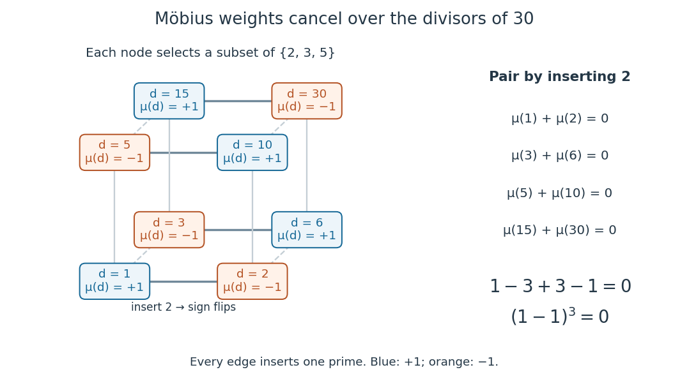

<h1 id="mobius-divisor-sum-identity">Möbius divisor-sum identity</h1>

↑ **Parent:** [Möbius function](mobius-function.md)

For every [positive integer](positive-integer.md) $n$, the [divisor sum](divisor-sum.md) of the [Möbius function](mobius-function.md) is

$$
\sum_{d\mid n}\mu(d)=\begin{cases}1&n=1,\\0&n>1.\end{cases}
$$

The sum includes all positive [integer divisors](divisor.md), but only [squarefree divisors](squarefree-divisor.md) contribute. Equivalently, $\mu*\mathbf1=\varepsilon$ under [Dirichlet convolution](dirichlet-convolution.md), where $\mathbf1$ is the [constant-one arithmetic function](constant-one-arithmetic-function.md) and $\varepsilon$ is the [Identity for Dirichlet convolution](identity-for-dirichlet-convolution.md). [Darij Grinberg, MIT 18.781 lecture notes, Propositions 2.4.6 and 2.4.7](https://darijgrinberg.gitlab.io/floor.pdf)

Each [squarefree divisor](squarefree-divisor.md) chooses a [subset](subset.md) of the distinct [prime factors](prime-factor.md) of $n$, contributing $(-1)^r$ when that [subset](subset.md) has $r$ elements. Expanding a product therefore gives

$$
\sum_{d\mid n}\mu(d)=\prod_{p\mid n}(1-1).
$$

For $n>1$ at least one [prime factor](prime-factor.md) occurs, so the product is zero. At $n=1$ it is an [empty product](empty-product.md), equal to one. This is the same alternating cancellation that drives [inclusion-exclusion](inclusion-exclusion-principle.md).

For $30=2\cdot3\cdot5$, all eight positive [integer divisors](divisor.md) are [squarefree integers](square-free-integer.md), giving

$$
\mu(1)+\mu(2)+\mu(3)+\mu(5)+\mu(6)+\mu(10)+\mu(15)+\mu(30)
=1-1-1-1+1+1+1-1=0.
$$

Pair each [subset](subset.md) not containing $2$ with the [subset](subset.md) obtained by inserting $2$: $(1,2),(3,6),(5,10),(15,30)$. Each pair cancels. The same nonzero terms occur for $60$, because its [squarefree divisors](squarefree-divisor.md) are still the [integer divisors](divisor.md) of $30$; its other [integer divisors](divisor.md) have [Möbius function](mobius-function.md) value zero.

**[Figure 11](#image-the-eight-integer-divisors-of-30-form-a-cube-of-subsets-of-its-prime-factors-adding-one-prime-factor-reverses-the-mobius-function-sign-and-all-contributions-cancel). The eight integer divisors of 30 form a cube of subsets of its prime factors; adding one prime factor reverses the Möbius function sign, and all contributions cancel**.

The [Möbius divisor-sum identity](mobius-divisor-sum-identity.md) is the cancellation behind [Möbius inversion](mobius-inversion-formula.md) and reciprocal [Dirichlet series](dirichlet-series.md): aggregation over [integer divisors](divisor.md) has an exact inverse.

## ↑ Ancestors (6)

1. [Möbius function](mobius-function.md)
2. [Arithmetic function](arithmetic-function-split.md)
3. [Number theory](number-theory-split.md)
4. [Area of mathematics](area-of-mathematics.md)
5. [Mathematics](mathematics-split.md)
6. [Codex Wiki](split.md)

## ← Incoming links (11)

- [Identity for Dirichlet convolution](identity-for-dirichlet-convolution.md)
- [Mertens bound from a log-integrable Chebyshev error](mertens-bound-from-a-log-integrable-chebyshev-error.md)
- [Möbius divisor-sum identity](mobius-divisor-sum-identity.md)
- [Möbius function](mobius-function.md)
- [Möbius inversion formula](mobius-inversion-formula.md)
- [Solution](past-exam-of-the-mathematics-course-of-the-university-of-cambridge/2010/iii/paper-25/2/solution.md)
- [Solution](past-exam-of-the-mathematics-course-of-the-university-of-cambridge/2010/iii/paper-25/5/solution.md)
- [Solution](past-exam-of-the-mathematics-course-of-the-university-of-cambridge/2012/iii/paper-29/1/solution.md)
- [Solution](past-exam-of-the-mathematics-course-of-the-university-of-cambridge/2014/iii/paper-25/5/b/solution.md)
- [Prime number asymptotic from Mertens cancellation](prime-number-asymptotic-from-mertens-cancellation.md)
- [Truncated Möbius inverse identity for the Riemann zeta function](truncated-mobius-inverse-identity-for-the-riemann-zeta-function.md)
