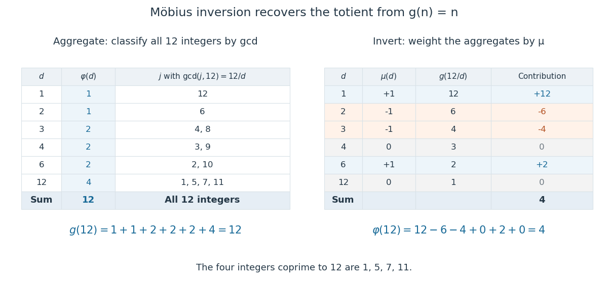

<h1 id="mobius-inversion-formula">Möbius inversion formula</h1>

↑ **Parent:** [Möbius function](mobius-function.md)  
ⓦ [Wiki](https://en.wikipedia.org/wiki/Möbius_inversion_formula)

[Möbius inversion](mobius-inversion-formula.md) recovers an [arithmetic function](arithmetic-function.md) from its [divisor sum](divisor-sum.md). For [arithmetic functions](arithmetic-function.md) $f,g$, the following statements are equivalent, with each equality required for every [positive integer](positive-integer.md) $n$:

$$
g(n)=\sum_{d\mid n}f(d)
\quad\Longleftrightarrow\quad
f(n)=\sum_{d\mid n}\mu(d)g(n/d).
$$

Here $d$ ranges over positive [integer divisors](divisor.md) of $n$ and $\mu$ is the [Möbius function](mobius-function.md). No [multiplicativity](multiplicativity-of-an-arithmetic-function.md) assumption is needed, and both sums are finite. The right side can also be written $\sum_{d\mid n}\mu(n/d)g(d)$ by exchanging complementary [integer divisors](divisor.md). [Darij Grinberg, MIT 18.781 lecture notes, Theorem 2.5.1 and Proposition 2.5.2](https://darijgrinberg.gitlab.io/floor.pdf)

The [divisor sum](divisor-sum.md) $g(n)$ bundles $f(n)$ together with values at smaller [integer divisors](divisor.md). [Möbius inversion](mobius-inversion-formula.md) subtracts aggregates indexed by one distinct [prime factor](prime-factor.md), adds those indexed by two, and continues with the alternating signs of [inclusion-exclusion](inclusion-exclusion-principle.md). A [divisor](divisor.md) containing a squared [prime factor](prime-factor.md) receives weight zero. The [Möbius divisor-sum identity](mobius-divisor-sum-identity.md) ensures that every unwanted contribution cancels exactly.

In [Dirichlet convolution](dirichlet-convolution.md) notation, $g=f*\mathbf1$ and $\mu*\mathbf1=\varepsilon$, where $\mathbf1$ is the [constant-one arithmetic function](constant-one-arithmetic-function.md) and $\varepsilon$ is the [Identity for Dirichlet convolution](identity-for-dirichlet-convolution.md). [Associativity](associative-property.md) and [commutativity](commutativity.md) give the short proof:

$$
\mu*g=\mu*(\mathbf1*f)=(\mu*\mathbf1)*f=\varepsilon*f=f.
$$

Convolving $f=\mu*g$ with $\mathbf1$ proves the reverse implication. At $n=1$, the formula reduces to $f(1)=g(1)$ because $\mu(1)=1$.

For a worked example, take $f(n)=\varphi(n)$, [Euler's totient function](euler-totient-function.md). The [totient divisor-sum identity](totient-divisor-sum-identity.md) says that $g(n)=n$, the [identity arithmetic function](identity-arithmetic-function.md):

$$
g(12)=\varphi(1)+\varphi(2)+\varphi(3)+\varphi(4)+\varphi(6)+\varphi(12)
=1+1+2+2+2+4=12.
$$

This identity comes from classifying the [integers](integer.md) $1,\ldots,n$ by their [greatest common divisor](greatest-common-divisor.md) with $n$: the group with $\gcd(j,n)=h$ has $\varphi(n/h)$ members, since $j/h$ and $n/h$ are [coprime integers](coprime-integers.md). Summing the group sizes gives $n$, as detailed under [totient divisor-sum identity](totient-divisor-sum-identity.md).

Now undo this aggregation with the [Möbius function](mobius-function.md):

$$
\begin{aligned}
\varphi(12)&=\mu(1)12+\mu(2)6+\mu(3)4+\mu(4)3+\mu(6)2+\mu(12)1\\
&=12-6-4+0+2+0=4.
\end{aligned}
$$

The nonzero terms use $d=1,2,3,6$; $d=4,12$ vanish because they contain the square of the [prime number](prime-number.md) $2$. The four surviving [integers](integer.md) [coprime](coprime-integers.md) to $12$ are $1,5,7,11$.

**[Figure 22](#image-a-divisor-sum-aggregates-euler-s-totient-function-values-to-12-while-mobius-inversion-recovers-the-four-integers-coprime-to-12). A divisor sum aggregates Euler's totient function values to 12, while Möbius inversion recovers the four integers coprime to 12**.

This example also reveals why [Möbius inversion](mobius-inversion-formula.md) is useful: it turns an easy count of all objects into a count satisfying a [coprimality](coprime-integers.md) restriction. Expanding over [subsets](subset.md) of distinct [prime factors](prime-factor.md) gives

$$
\varphi(n)=\sum_{d\mid n}\mu(d)\frac nd
=n\prod_{p\mid n}\left(1-\frac1p\right).
$$

The product is [inclusion-exclusion](inclusion-exclusion-principle.md) over multiples of the [prime factors](prime-factor.md). For $12$, it gives $12(1-1/2)(1-1/3)=4$. More generally, whenever a counting problem produces a [divisor sum](divisor-sum.md), [Möbius inversion](mobius-inversion-formula.md) lets that aggregate be reversed without solving a new system of [equations](equation.md).

## ↑ Ancestors (6)

1. [Möbius function](mobius-function.md)
2. [Arithmetic function](arithmetic-function.md)
3. [Number theory](number-theory-split.md)
4. [Area of mathematics](area-of-mathematics.md)
5. [Mathematics](mathematics-split.md)
6. [Codex Wiki](split.md)

## ← Incoming links (4)

- [Number of monic irreducible polynomials over a finite field](number-of-monic-irreducible-polynomials-over-a-finite-field.md)
- [Solution](past-exam-of-the-mathematics-course-of-the-university-of-cambridge/2015/ii/paper-2/1h/solution.md)
- [Solution](past-exam-of-the-mathematics-course-of-the-university-of-cambridge/2018/ii/paper-3/1g/solution.md)
- [Solution](past-exam-of-the-mathematics-course-of-the-university-of-cambridge/2020/ii/paper-4/11h/a/solution.md)
