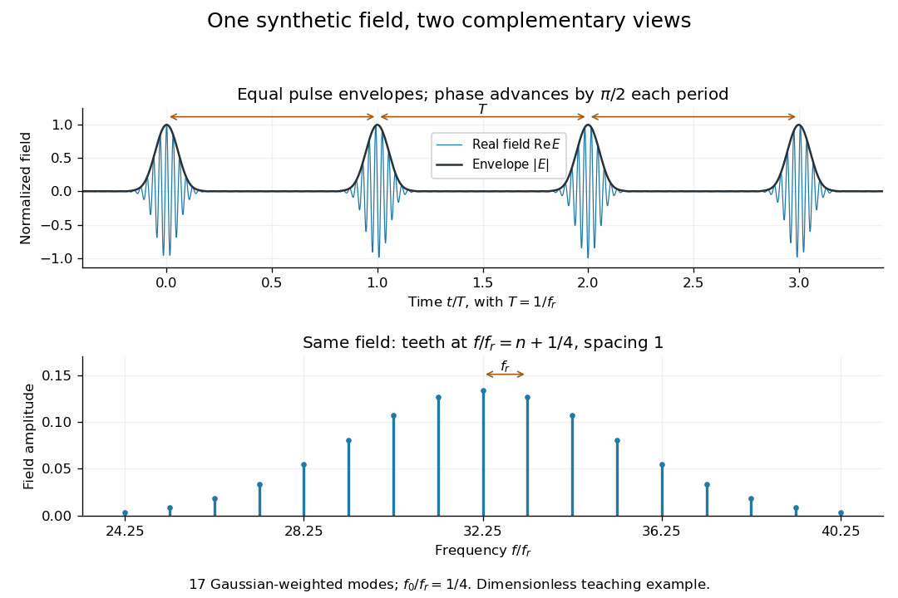

# Mode locking

↑ **Parent:** [Optical frequency comb](optical-frequency-comb.md)  
ⓦ [Wiki](https://en.wikipedia.org/wiki/Mode-locking)

[Mode locking](mode-locking.md) fixes relative [phases](phase-waves.md) between longitudinal [normal modes](normal-mode.md) of a [laser](laser-split.md), allowing short [optical pulses](optical-pulse.md). The same [optical spectrum](optical-spectrum.md) with wandering relative [phases](phase-waves.md) would not supply that stable pulse train.[Passion for Precision, p.157: coupled modes](passion-for-precision-by-theodor-w-hansch.md)

Here is an original finite-mode model, with the convention that a positive [frequency](frequency.md) has time dependence $e^{2\pi i f t}$:

$$
E(t)=\sum_{n=24}^{40}a_n e^{2\pi i(n f_r+f_0)t},\qquad
a_n=\frac{e^{-(n-32)^2/18}}{\sum_{j=24}^{40}e^{-(j-32)^2/18}}.
$$

These field coefficients follow a [Gaussian function](gaussian-function.md) and have aligned [phases](phase-waves.md) at $t=0$. Choose $f_0=f_r/4$ and write $T=1/f_r$. Since $e^{2\pi i n}=1$ for every [integer](integer-split.md) $n$,

$$
E(t+T)=e^{2\pi i f_0T}E(t)=iE(t),\qquad |E(t+T)|^2=|E(t)|^2.
$$

The pulse [light intensity](light-intensity.md) repeats every $T$ although the field needs four periods to repeat. At the pulse centers, $E(0)=1$, $E(T)=i$, $E(2T)=-1$ and $E(3T)=-i$. A detector of [light intensity](light-intensity.md) alone therefore cannot distinguish this offset from zero. This model has far fewer teeth than a practical optical comb; its normalized time and [frequency](frequency.md) scales are chosen to make the carrier oscillations visible.

**[Figure 5](#image-repeated-pulse-envelopes-can-conceal-a-changing-carrier-phase). Repeated pulse envelopes can conceal a changing carrier phase**. Original finite sum of 17 [normal modes](normal-mode.md) weighted using a [Gaussian function](gaussian-function.md), with $f_0/f_r=1/4$. Both panels represent the same complex field: the upper panel shows its real part and magnitude; the lower panel shows its field-amplitude coefficients. This is a dimensionless model, not historical measurement data.

A short proof of the converse uses the [Fourier series](fourier-series-split.md). If $E(t+T)=e^{i\Delta\phi}E(t)$, then $E(t)e^{-i\Delta\phi t/T}$ is periodic with period $T$. Its [Fourier series](fourier-series-split.md) has [frequencies](frequency.md) $n/T$; restoring the removed factor shifts every tooth by $\Delta\phi/(2\pi T)$. A finite observation time broadens the spectral peaks; it does not change this ideal infinite-train relation.

**Table of contents**

- [Mode-locked laser](mode-locked-laser.md)

## ↑ Ancestors (6)

1. [Optical frequency comb](optical-frequency-comb.md)
2. [Laser](laser-split.md)
3. [Optics](optics-split.md)
4. [Branches of physics](branches-of-physics.md)
5. [Physics](physics-split.md)
6. [Codex Wiki](split.md)

## ← Incoming links (5)

- [Attosecond pulse train](attosecond-pulse-train.md)
- [Gain bandwidth limit on a laser pulse](gain-bandwidth-limit-on-a-laser-pulse.md)
- [Mode-locked laser](mode-locked-laser.md)
- [Mode locking](mode-locking.md)
- [Solution](past-exam-of-the-quantum-condensed-matter-course-of-the-university-of-cambridge/2004/section-a/6/solution.md)
