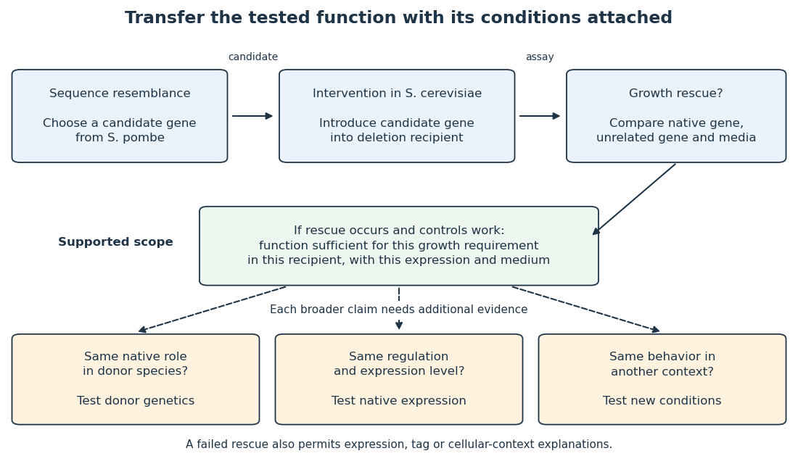

# Model organism evidence transfer

↑ **Parent:** [Model organism](model-organism.md)

Evidence transfers at a stated level. [Sequence alignment](sequence-alignment.md) can suggest a candidate relationship between [genes](gene.md); [functional complementation](functional-complementation.md) tests whether a candidate can supply a particular function in a chosen recipient. Neither alone establishes identical native [gene expression](gene-expression.md), identical [signal transduction](signal-transduction-split.md), or identical consequences in every [species](species.md). The [yeast cross-species complementation experiment](yeast-cross-species-complementation-experiment.md) is especially useful because it tests a conserved function by intervention rather than assuming it from resemblance. [Reeves et al. (2018), project design, pp. 3–4, and Course Activities, pp. 5–6](pathways-over-time-functional-genomics-research-in-an-introductory-laboratory-course-by-todd-d-reeves-and-others.md)

**[Figure 27](#image-what-a-model-organism-experiment-establishes-and-what-needs-another-test). What a model organism experiment establishes, and what needs another test**. Original evidence map using the [yeast cross-species complementation experiment](yeast-cross-species-complementation-experiment.md). Solid arrows indicate an experimental question that can be addressed in the recipient; dashed arrows mark additional claims requiring evidence. This is a schematic of inference boundaries, not a [phylogenetic tree](phylogenetic-tree.md), a measured pathway, or a claim about medical outcomes.

Even successful [functional complementation](functional-complementation.md) occurs within a specific [genetic background](genetic-background.md), nutrient supply and imposed [gene expression](gene-expression.md). The [enzyme](enzyme-split.md) may work with the recipient’s available [substrates](substrate-biochemistry.md) and partner [proteins](protein-split.md) at an experimentally imposed abundance. Establishing the same role in the donor [species](species.md) calls for experiments there; establishing behavior under another condition calls for experiments under that condition. A conserved component can therefore coexist with context-dependent behavior of an entire pathway. This separation makes [model organisms](model-organism.md) powerful: an accessible experiment supplies a precise mechanistic foothold and a better question for the next system.

## ↑ Ancestors (3)

1. [Model organism](model-organism.md)
2. [Biology](biology-split.md)
3. [Codex Wiki](split.md)

## ← Incoming links (1)

- [Model organism](model-organism.md)
