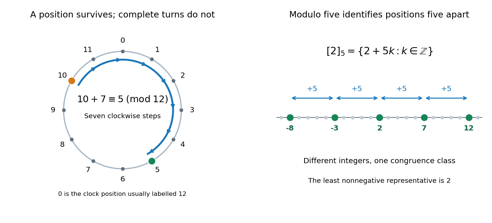

# Modular arithmetic

↑ **Parent:** [Number theory](number-theory-split.md)  
ⓦ [Wiki](https://en.wikipedia.org/wiki/Modular_arithmetic)

Modular arithmetic performs [addition](addition.md) and [multiplication](multiplication.md) on [integers](integer.md) while remembering only their [remainders](remainder.md) for a fixed positive [integer modulus](modulus-in-modular-arithmetic.md) $m$. The relation $a\equiv b\pmod m$ means that $m$ divides $a-b$: the two [integers](integer.md) lie in the same [congruence class](congruence-class.md). For example, $-3$, $2$ and $7$ represent one class modulo $5$. Choosing the [least nonnegative residue](least-nonnegative-residue.md) gives exactly $m$ representatives, $0,1,\ldots,m-1$, even though each [congruence class](congruence-class.md) contains infinitely many [integers](integer.md).

A clock supplies a familiar example. Represent the twelve positions by $0,1,\ldots,11$, with $0$ at the position usually labelled twelve. Starting at ten and moving seven positions gives

$$
10+7=17\equiv5\pmod{12}.
$$

The [integer congruence](integer-congruence.md) records the final position; it discards the number of complete revolutions. Adding another twelve changes the elapsed count while preserving the position. The picture also shows a single [congruence class](congruence-class.md) modulo five spread along the [number line](number-line.md).

**[Figure 29](#image-clock-addition-wraps-modulo-twelve-while-integers-separated-by-five-represent-one-congruence-class). Clock addition wraps modulo twelve, while integers separated by five represent one congruence class**.

The useful surprise is that discarding this information still preserves the arithmetic. If $a\equiv a'$ and $b\equiv b'$ modulo $m$, then $a+b\equiv a'+b'$ and $ab\equiv a'b'$ modulo $m$. Thus a large calculation can reduce its intermediate [integers](integer.md) after every step. For instance,

$$
10+7\equiv5\pmod{12},\qquad 10\cdot7\equiv10\pmod{12},\qquad 10^2\equiv4\pmod{12}.
$$

Replacing $10$ by $-2$ gives the same answers with smaller intermediate values. The [congruence classes](congruence-class.md) with these operations form the [quotient ring](quotient-ring.md) $\mathbb Z/m\mathbb Z$; their [addition](addition.md) alone forms a [cyclic group](cyclic-group.md). This passage from [integers](integer.md) to a finite arithmetic system is the setting for [modular exponentiation](modular-exponentiation.md), [primality testing](primality-testing.md) and the [RSA cryptosystem](rsa-cryptosystem.md). [Ankur Moitra, MIT 18.200, Lecture 15, modular arithmetic and its applications](https://ocw.mit.edu/courses/18-200-principles-of-discrete-applied-mathematics-spring-2024/mit18_200_s24_lec15.pdf)

[Multiplicative cancellation](multiplicative-cancellation-in-an-integral-domain.md) needs extra care. Modulo six, $2\cdot1\equiv2\cdot4$, but $1\not\equiv4$: multiplication by two has merged distinct [congruence classes](congruence-class.md). Cancelling a factor while retaining the [integer modulus](modulus-in-modular-arithmetic.md) is justified when that factor has a [modular multiplicative inverse](modular-multiplicative-inverse.md), equivalently when it is [coprime](coprime-integers.md) to the [integer modulus](modulus-in-modular-arithmetic.md). A [linear congruence](linear-congruence.md) can consequently have no solutions, one solution class, or several solution classes. The [Chinese remainder theorem](chinese-remainder-theorem.md) supplies a complementary operation: splitting a calculation across [coprime](coprime-integers.md) [integer moduli](modulus-in-modular-arithmetic.md) and reconstructing its class modulo their product.

Small remainders can also certify impossibility. A [perfect square](square-number.md) has residue zero or one modulo four, as checking the four [congruence classes](congruence-class.md) shows. Therefore an [integer](integer.md) equation $x^2=4k+2$ has no solution. The converse direction needs care: a permitted residue does not guarantee an [integer](integer.md) solution, since $5\equiv1\pmod4$ but five is not a [perfect square](square-number.md). Such local tests provide necessary conditions for [Diophantine equations](diophantine-equation.md) without replacing the full problem.

In _Disquisitiones arithmeticae_ (1801), [Carl Friedrich Gauss](carl-friedrich-gauss.md) defines [integer congruence](integer-congruence.md) in article 1 and adopts the symbol $\equiv$ in article 2. Article 12 derives [divisibility](divisibility.md) tests from powers of ten and explains checking arithmetic by its remainders. These passages show a systematic treatment of the same idea; they are not a claim that remainders were first used in 1801. [Gauss, Disquisitiones arithmeticae, section I, articles 1–2 and 12; text from the 1870 collected edition](https://la.wikisource.org/wiki/Disquisitiones_arithmeticae/Sectio_prima)

**Table of contents**

- [Modulus in modular arithmetic](modulus-in-modular-arithmetic.md)
- [Least nonnegative residue](least-nonnegative-residue.md)
- [Integer congruence](integer-congruence.md)
- [Wilson's theorem](wilson-s-theorem.md)
  - [Wilson factorial congruence modulo a triangular number](wilson-factorial-congruence-modulo-a-triangular-number.md)
  - [Odd-residue squared product modulo a prime](odd-residue-squared-product-modulo-a-prime.md)
  - [Complementary factorial congruence](complementary-factorial-congruence.md)
- [Congruence class](congruence-class.md)
- [Modular congruence](modular-congruence.md)
  - [Prime-power contraction under pth powers](prime-power-contraction-under-pth-powers.md)
  - [Reduced residue system](reduced-residue-system.md)
  - [Linear congruence](linear-congruence.md)
  - [Residue class](residue-class.md)
  - [Unit modulo n](unit-modulo-n.md)

## ↑ Ancestors (4)

1. [Number theory](number-theory-split.md)
2. [Area of mathematics](area-of-mathematics.md)
3. [Mathematics](mathematics-split.md)
4. [Codex Wiki](split.md)

## ← Incoming links (45)

- [Algebra](algebra-split.md)
- [Binary operation](binary-operation.md)
- [Binomial coefficient congruence across a prime row](binomial-coefficient-congruence-across-a-prime-row.md)
- [Cayley's theorem](cayley-s-theorem.md)
- [Cayley table](cayley-table.md)
- [Circulant matrix](circulant-matrix.md)
- [Circular buffer](circular-buffer.md)
- [Circular convolution](circular-convolution.md)
- [Commutative ring](commutative-ring.md)
- [Computing Legendre symbols by quadratic reciprocity](computing-legendre-symbols-by-quadratic-reciprocity.md)
- [Coprime integers](coprime-integers.md)
- [Coset](coset.md)
- [Cyclic group](cyclic-group.md)
- [Deterministic finite automaton](deterministic-finite-automaton.md)
- [Divisibility](divisibility.md)
- [Endomorphism](endomorphism.md)
- [Equivalence relation](equivalence-relation.md)
- [Fermat number](fermat-number.md)
- [Field with four elements](field-with-four-elements.md)
- [Finite field](finite-field.md)
- [Group](group-split.md)
- [Group action](group-action.md)
- [Hash collision](hash-collision.md)
- [Hash function](hash-function.md)
- [Hash table](hash-table.md)
- [Homomorphism](homomorphism.md)
- [Integer congruence](integer-congruence.md)
- [Lagrange's four-square theorem](lagrange-s-four-square-theorem.md)
- [Linear congruence](linear-congruence.md)
- [Modular exponentiation](modular-exponentiation.md)
- [Modular multiplicative inverse](modular-multiplicative-inverse.md)
- [Number theory](number-theory-split.md)
- [P-adic number](p-adic-number.md)
- [Solution](past-exam-of-the-mathematics-course-of-the-university-of-cambridge/2010/ii/paper-1/1g/ii/solution.md)
- [Solution](past-exam-of-the-mathematics-course-of-the-university-of-cambridge/2014/ia/paper-4/1e/solution.md)
- [Solution](past-exam-of-the-mathematics-course-of-the-university-of-cambridge/2016/ia/paper-4/1e/solution.md)
- [Solution](past-exam-of-the-mathematics-course-of-the-university-of-cambridge/2017/iii/paper-130/1/iii/solution.md)
- [Solution](past-exam-of-the-mathematics-course-of-the-university-of-cambridge/2019/iii/paper-324/2/b/iii/solution.md)
- [Prime field](prime-field.md)
- [Prime-row binomial coefficient divisibility](prime-row-binomial-coefficient-divisibility.md)
- [Quotient set](quotient-set.md)
- [Representation independence](representation-independence.md)
- [Strongly universal hash family](strongly-universal-hash-family.md)
- [Transitive group action](transitive-group-action.md)
- [Wilson's theorem](wilson-s-theorem.md)
