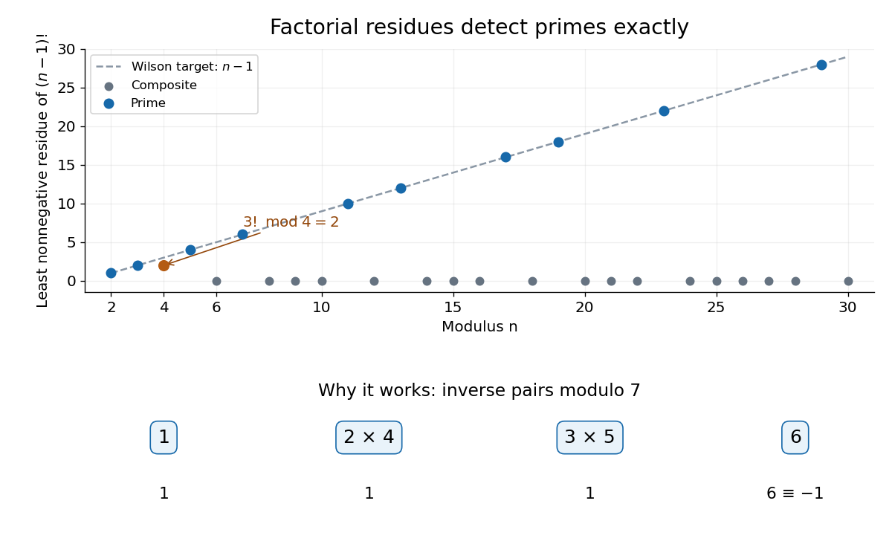
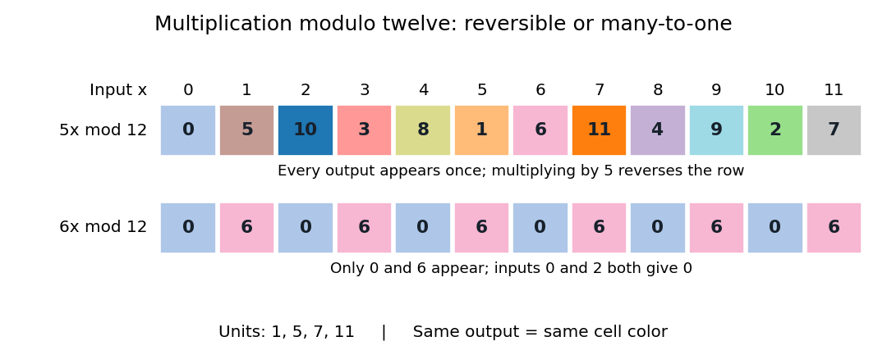

# Modular arithmetic

↑ **Parent:** [Number theory](number-theory.md)  
ⓦ [Wiki](https://en.wikipedia.org/wiki/Modular_arithmetic)

Modular arithmetic performs [addition](arithmetic.md#addition) and [multiplication](arithmetic.md#multiplication) on [integers](integer.md) while remembering only their [remainders](integer.md#remainder) for a fixed positive [integer modulus](#modulus-in-modular-arithmetic) $m$. The relation $a\equiv b\pmod m$ means that $m$ divides $a-b$: the two [integers](integer.md) lie in the same [congruence class](#congruence-class). For example, $-3$, $2$ and $7$ represent one class modulo $5$. Choosing the [least nonnegative residue](#least-nonnegative-residue) gives exactly $m$ representatives, $0,1,\ldots,m-1$, even though each [congruence class](#congruence-class) contains infinitely many [integers](integer.md).

A clock supplies a familiar example. Represent the twelve positions by $0,1,\ldots,11$, with $0$ at the position usually labelled twelve. Starting at ten and moving seven positions gives

$$
10+7=17\equiv5\pmod{12}.
$$

The [integer congruence](#integer-congruence) records the final position; it discards the number of complete revolutions. Adding another twelve changes the elapsed count while preserving the position. The picture also shows a single [congruence class](#congruence-class) modulo five spread along the [number line](arithmetic.md#number-line).

**[Figure 1](#image-clock-addition-wraps-modulo-twelve-while-integers-separated-by-five-represent-one-congruence-class). Clock addition wraps modulo twelve, while integers separated by five represent one congruence class**.

The useful surprise is that discarding this information still preserves the arithmetic. If $a\equiv a'$ and $b\equiv b'$ modulo $m$, then $a+b\equiv a'+b'$ and $ab\equiv a'b'$ modulo $m$. Thus a large calculation can reduce its intermediate [integers](integer.md) after every step. For instance,

$$
10+7\equiv5\pmod{12},\qquad 10\cdot7\equiv10\pmod{12},\qquad 10^2\equiv4\pmod{12}.
$$

Replacing $10$ by $-2$ gives the same answers with smaller intermediate values. The [congruence classes](#congruence-class) with these operations form the [quotient ring](commutative-algebra.md#quotient-ring) $\mathbb Z/m\mathbb Z$; their [addition](arithmetic.md#addition) alone forms a [cyclic group](group.md#cyclic-group). This passage from [integers](integer.md) to a finite arithmetic system is the setting for [modular exponentiation](number-theory.md#modular-exponentiation), [primality testing](theoretical-computer-science.md#primality-testing) and the [RSA cryptosystem](algebra.md#rsa-cryptosystem). [Ankur Moitra, MIT 18.200, Lecture 15, modular arithmetic and its applications](https://ocw.mit.edu/courses/18-200-principles-of-discrete-applied-mathematics-spring-2024/mit18_200_s24_lec15.pdf)

[Multiplicative cancellation](commutative-algebra.md#multiplicative-cancellation-in-an-integral-domain) needs extra care. Modulo six, $2\cdot1\equiv2\cdot4$, but $1\not\equiv4$: multiplication by two has merged distinct [congruence classes](#congruence-class). Cancelling a factor while retaining the [integer modulus](#modulus-in-modular-arithmetic) is justified when that factor has a [modular multiplicative inverse](number-theory.md#modular-multiplicative-inverse), equivalently when it is [coprime](divisibility.md#coprime-integers) to the [integer modulus](#modulus-in-modular-arithmetic). A [linear congruence](#linear-congruence) can consequently have no solutions, one solution class, or several solution classes. The [Chinese remainder theorem](mathematics.md#chinese-remainder-theorem) supplies a complementary operation: splitting a calculation across [coprime](divisibility.md#coprime-integers) [integer moduli](#modulus-in-modular-arithmetic) and reconstructing its class modulo their product.

Small remainders can also certify impossibility. A [perfect square](integer.md#square-number) has residue zero or one modulo four, as checking the four [congruence classes](#congruence-class) shows. Therefore an [integer](integer.md) equation $x^2=4k+2$ has no solution. The converse direction needs care: a permitted residue does not guarantee an [integer](integer.md) solution, since $5\equiv1\pmod4$ but five is not a [perfect square](integer.md#square-number). Such local tests provide necessary conditions for [Diophantine equations](number-theory.md#diophantine-equation) without replacing the full problem.

In _Disquisitiones arithmeticae_ (1801), [Carl Friedrich Gauss](mathematics.md#carl-friedrich-gauss) defines [integer congruence](#integer-congruence) in article 1 and adopts the symbol $\equiv$ in article 2. Article 12 derives [divisibility](divisibility.md) tests from powers of ten and explains checking arithmetic by its remainders. These passages show a systematic treatment of the same idea; they are not a claim that remainders were first used in 1801. [Gauss, Disquisitiones arithmeticae, section I, articles 1–2 and 12; text from the 1870 collected edition](https://la.wikisource.org/wiki/Disquisitiones_arithmeticae/Sectio_prima)

**Table of contents**

- [Modular division](#modular-division)
- [Modulo operation](#modulo-operation)
- [Modular square root](#modular-square-root)
- [Modular multiplication](#modular-multiplication)
- [Addition modulo an integer](#addition-modulo-an-integer)
- [Modulus in modular arithmetic](#modulus-in-modular-arithmetic)
- [Least nonnegative residue](#least-nonnegative-residue)
- [Integer congruence](#integer-congruence)
  - [Wolstenholme's theorem](#wolstenholme-s-theorem)
- [Wilson's theorem](#wilson-s-theorem)
  - [Wilson factorial congruence modulo a triangular number](#wilson-factorial-congruence-modulo-a-triangular-number)
  - [Odd-residue squared product modulo a prime](#odd-residue-squared-product-modulo-a-prime)
  - [Complementary factorial congruence](#complementary-factorial-congruence)
- [Congruence class](#congruence-class)
- [Modular congruence](#modular-congruence)
  - [Prime-power contraction under pth powers](#prime-power-contraction-under-pth-powers)
  - [Reduced residue system](#reduced-residue-system)
  - [Linear congruence](#linear-congruence)
  - [Residue class](#residue-class)
  - [Unit modulo n](#unit-modulo-n)

## Modular division

↑ **Parent:** [Modular arithmetic](modular-arithmetic.md)

## Modulo operation

↑ **Parent:** [Modular arithmetic](modular-arithmetic.md)

For an [integer](integer.md) $a$ and a positive [integer modulus](#modulus-in-modular-arithmetic) $m$, the modulo operation returns the unique [least nonnegative residue](#least-nonnegative-residue) $r$ satisfying $a=qm+r$ for an [integer](integer.md) $q$ and $0\leq r<m$. Equivalently, $r=a-m\lfloor a/m\rfloor$. For example, $-3\bmod5=2$. Some programming languages instead use a remainder with the sign of the dividend, so their negative-input convention must be checked before identifying an operator with this mathematical definition.

## Modular square root

↑ **Parent:** [Modular arithmetic](modular-arithmetic.md)

## Modular multiplication

↑ **Parent:** [Modular arithmetic](modular-arithmetic.md)

Computing the [remainder](integer.md#remainder) $ab\bmod m$ while working with bounded [integer](integer.md) representatives. Repeated doubling and addition can avoid forming an overflowing product: process the [binary digits](integer.md#binary-digit) of $b$, double the current contribution [modulo](#modulo-operation) $m$, and add it to the result whenever the current [binary digit](integer.md#binary-digit) is 1. The additions themselves must also use an overflow-safe implementation.

## Addition modulo an integer

↑ **Parent:** [Modular arithmetic](modular-arithmetic.md)

For an integer $n\ge1$, add residue classes by adding their representatives and taking the class modulo $n$. This is well-defined because replacing either representative by a multiple-of-$n$ translate changes the sum by a multiple of $n$. The [associativity](algebraic-operation.md#associative-property), identity class $[0]_n$ and inverse $[-a]_n$ are inherited from integer [addition](arithmetic.md#addition). The result is the additive [cyclic group](group.md#cyclic-group) $\mathbb Z/n\mathbb Z$.

## Modulus in modular arithmetic

↑ **Parent:** [Modular arithmetic](modular-arithmetic.md)

The positive [integer](integer.md) $m$ in $a\equiv b\pmod m$ is the modulus. It specifies which differences are ignored: exactly the [integer](integer.md) multiples of $m$. It is distinct from the [modulus of a complex number](complex-analysis.md#complex-modulus), which measures magnitude.

## Least nonnegative residue

↑ **Parent:** [Modular arithmetic](modular-arithmetic.md)

The least nonnegative residue of an [integer](integer.md) $a$ modulo a positive [integer modulus](#modulus-in-modular-arithmetic) $m$ is the unique representative $r$ of its [congruence class](#congruence-class) in $\{0,\ldots,m-1\}$. [Euclidean division](integer.md#euclidean-division) gives $a=qm+r$. For example, $-3=(-1)\cdot5+2$, so $-3\bmod5=2$; the [integer congruence](#integer-congruence) $-3\equiv2\pmod5$ does not assert equality of those two [integers](integer.md).

## Integer congruence

↑ **Parent:** [Modular arithmetic](modular-arithmetic.md)

For a positive modulus $m$, integers $a,b$ are congruent when their difference is divisible by $m$. This is an [equivalence relation](set-theory.md#equivalence-relation): zero is divisible by $m$, changing sign preserves [divisibility](divisibility.md), and adding two divisible differences proves transitivity. Addition and multiplication respect it, because $(a+c)-(b+d)=(a-b)+(c-d)$ and $ac-bd=c(a-b)+b(c-d)$. Its [equivalence classes](set-theory.md#equivalence-class) are the residue classes used in [modular arithmetic](modular-arithmetic.md).

<h3 id="wolstenholme-s-theorem">Wolstenholme's theorem</h3>

↑ **Parent:** [Integer congruence](#integer-congruence)

For every [prime](prime-number.md) $p\ge5$, $\binom{2p-1}{p-1}\equiv1\pmod{p^3}$. Equivalently, $\sum_{k=1}^{p-1}1/k\equiv0\pmod{p^2}$, with denominators interpreted through [modular inverses](number-theory.md#modular-multiplicative-inverse).

<h2 id="wilson-s-theorem">Wilson's theorem</h2>

↑ **Parent:** [Modular arithmetic](modular-arithmetic.md)  
ⓦ [Wiki](https://en.wikipedia.org/wiki/Wilson's_theorem)

For an [integer](integer.md) $n>1$, [Wilson's theorem](#wilson-s-theorem) characterizes [prime numbers](prime-number.md) by a [factorial](combinatorics.md#factorial):

$$
n\text{ is prime}\quad\Longleftrightarrow\quad(n-1)!\equiv-1\pmod n.
$$

The right side is an [integer congruence](#integer-congruence), so the least nonnegative [remainder](integer.md#remainder) is $n-1$. For example, $4!=24\equiv4\pmod5$ certifies that five is a [prime number](prime-number.md), whereas $5!=120\equiv0\pmod6$ rules out six. [Wilson's Theorem and Fermat's Theorem by Bruce Ikenaga](mathematics-bibliography.md#wilson-s-theorem-and-fermat-s-theorem-by-bruce-ikenaga)

**[Figure 2](#image-factorial-residues-distinguish-primes-from-composites-with-inverse-pairs-explaining-the-prime-case). Factorial residues distinguish primes from composites, with inverse pairs explaining the prime case**.

For an odd [prime number](prime-number.md) $p$, each nonzero [congruence class](#congruence-class) has a unique [modular multiplicative inverse](number-theory.md#modular-multiplicative-inverse). Pair each class with its inverse: each distinct pair contributes one. A class is its own inverse exactly when $a^2\equiv1\pmod p$; since $p\mid(a-1)(a+1)$, [Euclid's lemma](number-theory.md#euclid-s-lemma) leaves only $a\equiv\pm1$. Their product is $-1$. The [prime number](prime-number.md) two needs a separate check: $1!\equiv-1\pmod2$. Conversely, a proper [divisor](divisibility.md#divisor) $1<d<n$ divides both $n$ and $(n-1)!$, so the displayed [integer congruence](#integer-congruence) would force $d\mid1$, a contradiction. [Wilson's Theorem and Fermat's Theorem by Bruce Ikenaga](mathematics-bibliography.md#wilson-s-theorem-and-fermat-s-theorem-by-bruce-ikenaga)

The [composite numbers](number-theory.md#composite-number) have an even sharper pattern: $(n-1)!\equiv0\pmod n$ for every [composite number](number-theory.md#composite-number) $n>4$, but $3!=6\equiv2\pmod4$. To check the zero claim, write $n=ab$ with $1<a\leq b<n$. If $a<b$, both occur as different factors in the [factorial](combinatorics.md#factorial). If $a=b\geq3$, the different factors $a$ and $2a$ both occur since $2a<a^2=n$, and their product is divisible by $n$. The only excluded case is $a=b=2$. Thus four is an exception to the zero pattern, but still fails [Wilson's theorem](#wilson-s-theorem): its required [remainder](integer.md#remainder) would be three.

This is an exact [primality testing](theoretical-computer-science.md#primality-testing) criterion, but direct evaluation is expensive: even reducing modulo $n$ after every multiplication still takes a number of multiplications proportional to $n$, which grows exponentially with the number of [binary digits](integer.md#binary-digit) of $n$. The problem is not merely storing a huge [factorial](combinatorics.md#factorial). The more useful role of [Wilson's theorem](#wilson-s-theorem) is simplifying [factorial](combinatorics.md#factorial) expressions in [modular arithmetic](modular-arithmetic.md). For instance, if $p>2$ is a [prime number](prime-number.md), then $(p-1)(p-2)!\equiv-1\pmod p$ gives $(p-2)!\equiv1\pmod p$ by a [modular multiplicative inverse](number-theory.md#modular-multiplicative-inverse).

### Wilson factorial congruence modulo a triangular number

↑ **Parent:** [Wilson's theorem](#wilson-s-theorem)

For an odd [prime number](prime-number.md) $p$, put $m=(p-1)/2$. Both $(p-1)!$ and $p-1$ are divisible by $m$. By [Wilson's theorem](#wilson-s-theorem), they are also congruent modulo $p$, because each is $-1$ modulo $p$. The [coprime integers](divisibility.md#coprime-integers) $m,p$ therefore both divide their difference, giving the displayed [integer congruence](#integer-congruence). This combines the prime-modulus factorial identity with an elementary divisibility constraint.

### Odd-residue squared product modulo a prime

↑ **Parent:** [Wilson's theorem](#wilson-s-theorem)

For an odd prime $p$, the even residues are the negatives of the odd residues. If $O=1\cdot3\cdots(p-2)$, then $(p-1)!\equiv(-1)^{(p-1)/2}O^2$. Apply [Wilson theorem](#wilson-s-theorem) to obtain the displayed congruence. The empty product for $p=3$ is one.

### Complementary factorial congruence

↑ **Parent:** [Wilson's theorem](#wilson-s-theorem)

For a [prime number](prime-number.md) $p$ and nonnegative [integers](integer.md) $h+k=p-1$, [Wilson theorem](#wilson-s-theorem) gives $(-1)^k h!k!\equiv-1\pmod p$ by replacing the last $k$ factors of $(p-1)!$ with $-1,-2,\ldots,-k$. For odd $p$, $h,k$ have the same parity; for $p=2$, both signs have the same [residue class](#residue-class). Thus $h!k!+(-1)^h\equiv0\pmod p$, including the endpoint cases $0!=1$.

## Congruence class

↑ **Parent:** [Modular arithmetic](modular-arithmetic.md)

The [congruence class](#congruence-class) of $a$ modulo a positive integer $N$ is $\{a+Nk:k\in\mathbb Z\}$. Two integers have the same class exactly when their difference is divisible by $N$. Addition and multiplication of representatives descend to well-defined operations on $\mathbb Z/N\mathbb Z$, because replacing a representative by a multiple-of-$N$ translate changes the result by a multiple of $N$.

## Modular congruence

↑ **Parent:** [Modular arithmetic](modular-arithmetic.md)

For [integers](integer.md) $a,b$ and a positive [integer modulus](#modulus-in-modular-arithmetic) $n$, modular congruence means

$$
a\equiv b\pmod n\iff n\mid(a-b).
$$

Thus $a-b=kn$ for some [integer](integer.md) $k$: the two [integers](integer.md) differ by complete cycles of length $n$. For example, $14\equiv2\pmod{12}$ because $14-2=12$, and $-1\equiv11\pmod{12}$ because $-1-11=-12$. A [modular congruence](#modular-congruence) need not be an equality of [integers](integer.md).

On a twelve-position clock labelled $0,1,\ldots,11$, adding five to nine follows $9\to10\to11\to0\to1\to2$. Hence $9+5=14\equiv2\pmod{12}$: the final position remembers the [remainder](integer.md#remainder) while forgetting a complete revolution.

**[Figure 3](#image-adding-five-to-nine-takes-five-clockwise-steps-and-ends-at-two-modulo-twelve). Adding five to nine takes five clockwise steps and ends at two modulo twelve**.

The same idea tracks any count repeating every $n$ steps. It also lets us compute sums and products with small [residue classes](#residue-class), reducing intermediate results without changing the final class. The justification comes from [addition](arithmetic.md#addition) and [multiplication](arithmetic.md#multiplication) being well-defined on [residue classes](#residue-class).

In _Disquisitiones arithmeticae_ (1801), [Carl Friedrich Gauss](mathematics.md#carl-friedrich-gauss) defines [modular congruence](#modular-congruence) by [divisibility](divisibility.md) in article 1; article 2 describes the [integers](integer.md) $a+kn$ and adopts $\equiv$. These passages document his presentation and notation, without claiming that repeating remainders began in 1801. [Gauss, Disquisitiones arithmeticae, section I, articles 1–2; original text in the 1870 collected edition](https://la.wikisource.org/wiki/Disquisitiones_arithmeticae/Sectio_prima)

### Prime-power contraction under pth powers

↑ **Parent:** [Modular congruence](#modular-congruence)

For a prime $p$ and $k\geq1$, write $a=b+p^kh$. The [binomial theorem](binomial-coefficient.md#binomial-theorem) shows $a^p-b^p$ is divisible by $p^{k+1}$: the linear term contains the extra factor $p$ and every higher term contains at least $p^{2k}$. Iteration gives the displayed [modular congruence](#modular-congruence) for every $r\geq0$, including $p=2$. Applied to [Fermat's little theorem](number-theory.md#fermat-little-theorem), it yields $a^{p^n}\equiv a^{p^{n-1}}\pmod{p^n}$.

### Reduced residue system

↑ **Parent:** [Modular congruence](#modular-congruence)  
ⓦ [Wiki](https://en.wikipedia.org/wiki/Reduced_residue_system)

For a positive modulus $n$, a reduced residue system contains exactly one representative of each [residue class](#residue-class) coprime to $n$. Its size is the [Euler totient function](number-theory.md#euler-totient-function) $\varphi(n)$. Multiplication by any [unit modulo n](#unit-modulo-n) permutes these classes, which proves the [Fermat-Euler theorem](number-theory.md#euler-s-theorem) after multiplying and cancelling their unit product.

### Linear congruence

↑ **Parent:** [Modular congruence](#modular-congruence)

A linear congruence asks for the [integers](integer.md) $x$ satisfying $ax\equiv b\pmod n$, where $a,b$ are [integers](integer.md) and $n>1$. Let $d=\gcd(a,n)$ be their [greatest common divisor](divisibility.md#greatest-common-divisor). There are solutions exactly when $d$ divides $b$. When solutions exist, there are **exactly $d$ solution classes modulo $n$**, obtained from one solution $x_0$ by

$$
x\equiv x_0+j\frac nd\pmod n,\qquad j=0,\ldots,d-1.
$$

The [divisibility](divisibility.md) condition follows immediately from $ax-b=kn$: every common [divisor](divisibility.md#divisor) of $a,n$ must divide $b$. Conversely, [Bézout's identity](algebra.md#bezout-s-identity) constructs a solution when $d\mid b$. Differences between any two solutions obey $n\mid a(x-x_0)$, equivalently $n/d\mid x-x_0$, since $a/d$ and $n/d$ are [coprime](divisibility.md#coprime-integers). This explains both the spacing and the number of solution classes.

For a complete example, solve $6x\equiv9\pmod{15}$. Here $d=3$ divides nine. Dividing the corresponding [divisibility](divisibility.md) statement by three changes the [integer modulus](#modulus-in-modular-arithmetic) too:

$$
6x\equiv9\pmod{15}\iff2x\equiv3\pmod5.
$$

Because $2\cdot3\equiv1\pmod5$, multiplying by the [modular inverse](number-theory.md#modular-multiplicative-inverse) three gives $x\equiv9\equiv4\pmod5$. Lifting this class back to modulus fifteen yields **$x\equiv4,9,14\pmod{15}$**. Direct substitution gives $24$, $54$ and $84$, each with [remainder](integer.md#remainder) nine after [division with remainder](integer.md#euclidean-division) by fifteen. By contrast, $6x\equiv10\pmod{15}$ has no solutions, because three does not divide ten.

**[Figure 4](#image-multiplication-by-six-modulo-fifteen-hits-residue-nine-three-times-and-never-hits-residue-ten). Multiplication by six modulo fifteen hits residue nine three times and never hits residue ten**.

This is why ordinary-looking [division](arithmetic.md#division-mathematics) cannot be performed blindly in [modular arithmetic](modular-arithmetic.md). Reducing the equation and its [integer modulus](#modulus-in-modular-arithmetic) together keeps all solutions; retaining modulus fifteen after dividing by three would lose valid classes. When $d=1$, the [modular inverse](number-theory.md#modular-multiplicative-inverse) of $a$ exists and gives a unique class $x\equiv a^{-1}b\pmod n$. The [Euclidean algorithm](number-theory.md#euclidean-algorithm) computes the [Bézout coefficients](algebra.md#bezout-coefficient) needed for this construction. [Moitra, MIT 18.200, Lecture 15, modular inverses and the extended Euclidean algorithm](https://ocw.mit.edu/courses/18-200-principles-of-discrete-applied-mathematics-spring-2024/mit18_200_s24_lec15.pdf)

### Residue class

↑ **Parent:** [Modular congruence](#modular-congruence)  
ⓦ [Wiki](https://en.wikipedia.org/wiki/Residue_class)

For a positive [integer modulus](#modulus-in-modular-arithmetic) $m$, the residue class of an [integer](integer.md) $a$ is the [equivalence class](set-theory.md#equivalence-class)

$$
[a]_m=\{a+km:k\in\mathbb Z\}=\{b\in\mathbb Z:b\equiv a\pmod m\}.
$$

It contains all [integers](integer.md) in the same position of the repeating cycle. For example,

$$
[-1]_{12}=[11]_{12}=\{\ldots,-13,-1,11,23,35,\ldots\}.
$$

The [residue class](#residue-class) is this whole infinite collection; its canonical representative is the [least nonnegative residue](#least-nonnegative-residue). [Euclidean division](integer.md#euclidean-division) gives exactly one such representative in $0,1,\ldots,m-1$, so there are exactly $m$ [residue classes](#residue-class). When $m=1$, there is just one, $[0]_1=\mathbb Z$.

Define [addition](arithmetic.md#addition) and [multiplication](arithmetic.md#multiplication) of [residue classes](#residue-class) by

$$
[a]_m+[b]_m=[a+b]_m,\qquad [a]_m[b]_m=[ab]_m.
$$

These definitions must give the same answer whichever [integers](integer.md) represent the classes. If $a'\equiv a$ and $b'\equiv b$ modulo $m$, then

$$
(a'+b')-(a+b)=(a'-a)+(b'-b),\qquad a'b'-ab=b'(a'-a)+a(b'-b).
$$

Both differences are divisible by $m$, proving that the operations are well-defined. For example, $[9]_{12}+[5]_{12}=[2]_{12}$ and $[9]_{12}[5]_{12}=[9]_{12}$, since $45=3\cdot12+9$. Replacing nine by $-3$ gives the same answers with smaller intermediate [integers](integer.md).

With these operations the [residue classes](#residue-class) form the finite [commutative ring](commutative-algebra.md#commutative-ring) $\mathbb Z/m\mathbb Z$, a [quotient ring](commutative-algebra.md#quotient-ring). It need not be a [field](algebra.md#field): $[6]_{12}[2]_{12}=[0]_{12}$ although neither factor is the zero class. These [zero divisors](mathematics.md#zero-divisor) explain why [division](arithmetic.md#division-mathematics) requires a [unit modulo n](#unit-modulo-n). Reducing after each [multiplication](arithmetic.md#multiplication) is especially useful in [modular exponentiation](number-theory.md#modular-exponentiation), where the unreduced powers can become enormous.

### Unit modulo n

↑ **Parent:** [Modular congruence](#modular-congruence)

For a positive [integer modulus](#modulus-in-modular-arithmetic) $n$, a [residue class](#residue-class) $[a]_n$ is a [unit](algebra.md#unit-in-a-ring) when it has a [modular multiplicative inverse](number-theory.md#modular-multiplicative-inverse): some [integer](integer.md) $u$ satisfies $au\equiv1\pmod n$. Modulo twelve, the [units](algebra.md#unit-in-a-ring) are exactly

$$
[1]_{12},\quad[5]_{12},\quad[7]_{12},\quad[11]_{12}.
$$

In particular, five is its own [modular inverse](number-theory.md#modular-multiplicative-inverse), since $5\cdot5=25\equiv1\pmod{12}$. Multiplying all twelve [residue classes](#residue-class) by five gives a [permutation](combinatorics.md#permutation); multiplying the outputs by five recovers the inputs. By contrast, multiplying by six gives only zero and six, with six inputs for each output. It cannot be reversed.

**[Figure 5](#image-multiplication-by-five-permutes-all-twelve-residue-classes-whereas-multiplication-by-six-merges-distinct-inputs). Multiplication by five permutes all twelve residue classes, whereas multiplication by six merges distinct inputs**.

In general, the exact criterion is

$$
[a]_n\text{ is a unit}\iff\gcd(a,n)=1.
$$

For the forward direction, $au-kn=1$ implies every common [divisor](divisibility.md#divisor) of $a,n$ divides one. Conversely, if their [greatest common divisor](divisibility.md#greatest-common-divisor) is one, [Bézout's identity](algebra.md#bezout-s-identity) supplies $ua+vn=1$, so $u$ is a [modular inverse](number-theory.md#modular-multiplicative-inverse). The [extended Euclidean algorithm](number-theory.md#extended-euclidean-algorithm) computes these coefficients. The [units](algebra.md#unit-in-a-ring) form the [unit group](algebra.md#unit-group) $(\mathbb Z/n\mathbb Z)^\times$ under [multiplication](arithmetic.md#multiplication). [Ankur Moitra, MIT 18.200, Lecture 15 (2024), pp. 3–4: inverses, coprimality and the unit group](https://ocw.mit.edu/courses/18-200-principles-of-discrete-applied-mathematics-spring-2024/mit18_200_s24_lec15.pdf)

[Multiplicative cancellation](commutative-algebra.md#multiplicative-cancellation-in-an-integral-domain) while keeping the same [integer modulus](#modulus-in-modular-arithmetic) is valid for a [unit modulo n](#unit-modulo-n): from $ca\equiv cb\pmod n$, multiply by a [modular inverse](number-theory.md#modular-multiplicative-inverse) of $c$ to get $a\equiv b\pmod n$. A nonunit cannot be cancelled as a general rule. For example, $6\cdot0\equiv6\cdot2\pmod{12}$, yet $0\not\equiv2\pmod{12}$. Thus [division](arithmetic.md#division-mathematics) by six cannot undo this [multiplication](arithmetic.md#multiplication); solving a [linear congruence](#linear-congruence) instead keeps track of all possible classes.

This distinction marks the boundary between [commutative rings](commutative-algebra.md#commutative-ring) and [fields](algebra.md#field). Modulo a [prime number](prime-number.md) $p>1$, every nonzero [residue class](#residue-class) is a [unit](algebra.md#unit-in-a-ring), so $\mathbb Z/p\mathbb Z$ is a [finite field](algebra.md#finite-field). Modulo twelve it is a [commutative ring](commutative-algebra.md#commutative-ring) with [zero divisors](mathematics.md#zero-divisor), and is not a [field](algebra.md#field). For $n=1$, the sole class satisfies $[0]_1=[1]_1$ and is a [unit](algebra.md#unit-in-a-ring); this one-element [zero ring](commutative-algebra.md#zero-ring) is not a [field](algebra.md#field). [Moitra, MIT 18.200, Lecture 15, pp. 8–9: the prime-modulus field criterion](https://ocw.mit.edu/courses/18-200-principles-of-discrete-applied-mathematics-spring-2024/mit18_200_s24_lec15.pdf)

## ↑ Ancestors (4)

1. [Number theory](number-theory.md)
2. [Area of mathematics](mathematics.md#area-of-mathematics)
3. [Mathematics](mathematics.md)
4. [Codex Wiki](README.md)

## ← Incoming links (57)

- [Algebra](algebra.md)
- [Binary operation](algebraic-operation.md#binary-operation)
- [Binomial coefficient congruence across a prime row](binomial-coefficient.md#binomial-coefficient-congruence-across-a-prime-row)
- [Cayley's theorem](group-theory.md#cayley-s-theorem)
- [Cayley table](algebraic-operation.md#cayley-table)
- [Circulant matrix](linear-algebra.md#circulant-matrix)
- [Circular buffer](data-structure.md#circular-buffer)
- [Circular buffer indices](data-structure.md#circular-buffer-indices)
- [Circular convolution](fourier-analysis.md#circular-convolution)
- [Commutative ring](commutative-algebra.md#commutative-ring)
- [Computing Legendre symbols by quadratic reciprocity](number-theory.md#computing-legendre-symbols-by-quadratic-reciprocity)
- [Coprime integers](divisibility.md#coprime-integers)
- [Coset](group-theory.md#coset)
- [Cyclic group](group.md#cyclic-group)
- [Deterministic finite automaton](foundations-of-mathematics.md#deterministic-finite-automaton)
- [Divisibility](divisibility.md)
- [Endomorphism](algebra.md#endomorphism)
- [Equivalence relation](set-theory.md#equivalence-relation)
- [Exclusive or](theoretical-computer-science.md#exclusive-or)
- [Fermat number](number-theory.md#fermat-number)
- [Field with four elements](algebra.md#field-with-four-elements)
- [Finite field](algebra.md#finite-field)
- [Group](group.md)
- [Group action](group-action.md)
- [Hash collision](computer-science.md#hash-collision)
- [Hash function](computer-science.md#hash-function)
- [Hash table](data-structure.md#hash-table)
- [Hash table resizing](data-structure.md#hash-table-resizing)
- [Homomorphism](algebra.md#homomorphism)
- [Integer congruence](#integer-congruence)
- [Key equality](data-structure.md#key-equality)
- [Lagrange's four-square theorem](number-theory.md#lagrange-s-four-square-theorem)
- [Linear congruence](#linear-congruence)
- [Linear probing](data-structure.md#linear-probing)
- [Linear probing cluster](data-structure.md#linear-probing-cluster)
- [Modular exponentiation](number-theory.md#modular-exponentiation)
- [Modular multiplicative inverse](number-theory.md#modular-multiplicative-inverse)
- [Number-theoretic transform](discrete-fourier-transform.md#number-theoretic-transform)
- [Number theory](number-theory.md)
- [p-adic integer](number-theory.md#p-adic-integer)
- [P-adic number](non-archimedean-analysis.md#p-adic-number)
- [Solution](past-exam-of-the-mathematics-course-of-the-university-of-cambridge/2010/ii/paper-1.md#1g/ii/solution)
- [Solution](past-exam-of-the-mathematics-course-of-the-university-of-cambridge/2014/ia/paper-4.md#1e/solution)
- [Solution](past-exam-of-the-mathematics-course-of-the-university-of-cambridge/2016/ia/paper-4.md#1e/solution)
- [Solution](past-exam-of-the-mathematics-course-of-the-university-of-cambridge/2017/iii/paper-130.md#1/iii/solution)
- [Solution](past-exam-of-the-mathematics-course-of-the-university-of-cambridge/2019/iii/paper-324.md#2/b/iii/solution)
- [Solution](past-exam-of-the-mathematics-course-of-the-year-2-of-the-natural-sciences-course-of-the-university-of-cambridge/2002/paper-2.md#8/solution)
- [Pisano period](sequence-and-series.md#pisano-period)
- [Polynomial identity testing over a finite field](algorithm.md#polynomial-identity-testing-over-a-finite-field)
- [Prime field](algebra.md#prime-field)
- [Prime-row binomial coefficient divisibility](binomial-coefficient.md#prime-row-binomial-coefficient-divisibility)
- [Quotient set](set-theory.md#quotient-set)
- [Representation independence](computer-science.md#representation-independence)
- [Strong induction with four starting cases](foundations-of-mathematics.md#strong-induction-with-four-starting-cases)
- [Strongly universal hash family](computer-science.md#strongly-universal-hash-family)
- [Transitive group action](group-action.md#transitive-group-action)
- [Wilson's theorem](#wilson-s-theorem)
