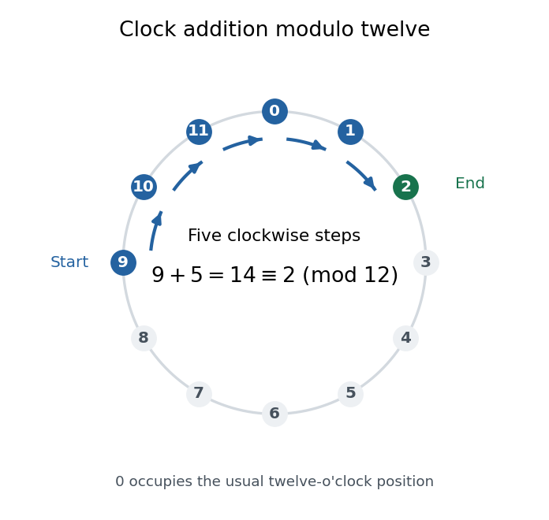

# Modular congruence

↑ **Parent:** [Modular arithmetic](modular-arithmetic-split.md)

For [integers](integer-split.md) $a,b$ and a positive [integer modulus](modulus-in-modular-arithmetic.md) $n$, modular congruence means

$$
a\equiv b\pmod n\iff n\mid(a-b).
$$

Thus $a-b=kn$ for some [integer](integer-split.md) $k$: the two [integers](integer-split.md) differ by complete cycles of length $n$. For example, $14\equiv2\pmod{12}$ because $14-2=12$, and $-1\equiv11\pmod{12}$ because $-1-11=-12$. A [modular congruence](modular-congruence.md) need not be an equality of [integers](integer-split.md).

On a twelve-position clock labelled $0,1,\ldots,11$, adding five to nine follows $9\to10\to11\to0\to1\to2$. Hence $9+5=14\equiv2\pmod{12}$: the final position remembers the [remainder](remainder.md) while forgetting a complete revolution.

**[Figure 3](#image-adding-five-to-nine-takes-five-clockwise-steps-and-ends-at-two-modulo-twelve). Adding five to nine takes five clockwise steps and ends at two modulo twelve**.

The same idea tracks any count repeating every $n$ steps. It also lets us compute sums and products with small [residue classes](residue-class.md), reducing intermediate results without changing the final class. The justification comes from [addition](addition.md) and [multiplication](multiplication.md) being well-defined on [residue classes](residue-class.md).

In _Disquisitiones arithmeticae_ (1801), [Carl Friedrich Gauss](carl-friedrich-gauss.md) defines [modular congruence](modular-congruence.md) by [divisibility](divisibility-split.md) in article 1; article 2 describes the [integers](integer-split.md) $a+kn$ and adopts $\equiv$. These passages document his presentation and notation, without claiming that repeating remainders began in 1801. [Gauss, Disquisitiones arithmeticae, section I, articles 1–2; original text in the 1870 collected edition](https://la.wikisource.org/wiki/Disquisitiones_arithmeticae/Sectio_prima)

**Table of contents**

- [Quadratic congruence](quadratic-congruence.md)
- [Prime-power contraction under pth powers](prime-power-contraction-under-pth-powers.md)
- [Reduced residue system](reduced-residue-system.md)
- [Linear congruence](linear-congruence.md)
  - [Cancellation of a common factor in a congruence](cancellation-of-a-common-factor-in-a-congruence.md)
- [Residue class](residue-class.md)
- [Unit modulo n](unit-modulo-n.md)

## ↑ Ancestors (5)

1. [Modular arithmetic](modular-arithmetic-split.md)
2. [Number theory](number-theory-split.md)
3. [Area of mathematics](area-of-mathematics.md)
4. [Mathematics](mathematics-split.md)
5. [Codex Wiki](split.md)

## ← Incoming links (51)

- [Carmichael number](carmichael-number.md)
- [Common power residues from coprime exponent congruences](common-power-residues-from-coprime-exponent-congruences.md)
- [Fermat little theorem](fermat-little-theorem.md)
- [Fermat test example](fermat-test-example.md)
- [Infinitely many primes congruent to one modulo six](infinitely-many-primes-congruent-to-one-modulo-six.md)
- [Legendre symbol](legendre-symbol.md)
- [Modular congruence](modular-congruence.md)
- [Modular multiplicative inverse](modular-multiplicative-inverse.md)
- [Multiplicativity of the Legendre symbol](multiplicativity-of-the-legendre-symbol.md)
- [p-adic absolute value](p-adic-absolute-value.md)
- [Solution](past-exam-of-the-algebra-analysis-and-differential-equations-1-course-of-the-university-of-oxford/2011/3/c/solution.md)
- [Solution](past-exam-of-the-mathematics-course-of-the-university-of-cambridge/2003/ia/paper-4/6c/ii/solution.md)
- [Solution](past-exam-of-the-mathematics-course-of-the-university-of-cambridge/2006/ia/paper-4/1e/solution.md)
- [Solution](past-exam-of-the-mathematics-course-of-the-university-of-cambridge/2006/ia/paper-4/5e/solution.md)
- [Solution](past-exam-of-the-mathematics-course-of-the-university-of-cambridge/2006/ia/paper-4/7e/solution.md)
- [Solution](past-exam-of-the-mathematics-course-of-the-university-of-cambridge/2006/ii/paper-3/1h/solution.md)
- [Solution](past-exam-of-the-mathematics-course-of-the-university-of-cambridge/2006/iii/paper-7/1/ii/solution.md)
- [Solution](past-exam-of-the-mathematics-course-of-the-university-of-cambridge/2008/ia/paper-4/6d/a/solution.md)
- [Solution](past-exam-of-the-mathematics-course-of-the-university-of-cambridge/2009/ia/paper-4/2e/a/solution.md)
- [Solution](past-exam-of-the-mathematics-course-of-the-university-of-cambridge/2009/ii/paper-1/1g/solution.md)
- [Solution](past-exam-of-the-mathematics-course-of-the-university-of-cambridge/2010/ia/paper-4/1e/a/solution.md)
- [Solution](past-exam-of-the-mathematics-course-of-the-university-of-cambridge/2010/ia/paper-4/1e/b/solution.md)
- [Solution](past-exam-of-the-mathematics-course-of-the-university-of-cambridge/2011/ia/paper-4/6e/solution.md)
- [Solution](past-exam-of-the-mathematics-course-of-the-university-of-cambridge/2012/ia/paper-4/1d/ii/solution.md)
- [Solution](past-exam-of-the-mathematics-course-of-the-university-of-cambridge/2014/ia/paper-4/6e/i/solution.md)
- [Solution](past-exam-of-the-mathematics-course-of-the-university-of-cambridge/2015/ia/paper-4/6e/ii/solution.md)
- [Solution](past-exam-of-the-mathematics-course-of-the-university-of-cambridge/2017/ia/paper-4/1d/a/solution.md)
- [Solution](past-exam-of-the-mathematics-course-of-the-university-of-cambridge/2017/ia/paper-4/1d/b/solution.md)
- [Solution](past-exam-of-the-mathematics-course-of-the-university-of-cambridge/2017/ia/paper-4/5d/a/solution.md)
- [Solution](past-exam-of-the-mathematics-course-of-the-university-of-cambridge/2019/ii/paper-3/1i/solution.md)
- [Solution](past-exam-of-the-mathematics-course-of-the-university-of-cambridge/2023/ii/paper-2/1g/solution.md)
- [Solution](past-exam-of-the-options-i-course-of-the-university-of-oxford/2008/c/c1/solution.md)
- [Solution](past-exam-of-the-options-i-course-of-the-university-of-oxford/2009/c/c1/iii/solution.md)
- [Solution](past-exam-of-the-options-i-course-of-the-university-of-oxford/2010/c/c1/ii/solution.md)
- [Solution](past-exam-of-the-options-i-course-of-the-university-of-oxford/2010/c/c1/iii/solution.md)
- [Solution](past-exam-of-the-options-ii-course-of-the-university-of-oxford/2006/c/2/solution.md)
- [Solution](past-exam-of-the-options-ii-course-of-the-university-of-oxford/2011/c/c2/a/ii/solution.md)
- [Solution](past-exam-of-the-options-ii-course-of-the-university-of-oxford/2011/c/c2/a/iv/solution.md)
- [Solution](past-exam-of-the-options-ii-course-of-the-university-of-oxford/2012/c/c2/a/iii/solution.md)
- [Solution](past-exam-of-the-options-ii-course-of-the-university-of-oxford/2012/c/c2/c/solution.md)
- [Solution](past-exam-of-the-short-options-course-of-the-university-of-oxford/2014/1/a/ii/solution.md)
- [Solution](past-exam-of-the-short-options-course-of-the-university-of-oxford/2014/1/b/ii/solution.md)
- [Solution](past-exam-of-the-short-options-course-of-the-university-of-oxford/2017/1/d/solution.md)
- [Solution](past-exam-of-the-short-options-course-of-the-university-of-oxford/2017/2/b/i/solution.md)
- [Solution](past-exam-of-the-short-options-course-of-the-university-of-oxford/2021/1/d/solution.md)
- [Pépin's test](pepin-s-test.md)
- [Prime divisor of a Fermat number](prime-divisor-of-a-fermat-number.md)
- [Prime-power contraction under pth powers](prime-power-contraction-under-pth-powers.md)
- [Quadratic congruence](quadratic-congruence.md)
- [Quadratic residue](quadratic-residue-split.md)
- [Weight-sixteen Eisenstein congruence](weight-sixteen-eisenstein-congruence.md)
