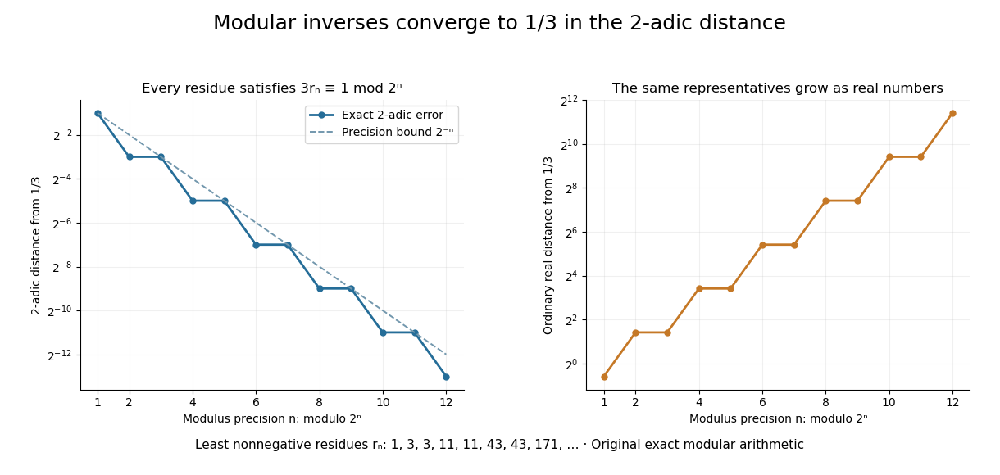

# Modular inversion converges to a p-adic inverse

↑ **Parent:** [p-adic integer](p-adic-integer.md)

Let $a$ be an [integer](integer-split.md) not divisible by $p$. Its [modular inverse](modular-multiplicative-inverse.md) modulo $p^n$ has a unique least nonnegative representative $r_n$. Reducing the inverse equation modulo $p^n$ shows that the representatives are compatible. Since $a$ is a [p-adic unit](p-adic-unit.md),

$$
|r_n-a^{-1}|_p=|ar_n-1|_p\leq p^{-n},
$$

so the sequence converges to the inverse $a^{-1}$ in $\mathbb Z_p$. This computes a fraction through finite [integer](integer-split.md) operations.

For $a=3$ and $p=2$, the first eight representatives are **$1,3,3,11,11,43,43,171$**. Each satisfies $3r_n\equiv1\pmod{2^n}$. The resulting expansion is

$$
\boxed{\frac13=1+2+8+32+\cdots
=1+\sum_{k\geq0}2^{2k+1}\quad\text{in }\mathbb Z_2.}
$$

The [geometric series](geometric-series.md) has ratio $4$, whose [2-adic absolute value](2-adic-absolute-value.md) is $1/4$, and its sum is $1+2/(1-4)=1/3$. In the ordinary [real number](real-number.md) [absolute value](absolute-value.md), the representatives grow. Different [metrics](metric.md) impose different meanings of a good approximation. The periodic digits here are a specific instance of the rational expansions studied in Conrad's authored note.[§1, printed p. 1: p-adic rational expansions and explicit low-order-first convention; §3, Theorem 3.1, printed pp. 3–5: eventual periodicity](the-p-adic-expansion-of-rational-numbers-by-keith-conrad.md)

**[Figure 14](#image-finite-modular-inverses-approximate-one-third-in-the-2-adic-metric). Finite modular inverses approximate one third in the 2-adic metric**. Original exact least nonnegative inverses of $3$ modulo $2^n$. The left panel plots $|r_n-1/3|_2$ and the bound $2^{-n}$. The right plots the ordinary real error $|r_n-1/3|$. Equal neighbouring representatives arise when the next binary digit is zero, so their exact errors also agree.

## ↑ Ancestors (6)

1. [p-adic integer](p-adic-integer.md)
2. [P-adic valuation](p-adic-valuation.md)
3. [Number theory](number-theory-split.md)
4. [Area of mathematics](area-of-mathematics.md)
5. [Mathematics](mathematics-split.md)
6. [Codex Wiki](split.md)

## ← Incoming links (2)

- [2-adic integer](2-adic-integer.md)
- [P-adic unit](p-adic-unit.md)
