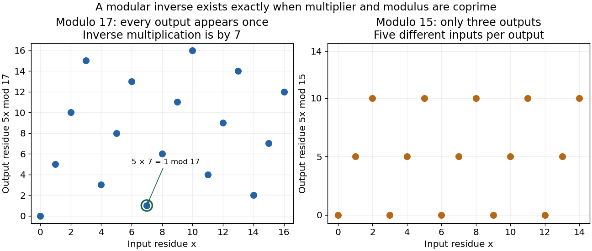

# Modular multiplicative inverse

↑ **Parent:** [Number theory](number-theory-split.md)  
ⓦ [Wiki](https://en.wikipedia.org/wiki/Modular_multiplicative_inverse)

For [integers](integer-split.md) $a$ and $n>1$, a modular multiplicative inverse is a [congruence class](congruence-class.md) $b$ satisfying $ab\equiv1\pmod n$. It exists exactly when $\gcd(a,n)=1$. Necessity follows because every common [divisor](divisor.md) of $a,n$ would divide $ab-kn=1$. Conversely, [Bézout's identity](bezout-s-identity.md) gives $ua+vn=1$ for [coprime integers](coprime-integers.md), making $u$ an inverse. This is the basic bridge from [greatest common divisor](greatest-common-divisor.md) calculations to reversible [modular arithmetic](modular-arithmetic-split.md).

For example, $5\cdot7-2\cdot17=1$, so $5^{-1}\equiv7\pmod{17}$. The [modular congruence](modular-congruence.md) $5x\equiv3\pmod{17}$ therefore has the unique solution class $x\equiv21\equiv4\pmod{17}$. Multiplication by $5$ sends all seventeen residue classes to different classes; multiplying by $7$ reverses it. The inverse criterion and its algorithmic construction are presented in [Ankur Moitra, MIT 18.200, 2024, modular inverses and Euclid's algorithm](https://ocw.mit.edu/courses/18-200-principles-of-discrete-applied-mathematics-spring-2024/mit18_200_s24_lec15.pdf).

By contrast, $5$ has no [modular inverse](modular-multiplicative-inverse.md) modulo $15$. Its products have only residues $0,5,10$. Consequently $5x\equiv3\pmod{15}$ has no solution, while $5x\equiv10\pmod{15}$ has five solution classes, $x\equiv2,5,8,11,14$. Dividing by a noninvertible residue would discard this distinction. In a [prime field](prime-field.md) $\mathbb F_p$, every nonzero residue is invertible; a general integer modulus instead gives a [quotient ring](quotient-ring.md) that can have [zero divisors](zero-divisor.md).

**[Figure 23](#image-multiplication-by-five-is-reversible-modulo-seventeen-but-collapses-classes-modulo-fifteen). Multiplication by five is reversible modulo seventeen but collapses classes modulo fifteen**.

**Table of contents**

- [Newton iteration for modular inversion](newton-iteration-for-modular-inversion.md)
- [Modular inversion](modular-inversion.md)
- [Batch modular inversion](batch-modular-inversion.md)

## ↑ Ancestors (4)

1. [Number theory](number-theory-split.md)
2. [Area of mathematics](area-of-mathematics.md)
3. [Mathematics](mathematics-split.md)
4. [Codex Wiki](split.md)

## ← Incoming links (18)

- [Chinese remainder theorem](chinese-remainder-theorem.md)
- [Euler's theorem](euler-s-theorem.md)
- [Euler totient function](euler-totient-function.md)
- [Exponent reduction for units](exponent-reduction-for-units.md)
- [Fermat little theorem](fermat-little-theorem.md)
- [Modular arithmetic](modular-arithmetic-split.md)
- [Modular exponentiation](modular-exponentiation.md)
- [Multiplicativity of the Legendre symbol](multiplicativity-of-the-legendre-symbol.md)
- [Nontrivial square root of unity modulo an integer](nontrivial-square-root-of-unity-modulo-an-integer.md)
- [Nonzero residue permutation](nonzero-residue-permutation.md)
- [Number theory](number-theory-split.md)
- [Solution](past-exam-of-the-mathematics-course-of-the-university-of-cambridge/2016/ia/paper-4/1e/solution.md)
- [Solution](past-exam-of-the-mathematics-course-of-the-university-of-cambridge/2016/ia/paper-4/6e/solution.md)
- [Solution](past-exam-of-the-mathematics-course-of-the-university-of-cambridge/2020/ia/paper-2/7d/c/solution.md)
- [Solution](past-exam-of-the-mathematics-course-of-the-university-of-cambridge/2020/ii/paper-4/1h/solution.md)
- [Prime-power fraction decomposition](prime-power-fraction-decomposition.md)
- [Unit modulo n](unit-modulo-n.md)
- [Wilson's theorem](wilson-s-theorem.md)
