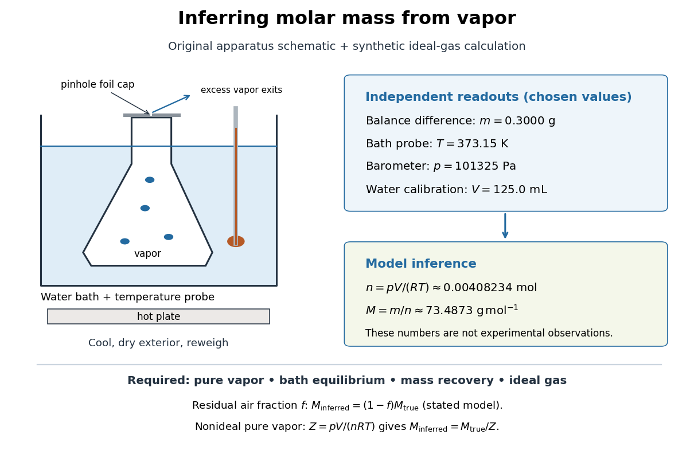

# Molar mass measurement model

↑ **Parent:** [Vapor-density molar mass measurement](vapor-density-molar-mass-measurement.md)

For a synthetic illustration, choose $m=0.3000\,\mathrm g$, $V=125.0\,\mathrm{mL}$, $p=101325\,\mathrm{Pa}$ and $T=373.15\,\mathrm K$. Using [molar gas constant](molar-gas-constant.md) $R\approx8.314462618\,\mathrm{J\,mol^{-1}\,K^{-1}}$ gives $n\approx0.00408234\,\mathrm{mol}$ and $M_{\rm inferred}\approx73.4873\,\mathrm{g\,mol^{-1}}$ under the [ideal gas law](ideal-gas-law.md). These are chosen model inputs, not observations of a particular [chemical substance](chemical-substance-split.md).

**[Figure 6](#molar-mass-vapor-measurement-model). Vapor molar mass inference: apparatus, independent readouts, and the assumptions behind a synthetic ideal gas law calculation**.

An error's direction follows the model. Extra exterior [water](water.md) raises the apparent $m$ and hence $M_{\rm inferred}$. If a fraction $f$ of the hot [gas](gas.md) particles is residual air, and only the unknown vapor contributes to recovered $m$, an otherwise [ideal gas](ideal-gas-split.md) calculation gives $M_{\rm inferred}=(1-f)M_{\rm true}$. For a pure nonideal vapor, define $Z=pV/(nRT)$; then $M_{\rm inferred}=M_{\rm true}/Z$, so the direction depends on $Z$. The dye endpoint alone cannot establish gas purity, [thermal equilibrium](thermal-equilibrium-split.md), or ideality. These conditional checks explain why the same apparatus cannot provide a universal [molar mass](molar-mass.md) measurement for arbitrary [mixtures](mixture-split.md) or substances that decompose on heating.

## ↑ Ancestors (4)

1. [Vapor-density molar mass measurement](vapor-density-molar-mass-measurement.md)
2. [Molar mass](molar-mass.md)
3. [Chemistry](chemistry-split.md)
4. [Codex Wiki](split.md)
