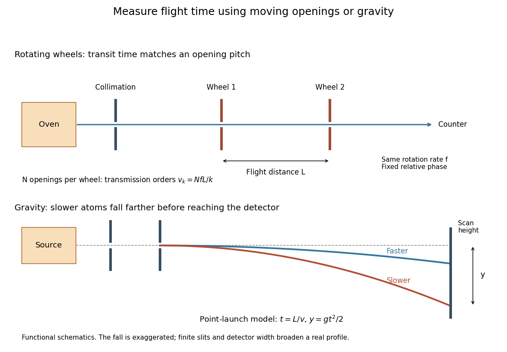

# Molecular beam

↑ **Parent:** [Experimental apparatus](experimental-apparatus.md)  
ⓦ [Wiki](https://en.wikipedia.org/wiki/Molecular_beam)

A directed stream of [molecules](molecule-split.md) used to prepare samples for [spectroscopy](spectroscopy.md).

A [molecular beam](molecular-beam.md) also includes a stream of [chemical atoms](atom-physics.md), then called an [atomic beam](atomic-beam.md). An oven supplies particles; aligned slits restrict their directions, and a [vacuum](vacuum.md) limits subsequent [collisions](collision.md). Narrowing the directions does not by itself make every particle's [speed](speed.md) equal. This gives a useful separation of tasks: prepare a path, select or measure [speed](speed.md), apply an interaction, and read the resulting [particle](particle-physics.md) counts or deflection.

The advantage is unusually tangible. A [magnetic field](magnetic-field-split.md) can separate [spin](spin.md) components in the [Stern-Gerlach experiment](stern-gerlach-experiment.md); even [gravity](gravity.md) can sort a beam by flight time. The [effusive beam speed distribution](effusive-beam-speed-distribution.md) explains which particles leave the source, while [gravity deflection of an atomic beam](gravity-deflection-of-an-atomic-beam.md) explains how that distribution becomes a pattern on a detector.

**[Figure 11](#image-two-ways-of-measuring-molecular-beam-speeds-rotating-openings-and-gravitational-flight). Two ways of measuring molecular beam speeds: rotating openings and gravitational flight**. Original functional schematics, not historical apparatus drawings. The lower panel exaggerates the fall for visibility; all numerical settings used in the text are chosen model inputs.

**Table of contents**

- [Dunoyer molecular-beam experiment](dunoyer-molecular-beam-experiment.md)
- [Effusive beam speed distribution](effusive-beam-speed-distribution.md)
- [Rotating-wheel molecular velocity selector](rotating-wheel-molecular-velocity-selector.md)
- [Gravity deflection of an atomic beam](gravity-deflection-of-an-atomic-beam.md)
- [Atomic beam](atomic-beam.md)
- [Surface ionization detector](surface-ionization-detector.md)
- [Molecular beam skimmer](molecular-beam-skimmer.md)

## ↑ Ancestors (3)

1. [Experimental apparatus](experimental-apparatus.md)
2. [Physics](physics-split.md)
3. [Codex Wiki](split.md)

## ← Incoming links (7)

- [Ammonia maser](ammonia-maser.md)
- [Maser cavity](maser-cavity.md)
- [Molecular beam](molecular-beam.md)
- [Molecular beam electric resonance](molecular-beam-electric-resonance.md)
- [NIST trace-gas FTMW validation experiment](nist-trace-gas-ftmw-validation-experiment.md)
- [Nobel Prize in Physics in 1943](nobel-prize-in-physics-in-1943.md)
- [Nuclear magnetic resonance](nuclear-magnetic-resonance-split.md)
