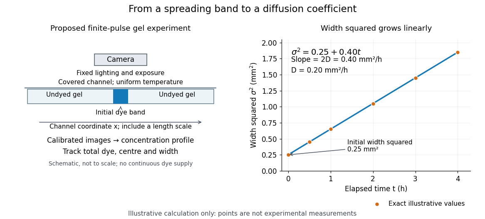

# Molecular diffusion

↑ **Parent:** [Diffusion](diffusion.md)

Molecular diffusion is the component of material transport caused by the random thermal motion of [molecules](molecule-split.md), measured relative to bulk motion of their surroundings. A [diffusion coefficient](diffusion-coefficient.md) is a property of a particular substance in a particular medium under specified conditions, not a universal speed of spreading. Its dependence on the [solute](solute.md), [solvent](solvent.md) and [temperature](temperature-split.md) is precisely what makes a spreading experiment informative. A [random walk](random-walk-split.md) idealizes this motion; the [Brownian motion](brownian-motion-split.md) description provides a continuous approximation over sufficiently long times. [Nepf, MIT: molecular motion and diffusivity](https://ocw.mit.edu/courses/1-061-transport-processes-in-the-environment-fall-2008/8260e3e1577cd739ce85143510d9c165_lec_01.pdf)

**A motivating experiment: watch dye enter a gel.** Samprovalaki, Robbins and Fryer studied rhodamine 6G and methylene blue entering agar gel from two side reservoirs. A covered slab, $10\times5\times1\,\mathrm{mm}$, sat on a controlled thermal stage; the dye was brought to the same [temperature](temperature-split.md). They photographed the gel every ten minutes, averaged image intensity across a strip, and fitted the changing [concentration](concentration.md) to a [diffusion equation](diffusion-equation-split.md) model. The cover limited evaporation and stopped dye travelling over the gel surface. Runs at $30$, $50$ and $70\,\mathrm{{}^{\circ}C}$ were repeated in triplicate. The measured spatial colour change therefore supplied a quantitative transport test, rather than merely showing that dye eventually spreads. Changing lighting also changes image intensity, so the optical response had to be checked. Importantly for interpretation, their constant-[diffusion coefficient](diffusion-coefficient.md) fit was imperfect and the gel coefficient is an effective transport coefficient, not automatically the value in free [water](water.md). [Samprovalaki, Robbins and Fryer (2012), Investigation of the diffusion of dyes in agar gels, sections 2-4](https://doi.org/10.1016/j.jfoodeng.2012.03.024)

**A finite-pulse version to test width growth.** The following is a proposed teaching variant, not that paper's apparatus or a report of measurements. Make a long, narrow, transparent gel channel of uniform cross-section. Join a thin dyed gel band between two undyed lengths of the same gel, with good contact and no air gaps; the dye should initially fill the cross-section so the dominant [concentration](concentration.md) variation is along the channel coordinate $x$. After assembly, keep the covered channel horizontal at uniform [temperature](temperature-split.md), away from vibration. The dye is a finite initial pulse: no reservoir supplies more dye. Choose a dye whose image response can be calibrated and whose interaction with the gel is small enough for an approximately constant [diffusion coefficient](diffusion-coefficient.md) to be plausible.

Photograph the whole pulse at recorded times with fixed lighting, focus and exposure, including a length scale. Use uniformly dyed standards of the same gel thickness and a blank gel to convert image intensity to [concentration](concentration.md) $C(x,t)$; do not assume raw brightness is proportional to [concentration](concentration.md). Average across the channel width and examine several parallel strips to check the one-dimensional approximation. Measure the initial profile instead of treating the band as infinitely thin. For a finite pulse with negligible end effects, define its spatial integral $Q$, centre $\bar x$ and width $\sigma$ by

$$
Q=\int_{-\infty}^{\infty}C(x,t)\,dx,\qquad
\bar x(t)=\frac1Q\int_{-\infty}^{\infty}xC(x,t)\,dx,\qquad
\sigma^2(t)=\frac1Q\int_{-\infty}^{\infty}(x-\bar x(t))^2C(x,t)\,dx.
$$

Here $\sigma^2$ is the [variance](variance-split.md) of the normalized profile $C/Q$, and $\sigma$ is its [standard deviation](standard-deviation.md). If $C$ is measured in $\mathrm{mol\,m^{-3}}$, then $Q$ has units $\mathrm{mol\,m^{-2}}$; multiplying by the channel cross-section gives the total [amount of substance](amount-of-substance.md). For the unbounded one-dimensional [diffusion equation](diffusion-equation-split.md) with constant $D$, conserved $Q$, finite [variance](variance-split.md) and sufficiently decaying tails,

$$
\sigma^2(t)=\sigma_0^2+2Dt,\qquad
D=\frac12\frac{d\sigma^2}{dt}.
$$

Thus plot width _squared_ against time: its slope determines the [diffusion coefficient](diffusion-coefficient.md), while its intercept includes the finite starting width. This moment law holds even for a non-[Gaussian distribution](normal-distribution.md) initially; it follows by applying [integration by parts](integration-by-parts.md) twice to the [diffusion equation](diffusion-equation-split.md). [Nepf, MIT: profile moments and estimating diffusivity from variance growth](https://ocw.mit.edu/courses/1-061-transport-processes-in-the-environment-fall-2008/68b0a4a664246168ee639298b39384b1_lec_03.pdf)

**[Figure 16](#image-measuring-molecular-diffusion-from-the-growth-of-width-squared). Measuring molecular diffusion from the growth of width squared**. Original schematic of the proposed finite-pulse gel experiment, with an illustrative calculation rather than measured data. A camera records the broadening band. The plotted points are exact samples of $\sigma^2=0.25+0.40t$ with $\sigma^2$ in $\mathrm{mm^2}$ and $t$ in hours; the slope gives the chosen $D=0.20\,\mathrm{mm^2\,h^{-1}}$. The schematic is not to scale and is not a reproduction of the published apparatus.

For the particularly readable case of an initially [Gaussian distribution](normal-distribution.md) centred at zero, uniform [advection](advection.md) at speed $u$ and constant [diffusion coefficient](diffusion-coefficient.md) $D$ give the one-dimensional [concentration](concentration.md) profile

$$
C(x,t)=\frac{Q}{\sqrt{2\pi(\sigma_0^2+2Dt)}}\exp\!\left[-\frac{(x-ut)^2}{2(\sigma_0^2+2Dt)}\right].
$$

Its centre moves as $\bar x=ut$ and its [variance](variance-split.md) grows as $\sigma_0^2+2Dt$. Our illustrative choice $\sigma_0=0.50\,\mathrm{mm}$ and $D=0.20\,\mathrm{mm^2\,h^{-1}}$ gives widths $0.50$, $0.81$ and $1.36\,\mathrm{mm}$ at zero, one and four hours. These are calculated values, not a measured dye coefficient. Once $2Dt$ dominates the initial [variance](variance-split.md), width grows as $\sqrt{2Dt}$: four times the elapsed time gives approximately twice the width. A rectangular starting band will not immediately have a [Gaussian distribution](normal-distribution.md), although the same width-squared law still applies under the stated assumptions.

**Controls and limits of the interpretation.** In the proposed experiment, check that $Q$ stays constant and that the centre remains stationary while the width increases. Include a blank and a uniformly dyed gel photographed over the same period: an apparent signal change there exposes lighting drift, dye fading or evaporation. Repeat with a lower starting dye [concentration](concentration.md) and a second initial width; agreement of the slopes is a check on constant $D$ and on preparation effects. Keep the pulse far from the channel ends and record its faint tails: truncation and background errors can strongly bias a [variance](variance-split.md). Poor contact, dye binding, [chemical reactions](chemical-reaction-split.md) or transport in a liquid film can invalidate the simple model. A gel suppresses bulk liquid motion, but its inferred [diffusivity](diffusion-coefficient.md) need not equal that in the pure [solvent](solvent.md). A stationary centre alone does not exclude symmetric flows, and linear width-squared growth alone does not prove a molecular mechanism: [turbulence](turbulence-split.md) can also produce an effective diffusive description. These are reasons to combine the profile test with the controlled setup.

## ↑ Ancestors (6)

1. [Diffusion](diffusion.md)
2. [Thermodynamics](thermodynamics-split.md)
3. [Statistical physics](statistical-physics-split.md)
4. [Branches of physics](branches-of-physics.md)
5. [Physics](physics-split.md)
6. [Codex Wiki](split.md)

## ← Incoming links (8)

- [Diffusion](diffusion.md)
- [Disc diffusion assay](disc-diffusion-assay.md)
- [Laminar flow](laminar-flow.md)
- [Molecular diffusion](molecular-diffusion.md)
- [Solution](past-exam-of-the-biochemistry-course-of-the-university-of-cambridge/2024/paper-5/section-2/j/solution.md)
- [Solution](past-exam-of-the-biochemistry-course-of-the-university-of-cambridge/2024/paper-5/section-2/q/solution.md)
- [Solution](past-exam-of-the-mathematics-course-of-the-university-of-cambridge/2002/iii/paper-51/1/solution.md)
- [Solution](past-exam-of-the-mathematics-course-of-the-university-of-cambridge/2002/iii/paper-51/3/solution.md)
