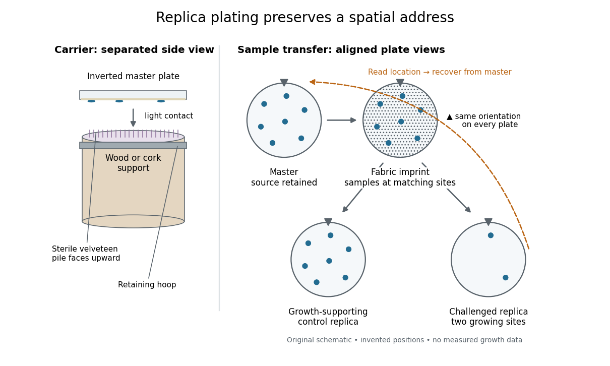
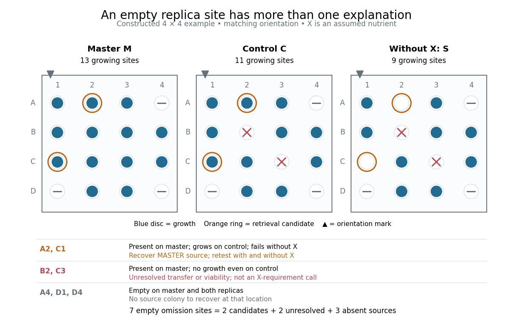
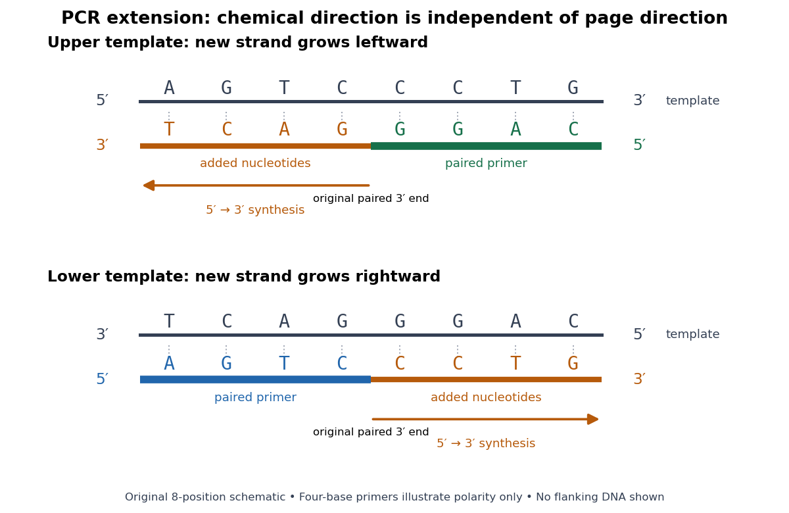
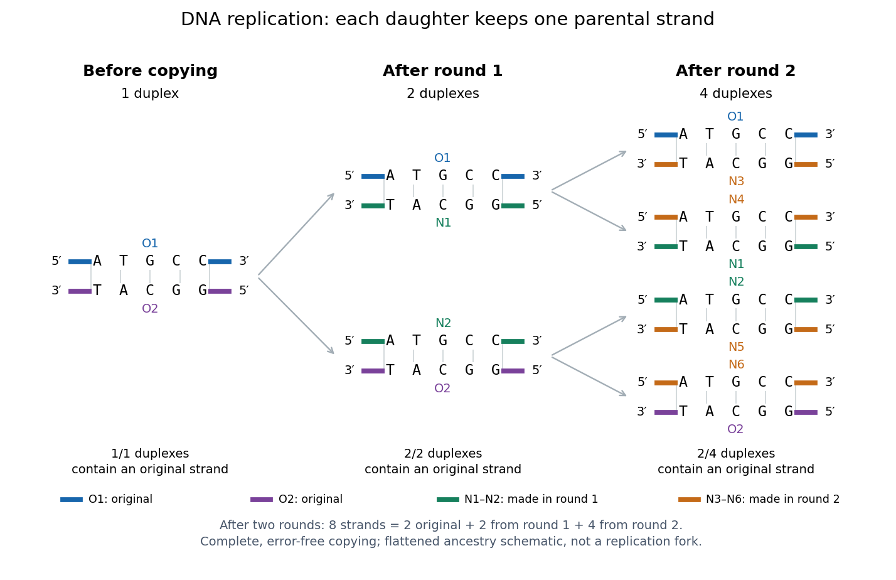

# Molecular genetics

↑ **Parent:** [Genetics](genetics.md)  
ⓦ [Wiki](https://en.wikipedia.org/wiki/Molecular_genetics)

**Table of contents**

- [Foraging gene](#foraging-gene)
- [DNA synthesis](#dna-synthesis)
  - [Trinucleotide phosphoramidite](#trinucleotide-phosphoramidite)
- [DNA library](#dna-library)
  - [Library coverage](#library-coverage)
- [Mutagenesis](#mutagenesis)
  - [Mutation load](#mutation-load)
  - [Saturation mutagenesis](#saturation-mutagenesis)
- [Retrotransposon insertion](#retrotransposon-insertion)
- [Ultraconserved element](#ultraconserved-element)
- [Transcriptomics](#transcriptomics)
  - [Spatial transcriptomics](#spatial-transcriptomics)
    - [Slide-seq](#slide-seq)
    - [Spatial barcoding](#spatial-barcoding)
- [Orthology](#orthology)
- [Tumour mutational burden](#tumour-mutational-burden)
- [dN/dS](#dn-ds)
- [CpG site](#cpg-site)
- [Genetic engineering](#genetic-engineering)
  - [Genetic perturbation](#genetic-perturbation)
  - [Protein engineering](#protein-engineering)
    - [Computational enzyme design](#computational-enzyme-design)
  - [Off-target effect](#off-target-effect)
  - [Gene knockout](#gene-knockout)
  - [CRISPR genome editing](#crispr-genome-editing)
    - [CRISPR locus labelling](#crispr-locus-labelling)
    - [CRISPR-Cas9](#crispr-cas9)
    - [CRISPR activation](#crispr-activation)
    - [CRISPR interference](#crispr-interference)
    - [Cas9](#cas9)
      - [dCas9](#dcas9)
    - [Protospacer adjacent motif](#protospacer-adjacent-motif)
    - [Guide RNA](#guide-rna)
  - [Optogenetics](#optogenetics)
- [Site-directed mutagenesis](#site-directed-mutagenesis)
- [De novo gene birth](#de-novo-gene-birth)
- [Neofunctionalization](#neofunctionalization)
- [Subfunctionalization](#subfunctionalization)
- [Gene duplication](#gene-duplication)
  - [Whole-genome duplication](#whole-genome-duplication)
    - [Two-round vertebrate genome duplication hypothesis](#two-round-vertebrate-genome-duplication-hypothesis)
  - [Tandem gene duplication](#tandem-gene-duplication)
  - [Tandem duplication](#tandem-duplication)
  - [Birth-and-death evolution](#birth-and-death-evolution)
  - [Paralogy](#paralogy)
    - [Paralogue](#paralogue)
- [DNA methylation](#dna-methylation)
  - [CHH methylation](#chh-methylation)
  - [CHG methylation](#chg-methylation)
  - [CG methylation](#cg-methylation)
  - [De novo DNA methylation](#de-novo-dna-methylation)
  - [Maintenance DNA methylation](#maintenance-dna-methylation)
  - [DNA demethylation](#dna-demethylation)
    - [DEMETER](#demeter)
    - [ROS1](#ros1)
  - [DNA methyltransferase](#dna-methyltransferase)
    - [DRM2](#drm2)
    - [CMT2](#cmt2)
    - [CMT3](#cmt3)
    - [MET1](#met1)
  - [Differentially methylated region](#differentially-methylated-region)
  - [Posterior methylation profile](#posterior-methylation-profile)
  - [Bisulfite sequencing](#bisulfite-sequencing)
- [Single-cell RNA sequencing](#single-cell-rna-sequencing)
  - [Developmental pseudotime](#developmental-pseudotime)
  - [Pseudotime](#pseudotime)
- [Chromatin](#chromatin)
  - [Polycomb repression](#polycomb-repression)
  - [Chromatin organization](#chromatin-organization)
    - [DDM1](#ddm1)
    - [Fluorescent operator-repressor chromosome labelling](#fluorescent-operator-repressor-chromosome-labelling)
  - [Chromosome territory](#chromosome-territory)
  - [Chromatin compartment](#chromatin-compartment)
  - [Chromatin loop](#chromatin-loop)
    - [Loop extrusion](#loop-extrusion)
  - [Topologically associating domain](#topologically-associating-domain)
  - [Chromosome conformation capture](#chromosome-conformation-capture)
    - [Hi-C](#hi-c)
  - [Nucleosome array](#nucleosome-array)
  - [Chromatin accessibility](#chromatin-accessibility)
    - [DNase-seq](#dnase-seq)
    - [ATAC-seq](#atac-seq)
  - [Dinoflagellate histone-like protein](#dinoflagellate-histone-like-protein)
  - [Dinoflagellate viral nucleoprotein](#dinoflagellate-viral-nucleoprotein)
  - [Liquid-crystalline chromosome organization](#liquid-crystalline-chromosome-organization)
  - [Chromatin boundary](#chromatin-boundary)
  - [Heterochromatin](#heterochromatin)
    - [H3K9 methylation](#h3k9-methylation)
      - [H3K9 dimethylation](#h3k9-dimethylation)
    - [Heterochromatin spreading](#heterochromatin-spreading)
  - [Chromatin remodelling](#chromatin-remodelling)
    - [ATP-dependent chromatin remodelling complex](#atp-dependent-chromatin-remodelling-complex)
  - [Histone acetylation](#histone-acetylation)
    - [HDA6](#hda6)
  - [Nucleosome](#nucleosome)
    - [Nucleosome reconstitution](#nucleosome-reconstitution)
    - [Histone transfer](#histone-transfer)
    - [Nucleosome stability](#nucleosome-stability)
    - [Nucleosome breathing](#nucleosome-breathing)
    - [Linker DNA](#linker-dna)
    - [Histone octamer](#histone-octamer)
    - [Nucleosome mapping by MNase-seq](#nucleosome-mapping-by-mnase-seq)
- [Plasmid](#plasmid)
  - [Expression vector](#expression-vector)
  - [Plasmid feature map](#plasmid-feature-map)
  - [Plasmid insert](#plasmid-insert)
  - [Plasmid restriction mapping](#plasmid-restriction-mapping)
  - [1973 plasmid construction experiment](#1973-plasmid-construction-experiment)
- [Genetic transformation](#genetic-transformation)
  - [Plasmid selection and confirmation](#plasmid-selection-and-confirmation)
- [Replica plating](#replica-plating)
  - [Replica plating spatial correspondence](#replica-plating-spatial-correspondence)
  - [Lederberg replica plating experiment](#lederberg-replica-plating-experiment)
  - [Replica plating controls](#replica-plating-controls)
  - [Indirect selection of bacterial mutants](#indirect-selection-of-bacterial-mutants)
- [Genome](#genome)
  - [Genome defence](#genome-defence)
  - [Episome](#episome)
    - [Episome partitioning](#episome-partitioning)
  - [Polyploidy](#polyploidy)
    - [Allopolyploidy](#allopolyploidy)
  - [Genome reduction](#genome-reduction)
    - [Adaptive gene loss](#adaptive-gene-loss)
  - [Chloroplast genome](#chloroplast-genome)
  - [Pangenome](#pangenome)
  - [Mitochondrial genome](#mitochondrial-genome)
  - [Genome mapping](#genome-mapping)
- [DNA sequencing](#dna-sequencing)
  - [Variant allele fraction](#variant-allele-fraction)
  - [Unique molecular identifier](#unique-molecular-identifier)
  - [Whole-genome sequencing](#whole-genome-sequencing)
  - [Long-read sequencing](#long-read-sequencing)
  - [Sanger sequencing](#sanger-sequencing)
    - [Sanger ladder reading](#sanger-ladder-reading)
    - [Sanger sequencing controls](#sanger-sequencing-controls)
    - [Sanger-Nicklen-Coulson sequencing experiment](#sanger-nicklen-coulson-sequencing-experiment)
  - [Sequencing primer](#sequencing-primer)
- [Sequence alignment](#sequence-alignment)
  - [Multiple sequence alignment](#multiple-sequence-alignment)
    - [Alignment column information content](#alignment-column-information-content)
    - [Gap fraction](#gap-fraction)
  - [Sequence similarity](#sequence-similarity)
  - [Sequence identity](#sequence-identity)
  - [Fitting sequence alignment](#fitting-sequence-alignment)
  - [Local sequence alignment](#local-sequence-alignment)
    - [FASTA sequence search](#fasta-sequence-search)
    - [BLAST](#blast)
    - [Smith-Waterman algorithm](#smith-waterman-algorithm)
  - [Global sequence alignment](#global-sequence-alignment)
    - [Needleman-Wunsch algorithm](#needleman-wunsch-algorithm)
  - [Gap penalty](#gap-penalty)
    - [Affine gap penalty](#affine-gap-penalty)
    - [Linear gap penalty](#linear-gap-penalty)
  - [Substitution matrix](#substitution-matrix)
    - [BLOSUM](#blosum)
      - [BLOSUM62](#blosum62)
  - [Splice-aware sequence alignment](#splice-aware-sequence-alignment)
- [Polymerase chain reaction](#polymerase-chain-reaction)
  - [Error-prone PCR](#error-prone-pcr)
  - [PCR primer](#pcr-primer)
    - [Primer melting temperature](#primer-melting-temperature)
  - [Amplicon](#amplicon)
  - [PCR thermal cycle](#pcr-thermal-cycle)
    - [PCR denaturation](#pcr-denaturation)
    - [PCR annealing](#pcr-annealing)
    - [PCR extension](#pcr-extension)
  - [Thermal cycler](#thermal-cycler)
  - [PCR efficiency](#pcr-efficiency)
    - [PCR plateau](#pcr-plateau)
  - [PCR specificity](#pcr-specificity)
    - [Primer dimer](#primer-dimer)
    - [PCR controls](#pcr-controls)
  - [PV92 teaching experiment](#pv92-teaching-experiment)
  - [Reverse transcription polymerase chain reaction](#reverse-transcription-polymerase-chain-reaction)
  - [Real-time polymerase chain reaction](#real-time-polymerase-chain-reaction)
    - [RT-qPCR](#rt-qpcr)
  - [Polymerase chain reaction history](#polymerase-chain-reaction-history)
- [PV92 locus](#pv92-locus)
- [Alu element](#alu-element)
- [Chelex extraction](#chelex-extraction)
- [Reverse transcription](#reverse-transcription)
  - [Reverse transcriptase](#reverse-transcriptase)
  - [Complementary DNA](#complementary-dna)
- [Northern blot](#northern-blot)
- [DNA replication](#dna-replication)
  - [Aphidicolin](#aphidicolin)
  - [Underreplicated DNA](#underreplicated-dna)
  - [Template switching](#template-switching)
  - [Translesion synthesis](#translesion-synthesis)
  - [Replication slippage](#replication-slippage)
  - [DNA polymerase proofreading](#dna-polymerase-proofreading)
  - [Replication stress](#replication-stress)
  - [DNA polymerase slippage](#dna-polymerase-slippage)
  - [Replication licensing](#replication-licensing)
  - [Lagging strand](#lagging-strand)
  - [Leading strand](#leading-strand)
  - [Replication fork](#replication-fork)
    - [Collapsed replication fork](#collapsed-replication-fork)
  - [Tus-Ter system](#tus-ter-system)
  - [DNA catenane](#dna-catenane)
  - [End-replication problem](#end-replication-problem)
  - [RNA primer](#rna-primer)
  - [Okazaki fragment](#okazaki-fragment)
  - [RFC](#rfc)
  - [PCNA](#pcna)
  - [DnaG](#dnag)
  - [Beta sliding clamp](#beta-sliding-clamp)
  - [DNA rereplication](#dna-rereplication)
  - [GINS](#gins)
  - [Cdc45](#cdc45)
  - [CMG helicase](#cmg-helicase)
  - [DnaB](#dnab)
  - [DnaA](#dnaa)
  - [MCM2-7](#mcm2-7)
  - [Cdt1](#cdt1)
  - [Cdc6](#cdc6)
  - [Origin recognition complex](#origin-recognition-complex)
  - [Replication origin licensing](#replication-origin-licensing)
    - [Once-per-cell-cycle replication](#once-per-cell-cycle-replication)
  - [Clamp loader](#clamp-loader)
  - [Semiconservative replication](#semiconservative-replication)
  - [DNA polymerase](#dna-polymerase)
    - [DNA polymerase I](#dna-polymerase-i)
    - [DNA polymerase delta](#dna-polymerase-delta)
    - [DNA polymerase epsilon](#dna-polymerase-epsilon)
    - [DNA polymerase alpha-primase](#dna-polymerase-alpha-primase)
    - [DNA polymerase III](#dna-polymerase-iii)
    - [Taq polymerase](#taq-polymerase)
    - [Klenow fragment](#klenow-fragment)
  - [Deoxynucleoside triphosphate](#deoxynucleoside-triphosphate)
  - [DNA replication inhibitor](#dna-replication-inhibitor)
    - [Hydroxyurea](#hydroxyurea)
  - [Dideoxynucleoside triphosphate](#dideoxynucleoside-triphosphate)
  - [Replicon](#replicon)
  - [Origin of replication](#origin-of-replication)
    - [oriC](#oric)
- [DNA repair](#dna-repair)
  - [DNA repair synthesis](#dna-repair-synthesis)
  - [Nucleotide excision repair](#nucleotide-excision-repair)
  - [Base excision repair](#base-excision-repair)
  - [RNase H1](#rnase-h1)
  - [Ribonucleotide excision repair](#ribonucleotide-excision-repair)
    - [RNase H2](#rnase-h2)
  - [BRCA2](#brca2)
  - [BRCA1](#brca1)
  - [Homology-directed repair](#homology-directed-repair)
  - [Non-homologous end joining](#non-homologous-end-joining)
  - [SOS response](#sos-response)
  - [D-loop](#d-loop)
  - [DNA strand exchange](#dna-strand-exchange)
  - [Presynaptic filament](#presynaptic-filament)
  - [DNA mismatch repair](#dna-mismatch-repair)
    - [Nascent-strand discrimination](#nascent-strand-discrimination)
    - [MutH](#muth)
    - [MutL complex](#mutl-complex)
    - [MutSβ](#muts-beta)
    - [MutSα](#muts-alpha)
  - [DNA double-strand break](#dna-double-strand-break)
- [Gene expression](#gene-expression)
  - [Differential gene expression](#differential-gene-expression)
  - [Trans-regulation](#trans-regulation)
  - [Regulation of gene expression](#regulation-of-gene-expression)
    - [Post-transcriptional regulation](#post-transcriptional-regulation)
      - [RNA export](#rna-export)
      - [Messenger RNA localization](#messenger-rna-localization)
        - [RNA partition coefficient](#rna-partition-coefficient)
      - [RNA decay](#rna-decay)
        - [AU-rich element](#au-rich-element)
      - [RNA half-life](#rna-half-life)
      - [RNA tethering assay](#rna-tethering-assay)
      - [Translational regulation](#translational-regulation)
        - [Translation efficiency](#translation-efficiency)
        - [Nascent-chain imaging](#nascent-chain-imaging)
    - [Inducer exclusion](#inducer-exclusion)
    - [Lac operon](#lac-operon)
      - [Lac operator](#lac-operator)
  - [Transcription corepressor](#transcription-corepressor)
  - [Transcription coactivator](#transcription-coactivator)
  - [Attenuation in bacterial gene regulation](#attenuation-in-bacterial-gene-regulation)
  - [RNA thermometer](#rna-thermometer)
  - [Riboswitch](#riboswitch)
  - [T7 expression system](#t7-expression-system)
  - [RNA editing](#rna-editing)
  - [Stringent response](#stringent-response)
  - [Integrated stress response](#integrated-stress-response)
  - [RNA interference](#rna-interference)
    - [Dicer-independent small RNA biogenesis](#dicer-independent-small-rna-biogenesis)
    - [RNA-induced silencing complex](#rna-induced-silencing-complex)
    - [Small interfering RNA](#small-interfering-rna)
      - [22G RNA](#22g-rna)
    - [RITS complex](#rits-complex)
  - [Preinitiation complex](#preinitiation-complex)
    - [TFIIH](#tfiih)
      - [XPB](#xpb)
    - [TFIIB](#tfiib)
    - [TFIID](#tfiid)
  - [Transcription start site](#transcription-start-site)
  - [Polyadenylation](#polyadenylation)
  - [Reporter gene](#reporter-gene)
  - [Cis-regulatory element](#cis-regulatory-element)
    - [Hormone response element](#hormone-response-element)
  - [Nonsense-mediated decay](#nonsense-mediated-decay)
    - [UPF protein](#upf-protein)
      - [UPF3](#upf3)
      - [UPF2](#upf2)
      - [UPF1](#upf1)
  - [Transcript isoform](#transcript-isoform)
  - [Gene overexpression](#gene-overexpression)
  - [Allele-specific expression](#allele-specific-expression)
  - [RNA sequencing](#rna-sequencing)
    - [Sequencing depth](#sequencing-depth)
    - [Read coverage](#read-coverage)
    - [RNA-seq differential expression](#rna-seq-differential-expression)
    - [Transcript assembly](#transcript-assembly)
    - [Nanopore sequencing](#nanopore-sequencing)
      - [xPore](#xpore)
    - [GRO-cap](#gro-cap)
    - [CAGE](#cage)
    - [SLAM-seq](#slam-seq)
    - [Single-nucleus RNA sequencing](#single-nucleus-rna-sequencing)
    - [Long-read RNA sequencing](#long-read-rna-sequencing)
  - [Enhancer](#enhancer)
    - [Enhancer-promoter contact](#enhancer-promoter-contact)
  - [Cis-regulatory evolution](#cis-regulatory-evolution)
  - [Genomic imprinting](#genomic-imprinting)
    - [Kinship theory of genomic imprinting](#kinship-theory-of-genomic-imprinting)
  - [Zygotic genome activation](#zygotic-genome-activation)
  - [Galactose induction](#galactose-induction)
  - [Promoter (genetics)](#promoter-genetics)
    - [psbD gene promoter](#psbd-gene-promoter)
    - [Core promoter](#core-promoter)
      - [Initiator element](#initiator-element)
      - [TATA box](#tata-box)
  - [Transcription factor](#transcription-factor)
    - [Hunchback](#hunchback)
    - [Bicoid](#bicoid)
    - [FOXA2](#foxa2)
    - [SMAD3](#smad3)
    - [SMAD2](#smad2)
    - [TEAD4](#tead4)
    - [PAL-1](#pal-1)
    - [SYS-1](#sys-1)
    - [POP-1](#pop-1)
    - [ELT-7](#elt-7)
    - [ELT-2](#elt-2)
    - [END-3](#end-3)
    - [END-1](#end-1)
    - [MED-2](#med-2)
    - [MED-1](#med-1)
    - [SKN-1](#skn-1)
    - [GATA transcription factor](#gata-transcription-factor)
    - [Phytochrome-interacting factor](#phytochrome-interacting-factor)
      - [PIF4](#pif4)
    - [DNA-binding motif](#dna-binding-motif)
    - [CTCF](#ctcf)
    - [ASCL1](#ascl1)
    - [Pioneer transcription factor](#pioneer-transcription-factor)
    - [E2F](#e2f)
    - [LacI](#laci)
    - [KRAB](#krab)
    - [Myc](#myc)
    - [TBX5](#tbx5)
    - [NKX2-5](#nkx2-5)
    - [Engrailed-1](#engrailed-1)
    - [Lmx1b](#lmx1b)
    - [CncC](#cncc)
    - [NRF2](#nrf2)
    - [ATOH1](#atoh1)
    - [RccR](#rccr)
    - [HNF1β](#hnf1-beta)
    - [TCF transcription factor](#tcf-transcription-factor)
    - [Transcription activator](#transcription-activator)
    - [NEEDLY](#needly)
    - [LEAFY](#leafy)
    - [MADS-box transcription factor](#mads-box-transcription-factor)
    - [SEPALLATA](#sepallata)
    - [AGAMOUS](#agamous)
    - [PISTILLATA](#pistillata)
    - [APETALA3](#apetala3)
    - [CYCLOIDEA](#cycloidea)
    - [KNOX2](#knox2)
    - [Catabolite activator protein](#catabolite-activator-protein)
    - [Eukaryotic transcriptional activator](#eukaryotic-transcriptional-activator)
    - [DNA shape readout](#dna-shape-readout)
    - [Twist1](#twist1)
    - [ZEB1](#zeb1)
    - [GCN4](#gcn4)
    - [ATF4](#atf4)
    - [KRAB zinc-finger protein](#krab-zinc-finger-protein)
    - [TATA-binding protein](#tata-binding-protein)
    - [TFAP2C](#tfap2c)
    - [PRDM14](#prdm14)
    - [BLIMP1](#blimp1)
    - [Dichaete](#dichaete)
    - [Caudal](#caudal)
    - [Odd-paired](#odd-paired)
    - [Hes/Her transcription factor](#hes-her-transcription-factor)
    - [KLF17](#klf17)
    - [SOX17](#sox17)
    - [GATA4](#gata4)
    - [GATA6](#gata6)
    - [NANOG](#nanog)
    - [OCT4](#oct4)
    - [CDX2](#cdx2)
    - [TEAD](#tead)
    - [YAP](#yap)
    - [Dorsal protein](#dorsal-protein)
    - [Snail](#snail)
    - [Twist](#twist)
    - [Tbx6](#tbx6)
    - [Brachyury](#brachyury)
    - [Sox2](#sox2)
  - [Transcription (biology)](#transcription-biology)
    - [Transcriptional quiescence](#transcriptional-quiescence)
    - [RNA polymerase](#rna-polymerase)
      - [RNA polymerase V](#rna-polymerase-v)
      - [RNA polymerase IV](#rna-polymerase-iv)
      - [Sigma factor](#sigma-factor)
        - [SIG5](#sig5)
      - [RNA-dependent RNA polymerase](#rna-dependent-rna-polymerase)
        - [RDR2](#rdr2)
      - [RNA polymerase II](#rna-polymerase-ii)
        - [Mediator complex](#mediator-complex)
    - [Coding strand](#coding-strand)
  - [Translation (biology)](#translation-biology)
    - [Translational repression](#translational-repression)
    - [Translation initiation](#translation-initiation)
      - [Lactimidomycin](#lactimidomycin)
      - [Harringtonine](#harringtonine)
      - [Translation reinitiation](#translation-reinitiation)
      - [Leaky scanning](#leaky-scanning)
    - [Puromycin](#puromycin)
    - [Stop-codon readthrough](#stop-codon-readthrough)
    - [Ribosomal translocation](#ribosomal-translocation)
    - [RF3](#rf3)
    - [eEF2](#eef2)
    - [EF-G](#ef-g)
    - [eEF1A](#eef1a)
    - [Kinetic proofreading](#kinetic-proofreading)
    - [EF-Tu](#ef-tu)
    - [Translational coupling](#translational-coupling)
    - [Shine-Dalgarno sequence](#shine-dalgarno-sequence)
    - [Ribosome-binding site](#ribosome-binding-site)
    - [eIF4F](#eif4f)
    - [eIF4G](#eif4g)
    - [eIF4E](#eif4e)
    - [4E-BP protein](#4e-bp-protein)
    - [Upstream open reading frame](#upstream-open-reading-frame)
    - [eIF2B](#eif2b)
    - [eIF2](#eif2)
    - [Ribosome-associated quality control](#ribosome-associated-quality-control)
    - [Amino acid starvation](#amino-acid-starvation)
    - [Genetic code](#genetic-code)
      - [Codon](#codon)
        - [Start codon](#start-codon)
        - [Degenerate codon](#degenerate-codon)
          - [NNS codon](#nns-codon)
          - [NNK codon](#nnk-codon)
        - [Stop codon](#stop-codon)
          - [Release factor](#release-factor)
      - [Reading frame](#reading-frame)
        - [Open reading frame](#open-reading-frame)
          - [Small open reading frame](#small-open-reading-frame)
        - [Ribosomal frameshifting](#ribosomal-frameshifting)
        - [Programmed ribosomal frameshifting](#programmed-ribosomal-frameshifting)
        - [Frameshift mutation](#frameshift-mutation)
      - [Degeneracy of the genetic code](#degeneracy-of-the-genetic-code)
      - [Nirenberg and Matthaei experiment](#nirenberg-and-matthaei-experiment)
    - [Cell-free translation](#cell-free-translation)
- [Non-coding DNA](#non-coding-dna)
- [Auxotrophy](#auxotrophy)
- [DNA ligation](#dna-ligation)
- [Molecular cloning](#molecular-cloning)

## Foraging gene

↑ **Parent:** [Molecular genetics](molecular-genetics.md)

The Drosophila [gene](genetics.md#gene) conventionally called for, encoding a cGMP-dependent protein kinase. Natural rover and sitter variants illustrate the distinction between identifying a behavioural mechanism and explaining the historical maintenance of its variants.

## DNA synthesis

↑ **Parent:** [Molecular genetics](molecular-genetics.md)

### Trinucleotide phosphoramidite

↑ **Parent:** [DNA synthesis](#dna-synthesis)

A reagent adding a predefined three-nucleotide unit during oligonucleotide synthesis. Mixtures of whole [codons](#codon) allow controlled [amino-acid](chemical-substance.md#amino-acid) representation while avoiding unwanted stop [codons](#codon).[Whole-codon synthesis](biology-bibliography.md#trinucleotide-phosphoramidites-ideal-reagents-for-the-synthesis-of-mixed-oligonucleotides-for-random-mutagenesis-by-bernhard-virnekas-and-others)

## DNA library

↑ **Parent:** [Molecular genetics](molecular-genetics.md)

A collection of [DNA](polymer.md#deoxyribonucleic-acid) molecules representing different sequences. For [directed evolution](protein.md#directed-evolution), accessible diversity, sequence frequencies and linkage to the measured phenotype matter more than nominal molecule count.

### Library coverage

↑ **Parent:** [DNA library](#dna-library)

The fraction or distribution of intended variants actually constructed or sampled, with those two meanings distinguished. Unequal variant frequencies and repeated clones reduce effective exploration.

## Mutagenesis

↑ **Parent:** [Molecular genetics](molecular-genetics.md)

Deliberate or naturally induced generation of sequence changes. In experimental [protein](protein.md) evolution the method determines the distribution of variants available for testing.

### Mutation load

↑ **Parent:** [Mutagenesis](#mutagenesis)

The number or distribution of sequence changes per variant in a mutagenized [library](#dna-library). Higher load explores more distant combinations while commonly reducing functional recovery.

### Saturation mutagenesis

↑ **Parent:** [Mutagenesis](#mutagenesis)

Diversification of specified sequence positions across a defined set of residues. It focuses screening but can exclude important effects at unchosen sites.

## Retrotransposon insertion

↑ **Parent:** [Molecular genetics](molecular-genetics.md)

Insertion of a copied mobile element through an RNA intermediate. Orthologous insertion patterns can inform phylogenetic relationships, with lineage sorting and insertion-site properties considered.

## Ultraconserved element

↑ **Parent:** [Molecular genetics](molecular-genetics.md)

A genomic region showing exceptionally strong sequence conservation across the compared lineages. Conserved cores can anchor sequence capture, while associated variable regions contribute phylogenetic information.

## Transcriptomics

↑ **Parent:** [Molecular genetics](molecular-genetics.md)

Measurement and comparison of expressed transcripts. Comparative developmental studies require control of stage, tissue composition, [gene](genetics.md#gene) correspondence and biological replication.

### Spatial transcriptomics

↑ **Parent:** [Transcriptomics](#transcriptomics)

Measurement of [gene expression](#gene-expression) together with positions within a tissue. Its spatial units can be individual molecules, segmented cells or capture regions; these units should not be conflated.

#### Slide-seq

↑ **Parent:** [Spatial transcriptomics](#spatial-transcriptomics)

#### Spatial barcoding

↑ **Parent:** [Spatial transcriptomics](#spatial-transcriptomics)

## Orthology

↑ **Parent:** [Molecular genetics](molecular-genetics.md)

Relationship between corresponding [genes](genetics.md#gene) separated by lineage divergence, distinguished from relationships created by [gene duplication](#gene-duplication). Correct copy assignment matters when interpreting comparative expression or inferring a [gene tree](biology.md#gene-tree).

## Tumour mutational burden

↑ **Parent:** [Molecular genetics](molecular-genetics.md)

The number of somatic [mutations](genetics.md#mutation) per defined amount of [tumour](biology.md#tumour) sequence under a specified assay. It is an imperfect proxy for the number of useful immunogenic targets.

<h2 id="dn-ds">dN/dS</h2>

↑ **Parent:** [Molecular genetics](molecular-genetics.md)

The ratio of nonsynonymous to synonymous substitution rates after accounting for relevant [mutation](genetics.md#mutation) opportunities. Somatic-cancer analyses need background models appropriate to somatic [mutation](genetics.md#mutation) processes rather than raw event ratios.

## CpG site

↑ **Parent:** [Molecular genetics](molecular-genetics.md)

A [DNA](polymer.md#deoxyribonucleic-acid) position where cytosine is followed by guanine along one strand. Methylation and sequence context influence its mutational behaviour.

## Genetic engineering

↑ **Parent:** [Molecular genetics](molecular-genetics.md)  
ⓦ [Wiki](https://en.wikipedia.org/wiki/Genetic_engineering)

### Genetic perturbation

↑ **Parent:** [Genetic engineering](#genetic-engineering)

A controlled change to a genetic system used to test a functional hypothesis. Its interpretation depends on specificity, timing and controls for secondary effects.

### Protein engineering

↑ **Parent:** [Genetic engineering](#genetic-engineering)

Modification or design of a [protein](protein.md) to change its properties. Rational design, library construction and [directed evolution](protein.md#directed-evolution) offer complementary ways to test sequence–function relationships.

#### Computational enzyme design

↑ **Parent:** [Protein engineering](#protein-engineering)

Design of a protein catalyst using computational models of structure and chemistry. Experimental screening and [directed evolution](protein.md#directed-evolution) test and improve the proposed catalytic arrangement.

### Off-target effect

↑ **Parent:** [Genetic engineering](#genetic-engineering)

An unintended effect outside the nominated molecular target. Independent reagents, verified target changes and functional rescue help distinguish target-specific consequences from these effects.

### Gene knockout

↑ **Parent:** [Genetic engineering](#genetic-engineering)

A genetic intervention eliminating functional output of a gene. A targeted insertion or deletion is not by itself proof of knockout: remaining alleles, reading frame and functional protein must be checked.

### CRISPR genome editing

↑ **Parent:** [Genetic engineering](#genetic-engineering)

Targeted alteration of a [genome](#genome) using a guide-directed CRISPR system. Independent targeting reagents, verification of the resulting [alleles](genetics.md#allele) and functional rescue help distinguish an intended effect from unrelated damage.

#### CRISPR locus labelling

↑ **Parent:** [CRISPR genome editing](#crispr-genome-editing)

Sequence-targeted fluorescent localization of chromosomal sites using a nuclease-inactive targeting system. Colocalization with a [protein](protein.md) is evidence of shared location, not necessarily direct molecular contact.

#### CRISPR-Cas9

↑ **Parent:** [CRISPR genome editing](#crispr-genome-editing)

A guide-directed bacterial DNA-recognition and cleavage system. Catalytically inactive [dCas9](#dcas9) retains targeting functions used in imaging and transcriptional regulation.

#### CRISPR activation

↑ **Parent:** [CRISPR genome editing](#crispr-genome-editing)

Guide-directed recruitment of transcriptional activation machinery to increase endogenous [gene expression](#gene-expression). Unlike a promoter-replacing knock-in, it need not change the target sequence.

#### CRISPR interference

↑ **Parent:** [CRISPR genome editing](#crispr-genome-editing)

Guide-directed reduction of [gene expression](#gene-expression) using nuclease-inactive DNA targeting. In mammalian cells, [dCas9](#dcas9) fused to a repressor can reduce transcription without requiring a DNA break.

#### Cas9

↑ **Parent:** [CRISPR genome editing](#crispr-genome-editing)

A guide-directed [DNA](polymer.md#deoxyribonucleic-acid) nuclease. Target recognition depends on a [guide RNA](#guide-rna) and an appropriate [protospacer adjacent motif](#protospacer-adjacent-motif); cleavage is followed by cellular repair, so cleavage alone does not specify the final allele.

##### dCas9

↑ **Parent:** [Cas9](#cas9)

A catalytically inactive form of [Cas9](#cas9) retaining guide-directed DNA binding. Recruitment of regulatory domains makes it a platform for [CRISPR interference](#crispr-interference) and [CRISPR activation](#crispr-activation).

#### Protospacer adjacent motif

↑ **Parent:** [CRISPR genome editing](#crispr-genome-editing)

A short target-adjacent [DNA](polymer.md#deoxyribonucleic-acid) motif recognized by a CRISPR-associated nuclease. The motif requirement depends on the nuclease; the commonly used [Cas9](#cas9) from [Streptococcus pyogenes](organism.md#streptococcus-pyogenes) recognizes NGG.

#### Guide RNA

↑ **Parent:** [CRISPR genome editing](#crispr-genome-editing)

An [RNA](polymer.md#ribonucleic-acid) molecule whose complementary sequence directs a targeting complex to a nucleic-acid sequence. In [CRISPR genome editing](#crispr-genome-editing), guide complementarity and a compatible [protospacer adjacent motif](#protospacer-adjacent-motif) jointly constrain targeting.

### Optogenetics

↑ **Parent:** [Genetic engineering](#genetic-engineering)  
ⓦ [Wiki](https://en.wikipedia.org/wiki/Optogenetics)

[Optogenetics](#optogenetics) uses genetically introduced light-responsive components to perturb or monitor biological processes with spatial and temporal control. Light-only, construct-only and expression-matched controls help distinguish the intended response from phototoxicity.

## Site-directed mutagenesis

↑ **Parent:** [Molecular genetics](molecular-genetics.md)

[site-directed mutagenesis](#site-directed-mutagenesis) deliberately changes a specified sequence position. Functional interpretation requires distinguishing a local mechanistic effect from altered abundance, localization or [protein folding](protein.md#protein-folding).

## De novo gene birth

↑ **Parent:** [Molecular genetics](molecular-genetics.md)

Origin of a new coding [gene](genetics.md#gene) from ancestrally [non-coding DNA](#non-coding-dna), rather than divergence from a previously coding copy. Failure to detect a distant relative is insufficient evidence: comparative genomic context and evidence of ancestral coding status matter.

## Neofunctionalization

↑ **Parent:** [Molecular genetics](molecular-genetics.md)

Acquisition of a new function by a [gene](genetics.md#gene) copy, classically following [gene duplication](#gene-duplication). The other copy can retain an ancestral function while changes accumulate in the retained duplicate.

## Subfunctionalization

↑ **Parent:** [Molecular genetics](molecular-genetics.md)

Partitioning of ancestral functions or expression domains between duplicated [genes](genetics.md#gene). Each copy can retain a subset of deployments that a single ancestral copy performed.

## Gene duplication

↑ **Parent:** [Molecular genetics](molecular-genetics.md)

Creation of an additional inherited copy of a [gene](genetics.md#gene). Copies can be lost, retain shared functions, undergo [subfunctionalization](#subfunctionalization), or undergo [neofunctionalization](#neofunctionalization); duplication alone does not guarantee a useful novelty.

### Whole-genome duplication

↑ **Parent:** [Gene duplication](#gene-duplication)

Duplication of the full genomic complement. [gene loss](biology.md#gene-loss), [subfunctionalization](#subfunctionalization) and [neofunctionalization](#neofunctionalization) can obscure the original duplicated organization.

#### Two-round vertebrate genome duplication hypothesis

↑ **Parent:** [Whole-genome duplication](#whole-genome-duplication)

The hypothesis that two early large-scale duplication rounds contributed to the multiple paralogous genomic regions of jawed [vertebrates](organism.md#vertebrate). [Hox clusters](genetics.md#hox-cluster) are one informative set of loci; a single family does not by itself establish [genome](#genome)-wide duplication.

### Tandem gene duplication

↑ **Parent:** [Gene duplication](#gene-duplication)

Creation of adjacent copies of a [gene](genetics.md#gene) or genomic segment. Subsequent divergence can produce a local [gene](genetics.md#gene) family while preserving aspects of ancestral order.

### Tandem duplication

↑ **Parent:** [Gene duplication](#gene-duplication)

### Birth-and-death evolution

↑ **Parent:** [Gene duplication](#gene-duplication)

Gene-family evolution through duplication and retention of some copies and loss or pseudogenization of others.

### Paralogy

↑ **Parent:** [Gene duplication](#gene-duplication)

A relationship between [genes](genetics.md#gene) arising through duplication. It differs from [orthology](#orthology), which concerns divergence through lineage splitting.

#### Paralogue

↑ **Parent:** [Paralogy](#paralogy)

A gene related to another through duplication. Comparing paralogues as if they were orthologues can mislead inference about lineage-specific sequence change.

## DNA methylation

↑ **Parent:** [Molecular genetics](molecular-genetics.md)

Covalent methyl-group modification of [DNA](polymer.md#deoxyribonucleic-acid), involved in regulation and cellular memory. Its relationship to transcription depends on genomic location and biological context.

### CHH methylation

↑ **Parent:** [DNA methylation](#dna-methylation)

Methylation in an asymmetric CHH sequence context, where H is A, C or T; maintenance of the pattern requires repeated targeting rather than direct copying from a symmetric dyad.

### CHG methylation

↑ **Parent:** [DNA methylation](#dna-methylation)

Methylation in the CHG sequence context, where H is A, C or T; its restoration is strongly coupled to H3K9 methylation.

### CG methylation

↑ **Parent:** [DNA methylation](#dna-methylation)

Methylation in the symmetric CG sequence context.

### De novo DNA methylation

↑ **Parent:** [DNA methylation](#dna-methylation)

Establishment of methylation at a site that lacks the previous methylation pattern; sequence-directed and chromatin-directed recruitment provide specificity.

### Maintenance DNA methylation

↑ **Parent:** [DNA methylation](#dna-methylation)

Re-establishment of a pre-existing methylation pattern following [DNA replication](#dna-replication).

### DNA demethylation

↑ **Parent:** [DNA methylation](#dna-methylation)

Loss of methylated cytosines through active enzymatic replacement or through failed maintenance during replication.

#### DEMETER

↑ **Parent:** [DNA demethylation](#dna-demethylation)

A [plant](organism.md#plant) DNA glycosylase involved in reproductive epigenetic reprogramming and maternal imprinting effects.

#### ROS1

↑ **Parent:** [DNA demethylation](#dna-demethylation)

A [plant](organism.md#plant) DNA glycosylase/lyase involved in active [DNA demethylation](#dna-demethylation) through a repair-associated pathway.

### DNA methyltransferase

↑ **Parent:** [DNA methylation](#dna-methylation)

#### DRM2

↑ **Parent:** [DNA methyltransferase](#dna-methyltransferase)

A methyltransferase recruited by [RNA-directed DNA methylation](biology.md#rna-directed-dna-methylation) that can establish methylation in multiple cytosine sequence contexts.

#### CMT2

↑ **Parent:** [DNA methyltransferase](#dna-methyltransferase)

A [plant](organism.md#plant) chromomethylase contributing strongly to [CHH methylation](#chh-methylation) in heterochromatic regions.

#### CMT3

↑ **Parent:** [DNA methyltransferase](#dna-methyltransferase)

A [plant](organism.md#plant) chromomethylase important for [CHG methylation](#chg-methylation) and its coupling to H3K9 methylation.

#### MET1

↑ **Parent:** [DNA methyltransferase](#dna-methyltransferase)

A [plant](organism.md#plant) [CG methylation](#cg-methylation) maintenance enzyme.

### Differentially methylated region

↑ **Parent:** [DNA methylation](#dna-methylation)

A genomic interval with a statistically supported difference in [DNA methylation](#dna-methylation) between the compared samples.

### Posterior methylation profile

↑ **Parent:** [DNA methylation](#dna-methylation)

A [posterior methylation profile](#posterior-methylation-profile) gives the [posterior probability](bayesian-statistics.md#posterior-probability) of [DNA methylation](#dna-methylation) at each modeled site. It differs from one sampled binary pattern and from a maximum-probability joint pattern.

### Bisulfite sequencing

↑ **Parent:** [DNA methylation](#dna-methylation)

## Single-cell RNA sequencing

↑ **Parent:** [Molecular genetics](molecular-genetics.md)

Measurement of [RNA](polymer.md#ribonucleic-acid) profiles in individual cells. It resolves heterogeneous populations, but transcript abundance alone does not prove lineage potential, signalling dependence or new transcription.

### Developmental pseudotime

↑ **Parent:** [Single-cell RNA sequencing](#single-cell-rna-sequencing)

An inferred ordering of molecular states along a developmental trajectory. It does not itself establish which [cell](biological-cell.md) divided to produce another [cell](biological-cell.md).

### Pseudotime

↑ **Parent:** [Single-cell RNA sequencing](#single-cell-rna-sequencing)

An inferred ordering of [biological cells](biological-cell.md) by a model of state progression. It is not by itself a measured time, a lineage trace or proof of causal developmental transitions.

## Chromatin

↑ **Parent:** [Molecular genetics](molecular-genetics.md)

The complex of [DNA](polymer.md#deoxyribonucleic-acid) and associated proteins that organises nuclear genetic material and helps regulate its accessibility.

### Polycomb repression

↑ **Parent:** [Chromatin](#chromatin)

Transcriptional repression mediated by Polycomb-group [proteins](protein.md) and associated [chromatin](#chromatin) states. Developmental regulators can be kept inactive until appropriate activation.

### Chromatin organization

↑ **Parent:** [Chromatin](#chromatin)

The spatial arrangement and dynamic interactions of [chromatin](#chromatin). [Hi-C](#hi-c), imaging and accessibility assays measure different aspects; no one readout establishes a universal three-dimensional structure.

#### DDM1

↑ **Parent:** [Chromatin organization](#chromatin-organization)

A [nucleosome](#nucleosome) remodeler that permits methyltransferase access to H1-containing [heterochromatin](#heterochromatin).

#### Fluorescent operator-repressor chromosome labelling

↑ **Parent:** [Chromatin organization](#chromatin-organization)

A bacterial DNA-recognition pair marks an integrated operator array with a fluorescent repressor. It enables live tracking of a chosen [genetic locus](genetics.md#genetic-locus), while the array and bound [protein](protein.md) can perturb that locus.

### Chromosome territory

↑ **Parent:** [Chromatin](#chromatin)

A nuclear volume preferentially occupied by a chromosome. Territories can contact and intermingle at their boundaries rather than forming sealed compartments.

### Chromatin compartment

↑ **Parent:** [Chromatin](#chromatin)

A genomic interaction pattern in which regions with related properties preferentially associate. Large-scale compartments and cohesin-dependent loop domains can respond differently to perturbation.

### Chromatin loop

↑ **Parent:** [Chromatin](#chromatin)

An organization in which separated genomic regions are brought into enhanced proximity. Contact enrichment and a fixed loop in every [biological cell](biological-cell.md) are different claims.

#### Loop extrusion

↑ **Parent:** [Chromatin loop](#chromatin-loop)

A mechanism in which a molecular complex progressively enlarges a [DNA](polymer.md#deoxyribonucleic-acid) loop. Its predictions can be tested through contact maps and acute perturbation of architectural factors.

### Topologically associating domain

↑ **Parent:** [Chromatin](#chromatin)

A genomic interval with preferential internal contact frequency under a specified analysis. Its boundaries and physical realization can vary between [biological cells](biological-cell.md) and conditions.

### Chromosome conformation capture

↑ **Parent:** [Chromatin](#chromatin)

Crosslinking, fragmentation and ligation methods that infer genomic proximity from recovered junctions. Contact frequency is not automatically an absolute spatial distance or proof of direct functional interaction.

#### Hi-C

↑ **Parent:** [Chromosome conformation capture](#chromosome-conformation-capture)

A genome-wide chromosome-contact assay. Coverage, fragment recovery and bin size affect interpretable resolution; the matrix describes sampled contacts rather than a single universal chromosome structure.

### Nucleosome array

↑ **Parent:** [Chromatin](#chromatin)

A succession of [nucleosomes](#nucleosome) connected by [linker DNA](#linker-dna). Regular arrays reconstituted under selected conditions need not represent one universal cellular fibre architecture.

### Chromatin accessibility

↑ **Parent:** [Chromatin](#chromatin)

The propensity of a [chromatin](#chromatin) region to be reached by a specified probe or enzyme under stated conditions. Accessibility, transcription-factor occupancy and regulatory function are related but distinct.

#### DNase-seq

↑ **Parent:** [Chromatin accessibility](#chromatin-accessibility)

Sequencing-based mapping of [DNA](polymer.md#deoxyribonucleic-acid) cleavage by DNase, used to identify accessible regions and hypersensitive sites. Sequence preferences and digestion conditions require controls.

#### ATAC-seq

↑ **Parent:** [Chromatin accessibility](#chromatin-accessibility)

Profiling accessible [DNA](polymer.md#deoxyribonucleic-acid) through transposase-mediated adapter insertion and sequencing. Enzyme bias, sample preparation and [biological cell](biological-cell.md) composition affect the observed accessibility landscape.

### Dinoflagellate histone-like protein

↑ **Parent:** [Chromatin](#chromatin)

A [dinoflagellate histone-like protein](#dinoflagellate-histone-like-protein) in the HU-related families is distinct from a canonical eukaryotic core histone. Its distribution is lineage dependent; the label must not be used to imply restoration of a conventional nucleosomal genome.

### Dinoflagellate viral nucleoprotein

↑ **Parent:** [Chromatin](#chromatin)

A [dinoflagellate viral nucleoprotein](#dinoflagellate-viral-nucleoprotein) is a member of the DVNP family of basic nuclear proteins found in dinoflagellates and related large DNA viruses. Comparative abundance and yeast perturbation experiments support interactions with DNA packaging, without fully reconstructing the evolutionary transition.

### Liquid-crystalline chromosome organization

↑ **Parent:** [Chromatin](#chromatin)

[Liquid-crystalline chromosome organization](#liquid-crystalline-chromosome-organization) describes ordered dense DNA packing with orientational organization distinct from a conventional nucleosome array. Microscopic order does not by itself identify the proteins or interactions required to maintain it.

### Chromatin boundary

↑ **Parent:** [Chromatin](#chromatin)

A region or activity limiting propagation of a [chromatin](#chromatin) state. A functional boundary is demonstrated by perturbing it and measuring the resulting domain behavior, rather than merely observing an endpoint.

### Heterochromatin

↑ **Parent:** [Chromatin](#chromatin)

A relatively inaccessible, frequently repressive form of [chromatin](#chromatin). Different forms have distinct marks and mechanisms; [H3K9 methylation](#h3k9-methylation) is a major example rather than a universal definition.

#### H3K9 methylation

↑ **Parent:** [Heterochromatin](#heterochromatin)

Methylation of lysine 9 of [histone H3](protein.md#histone-h3). Different methylation states can recruit specific reader [proteins](protein.md) and contribute to [heterochromatin](#heterochromatin) regulation.

##### H3K9 dimethylation

↑ **Parent:** [H3K9 methylation](#h3k9-methylation)

#### Heterochromatin spreading

↑ **Parent:** [Heterochromatin](#heterochromatin)

Extension of a repressive [chromatin](#chromatin) domain beyond its initial nucleation site. Reader–writer [positive feedback](signal-transduction.md#positive-feedback) can propagate local marks, while [histone](protein.md#histone) turnover, opposing activities and [chromatin boundaries](#chromatin-boundary) constrain the domain.

### Chromatin remodelling

↑ **Parent:** [Chromatin](#chromatin)

Alteration of [nucleosome](#nucleosome) organization, positioning or composition by associated machinery. Increased accessibility does not by itself identify the direct molecular target of a drug.

#### ATP-dependent chromatin remodelling complex

↑ **Parent:** [Chromatin remodelling](#chromatin-remodelling)

An [ATP-dependent chromatin remodelling complex](#atp-dependent-chromatin-remodelling-complex) uses ATP-dependent activity to alter nucleosome positioning, composition or organization. It changes access to DNA without needing to change the DNA sequence.

### Histone acetylation

↑ **Parent:** [Chromatin](#chromatin)

Addition of acetyl groups to [histones](protein.md#histone). Its functional effects depend on the site, associated readers and local [chromatin](#chromatin) context.

#### HDA6

↑ **Parent:** [Histone acetylation](#histone-acetylation)

A [plant](organism.md#plant) histone deacetylase participating in [chromatin](#chromatin) silencing, including [nucleolar dominance](biology.md#nucleolar-dominance).

### Nucleosome

↑ **Parent:** [Chromatin](#chromatin)

A repeating [chromatin](#chromatin) unit in which [DNA](polymer.md#deoxyribonucleic-acid) wraps around a [histone](protein.md#histone) core. Position, turnover and modification affect accessibility of the associated [DNA](polymer.md#deoxyribonucleic-acid).

#### Nucleosome reconstitution

↑ **Parent:** [Nucleosome](#nucleosome)

#### Histone transfer

↑ **Parent:** [Nucleosome](#nucleosome)

Movement of [histones](protein.md#histone) from one [DNA](polymer.md#deoxyribonucleic-acid) substrate or complex to another. In competition experiments, loss of [histones](protein.md#histone) from a labelled complex need not release free [DNA](polymer.md#deoxyribonucleic-acid) if another [DNA-binding protein](protein.md#dna-binding-protein) remains attached.

#### Nucleosome stability

↑ **Parent:** [Nucleosome](#nucleosome)

Resistance of a histone–DNA particle to loss or rearrangement of its components under specified conditions. Competitor-induced [histone transfer](#histone-transfer) can reveal destabilization even while a [DNA-binding protein](protein.md#dna-binding-protein) remains attached.

#### Nucleosome breathing

↑ **Parent:** [Nucleosome](#nucleosome)

Transient local unwrapping and rewrapping of nucleosomal [DNA](polymer.md#deoxyribonucleic-acid). This changes the accessibility of DNA and histone surfaces without requiring complete and irreversible loss of the [histone octamer](#histone-octamer).

#### Linker DNA

↑ **Parent:** [Nucleosome](#nucleosome)

[DNA](polymer.md#deoxyribonucleic-acid) connecting adjacent [nucleosome](#nucleosome) cores. Its length and accessibility affect nucleosome-array organization.

#### Histone octamer

↑ **Parent:** [Nucleosome](#nucleosome)

The core [histone](protein.md#histone) assembly containing two copies each of H2A, H2B, H3 and H4 around which nucleosomal [DNA](polymer.md#deoxyribonucleic-acid) wraps.

#### Nucleosome mapping by MNase-seq

↑ **Parent:** [Nucleosome](#nucleosome)

Mapping [DNA](polymer.md#deoxyribonucleic-acid) fragments protected during controlled micrococcal-nuclease digestion. Digestion titration and fragment validation help distinguish [nucleosome](#nucleosome) occupancy from sequence bias and other protected complexes.

## Plasmid

↑ **Parent:** [Molecular genetics](molecular-genetics.md)  
ⓦ [Wiki](https://en.wikipedia.org/wiki/Plasmid)

A [plasmid](#plasmid) is an extrachromosomal [DNA](polymer.md#deoxyribonucleic-acid) [replicon](#replicon): genetic material maintained by [DNA replication](#dna-replication) separately from the host's main [chromosomes](genetics.md#chromosome). Separate copying does not mean independence of the host's [enzymes](enzyme.md) or resources. Many [plasmids](#plasmid) are circular, but naturally occurring linear [plasmids](#plasmid) also exist.[Stewart, Chaconas and Rosa (2003), abstract opening sentence: natural linear and circular plasmids](biology-bibliography.md#conservation-of-plasmid-maintenance-functions-between-linear-and-circular-plasmids-in-borrelia-burgdorferi-by-philip-e-stewart-and-others)

Engineered [plasmids](#plasmid) can carry [genes](genetics.md#gene) for [genetic transformation](#genetic-transformation) and [functional complementation](genetics.md#functional-complementation). Typical laboratory [plasmids](#plasmid) combine an [origin of replication](#origin-of-replication), a [selectable marker](genetics.md#selectable-marker) and a [plasmid insert](#plasmid-insert). These are engineering roles, not requirements that every natural [plasmid](#plasmid) carry an experimentally chosen [selectable marker](genetics.md#selectable-marker) or [plasmid insert](#plasmid-insert).[Plasmid Elements, Figure 2 and table: origin, antibiotic-resistance gene, insert and promoter; description applies to engineered vectors](biology-bibliography.md#molecular-biology-reference-by-addgene)

The useful separation is between keeping a [DNA](polymer.md#deoxyribonucleic-acid) fragment, finding its carriers and testing its function. [Molecular cloning](#molecular-cloning) uses propagation to recover more copies for study. [Plasmid restriction mapping](#plasmid-restriction-mapping) tests a proposed arrangement, while [DNA sequencing](#dna-sequencing) examines its letters. A successful [genetic transformation](#genetic-transformation) or a [biological colony](organism.md#colony-biology) showing [antibiotic resistance](biology.md#antibiotic-resistance) answers neither question completely. The [yeast cross-species complementation experiment](biology.md#yeast-cross-species-complementation-experiment) goes a step further by separating [plasmid](#plasmid) selection from a test of [functional complementation](genetics.md#functional-complementation).

### Expression vector

↑ **Parent:** [Plasmid](#plasmid)

An [expression vector](#expression-vector) supplies regulatory and maintenance sequences for producing a chosen [protein](protein.md) or RNA in a host. The coding insert must have a compatible [promoter](#promoter-genetics), initiation signals and reading frame; successful plasmid propagation does not establish successful expression.

### Plasmid feature map

↑ **Parent:** [Plasmid](#plasmid)

A [plasmid feature map](#plasmid-feature-map) records the positions of specified [DNA](polymer.md#deoxyribonucleic-acid) features. Construct an original circular example of total length $L=6000$ [base pairs](polymer.md#base-pair). Coordinates run clockwise from a chosen zero, and $0$ and $6000$ label the same boundary. Positions here denote boundaries between [base pairs](polymer.md#base-pair), so the interval from 1000 to 2500 contains $2500-1000=1500$ [base pairs](polymer.md#base-pair). This convention avoids counting both endpoints as additional material.

**[Figure 1](#image-an-original-6000-base-pair-plasmid-feature-map-copying-selection-and-a-chosen-plasmid-insert-occupy-distinct-regions). An original 6000-base pair plasmid feature map: copying, selection and a chosen plasmid insert occupy distinct regions**. Hypothetical engineered circular [DNA](polymer.md#deoxyribonucleic-acid), with clockwise boundary coordinates. Blue marks an [origin of replication](#origin-of-replication) at 200–700; green marks a [selectable marker](genetics.md#selectable-marker) at 3200–4000; orange marks the [plasmid insert](#plasmid-insert) at 1000–2500. Abstract [restriction enzymes](enzyme.md#restriction-enzyme) A and B cut at the labelled boundaries: A at 1000; B at 2500 and 4500. Their recognition [nucleotide sequences](polymer.md#nucleic-acid-sequence) are unspecified. Neither the feature intervals nor the total length describe a real commercial construct. The ring records position, not the physical shape or three-dimensional conformation of [DNA](polymer.md#deoxyribonucleic-acid).

The [origin of replication](#origin-of-replication) is assigned to 200–700, the [selectable marker](genetics.md#selectable-marker) to 3200–4000 and the [plasmid insert](#plasmid-insert) to 1000–2500. Other positions are unspecified [DNA](polymer.md#deoxyribonucleic-acid), not empty gaps. Their lengths account for the entire circle:

$$
500+800+1500+3200=6000.
$$

The first three terms are the marked regions; the last is all remaining material. Choosing a coordinate zero does not add a physical break. Rotating every coordinate by the same amount changes the drawing's labels without changing any distance around the [plasmid](#plasmid).

A [gene promoter](#promoter-genetics) must function in the recipient for the intended [gene expression](#gene-expression); copying a [plasmid](#plasmid) alone does not establish [gene expression](#gene-expression).[Plasmid Elements, Promoter Region row: recipient-dependent transcriptional machinery](biology-bibliography.md#molecular-biology-reference-by-addgene) The map therefore supports three separate questions: can the carrier persist, can carriers be recovered, and can the selected [DNA](polymer.md#deoxyribonucleic-acid) perform the proposed task? The [galactose induction](#galactose-induction) comparison illustrates the third question in an actual [yeast](organism.md#yeast) experiment.

### Plasmid insert

↑ **Parent:** [Plasmid](#plasmid)

A [plasmid insert](#plasmid-insert) is the [DNA](polymer.md#deoxyribonucleic-acid) fragment added to a carrier [plasmid](#plasmid) during construction. In the [plasmid feature map](#plasmid-feature-map), its stipulated boundaries are 1000 and 2500, giving 1500 [base pairs](polymer.md#base-pair). The label identifies a construction role; it does not establish [gene expression](#gene-expression) or [functional complementation](genetics.md#functional-complementation).

### Plasmid restriction mapping

↑ **Parent:** [Plasmid](#plasmid)

[Plasmid restriction mapping](#plasmid-restriction-mapping) compares fragment lengths after a [restriction digest](enzyme.md#restriction-digest) with the pattern predicted by specified cut positions. Use the original 6000-[base pair](polymer.md#base-pair) [plasmid feature map](#plasmid-feature-map). Abstract [restriction enzyme](enzyme.md#restriction-enzyme) A cuts once, at 1000. Abstract [restriction enzyme](enzyme.md#restriction-enzyme) B cuts twice, at 2500 and 4500. Assume complete cutting of identical circular copies at exactly those sites, with no loss of [DNA](polymer.md#deoxyribonucleic-acid). These assumptions define a length-accounting exercise; the labels A and B do not stand for particular commercial [enzymes](enzyme.md).

| Complete [restriction digest](enzyme.md#restriction-digest) | Cut coordinates | Linear fragment lengths in [base pairs](polymer.md#base-pair) |
| --- | --- | --- |
| A | 1000 | 6000 |
| B | 2500, 4500 | 2000, 4000 |
| A and B | 1000, 2500, 4500 | 1500, 2000, 2500 |

For the combined [restriction digest](enzyme.md#restriction-digest), successive clockwise distances are

$$
2500-1000=1500,\qquad 4500-2500=2000,
$$

and the final fragment crosses the chosen zero:

$$
(6000-4500)+1000=2500.
$$

Their sum is $1500+2000+2500=6000$. The single A cut opens the circle into one full-length linear fragment. It does not produce pieces of lengths 1000 and 5000, because coordinate zero was never an end.

**[Figure 2](#image-plasmid-restriction-mapping-counts-physical-ends-plasmid-selection-and-confirmation-answer-different-questions). Plasmid restriction mapping counts physical ends; plasmid selection and confirmation answer different questions**. Original length-accounting and inference schematic for the same 6000-[base pair](polymer.md#base-pair) construction. The upper strips compare complete A-and-B cutting of the circle with cutting of a separate linear [DNA](polymer.md#deoxyribonucleic-acid) substrate that already has physical ends at 0 and 6000. The lower branches show that the [selectable marker](genetics.md#selectable-marker) can permit recovery of both an intended construct and an empty carrier. No [biological colony](organism.md#colony-biology) counts, experimental efficiencies, measured [gel bands](biology.md#gel-band) or historical data are depicted.

For contrast, stipulate a different starting substrate: a linear 6000-[base pair](polymer.md#base-pair) [DNA](polymer.md#deoxyribonucleic-acid) fragment with physical ends at 0 and 6000 and the same three internal cut coordinates. Its complete [restriction digest](enzyme.md#restriction-digest) gives

$$
1000,\quad1500,\quad2000,\quad1500
$$

[base pairs](polymer.md#base-pair), summing again to 6000. There are four fragments, including two of equal length. Even an ideal length-resolving comparison would show only three distinct sizes if both 1500-[base pair](polymer.md#base-pair) fragments occupy the same [gel band](biology.md#gel-band). Fragment number and visible [gel band](biology.md#gel-band) number need not agree.

The general counting argument is short. For $k\geq1$ distinct complete cuts of a circle, each fragment runs from one cut to the next, so there are $k$ fragments. For a linear substrate with $k$ distinct internal cuts, its two pre-existing ends give $k+1$ intervals. Summing successive distances counts every original [base pair](polymer.md#base-pair) once in either case. The rule assumes internal double-strand cuts and does not treat an uncut circle as a zero-length product.

In practice, compare released linear fragments with an appropriate [DNA ladder](biology.md#dna-ladder) using [agarose gel electrophoresis](biology.md#agarose-gel-electrophoresis). The original uncut circular [DNA](polymer.md#deoxyribonucleic-acid) need not migrate like a linear fragment of equal length; the existing [agarose gel electrophoresis](biology.md#agarose-gel-electrophoresis) discussion explains that shape-dependent limitation. Partial cutting also changes the expected pattern. In this example, a circular copy cut at 1000 and 2500 but not 4500 yields lengths 1500 and 4500. A 4500-[base pair](polymer.md#base-pair) product would therefore be compatible with that missed cut rather than uniquely identifying a different construction.

Matching lengths constrain an arrangement without determining every [nucleotide sequence](polymer.md#nucleic-acid-sequence). For example, any change of letters preserving all three cut positions leaves this predicted pattern unchanged. Even the order of fragments can be ambiguous when only their unordered lengths are observed. [DNA sequencing](#dna-sequencing) across both joins and through the [plasmid insert](#plasmid-insert) tests additional claims that this length model cannot decide.

### 1973 plasmid construction experiment

↑ **Parent:** [Plasmid](#plasmid)

In his account of the 1973 work, [Stanley Norman Cohen](biology.md#stanley-norman-cohen) describes purified R6-5 [plasmid](#plasmid) [DNA](polymer.md#deoxyribonucleic-acid) cut with [EcoRI](enzyme.md#ecori), reassociated and joined by [DNA ligase](enzyme.md#dna-ligase). The mixture entered [calcium chloride](ionic-bonding.md#calcium-chloride)-treated [Escherichia coli](organism.md#escherichia-coli); plates containing [antibiotics](biology.md#antibiotic) selected [biological colonies](organism.md#colony-biology) showing [antibiotic resistance](biology.md#antibiotic-resistance). The recovered pSC102 carried three R6-5 fragments and [kanamycin](biology.md#kanamycin) [antibiotic resistance](biology.md#antibiotic-resistance). The team then joined material from pSC102 to the carrier pSC101 providing [tetracycline](biology.md#tetracycline) [antibiotic resistance](biology.md#antibiotic-resistance), recovering pSC105 with both forms of [antibiotic resistance](biology.md#antibiotic-resistance).[Cohen (2013), The Hawaii Meeting and the Initial DNA Cloning Experiments, Figure 2 and Figure 3 caption; pSC102, pSC101 and pSC105 identities](biology-bibliography.md#dna-cloning-a-personal-view-after-40-years-by-stanley-norman-cohen)

Stained [agarose gel electrophoresis](biology.md#agarose-gel-electrophoresis), gradient [centrifugation](biology.md#centrifugation) and [electron microscope](optics.md#electron-microscope) comparisons characterized recovered [plasmids](#plasmid). Parental and mixture lanes in Figure 3 supplied fragment comparisons; pSC101 alone gave one [EcoRI](enzyme.md#ecori) fragment, while pSC105 combined its carrier fragment with the resistance-bearing fragment. This supported joined, propagating genetic material beyond selection alone. The comparisons did not determine every [nucleotide sequence](polymer.md#nucleic-acid-sequence) or establish a universal construction efficiency.[Cohen (2013), paragraphs describing the two laboratories' analyses and Figure 3, top and bottom: parental, mixed and recovered DNA comparisons](biology-bibliography.md#dna-cloning-a-personal-view-after-40-years-by-stanley-norman-cohen)

The interesting inference combines two kinds of evidence: a recoverable [phenotype](genetics.md#phenotype) identifies descendants worth examining, and the extracted [DNA](polymer.md#deoxyribonucleic-acid) tests a structural explanation. The fragment comparisons are molecular [scientific controls](statistical-modelling.md#scientific-control); they answer a different objection from a control for background growth. The hypothetical diagrams here illustrate that logic without reproducing the historical fragment lengths or [biological colony](organism.md#colony-biology) counts.

## Genetic transformation

↑ **Parent:** [Molecular genetics](molecular-genetics.md)

[Genetic transformation](#genetic-transformation) introduces [DNA](polymer.md#deoxyribonucleic-acid) into recipient [biological cells](biological-cell.md). It can change their [genotype](genetics.md#genotype) and sometimes their [phenotype](genetics.md#phenotype); the [yeast cross-species complementation experiment](biology.md#yeast-cross-species-complementation-experiment) separates detecting introduction of a [plasmid](#plasmid) from detecting its functional effect.

### Plasmid selection and confirmation

↑ **Parent:** [Genetic transformation](#genetic-transformation)

[Plasmid selection and confirmation](#plasmid-selection-and-confirmation) separate recovering candidates from establishing what they contain. In an original idealized comparison, stipulate a susceptible recipient and a [selectable marker](genetics.md#selectable-marker) that permits growth under the chosen condition. The intended 6000-[base pair](polymer.md#base-pair) construction and an empty carrier retaining that marker can both yield [biological colonies](organism.md#colony-biology). If removal of the 1500-[base pair](polymer.md#base-pair) [plasmid insert](#plasmid-insert) followed by [DNA ligation](#dna-ligation) joins its two boundaries without losing other material, the empty carrier is $6000-1500=4500$ [base pairs](polymer.md#base-pair). Selection for their shared [selectable marker](genetics.md#selectable-marker) cannot distinguish these candidates.

Use separate [scientific controls](statistical-modelling.md#scientific-control) for separate uncertainties. A recipient-only comparison tests background growth under selection. A known intact [plasmid](#plasmid) tests whether recipient preparation, [genetic transformation](#genetic-transformation) and recovery can yield selected carriers. A carrier-only construction comparison tests recovery in the absence of added [plasmid insert](#plasmid-insert). Growth on supporting [cell culture medium](biological-cell.md#cell-culture-medium) tests viability under that supporting condition. These are analytical comparisons for the constructed example, not a list claimed to have been performed in the [1973 plasmid construction experiment](#1973-plasmid-construction-experiment).

Recover candidate [DNA](polymer.md#deoxyribonucleic-acid), compare a complete [restriction digest](enzyme.md#restriction-digest) with the stipulated pattern, and inspect relevant joins by [DNA sequencing](#dna-sequencing). Each step narrows the claim: selection supports a growth [phenotype](genetics.md#phenotype); length comparison supports size and some structural features; [DNA sequencing](#dna-sequencing) tests the letters sampled. Even a confirmed [nucleotide sequence](polymer.md#nucleic-acid-sequence) does not alone show the intended biological function. That requires an appropriate readout such as [functional complementation](genetics.md#functional-complementation), with its own [scientific controls](statistical-modelling.md#scientific-control) and recipient [genetic background](genetics.md#genetic-background).

## Replica plating

↑ **Parent:** [Molecular genetics](molecular-genetics.md)  
ⓦ [Wiki](https://en.wikipedia.org/wiki/Replica_plating)

[Replica plating](#replica-plating) transfers samples from corresponding [biological colonies](organism.md#colony-biology) or patches to several growth conditions while preserving their spatial arrangement. A master plate makes it possible to relate growth or failure at one location to the same source population on another plate.

The master preserves the source [biological colonies](organism.md#colony-biology); each replica tests a sample of their [biological cells](biological-cell.md). A fabric carrier takes one spatial impression from the master and deposits samples onto fresh plates. Different [cell culture medium](biological-cell.md#cell-culture-medium) formulations can then reveal different growth [phenotypes](genetics.md#phenotype) at corresponding sites. The carrier copies locations, not a guaranteed number of [biological cells](biological-cell.md). [Replica plating spatial correspondence](#replica-plating-spatial-correspondence) therefore lets an investigator connect a readout to a recoverable source without treating every empty replica site as a missing master [biological colony](organism.md#colony-biology).

**[Figure 3](#image-replica-plating-a-fabric-carrier-copies-locations-while-the-master-preserves-the-source). Replica plating: a fabric carrier copies locations while the master preserves the source**. Original apparatus and transfer schematic with invented [biological colony](organism.md#colony-biology) positions. The left panel separates the inverted plate, fabric pile, retaining hoop and support for clarity. The right panel shows aligned plate views after incubation; the fabric holds an imprint rather than growing the pictured [biological colonies](organism.md#colony-biology). Arrows show sample transfer. The dotted return arrow shows using a location to recover material from the unexposed master, not transferring material back from a challenged replica. Sizes and growth outcomes are schematic.

The useful trick is that a destructive or growth-restricting test can interrogate one sample while another remains available. In [indirect selection of bacterial mutants](#indirect-selection-of-bacterial-mutants), the replica supplies information about which source to recover. This also makes a failure-to-grow [phenotype](genetics.md#phenotype) accessible: a missing replica [biological colony](organism.md#colony-biology) cannot be picked, but its source may still be present on the master. Matching positions is the bridge between testing and retrieval.

### Replica plating spatial correspondence

↑ **Parent:** [Replica plating](#replica-plating)

[Replica plating spatial correspondence](#replica-plating-spatial-correspondence) is the preserved association between a master site and its sampled sites on replicas. Label a master site by an [ordered pair](set.md#ordered-pair) $(r,c)$, specifying its row and column. Keeping the same orientation and viewing convention makes that label refer to the same source on every plate. The [biological colonies](organism.md#colony-biology) need not have identical outlines, because the transferred samples can contain different numbers of [biological cells](biological-cell.md).

A simple orientation check shows why a circular outline is insufficient. In a constructed four-by-four layout, a half-turn sends $(r,c)$ to $(5-r,5-c)$. Thus B2, or $(2,2)$, would be confused with C3, or $(3,3)$. Applying the half-turn twice returns the original [ordered pair](set.md#ordered-pair), but applying it once generally selects the wrong source. An asymmetric orientation mark fixes that ambiguity. Two contact transfers also preserve the handedness when all plates are viewed from the same side: any reflection in going from plate to fabric is undone in going from fabric to plate. A fabric-side view must not be silently substituted for a plate-side view.

### Lederberg replica plating experiment

↑ **Parent:** [Replica plating](#replica-plating)

[Joshua Lederberg](biology.md#joshua-lederberg) and [Esther Lederberg](biology.md#esther-lederberg) reported [replica plating](#replica-plating) in 1952. They [autoclave](biological-cell.md#autoclave)-sterilized velveteen and secured it pile-up on a wood or cork cylinder with a metal hoop. Inverted [agar](chemical-substance.md#agar) plates touched the fabric lightly. Pencil marks or pin indentations fixed orientation. Complete-medium and minimal-medium replicas compared growth of [biological colonies](organism.md#colony-biology).[pp. 399–402, Methods: Replica plating; Figure 1 caption; Results: plate orientation](biology-bibliography.md#replica-plating-and-indirect-selection-of-bacterial-mutants-by-joshua-lederberg-and-esther-lederberg)

[Escherichia coli](organism.md#escherichia-coli) W-1 grew on plain [agar](chemical-substance.md#agar); serial T-1 [bacteriophage](biology.md#bacteriophage) replicas showed resistant [biological colonies](organism.md#colony-biology) at matching sites. Corresponding unexposed master regions seeded repeated broth-and-plain-[agar](chemical-substance.md#agar) enrichment, yielding resistant isolates. Stray-[bacteriophage](biology.md#bacteriophage) checks were negative; resistance persisted without challenge. This supported preexisting heritable resistance. The authors noted variable transfer and moisture-dependent resolution.[pp. 401–403: transfer variability, Clonal occurrence of phage resistant mutants, Indirect selection and stray-phage checks; p. 404, Discussion](biology-bibliography.md#replica-plating-and-indirect-selection-of-bacterial-mutants-by-joshua-lederberg-and-esther-lederberg)

The [Luria-Delbrück experiment](genetics.md#luria-delbruck-experiment) uses variation between independently grown [cell cultures](biological-cell.md#cell-culture) to investigate the timing of resistant [mutations](genetics.md#mutation). The [Lederberg replica plating experiment](#lederberg-replica-plating-experiment) adds a spatial route to a recoverable source: the tested samples identify an unexposed lineage. These are complementary arguments about [mutation](genetics.md#mutation) and [natural selection](biology.md#natural-selection). Growth readouts establish a tested [phenotype](genetics.md#phenotype); identifying the responsible [nucleotide sequence](polymer.md#nucleic-acid-sequence) requires other evidence, such as [DNA sequencing](#dna-sequencing).

### Replica plating controls

↑ **Parent:** [Replica plating](#replica-plating)

[Replica plating controls](#replica-plating-controls) distinguish a growth [phenotype](genetics.md#phenotype) from failure of the copying process. A replica on a [cell culture medium](biological-cell.md#cell-culture-medium) that supports the starting [biological colonies](organism.md#colony-biology) is a touch-transfer [scientific control](statistical-modelling.md#scientific-control): growth at a site demonstrates that viable [biological cells](biological-cell.md) reached that control site. If a source is visible on the master but absent on both control and restrictive replicas, the restrictive readout is unresolved. If it grows on the control but fails on the restrictive replica, the difference is a candidate condition-dependent [phenotype](genetics.md#phenotype).

The touch-transfer [scientific control](statistical-modelling.md#scientific-control) still cannot guarantee transfer to every other replica. A known growing comparison on the restrictive [cell culture medium](biological-cell.md#cell-culture-medium), repeat sampling, and retesting a recovered source address different possible failures. Likewise, an orientation mark checks which source a site represents; it cannot check whether any [biological cells](biological-cell.md) arrived. Gentle, aligned contact helps preserve the map. In Investigations in Molecular Cell Biology by [Clare M. O’Connor](biology-author.md#clare-m-o’connor), section 12.6: Exercise 2 - Replica plating and complementation, the instructions align master and carrier marks and call for light, even contact.[Investigations in Molecular Cell Biology by Clare M. O’Connor; Introductory light-touch instruction and steps 1–2: orientation marks, aligned inversion and gentle even contact](biology-bibliography.md#investigations-in-molecular-cell-biology-by-clare-m-o’connor/12-6-exercise-2-replica-plating-and-complementation)

For [indirect selection of bacterial mutants](#indirect-selection-of-bacterial-mutants), keep the recovery route on the unexposed master. Returning a carrier that has touched a challenged replica to that master would introduce a possible exposure route. The original experiment's stray-[bacteriophage](biology.md#bacteriophage) check addresses contamination of the retained lineage, while the orientation and touch-transfer [scientific controls](statistical-modelling.md#scientific-control) address spatial identity and successful sampling. These questions must be checked separately.

### Indirect selection of bacterial mutants

↑ **Parent:** [Replica plating](#replica-plating)

[Indirect selection of bacterial mutants](#indirect-selection-of-bacterial-mutants) recovers a source using a related sample's tested [phenotype](genetics.md#phenotype), rather than directly challenging the retained lineage. A positive example uses a surviving replica [biological colony](organism.md#colony-biology) to locate its unexposed source. A negative example uses failure to grow in one condition to locate a source that does grow elsewhere. The second is particularly useful for finding [auxotrophy](#auxotrophy): dependence on an externally supplied nutrient.

Construct a four-by-four teaching layout with rows A–D and columns 1–4. The master has 13 [biological colonies](organism.md#colony-biology); A4, D1 and D4 are empty. A growth-supporting control replica grows at every occupied master site except B2 and C3. A replica lacking an assumed nutrient X grows at those same control sites except A2 and C1. All other requirements are stipulated equal. These are invented readouts, not observations from the [Lederberg replica plating experiment](#lederberg-replica-plating-experiment).

**[Figure 4](#image-an-original-replica-plating-map-separates-retrieval-candidates-unresolved-transfer-and-absent-sources). An original replica plating map separates retrieval candidates, unresolved transfer and absent sources**. Constructed four-by-four master, control and nutrient-X-omission readouts, viewed in the same orientation. Blue discs mean growth. Orange rings identify A2 and C1 for recovery from the master. Red crosses mark B2 and C3, which lack growth even on the control; gray dashes mark positions empty on the master. The lower comparison distinguishes these three explanations of an empty restrictive-replica site. No measured data or published plate illustration is reproduced.

Let $M$, $C$ and $S$ be the [finite sets](set.md#finite-set) of sites with growth on the master, control and X-omission replica respectively. In this construction $S\subseteq C\subseteq M$, with [cardinalities](cardinal-number.md#cardinality)

$$
|M|=13,\qquad |C|=11,\qquad |S|=9.
$$

The [set difference](set.md#set-difference)

$$
C\setminus S=\{\mathrm{A2},\mathrm{C1}\}
$$

contains the two condition-dependent candidates. Pick from A2 and C1 on the master, then compare fresh samples of each recovered source with and without X. Restoration of growth when X is supplied supports an X-requirement [phenotype](genetics.md#phenotype), subject to the [scientific controls](statistical-modelling.md#scientific-control); growth alone does not identify a particular [gene](genetics.md#gene) or [mutation](genetics.md#mutation).

By contrast,

$$
M\setminus C=\{\mathrm{B2},\mathrm{C3}\}
$$

is unresolved sampling or viability in this first comparison. Neither site should be counted as an X-requirement candidate. The three sites outside $M$ have no master source to recover at all. The short logical argument is membership testing: a candidate must belong to $C$, establishing control growth, and not belong to $S$, establishing the contrasting readout. Being outside $S$ alone supplies only the second condition. Among the seven empty X-omission sites, two are candidates, two are unresolved and three have no master source. The beauty of the method is that a shared location turns this logical distinction into a practical retrieval route.

## Genome

↑ **Parent:** [Molecular genetics](molecular-genetics.md)  
ⓦ [Wiki](https://en.wikipedia.org/wiki/Genome)

A [genome](#genome) is the complete set of genetic information under discussion. For a cellular [organism](organism.md) it is encoded in [DNA](polymer.md#deoxyribonucleic-acid), including [genes](genetics.md#gene) and other sequences. Specify whether a comparison concerns a nuclear [genome](#genome), a [mitochondrion](biological-cell.md#mitochondria)'s [genome](#genome) or all cellular genetic material: the [cell nucleus](biological-cell.md#cell-nucleus) does not contain every [DNA](polymer.md#deoxyribonucleic-acid) sequence in a typical [eukaryote](organism.md#eukaryote). See [NHGRI: genome](https://www.genome.gov/genetics-glossary/Genome).

### Genome defence

↑ **Parent:** [Genome](#genome)

Mechanisms limiting the propagation or harmful effects of parasitic genetic material. Shared defence functions do not by themselves prove one origin for all molecular pathways.[2014, Figures 1–4, DNA guides and foreign-DNA restriction](biology-bibliography.md#dna-guided-dna-interference-by-a-prokaryotic-argonaute-by-daan-c-swarts-and-others)

### Episome

↑ **Parent:** [Genome](#genome)

A genetic element maintained separately from host [chromosomes](genetics.md#chromosome) in an episomal state. Copying, [nuclear retention](biological-cell.md#nuclear-retention) and partition between daughter [biological cells](biological-cell.md) are separate requirements for stable maintenance.

#### Episome partitioning

↑ **Parent:** [Episome](#episome)

### Polyploidy

↑ **Parent:** [Genome](#genome)

Possession of more than two complete chromosome sets. DNA content can increase without a corresponding increase in cell number.

#### Allopolyploidy

↑ **Parent:** [Polyploidy](#polyploidy)

[polyploidy](#polyploidy) combining chromosome complements derived from different species.

### Genome reduction

↑ **Parent:** [Genome](#genome)

[genome reduction](#genome-reduction) is evolutionary loss of genomic material and functions. Host complementation can relax selection on some pathways, while transmission bottlenecks and [genetic drift](population-genetics.md#genetic-drift) can also permit deleterious losses; reduction is not necessarily wholly adaptive.

#### Adaptive gene loss

↑ **Parent:** [Genome reduction](#genome-reduction)

Loss of a function favoured because the costs of retaining it exceed its benefits in a specified environment. This hypothesis differs from neutral deterioration under relaxed selection and requires evidence beyond absence of the gene.

### Chloroplast genome

↑ **Parent:** [Genome](#genome)

The [genome](#genome) carried within a [chloroplast](biological-cell.md#chloroplast). It retains some [photosynthesis](biology.md#photosynthesis) and expression-machinery [genes](genetics.md#gene), while many components required for its expression are encoded in the nuclear [genome](#genome).

### Pangenome

↑ **Parent:** [Genome](#genome)

A representation of genomic variation across multiple sampled individuals or lineages. It can include sequence absent from a single reference, helping address reference-dependent ascertainment.

### Mitochondrial genome

↑ **Parent:** [Genome](#genome)

A [mitochondrial genome](#mitochondrial-genome) is the genetic material carried in a [mitochondrion](biological-cell.md#mitochondria). In comparing sampled [mitochondrial genomes](#mitochondrial-genome), the age of their ancestral split is the relevant branch-time calibration; it need not equal the time of separation of the species carrying them.

### Genome mapping

↑ **Parent:** [Genome](#genome)

Locating [genetic markers](genetics.md#genetic-marker) or other features within a [genome](#genome). Physical positions use [DNA](polymer.md#deoxyribonucleic-acid) sequence distances, while linkage maps use [genetic recombination](genetics.md#genetic-recombination) frequencies.

## DNA sequencing

↑ **Parent:** [Molecular genetics](molecular-genetics.md)  
ⓦ [Wiki](https://en.wikipedia.org/wiki/DNA_sequencing)

[DNA sequencing](#dna-sequencing) determines the order of [nucleotide](molecule.md#nucleotide) bases in [DNA](polymer.md#deoxyribonucleic-acid). Sequence data can test molecular rearrangements, as in the [functional plastid-to-nucleus gene transfer experiment](ecology.md#functional-plastid-to-nucleus-gene-transfer-experiment), or support [phylogenetics](biology.md#phylogenetics) after a suitable [sequence alignment](#sequence-alignment).

An ordered [nucleotide sequence](polymer.md#nucleic-acid-sequence) answers a different question from fragment size. The eight-[nucleotide](molecule.md#nucleotide) strands ACGTTAGC and AACCGGTT have equal lengths and identical counts of [adenine](molecule.md#adenine), [cytosine](molecule.md#cytosine), [guanine](molecule.md#guanine) and [thymine](molecule.md#thymine), yet different orders. A length-compatible [gel band](biology.md#gel-band) therefore cannot identify either strand by itself. [Sanger sequencing](#sanger-sequencing) makes length informative by deliberately coupling each stopping position to the identity of its last added [nucleotide](molecule.md#nucleotide).

That coupling is the beautiful experimental idea: convert an invisible order into a collection of ordered endpoints. [Sanger ladder reading](#sanger-ladder-reading) recovers the newly synthesized strand; [base pairing](polymer.md#base-pairing) and the [reverse complement](polymer.md#reverse-complement) then connect that readout to the original template. The distinction also matters when checking a [mutation](genetics.md#mutation): a reliable local [nucleotide sequence](polymer.md#nucleic-acid-sequence) supports a particular molecular change, while its effect on a [phenotype](genetics.md#phenotype) requires additional evidence.

### Variant allele fraction

↑ **Parent:** [DNA sequencing](#dna-sequencing)

The fraction of informative reads carrying a variant. Purity, copy number and allelic configuration affect its relationship to the fraction of [biological cells](biological-cell.md) carrying that variant.

### Unique molecular identifier

↑ **Parent:** [DNA sequencing](#dna-sequencing)

### Whole-genome sequencing

↑ **Parent:** [DNA sequencing](#dna-sequencing)

### Long-read sequencing

↑ **Parent:** [DNA sequencing](#dna-sequencing)

Sequencing methods that read long contiguous nucleic-acid molecules or their derived templates. Long reads help connect distant variants or exons, but error models and molecular completeness must still be evaluated.

### Sanger sequencing

↑ **Parent:** [DNA sequencing](#dna-sequencing)  
ⓦ [Wiki](https://en.wikipedia.org/wiki/Sanger_sequencing)

[Sanger sequencing](#sanger-sequencing) determines a [DNA](polymer.md#deoxyribonucleic-acid) [nucleotide sequence](polymer.md#nucleic-acid-sequence) by extending a common [sequencing primer](#sequencing-primer) and occasionally incorporating a [dideoxynucleoside triphosphate](#dideoxynucleoside-triphosphate). A normal [deoxynucleoside triphosphate](#deoxynucleoside-triphosphate) already has [hydrogen](chemical-substance.md#hydrogen) in place of a $2'$ [hydroxy group](chemistry.md#hydroxy-group); it retains the $3'$ [hydroxy group](chemistry.md#hydroxy-group). A [dideoxynucleoside triphosphate](#dideoxynucleoside-triphosphate) lacks that $3'$ [hydroxy group](chemistry.md#hydroxy-group) too. It can join the growing strand because the preceding [nucleotide](molecule.md#nucleotide) supplies the reacting $3'$ [hydroxy group](chemistry.md#hydroxy-group). Once incorporated, its own $3'$ end cannot form the next [phosphodiester bond](covalent-bond.md#phosphodiester-bond). Thus the blocked step is the next addition, not attachment of the terminator itself.[Alberts and others, Molecular Biology of the Cell, 4th edition (2002), Isolating, Cloning, and Sequencing DNA, Figure 8-36 and accompanying dideoxy-method explanation](biology-bibliography.md#molecular-biology-of-the-cell-4th-edition-by-bruce-alberts-and-others/isolating-cloning-and-sequencing-dna)

**[Figure 5](#image-a-dntp-retains-a-3-hydroxy-group-a-ddntp-permits-incorporation-but-blocks-the-next-extension). A dNTP retains a $3'$ hydroxy group; a ddNTP permits incorporation but blocks the next extension**. Original chemical-feature and chain-extension schematic. Both substrates have $2'$-H; only the [dNTP](#deoxynucleoside-triphosphate) has $3'$-OH. Boxes omit most [chemical atoms](physics.md#atom-physics) and do not specify stereochemistry. The lower rows show incorporated units, which no longer carry the substrate's complete triphosphate group. The previous strand end attaches either substrate; the difference appears at the new terminal $3'$ end. This is a conceptual drawing, not molecular imaging or experimental data.

In the historical four-reaction format, each tube receives copies of the same template, the same [sequencing primer](#sequencing-primer), a [DNA polymerase](#dna-polymerase) and all four ordinary [deoxynucleoside triphosphates](#deoxynucleoside-triphosphate). The tubes differ in their terminating substrate: ddATP, ddCTP, ddGTP or ddTTP. In the A reaction, ordinary dATP can allow copying to continue past one A position, whereas incorporation of ddATP stops another copy there. Competition produces a family of endpoints, rather than every strand stopping at the first A. Adjusting substrate proportions makes later endpoints detectable. A lane identifies the terminating [nucleobase](molecule.md#nucleotide-base) in the new strand, not the complementary template letter.[T. A. Brown, Genomes, 2nd edition (2002), section 6.1.1, Chain termination sequencing in outline](biology-bibliography.md#genomes-2nd-edition-by-terence-a-brown/sequencing-genomes)

The readout requires [gel electrophoresis](biology.md#gel-electrophoresis) capable of separating single-stranded [DNA](polymer.md#deoxyribonucleic-acid) fragments differing by one [nucleotide](molecule.md#nucleotide). Historical [denaturing polyacrylamide gel electrophoresis](biology.md#denaturing-polyacrylamide-gel-electrophoresis) suppressed strand folding and resolved these adjacent lengths; radioactive labels were detected by [autoradiography](biology.md#autoradiography). An ordinary [agarose gel electrophoresis](biology.md#agarose-gel-electrophoresis) comparison with a 100-[base pair](polymer.md#base-pair) [DNA ladder](biology.md#dna-ladder) does not supply that resolution. Four separate reaction lanes carry the identities in this format.[T. A. Brown, Genomes, 2nd edition (2002), section 6.1.1, Figure 6.1, Figure 6.2 and Technical Note 6.1: single-nucleotide resolution and autoradiographic readout](biology-bibliography.md#genomes-2nd-edition-by-terence-a-brown/sequencing-genomes)

#### Sanger ladder reading

↑ **Parent:** [Sanger sequencing](#sanger-sequencing)

Consider an original teaching template whose next eight positions, encountered after the [sequencing primer](#sequencing-primer), are

$$
3'\text{-}\mathrm{TGCAATCG}\text{-}5'.
$$

The [sequencing primer](#sequencing-primer) binds an upstream region omitted from this display; the template also continues beyond the eight positions shown. [DNA polymerase](#dna-polymerase) encounters the displayed template from left to right. Applying [base pairing](polymer.md#base-pairing) at each successive position gives the extension

$$
5'\text{-}\mathrm{ACGTTAGC}\text{-}3'.
$$

These eight letters are added material, not the entire primer-containing [DNA](polymer.md#deoxyribonucleic-acid) [molecule](molecule.md).

**[Figure 6](#image-read-an-original-four-lane-sanger-sequencing-ladder-from-the-shortest-fragment-upward-to-recover-5-text-mathrm-acgttagc-text-3). Read an original four-lane Sanger sequencing ladder from the shortest fragment upward to recover $5'\text{-}\mathrm{ACGTTAGC}\text{-}3'$**. Invented ideal endpoints: A at extension positions 1 and 6; C at 2 and 8; G at 3 and 7; T at 4 and 5. Every fragment contains the same [sequencing primer](#sequencing-primer) of length $p$; the shortest drawn band is $p+1$ [nucleotides](molecule.md#nucleotide), not a one-[nucleotide](molecule.md#nucleotide) whole strand. The gel is a schematic of [denaturing polyacrylamide gel electrophoresis](biology.md#denaturing-polyacrylamide-gel-electrophoresis); band spacing, widths and darkness are illustrative, with no measured migration, abundance or experimental photograph. The right panel shows the complete added prefix represented by each endpoint.

Here is the full endpoint accounting. A terminal letter denotes an incorporated terminating [nucleotide](molecule.md#nucleotide); all preceding letters of that extension were supplied by ordinary [deoxynucleoside triphosphates](#deoxynucleoside-triphosphate).

| Added position $n$ | Reaction lane | Added prefix, $5'$ to $3'$ | Whole-fragment length |
| --- | --- | --- | --- |
| 1 | A | A | $p+1$ |
| 2 | C | AC | $p+2$ |
| 3 | G | ACG | $p+3$ |
| 4 | T | ACGT | $p+4$ |
| 5 | T | ACGTT | $p+5$ |
| 6 | A | ACGTTA | $p+6$ |
| 7 | G | ACGTTAG | $p+7$ |
| 8 | C | ACGTTAGC | $p+8$ |

The shortest fragments migrate farthest, placing position 1 at the bottom. Reading upward, the lane labels spell A, C, G, T, T, A, G, C: the new strand in its $5'$-to-$3'$ direction. The adjacent T bands at positions 4 and 5 encode two separate additions. A single unresolved T patch would leave that count uncertain. In the A lane, the position-6 fragment passed position 1 using ordinary dATP and stopped at position 6 using ddATP; it does not skip the intervening [nucleotides](molecule.md#nucleotide).

The common [sequencing primer](#sequencing-primer) is an offset. For primer length $p$, endpoint $n$ has length $p+n$ [nucleotides](molecule.md#nucleotide). With an illustrative $p=20$, the drawn fragments would contain 21 through 28 [nucleotides](molecule.md#nucleotide), and adjacent endpoints still differ by one. Subtracting the common $p$ preserves their order because $(p+n+1)-(p+n)=1$. This supplies a short justification for [Sanger ladder reading](#sanger-ladder-reading): nested fragments share a start, length orders their endpoints, and lane membership supplies each endpoint's letter. A missing early band cannot be relabeled position 1 without independent evidence about the starting point.

To report the original template region, first complement the readout in aligned orientation:

$$
\begin{aligned}
\text{new extension:}&\quad 5'\text{-}\mathrm{ACGTTAGC}\text{-}3',\\
\text{aligned template:}&\quad 3'\text{-}\mathrm{TGCAATCG}\text{-}5'.
\end{aligned}
$$

If the requested answer is that template written $5'$ to $3'$, reverse the aligned template to obtain $5'\text{-}\mathrm{GCTAACGT}\text{-}3'$, the [reverse complement](polymer.md#reverse-complement) of the readout. Reversing the readout alone would give CGATTGCA and would be wrong. Complementing without reversing gives the correct template letters in its displayed $3'$-to-$5'$ direction, but not in the usual reporting convention. Specify the strand and its direction before transforming the answer.

#### Sanger sequencing controls

↑ **Parent:** [Sanger sequencing](#sanger-sequencing)

The endpoint argument identifies what its [scientific controls](statistical-modelling.md#scientific-control) must interrogate. A known-template comparison tests whether preparation, copying and detection can produce an interpretable ladder. A no-template comparison tests background arising without the intended template. Agreement from an independently primed opposite-strand read tests the proposed [nucleotide sequence](polymer.md#nucleic-acid-sequence) through its [reverse complement](polymer.md#reverse-complement). These are distinct analytical checks; none follows merely from seeing a [gel band](biology.md#gel-band).

An ambiguous ladder should retain its ambiguity. More than one band at a nominal position can reflect mixed templates or unwanted stops; a missing band can reflect failed detection rather than an absent [nucleotide](molecule.md#nucleotide). Four clean lanes are an assumption of the ideal example. They do not establish a unique [genome](#genome), a biological function, or the frequency of a [mutation](genetics.md#mutation) in a population. The historical observations below show why a control for copying chemistry matters even before interpreting the letters.

#### Sanger-Nicklen-Coulson sequencing experiment

↑ **Parent:** [Sanger sequencing](#sanger-sequencing)

In 1977, [Frederick Sanger](biochemistry.md#frederick-sanger), [S. Nicklen](biology-author.md#s-nicklen) and [Alan Coulson](biology.md#alan-coulson) tested chain termination on [Phi X 174](biology.md#phi-x-174) [DNA](polymer.md#deoxyribonucleic-acid). They isolated [restriction enzyme](enzyme.md#restriction-enzyme) fragments as primers, heated them with template to $100^{\circ}\mathrm{C}$ for three minutes and annealed at $67^{\circ}\mathrm{C}$ for thirty minutes. Four extension mixtures used the [Klenow fragment](#klenow-fragment) of [DNA polymerase](#dna-polymerase) and radioactive dATP. Their Figure 1 used ddGTP, ddATP, ddTTP and araCTP, an alternative terminating substrate; Figure 2 used all four dideoxy types. This distinction matters when relating the original experiments to an all-ddNTP teaching model.[Sanger, Nicklen and Coulson, DNA sequencing with chain-terminating inhibitors, PNAS 74 (1977), pp. 5463–5465, Sequencing Procedure and Figures 1–2](biology-bibliography.md#dna-sequencing-with-chain-terminating-inhibitors-by-frederick-sanger-and-others)

Figure 1 used a 12% acrylamide gel at $40\,\mathrm{mA}$ for fourteen hours, read by [autoradiography](biology.md#autoradiography). Omitting the unlabeled dATP chase caused unwanted A stops across samples: a chemistry [scientific control](statistical-modelling.md#scientific-control). Ordered bands supported local [nucleotide sequences](polymer.md#nucleic-acid-sequence); comparisons could revise provisional assignments. Weak T bands, unresolved long runs and structure-dependent migration limited interpretation. The paper's observations are evidence from particular preparations, not a guarantee that every endpoint is resolved.[Sanger, Nicklen and Coulson (1977), p. 5464, chase-omission observation and Figure 1 caption; p. 5466, Results: weak T bands, unresolved runs, sequence comparisons and structure-dependent migration](biology-bibliography.md#dna-sequencing-with-chain-terminating-inhibitors-by-frederick-sanger-and-others)

### Sequencing primer

↑ **Parent:** [DNA sequencing](#dna-sequencing)

A short [DNA](polymer.md#deoxyribonucleic-acid) strand used to initiate a [DNA sequencing](#dna-sequencing) read.

## Sequence alignment

↑ **Parent:** [Molecular genetics](molecular-genetics.md)  
ⓦ [Wiki](https://en.wikipedia.org/wiki/Sequence_alignment)

A [sequence alignment](#sequence-alignment) places [nucleotide sequences](polymer.md#nucleic-acid-sequence) or [protein](protein.md) sequences in correspondence for comparison. The choice of corresponding positions affects evolutionary inference; matching a short stretch alone does not establish [common descent](biology.md#common-descent) of entire [organisms](organism.md).

### Multiple sequence alignment

↑ **Parent:** [Sequence alignment](#sequence-alignment)  
ⓦ [Wiki](https://en.wikipedia.org/wiki/Multiple_sequence_alignment)

#### Alignment column information content

↑ **Parent:** [Multiple sequence alignment](#multiple-sequence-alignment)

For an [amino acid](chemical-substance.md#amino-acid) alignment, this [relative entropy](f-divergence.md#kullback-leibler-divergence) measures departure of the nongap [empirical distribution](information-theory.md#type-information-theory) in a column from the uniform distribution on the twenty standard [amino acids](chemical-substance.md#amino-acid).

#### Gap fraction

↑ **Parent:** [Multiple sequence alignment](#multiple-sequence-alignment)

The proportion of entries in an alignment column, or columns in a pairwise alignment, that are counted as gaps under a stated convention.

### Sequence similarity

↑ **Parent:** [Sequence alignment](#sequence-alignment)

Similarity of aligned sequence positions according to a specified scoring rule. Positive substitution score, chemical similarity and identical characters are different possible criteria.

### Sequence identity

↑ **Parent:** [Sequence alignment](#sequence-alignment)

The fraction of the chosen alignment columns containing identical nongap characters, with the denominator convention stated explicitly.

### Fitting sequence alignment

↑ **Parent:** [Sequence alignment](#sequence-alignment)

A [fitting sequence alignment](#fitting-sequence-alignment) aligns all of a short query to a substring of a longer target, leaving target flanks unpenalized. It differs from unrestricted [local sequence alignment](#local-sequence-alignment), which may also omit part of the query.

### Local sequence alignment

↑ **Parent:** [Sequence alignment](#sequence-alignment)

A [local sequence alignment](#local-sequence-alignment) finds the highest-scoring pair of subsequences, allowing unmatched flanks.

#### FASTA sequence search

↑ **Parent:** [Local sequence alignment](#local-sequence-alignment)

The [FASTA sequence search](#fasta-sequence-search) algorithm locates promising matching words and diagonals before refining a limited set of alignments. The [FASTA format](biology.md#fasta-format) is a separate sequence-file convention.

#### BLAST

↑ **Parent:** [Local sequence alignment](#local-sequence-alignment)  
ⓦ [Wiki](https://en.wikipedia.org/wiki/BLAST_(biotechnology))

#### Smith-Waterman algorithm

↑ **Parent:** [Local sequence alignment](#local-sequence-alignment)  
ⓦ [Wiki](https://en.wikipedia.org/wiki/Smith–Waterman_algorithm)

### Global sequence alignment

↑ **Parent:** [Sequence alignment](#sequence-alignment)

A [global sequence alignment](#global-sequence-alignment) optimizes the correspondence across both complete input sequences, including their ends.

#### Needleman-Wunsch algorithm

↑ **Parent:** [Global sequence alignment](#global-sequence-alignment)  
ⓦ [Wiki](https://en.wikipedia.org/wiki/Needleman–Wunsch_algorithm)

### Gap penalty

↑ **Parent:** [Sequence alignment](#sequence-alignment)  
ⓦ [Wiki](https://en.wikipedia.org/wiki/Gap_penalty)

A [gap penalty](#gap-penalty) is the score cost of introducing an insertion or deletion into a [sequence alignment](#sequence-alignment).

#### Affine gap penalty

↑ **Parent:** [Gap penalty](#gap-penalty)

An [affine gap penalty](#affine-gap-penalty) charges $o$ for the first position of a gap and $e$ for each additional position. With $o>e$, one long gap costs less than several separate gaps of the same total length. Some software instead uses $o+e\ell$; numerical settings must be interpreted with their convention.

#### Linear gap penalty

↑ **Parent:** [Gap penalty](#gap-penalty)

### Substitution matrix

↑ **Parent:** [Sequence alignment](#sequence-alignment)  
ⓦ [Wiki](https://en.wikipedia.org/wiki/Substitution_matrix)

A [substitution matrix](#substitution-matrix) assigns a score to aligning each pair of sequence symbols. Scores based on [logarithms](calculus.md#logarithm) of observed-to-background pair frequencies turn products of relative support into additive alignment scores.

#### BLOSUM

↑ **Parent:** [Substitution matrix](#substitution-matrix)  
ⓦ [Wiki](https://en.wikipedia.org/wiki/BLOSUM)

##### BLOSUM62

↑ **Parent:** [BLOSUM](#blosum)

### Splice-aware sequence alignment

↑ **Parent:** [Sequence alignment](#sequence-alignment)

A [sequence alignment](#sequence-alignment) that permits gaps corresponding to removed [introns](biology.md#intron) when matching processed [RNA](polymer.md#ribonucleic-acid) reads to a [genome](#genome). Short [microexons](biology.md#microexon) require particular care because their supporting aligned segments can be very small.

## Polymerase chain reaction

↑ **Parent:** [Molecular genetics](molecular-genetics.md)  
ⓦ [Wiki](https://en.wikipedia.org/wiki/Polymerase_chain_reaction)

The [polymerase chain reaction](#polymerase-chain-reaction) amplifies a selected [DNA](polymer.md#deoxyribonucleic-acid) region using repeated copying steps. Amplified material can be examined by [DNA sequencing](#dna-sequencing); appropriate template controls help distinguish a new rearrangement from material already present in the starting preparation.

The essential trick is to choose two [PCR primers](#pcr-primer) on opposite [DNA](polymer.md#deoxyribonucleic-acid) strands with their extendible $3'$ ends facing into the same interval. A [DNA polymerase](#dna-polymerase) extends each [PCR primer](#pcr-primer) $5'\to3'$; the resulting [DNA](polymer.md#deoxyribonucleic-acid) can itself become a template. The [amplicon](#amplicon) is therefore selected by two opposed [PCR primers](#pcr-primer), rather than by the [DNA polymerase](#dna-polymerase) recognizing a named [gene](genetics.md#gene). This makes [PCR amplification](#polymerase-chain-reaction) useful for inspecting one interval within a much larger [genome](#genome). Here PCR means [polymerase chain reaction](#polymerase-chain-reaction); the statistical abbreviation [PCR](statistical-learning.md#principal-component-regression) means [principal component regression](statistical-learning.md#principal-component-regression).[Background Information: two primers, template-directed copying and product verification](biology-bibliography.md#polymerase-chain-reaction-pcr-by-addgene)

For a deliberately tiny [nucleotide sequence](polymer.md#nucleic-acid-sequence) example, display the upper strand as $5'\text{-}\mathrm{ACGT}\text{-}\mathrm{GGAATT}\text{-}\mathrm{CAGC}\text{-}3'$. The left [PCR primer](#pcr-primer) is $5'\text{-}\mathrm{ACGT}\text{-}3'$ and binds the lower strand. The right [PCR primer](#pcr-primer), written in its own $5'$-to-$3'$ direction, is $5'\text{-}\mathrm{GCTG}\text{-}3'$: the [reverse complement](polymer.md#reverse-complement) of CAGC. It binds the upper strand and extends leftward in the drawing. With flanks outside this interval, the bounded [amplicon](#amplicon) contains $4+6+4=14$ [base pairs](polymer.md#base-pair), including both [PCR primer](#pcr-primer) sequences. These four-[nucleotide](molecule.md#nucleotide) [PCR primers](#pcr-primer) illustrate direction and counting only; they are not a proposed experimental design.

**[Figure 7](#image-opposed-pcr-primers-define-the-amplicon-through-successive-copying-cycles). Opposed PCR primers define the amplicon through successive copying cycles**. Original schematic, not molecular imaging. The upper panel follows separation, binding and $5'$-to-$3'$ extension on the two original [DNA](polymer.md#deoxyribonucleic-acid) strands. The lower panel follows one selected lineage: cycle 1 makes a strand with one primer-defined end; cycle 2 copies it to make the first strand bounded at both ends; cycle 3 copies that bounded strand to make a bounded duplex. Other products are omitted. Primer colors identify the two [PCR primers](#pcr-primer), not different [nucleobases](molecule.md#nucleotide-base); extensions continue beyond the second site when the available template extends farther.

A useful way to understand the [polymerase chain reaction](#polymerase-chain-reaction) is to separate recognition from construction. [Base pairing](polymer.md#base-pairing) positions a [PCR primer](#pcr-primer); a [DNA polymerase](#dna-polymerase) then joins new [nucleotides](molecule.md#nucleotide) onto that existing strand. The [PCR primer](#pcr-primer) becomes part of the copied [DNA](polymer.md#deoxyribonucleic-acid), rather than merely marking a place for an independent strand to start. A [PCR thermal cycle](#pcr-thermal-cycle) repeatedly exposes templates, positions starting ends and permits construction. This makes [DNA](polymer.md#deoxyribonucleic-acid) copying possible outside [biological cells](biological-cell.md), with the chosen [PCR primers](#pcr-primer) specifying which interval is repeatedly accessible.

### Error-prone PCR

↑ **Parent:** [Polymerase chain reaction](#polymerase-chain-reaction)

[Error-prone PCR](#error-prone-pcr) deliberately introduces sequence diversity during amplification by conditions or enzymes with reduced fidelity. The mutation burden and library composition affect how much useful sequence space can be explored.

### PCR primer

↑ **Parent:** [Polymerase chain reaction](#polymerase-chain-reaction)

A [PCR primer](#pcr-primer) is a short [DNA](polymer.md#deoxyribonucleic-acid) strand that supplies a paired $3'$ end for a [DNA polymerase](#dna-polymerase). Its [nucleotide sequence](polymer.md#nucleic-acid-sequence) determines where [base pairing](polymer.md#base-pairing) can initiate copying. Matching a [PCR primer](#pcr-primer) at one site is insufficient: both [PCR primers](#pcr-primer) must support opposed extension across a copyable interval for sustained selective [PCR amplification](#polymerase-chain-reaction).

#### Primer melting temperature

↑ **Parent:** [PCR primer](#pcr-primer)

The temperature at which a defined primer duplex is half dissociated under specified conditions. Sequence, salt and concentration matter; a simple composition rule is an approximation rather than a complete assay design.

### Amplicon

↑ **Parent:** [Polymerase chain reaction](#polymerase-chain-reaction)  
ⓦ [Wiki](https://en.wikipedia.org/wiki/Amplicon)

An [amplicon](#amplicon) is a [nucleic acid](polymer.md#nucleic-acid) product of amplification. In ordinary [PCR amplification](#polymerase-chain-reaction) without added primer tails, its boundaries eventually correspond to the outer ends of the two [PCR primer](#pcr-primer) binding sites. First-cycle extensions on long starting templates can run beyond the opposite site; exact-length single strands appear in cycle 2 and exact-length duplex products in cycle 3 under complete extension. This explains why the bounded product becomes dominant even though the initial extensions need not have its length.

### PCR thermal cycle

↑ **Parent:** [Polymerase chain reaction](#polymerase-chain-reaction)

A [PCR thermal cycle](#pcr-thermal-cycle) separates three jobs. During [PCR denaturation](#pcr-denaturation), heating separates the paired [DNA](polymer.md#deoxyribonucleic-acid) strands without intentionally cutting their [phosphodiester bonds](covalent-bond.md#phosphodiester-bond). During [PCR annealing](#pcr-annealing), cooling permits [base pairing](polymer.md#base-pairing) between [PCR primers](#pcr-primer) and templates. During [PCR extension](#pcr-extension), the chosen interval supports [DNA polymerase](#dna-polymerase) synthesis from the paired $3'$ ends. Each new [nucleotide](molecule.md#nucleotide) is supplied as a [deoxynucleoside triphosphate](#deoxynucleoside-triphosphate); its incorporation lengthens the strand. The [DNA polymerase](#dna-polymerase) is a [catalyst](chemical-kinetics.md#catalyst), while these [nucleotides](molecule.md#nucleotide) are consumed substrates.[Principles of PCR, accompanying description: denaturation, annealing, primer-dependent extension and dNTP incorporation](biology-bibliography.md#principles-of-pcr-by-thermo-fisher-scientific)

[Taq polymerase](#taq-polymerase) withstands repeated high-[temperature](temperature.md) strand separation better than a heat-sensitive [DNA polymerase](#dna-polymerase). Its extension activity still depends on [temperature](temperature.md), [buffer solution](acid-base-chemistry.md#buffer-solution) and [magnesium](chemical-substance.md#magnesium) ions. Heat resistance does not mean constant activity at every stage: the separation [temperature](temperature.md) serves the [DNA](polymer.md#deoxyribonucleic-acid), whereas the extension [temperature](temperature.md) serves the copying [enzyme](enzyme.md). As one institutional example, Addgene's Basic PCR Program specifies $94^{\circ}\mathrm{C}$ separation, $55^{\circ}\mathrm{C}$ primer binding and $72^{\circ}\mathrm{C}$ extension. These are example settings, not universal properties of all [PCR primers](#pcr-primer) or [DNA polymerases](#dna-polymerase).[Basic PCR Program, steps 1–6; Materials List: Taq buffer with magnesium chloride](biology-bibliography.md#polymerase-chain-reaction-pcr-by-addgene)

**[Figure 8](#image-the-three-jobs-in-a-pcr-thermal-cycle-separate-pair-extend). The three jobs in a PCR thermal cycle: separate, pair, extend**. Original schematic of three stipulated cycles with $94$, $55$ and $72^{\circ}\mathrm{C}$ holds lasting $20$, $25$ and $45\,\mathrm{s}$ respectively. Horizontal widths represent these assumed hold durations. Vertical transitions omit heating and cooling time; this is neither a measured sample-temperature trace nor a validated experimental program. Initial separation, final extension and storage holds are omitted.

For timing arithmetic alone, those stipulated holds give $20+25+45=90\,\mathrm{s}$ per [PCR thermal cycle](#pcr-thermal-cycle), and three cycles give $270\,\mathrm{s}$. Adding an assumed $90\,\mathrm{s}$ initial separation and $180\,\mathrm{s}$ final extension gives $540\,\mathrm{s}=9\,\mathrm{min}$ of holds. A real [thermal cycler](#thermal-cycler) also takes time to move between [temperatures](temperature.md). The schedule tells us when conditions favour [PCR denaturation](#pcr-denaturation), [PCR annealing](#pcr-annealing) or [PCR extension](#pcr-extension); it does not measure the fraction of [DNA](polymer.md#deoxyribonucleic-acid) copied.

An actual institutional protocol makes the distinction concrete. New England Biolabs specifies mixing templates and [PCR primers](#pcr-primer) with its OneTaq master mix in a thin-walled tube; a quick spin collects liquid at the bottom. Its $25\,\mathrm{\mu L}$ preparation uses $12.5\,\mathrm{\mu L}$ of the twice-concentrated mix and $0.5\,\mathrm{\mu L}$ of each $10\,\mathrm{\mu M}$ [PCR primer](#pcr-primer) stock, with [water](chemical-substance.md#water) completing the volume. Tubes enter a [thermal cycler](#thermal-cycler) preheated to $94^{\circ}\mathrm{C}$; mineral oil is specified if there is no heated lid. The program gives thirty cycles of $94^{\circ}\mathrm{C}$ separation, $45$–$68^{\circ}\mathrm{C}$ binding and $68^{\circ}\mathrm{C}$ extension, with extension time scaled to product length. The binding setting must be selected for the [PCR primers](#pcr-primer); the range is not a continuously swept setting.[Protocol, Reaction setup steps 1–2, 25 microlitre table and Thermocycling conditions; General Guidelines, Annealing and Extension](biology-bibliography.md#protocol-for-onetaq-2x-master-mix-with-standard-buffer-by-new-england-biolabs)

The dilution can be checked independently: each [PCR primer](#pcr-primer) has final [concentration](mathematical-physics.md#concentration) $10\times0.5/25=0.2\,\mathrm{\mu M}$, while the mix is diluted twofold. For an endpoint readout, Addgene specifies examining a product aliquot by [gel electrophoresis](biology.md#gel-electrophoresis).[Procedure, Primer Design and PCR step 13: run 2 microlitres on a gel](biology-bibliography.md#polymerase-chain-reaction-pcr-by-addgene) Pair that size comparison with the existing [PCR controls](#pcr-controls): a known template and a no-template tube test different explanations of success or failure. Those comparisons are an analytical addition, not controls documented in the OneTaq schedule. An expected-sized band supports production of a length-compatible [amplicon](#amplicon); it does not establish its [nucleotide sequence](polymer.md#nucleic-acid-sequence), ideal [PCR efficiency](#pcr-efficiency) or successful separation during every cycle. Neither protocol supplies a measured temperature or yield curve for the schematic above.

#### PCR denaturation

↑ **Parent:** [PCR thermal cycle](#pcr-thermal-cycle)

[PCR denaturation](#pcr-denaturation) is the high-[temperature](temperature.md) stage that separates a [DNA](polymer.md#deoxyribonucleic-acid) duplex into single-stranded templates for the next copying step. It disrupts the pairing and stacking arrangement of [nucleobases](molecule.md#nucleotide-base); it does not require cutting the [phosphodiester bonds](covalent-bond.md#phosphodiester-bond) along either strand. The distinction matters: breaking the backbone would damage the ordered [nucleotide sequence](polymer.md#nucleic-acid-sequence) that is meant to serve as a template.

For an original eight-[base pair](polymer.md#base-pair) duplex, complete [PCR denaturation](#pcr-denaturation) exposes two eight-[nucleotide](molecule.md#nucleotide) strands. It leaves sixteen [nucleotides](molecule.md#nucleotide) altogether: separation has made the templates accessible without yet making more [DNA](polymer.md#deoxyribonucleic-acid). [PCR extension](#pcr-extension), rather than heating alone, adds the new material. Already copied duplexes also need to separate at the beginning of subsequent cycles.

Separation is a condition-dependent process. Template composition and the [buffer solution](acid-base-chemistry.md#buffer-solution) affect the required [temperature](temperature.md) and duration; heating longer is not automatically better because prolonged heating can reduce [DNA polymerase](#dna-polymerase) activity. Incomplete separation leaves fewer accessible templates even when the [PCR primers](#pcr-primer) themselves are well chosen.[Template DNA denaturation assessment, paragraphs 1 and 3–6; DNA denaturation considerations, paragraph 1](biology-bibliography.md#pcr-cycling-parameters-six-key-considerations-for-success-by-thermo-fisher-scientific)

#### PCR annealing

↑ **Parent:** [PCR thermal cycle](#pcr-thermal-cycle)

[PCR annealing](#pcr-annealing) is association of [PCR primers](#pcr-primer) with exposed complementary [DNA](polymer.md#deoxyribonucleic-acid) regions by [base pairing](polymer.md#base-pairing). It supplies the paired starting ends required for [PCR extension](#pcr-extension). Cooling can permit this association without itself joining new [nucleotides](molecule.md#nucleotide) onto the [PCR primers](#pcr-primer). The two templates can also pair with one another again, so exposure after [PCR denaturation](#pcr-denaturation) is an opportunity for binding, not a guarantee of productive copying.[Description, first and final paragraphs: binding to complementary templates precedes primer-dependent copying](biology-bibliography.md#principles-of-pcr-by-thermo-fisher-scientific)

In the example below, $5'\text{-}\mathrm{AGTC}\text{-}3'$ pairs with the aligned template segment $3'\text{-}\mathrm{TCAG}\text{-}5'$. The opposite end labels show [antiparallel nucleic acid strands](polymer.md#antiparallel-nucleic-acid-strands). Pairing the right letters in the wrong directional display does not supply a correctly depicted starting end. These four-[nucleotide](molecule.md#nucleotide) strands are a teaching example, not a laboratory [PCR primer](#pcr-primer) recommendation.

The binding [temperature](temperature.md) balances enough productive pairing against unwanted binding. Its appropriate value depends on the [PCR primers](#pcr-primer) and reaction conditions; increasing it can improve [PCR specificity](#pcr-specificity) but can also prevent useful binding. A predicted binding setting therefore needs experimental assessment rather than being inferred from the label PCR.[Primer annealing optimization, paragraphs beginning In this step, Note that the calculated, and If nonspecific PCR products](biology-bibliography.md#pcr-cycling-parameters-six-key-considerations-for-success-by-thermo-fisher-scientific)

#### PCR extension

↑ **Parent:** [PCR thermal cycle](#pcr-thermal-cycle)

[PCR extension](#pcr-extension) is template-directed construction of [DNA](polymer.md#deoxyribonucleic-acid) from an annealed [PCR primer](#pcr-primer) by a [DNA polymerase](#dna-polymerase). Incoming [deoxynucleoside triphosphates](#deoxynucleoside-triphosphate) supply the new [nucleotides](molecule.md#nucleotide). Each addition lengthens the growing strand at its $3'$ end, so the product grows $5'\to3'$ while the template is read $3'\to5'$. The direction refers to the [nucleic acid](polymer.md#nucleic-acid) backbone, not to left or right on a page.[Description, final paragraph: extension of annealed primers by dNTP incorporation](biology-bibliography.md#principles-of-pcr-by-thermo-fisher-scientific)

**[Figure 9](#image-pcr-extension-follows-the-paired-3-end-on-either-template-orientation). PCR extension follows the paired $3'$ end on either template orientation**. Original eight-position [DNA](polymer.md#deoxyribonucleic-acid) example with separated complementary templates. Dark rails are existing templates; coloured rails are new strands. The blue [PCR primer](#pcr-primer) grows rightward and the green [PCR primer](#pcr-primer) grows leftward. Orange marks the material added by [DNA polymerase](#dna-polymerase); both arrows point from the original paired $3'$ end toward the new $3'$ end. Labels at each end show that both products grow $5'\to3'$. The templates stop at the displayed boundaries for this teaching example; real starting templates can extend farther. Four-[nucleotide](molecule.md#nucleotide) [PCR primers](#pcr-primer) are deliberately too short to constitute an experimental design.

For a complete worked copying step, start with template $3'\text{-}\mathrm{TCAGGGAC}\text{-}5'$ and paired [PCR primer](#pcr-primer) $5'\text{-}\mathrm{AGTC}\text{-}3'$. The next four template letters are GGAC, encountered in the template's $3'$-to-$5'$ direction. The [base pairing](polymer.md#base-pairing) rule therefore selects CCTG in order, giving

$$
5'\text{-}\underbrace{\mathrm{AGTC}}_{\text{primer}}\underbrace{\mathrm{CCTG}}_{\text{extension}}\text{-}3'.
$$

The [PCR primer](#pcr-primer) supplies four [nucleotides](molecule.md#nucleotide), and [PCR extension](#pcr-extension) adds four more; this copying event consumes four [deoxynucleoside triphosphates](#deoxynucleoside-triphosphate). On the oppositely oriented template $5'\text{-}\mathrm{AGTCCCTG}\text{-}3'$, the other [PCR primer](#pcr-primer) is $5'\text{-}\mathrm{CAGG}\text{-}3'$. It pairs at the right and extends leftward. Reading that template from right to left encounters CTGA after the paired region, so addition of GACT gives $5'\text{-}\mathrm{CAGGGACT}\text{-}3'$. Both finished products are the [reverse complements](polymer.md#reverse-complement) of their respective templates.

The direction argument is short: the [PCR primer](#pcr-primer) and its template are [antiparallel nucleic acid strands](polymer.md#antiparallel-nucleic-acid-strands); extension takes place at the [PCR primer](#pcr-primer)'s $3'$ end; hence forward progress along the new strand is backward progress along the template. Reflecting a drawing reverses its arrows on the page without changing either chemical direction. This is why a leftward arrow can represent $5'\to3'$ synthesis.

The time needed depends on how much [DNA](polymer.md#deoxyribonucleic-acid) remains to be copied and the chosen [DNA polymerase](#dna-polymerase), while [temperature](temperature.md) must support that [enzyme](enzyme.md)'s activity.[Primer extension considerations, paragraphs 1 and 3: enzyme activity, synthesis rate and target length](biology-bibliography.md#pcr-cycling-parameters-six-key-considerations-for-success-by-thermo-fisher-scientific) Separating [PCR annealing](#pcr-annealing) and [PCR extension](#pcr-extension) into different holds is convenient, but some compatible conditions allow a combined hold. The three chemical jobs therefore need not always require three distinct [temperatures](temperature.md).[Description, paragraphs 2–3: enzyme-dependent extension temperature and two-step cycling](biology-bibliography.md#principles-of-pcr-by-thermo-fisher-scientific)

### Thermal cycler

↑ **Parent:** [Polymerase chain reaction](#polymerase-chain-reaction)  
ⓦ [Wiki](https://en.wikipedia.org/wiki/Thermal_cycler)

A [thermal cycler](#thermal-cycler) changes the [temperature](temperature.md) of reaction tubes through a programmed sequence. A heated lid can reduce evaporation and condensation above the reaction. Instrument timing, sample [temperature](temperature.md) and nominal block [temperature](temperature.md) need not be identical.

### PCR efficiency

↑ **Parent:** [Polymerase chain reaction](#polymerase-chain-reaction)

For a stipulated population of amplifiable copies, let $N_n$ be the amount after cycle $n$ and define [PCR efficiency](#pcr-efficiency) by the fractional new yield

$$
N_{n+1}=N_n(1+E_n),\qquad 0\leq E_n\leq1.
$$

Here $E_n=1$ means one additional copy per existing copy, hence ideal doubling. If every cycle has the same [PCR efficiency](#pcr-efficiency) $E$, the [exponential growth](calculus.md#exponential-growth) model gives $N_n=N_0(1+E)^n$. Starting with $N_0=100$ copies, twenty ideal cycles give $104\,857\,600$ copies; the stipulated value $E=0.8$ gives about $12\,748\,236$. An efficiency of 80 percent therefore means multiplication by 1.8 each cycle, not retention of 80 percent of the final ideal yield.

**[Figure 10](#image-stipulated-pcr-efficiency-models-ideal-doubling-slower-exponential-growth-and-a-pcr-plateau). Stipulated PCR efficiency models: ideal doubling, slower exponential growth and a PCR plateau**. Original calculated curves, not laboratory observations or measured [fluorescence](fluorescence.md). All begin at $N_0=100$. Blue has $E_n=1$; orange has $E_n=0.8$; green stipulates $E_n=0.9(1-N_n/K)$ with $K=10^8$. The left panel uses a [logarithmic scale](calculus.md#logarithmic-scale) for copy amount; the right shows the assigned cycle efficiencies. Only the green model includes a finite ceiling. The illustrative ceiling and its equation are assumptions, not fitted chemical kinetics or a universal explanation of a plateau.

In the ideal strand-counting example, all duplex-equivalent material doubles, but exact-length [amplicons](#amplicon) lag initially. Starting from one longer duplex and retaining its two original strands, cycle $n\geq1$ contains $2(2^n-n-1)$ exact-length strands out of $2^{n+1}$ total strands. Thus their fraction is $1-(n+1)/2^n$: zero after cycle 1, one quarter after cycle 2 and one half after cycle 3. This counts strands rather than assuming every strand immediately finds an exact-length partner. The generic yield model above ignores this early distinction.

#### PCR plateau

↑ **Parent:** [PCR efficiency](#pcr-efficiency)

A [PCR plateau](#pcr-plateau) is the late phase in which further cycles add little product. Depletion of substrates and accumulation of reaction by-products can reduce [PCR efficiency](#pcr-efficiency). Consequently, similar final [amplicon](#amplicon) amounts need not mean similar initial template amounts. In the stipulated green model, $0<N_n<K$ implies $N_n<N_{n+1}<K$, and growth approaches the imposed ceiling. That illustrates loss of starting-amount information without claiming to identify the limiting chemical process in an actual tube.[PCR cycle number determination and Figure 7: lowered efficiency and plateau from reaction-component depletion and by-products](biology-bibliography.md#pcr-cycling-parameters-six-key-considerations-for-success-by-thermo-fisher-scientific)

### PCR specificity

↑ **Parent:** [Polymerase chain reaction](#polymerase-chain-reaction)

[PCR specificity](#pcr-specificity) concerns whether the accumulated [amplicon](#amplicon) comes from the intended interval. Binding [temperature](temperature.md), [PCR primer](#pcr-primer) [nucleotide sequences](polymer.md#nucleic-acid-sequence) and their possible alternative binding sites matter. Too permissive binding can support competing products; excessively restrictive binding can prevent the intended product. A band of the expected length is useful evidence, but unrelated [nucleotide sequences](polymer.md#nucleic-acid-sequence) can have the same length. [DNA sequencing](#dna-sequencing) tests identity more directly, subject to mixtures and copying errors.[Primer Design for PCR: specificity, paired melting temperatures and complementary primer sequences](biology-bibliography.md#how-to-design-a-primer-by-addgene)

#### Primer dimer

↑ **Parent:** [PCR specificity](#pcr-specificity)  
ⓦ [Wiki](https://en.wikipedia.org/wiki/Primer_dimer)

A [primer dimer](#primer-dimer) is an amplification artifact in which [PCR primers](#pcr-primer) provide extendible partners for one another. Its accumulation consumes substrates and may produce a signal even without the intended template. It is not evidence that the intended [amplicon](#amplicon) was present.[FAQ: primer structures as DNA-polymerase substrates, and carryover PCR-product contamination](biology-bibliography.md#why-do-i-see-amplification-curves-in-my-ntc-samples-by-new-england-biolabs)

#### PCR controls

↑ **Parent:** [PCR specificity](#pcr-specificity)

[PCR controls](#pcr-controls) are [scientific controls](statistical-modelling.md#scientific-control) that separate different explanations for a readout. A no-template reaction contains the [PCR primers](#pcr-primer) and copying reagents but replaces the added template with [water](chemical-substance.md#water) or sample buffer. Amplification there can indicate carried-over [DNA](polymer.md#deoxyribonucleic-acid) or a [primer dimer](#primer-dimer); a clean result does not exclude contamination confined to one sample.[FAQ: target-free control reactions and differing product sizes or melt profiles](biology-bibliography.md#how-can-i-distinguish-non-template-amplification-ntc-from-real-products-by-new-england-biolabs)

Different comparisons answer different questions. A known amplifiable template tests whether the [PCR primers](#pcr-primer), [DNA polymerase](#dna-polymerase) and [thermal cycler](#thermal-cycler) can produce the expected [amplicon](#amplicon). An extraction blank follows sample preparation without adding the sampled material. A separate amplifiable interval in the sample can test whether recovered [DNA](polymer.md#deoxyribonucleic-acid) supports copying, although success there does not guarantee success at the target. A length standard calibrates [gel electrophoresis](biology.md#gel-electrophoresis); it is not a control for the copying reaction. These comparisons are an analytical design extension to the teaching example below, not a claim that its student protocol includes every comparison.

### PV92 teaching experiment

↑ **Parent:** [Polymerase chain reaction](#polymerase-chain-reaction)

The DNA Learning Center's [Detection of an Alu Insertion Polymorphism by PCR by DNA Learning Center, Cold Spring Harbor Laboratory](biology-bibliography.md#detection-of-an-alu-insertion-polymorphism-by-pcr-by-dna-learning-center-cold-spring-harbor-laboratory) supplies a concrete length-based example. It collects mouthwash [biological cells](biological-cell.md), concentrates them with a [microcentrifuge](biology.md#microcentrifuge), heats them by [Chelex extraction](#chelex-extraction) and transfers the [DNA](polymer.md#deoxyribonucleic-acid)-containing [supernatant](biology.md#supernatant). Its $25\,\mathrm{\mu L}$ reaction combines $2.5\,\mathrm{\mu L}$ of that preparation with primer mix and a reagent bead in a [thermal cycler](#thermal-cycler). Thirty cycles use $94$, $68$ and $72^{\circ}\mathrm{C}$, each for thirty seconds. An electrophoresis chamber separates products by [agarose gel electrophoresis](biology.md#agarose-gel-electrophoresis) in a 2 percent gel; a [UV transilluminator](biology.md#uv-transilluminator) reveals stained [DNA](polymer.md#deoxyribonucleic-acid).[pp. 2–3, Procedures I–III: extraction, 25 microlitre reaction, cycle profile, gel and UV readout](biology-bibliography.md#detection-of-an-alu-insertion-polymorphism-by-pcr-by-dna-learning-center-cold-spring-harbor-laboratory)

Its [PCR primers](#pcr-primer) flank an insertion site at the [PV92 locus](#pv92-locus). The student protocol predicts a 715-[base pair](polymer.md#base-pair) product with the [Alu element](#alu-element) and a 415-[base pair](polymer.md#base-pair) product without it. Two bands support a [heterozygous](genetics.md#heterozygosity) [genotype](genetics.md#genotype); one corresponding band supports a [homozygous](genetics.md#homozygosity) [genotype](genetics.md#genotype) only if amplification and detection of both [alleles](genetics.md#allele) were adequate. These are the protocol's expected readouts, not newly collected observations.[p. 1, Introduction: primer-flanked insertion and stated 715/415 bp genotype patterns](biology-bibliography.md#detection-of-an-alu-insertion-polymorphism-by-pcr-by-dna-learning-center-cold-spring-harbor-laboratory)

The instructor manual describes extra bands from nonspecific priming and a small diffuse [primer dimer](#primer-dimer) band. A missing target band therefore cannot on its own distinguish failed extraction, inhibited copying, poor binding or lack of the target. Nor does detection of the [Alu element](#alu-element) at this one [genetic locus](genetics.md#genetic-locus) establish a complete [genome](#genome), a unique personal identity or a clinical conclusion. The [PCR controls](#pcr-controls) help separate these possibilities; [DNA sequencing](#dna-sequencing) can add sequence evidence to the size comparison.[printed pp. 18 and 29, Results and Discussion and Amplify DNA by PCR: primer dimer and nonspecific priming](biology-bibliography.md#using-an-alu-insertion-polymorphism-to-study-human-populations-by-dolan-dna-learning-center-cold-spring-harbor-laboratory)

### Reverse transcription polymerase chain reaction

↑ **Parent:** [Polymerase chain reaction](#polymerase-chain-reaction)  
ⓦ [Wiki](https://en.wikipedia.org/wiki/Reverse_transcription_polymerase_chain_reaction)

[RT-PCR](#reverse-transcription-polymerase-chain-reaction) combines [reverse transcription](#reverse-transcription) with [PCR amplification](#polymerase-chain-reaction). The RT names the [RNA](polymer.md#ribonucleic-acid)-to-[DNA](polymer.md#deoxyribonucleic-acid) step, not real-time observation. [RT-PCR](#reverse-transcription-polymerase-chain-reaction) can have an endpoint readout. A matched preparation omitting [reverse transcriptase](#reverse-transcriptase) tests whether contaminating [DNA](polymer.md#deoxyribonucleic-acid) could account for amplification; it answers a different question from a no-template reaction.[One-step vs. Two-step RT-qPCR and Controls for RT-qPCR: minus-reverse-transcription control](biology-bibliography.md#basic-principles-of-rt-qpcr-by-thermo-fisher-scientific)

### Real-time polymerase chain reaction

↑ **Parent:** [Polymerase chain reaction](#polymerase-chain-reaction)  
ⓦ [Wiki](https://en.wikipedia.org/wiki/Real-time_polymerase_chain_reaction)

[Real-time polymerase chain reaction](#real-time-polymerase-chain-reaction) monitors [fluorescence](fluorescence.md) during cycling. With validated specificity, calibration and [PCR efficiency](#pcr-efficiency), that record supports estimating initial template amount; this quantitative use is called [qPCR](#real-time-polymerase-chain-reaction). Ordinary endpoint [PCR amplification](#polymerase-chain-reaction) examines accumulated product afterwards. [qPCR](#real-time-polymerase-chain-reaction) need not start from [RNA](polymer.md#ribonucleic-acid), and [RT-PCR](#reverse-transcription-polymerase-chain-reaction) need not monitor [fluorescence](fluorescence.md). Combining both operations gives [RT-qPCR](#rt-qpcr).[Real-Time PCR Basics: amplification monitoring and quantification](biology-bibliography.md#real-time-pcr-qpcr-basics-by-thermo-fisher-scientific)

#### RT-qPCR

↑ **Parent:** [Real-time polymerase chain reaction](#real-time-polymerase-chain-reaction)

[RT-qPCR](#rt-qpcr) applies [qPCR](#real-time-polymerase-chain-reaction) after [reverse transcription](#reverse-transcription). Differences in [RNA](polymer.md#ribonucleic-acid) recovery and conversion into [Complementary DNA](#complementary-dna) can affect its inferred starting amount as well as differences in [PCR efficiency](#pcr-efficiency).

### Polymerase chain reaction history

↑ **Parent:** [Polymerase chain reaction](#polymerase-chain-reaction)

The 1993 Nobel chemistry announcement credits [Kary Mullis](biochemistry.md#kary-mullis) with inventing the [polymerase chain reaction](#polymerase-chain-reaction) method and states that the technique was first presented in 1985. The reusable-product principle explains its power: each successfully copied interval can help specify the next generation. The award attribution is a historical claim; it does not imply that every improvement in [DNA polymerases](#dna-polymerase), [thermal cyclers](#thermal-cycler) or [PCR controls](#pcr-controls) came from one person.[13 October 1993 announcement, award citation and introductory account of PCR first presented in 1985](biology-bibliography.md#press-release-the-1993-nobel-prize-in-chemistry-by-royal-swedish-academy-of-sciences)

## PV92 locus

↑ **Parent:** [Molecular genetics](molecular-genetics.md)

The [PV92 locus](#pv92-locus) is a [genetic locus](genetics.md#genetic-locus) on human chromosome 16 used in the [PV92 teaching experiment](#pv92-teaching-experiment) to compare the presence and absence of an [Alu element](#alu-element).

## Alu element

↑ **Parent:** [Molecular genetics](molecular-genetics.md)  
ⓦ [Wiki](https://en.wikipedia.org/wiki/Alu_element)

An [Alu element](#alu-element) is a repeated [DNA](polymer.md#deoxyribonucleic-acid) element; the [PV92 teaching experiment](#pv92-teaching-experiment) examines one particular insertion site rather than amplifying every copy across the [genome](#genome).

## Chelex extraction

↑ **Parent:** [Molecular genetics](molecular-genetics.md)

[Chelex extraction](#chelex-extraction) releases [DNA](polymer.md#deoxyribonucleic-acid) from heated [biological cells](biological-cell.md) in the presence of a resin that binds metal ions. The [PV92 teaching experiment](#pv92-teaching-experiment) transfers the [supernatant](biology.md#supernatant), leaving resin and debris behind.

## Reverse transcription

↑ **Parent:** [Molecular genetics](molecular-genetics.md)

[Reverse transcription](#reverse-transcription) makes [DNA](polymer.md#deoxyribonucleic-acid) from an [RNA](polymer.md#ribonucleic-acid) template using a [reverse transcriptase](#reverse-transcriptase). It reverses the template/product relationship of ordinary [transcription](#transcription-biology), which makes [RNA](polymer.md#ribonucleic-acid) from [DNA](polymer.md#deoxyribonucleic-acid). The resulting [Complementary DNA](#complementary-dna) can supply a template for [PCR amplification](#polymerase-chain-reaction).[RNA as the Starting Material and Reverse Transcriptase Enzymes](biology-bibliography.md#basic-principles-of-rt-qpcr-by-thermo-fisher-scientific)

### Reverse transcriptase

↑ **Parent:** [Reverse transcription](#reverse-transcription)  
ⓦ [Wiki](https://en.wikipedia.org/wiki/Reverse_transcriptase)

An [enzyme](enzyme.md) that can synthesize [DNA](polymer.md#deoxyribonucleic-acid) from an [RNA](polymer.md#ribonucleic-acid) template during [reverse transcription](#reverse-transcription).

### Complementary DNA

↑ **Parent:** [Reverse transcription](#reverse-transcription)  
ⓦ [Wiki](https://en.wikipedia.org/wiki/Complementary_DNA)

[Complementary DNA](#complementary-dna) is [DNA](polymer.md#deoxyribonucleic-acid) made from an [RNA](polymer.md#ribonucleic-acid) template by [reverse transcription](#reverse-transcription). When its template is mature [messenger RNA](polymer.md#messenger-rna), its sequence reflects the processed transcript rather than every intervening [intron](biology.md#intron) in the corresponding [gene](genetics.md#gene).

## Northern blot

↑ **Parent:** [Molecular genetics](molecular-genetics.md)  
ⓦ [Wiki](https://en.wikipedia.org/wiki/Northern_blot)

A [Northern blot](#northern-blot) separates [RNA](polymer.md#ribonucleic-acid) by size and detects selected sequences through hybridization with a probe. Detection of a [messenger RNA](polymer.md#messenger-rna) supports [transcription](#transcription-biology) of a [gene](genetics.md#gene), but does not alone establish a functional [protein](protein.md) or its destination.

## DNA replication

↑ **Parent:** [Molecular genetics](molecular-genetics.md)  
ⓦ [Wiki](https://en.wikipedia.org/wiki/DNA_replication)

[DNA replication](#dna-replication) copies a double-stranded [DNA](polymer.md#deoxyribonucleic-acid) [molecule](molecule.md) into two daughter double-stranded [DNA](polymer.md#deoxyribonucleic-acid) [molecules](molecule.md). In [semiconservative replication](#semiconservative-replication), each daughter retains one parental strand and receives one newly synthesized complementary strand. [DNA polymerases](#dna-polymerase) build the new strands from incoming [nucleotides](molecule.md#nucleotide); they do not make [RNA](polymer.md#ribonucleic-acid) or [proteins](protein.md) in this copying step. See [Alberts et al., Molecular Biology of the Cell, 4th edition (2002): DNA replication mechanisms](https://www.ncbi.nlm.nih.gov/books/NBK26850/).

For a five-[base pair](polymer.md#base-pair) example, separate $5'\text{-}\mathrm{ATGCC}\text{-}3'$ from its partner $3'\text{-}\mathrm{TACGG}\text{-}5'$. [Base pairing](polymer.md#base-pairing) specifies a new TACGG partner for the old ATGCC strand and a new ATGCC partner for the old TACGG strand. With error-free copying, both daughter [DNA](polymer.md#deoxyribonucleic-acid) [molecules](molecule.md) have the original [nucleotide sequence](polymer.md#nucleic-acid-sequence), but different physical strand histories. One initial duplex contains ten [nucleotides](molecule.md#nucleotide); one complete round produces two duplexes containing twenty [nucleotides](molecule.md#nucleotide), ten retained and ten newly incorporated.

**[Figure 11](#image-semiconservative-replication-follow-two-original-dna-strands-through-two-complete-copying-rounds). Semiconservative replication: follow two original DNA strands through two complete copying rounds**. Blue O1 and purple O2 are the original strands; green strands were made in round 1 and orange strands in round 2. Each arrow connects a parent duplex to its daughters. After round 2, two of four duplexes retain an original strand, and the other two retain a round-1 strand. All eight strands have the appropriate complementary [nucleotide sequences](polymer.md#nucleic-acid-sequence); colors identify strand age, not different [nucleobases](molecule.md#nucleotide-base). The flattened duplexes show ancestry and orientation, not a replication fork or molecular shape.

This is useful for inheritance: both daughter [biological cells](biological-cell.md) can receive a copy of the [DNA](polymer.md#deoxyribonucleic-acid) record. The elegant feature is that [base pairing](polymer.md#base-pairing) lets each strand specify its missing partner. Direction matters too: a replicating [DNA polymerase](#dna-polymerase) reads its template $3'\to5'$ and extends the new strand at its $3'$ end, so synthesis proceeds $5'\to3'$. These are opposite directions on [antiparallel nucleic acid strands](polymer.md#antiparallel-nucleic-acid-strands), not two alternative directions of synthesis. The enzyme needs a pre-existing paired strand end to extend; the diagram omits the machinery that starts and coordinates copying. See [Alberts et al.: template-directed synthesis and the requirement for a primer](https://www.ncbi.nlm.nih.gov/books/NBK26850/).

The strand accounting predicts observable differences between copying mechanisms. In 1958, Meselson and Stahl grew [Escherichia coli](organism.md#escherichia-coli) with the heavier [nitrogen](chemical-substance.md#nitrogen) [isotope](chemical-substance.md#isotope) $^{15}\mathrm{N}$, then supplied $^{14}\mathrm{N}$ and measured extracted [DNA](polymer.md#deoxyribonucleic-acid) by density-gradient centrifugation. After one generation their samples contained intermediate-density [DNA](polymer.md#deoxyribonucleic-acid); after two, intermediate-density and light [DNA](polymer.md#deoxyribonucleic-acid) occurred in equal amounts. This supported [semiconservative replication](#semiconservative-replication) in the tested [Escherichia coli](organism.md#escherichia-coli) culture. It was an [isotope](chemical-substance.md#isotope) assay of sampled [DNA](polymer.md#deoxyribonucleic-acid), not simultaneous testing of every kind of [DNA](polymer.md#deoxyribonucleic-acid) or direct colored-strand photography. See [The replication of DNA in Escherichia coli by Matthew Meselson and Franklin W. Stahl](biology-bibliography.md#the-replication-of-dna-in-escherichia-coli-by-matthew-meselson-and-franklin-w-stahl).

### Aphidicolin

↑ **Parent:** [DNA replication](#dna-replication)

An inhibitor of replicative [DNA polymerases](#dna-polymerase) used to impose [replication stress](#replication-stress). Increased fragility after treatment supports replication-sensitive vulnerability without identifying every molecular intermediate.

### Underreplicated DNA

↑ **Parent:** [DNA replication](#dna-replication)

[DNA](polymer.md#deoxyribonucleic-acid) whose copying has not completed at a relevant cell-cycle transition. It can contribute to abnormal mitotic structures or breakage, but requires evidence distinct from a general DNA-damage signal.

### Template switching

↑ **Parent:** [DNA replication](#dna-replication)

Use of an alternative template during synthesis or damage tolerance. Appropriate switching can bypass a block; inappropriate switching can alter sequence organization.

### Translesion synthesis

↑ **Parent:** [DNA replication](#dna-replication)

[DNA](polymer.md#deoxyribonucleic-acid) synthesis across a lesion by an appropriate polymerase. It can allow replication to continue without removing the original lesion, and its accuracy is substrate dependent.

### Replication slippage

↑ **Parent:** [DNA replication](#dna-replication)

Misalignment of nascent and template strands during copying, especially at repeats. A retained nascent-strand loop can yield insertion, whereas a looped-out template can yield deletion.

### DNA polymerase proofreading

↑ **Parent:** [DNA replication](#dna-replication)

Removal of a misincorporated terminal [nucleotide](molecule.md#nucleotide) by a suitable proofreading [exonuclease](enzyme.md#exonuclease), commonly acting in the 3′→5′ direction. It is distinct from later [DNA mismatch repair](#dna-mismatch-repair).

### Replication stress

↑ **Parent:** [DNA replication](#dna-replication)

Impaired progression or completion of DNA replication. Stalled or damaged forks can lead to genome alterations if not appropriately stabilized, restarted or repaired.

### DNA polymerase slippage

↑ **Parent:** [DNA replication](#dna-replication)

A loss of register between template and growing strand during copying, especially in repetitive sequences. It can generate [indels](genetics.md#indel) in cells or stutter artifacts during experimental amplification.

### Replication licensing

↑ **Parent:** [DNA replication](#dna-replication)

[Replication licensing](#replication-licensing) prepares DNA replication origins for a subsequent initiation event. Separation of licensing from initiation and inhibition of relicensing during high-CDK phases helps prevent repeated copying within one cell cycle.

### Lagging strand

↑ **Parent:** [DNA replication](#dna-replication)

The daughter strand synthesised through repeated priming and joining of fragments because [DNA](polymer.md#deoxyribonucleic-acid) polymerases extend only in one chemical direction.

### Leading strand

↑ **Parent:** [DNA replication](#dna-replication)

The daughter strand synthesised predominantly in the direction of overall fork movement in conventional replication.

### Replication fork

↑ **Parent:** [DNA replication](#dna-replication)

The moving region where parental [DNA](polymer.md#deoxyribonucleic-acid) is unwound and daughter strands are synthesised. Its speed is distinct from the duration of whole-genome replication.

#### Collapsed replication fork

↑ **Parent:** [Replication fork](#replication-fork)

A fork that has lost the integrity or organization needed for ordinary progression, potentially including a [DNA](polymer.md#deoxyribonucleic-acid) break. Restoration requires more than correction of a base mismatch.

### Tus-Ter system

↑ **Parent:** [DNA replication](#dna-replication)

The [E. coli](organism.md#escherichia-coli) replication-fork barrier involving Tus [protein](protein.md) and Ter [DNA](polymer.md#deoxyribonucleic-acid) sites, a specific bacterial termination arrangement rather than a universal bacterial mechanism.

### DNA catenane

↑ **Parent:** [DNA replication](#dna-replication)

A topological interlink between [DNA](polymer.md#deoxyribonucleic-acid) molecules, including replicated duplexes that must be resolved for successful segregation.

### End-replication problem

↑ **Parent:** [DNA replication](#dna-replication)

The difficulty conventional replication machinery encounters in completely copying the ends of linear [DNA](polymer.md#deoxyribonucleic-acid) molecules after terminal primer removal.

### RNA primer

↑ **Parent:** [DNA replication](#dna-replication)

A short [RNA](polymer.md#ribonucleic-acid) segment providing a paired 3-prime end from which [DNA](polymer.md#deoxyribonucleic-acid) synthesis can be extended. It is subsequently removed or processed during strand maturation.

### Okazaki fragment

↑ **Parent:** [DNA replication](#dna-replication)

A short [DNA](polymer.md#deoxyribonucleic-acid) segment initiated on the [lagging strand](#lagging-strand) and later joined with neighbouring segments to produce a continuous daughter strand.

### RFC

↑ **Parent:** [DNA replication](#dna-replication)

Replication factor C, a clamp-loading complex involved in installing [PCNA](#pcna) on suitable [DNA](polymer.md#deoxyribonucleic-acid) structures.

### PCNA

↑ **Parent:** [DNA replication](#dna-replication)

Proliferating cell nuclear antigen, the [eukaryotic](organism.md#eukaryote) sliding clamp that supports [DNA](polymer.md#deoxyribonucleic-acid) synthesis and coordinates associated processes.

### DnaG

↑ **Parent:** [DNA replication](#dna-replication)

The conventional [E. coli](organism.md#escherichia-coli) primase that makes [RNA](polymer.md#ribonucleic-acid) primers for [DNA](polymer.md#deoxyribonucleic-acid) replication.

### Beta sliding clamp

↑ **Parent:** [DNA replication](#dna-replication)

The ring-shaped bacterial processivity factor that helps maintain association between [DNA](polymer.md#deoxyribonucleic-acid) polymerase and its template.

### DNA rereplication

↑ **Parent:** [DNA replication](#dna-replication)

Inappropriate recopying of already replicated nuclear [DNA](polymer.md#deoxyribonucleic-acid) within a cell-cycle interval, prevented by controls separating origin licensing from firing.

### GINS

↑ **Parent:** [DNA replication](#dna-replication)

A [protein](protein.md) complex that participates with [Cdc45](#cdc45) and [MCM2-7](#mcm2-7) in the active [eukaryotic](organism.md#eukaryote) [CMG helicase](#cmg-helicase).

### Cdc45

↑ **Parent:** [DNA replication](#dna-replication)

A component of the active [eukaryotic](organism.md#eukaryote) CMG replicative helicase.

### CMG helicase

↑ **Parent:** [DNA replication](#dna-replication)

The active [eukaryotic](organism.md#eukaryote) replicative helicase assembled from [Cdc45](#cdc45), [MCM2-7](#mcm2-7) and [GINS](#gins), translocating on the leading-strand template.

### DnaB

↑ **Parent:** [DNA replication](#dna-replication)

The conventional [E. coli](organism.md#escherichia-coli) replicative [DNA helicase](enzyme.md#dna-helicase), translocating on the lagging-strand template.

### DnaA

↑ **Parent:** [DNA replication](#dna-replication)

A bacterial replication initiator that acts at the [E. coli](organism.md#escherichia-coli) origin, [oriC](#oric), with regulation involving nucleotide state and cellular conditions.

### MCM2-7

↑ **Parent:** [DNA replication](#dna-replication)

A heterohexameric complex forming the motor core of the [eukaryotic](organism.md#eukaryote) replicative helicase. Inactive double hexamers are loaded during licensing before conversion into active [CMG helicase](#cmg-helicase) complexes.

### Cdt1

↑ **Parent:** [DNA replication](#dna-replication)

A licensing factor that helps load [MCM2-7](#mcm2-7) onto origin [DNA](polymer.md#deoxyribonucleic-acid) before helicase activation.

### Cdc6

↑ **Parent:** [DNA replication](#dna-replication)

A licensing factor cooperating with the [origin recognition complex](#origin-recognition-complex) and [Cdt1](#cdt1) to load the [MCM2-7](#mcm2-7) replication-helicase precursor.

### Origin recognition complex

↑ **Parent:** [DNA replication](#dna-replication)

A [protein](protein.md) complex that participates in recruitment of factors for [replication origin licensing](#replication-origin-licensing) in [eukaryotes](organism.md#eukaryote).

### Replication origin licensing

↑ **Parent:** [DNA replication](#dna-replication)

Loading of an inactive replication-helicase precursor that makes an origin competent to fire later. In conventional [eukaryotic](organism.md#eukaryote) cycles, low kinase activity permits licensing and subsequent high kinase activity promotes firing while preventing renewed licensing.

#### Once-per-cell-cycle replication

↑ **Parent:** [Replication origin licensing](#replication-origin-licensing)

Control separating competence to initiate from actual origin firing so that genomic regions are not repeatedly copied within one [S phase](cell-cycle.md#s-phase). Details include kinase activity and organism-specific licensing inhibitors.

### Clamp loader

↑ **Parent:** [DNA replication](#dna-replication)

An ATP-dependent [protein](protein.md) complex that installs a sliding clamp at an appropriate [DNA](polymer.md#deoxyribonucleic-acid) structure, enabling processive synthesis and associated functions.

### Semiconservative replication

↑ **Parent:** [DNA replication](#dna-replication)  
ⓦ [Wiki](https://en.wikipedia.org/wiki/Semiconservative_replication)

In [semiconservative replication](#semiconservative-replication), each daughter duplex retains one strand of its immediate parent. Under complete copying without strand loss or exchange, one starting duplex gives $2^n$ duplexes after $n$ rounds, but still only two original strands. For $n\geq1$, the fraction of duplexes containing an original strand is $2/2^n=2^{1-n}$: all after one round, half after two, a quarter after three. The fraction of all strands that are original is instead $2^{-n}$. A strand made in round 1 is parental when round 2 begins.

### DNA polymerase

↑ **Parent:** [DNA replication](#dna-replication)  
ⓦ [Wiki](https://en.wikipedia.org/wiki/DNA_polymerase)

A replicating [DNA polymerase](#dna-polymerase) is an [enzyme](enzyme.md) that extends a paired strand end with [nucleotides](molecule.md#nucleotide) selected against a [DNA](polymer.md#deoxyribonucleic-acid) template. New [DNA](polymer.md#deoxyribonucleic-acid) grows $5'\to3'$ while the template is read $3'\to5'$. [Base pairing](polymer.md#base-pairing) specifies the partner; the [DNA polymerase](#dna-polymerase) catalyzes its incorporation. See [Alberts et al.: DNA polymerase](https://www.ncbi.nlm.nih.gov/books/NBK26850/).

#### DNA polymerase I

↑ **Parent:** [DNA polymerase](#dna-polymerase)

An [E. coli](organism.md#escherichia-coli) polymerase participating in primer removal and gap filling, distinct from the principal chromosomal replicase [DNA polymerase III](#dna-polymerase-iii).

#### DNA polymerase delta

↑ **Parent:** [DNA polymerase](#dna-polymerase)

A [eukaryotic](organism.md#eukaryote) replicative polymerase with a predominant lagging-strand role, also participating in initiation, strand displacement and repair contexts.

#### DNA polymerase epsilon

↑ **Parent:** [DNA polymerase](#dna-polymerase)

A [eukaryotic](organism.md#eukaryote) replicative polymerase with a predominant leading-strand role during conventional nuclear replication.

#### DNA polymerase alpha-primase

↑ **Parent:** [DNA polymerase](#dna-polymerase)

The [eukaryotic](organism.md#eukaryote) initiation complex that synthesises an [RNA primer](#rna-primer) and then a short [DNA](polymer.md#deoxyribonucleic-acid) extension before handoff to more processive polymerases.

#### DNA polymerase III

↑ **Parent:** [DNA polymerase](#dna-polymerase)

The principal [E. coli](organism.md#escherichia-coli) chromosomal replicative [DNA](polymer.md#deoxyribonucleic-acid) polymerase, operating with a sliding clamp and associated replication factors.

#### Taq polymerase

↑ **Parent:** [DNA polymerase](#dna-polymerase)  
ⓦ [Wiki](https://en.wikipedia.org/wiki/Taq_polymerase)

[Taq polymerase](#taq-polymerase) is a heat-resistant [DNA polymerase](#dna-polymerase) used in [PCR amplification](#polymerase-chain-reaction). It requires a paired strand end and [nucleotide](molecule.md#nucleotide) substrates; heat resistance does not confer target recognition.

#### Klenow fragment

↑ **Parent:** [DNA polymerase](#dna-polymerase)  
ⓦ [Wiki](https://en.wikipedia.org/wiki/Klenow_fragment)

### Deoxynucleoside triphosphate

↑ **Parent:** [DNA replication](#dna-replication)

A [deoxynucleoside triphosphate](#deoxynucleoside-triphosphate) is a [nucleotide](molecule.md#nucleotide) containing [deoxyribose](chemical-substance.md#deoxyribose) and three [phosphate](chemical-substance.md#phosphate) groups. [DNA polymerases](#dna-polymerase) use these substrates to extend [DNA](polymer.md#deoxyribonucleic-acid); the four standard substrate types carry [adenine](molecule.md#adenine), [cytosine](molecule.md#cytosine), [guanine](molecule.md#guanine) or [thymine](molecule.md#thymine).

### DNA replication inhibitor

↑ **Parent:** [DNA replication](#dna-replication)

A [DNA replication inhibitor](#dna-replication-inhibitor) interferes with [DNA replication](#dna-replication); the observed effect depends on exposure and assay conditions.

#### Hydroxyurea

↑ **Parent:** [DNA replication inhibitor](#dna-replication-inhibitor)  
ⓦ [Wiki](https://en.wikipedia.org/wiki/Hydroxyurea)

[Hydroxyurea](#hydroxyurea) supplies the synthesis-blocking comparison in the experiment under [EdU labeling](cell-cycle.md#dna-synthesis-labeling-with-edu).

### Dideoxynucleoside triphosphate

↑ **Parent:** [DNA replication](#dna-replication)

A [deoxynucleoside triphosphate](#deoxynucleoside-triphosphate) analogue with $3'$-H in place of $3'$-OH, used in [Sanger sequencing](#sanger-sequencing).

### Replicon

↑ **Parent:** [DNA replication](#dna-replication)

A [replicon](#replicon) is a [DNA](polymer.md#deoxyribonucleic-acid) unit replicated from an [origin of replication](#origin-of-replication). A [plasmid](#plasmid) can form a [replicon](#replicon) separate from a host [chromosome](genetics.md#chromosome).

### Origin of replication

↑ **Parent:** [DNA replication](#dna-replication)

An [origin of replication](#origin-of-replication) is a [DNA](polymer.md#deoxyribonucleic-acid) region at which [DNA replication](#dna-replication) is initiated. Its function depends on compatible cellular machinery.

#### oriC

↑ **Parent:** [Origin of replication](#origin-of-replication)

The chromosomal [origin of replication](#origin-of-replication) in [E. coli](organism.md#escherichia-coli), where DnaA-dependent initiation assembles bidirectional replication machinery.

## DNA repair

↑ **Parent:** [Molecular genetics](molecular-genetics.md)  
ⓦ [Wiki](https://en.wikipedia.org/wiki/DNA_repair)

[DNA repair](#dna-repair) addresses damage to [DNA](polymer.md#deoxyribonucleic-acid). Incorporation of a labeled precursor during [DNA repair](#dna-repair) need not indicate duplication of the whole [genome](#genome) in [S phase](cell-cycle.md#s-phase).

### DNA repair synthesis

↑ **Parent:** [DNA repair](#dna-repair)

### Nucleotide excision repair

↑ **Parent:** [DNA repair](#dna-repair)

Excision of an oligonucleotide around a lesion followed by replacement and sealing, important for many bulky helix-distorting lesions.

### Base excision repair

↑ **Parent:** [DNA repair](#dna-repair)

Removal of a damaged base followed by processing, replacement synthesis and sealing. It repairs chemical base damage rather than every replication mismatch.

### RNase H1

↑ **Parent:** [DNA repair](#dna-repair)

An [enzyme](enzyme.md) acting on appropriate RNA–DNA hybrid substrates. Its substrate requirements differ from removal of a single isolated [ribonucleotide](molecule.md#ribonucleotide) by [RNase H2](#rnase-h2).

### Ribonucleotide excision repair

↑ **Parent:** [DNA repair](#dna-repair)

Repair of [ribonucleotides](molecule.md#ribonucleotide) embedded in [DNA](polymer.md#deoxyribonucleic-acid), including molecules with correct [base pairing](polymer.md#base-pairing). [RNase H2](#rnase-h2) can initiate an incision followed by replacement synthesis and ligation.[Biochemical pathway reconstitution](biology-bibliography.md#rnase-h2-initiated-ribonucleotide-excision-repair-by-justin-l-sparks-and-others)

#### RNase H2

↑ **Parent:** [Ribonucleotide excision repair](#ribonucleotide-excision-repair)

A ribonuclease H system capable of recognizing a single [ribonucleotide](molecule.md#ribonucleotide) embedded in [DNA](polymer.md#deoxyribonucleic-acid) and initiating its removal. This substrate is distinct from a longer RNA–DNA hybrid.

### BRCA2

↑ **Parent:** [DNA repair](#dna-repair)

A protein supporting homologous-recombination repair, including control of RAD51-mediated processes. Inherited pathogenic variants can predispose to cancer.

### BRCA1

↑ **Parent:** [DNA repair](#dna-repair)

A protein involved in DNA-damage responses and homologous-recombination-related repair. Inherited pathogenic variants can predispose to cancer.

### Homology-directed repair

↑ **Parent:** [DNA repair](#dna-repair)

Repair using a homologous sequence as a template. An experimentally supplied donor can introduce a defined sequence, although repair-pathway competition and cell state constrain efficiency.

### Non-homologous end joining

↑ **Parent:** [DNA repair](#dna-repair)

Repair joining broken DNA ends without an extended homologous donor. End processing can create insertions or deletions; repair need not disrupt the reading frame.

### SOS response

↑ **Parent:** [DNA repair](#dna-repair)

A bacterial DNA-damage response regulating repair and damage-tolerance functions; its details differ among bacterial lineages.

### D-loop

↑ **Parent:** [DNA repair](#dna-repair)

A [D-loop](#d-loop) is a local strand-invasion structure in which an incoming strand pairs with one strand of a duplex and displaces the other. It is a useful intermediate and assay product in [homologous recombination](genetics.md#homologous-recombination).

### DNA strand exchange

↑ **Parent:** [DNA repair](#dna-repair)

[DNA strand exchange](#dna-strand-exchange) replaces a strand's original pairing partner with another complementary strand. [RecA](protein.md#reca) and [RAD51](protein.md#rad51) organize the substrates and promote local donor opening; new pairing produces [heteroduplex DNA](polymer.md#heteroduplex-dna).

### Presynaptic filament

↑ **Parent:** [DNA repair](#dna-repair)

A [presynaptic filament](#presynaptic-filament) in [homologous recombination](genetics.md#homologous-recombination) is the [recombinase](enzyme.md#recombinase)–[single-stranded DNA](polymer.md#single-stranded-dna) assembly formed before productive donor pairing. Distinguish its formation from later donor capture and [DNA strand exchange](#dna-strand-exchange).

### DNA mismatch repair

↑ **Parent:** [DNA repair](#dna-repair)

Repair that recognizes and corrects mismatched sequence after copying or strand exchange. It can also inhibit [homologous recombination](genetics.md#homologous-recombination) between sufficiently divergent sequences.[Nature 342, pp. 396–401](biology-bibliography.md#the-barrier-to-recombination-between-escherichia-coli-and-salmonella-typhimurium-is-disrupted-in-mismatch-repair-mutants-by-christiane-rayssiguier-and-others)

#### Nascent-strand discrimination

↑ **Parent:** [DNA mismatch repair](#dna-mismatch-repair)

Identification of the newly synthesized strand as the strand to replace during correction. Detecting a mismatch without an appropriate strand signal does not specify which base should be retained.

#### MutH

↑ **Parent:** [DNA mismatch repair](#dna-mismatch-repair)

An [enzyme](enzyme.md) involved in methyl-directed [DNA mismatch repair](#dna-mismatch-repair) in E. coli. This mechanism should not be generalized to eukaryotic daughter-strand discrimination.

#### MutL complex

↑ **Parent:** [DNA mismatch repair](#dna-mismatch-repair)

A mismatch-repair [protein](protein.md) complex that connects recognition with downstream processing. Complex composition and strand-incision mechanisms differ between organisms.

<h4 id="muts-beta">MutSβ</h4>

↑ **Parent:** [DNA mismatch repair](#dna-mismatch-repair)

The eukaryotic MSH2–MSH3 complex, with an important role in recognition of larger insertion–deletion loops.

<h4 id="muts-alpha">MutSα</h4>

↑ **Parent:** [DNA mismatch repair](#dna-mismatch-repair)

The eukaryotic MSH2–MSH6 mismatch-recognition complex, acting on base mismatches and many small insertion–deletion loops.

### DNA double-strand break

↑ **Parent:** [DNA repair](#dna-repair)

A break involving both strands of a [DNA](polymer.md#deoxyribonucleic-acid) molecule. Unrepaired breaks can prevent reliable transmission; controlled breaks also initiate meiotic [homologous recombination](genetics.md#homologous-recombination).

## Gene expression

↑ **Parent:** [Molecular genetics](molecular-genetics.md)  
ⓦ [Wiki](https://en.wikipedia.org/wiki/Gene_expression)

[Gene expression](#gene-expression) uses a [gene](genetics.md#gene)'s information to produce functional [RNA](polymer.md#ribonucleic-acid) or a [protein](protein.md). [Transcription](#transcription-biology) makes [RNA](polymer.md#ribonucleic-acid) from a [DNA](polymer.md#deoxyribonucleic-acid) template; for a [protein](protein.md)-coding [gene](genetics.md#gene), [biological translation](#translation-biology) then uses [messenger RNA](polymer.md#messenger-rna) to specify an [amino acid](chemical-substance.md#amino-acid) chain. Many [genes](genetics.md#gene) instead produce functional [RNA](polymer.md#ribonucleic-acid), including [transfer RNA](polymer.md#transfer-rna) and [ribosomal RNA](polymer.md#ribosomal-rna), without a translated [protein](protein.md) product. See [Alberts et al., Molecular Biology of the Cell, 4th edition (2002): from DNA to RNA](https://www.ncbi.nlm.nih.gov/books/NBK26887/).

Follow the chosen [coding strand](#coding-strand) $5'\text{-}\mathrm{ATGGCTTAA}\text{-}3'$: [transcription](#transcription-biology) of its complementary template gives $5'\text{-}\mathrm{AUGGCUUAA}\text{-}3'$ in [messenger RNA](polymer.md#messenger-rna). In the stated [reading frame](#reading-frame), its three [codons](#codon) are AUG, GCU and UAA: [methionine](chemical-substance.md#methionine), [alanine](chemical-substance.md#alanine) and a [stop codon](#stop-codon). Thus nine [nucleotides](molecule.md#nucleotide) specify two [amino acid](chemical-substance.md#amino-acid) residues followed by termination, not three residues. This is an illustrative coding segment embedded in suitable expression and initiation context, not a claim that an isolated nine-[nucleotide](molecule.md#nucleotide) [RNA](polymer.md#ribonucleic-acid) is sufficient to initiate [biological translation](#translation-biology).

**[Figure 12](#image-gene-expression-oriented-dna-template-messenger-rna-codons-and-the-resulting-amino-acid-order). Gene expression: oriented DNA template, messenger RNA codons and the resulting amino acid order**. The [coding strand](#coding-strand) matches the displayed [messenger RNA](polymer.md#messenger-rna) after T is replaced by U; [RNA polymerase](#rna-polymerase) uses the opposite, complementary [DNA](polymer.md#deoxyribonucleic-acid) strand. The [ribosome](biological-cell.md#ribosome) reads AUG, GCU and UAA from $5'$ to $3'$. AUG and GCU specify [methionine](chemical-substance.md#methionine) and [alanine](chemical-substance.md#alanine); UAA signals termination without supplying an [amino acid](chemical-substance.md#amino-acid). The chain is shown from its [N-terminus](protein.md#n-terminus) to its [C-terminus](protein.md#c-terminus). The labels summarize successive operations, not simultaneous binding of all depicted components; flanking signals and machinery are omitted.

The distinction between copying and use explains how [biological cells](biological-cell.md) can preserve the same [DNA](polymer.md#deoxyribonucleic-acid) yet produce different products. [DNA replication](#dna-replication) duplicates the record; [gene expression](#gene-expression) selects and uses parts of it. [Transcription](#transcription-biology) does not use all [DNA](polymer.md#deoxyribonucleic-acid) at once, and [gene expression](#gene-expression) can be controlled at several steps, including [transcription](#transcription-biology), [RNA](polymer.md#ribonucleic-acid) processing and [biological translation](#translation-biology). See [Clark, Douglas and Choi, Biology 2e: regulation of gene expression](https://openstax.org/books/biology-2e/pages/16-1-regulation-of-gene-expression). The arrows describe template-directed synthesis: the [DNA](polymer.md#deoxyribonucleic-acid) does not physically turn into a [protein](protein.md), and the [messenger RNA](polymer.md#messenger-rna) does not supply the [amino acids](chemical-substance.md#amino-acid) from which that [protein](protein.md) is assembled.

### Differential gene expression

↑ **Parent:** [Gene expression](#gene-expression)

### Trans-regulation

↑ **Parent:** [Gene expression](#gene-expression)

Regulation through a diffusible product acting at another genetic locus, contrasted with a local cis-regulatory sequence.

### Regulation of gene expression

↑ **Parent:** [Gene expression](#gene-expression)

Control over when, where and how much a [gene](genetics.md#gene) is expressed. Evolutionary changes in expression domains can alter developmental identity without requiring movement of a formed organ.

#### Post-transcriptional regulation

↑ **Parent:** [Regulation of gene expression](#regulation-of-gene-expression)

##### RNA export

↑ **Parent:** [Post-transcriptional regulation](#post-transcriptional-regulation)

Movement of [RNA](polymer.md#ribonucleic-acid) from the nucleus to the cytoplasm in the relevant eukaryotic pathway. Processing, recognition and quality control can be coupled to export; export is distinct from transcription or subsequent translation.

##### Messenger RNA localization

↑ **Parent:** [Post-transcriptional regulation](#post-transcriptional-regulation)

The spatial distribution and targeting of messenger [RNA](polymer.md#ribonucleic-acid) within a [biological cell](biological-cell.md). [concentration](mathematical-physics.md#concentration) enrichment, total fraction recruited, residence time and transport are different observables.

###### RNA partition coefficient

↑ **Parent:** [Messenger RNA localization](#messenger-rna-localization)

The ratio of [RNA](polymer.md#ribonucleic-acid) [concentration](mathematical-physics.md#concentration) inside an assembly to that outside, with accessible volumes and molecule detection specified. A high [concentration](mathematical-physics.md#concentration) ratio does not mean a large fraction of all cellular molecules is recruited.

##### RNA decay

↑ **Parent:** [Post-transcriptional regulation](#post-transcriptional-regulation)

Degradation of [RNA](polymer.md#ribonucleic-acid) molecules. [RNA](polymer.md#ribonucleic-acid) abundance reflects both production and decay, so a steady-state abundance difference alone does not establish a change in stability.

###### AU-rich element

↑ **Parent:** [RNA decay](#rna-decay)

An [RNA](polymer.md#ribonucleic-acid) sequence element enriched in adenine and uracil that can recruit regulatory [proteins](protein.md) affecting [RNA](polymer.md#ribonucleic-acid) stability.

##### RNA half-life

↑ **Parent:** [Post-transcriptional regulation](#post-transcriptional-regulation)

The time for half of an [RNA](polymer.md#ribonucleic-acid) population to disappear under specified conditions. For a homogeneous first-order decay process it equals $\ln 2/k_{\mathrm d}$; ongoing synthesis and changing [biological cell](biological-cell.md) states complicate abundance measurements.

##### RNA tethering assay

↑ **Parent:** [Post-transcriptional regulation](#post-transcriptional-regulation)

Artificial recruitment of a candidate effector to a chosen [RNA](polymer.md#ribonucleic-acid) through a separate recognition module. It tests activity after recruitment while bypassing native recognition; physiological targeting and necessity require independent evidence.

##### Translational regulation

↑ **Parent:** [Post-transcriptional regulation](#post-transcriptional-regulation)

Control of the rate or pattern of [biological translation](#translation-biology). [ribosome](biological-cell.md#ribosome) occupancy depends on initiation and passage, so more occupied [ribosomes](biological-cell.md#ribosome) need not mean more completed [protein](protein.md).

###### Translation efficiency

↑ **Parent:** [Translational regulation](#translational-regulation)

An operational measure often estimated from normalized [ribosome](biological-cell.md#ribosome) footprints relative to [RNA](polymer.md#ribonucleic-acid) abundance. It reflects occupancy per transcript and is not automatically a direct rate of completed [protein](protein.md) production.

###### Nascent-chain imaging

↑ **Parent:** [Translational regulation](#translational-regulation)

Imaging newly emerging peptide chains at individual [RNA](polymer.md#ribonucleic-acid) molecules. Release and run-off controls help distinguish translation-dependent signals from aggregates or completed [proteins](protein.md).

#### Inducer exclusion

↑ **Parent:** [Regulation of gene expression](#regulation-of-gene-expression)

Inhibition of uptake of an inducing substrate by a preferred-carbon-source regulatory system. Glucose-dependent inhibition of [lactose permease](cell-membrane.md#lactose-permease) reduces formation of [allolactose](chemical-substance.md#allolactose) and reinforces [lac operon](#lac-operon) repression.

#### Lac operon

↑ **Parent:** [Regulation of gene expression](#regulation-of-gene-expression)

An [Escherichia coli](organism.md#escherichia-coli) transcription unit encoding lactose-use proteins. Expression integrates [LacI](#laci)-dependent repression, [allolactose](chemical-substance.md#allolactose) induction, [catabolite activator protein](#catabolite-activator-protein) activation and [inducer exclusion](#inducer-exclusion).

##### Lac operator

↑ **Parent:** [Lac operon](#lac-operon)

A [DNA](polymer.md#deoxyribonucleic-acid) recognition sequence bound by [LacI](#laci). Repeated copies are used in [fluorescent operator-repressor chromosome labelling](#fluorescent-operator-repressor-chromosome-labelling).

### Transcription corepressor

↑ **Parent:** [Gene expression](#gene-expression)

A regulatory factor that helps repress target [gene](genetics.md#gene) expression through recruited molecular interactions. The outcome depends on the bound regulator, promoter and cellular context.

### Transcription coactivator

↑ **Parent:** [Gene expression](#gene-expression)

A regulatory factor that helps a [transcription activator](#transcription-activator) increase target [gene](genetics.md#gene) expression, often through interactions with [chromatin](#chromatin) or the [RNA polymerase](#rna-polymerase) machinery.

### Attenuation in bacterial gene regulation

↑ **Parent:** [Gene expression](#gene-expression)

[Attenuation in bacterial gene regulation](#attenuation-in-bacterial-gene-regulation) regulates downstream transcription through formation of alternative RNA structures during transcription. In the tryptophan example, translation of a leader peptide influences which structure forms; the immediate decision is transcription termination.

### RNA thermometer

↑ **Parent:** [Gene expression](#gene-expression)

An [RNA thermometer](#rna-thermometer) uses a temperature-dependent RNA structural equilibrium to regulate expression, often by masking or exposing a translation-initiation region. Demonstration requires a relevant temperature range and sequence-dependent structural controls.

### Riboswitch

↑ **Parent:** [Gene expression](#gene-expression)

A [riboswitch](#riboswitch) is a structured RNA regulatory element whose ligand-binding state changes gene expression through a coupled expression platform. Depending on the system, the immediate output can be translation-initiation accessibility or transcription termination.

### T7 expression system

↑ **Parent:** [Gene expression](#gene-expression)

A [T7 expression system](#t7-expression-system) uses bacteriophage T7 [RNA polymerase](#rna-polymerase) to transcribe an insert from a recognized promoter. Regulating the supply or activity of that polymerase can control expression. High transcript production can still yield insoluble or inactive protein.

### RNA editing

↑ **Parent:** [Gene expression](#gene-expression)

An alteration of an [RNA](polymer.md#ribonucleic-acid) sequence after its synthesis. Sequence-specific recognition and catalytic activity can depend on distinct factors.

### Stringent response

↑ **Parent:** [Gene expression](#gene-expression)

A bacterial nutrient-stress response involving [(p)ppGpp](molecule.md#p-ppgpp), reallocating expression away from rapid growth and toward survival and restored nutrient supply.

### Integrated stress response

↑ **Parent:** [Gene expression](#gene-expression)

A regulatory response in which [eIF2](#eif2) [phosphorylation](chemical-reaction.md#phosphorylation) reduces general initiation while favoring expression of selected stress-responsive [genes](genetics.md#gene), including [ATF4](#atf4) in mammals.

### RNA interference

↑ **Parent:** [Gene expression](#gene-expression)

Sequence-directed regulation guided by small [RNAs](polymer.md#ribonucleic-acid), often through [Argonaute](protein.md#argonaute). Its effects can include transcript destruction, repression of [biological translation](#translation-biology) or recruitment of repressive [chromatin](#chromatin), depending on the pathway.

#### Dicer-independent small RNA biogenesis

↑ **Parent:** [RNA interference](#rna-interference)

Generation of [small regulatory RNAs](polymer.md#small-regulatory-rna) without [Dicer](enzyme.md#dicer) cleavage. [Piwi-interacting RNA](polymer.md#piwi-interacting-rna) production and nematode [RNA-dependent RNA polymerase](#rna-dependent-rna-polymerase)-generated secondary [RNAs](polymer.md#ribonucleic-acid) are important examples.

#### RNA-induced silencing complex

↑ **Parent:** [RNA interference](#rna-interference)

An [Argonaute](protein.md#argonaute)-containing effector complex guided by small [RNA](polymer.md#ribonucleic-acid). Target binding can produce cleavage, [translational repression](#translational-repression) or [RNA](polymer.md#ribonucleic-acid) destabilization depending on the guide, effector and target.

#### Small interfering RNA

↑ **Parent:** [RNA interference](#rna-interference)

A short RNA that guides sequence-specific silencing through an Argonaute protein; different pathways use different lengths and targets.

##### 22G RNA

↑ **Parent:** [Small interfering RNA](#small-interfering-rna)

A class of [Caenorhabditis elegans](organism.md#caenorhabditis-elegans) secondary small [RNAs](polymer.md#ribonucleic-acid) with a characteristic 5′ guanine and approximately 22-nucleotide length, generated by [RNA](polymer.md#ribonucleic-acid)-dependent [RNA](polymer.md#ribonucleic-acid) polymerases.

#### RITS complex

↑ **Parent:** [RNA interference](#rna-interference)

A fission-yeast small-[RNA](polymer.md#ribonucleic-acid)-guided [chromatin](#chromatin) silencing complex including [Argonaute](protein.md#argonaute) and a methyl-mark-binding component.[Abstract](biology-bibliography.md#rnai-mediated-targeting-of-heterochromatin-by-the-rits-complex-by-andre-verdel-and-others)

### Preinitiation complex

↑ **Parent:** [Gene expression](#gene-expression)

An assembly of [RNA polymerase](#rna-polymerase) and associated factors at a [gene promoter](#promoter-genetics) before productive [RNA](polymer.md#ribonucleic-acid) synthesis. Its positioning and opening of template [DNA](polymer.md#deoxyribonucleic-acid) help determine initiation.

#### TFIIH

↑ **Parent:** [Preinitiation complex](#preinitiation-complex)

A general [transcription factor](#transcription-factor) complex containing activities involved in promoter opening and regulation of [RNA polymerase II](#rna-polymerase-ii); some components also function in [DNA repair](#dna-repair).

##### XPB

↑ **Parent:** [TFIIH](#tfiih)

A [DNA](polymer.md#deoxyribonucleic-acid) translocase component of [TFIIH](#tfiih) involved in opening [RNA polymerase II](#rna-polymerase-ii) [gene promoters](#promoter-genetics). It is a molecular target of [triptolide](enzyme.md#triptolide).[Abstract](biology-bibliography.md#xpb-a-subunit-of-tfiih-is-a-target-of-the-natural-product-triptolide-by-denis-v-titov-and-others)

#### TFIIB

↑ **Parent:** [Preinitiation complex](#preinitiation-complex)

A general [transcription factor](#transcription-factor) contributing to assembly and positioning of [RNA polymerase II](#rna-polymerase-ii) in the [preinitiation complex](#preinitiation-complex).

#### TFIID

↑ **Parent:** [Preinitiation complex](#preinitiation-complex)

A general [transcription factor](#transcription-factor) complex containing [TATA-binding protein](#tata-binding-protein) and associated subunits, involved in recognition and assembly at many [RNA polymerase II](#rna-polymerase-ii) [core promoters](#core-promoter).

### Transcription start site

↑ **Parent:** [Gene expression](#gene-expression)

The [DNA](polymer.md#deoxyribonucleic-acid) position corresponding to the first incorporated [ribonucleotide](molecule.md#ribonucleotide) in a primary transcript. A processed $5'$ end need not identify a [transcription start site](#transcription-start-site).

### Polyadenylation

↑ **Parent:** [Gene expression](#gene-expression)

Addition of a [poly(A) tail](polymer.md#poly-a-tail) to an [RNA](polymer.md#ribonucleic-acid) end. Its effect and regulation depend on the compartment and transcript class.

### Reporter gene

↑ **Parent:** [Gene expression](#gene-expression)

An experimentally introduced [gene](genetics.md#gene) whose measurable output reports a specified regulatory process. A change in [protein](protein.md) output alone cannot distinguish altered [transcription](#transcription-biology), [RNA](polymer.md#ribonucleic-acid) decay and [biological translation](#translation-biology).

### Cis-regulatory element

↑ **Parent:** [Gene expression](#gene-expression)

A sequence element acting on expression or processing of the molecule or locus carrying it. A binding motif in an [intron](biology.md#intron) can regulate nearby [alternative splicing](biology.md#alternative-splicing), with its effect depending on position and the available [RNA-binding proteins](protein.md#rna-binding-protein).

#### Hormone response element

↑ **Parent:** [Cis-regulatory element](#cis-regulatory-element)

A [DNA](polymer.md#deoxyribonucleic-acid) sequence recognized by an activated hormone-regulated [transcription factor](#transcription-factor). It connects ligand-dependent regulator activity to a particular target [gene](genetics.md#gene).

### Nonsense-mediated decay

↑ **Parent:** [Gene expression](#gene-expression)

An [RNA](polymer.md#ribonucleic-acid) surveillance pathway that removes certain transcripts after a termination event interpreted in an abnormal context. It can alter observed [transcript isoform](#transcript-isoform) abundance after [RNA splicing](biology.md#rna-splicing), so mature abundance is not always a direct measure of the production ratio.

#### UPF protein

↑ **Parent:** [Nonsense-mediated decay](#nonsense-mediated-decay)

A member of the UPF surveillance-factor system. Artificial recruitment downstream of a termination [codon](#codon) can trigger [nonsense-mediated decay](#nonsense-mediated-decay) when the required downstream machinery is present.

##### UPF3

↑ **Parent:** [UPF protein](#upf-protein)

##### UPF2

↑ **Parent:** [UPF protein](#upf-protein)

##### UPF1

↑ **Parent:** [UPF protein](#upf-protein)

### Transcript isoform

↑ **Parent:** [Gene expression](#gene-expression)

One of the distinct [RNA](polymer.md#ribonucleic-acid) products associated with a [gene](genetics.md#gene), differing through initiation, [RNA splicing](biology.md#rna-splicing), end formation or other processing. Different [transcript isoforms](#transcript-isoform) need not encode different [proteins](protein.md).

### Gene overexpression

↑ **Parent:** [Gene expression](#gene-expression)

[gene overexpression](#gene-overexpression) produces more of a [gene](genetics.md#gene) product than the chosen reference state. Increased [protein](protein.md) [concentration](mathematical-physics.md#concentration) can alter occupancy or create associations absent at endogenous abundance.

### Allele-specific expression

↑ **Parent:** [Gene expression](#gene-expression)

Measurement of the relative expression of distinguishable [alleles](genetics.md#allele) within the same sample. In an informative [hybrid](genetics.md#hybrid-biology), the shared cellular environment helps test local regulatory differences, but mapping bias and parent-of-origin effects can complicate interpretation.

### RNA sequencing

↑ **Parent:** [Gene expression](#gene-expression)

Use of [DNA sequencing](#dna-sequencing) of RNA-derived material to characterize expressed products and their abundances. Tissue composition and developmental stage must be controlled when comparing [gene expression](#gene-expression) across lineages.

#### Sequencing depth

↑ **Parent:** [RNA sequencing](#rna-sequencing)

#### Read coverage

↑ **Parent:** [RNA sequencing](#rna-sequencing)

#### RNA-seq differential expression

↑ **Parent:** [RNA sequencing](#rna-sequencing)

#### Transcript assembly

↑ **Parent:** [RNA sequencing](#rna-sequencing)

#### Nanopore sequencing

↑ **Parent:** [RNA sequencing](#rna-sequencing)

##### xPore

↑ **Parent:** [Nanopore sequencing](#nanopore-sequencing)

A method for detecting differential RNA-modification signals using [Gaussian mixture distributions](probability-distribution.md#gaussian-mixture-distribution) of nanopore current, with condition-specific component proportions. A shifted signal requires biological interpretation as well as statistical separation.[Method overview: shared current distributions and sample-specific modification fractions](biology-bibliography.md#identification-of-differential-rna-modifications-from-nanopore-direct-rna-sequencing-with-xpore-by-ploy-n-pratanwanich-and-others)

#### GRO-cap

↑ **Parent:** [RNA sequencing](#rna-sequencing)

A nuclear run-on and capped-end mapping method for characterizing [transcription](#transcription-biology) initiation. It is useful for comparing nascent initiation with the surviving mature transcript population.[Abstract and Methods](biology-bibliography.md#analysis-of-nascent-rna-identifies-a-unified-architecture-of-initiation-regions-at-mammalian-promoters-and-enhancers-by-leighton-j-core-and-others)

#### CAGE

↑ **Parent:** [RNA sequencing](#rna-sequencing)

Cap analysis of gene expression: sequencing capped [RNA](polymer.md#ribonucleic-acid) ends to characterize start-site usage. Differential survival or capping of transcripts can alter the observed distribution without a matching change in nascent initiation.

#### SLAM-seq

↑ **Parent:** [RNA sequencing](#rna-sequencing)

Thiol-linked alkylation used with [metabolic RNA labelling](biology.md#metabolic-rna-labelling) to identify newly synthesized [RNA](polymer.md#ribonucleic-acid) through characteristic sequencing changes after [4-thiouridine](molecule.md#4-thiouridine) incorporation.[Abstract](biology-bibliography.md#thiol-linked-alkylation-of-rna-to-assess-expression-dynamics-by-veronika-a-herzog-and-others)

#### Single-nucleus RNA sequencing

↑ **Parent:** [RNA sequencing](#rna-sequencing)

Profiling [RNA](polymer.md#ribonucleic-acid) from individual isolated [cell nucleus](biological-cell.md#cell-nucleus) preparations. The preparation samples nuclear and often incompletely processed transcripts, so its [intron](biology.md#intron) counts are not interchangeable with mature cytoplasmic [messenger RNA](polymer.md#messenger-rna) counts.

#### Long-read RNA sequencing

↑ **Parent:** [RNA sequencing](#rna-sequencing)

Sequencing designed to span long portions of individual [RNA](polymer.md#ribonucleic-acid) molecules or derived [Complementary DNA](#complementary-dna). Linking distant [exons](biology.md#exon) on one molecule helps resolve complete [transcript isoforms](#transcript-isoform), while per-base errors and sampling depth still require control.

### Enhancer

↑ **Parent:** [Gene expression](#gene-expression)

A regulatory [DNA](polymer.md#deoxyribonucleic-acid) region that can increase [gene expression](#gene-expression) in a suitable cellular context through interactions with regulatory machinery. The specificity of an [enhancer](#enhancer) can permit [cis-regulatory evolution](#cis-regulatory-evolution) of one developmental deployment.

#### Enhancer-promoter contact

↑ **Parent:** [Enhancer](#enhancer)

Physical proximity between an [enhancer](#enhancer) and a [promoter](#promoter-genetics) measured or inferred in [chromatin](#chromatin) experiments. A contact does not by itself establish a regulatory effect.

### Cis-regulatory evolution

↑ **Parent:** [Gene expression](#gene-expression)

Evolutionary change in [DNA](polymer.md#deoxyribonucleic-acid) sequences that regulate [gene expression](#gene-expression) on the same molecule. A tissue-specific [enhancer](#enhancer) can change one deployment of a [gene](genetics.md#gene) while preserving others, although regulatory changes can themselves have [pleiotropy](genetics.md#pleiotropy).

### Genomic imprinting

↑ **Parent:** [Gene expression](#gene-expression)

Dependence of [gene expression](#gene-expression) on an [allele](genetics.md#allele)'s parental origin. Disrupted [genomic imprinting](#genomic-imprinting) can make reciprocal [hybrid](genetics.md#hybrid-biology) crosses differ in embryonic growth.[Nature Genetics 20, pp. 362–365](biology-bibliography.md#genomic-imprinting-is-disrupted-in-interspecific-peromyscus-hybrids-by-paul-b-vrana-and-others)

#### Kinship theory of genomic imprinting

↑ **Parent:** [Genomic imprinting](#genomic-imprinting)

An explanation in which maternally and paternally inherited copies differ in relatedness to recipients affected by [gene expression](#gene-expression), generating different favoured expression levels.

### Zygotic genome activation

↑ **Parent:** [Gene expression](#gene-expression)

The establishment of substantial embryonic [transcription](#transcription-biology) after fertilisation. Minor earlier transcription and later major waves make the onset a process rather than one universally instantaneous event.

### Galactose induction

↑ **Parent:** [Gene expression](#gene-expression)

In the GAL1 [gene promoter](#promoter-genetics) system used in the [yeast cross-species complementation experiment](biology.md#yeast-cross-species-complementation-experiment), the inducing [sugar](chemical-substance.md#sugar) galactose promotes [gene expression](#gene-expression) from the engineered construct, whereas [glucose](chemical-substance.md#glucose) provides a noninducing comparison. The comparison concerns an imposed regulatory system, not the donor [species](biology.md#species)’ native regulation. [O’Connor (2018), Plasmid features enable multiple student experiments and Complementation reveals conservation of function: GAL1 promoter](biology-bibliography.md#pathways-over-time-plasmids-engage-students-in-functional-genomics-research-by-clare-o’connor)

### Promoter (genetics)

↑ **Parent:** [Gene expression](#gene-expression)  
ⓦ [Wiki](https://en.wikipedia.org/wiki/Promoter_(genetics))

A [gene promoter](#promoter-genetics) is a [DNA](polymer.md#deoxyribonucleic-acid) region involved in initiating [transcription](#transcription-biology). Moving a coding sequence into a nuclear [genome](#genome) does not guarantee that its original [gene promoter](#promoter-genetics) can drive nuclear [gene expression](#gene-expression).

#### psbD gene promoter

↑ **Parent:** [Promoter (genetics)](#promoter-genetics)

A plastid [gene promoter](#promoter-genetics) directing expression of a [photosystem II](biology.md#photosystem-ii) component. A blue-light-responsive promoter in [Arabidopsis thaliana](biology.md#arabidopsis-thaliana) is regulated through [SIG5](#sig5).

#### Core promoter

↑ **Parent:** [Promoter (genetics)](#promoter-genetics)

The region containing sequence information used for local assembly and initiation by the [transcription](#transcription-biology) machinery. Different architectures can support focused or dispersed [transcription start sites](#transcription-start-site).

##### Initiator element

↑ **Parent:** [Core promoter](#core-promoter)

A [core promoter](#core-promoter) element overlapping a [transcription start site](#transcription-start-site). In focused human [gene promoters](#promoter-genetics), its position has a defined relationship to initiation.[Abstract](biology-bibliography.md#the-human-initiator-is-a-distinct-and-abundant-element-that-is-precisely-positioned-in-focused-core-promoters-by-long-vo-ngoc-and-others)

##### TATA box

↑ **Parent:** [Core promoter](#core-promoter)

A [core promoter](#core-promoter) sequence element recognized by [TATA-binding protein](#tata-binding-protein). Its position and spacing relative to other elements can affect initiation geometry.

### Transcription factor

↑ **Parent:** [Gene expression](#gene-expression)  
ⓦ [Wiki](https://en.wikipedia.org/wiki/Transcription_factor)

A [transcription factor](#transcription-factor) is a [protein](protein.md) that regulates [transcription](#transcription-biology). Combinations of [transcription factors](#transcription-factor) help select [gene expression](#gene-expression) patterns during [cell differentiation](organism.md#cellular-differentiation). [Anatomy and Physiology 2e, §3.6, Differentiation and Figure 3.35: transcription factors](biology-bibliography.md#anatomy-and-physiology-2e-by-j-gordon-betts-and-others)

#### Hunchback

↑ **Parent:** [Transcription factor](#transcription-factor)

A [Drosophila](organism.md#drosophila) [transcription factor](#transcription-factor) supplied through maternal and zygotic expression. Posterior [Nanos](protein.md#nanos)-dependent repression of the maternal [messenger RNA](polymer.md#messenger-rna) and anterior [Bicoid](#bicoid)-dependent [transcription](#transcription-biology) make distinct contributions.

#### Bicoid

↑ **Parent:** [Transcription factor](#transcription-factor)

A [Drosophila](organism.md#drosophila) maternal [homeodomain](protein.md#homeodomain) [protein](protein.md) concentrated anteriorly. It activates zygotic [transcription](#transcription-biology) in a [concentration](mathematical-physics.md#concentration)-dependent context and also represses translation of [Caudal](#caudal) [messenger RNA](polymer.md#messenger-rna).

#### FOXA2

↑ **Parent:** [Transcription factor](#transcription-factor)

A forkhead-family [transcription factor](#transcription-factor) associated with axial [mesendoderm](biology.md#mesendoderm) and [definitive endoderm](biology.md#definitive-endoderm) specification.

#### SMAD3

↑ **Parent:** [Transcription factor](#transcription-factor)

A signal-responsive transcriptional effector that can act with [SMAD2](#smad2) in Nodal-related developmental signalling.

#### SMAD2

↑ **Parent:** [Transcription factor](#transcription-factor)

A signal-responsive transcriptional effector of Nodal and related TGF-beta-family pathways.

#### TEAD4

↑ **Parent:** [Transcription factor](#transcription-factor)

A [TEAD](#tead)-family [transcription factor](#transcription-factor) whose activity with [YAP](#yap) participates in mouse [trophectoderm](biology.md#trophectoderm) specification.

#### PAL-1

↑ **Parent:** [Transcription factor](#transcription-factor)

A [Caudal](#caudal)-related [transcription factor](#transcription-factor) supplying an additional input into the [Caenorhabditis elegans](organism.md#caenorhabditis-elegans) endomesoderm network.

#### SYS-1

↑ **Parent:** [Transcription factor](#transcription-factor)

A divergent [Caenorhabditis elegans](organism.md#caenorhabditis-elegans) [beta-catenin](protein.md#beta-catenin) coactivator that binds [POP-1](#pop-1). A high [SYS-1](#sys-1)-to-[POP-1](#pop-1) ratio supports transcriptional activation in the appropriate posterior daughter.

#### POP-1

↑ **Parent:** [Transcription factor](#transcription-factor)

The [Caenorhabditis elegans](organism.md#caenorhabditis-elegans) TCF-family [transcription factor](#transcription-factor). Its action depends on nuclear abundance and availability of [SYS-1](#sys-1), so it can repress or activate [endoderm](biology.md#endoderm) targets in different daughter [cells](biological-cell.md).

#### ELT-7

↑ **Parent:** [Transcription factor](#transcription-factor)

A [GATA transcription factor](#gata-transcription-factor) acting with [ELT-2](#elt-2) across the specification-to-differentiation transition in the [Caenorhabditis elegans](organism.md#caenorhabditis-elegans) intestine.

#### ELT-2

↑ **Parent:** [Transcription factor](#transcription-factor)

A [GATA transcription factor](#gata-transcription-factor) important in intestinal differentiation and maintenance in [Caenorhabditis elegans](organism.md#caenorhabditis-elegans), with overlapping functions with [ELT-7](#elt-7).

#### END-3

↑ **Parent:** [Transcription factor](#transcription-factor)

A transient [GATA transcription factor](#gata-transcription-factor) acting in early [Caenorhabditis elegans](organism.md#caenorhabditis-elegans) [endoderm](biology.md#endoderm) specification and contributing to [END-1](#end-1) activation.

#### END-1

↑ **Parent:** [Transcription factor](#transcription-factor)

A [GATA transcription factor](#gata-transcription-factor) specifying [Caenorhabditis elegans](organism.md#caenorhabditis-elegans) [endoderm](biology.md#endoderm), with overlapping function with [END-3](#end-3). Forced expression can test bypass of an earlier regulatory requirement.

#### MED-2

↑ **Parent:** [Transcription factor](#transcription-factor)

A divergent [GATA transcription factor](#gata-transcription-factor) acting with [MED-1](#med-1). Parallel regulatory inputs mean that loss of the MED factors need not eliminate every intestinal [cell](biological-cell.md) in every [embryo](biology.md#embryo).

#### MED-1

↑ **Parent:** [Transcription factor](#transcription-factor)

A divergent [GATA transcription factor](#gata-transcription-factor) contributing to the robustness of [Caenorhabditis elegans](organism.md#caenorhabditis-elegans) endomesoderm specification, partly redundantly with [MED-2](#med-2).

#### SKN-1

↑ **Parent:** [Transcription factor](#transcription-factor)

A maternal [transcription factor](#transcription-factor) providing endomesodermal input to the EMS lineage in [Caenorhabditis elegans](organism.md#caenorhabditis-elegans). Its effects include activation of MED factors and [endoderm](biology.md#endoderm)-specifying regulators.

#### GATA transcription factor

↑ **Parent:** [Transcription factor](#transcription-factor)

A [transcription factor](#transcription-factor) family recognizing GATA-related [DNA](polymer.md#deoxyribonucleic-acid) motifs. Successive GATA factors can implement specification, stabilization and differentiated [gene expression](#gene-expression) in a developmental [gene regulatory network](mathematical-biology.md#gene-regulatory-network).

#### Phytochrome-interacting factor

↑ **Parent:** [Transcription factor](#transcription-factor)

A family of transcription factors connecting phytochrome signaling to growth and development. Family members have distinct targets and regulatory interactions.

##### PIF4

↑ **Parent:** [Phytochrome-interacting factor](#phytochrome-interacting-factor)

An Arabidopsis transcription factor linking environmental and hormonal inputs to growth. DELLA binding can restrict its DNA-binding activity.

#### DNA-binding motif

↑ **Parent:** [Transcription factor](#transcription-factor)

#### CTCF

↑ **Parent:** [Transcription factor](#transcription-factor)

A DNA-binding architectural regulator associated with many mammalian chromatin-loop anchors and boundaries. Motif orientation and neighbouring factors affect its architectural roles.

#### ASCL1

↑ **Parent:** [Transcription factor](#transcription-factor)

A neurogenic [transcription factor](#transcription-factor) whose role in direct neuronal conversion illustrates context-dependent [chromatin](#chromatin) engagement and hierarchical factor action.[Chromatin binding and reprogramming](biology-bibliography.md#hierarchical-mechanisms-for-direct-reprogramming-of-fibroblasts-to-neurons-by-orly-l-wapinski-and-others)

#### Pioneer transcription factor

↑ **Parent:** [Transcription factor](#transcription-factor)

A [transcription factor](#transcription-factor) able to engage certain nucleosomal or otherwise inaccessible [DNA](polymer.md#deoxyribonucleic-acid) contexts and facilitate subsequent regulatory changes. Opening after expression does not alone prove direct pioneer action.

#### E2F

↑ **Parent:** [Transcription factor](#transcription-factor)

A family of transcription factors regulating genes involved in cell-cycle progression and DNA replication. RB-associated regulation connects their output to cyclin-dependent-kinase activity.

#### LacI

↑ **Parent:** [Transcription factor](#transcription-factor)

The repressor controlling the [lac operon](#lac-operon). Operator binding represses transcription, while inducer binding shifts the conformational equilibrium towards lower operator occupancy.

#### KRAB

↑ **Parent:** [Transcription factor](#transcription-factor)

A transcriptional repression domain used in some [dCas9](#dcas9) fusions to recruit repression machinery. Its effect depends on target position and cellular chromatin context.

#### Myc

↑ **Parent:** [Transcription factor](#transcription-factor)

A family of transcriptional regulators affecting cellular growth and proliferation. Experimental elevation of Drosophila dMyc can drive elimination of lower-expressing neighbours; this is a cell-competition phenotype, not by itself a complete model of cancer.

#### TBX5

↑ **Parent:** [Transcription factor](#transcription-factor)

A T-box transcriptional regulator with important roles in heart and limb development.

#### NKX2-5

↑ **Parent:** [Transcription factor](#transcription-factor)

A homeodomain transcriptional regulator involved in cardiac specification, progenitor regulation and subsequent heart development. Early and late perturbations can test different functions.

#### Engrailed-1

↑ **Parent:** [Transcription factor](#transcription-factor)

A developmental transcriptional regulator whose ventral limb expression helps organize dorsal-ventral signalling boundaries.

#### Lmx1b

↑ **Parent:** [Transcription factor](#transcription-factor)

A LIM-homeodomain transcriptional regulator associated with dorsal limb identity.

#### CncC

↑ **Parent:** [Transcription factor](#transcription-factor)

A Drosophila counterpart of mammalian [NRF2](#nrf2), regulating oxidative-stress-response genes. Its activation can be protective yet also alter neighbour-dependent competitive behaviour.

#### NRF2

↑ **Parent:** [Transcription factor](#transcription-factor)

A transcriptional regulator of antioxidant and detoxification responses. Its protective activity and its effect on relative competitive fitness depend on tissue, activation level and neighbourhood.

#### ATOH1

↑ **Parent:** [Transcription factor](#transcription-factor)

A transcriptional regulator involved in intestinal secretory-lineage specification. Its activity participates in the balance between secretory and absorptive epithelial output.

#### RccR

↑ **Parent:** [Transcription factor](#transcription-factor)

[RccR](#rccr) is a metabolite-responsive transcriptional regulator of central carbon genes in studied Pseudomonas species. In [Pseudomonas aeruginosa](organism.md#pseudomonas-aeruginosa), [KDPG](chemical-substance.md#kdpg) binding and repression of shunt-associated genes connect carbon state to [enzyme](enzyme.md) expression.

<h4 id="hnf1-beta">HNF1β</h4>

↑ **Parent:** [Transcription factor](#transcription-factor)

Hepatocyte nuclear factor 1 beta, a [DNA](polymer.md#deoxyribonucleic-acid)-binding transcriptional regulator. The supplied exam model uses it as an isoform-dependent corepressor; that experimental role should not be generalized to every tissue or target.

#### TCF transcription factor

↑ **Parent:** [Transcription factor](#transcription-factor)

A T-cell-factor-family regulator in [Wnt signalling](signal-transduction.md#wnt-signalling). Mechanistic claims about specifically named long and short products in an experimental problem require the stated isoform sequences and cellular context.

#### Transcription activator

↑ **Parent:** [Transcription factor](#transcription-factor)

A [transcription factor](#transcription-factor) that increases [transcription](#transcription-biology) of a target [gene](genetics.md#gene). It can act by recruiting or modulating the [RNA polymerase](#rna-polymerase) machinery and its associated factors.

#### NEEDLY

↑ **Parent:** [Transcription factor](#transcription-factor)

A reproductive regulator related to [LEAFY](#leafy) and considered in comparative hypotheses of flower origins. Gene-copy history alone does not determine ancestral organ morphology.

#### LEAFY

↑ **Parent:** [Transcription factor](#transcription-factor)

A plant reproductive-development regulator whose comparative history informs hypotheses about the reorganization of reproductive shoots.

#### MADS-box transcription factor

↑ **Parent:** [Transcription factor](#transcription-factor)

A member of a regulatory protein family with roles including reproductive development. Interactions among members help combine regulatory activities during floral organ specification.

#### SEPALLATA

↑ **Parent:** [Transcription factor](#transcription-factor)

A group of floral regulators whose combined loss demonstrates requirements for normal inner floral organ specification.[Multiple-mutant analysis](biology-bibliography.md#b-and-c-floral-organ-identity-functions-require-sepallata-mads-box-genes-by-soraya-pelaz-and-others)

#### AGAMOUS

↑ **Parent:** [Transcription factor](#transcription-factor)

An [Arabidopsis thaliana](biology.md#arabidopsis-thaliana) regulator contributing to floral C function and reproductive organ identity.

#### PISTILLATA

↑ **Parent:** [Transcription factor](#transcription-factor)

An [Arabidopsis thaliana](biology.md#arabidopsis-thaliana) regulator contributing to floral B function and organ identity.

#### APETALA3

↑ **Parent:** [Transcription factor](#transcription-factor)

An [Arabidopsis thaliana](biology.md#arabidopsis-thaliana) regulator contributing to floral B function and organ identity.

#### CYCLOIDEA

↑ **Parent:** [Transcription factor](#transcription-factor)

A developmental regulator investigated through floral mutants and expression patterns in [Antirrhinum](organism.md#antirrhinum). Its relatives can have changed spatial deployment in other lineages.[Dorsal floral growth and organ-patterning results](biology-bibliography.md#origin-of-floral-asymmetry-in-antirrhinum-by-da-luo-and-others)

#### KNOX2

↑ **Parent:** [Transcription factor](#transcription-factor)

A class of plant developmental regulators implicated in the distinction between [gametophyte](biology.md#gametophyte) and [sporophyte](biology.md#sporophyte) programs. Deleting KNOX2 regulators in a moss produced gametophyte bodies from [diploid](genetics.md#diploid) embryos without intervening [meiosis](genetics.md#meiosis).[Deletion experiments](biology-bibliography.md#knox2-genes-regulate-the-haploid-to-diploid-morphological-transition-in-land-plants-by-keiko-sakakibara-and-others)

#### Catabolite activator protein

↑ **Parent:** [Transcription factor](#transcription-factor)

The [catabolite activator protein](#catabolite-activator-protein) is a bacterial transcription regulator whose cAMP-dependent conformation supports DNA binding and contacts with RNA polymerase at suitable promoters. Promoter geometry determines which activating contacts are possible.

#### Eukaryotic transcriptional activator

↑ **Parent:** [Transcription factor](#transcription-factor)

A [eukaryotic transcriptional activator](#eukaryotic-transcriptional-activator) increases productive transcription through interactions with chromatin regulators, coactivators or the transcription machinery. Its effect depends on regulatory-site occupancy and cellular context, not just the presence of a DNA-binding protein.

#### DNA shape readout

↑ **Parent:** [Transcription factor](#transcription-factor)

[DNA shape readout](#dna-shape-readout) is recognition through sequence-dependent geometry, deformability, electrostatics or hydration as well as, or instead of, direct contacts to exposed base-edge groups. Mutating a binding site can therefore change both its chemical pattern and its preferred shape.

#### Twist1

↑ **Parent:** [Transcription factor](#transcription-factor)

A mammalian [transcription](#transcription-biology) factor involved in developmental and tumour-associated state changes, including motility and epithelial–mesenchymal transitions in experimental models.

#### ZEB1

↑ **Parent:** [Transcription factor](#transcription-factor)

A transcriptional regulator involved in epithelial–mesenchymal state changes and other context-dependent cellular programmes.

#### GCN4

↑ **Parent:** [Transcription factor](#transcription-factor)

A yeast [transcription factor](#transcription-factor) regulated through several [upstream open reading frames](#upstream-open-reading-frame) during [amino acid starvation](#amino-acid-starvation).

#### ATF4

↑ **Parent:** [Transcription factor](#transcription-factor)

A mammalian stress-responsive [transcription factor](#transcription-factor). Its synthesis can increase when ternary complex is limited because its leader contains regulatory [upstream open reading frames](#upstream-open-reading-frame).[Abstract](biology-bibliography.md#reinitiation-involving-upstream-orfs-regulates-atf4-mrna-translation-in-mammalian-cells-by-krishna-m-vattem-and-ronald-c-wek)

#### KRAB zinc-finger protein

↑ **Parent:** [Transcription factor](#transcription-factor)

A zinc-finger [protein](protein.md) carrying a KRAB repression domain. Sequence recognition can recruit [KAP1](protein.md#kap1) and thereby initiate local silencing.

#### TATA-binding protein

↑ **Parent:** [Transcription factor](#transcription-factor)

A [protein](protein.md) that recognizes a [TATA box](#tata-box) and participates in [transcription](#transcription-biology) initiation complexes. Its roles are not restricted to [gene promoters](#promoter-genetics) with an easily identifiable consensus [TATA box](#tata-box).

#### TFAP2C

↑ **Parent:** [Transcription factor](#transcription-factor)

A transcriptional regulator also called AP2-gamma, involved in mammalian germline specification and other developmental programmes.

#### PRDM14

↑ **Parent:** [Transcription factor](#transcription-factor)

A regulator participating in mouse [primordial germ cell](biological-cell.md#primordial-germ-cell) specification and [epigenetic reprogramming](organism.md#epigenetic-reprogramming) together with [BLIMP1](#blimp1) and [TFAP2C](#tfap2c).

#### BLIMP1

↑ **Parent:** [Transcription factor](#transcription-factor)

A transcriptional regulator also called PRDM1; in germ-cell development it helps repress alternative somatic programmes while cooperating with other specification factors.

#### Dichaete

↑ **Parent:** [Transcription factor](#transcription-factor)

A Sox-family [transcription factor](#transcription-factor) involved in developmental regulation, including insect segmentation timing.

#### Caudal

↑ **Parent:** [Transcription factor](#transcription-factor)

A homeobox [transcription factor](#transcription-factor) involved in posterior patterning and temporal regulation of insect segmentation.

#### Odd-paired

↑ **Parent:** [Transcription factor](#transcription-factor)

A developmental [transcription factor](#transcription-factor) that supplies temporal regulation of the insect segmentation network, including the transition to single-segment periodicity in [Drosophila melanogaster](organism.md#drosophila-melanogaster).

<h4 id="hes-her-transcription-factor">Hes/Her transcription factor</h4>

↑ **Parent:** [Transcription factor](#transcription-factor)

Members of related transcription-factor families involved in developmental regulation, including oscillatory feedback during vertebrate [somitogenesis](biology.md#somitogenesis).

#### KLF17

↑ **Parent:** [Transcription factor](#transcription-factor)

A Krüppel-like [transcription factor](#transcription-factor) associated with the human early pluripotency programme and used in panels of epiblast markers.

#### SOX17

↑ **Parent:** [Transcription factor](#transcription-factor)

A [transcription factor](#transcription-factor) used in endodermal and germline developmental programmes. Its human germ-cell specification role differs from its role in the mouse germline.

#### GATA4

↑ **Parent:** [Transcription factor](#transcription-factor)

A GATA-family [transcription factor](#transcription-factor) used among markers of more mature [hypoblast](biology.md#hypoblast) identity.

#### GATA6

↑ **Parent:** [Transcription factor](#transcription-factor)

A GATA-family [transcription factor](#transcription-factor) associated with early hypoblast development; its initial coexpression with [NANOG](#nanog) can precede lineage resolution.

#### NANOG

↑ **Parent:** [Transcription factor](#transcription-factor)

A pluripotency-associated [transcription factor](#transcription-factor) used with other markers to distinguish prospective [epiblast](biology.md#epiblast) from [hypoblast](biology.md#hypoblast).

#### OCT4

↑ **Parent:** [Transcription factor](#transcription-factor)

A pluripotency-associated [transcription factor](#transcription-factor), also called POU5F1. Expression alone does not establish that a cell is functionally pluripotent at every developmental stage.

#### CDX2

↑ **Parent:** [Transcription factor](#transcription-factor)

A homeobox [transcription factor](#transcription-factor) used as a trophectoderm-associated regulator and marker, with species- and stage-dependent expression.

#### TEAD

↑ **Parent:** [Transcription factor](#transcription-factor)

A family of DNA-binding transcription factors that can cooperate with [YAP](#yap) in lineage-associated gene regulation.

#### YAP

↑ **Parent:** [Transcription factor](#transcription-factor)

A transcriptional coactivator regulated by [Hippo signalling](signal-transduction.md#hippo-signalling); its nuclear availability influences TEAD-dependent gene expression.

#### Dorsal protein

↑ **Parent:** [Transcription factor](#transcription-factor)

An NF-kappaB-family maternal [transcription factor](#transcription-factor) whose ventral nuclear enrichment patterns the early [Drosophila melanogaster](organism.md#drosophila-melanogaster) embryo. Its name does not mean its nuclear activity is highest dorsally.

#### Snail

↑ **Parent:** [Transcription factor](#transcription-factor)

A family of developmental [transcription factors](#transcription-factor); early Snail expression helps identify the ventral mesodermal domain of [Drosophila melanogaster](organism.md#drosophila-melanogaster).

#### Twist

↑ **Parent:** [Transcription factor](#transcription-factor)

A developmental [transcription factor](#transcription-factor); its early ventral expression in [Drosophila melanogaster](organism.md#drosophila-melanogaster) is useful for assaying presumptive mesodermal identity.

#### Tbx6

↑ **Parent:** [Transcription factor](#transcription-factor)

A T-box [transcription factor](#transcription-factor) promoting paraxial mesodermal identity in posterior vertebrate development.

#### Brachyury

↑ **Parent:** [Transcription factor](#transcription-factor)

A T-box [transcription factor](#transcription-factor) important in posterior and mesodermal development, commonly used with [Sox2](#sox2) to identify [neuromesodermal progenitors](biological-cell.md#neuromesodermal-progenitor).

#### Sox2

↑ **Parent:** [Transcription factor](#transcription-factor)

A [transcription factor](#transcription-factor) involved in neural and pluripotent [cell states](biological-cell.md#cell-state). Coexpression with [Brachyury](#brachyury) helps identify a neuromesodermal regulatory state but does not alone demonstrate bipotency.

### Transcription (biology)

↑ **Parent:** [Gene expression](#gene-expression)  
ⓦ [Wiki](https://en.wikipedia.org/wiki/Transcription_(biology))

[Transcription](#transcription-biology) is synthesis of [RNA](polymer.md#ribonucleic-acid) using one [DNA](polymer.md#deoxyribonucleic-acid) strand as a template by an [RNA polymerase](#rna-polymerase). During elongation the [RNA polymerase](#rna-polymerase) reads that template $3'\to5'$ while extending [RNA](polymer.md#ribonucleic-acid) $5'\to3'$. Only the selected region is transcribed; other regions need not be active, and the template strand can differ between [genes](genetics.md#gene). See [Alberts et al.: RNA polymerase and selection of transcribed DNA regions](https://www.ncbi.nlm.nih.gov/books/NBK26887/).

For the displayed example, align these three [nucleotide sequences](polymer.md#nucleic-acid-sequence) in the same left-to-right positions:

$$
\begin{aligned}
\text{coding DNA:}\quad&5'\text{-}\mathrm{ATGGCTTAA}\text{-}3',\\
\text{template DNA:}\quad&3'\text{-}\mathrm{TACCGAATT}\text{-}5',\\
\text{RNA product:}\quad&5'\text{-}\mathrm{AUGGCUUAA}\text{-}3'.
\end{aligned}
$$

The first template triplet TAC selects AUG: T pairs with A, A with U, and C with G. The next CGA selects GCU, and ATT selects UAA. The [coding strand](#coding-strand) therefore matches the [RNA](polymer.md#ribonucleic-acid) lettering except for T versus U, whereas the template is complementary. Reading that template in its own $5'\to3'$ direction gives $5'\text{-}\mathrm{TTAAGCCAT}\text{-}3'$; orientation cannot be discarded. The [gene expression](#gene-expression) diagram keeps all three rows aligned. See [Clark, Douglas and Choi, Biology 2e: template and coding strands in transcription](https://openstax.org/books/biology-2e/pages/15-2-prokaryotic-transcription).

This correspondence makes [nucleotide sequences](polymer.md#nucleic-acid-sequence) interpretable, but replacing T by U is valid only after identifying the [coding strand](#coding-strand). Moreover, [RNA](polymer.md#ribonucleic-acid) may be processed after [transcription](#transcription-biology), so the initial product and mature [messenger RNA](polymer.md#messenger-rna) need not have identical uninterrupted [nucleotide sequences](polymer.md#nucleic-acid-sequence). [Transcription](#transcription-biology) also makes functional [RNA](polymer.md#ribonucleic-acid) that will not undergo [biological translation](#translation-biology). See [Alberts et al.: RNA processing and RNA as the final gene product](https://www.ncbi.nlm.nih.gov/books/NBK26887/).

#### Transcriptional quiescence

↑ **Parent:** [Transcription (biology)](#transcription-biology)

A state of reduced transcriptional activity, potentially broad or gene-selective. In germ cells, repression of somatic programmes must be distinguished from complete polymerase shutdown.

#### RNA polymerase

↑ **Parent:** [Transcription (biology)](#transcription-biology)  
ⓦ [Wiki](https://en.wikipedia.org/wiki/RNA_polymerase)

An [RNA polymerase](#rna-polymerase) used in [transcription](#transcription-biology) is an [enzyme](enzyme.md) that synthesizes [RNA](polymer.md#ribonucleic-acid) from a [DNA](polymer.md#deoxyribonucleic-acid) template. Unlike a replicating [DNA polymerase](#dna-polymerase), it can start a new strand without a pre-existing paired strand end; initiation still requires the appropriate [DNA](polymer.md#deoxyribonucleic-acid) signals and associated machinery. See [Alberts et al.: RNA polymerase and transcription initiation](https://www.ncbi.nlm.nih.gov/books/NBK26887/).

##### RNA polymerase V

↑ **Parent:** [RNA polymerase](#rna-polymerase)

##### RNA polymerase IV

↑ **Parent:** [RNA polymerase](#rna-polymerase)

##### Sigma factor

↑ **Parent:** [RNA polymerase](#rna-polymerase)

A [protein](protein.md) that confers promoter-recognition specificity on a bacterial-type [RNA polymerase](#rna-polymerase). Plastid [sigma factors](#sigma-factor) can be nuclear encoded and imported.

###### SIG5

↑ **Parent:** [Sigma factor](#sigma-factor)

A nuclear-encoded plastid [sigma factor](#sigma-factor) involved in activation of the [psbD gene promoter](#psbd-gene-promoter) in [Arabidopsis thaliana](biology.md#arabidopsis-thaliana).[Abstract](biology-bibliography.md#the-multiple-stress-responsive-plastid-sigma-factor-sig5-directs-activation-of-the-psbd-blue-light-responsive-promoter-blrp-in-arabidopsis-thaliana-by-akitomo-nagashima-and-others)

##### RNA-dependent RNA polymerase

↑ **Parent:** [RNA polymerase](#rna-polymerase)

An [RNA polymerase](#rna-polymerase) that uses [RNA](polymer.md#ribonucleic-acid) as its template. In some [RNA interference](#rna-interference) pathways it helps generate substrates for small-[RNA](polymer.md#ribonucleic-acid) production.

###### RDR2

↑ **Parent:** [RNA-dependent RNA polymerase](#rna-dependent-rna-polymerase)

An RNA-dependent RNA polymerase contributing to double-stranded precursors for canonical [RdDM](biology.md#rna-directed-dna-methylation) small RNAs.

##### RNA polymerase II

↑ **Parent:** [RNA polymerase](#rna-polymerase)

The eukaryotic polymerase responsible for transcription of protein-coding genes and several noncoding transcripts. Its C-terminal-domain phosphorylation state helps regulate elongation.

###### Mediator complex

↑ **Parent:** [RNA polymerase II](#rna-polymerase-ii)

The [Mediator complex](#mediator-complex) is a multiprotein coactivator involved in coupling regulatory proteins to RNA-polymerase-II transcription. A requirement for mediator activity can be tested by removal and restoration in a reconstituted transcription system.

#### Coding strand

↑ **Parent:** [Transcription (biology)](#transcription-biology)  
ⓦ [Wiki](https://en.wikipedia.org/wiki/Coding_strand)

For a specified [transcription](#transcription-biology) unit, the [coding strand](#coding-strand) is the [DNA](polymer.md#deoxyribonucleic-acid) strand matching the initial [RNA](polymer.md#ribonucleic-acid) product in the $5'\to3'$ direction, with T in place of U. The opposite [DNA](polymer.md#deoxyribonucleic-acid) strand is the template. The name does not imply that every transcribed [gene](genetics.md#gene) encodes a [protein](protein.md). See [Clark, Douglas and Choi: coding and template strands](https://openstax.org/books/biology-2e/pages/15-2-prokaryotic-transcription).

### Translation (biology)

↑ **Parent:** [Gene expression](#gene-expression)  
ⓦ [Wiki](https://en.wikipedia.org/wiki/Translation_(biology))

[Biological translation](#translation-biology) uses a [ribosome](biological-cell.md#ribosome) to read [messenger RNA](polymer.md#messenger-rna) [codons](#codon) $5'\to3'$ and assemble the corresponding [amino acid](chemical-substance.md#amino-acid) chain. [Transfer RNA](polymer.md#transfer-rna) adaptors match [codons](#codon) through [base pairing](polymer.md#base-pairing) and carry the [amino acids](chemical-substance.md#amino-acid); the [genetic code](#genetic-code) supplies the correspondence. The chain grows from the [N-terminus](protein.md#n-terminus) toward the [C-terminus](protein.md#c-terminus), by adding each new residue at the [C-terminus](protein.md#c-terminus). See [Clark, Douglas and Choi, Biology 2e: ribosomes, transfer RNA and protein synthesis](https://openstax.org/books/biology-2e/pages/15-5-ribosomes-and-protein-synthesis).

In the [gene expression](#gene-expression) diagram, read $5'\text{-}\mathrm{AUG\ GCU\ UAA}\text{-}3'$ in the chosen [reading frame](#reading-frame). Under the standard [genetic code](#genetic-code), AUG specifies [methionine](chemical-substance.md#methionine) and GCU specifies [alanine](chemical-substance.md#alanine); UAA is a [stop codon](#stop-codon). The result before any subsequent processing is the two-residue chain N–[methionine](chemical-substance.md#methionine)–[alanine](chemical-substance.md#alanine)–C, followed by termination. The [stop codon](#stop-codon) contributes zero [amino acids](chemical-substance.md#amino-acid). See [Clark, Douglas and Choi, Biology 2e: the standard genetic code](https://openstax.org/books/biology-2e/pages/15-1-the-genetic-code). This example assumes appropriate initiation at the displayed AUG in a suitable context in a [eukaryote](organism.md#eukaryote); the diagram displays the coding segment, not a complete independently translatable [messenger RNA](polymer.md#messenger-rna).

Initiation establishes the starting position and [reading frame](#reading-frame), using a [ribosome](biological-cell.md#ribosome), an initiating [transfer RNA](polymer.md#transfer-rna) and additional factors. At a standard [stop codon](#stop-codon), a release factor promotes release of the chain rather than delivery of another [amino acid](chemical-substance.md#amino-acid) by [transfer RNA](polymer.md#transfer-rna). See [Clark, Douglas and Choi: initiation and termination of translation](https://openstax.org/books/biology-2e/pages/15-5-ribosomes-and-protein-synthesis). A short two-residue example illustrates decoding, not the size or folding of a typical functional [protein](protein.md).

The useful connection is between two different alphabets: [nucleotides](molecule.md#nucleotide) specify the order of [amino acids](chemical-substance.md#amino-acid) through the [genetic code](#genetic-code). [Base pairing](polymer.md#base-pairing) helps select [transfer RNA](polymer.md#transfer-rna), while the [ribosome](biological-cell.md#ribosome) catalyzes joining the delivered [amino acids](chemical-substance.md#amino-acid). The [messenger RNA](polymer.md#messenger-rna) remains a template rather than being consumed as the chain's building material. Separating template, adaptor and product makes clear why [transcription](#transcription-biology) and [biological translation](#translation-biology) are distinct mechanisms.

#### Translational repression

↑ **Parent:** [Translation (biology)](#translation-biology)

Reduction of [protein](protein.md) production from an [RNA](polymer.md#ribonucleic-acid) without requiring an initial decrease in its abundance. [RNA](polymer.md#ribonucleic-acid) stability and translation measurements are needed to distinguish coupled effects.

#### Translation initiation

↑ **Parent:** [Translation (biology)](#translation-biology)

Assembly and positioning of the [biological translation](#translation-biology) machinery at a selected start. [ribosome](biological-cell.md#ribosome) recruitment, scanning and start-codon recognition are distinguishable processes.

##### Lactimidomycin

↑ **Parent:** [Translation initiation](#translation-initiation)

A [biological translation](#translation-biology) inhibitor with preferential effects on early [ribosomes](biological-cell.md#ribosome), used in [initiation-site profiling](biology.md#initiation-site-profiling). Peak size need not equal initiation flux.

##### Harringtonine

↑ **Parent:** [Translation initiation](#translation-initiation)

A [biological translation](#translation-biology) inhibitor used to enrich [ribosomes](biological-cell.md#ribosome) near initiation sites while much ongoing elongation runs off. Exposure time and trapping kinetics affect inferred initiation positions.

##### Translation reinitiation

↑ **Parent:** [Translation initiation](#translation-initiation)

Initiation after a preceding [biological translation](#translation-biology) event on the same [RNA](polymer.md#ribonucleic-acid), often involving retention of a small subunit and reacquisition of required factors. Upstream reading-frame effects depend on these kinetics.

##### Leaky scanning

↑ **Parent:** [Translation initiation](#translation-initiation)

Bypass of a potential initiation site by a scanning small-subunit complex, allowing initiation farther downstream. Local context and factor availability affect the [probability](probability-theory.md#probability) of selection.

#### Puromycin

↑ **Parent:** [Translation (biology)](#translation-biology)

A reagent that can release nascent chains by accepting the growing peptide, useful as a control for translation-site signals. Global treatment also perturbs cellular physiology.

#### Stop-codon readthrough

↑ **Parent:** [Translation (biology)](#translation-biology)

Continuation of [biological translation](#translation-biology) past a [stop codon](#stop-codon) through incorporation of an [amino acid](chemical-substance.md#amino-acid) instead of normal termination.

#### Ribosomal translocation

↑ **Parent:** [Translation (biology)](#translation-biology)

Movement of the messenger-RNA–tRNA complex relative to the ribosome after peptide-bond formation, advancing the coding position and repositioning tRNAs.

#### RF3

↑ **Parent:** [Translation (biology)](#translation-biology)

A bacterial GTPase assisting recycling of class-I release factors. The release factor catalyses peptidyl-tRNA hydrolysis; GTP cleavage is not itself the peptide-release reaction.

#### eEF2

↑ **Parent:** [Translation (biology)](#translation-biology)

The eukaryotic translocation GTPase, functionally corresponding to bacterial [EF-G](#ef-g).

#### EF-G

↑ **Parent:** [Translation (biology)](#translation-biology)

A bacterial GTPase promoting [ribosomal translocation](#ribosomal-translocation). Its nucleotide-exchange kinetics differ from those of [EF-Tu](#ef-tu), so it does not require [EF-Ts](protein.md#ef-ts) for recycling.

#### eEF1A

↑ **Parent:** [Translation (biology)](#translation-biology)

The eukaryotic elongation GTPase delivering [aminoacyl-tRNA](polymer.md#aminoacyl-trna) to the ribosome. Its nucleotide cycle is regenerated by [eEF1B](protein.md#eef1b) exchange activity.

#### Kinetic proofreading

↑ **Parent:** [Translation (biology)](#translation-biology)

Increased discrimination through successive kinetically controlled selection steps coupled to an energy-consuming reaction. Ribosomal tRNA selection includes rejection before and after GTP hydrolysis, improving fidelity beyond a single equilibrium binding comparison.

#### EF-Tu

↑ **Parent:** [Translation (biology)](#translation-biology)

A bacterial translational GTPase delivering [aminoacyl-tRNA](polymer.md#aminoacyl-trna) to the ribosome. Correct decoding promotes its hydrolysis cycle; [EF-Ts](protein.md#ef-ts) accelerates nucleotide exchange for reuse.

#### Translational coupling

↑ **Parent:** [Translation (biology)](#translation-biology)

[Translational coupling](#translational-coupling) makes translation of one coding region influence translation of another on the same transcript. One mechanism is unfolding of a structure masking the downstream initiation region by an upstream translating ribosome.

#### Shine-Dalgarno sequence

↑ **Parent:** [Translation (biology)](#translation-biology)

A [Shine-Dalgarno sequence](#shine-dalgarno-sequence) is a bacterial messenger-RNA element that can pair with the anti-Shine-Dalgarno region of small-subunit ribosomal RNA to position initiation. Base pairing within the messenger RNA can make the element unavailable.

#### Ribosome-binding site

↑ **Parent:** [Translation (biology)](#translation-biology)

A [ribosome-binding site](#ribosome-binding-site) is a transcript region involved in recruiting or positioning a [ribosome](biological-cell.md#ribosome) for initiation. In many bacteria it includes a [Shine-Dalgarno sequence](#shine-dalgarno-sequence), but accessibility and start-codon context matter and not all bacterial initiation uses that motif.

#### eIF4F

↑ **Parent:** [Translation (biology)](#translation-biology)

A cap-associated initiation-factor complex including [eIF4E](#eif4e) and [eIF4G](#eif4g), supporting recruitment and initiation on many [messenger RNAs](polymer.md#messenger-rna).

#### eIF4G

↑ **Parent:** [Translation (biology)](#translation-biology)

An initiation-factor scaffold participating in assembly of [eIF4F](#eif4f).

#### eIF4E

↑ **Parent:** [Translation (biology)](#translation-biology)

A cap-binding initiation factor. Its association with [eIF4G](#eif4g) can be restricted by [4E-BP proteins](#4e-bp-protein).

#### 4E-BP protein

↑ **Parent:** [Translation (biology)](#translation-biology)

An [eIF4E](#eif4e)-binding regulator. Hypophosphorylated forms can restrict [eIF4F](#eif4f) assembly; [phosphorylation](chemical-reaction.md#phosphorylation) downstream of [mTORC1](signal-transduction.md#mtorc1) reduces this inhibition.

#### Upstream open reading frame

↑ **Parent:** [Translation (biology)](#translation-biology)

A translated reading region upstream of a main coding region in a [messenger RNA](polymer.md#messenger-rna). Its effects depend on initiation, termination, scanning and reinitiation, rather than its mere presence.

#### eIF2B

↑ **Parent:** [Translation (biology)](#translation-biology)

The nucleotide-exchange factor that promotes replacement of [GDP](molecule.md#guanosine-diphosphate) by [GTP](molecule.md#guanosine-triphosphate) on [eIF2](#eif2). Inhibition of this exchange reduces the supply of initiation-competent ternary complex.

#### eIF2

↑ **Parent:** [Translation (biology)](#translation-biology)

A eukaryotic initiation factor carrying initiating [methionyl-tRNA](polymer.md#methionyl-trna) in a [GTP](molecule.md#guanosine-triphosphate)-bound ternary complex. Its alpha-subunit [phosphorylation](chemical-reaction.md#phosphorylation) can inhibit nucleotide exchange by [eIF2B](#eif2b) and lower initiation capacity.

#### Ribosome-associated quality control

↑ **Parent:** [Translation (biology)](#translation-biology)

Processes recognizing problematic stalled [ribosomes](biological-cell.md#ribosome) and managing their incomplete [polypeptides](protein.md#polypeptide) and associated components.

#### Amino acid starvation

↑ **Parent:** [Translation (biology)](#translation-biology)

Insufficient availability of one or more [amino acids](chemical-substance.md#amino-acid) relative to cellular requirements. Its translational consequences include substrate limitation and regulated changes in initiation and stress adaptation.

#### Genetic code

↑ **Parent:** [Translation (biology)](#translation-biology)  
ⓦ [Wiki](https://en.wikipedia.org/wiki/Genetic_code)

The [genetic code](#genetic-code) assigns [RNA](polymer.md#ribonucleic-acid) [codons](#codon) to [amino acids](chemical-substance.md#amino-acid) or termination signals. Four possible [nucleobases](molecule.md#nucleotide-base) at each of three positions give $4^3=64$ [codons](#codon). In the standard [genetic code](#genetic-code), 61 specify [amino acids](chemical-substance.md#amino-acid) and three are [stop codons](#stop-codon); several [codons](#codon) can specify the same [amino acid](chemical-substance.md#amino-acid). Variants exist, so state which [genetic code](#genetic-code) is being used. See [Clark, Douglas and Choi: genetic code assignments and variants](https://openstax.org/books/biology-2e/pages/15-1-the-genetic-code).

##### Codon

↑ **Parent:** [Genetic code](#genetic-code)

A [codon](#codon) is a three-[nucleotide](molecule.md#nucleotide) unit read in a specified [reading frame](#reading-frame) during [biological translation](#translation-biology). For example, GCU specifies [alanine](chemical-substance.md#alanine) in the standard [genetic code](#genetic-code). Its letters are read $5'\to3'$.

For an original example, choose the [messenger RNA](polymer.md#messenger-rna) segment $5'\text{-}\mathrm{AUG\ GCU\ UUC\ UGA}\text{-}3'$ and stipulate initiation at the displayed AUG in a suitable [eukaryotic](organism.md#eukaryote) context. Under the standard [genetic code](#genetic-code), its first three [codons](#codon) specify [methionine](chemical-substance.md#methionine), [alanine](chemical-substance.md#alanine) and [phenylalanine](protein.md#phenylalanine); the fourth is a [stop codon](#stop-codon). The resulting [peptide](protein.md#peptide) before processing is N–[methionine](chemical-substance.md#methionine)–[alanine](chemical-substance.md#alanine)–[phenylalanine](protein.md#phenylalanine)–C. Twelve [nucleotides](molecule.md#nucleotide) therefore specify three [amino acid residues](protein.md#amino-acid-residue) and termination. The displayed segment omits the surrounding initiation signals; its [nucleotide sequence](polymer.md#nucleic-acid-sequence) alone is not a complete expression system.

A [codon](#codon) belongs to an oriented [nucleotide sequence](polymer.md#nucleic-acid-sequence): GCU and UCG are different ordered triplets. Four possible [nucleobases](molecule.md#nucleotide-base), [adenine](molecule.md#adenine), [cytosine](molecule.md#cytosine), [guanine](molecule.md#guanine) and [uracil](molecule.md#uracil), allow $4\times4\times4=64$ triplets because each position can be chosen independently when enumerating possible sequences. This is a counting argument, not a claim that [nucleobases](molecule.md#nucleotide-base) occur independently in real [RNA](polymer.md#ribonucleic-acid). Sixty-one triplets are sense [codons](#codon), meaning [amino acid](chemical-substance.md#amino-acid) assignments, and UAA, UAG and UGA are [stop codons](#stop-codon) in the standard [genetic code](#genetic-code).[§15.1, The Genetic Code, Figure 15.4 and following paragraph: triplets and standard assignments](biology-bibliography.md#biology-2e-by-mary-ann-clark-and-others)

**[Figure 13](#image-codons-connect-an-oriented-rna-segment-to-an-amino-acid-order). Codons connect an oriented RNA segment to an amino acid order**. Original constructed [nucleotide sequence](polymer.md#nucleic-acid-sequence) under the standard [genetic code](#genetic-code). Only the first row assumes initiation at AUG; the other two [reading frames](#reading-frame) merely regroup the same letters. The bottom row inserts one C after AUG and retains that starting position. Grey trailing letters do not form complete [codons](#codon) within the displayed segment.

The useful unit is the ordered triplet together with its [reading frame](#reading-frame) and [genetic code](#genetic-code), rather than three letters viewed in isolation. That combination lets [DNA sequencing](#dna-sequencing) data support predictions about [protein](protein.md) sequences after identifying the relevant [messenger RNA](polymer.md#messenger-rna). The [Nirenberg and Matthaei experiment](#nirenberg-and-matthaei-experiment) illustrates how the correspondence became experimentally accessible.

###### Start codon

↑ **Parent:** [Codon](#codon)

A [codon](#codon) used to begin a translated [reading frame](#reading-frame). AUG is common, but initiation at near-cognate [codons](#codon) can occur in an appropriate context.

###### Degenerate codon

↑ **Parent:** [Codon](#codon)

A [codon](#codon) position synthesized as a nucleotide mixture, producing several [codons](#codon) across a [library](#dna-library). Equal nucleotide mixture proportions do not generally produce equal [amino-acid](chemical-substance.md#amino-acid) frequencies.

###### NNS codon

↑ **Parent:** [Degenerate codon](#degenerate-codon)

A [library](#dna-library) [codon](#codon) with any base at the first two positions and G or C at the third. Its 32 [codons](#codon) represent the 20 standard [amino acids](chemical-substance.md#amino-acid) unequally and include one [stop codon](#stop-codon).

###### NNK codon

↑ **Parent:** [Degenerate codon](#degenerate-codon)

A [library](#dna-library) [codon](#codon) with any base at the first two positions and G or T at the third. Its 32 [codons](#codon) represent the 20 standard [amino acids](chemical-substance.md#amino-acid) unequally and include one [stop codon](#stop-codon).

###### Stop codon

↑ **Parent:** [Codon](#codon)  
ⓦ [Wiki](https://en.wikipedia.org/wiki/Stop_codon)

In the standard [genetic code](#genetic-code), UAA, UAG and UGA are [stop codons](#stop-codon): they signal termination of [biological translation](#translation-biology) rather than an [amino acid](chemical-substance.md#amino-acid) assignment. See [Clark, Douglas and Choi: stop codons](https://openstax.org/books/biology-2e/pages/15-1-the-genetic-code).

A [stop codon](#stop-codon) supplies no additional [amino acid residue](protein.md#amino-acid-residue). In the constructed AUG GCU UUC UGA example, replacing UGA by UAA preserves termination after the same three [amino acid residues](protein.md#amino-acid-residue). Replacing UUC by UAA instead terminates after [methionine](chemical-substance.md#methionine) and [alanine](chemical-substance.md#alanine). These are consequences of the stated [genetic code](#genetic-code), not measurements of expression efficiency.

At a standard [stop codon](#stop-codon), a [release factor](#release-factor) promotes release of the [polypeptide](protein.md#polypeptide) from the [ribosome](biological-cell.md#ribosome). Ordinary delivery of an [amino acid](chemical-substance.md#amino-acid) by [transfer RNA](polymer.md#transfer-rna) does not supply a “stop [amino acid](chemical-substance.md#amino-acid)”.[§15.5, Translation, Elongation, and Termination, paragraph beginning “Termination of translation”: stop codons and release factors](biology-bibliography.md#biology-2e-by-mary-ann-clark-and-others)

###### Release factor

↑ **Parent:** [Stop codon](#stop-codon)

A [release factor](#release-factor) is a [protein](protein.md) involved in terminating [biological translation](#translation-biology) and releasing the completed [polypeptide](protein.md#polypeptide) at a [stop codon](#stop-codon).[§15.5, Translation, Elongation, and Termination, paragraph beginning “Termination of translation”](biology-bibliography.md#biology-2e-by-mary-ann-clark-and-others)

##### Reading frame

↑ **Parent:** [Genetic code](#genetic-code)  
ⓦ [Wiki](https://en.wikipedia.org/wiki/Reading_frame)

A [reading frame](#reading-frame) specifies how consecutive [nucleotides](molecule.md#nucleotide) are grouped into [codons](#codon). Starting at position 1 of AUGGCUUAA gives AUG / GCU / UAA; starting at position 2 gives UGG / CUU with AA left over. The letters are unchanged but the groups differ. A possible grouping alone does not establish an actual [biological translation](#translation-biology) initiation site.

For the twelve-[nucleotide](molecule.md#nucleotide) example, number positions from the $5'$ end. The three possible forward [reading frames](#reading-frame) start at positions 1, 2 and 3:

$$
\begin{aligned}
1:&\quad\mathrm{AUG\;GCU\;UUC\;UGA},\\
2:&\quad\mathrm{UGG\;CUU\;UCU}\quad(\mathrm{GA}),\\
3:&\quad\mathrm{GGC\;UUU\;CUG}\quad(\mathrm{A}).
\end{aligned}
$$

Parentheses enclose incomplete trailing groups. The second and third rows do not assert initiation of [biological translation](#translation-biology) in a [biological cell](biological-cell.md). A chosen start fixes which positions belong together; the [ribosome](biological-cell.md#ribosome) then advances through consecutive [codons](#codon) rather than searching each three-letter window independently.

###### Open reading frame

↑ **Parent:** [Reading frame](#reading-frame)

A sequence interpreted in a particular [codon](#codon) frame without an internal in-frame stop, with the boundary convention stated. Prediction of an [open reading frame](#open-reading-frame) alone does not demonstrate [biological translation](#translation-biology) or a stable functional product.

###### Small open reading frame

↑ **Parent:** [Open reading frame](#open-reading-frame)

A relatively short potential coding region under an explicitly chosen length convention. Evidence of [biological translation](#translation-biology) and evidence for a stable functional peptide are different.

###### Ribosomal frameshifting

↑ **Parent:** [Reading frame](#reading-frame)

A change of reading frame during [biological translation](#translation-biology). It need not change the underlying [DNA](polymer.md#deoxyribonucleic-acid) sequence, unlike a [frameshift mutation](#frameshift-mutation). It can be programmed by a recoding signal or occur as a translation error.

###### Programmed ribosomal frameshifting

↑ **Parent:** [Reading frame](#reading-frame)

[Programmed ribosomal frameshifting](#programmed-ribosomal-frameshifting) changes the reading frame during translation at a specific recoding signal. A slippery sequence and a downstream RNA structure can bias the event, allowing one transcript to produce different polypeptides in controlled proportions.

###### Frameshift mutation

↑ **Parent:** [Reading frame](#reading-frame)  
ⓦ [Wiki](https://en.wikipedia.org/wiki/Frameshift_mutation)

A [frameshift mutation](#frameshift-mutation) changes downstream grouping into [codons](#codon) through insertion or deletion of a number of [nucleotides](molecule.md#nucleotide) not divisible by three. In the constructed [messenger RNA](polymer.md#messenger-rna) example, insert C immediately after AUG while retaining the same initiation position: $\mathrm{AUG\;CGC\;UUU\;CUG}\;(\mathrm{A})$. The first [codon](#codon) is preserved, but the original downstream groups GCU, UUC and UGA disappear. The displayed fragment now has no complete standard [stop codon](#stop-codon); what happens later depends on its continuation.

The short proof is positional: every downstream [nucleotide](molecule.md#nucleotide) moves by $k$ positions after an insertion of length $k$. Boundaries recur every three positions, so they retain the original phase exactly when $k$ is divisible by three. An insertion of three [nucleotides](molecule.md#nucleotide) can still change the [peptide](protein.md#peptide), but it does not shift the downstream [reading frame](#reading-frame). This distinction helps interpret [genetic variants](genetics.md#genetic-variant) without predicting a particular [phenotype](genetics.md#phenotype) from grouping alone.[§15.1, The Genetic Code, Figure 15.5: nucleotide deletion and shifted grouping](biology-bibliography.md#biology-2e-by-mary-ann-clark-and-others)

##### Degeneracy of the genetic code

↑ **Parent:** [Genetic code](#genetic-code)

[Degeneracy of the genetic code](#degeneracy-of-the-genetic-code) means that distinct [codons](#codon) can specify the same [amino acid](chemical-substance.md#amino-acid). For example, UUU and UUC both specify [phenylalanine](protein.md#phenylalanine) in the standard [genetic code](#genetic-code).[§15.1, Figure 15.4 and paragraph defining degeneracy](biology-bibliography.md#biology-2e-by-mary-ann-clark-and-others) In the original AUG GCU UUC UGA example, changing UUC to UUU preserves the predicted [amino acid](chemical-substance.md#amino-acid) order. This illustrates redundancy of assignment, not equality of every possible effect on [gene expression](#gene-expression).

[Degeneracy of the genetic code](#degeneracy-of-the-genetic-code) differs from ambiguity: multiple inputs share one output, whereas an ambiguous assignment would give a single [codon](#codon) more than one meaning in the same specified decoding context. The standard [genetic code](#genetic-code) table has one listed assignment per triplet. Alternative [genetic codes](#genetic-code), including those used in some [mitochondria](biological-cell.md#mitochondria), and engineered decoding contexts must be specified separately; the standard table is not a universal statement about all [organelles](biological-cell.md#organelle) or synthetic systems.

##### Nirenberg and Matthaei experiment

↑ **Parent:** [Genetic code](#genetic-code)  
ⓦ [Wiki](https://en.wikipedia.org/wiki/Nirenberg_and_Matthaei_experiment)

In 1961, [Marshall Warren Nirenberg](biochemistry.md#marshall-warren-nirenberg) and [J. Heinrich Matthaei](biochemistry.md#j-heinrich-matthaei) ground washed [Escherichia coli](organism.md#escherichia-coli) and used [centrifugation](biology.md#centrifugation) to prepare a [cell-free extract](biochemistry.md#cell-free-extract). Reactions at $35^\circ\mathrm{C}$ combined [ribosomes](biological-cell.md#ribosome), soluble components, [ATP](molecule.md#adenosine-triphosphate) regeneration and [phenylalanine](protein.md#phenylalanine) carrying a $^{14}\mathrm{C}$ [isotope](chemical-substance.md#isotope) label, with or without [polyuridylic acid](polymer.md#polyuridylic-acid), an [RNA](polymer.md#ribonucleic-acid) containing only U. After incubation, [trichloroacetic acid](chemical-substance.md#trichloroacetic-acid) [precipitation](chemical-reaction.md#precipitation-chemistry), washing and counting [radioactive decay](physics.md#radioactive-decay) detected label in insoluble material. Added [polyuridylic acid](polymer.md#polyuridylic-acid) strongly increased incorporation; removing [ribosomes](biological-cell.md#ribosome) or [ATP](molecule.md#adenosine-triphosphate) regeneration suppressed it. Product characterization supported a [phenylalanine](protein.md#phenylalanine) [polypeptide](protein.md#polypeptide).[pp. 1589–1590, Methods and Materials; p. 1592, Table 1 assay; pp. 1595–1600, Tables 6–9 and Figure 6](biology-bibliography.md#the-dependence-of-cell-free-protein-synthesis-in-e-coli-upon-naturally-occurring-or-synthetic-polyribonucleotides-by-marshall-warren-nirenberg-and-j-heinrich-matthaei)

**[Figure 14](#image-nirenberg-and-matthaei-experiment-preparation-comparison-and-readout). Nirenberg and Matthaei experiment: preparation, comparison and readout**. Original schematic; readout summarizes qualitative published observations.

The inference connects an imposed [RNA](polymer.md#ribonucleic-acid) template to a specific [amino acid](chemical-substance.md#amino-acid) product. Yet repeated U alone cannot distinguish one-, two- or three-letter coding units: every possible group still contains only U. Neither triplet length nor the complete [genetic code](#genetic-code) follows.[p. 1601, Discussion and Note added in proof: coding-unit length not established](biology-bibliography.md#the-dependence-of-cell-free-protein-synthesis-in-e-coli-upon-naturally-occurring-or-synthetic-polyribonucleotides-by-marshall-warren-nirenberg-and-j-heinrich-matthaei)

#### Cell-free translation

↑ **Parent:** [Translation (biology)](#translation-biology)

[Cell-free translation](#cell-free-translation) uses isolated [ribosomes](biological-cell.md#ribosome) and soluble components to make [polypeptide chains](protein.md#polypeptide) from [messenger RNA](polymer.md#messenger-rna) outside an intact [biological cell](biological-cell.md).

## Non-coding DNA

↑ **Parent:** [Molecular genetics](molecular-genetics.md)  
ⓦ [Wiki](https://en.wikipedia.org/wiki/Non-coding_DNA)

## Auxotrophy

↑ **Parent:** [Molecular genetics](molecular-genetics.md)

[Auxotrophy](#auxotrophy) is a [phenotype](genetics.md#phenotype) in which growth requires an externally supplied substance that a comparison [biological strain](genetics.md#strain-biology) can make for itself. Growth on supplemented [cell culture medium](biological-cell.md#cell-culture-medium) formulations can reveal the requirement without identifying the responsible [gene](genetics.md#gene).

## DNA ligation

↑ **Parent:** [Molecular genetics](molecular-genetics.md)

[DNA ligation](#dna-ligation) joins [DNA](polymer.md#deoxyribonucleic-acid) ends covalently through [DNA ligase](enzyme.md#dna-ligase). [Base pairing](polymer.md#base-pairing) of complementary ends can align fragments before joining.

## Molecular cloning

↑ **Parent:** [Molecular genetics](molecular-genetics.md)

[Molecular cloning](#molecular-cloning) propagates a chosen [DNA](polymer.md#deoxyribonucleic-acid) fragment using a carrier such as a [plasmid](#plasmid) in suitable recipient [biological cells](biological-cell.md).

## ↑ Ancestors (3)

1. [Genetics](genetics.md)
2. [Biology](biology.md)
3. [Codex Wiki](README.md)
