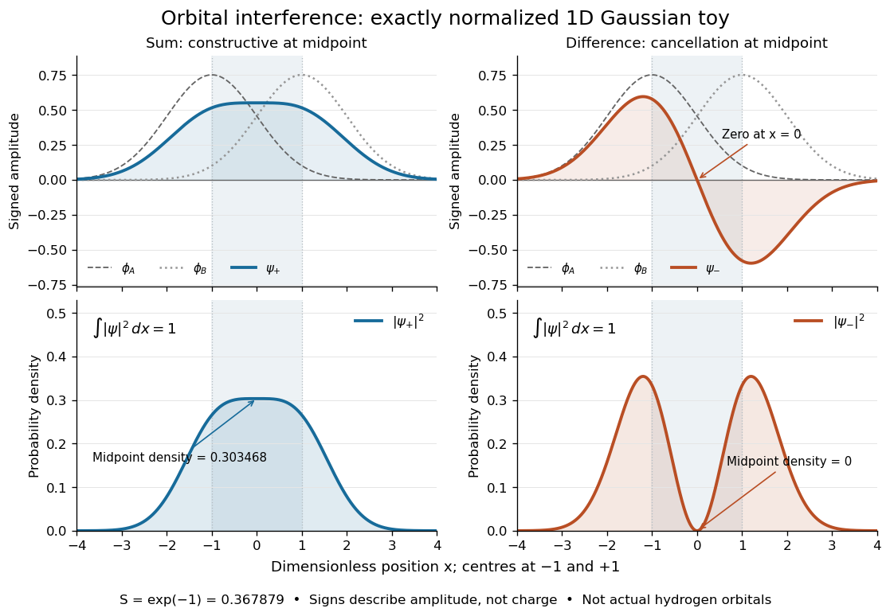
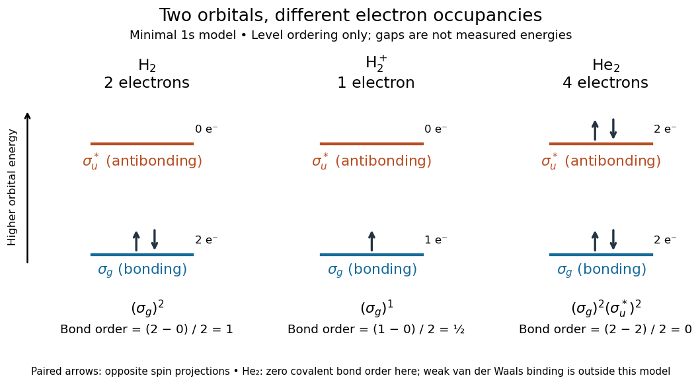

# Molecular orbital theory

↑ **Parent:** [Quantum chemistry](quantum-chemistry.md)  
ⓦ [Wiki](https://en.wikipedia.org/wiki/Molecular_orbital_theory)

[Molecular orbital theory](molecular-orbital-theory.md) describes the electronic arrangement of a [molecule](molecule-split.md) using [molecular orbitals](molecular-orbital.md): one-[electron](electron.md) spatial [wavefunctions](wave-function-split.md) extending over the combined [atomic nuclei](atomic-nucleus-split.md). Filling [bonding molecular orbitals](bonding-orbital.md) can stabilize a [chemical bond](chemical-bond-split.md); filling [antibonding molecular orbitals](antibonding-orbital.md) opposes that stabilization. A [molecular orbital](molecular-orbital.md) is a building block of a many-[electron](electron.md) description, rather than the entire many-[electron](electron.md) [wavefunction](wave-function-split.md). See [Robert W. Field, MIT 5.61, lecture 24, pp. 1–4: molecular orbitals and the LCAO approximation](https://ocw.mit.edu/courses/5-61-physical-chemistry-fall-2017/ef9da1132ff6233d732a1d6115099467_MIT5_61F17_lec24.pdf).

First make the [interference](interference-wave-propagation.md) visible with an exactly normalized one-dimensional toy. Replace the three-dimensional $1s$ [atomic orbitals](atomic-orbital.md) of the [hydrogen atom](hydrogen-atom.md) by two [Gaussian functions](gaussian-function.md) centred at $x=\pm a$, with [dimensionless](dimensionless-quantity.md) $x$ and $a>0$:

$$
\phi_A(x)=\pi^{-1/4}e^{-(x+a)^2/2},\qquad
\phi_B(x)=\pi^{-1/4}e^{-(x-a)^2/2},\qquad
S=\int_{-\infty}^{\infty}\phi_A\phi_B\,dx=e^{-a^2}.
$$

The normalized sum and difference are $\psi_\pm=(\phi_A\pm\phi_B)/\sqrt{2(1\pm S)}$, following the same [linear combination of atomic orbitals](linear-combination-of-atomic-orbitals.md) algebra. At $a=1$, the [orbital overlap](orbital-overlap.md) is $S=e^{-1}\approx0.367879$. At the midpoint, $\phi_A(0)=\phi_B(0)\approx0.455581$, giving

$$
\psi_+(0)\approx0.550879,\qquad |\psi_+(0)|^2\approx0.303468,\qquad
\psi_-(0)=|\psi_-(0)|^2=0.
$$

Both [probability densities](probability-density.md) have total [integral](integral-split.md) one: [interference](interference-wave-propagation.md) redistributes [probability](probability.md), rather than creating an extra [electron](electron.md). These are toy [wavefunctions](wave-function-split.md), not actual [hydrogen atom](hydrogen-atom.md) orbitals or predictions of [molecular hydrogen](molecular-hydrogen.md) [energies](energy-split.md).

**[Figure 3](#image-normalized-one-dimensional-gaussian-function-toy-signed-probability-amplitudes-add-or-cancel-before-their-squares-give-probability-densities). Normalized one-dimensional Gaussian function toy: signed probability amplitudes add or cancel before their squares give probability densities**. Centres at $x=-1$ and $x=1$ give [orbital overlap](orbital-overlap.md) $S=e^{-1}$. The difference has a zero at the midpoint; its negative lobe does not carry positive [electric charge](electric-charge-split.md). All density curves shown are normalized on the line, rather than in three-dimensional space.

Now fill the two $1s$-derived [molecular orbitals](molecular-orbital.md) in the minimal model. The lower [bonding molecular orbital](bonding-orbital.md) is labelled $\sigma_g$; the upper [antibonding molecular orbital](antibonding-orbital.md) is $\sigma_u^*$. The [Pauli exclusion principle](pauli-exclusion-principle.md) permits at most two [electrons](electron.md) in each spatial [molecular orbital](molecular-orbital.md), with opposite [spin](spin.md) projections along a chosen axis. For the lowest [electron configuration](electron-configuration.md) in this model, fill $\sigma_g$ first. The subscripts $g$ and $u$ denote [even](even-function.md) and [odd](odd-function.md) behaviour under inversion through the midpoint; the star marks an [antibonding molecular orbital](antibonding-orbital.md). See [Flowers et al., Chemistry 2e, 8.4: occupancy and bond order](https://openstax.org/books/chemistry-2e/pages/8-4-molecular-orbital-theory) and [Field, MIT 5.61, lecture 25, pp. 1–3: bonding, antibonding, and symmetry labels](https://ocw.mit.edu/courses/5-61-physical-chemistry-fall-2017/e9f9413400be87f6a0a512e757d52e3c_MIT5_61F17_lec25.pdf).

With $N_b$ [electrons](electron.md) in [bonding molecular orbitals](bonding-orbital.md) and $N_a$ in [antibonding molecular orbitals](antibonding-orbital.md), the model's [bond order](bond-order.md) is $b=(N_b-N_a)/2$. The three elementary counts are:
- [Molecular hydrogen](molecular-hydrogen.md), $\mathrm H_2$: two [electrons](electron.md) give $(\sigma_g)^2$ and $b=(2-0)/2=1$.
- The [hydrogen](hydrogen.md) molecular [ion](ion.md) $\mathrm H_2^+$: one [electron](electron.md) gives $(\sigma_g)^1$ and $b=(1-0)/2=1/2$.
- Two neutral [helium](helium.md) [chemical atoms](atom-physics.md), $\mathrm{He}_2$: four [electrons](electron.md) give $(\sigma_g)^2(\sigma_u^*)^2$ and $b=(2-2)/2=0$ in this minimal $1s$ model.

**[Figure 4](#image-schematic-molecular-orbital-occupancy-for-mathrm-h-2-mathrm-h-2-plus-and-mathrm-he-2-bond-orders-one-one-half-and-zero). Schematic molecular orbital occupancy for $\mathrm H_2$, $\mathrm H_2^+$, and $\mathrm{He}_2$: bond orders one, one half, and zero**. Each horizontal line is one spatial [molecular orbital](molecular-orbital.md); paired arrows represent opposite [spin](spin.md) projections. Vertical positions show ordering only, with arbitrary gaps rather than measured [energies](energy-split.md) or a common scale across species.

The zero [bond order](bond-order.md) says this minimal model gives no net [covalent bond](covalent-bond-split.md) for $\mathrm{He}_2$. It does not rule out every bound pair of [helium](helium.md) [chemical atoms](atom-physics.md): a very weak [Van der Waals force](van-der-waals-force.md) can bind a neutral [helium](helium.md) dimer, which has been observed experimentally. See [Zeller et al., Imaging the He2 quantum halo state using a free electron laser, PNAS 113, 14651–14655 (2016), p. 14651: van der Waals binding](https://www.atom.uni-frankfurt.de/publications/files/ZellerPNAS-2016.pdf) and [Luo et al., The weakest bond: Experimental observation of helium dimer, Journal of Chemical Physics 98, 3564–3567 (1993)](https://scholarworks.gvsu.edu/chm_articles/6/). The [bond order](bond-order.md) count does not include that weak binding mechanism.

The useful surprise is that sharing alone does not determine a [chemical bond](chemical-bond-split.md): the relative [quantum phase](quantum-phase.md) and the occupancy matter together. The same two shapes explain why adding an [electron](electron.md) to a [bonding molecular orbital](bonding-orbital.md) increases the model's [bond order](bond-order.md), while adding one to an [antibonding molecular orbital](antibonding-orbital.md) decreases it. [Molecular orbital theory](molecular-orbital-theory.md) also accounts for the unpaired [electrons](electron.md) and [paramagnetism](paramagnetism.md) of [molecular oxygen](molecular-oxygen.md), which its all-paired [Lewis structure](lewis-structure.md) misses. See [Chemistry 2e, 8.4: the molecular orbital description of oxygen](https://openstax.org/books/chemistry-2e/pages/8-4-molecular-orbital-theory).

**Table of contents**

- [Isolobal analogy](isolobal-analogy.md)
- [Molecular orbital correlation diagram](molecular-orbital-correlation-diagram.md)
- [s–p orbital mixing](s-p-orbital-mixing.md)
- [Hückel method](huckel-method.md)
  - [Cube nearest-neighbour Hückel model](cube-nearest-neighbour-huckel-model.md)
  - [Hückel square-to-trapezium distortion](huckel-square-to-trapezium-distortion.md)
  - [Coulson-Rushbrooke pairing theorem](coulson-rushbrooke-pairing-theorem.md)
  - [Hückel pi bond order](huckel-pi-bond-order.md)
  - [Hückel Coulomb parameter](huckel-coulomb-parameter.md)
  - [Hückel resonance integral](huckel-resonance-integral.md)
  - [Triangular three-site orbital model](triangular-three-site-orbital-model.md)
  - [Delocalization energy](delocalization-energy.md)
  - [Hückel orbital charge density](huckel-orbital-charge-density.md)
- [Molecular orbital](molecular-orbital.md)
  - [Frontier molecular orbital](frontier-molecular-orbital.md)
  - [Nonbonding molecular orbital](nonbonding-molecular-orbital.md)
  - [Open-shell frontier orbital convention](open-shell-frontier-orbital-convention.md)
  - [Singly occupied molecular orbital](singly-occupied-molecular-orbital.md)
  - [Nonbonding orbital](nonbonding-orbital.md)
  - [Molecular orbital diagram](molecular-orbital-diagram.md)
    - [Ammonia molecular orbital diagram](ammonia-molecular-orbital-diagram.md)
  - [Highest occupied molecular orbital](highest-occupied-molecular-orbital.md)
  - [Orbital degeneracy](orbital-degeneracy.md)
  - [Lowest unoccupied molecular orbital](lowest-unoccupied-molecular-orbital.md)
  - [Bonding orbital](bonding-orbital.md)
  - [Antibonding orbital](antibonding-orbital.md)
- [Linear combination of atomic orbitals](linear-combination-of-atomic-orbitals.md)
  - [Symmetry-adapted linear combination](symmetry-adapted-linear-combination.md)
    - [Tetrahedral s-orbital symmetry combinations](tetrahedral-s-orbital-symmetry-combinations.md)
  - [Orbital overlap](orbital-overlap.md)
- [Bond order](bond-order.md)

## ↑ Ancestors (3)

1. [Quantum chemistry](quantum-chemistry.md)
2. [Chemistry](chemistry-split.md)
3. [Codex Wiki](split.md)

## ← Incoming links (9)

- [Atomic orbital](atomic-orbital.md)
- [Bond order](bond-order.md)
- [Bond pair](bond-pair.md)
- [Bonding orbital](bonding-orbital.md)
- [Covalent bond](covalent-bond-split.md)
- [Crystal field theory](crystal-field-theory.md)
- [Lewis structure](lewis-structure.md)
- [Molecular orbital theory](molecular-orbital-theory.md)
- [Paramagnetism](paramagnetism.md)
