# Molecule

↑ **Parent:** [Chemistry](chemistry.md)  
ⓦ [Wiki](https://en.wikipedia.org/wiki/Molecule)

A [molecule](molecule.md), using the [International Union of Pure and Applied Chemistry](chemistry-author.md#international-union-of-pure-and-applied-chemistry) (IUPAC) convention, is an electrically neutral entity containing two or more [chemical atoms](physics.md#atom-physics). Its constituents form a bound unit through [chemical bonds](chemical-bond.md); merely drawing a boundary around neighboring particles does not make a [molecule](molecule.md). The neutrality requirement concerns total [electric charge](electric-charge.md), not the absence of internal charge separation: [water](chemical-substance.md#water) is a [polar molecule](physical-chemistry.md#polar-molecule) with zero total [electric charge](electric-charge.md).[Gold Book, fifth edition, molecule: neutral entity with more than one atom; bound-state qualification](chemistry-bibliography.md#iupac-compendium-of-chemical-terminology-fifth-edition-gold-book-by-international-union-of-pure-and-applied-chemistry/molecule)

One [water](chemical-substance.md#water) [molecule](molecule.md), $\mathrm{H_2O}$, contains two [hydrogen](chemical-substance.md#hydrogen) and one [oxygen](chemical-substance.md#oxygen) [chemical atom](physics.md#atom-physics). One [molecular oxygen](chemical-substance.md#molecular-oxygen) [molecule](molecule.md), $\mathrm{O_2}$, contains two [oxygen](chemical-substance.md#oxygen) [chemical atoms](physics.md#atom-physics); a [molecule](molecule.md) need not contain different [chemical elements](chemical-substance.md#chemical-element). One [carbon dioxide](chemical-substance.md#carbon-dioxide) [molecule](molecule.md), $\mathrm{CO_2}$, contains one [carbon](chemical-substance.md#carbon) and two [oxygen](chemical-substance.md#oxygen) [chemical atoms](physics.md#atom-physics). The [molecular formula](chemical-substance.md#molecular-formula) records these inventories, while [molecular geometry](#molecular-geometry) describes their arrangement. [Water](chemical-substance.md#water) and [carbon dioxide](chemical-substance.md#carbon-dioxide) are [chemical compounds](chemical-substance.md#chemical-compound); [molecular oxygen](chemical-substance.md#molecular-oxygen) is a form of one [chemical element](chemical-substance.md#chemical-element).

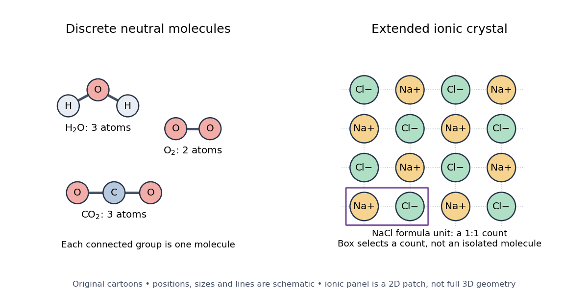

**[Figure 1](#image-molecules-and-extended-ionic-arrangement). Discrete neutral molecules versus an extended ionic crystal**. Original explanatory cartoons of [water](chemical-substance.md#water), [molecular oxygen](chemical-substance.md#molecular-oxygen), [carbon dioxide](chemical-substance.md#carbon-dioxide), and a patch of [sodium chloride](chemical-substance.md#sodium-chloride). The right panel uses a two-dimensional alternating arrangement to explain counting, not the full three-dimensional [ionic crystal](ionic-bonding.md#ionic-crystal). Dotted neighbor guides are not localized [covalent bonds](covalent-bond.md); the box selects a $1:1$ count without isolating a [molecule](molecule.md). Neither panel is a measured molecular image; positions, sizes, and connections are schematic.

Ordinary crystalline [sodium chloride](chemical-substance.md#sodium-chloride), $\mathrm{NaCl}$, contains an extended arrangement of [sodium](chemical-substance.md#sodium) [cations](chemistry.md#cation) $\mathrm{Na^+}$ and [chlorine](chemical-substance.md#chlorine) [anions](chemistry.md#anion) $\mathrm{Cl^-}$. Its [formula unit](chemical-substance.md#formula-unit) specifies one of each for compositional accounting, without selecting a unique isolated pair. Bulk neutrality therefore does not imply a material consists of neutral [molecules](molecule.md). This statement concerns the [ionic crystal](ionic-bonding.md#ionic-crystal); the physical state and conditions matter when deciding what particles a [chemical formula](chemical-substance.md#chemical-formula) represents.[Ionic Compounds: NaCl composition and the absence of discrete molecules in the ordinary crystal](chemistry-bibliography.md#chemistry-2e-by-paul-flowers-and-others/2-6-ionic-and-molecular-compounds)

A [polyatomic ion](chemistry.md#polyatomic-ion) is a charged bound group of [chemical atoms](physics.md#atom-physics), such as [hydronium](chemistry.md#hydronium), $\mathrm{H_3O^+}$. A [molecular ion](chemistry.md#molecular-ion) formed by removing an [electron](physics.md#electron) from intact [water](chemical-substance.md#water), $\mathrm{H_2O^{\bullet+}}$, retains the same atom inventory but has net [electric charge](electric-charge.md) $+e$. Neither satisfies the neutral-[molecule](molecule.md) definition. Distinguishing these entities makes [molecular count and amount of substance](chemical-reaction.md#molecular-count-and-amount-of-substance) and [mass spectrometry](chemistry.md#mass-spectrometry) interpretable: say whether the count is of [chemical atoms](physics.md#atom-physics), neutral [molecules](molecule.md), [ions](chemistry.md#ion), or [formula units](chemical-substance.md#formula-unit).

The useful surprise is that a [molecule](molecule.md) can be treated as one particle for motion and counting while retaining internal structure. Its [molar mass](chemistry.md#molar-mass) connects a particle inventory to bulk [mass](classical-mechanics.md#mass); [molecular rotation](#molecular-rotation) and [molecular vibration](#molecular-vibration) reveal internal organization. The [continuum approximation](continuum-mechanics.md#continuum-approximation) uses bulk fields in place of individual molecular positions and motions.

**Table of contents**

- [Oligomer](#oligomer)
- [Dimer](#dimer)
- [Side chain](#side-chain)
- [Heterocyclic compound](#heterocyclic-compound)
  - [Aminopyridine](#aminopyridine)
  - [Indole](#indole)
  - [Bipyridine](#bipyridine)
  - [Imidazolium](#imidazolium)
  - [Isocyanoacetate pyrrole synthesis](#isocyanoacetate-pyrrole-synthesis)
  - [Pyrone-to-pyridone conversion](#pyrone-to-pyridone-conversion)
  - [1,3,4-Oxadiazole](#1-3-4-oxadiazole)
  - [Thiazole](#thiazole)
  - [Isoxazolidine](#isoxazolidine)
  - [Isoquinoline](#isoquinoline)
  - [Pyrazole](#pyrazole)
  - [Sydnone](#sydnone)
  - [Triazolide](#triazolide)
  - [Thiirane](#thiirane)
    - [Thiocyanate-mediated thiirane inversion](#thiocyanate-mediated-thiirane-inversion)
  - [Pyrone](#pyrone)
  - [1,3-Dioxane](#1-3-dioxane)
  - [2-Oxazoline](#2-oxazoline)
- [Aromaticity](#aromaticity)
  - [Arene](#arene)
  - [Hückel's rule](#huckel-s-rule)
  - [Aromatic ring](#aromatic-ring)
- [Iron-sulfur cluster](#iron-sulfur-cluster)
- [Reactive oxygen species](#reactive-oxygen-species)
  - [Superoxide](#superoxide)
- [Uridine](#uridine)
- [4-thiouridine](#4-thiouridine)
- [N6-methyladenosine](#n6-methyladenosine)
- [Molecular dynamics](#molecular-dynamics)
- [Macromolecule](#macromolecule)
- [Molecule bookkeeping](#molecule-bookkeeping)
- [Single-molecule experiment](#single-molecule-experiment)
  - [Single-molecule force spectroscopy](#single-molecule-force-spectroscopy)
    - [Force clamp](#force-clamp)
    - [Cantilever compliance correction](#cantilever-compliance-correction)
  - [Single-molecule absorption in a molecular crystal](#single-molecule-absorption-in-a-molecular-crystal)
- [Molecular rotation](#molecular-rotation)
  - [Vibration-rotation interaction](#vibration-rotation-interaction)
    - [Polyatomic vibration-rotation interaction](#polyatomic-vibration-rotation-interaction)
  - [Rigid rotor](#rigid-rotor)
    - [Rotational line spacing and diatomic bond length](#rotational-line-spacing-and-diatomic-bond-length)
    - [Planar rigid rotor](#planar-rigid-rotor)
    - [Rotational energy](#rotational-energy)
      - [Rotational angular momentum](#rotational-angular-momentum)
    - [Rotational symmetry number](#rotational-symmetry-number)
    - [Linear rigid rotor](#linear-rigid-rotor)
      - [Rotational temperature](#rotational-temperature)
      - [Rotational constant](#rotational-constant)
      - [Pure rotational electric-dipole selection rules](#pure-rotational-electric-dipole-selection-rules)
      - [Isotope shift of a linear rotor](#isotope-shift-of-a-linear-rotor)
    - [Centrifugal distortion](#centrifugal-distortion)
  - [Rotational spectroscopy](#rotational-spectroscopy)
    - [Rotational spectrum](#rotational-spectrum)
    - [Symmetric-top rotational spectrum](#symmetric-top-rotational-spectrum)
    - [Rotational spectral line assignment](#rotational-spectral-line-assignment)
    - [Rotational state populations](#rotational-state-populations)
      - [Most populated rotational level](#most-populated-rotational-level)
    - [Molecular structure from rotational constants](#molecular-structure-from-rotational-constants)
    - [Rotational Raman spectroscopy](#rotational-raman-spectroscopy)
    - [Fourier transform microwave spectroscopy](#fourier-transform-microwave-spectroscopy)
      - [NIST trace-gas FTMW validation experiment](#nist-trace-gas-ftmw-validation-experiment)
      - [Rotational monitoring of deuterium exchange](#rotational-monitoring-of-deuterium-exchange)
- [Linear molecule](#linear-molecule)
  - [Diatomic molecule](#diatomic-molecule)
    - [Lithium beryllium diatomic molecule](#lithium-beryllium-diatomic-molecule)
    - [Lithium dimer](#lithium-dimer)
    - [Helium dimer](#helium-dimer)
    - [Beryllium dimer](#beryllium-dimer)
    - [Homonuclear diatomic molecule](#homonuclear-diatomic-molecule)
      - [Spin isomers of hydrogen](#spin-isomers-of-hydrogen)
        - [Ortho-para conversion](#ortho-para-conversion)
          - [Ortho-para conversion heat](#ortho-para-conversion-heat)
        - [Frozen ortho-para mixture](#frozen-ortho-para-mixture)
        - [Parahydrogen](#parahydrogen)
        - [Orthohydrogen](#orthohydrogen)
        - [Normal hydrogen](#normal-hydrogen)
        - [Rotational partition functions of hydrogen](#rotational-partition-functions-of-hydrogen)
          - [Hydrogen rotational heat capacity](#hydrogen-rotational-heat-capacity)
        - [Heat released by hydrogen spin conversion](#heat-released-by-hydrogen-spin-conversion)
        - [Surface-catalysed hydrogen spin conversion experiment](#surface-catalysed-hydrogen-spin-conversion-experiment)
- [Molecular vibration](#molecular-vibration)
  - [Vibrational relaxation](#vibrational-relaxation)
  - [Molecular normal coordinate](#molecular-normal-coordinate)
  - [Spectroscopic anharmonicity constant](#spectroscopic-anharmonicity-constant)
  - [Equivalent-mode harmonic coupling](#equivalent-mode-harmonic-coupling)
  - [Vibronic coupling](#vibronic-coupling)
    - [Vibrational activation of an electronic transition](#vibrational-activation-of-an-electronic-transition)
  - [Vibronic state](#vibronic-state)
  - [Vibrational angular momentum](#vibrational-angular-momentum)
  - [Rovibrational spectroscopy](#rovibrational-spectroscopy)
    - [Perpendicular rovibrational band](#perpendicular-rovibrational-band)
    - [Parallel rovibrational band](#parallel-rovibrational-band)
    - [R branch](#r-branch)
    - [Q branch](#q-branch)
    - [P branch](#p-branch)
    - [Rovibrational spectrum](#rovibrational-spectrum)
  - [Hot band](#hot-band)
  - [Vibrational fundamental](#vibrational-fundamental)
  - [Vibrational heat capacity of a diatomic gas](#vibrational-heat-capacity-of-a-diatomic-gas)
  - [Diatomic bond stretch](#diatomic-bond-stretch)
    - [Bond force constant](#bond-force-constant)
    - [Harmonic vibrational energy levels](#harmonic-vibrational-energy-levels)
    - [HCl and DCl harmonic stretch comparison](#hcl-and-dcl-harmonic-stretch-comparison)
  - [Vibrational infrared activity](#vibrational-infrared-activity)
  - [University of Florida HCl and DCl FTIR experiment](#university-of-florida-hcl-and-dcl-ftir-experiment)
  - [Vibrational overtone](#vibrational-overtone)
- [Molecular geometry](#molecular-geometry)
  - [Fluxionality](#fluxionality)
  - [Polyhedral cluster](#polyhedral-cluster)
    - [Zintl cluster](#zintl-cluster)
    - [Arachno cluster](#arachno-cluster)
    - [Nido cluster](#nido-cluster)
    - [Closo cluster](#closo-cluster)
  - [Spiro compound](#spiro-compound)
    - [Spirodienone](#spirodienone)
  - [Trigonal-bipyramidal molecular geometry](#trigonal-bipyramidal-molecular-geometry)
  - [Trigonal planar molecular geometry](#trigonal-planar-molecular-geometry)
  - [Ring fusion](#ring-fusion)
  - [Square-pyramidal molecular geometry](#square-pyramidal-molecular-geometry)
  - [Square planar molecular geometry](#square-planar-molecular-geometry)
  - [Octahedral molecular geometry](#octahedral-molecular-geometry)
  - [Bond angle](#bond-angle)
  - [Tetrahedral molecular geometry](#tetrahedral-molecular-geometry)
  - [Trigonal pyramidal molecular geometry](#trigonal-pyramidal-molecular-geometry)
  - [Bent molecular geometry](#bent-molecular-geometry)
  - [Gas electron diffraction](#gas-electron-diffraction)
- [Nucleoside](#nucleoside)
  - [Thymidine](#thymidine)
  - [Bromodeoxyuridine](#bromodeoxyuridine)
  - [Inosine](#inosine)
  - [Adenosine](#adenosine)
- [Nucleotide](#nucleotide)
  - [Nucleotide exchange](#nucleotide-exchange)
  - [Nucleotide sugar](#nucleotide-sugar)
    - [UDP-glucuronic acid](#udp-glucuronic-acid)
    - [CMP-sialic acid](#cmp-sialic-acid)
    - [ADP-glucose](#adp-glucose)
    - [GDP-fucose](#gdp-fucose)
    - [GDP-mannose](#gdp-mannose)
    - [UDP-N-acetylglucosamine](#udp-n-acetylglucosamine)
    - [UDP-galactose](#udp-galactose)
    - [UDP-glucose](#udp-glucose)
  - [(p)ppGpp](#p-ppgpp)
  - [Nucleoside triphosphate](#nucleoside-triphosphate)
  - [Ribonucleotide](#ribonucleotide)
  - [Guanosine diphosphate](#guanosine-diphosphate)
  - [Adenosine triphosphate](#adenosine-triphosphate)
  - [Adenosine diphosphate](#adenosine-diphosphate)
  - [Adenosine monophosphate](#adenosine-monophosphate)
  - [Guanosine triphosphate](#guanosine-triphosphate)
- [Nucleotide base](#nucleotide-base)
  - [Purine](#purine)
  - [Hypoxanthine](#hypoxanthine)
  - [Adenine](#adenine)
  - [Guanine](#guanine)
  - [Cytosine](#cytosine)
  - [Thymine](#thymine)
  - [Uracil](#uracil)
- [Molecular mass](#molecular-mass)

## Oligomer

↑ **Parent:** [Molecule](molecule.md)

A [molecule](molecule.md) consisting of a small number of linked monomer units.

## Dimer

↑ **Parent:** [Molecule](molecule.md)

An assembly of two molecular subunits.

## Side chain

↑ **Parent:** [Molecule](molecule.md)

## Heterocyclic compound

↑ **Parent:** [Molecule](molecule.md)

### Aminopyridine

↑ **Parent:** [Heterocyclic compound](#heterocyclic-compound)

A [pyridine](chemical-substance.md#pyridine) bearing an amino substituent; its NH donors and ring-N acceptor permit complementary [hydrogen](chemical-substance.md#hydrogen) bonding.

### Indole

↑ **Parent:** [Heterocyclic compound](#heterocyclic-compound)

A fused benzene–pyrrole heteroaromatic ring system. Electrophilic substitution normally favours C3; when that position is occupied, C2 substitution can retain the pyrrolic [nitrogen](chemical-substance.md#nitrogen)–hydrogen bond.

### Bipyridine

↑ **Parent:** [Heterocyclic compound](#heterocyclic-compound)

A compound containing two joined [pyridine](chemical-substance.md#pyridine) rings; 2,2′-bipyridine is a common bidentate nitrogen ligand.

### Imidazolium

↑ **Parent:** [Heterocyclic compound](#heterocyclic-compound)

The [cation](chemistry.md#cation) obtained by protonation or suitable N-alkylation of [imidazole](chemical-substance.md#imidazole).

### Isocyanoacetate pyrrole synthesis

↑ **Parent:** [Heterocyclic compound](#heterocyclic-compound)

Assembly of a pyrrole by carbon-nucleophile addition of an isocyanoacetate to an activated unsaturated partner, ring closure at isocyanide carbon and aromatization.

### Pyrone-to-pyridone conversion

↑ **Parent:** [Heterocyclic compound](#heterocyclic-compound)

Replacement of the ring oxygen of an activated pyrone by nitrogen through nucleophilic addition, ring opening and reclosure. Atom mapping distinguishes it from simple side-chain amidation.

<h3 id="1-3-4-oxadiazole">1,3,4-Oxadiazole</h3>

↑ **Parent:** [Heterocyclic compound](#heterocyclic-compound)

A five-membered aromatic ring with one oxygen and two adjacent nitrogens. Cyclodehydration of a diacylhydrazine is a useful synthesis.

### Thiazole

↑ **Parent:** [Heterocyclic compound](#heterocyclic-compound)

A five-membered aromatic ring with sulfur at position 1 and nitrogen at position 3.

### Isoxazolidine

↑ **Parent:** [Heterocyclic compound](#heterocyclic-compound)

A saturated five-membered ring containing adjacent oxygen and nitrogen atoms.

### Isoquinoline

↑ **Parent:** [Heterocyclic compound](#heterocyclic-compound)

A fused bicyclic aromatic heterocycle with nitrogen at position 2.

### Pyrazole

↑ **Parent:** [Heterocyclic compound](#heterocyclic-compound)

A five-membered aromatic ring containing two adjacent nitrogen atoms.

### Sydnone

↑ **Parent:** [Heterocyclic compound](#heterocyclic-compound)

A mesoionic five-membered heterocycle that can undergo [cycloaddition](chemical-reaction.md#cycloaddition) and carbon-dioxide extrusion to form a [pyrazole](#pyrazole).

### Triazolide

↑ **Parent:** [Heterocyclic compound](#heterocyclic-compound)

The conjugate base of a triazole NH group.

### Thiirane

↑ **Parent:** [Heterocyclic compound](#heterocyclic-compound)

A saturated three-membered ring containing [sulfur](chemical-substance.md#sulfur) and two [carbons](chemical-substance.md#carbon). Its strained [carbon](chemical-substance.md#carbon)–[sulfur](chemical-substance.md#sulfur) bonds can undergo nucleophilic opening.

#### Thiocyanate-mediated thiirane inversion

↑ **Parent:** [Thiirane](#thiirane)

Sequential ring opening, five-membered cyclic imidodithiocarbonate formation, cleavage and reclosure can exchange the [thiirane](#thiirane) [sulfur](chemical-substance.md#sulfur) with the [thiocyanate](chemical-substance.md#thiocyanate) [sulfur](chemical-substance.md#sulfur). Backside substitution at both ring [carbons](chemical-substance.md#carbon) reverses the [thiirane](#thiirane) face while leaving remote stereocentres intact.

### Pyrone

↑ **Parent:** [Heterocyclic compound](#heterocyclic-compound)

A six-membered [oxygen](chemical-substance.md#oxygen) [heterocycle](#heterocyclic-compound) containing an exocyclic [carbonyl](chemical-bond.md#carbonyl-group). A charge-separated contributor with [carbonyl](chemical-bond.md#carbonyl-group) [oxygen](chemical-substance.md#oxygen) negative and a pyrylium-like ring clarifies why aromatic character is weaker and more polarized than in [benzene](chemical-substance.md#benzene).

<h3 id="1-3-dioxane">1,3-Dioxane</h3>

↑ **Parent:** [Heterocyclic compound](#heterocyclic-compound)

[1,3-Dioxane](#1-3-dioxane) is a six-membered ring with [oxygen](chemical-substance.md#oxygen) at positions 1 and 3. It commonly adopts [chair conformations](stereochemistry.md#chair-conformation). Axial substituent penalties differ sharply between C2 and C5 because the relevant 1,3 contacts involve different ring atoms.

### 2-Oxazoline

↑ **Parent:** [Heterocyclic compound](#heterocyclic-compound)

A [2-Oxazoline](#2-oxazoline) has the five-membered ring $\mathrm{O{-}C{=}N{-}CH_2{-}CH_2}$. A substituent at its imine [carbon](chemical-substance.md#carbon) can be introduced by aromatic capture of an activated cyclic [carbamate](chemical-substance.md#carbamate).

## Aromaticity

↑ **Parent:** [Molecule](molecule.md)  
ⓦ [Wiki](https://en.wikipedia.org/wiki/Aromaticity)

[Aromaticity](#aromaticity) describes the distinctive stability and associated electronic properties of suitable cyclic delocalized systems. In simple planar conjugated rings, orbital occupancy determines whether delocalization is stabilizing; merely drawing a ring is insufficient.

### Arene

↑ **Parent:** [Aromaticity](#aromaticity)

An aromatic hydrocarbon; the term is also commonly used for the carbocyclic aromatic donor portion of an organometallic [arene](#arene) complex.

<h3 id="huckel-s-rule">Hückel's rule</h3>

↑ **Parent:** [Aromaticity](#aromaticity)

A monocyclic, approximately planar, continuously conjugated pi system with $4n+2$ pi [electrons](physics.md#electron) has a closed-shell aromatic configuration in the elementary Hückel model, where $n$ is a [nonnegative integer](arithmetic.md#natural-number). Fused systems and [heterocycles](#heterocyclic-compound) require a specified orbital and [resonance](covalent-bond.md#resonance-chemistry) description rather than counting every drawn [double bond](covalent-bond.md#double-bond) in each polygon.

### Aromatic ring

↑ **Parent:** [Aromaticity](#aromaticity)

## Iron-sulfur cluster

↑ **Parent:** [Molecule](molecule.md)

An assembly containing [iron](chemical-substance.md#iron) and sulfur, incorporated into some [proteins](protein.md) as a functional cofactor. Its synthesis and insertion can require dedicated maturation machinery.

## Reactive oxygen species

↑ **Parent:** [Molecule](molecule.md)

[Reactive oxygen species](#reactive-oxygen-species) include oxygen-derived reactive species with different chemical and electronic properties. Their generation, detoxification and damage pathways should not be treated as one universal reaction.

### Superoxide

↑ **Parent:** [Reactive oxygen species](#reactive-oxygen-species)

The radical anion $\mathrm{O}_2^{\bullet-}$. Its production, reactivity and localization differ from those of [hydrogen peroxide](chemical-substance.md#hydrogen-peroxide); the two should not be treated as an interchangeable oxidant measurement.

## Uridine

↑ **Parent:** [Molecule](molecule.md)

## 4-thiouridine

↑ **Parent:** [Molecule](molecule.md)

A sulfur-containing [uridine](#uridine) analogue used in [metabolic RNA labelling](biology.md#metabolic-rna-labelling). Its incorporation and chemical conversion allow labelled molecules to be distinguished from older [RNA](polymer.md#ribonucleic-acid).

## N6-methyladenosine

↑ **Parent:** [Molecule](molecule.md)

An [adenosine](#adenosine) modification bearing a methyl group on the exocyclic N6 nitrogen. Its presence can alter recognition by an [RNA-binding protein](protein.md#rna-binding-protein) directly or through [RNA secondary structure](polymer.md#rna-secondary-structure).

## Molecular dynamics

↑ **Parent:** [Molecule](molecule.md)

[molecular dynamics](#molecular-dynamics) simulates time evolution of a molecular system using a chosen interaction model. Simulated pathways and state populations require adequate sampling and validation against measured observables; a plausible trajectory alone does not establish a biological mechanism.

## Macromolecule

↑ **Parent:** [Molecule](molecule.md)  
ⓦ [Wiki](https://en.wikipedia.org/wiki/Macromolecule)

A [molecule](molecule.md) with a high [relative molecular mass](chemistry.md#relative-molecular-mass), typically built from many smaller units joined by [covalent bonds](covalent-bond.md). [Proteins](protein.md) and [nucleic acids](polymer.md#nucleic-acid) are examples. In [dialysis](biochemistry.md#dialysis-biochemistry), a [semipermeable membrane](cell-membrane.md#semipermeable-membrane) can retain these large [molecules](molecule.md) while smaller [solutes](mixture.md#solute) diffuse through.

## Molecule bookkeeping

↑ **Parent:** [Molecule](molecule.md)

Four [water](chemical-substance.md#water) [molecules](molecule.md) contain eight [hydrogen](chemical-substance.md#hydrogen) and four [oxygen](chemical-substance.md#oxygen) [chemical atoms](physics.md#atom-physics), twelve constituent [chemical atoms](physics.md#atom-physics) altogether. Counting the constituents does not mean they have been separated by breaking [chemical bonds](chemical-bond.md). The same sample has different counts because the specified entities differ.

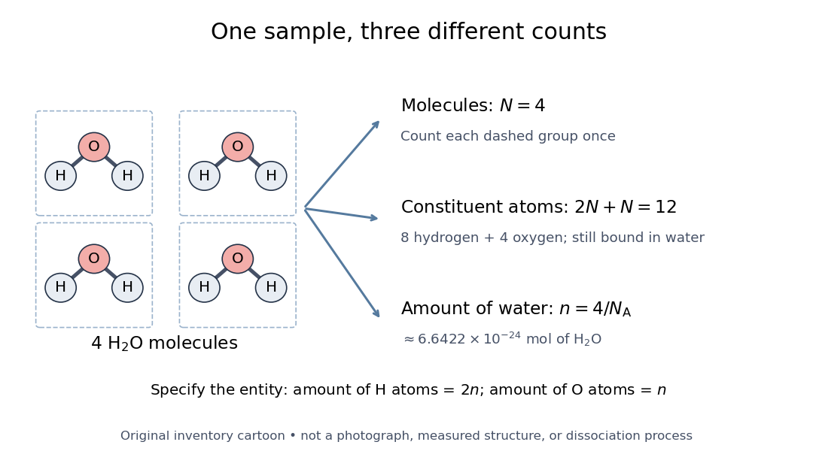

**[Figure 2](#image-molecule-atom-and-amount-bookkeeping). One water sample: molecule, constituent chemical atom, and amount of substance bookkeeping**. An original four-[molecule](molecule.md) inventory cartoon, not a measurement or a [chemical reaction](chemical-reaction.md). Dashed boundaries identify whole [water](chemical-substance.md#water) [molecules](molecule.md); each contains two [hydrogen](chemical-substance.md#hydrogen) and one [oxygen](chemical-substance.md#oxygen) [chemical atom](physics.md#atom-physics). All three counts describe the same bound sample. The [amount of substance](physics.md#amount-of-substance) uses the exact [Avogadro constant](physics.md#avogadro-constant); the displayed decimal is rounded.

For $N$ [water](chemical-substance.md#water) [molecules](molecule.md), their [amount of substance](physics.md#amount-of-substance) is $n=N/N_{\mathrm A}$, while the constituent [hydrogen](chemical-substance.md#hydrogen) and [oxygen](chemical-substance.md#oxygen) inventories correspond to $2n$ and $n$ respectively. The exact [Avogadro constant](physics.md#avogadro-constant) is $N_{\mathrm A}=6.02214076\times10^{23}\,\mathrm{mol^{-1}}$. The [mole](physics.md#mole-unit) applies to specified entities, including [chemical atoms](physics.md#atom-physics), [molecules](molecule.md), and [ions](chemistry.md#ion).[SI base unit: mole, definition and the requirement to specify the elementary entity](chemistry-bibliography.md#si-base-unit-mole-by-bureau-international-des-poids-et-mesures) Thus four [water](chemical-substance.md#water) [molecules](molecule.md) correspond to approximately $6.6422\times10^{-24}\,\mathrm{mol}$ of [water](chemical-substance.md#water), but twice that [amount of substance](physics.md#amount-of-substance) of constituent [hydrogen](chemical-substance.md#hydrogen) [chemical atoms](physics.md#atom-physics). A macroscopic conversion through measured [mass](classical-mechanics.md#mass) additionally needs the relevant [molar mass](chemistry.md#molar-mass), as in [water mass to molecular count](chemistry.md#water-mass-to-molecular-count).

## Single-molecule experiment

↑ **Parent:** [Molecule](molecule.md)  
ⓦ [Wiki](https://en.wikipedia.org/wiki/Single-molecule_experiment)

A [single-molecule experiment](#single-molecule-experiment) resolves a response attributable to an individual [molecule](molecule.md), rather than only an average over many [molecules](molecule.md). Optical detection need not resolve its constituent [chemical atoms](physics.md#atom-physics) in an image: repeated [photon absorption](quantum-mechanics.md#photon-absorption) by the same [molecule](molecule.md) can produce a measurable response. One detected [photon](quantum-mechanics.md#photon) is not automatically one different [molecule](molecule.md).

The measured channel matters. Direct [photon absorption](quantum-mechanics.md#photon-absorption) detection measures a change in transmitted light. [Fluorescence](fluorescence.md) detection collects [photons](quantum-mechanics.md#photon) emitted after excitation; a [fluorescence excitation spectrum](fluorescence.md#fluorescence-excitation-spectrum) varies the illuminating [frequency](wave.md#frequency) while observing that emission. Both can probe excitation, but their backgrounds and readouts differ. A labeled particle cartoon explains the interpretation; it supplies no experimental evidence by itself.

Such measurements expose differences that a population average can conceal. Suppose two groups of [molecules](molecule.md) switch between different internal [quantum states](quantum-system.md#quantum-state). Their average response could vary smoothly even though each [molecule](molecule.md) changes in discrete steps. Resolving an individual response tests that interpretation directly, subject to the measurement's time resolution, sensitivity, and particle assignment. The following experiment makes that assignment through spectral selection and controlled perturbations.

### Single-molecule force spectroscopy

↑ **Parent:** [Single-molecule experiment](#single-molecule-experiment)

Measure the [force](force.md) and extension of an individual molecular tether under controlled displacement or load. A calibrated cantilever or [optical trap](optics.md#optical-tweezers) converts deflection to [force](force.md). Synthetic [polymer](polymer.md) stretching provides a nonbiological application; the observed curve also contains instrument and attachment compliance, and its loading-rate dependence can distinguish [equilibrium](dynamical-systems.md#equilibrium-point-of-a-dynamical-system) elasticity from activated events.

#### Force clamp

↑ **Parent:** [Single-molecule force spectroscopy](#single-molecule-force-spectroscopy)

A measurement protocol that holds applied [force](force.md) approximately constant while allowing displacement to vary. Feedback can adjust an actuator in response to a calibrated load signal; alternatively, a passive field gradient can be sufficiently uniform over the displacement range. Finite feedback bandwidth, drift and spatial force variation limit the approximation. This differs from fixing actuator position or prescribing a force ramp.

#### Cantilever compliance correction

↑ **Parent:** [Single-molecule force spectroscopy](#single-molecule-force-spectroscopy)

For a simple single-tether geometry, imposed displacement $Z$ divides into cantilever deflection $d$ and molecular extension $x$. Applying the displayed correction prevents attributing the instrument's stretch to the molecule. Geometric offsets, handles and substrate compliance require additional calibrated terms.

### Single-molecule absorption in a molecular crystal

↑ **Parent:** [Single-molecule experiment](#single-molecule-experiment)

In 1989, [William E. Moerner](chemistry.md#william-e-moerner) and [Lothar Kador](physicist.md#lothar-kador) reported individual [pentacene](chemical-substance.md#pentacene) absorbers in [para-terphenyl](chemical-substance.md#para-terphenyl) in [Optical detection and spectroscopy of single molecules in a solid by W. E. Moerner and L. Kador](chemistry-bibliography.md#optical-detection-and-spectroscopy-of-single-molecules-in-a-solid-by-w-e-moerner-and-l-kador) (pp. 2535–2538). Different local environments spread [photon absorption](quantum-mechanics.md#photon-absorption) [frequencies](wave.md#frequency); tuning into the sparse wings selected few resonant [molecules](molecule.md) despite many [molecules](molecule.md) in the illuminated volume.

Their tunable dye [laser](laser.md) focused through a $0.85$ [numerical aperture](point-spread-function.md#numerical-aperture) lens onto a $100$–$200\,\mathrm{\mu m}$ crystal immersed in [superfluid](statistical-physics.md#superfluid) [helium](chemical-substance.md#helium) at $1.6\,\mathrm K$. [Frequency modulation](electrical-engineering.md#frequency-modulation) accompanied either a $5\,\mathrm{kHz}$ [electric field](electric-field.md) between coated sapphire disks, detected at $10\,\mathrm{kHz}$, or a $2\,\mathrm{MHz}$ [quartz](chemical-substance.md#quartz) shear transducer. An avalanche [photodiode](optical-instrument.md#photodiode) measured transmitted-light [photon absorption](quantum-mechanics.md#photon-absorption), not [fluorescence](fluorescence.md). Double modulation suppressed residual [laser](laser.md) amplitude background.[pp. 2535–2537: sample, lens, dye laser, FM/Stark and FM/ultrasound apparatus and detection](chemistry-bibliography.md#optical-detection-and-spectroscopy-of-single-molecules-in-a-solid-by-w-e-moerner-and-l-kador)

Repeated scans gave the predicted modulated line shape. Blank crystals and off-resonance scans gave background; changing modulation [frequency](wave.md#frequency) expanded and contracted the feature as predicted. Agreement between both perturbation methods supported the individual-absorber inference. The authors acknowledged out-of-focus [molecules](molecule.md) and the unlikely alternative of multiple absorbers with exactly coincident [frequencies](wave.md#frequency).[Fig. 1(d–g), Fig. 2(b–g), and pp. 2537–2538: blanks, modulation-frequency changes, background and coincident-absorber qualification](chemistry-bibliography.md#optical-detection-and-spectroscopy-of-single-molecules-in-a-solid-by-w-e-moerner-and-l-kador)

This is evidence for a selected absorber in a prepared, known [chemical substance](chemical-substance.md) and host. It does not establish arbitrary unknown [molecule](molecule.md) identity from one spectral feature, provide an atom-resolved photograph, or count every [molecule](molecule.md) in the crystal. A measurement sensitive to only a narrow excitation range cannot detect a [molecule](molecule.md) whose transition lies outside that range. This distinction separates the total particle inventory from the number responding to a particular probe.

## Molecular rotation

↑ **Parent:** [Molecule](molecule.md)

[Molecular rotation](#molecular-rotation) changes a [molecule](molecule.md)'s orientation. Its [rotational kinetic energy](energy.md#rotational-kinetic-energy) depends on the arrangement and [masses](classical-mechanics.md#mass) of its [chemical atoms](physics.md#atom-physics). A [rigid rotor](#rigid-rotor) freezes internal distances to isolate this motion; [rotational spectroscopy](#rotational-spectroscopy) tests the resulting [energy eigenvalues](energy-eigenvalue.md) through transitions between [quantum states](quantum-system.md#quantum-state). The [molecular beam electric resonance](electronegativity.md#molecular-beam-electric-resonance) experiment provides a complementary probe of the coupling to an [electric field](electric-field.md).

### Vibration-rotation interaction

↑ **Parent:** [Molecular rotation](#molecular-rotation)

The dependence of rotational energy on the vibrational state. For a diatomic molecule a common leading approximation is $B_v=B_e-\alpha_e(v+1/2)$, so vibrational satellites can have different rotational line spacings.

#### Polyatomic vibration-rotation interaction

↑ **Parent:** [Vibration-rotation interaction](#vibration-rotation-interaction)

The first-order dependence of a polyatomic [rotational constant](#rotational-constant) on vibrational occupations $v_i$, where $d_i$ is the degeneracy of [normal mode](wave-equation.md#normal-mode) $i$. The factor $d_i/2$ accounts for all of that mode's [zero-point energy](quantum-harmonic-oscillator.md#zero-point-energy). A single band's change in [rotational constant](#rotational-constant) generally determines one $\alpha_i$, rather than every zero-point correction needed for $B_e$.

### Rigid rotor

↑ **Parent:** [Molecular rotation](#molecular-rotation)  
ⓦ [Wiki](https://en.wikipedia.org/wiki/Rigid_rotor)

A [rigid rotor](#rigid-rotor) models rotational motion with fixed internal separations. Its use in the synthetic [Stark effect](mathematical-physics.md#stark-effect) figure omits vibrational motion and additional interactions in real [molecules](molecule.md).

Rigidity fixes the [molecular geometry](#molecular-geometry), not the orientation, and does not require a spherical mass distribution. Remove motion of the [centre of mass](classical-mechanics.md#center-of-mass), choose [principal axes](rigid-body-dynamics.md#principal-axis) of the [inertia tensor](rigid-body-dynamics.md#inertia-tensor), and write the classical [rotational kinetic energy](energy.md#rotational-kinetic-energy) as

$$
T_{\rm rot}=\frac12\left(I_a\omega_a^2+I_b\omega_b^2+I_c\omega_c^2\right)
=\frac{L_a^2}{2I_a}+\frac{L_b^2}{2I_b}+\frac{L_c^2}{2I_c}.
$$

Here $I_a,I_b,I_c$ are the principal [moments of inertia](rigid-body-dynamics.md#moment-of-inertia), $\omega_a,\omega_b,\omega_c$ components of [angular velocity](rigid-body-dynamics.md#angular-velocity), and $L_a,L_b,L_c$ components of [angular momentum](momentum.md#angular-momentum). Quantization replaces these last components by [angular momentum operators](angular-momentum-operator.md). Different principal [moments of inertia](rigid-body-dynamics.md#moment-of-inertia) produce different spectra: the single-constant [linear rigid rotor](#linear-rigid-rotor) is a special case, not a formula for every [molecule](molecule.md).[printed p. 1: principal-axis energy and classification; pp. 4–5: asymmetric rotors](chemistry-bibliography.md#lecture-24-supplement-energy-levels-of-a-rigid-rotor-by-dudley-herschbach)

#### Rotational line spacing and diatomic bond length

↑ **Parent:** [Rigid rotor](#rigid-rotor)

For a rigid heteronuclear diatomic rotor, $E_J=\hbar^2J(J+1)/(2I)$ and electric-dipole absorption has $\Delta J=+1$. Therefore the $J'\to J'-1$ line [frequency](wave.md#frequency) is $hJ'/(4\pi^2I)$ and adjacent absorption lines are spaced by $h/(4\pi^2I)$. With [reduced mass](classical-mechanics.md#reduced-mass) $\mu$, the bond-length estimate is $r=\sqrt{I/\mu}$. The conversion assumes [frequency](wave.md#frequency) rather than [angular frequency](lagrangian-mechanics.md#angular-frequency); [centrifugal distortion](#centrifugal-distortion) makes real high-J spacings imperfectly uniform.

#### Planar rigid rotor

↑ **Parent:** [Rigid rotor](#rigid-rotor)

A [rigid rotor](#rigid-rotor) restricted to one angular coordinate $\phi$. Single-valued spatial states $e^{im\phi}$ have $m\in\mathbb Z$ and [energy](energy.md) $E_m=\hbar^2m^2/(2I)$, with [moment of inertia](rigid-body-dynamics.md#moment-of-inertia) $I$. The zero-angular-momentum level has [state degeneracy](statistical-physics.md#state-degeneracy) one; every nonzero $|m|$ has two directions. For labelled molecular ends its high-temperature [rotational partition function](canonical-ensemble.md#rotational-partition-function) is $\sqrt{\pi T/\theta_{\rm rot}}$, where $\theta_{\rm rot}=\hbar^2/(2Ik_{\rm B})$. Equivalent orientations and [nuclear spin statistics](tensor-product-of-quantum-systems.md#nuclear-spin-statistics) require a further molecular counting convention. One quadratic [angular momentum](momentum.md#angular-momentum) gives rotational [heat capacity](heat.md#heat-capacity) $k_{\rm B}/2$ per molecule, rather than $k_{\rm B}$ for an unrestricted [linear rigid rotor](#linear-rigid-rotor).

#### Rotational energy

↑ **Parent:** [Rigid rotor](#rigid-rotor)

For a [linear rigid rotor](#linear-rigid-rotor) with [moment of inertia](rigid-body-dynamics.md#moment-of-inertia) $I$, the [energy eigenvalue](energy-eigenvalue.md) at [angular momentum quantum number](quantum-system.md#angular-momentum-quantum-number) $J$ is $\hbar^2J(J+1)/(2I)$. Each level has [statistical weight](quantum-mechanics.md#statistical-weight) $2J+1$ before additional symmetry or nuclear-[spin](angular-momentum-operator.md#spin) restrictions.

##### Rotational angular momentum

↑ **Parent:** [Rotational energy](#rotational-energy)

The [angular momentum](momentum.md#angular-momentum) associated with end-over-end [molecular rotation](#molecular-rotation). In an open-shell [diatomic molecule](#diatomic-molecule) it is useful to distinguish $\mathbf N$ from the total $\mathbf J=\mathbf N+\mathbf S$, which also contains the electronic [spin angular momentum](angular-momentum-operator.md#spin).

#### Rotational symmetry number

↑ **Parent:** [Rigid rotor](#rigid-rotor)

The [rotational symmetry number](#rotational-symmetry-number) corrects a rotational phase-space count for indistinguishable molecular orientations. A linear molecule with identical ends, such as carbon dioxide with identical oxygen isotopes, has $\sigma=2$; making its ends isotopically distinct gives $\sigma=1$. In the high-temperature linear [rigid rotor](#rigid-rotor) approximation, $q_{\rm rot}=8\pi^2IkT/(\sigma h^2)$. Holding the spectrum otherwise fixed, doubling $\sigma$ lowers molar rotational [entropy](entropy.md) by $R\log2$.

#### Linear rigid rotor

↑ **Parent:** [Rigid rotor](#rigid-rotor)

For a [diatomic molecule](#diatomic-molecule), let $m_1,m_2$ be the two [masses](classical-mechanics.md#mass) and $r$ their fixed separation. The distances from the [centre of mass](classical-mechanics.md#center-of-mass) are $r_1=m_2r/(m_1+m_2)$ and $r_2=m_1r/(m_1+m_2)$. A perpendicular axis through the [centre of mass](classical-mechanics.md#center-of-mass) therefore has [moment of inertia](rigid-body-dynamics.md#moment-of-inertia)

$$
I=m_1r_1^2+m_2r_2^2=\mu r^2,\qquad \mu=\frac{m_1m_2}{m_1+m_2}.
$$

The [reduced mass](classical-mechanics.md#reduced-mass) $\mu$ here is not the [electric dipole moment](electrostatics.md#electric-dipole-moment), for which we use $\mathbf d$. For a longer [linear molecule](#linear-molecule), replace $\mu r^2$ by $\sum_i m_i\rho_i^2$, where $\rho_i$ is each distance along the axis from the [centre of mass](classical-mechanics.md#center-of-mass). In the point-mass idealization, the axial [moment of inertia](rigid-body-dynamics.md#moment-of-inertia) is zero; turning about that axis changes no nuclear positions, so no independent axial rotational degree of freedom is included.

For the field-free [linear rigid rotor](#linear-rigid-rotor), assume a fixed internal [quantum state](quantum-system.md#quantum-state) with no electronic [angular momentum](momentum.md#angular-momentum) or electronic [spin](angular-momentum-operator.md#spin), and omit couplings to nuclear [spin](angular-momentum-operator.md#spin). The rotational [Hamiltonian](hamiltonian-mechanics.md#hamiltonian) is $\widehat H_{\rm rot}=\widehat{\mathbf L}^{\,2}/(2I)$. Its orientation [wavefunctions](wave-function.md) are [spherical harmonics](analysis.md#spherical-harmonic) $Y_{JM}$, and its [angular momentum eigenstates](angular-momentum-operator.md#angular-momentum-eigenstate) satisfy

$$
\widehat{\mathbf L}^{\,2}Y_{JM}=\hbar^2J(J+1)Y_{JM},\qquad
\widehat L_zY_{JM}=\hbar M Y_{JM},\qquad
E_J=\frac{\hbar^2}{2I}J(J+1)=hB J(J+1),
$$

where $J=0,1,2,\ldots$ and $M=-J,-J+1,\ldots,J$. Each $E_J$ belongs to $2J+1$ [angular momentum eigenstates](angular-momentum-operator.md#angular-momentum-eigenstate) distinguished by the [magnetic quantum number](quantum-mechanics.md#magnetic-quantum-number) $M$, an instance of [degenerate energy levels](quantum-mechanics.md#degenerate-energy-levels). The [Planck constant](quantum-mechanics.md#planck-constant) is $h=2\pi\hbar$; $B$ is the frequency-valued [rotational constant](#rotational-constant). Notice that the [energy eigenvalues](energy-eigenvalue.md) scale as $J(J+1)$, not $J^2$.

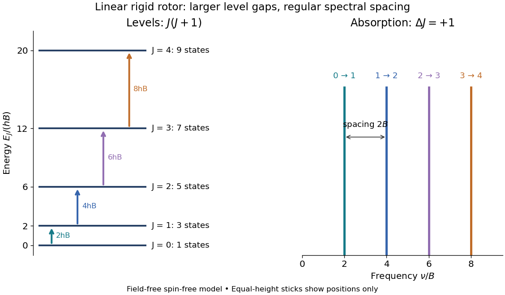

**[Figure 3](#image-linear-rigid-rotor-levels-and-transitions). Linear rigid rotor: increasing gaps between energy eigenvalues and equally spaced transition frequencies**. Original dimensionless model: $E_J/(hB)=J(J+1)$. Upward arrows show [photon absorption](quantum-mechanics.md#photon-absorption) with $\Delta J=1$; the sticks show positions only, not measured or predicted intensities. The $2J+1$ states at each [energy eigenvalue](energy-eigenvalue.md) are represented by one horizontal line.

Subtracting consecutive [energy eigenvalues](energy-eigenvalue.md) gives

$$
\nu_{J\to J+1}=\frac{E_{J+1}-E_J}{h}=2B(J+1).
$$

Thus increasing level gaps produce a regularly spaced series of lines at $2B,4B,6B,\ldots$, with spacing $2B$. Allowed positions do not guarantee that every line is visible: [electric-dipole selection rules](quantum-mechanics.md#electric-dipole-selection-rule), occupation of the initial [quantum state](quantum-system.md#quantum-state), and instrument response also matter.

##### Rotational temperature

↑ **Parent:** [Linear rigid rotor](#linear-rigid-rotor)  
ⓦ [Wiki](https://en.wikipedia.org/wiki/Rotational_temperature)

For a [linear rigid rotor](#linear-rigid-rotor), [rotational temperature](#rotational-temperature) expresses the rotational [energy](energy.md) constant in kelvins: $E_J=k_B\theta_rJ(J+1)$, where $I$ is the perpendicular [moment of inertia](rigid-body-dynamics.md#moment-of-inertia). With all integer $J\geq0$ allowed and degeneracies $2J+1$, its rotational [canonical partition function](canonical-ensemble.md#canonical-partition-function) is $Z=\sum_J(2J+1)e^{-\theta_rJ(J+1)/T}$. It approaches $1+3e^{-2\theta_r/T}$ at low [temperature](temperature.md) and $T/\theta_r$ at high [temperature](temperature.md). The latter limit gives mean rotational [energy](energy.md) $k_BT$ and [heat capacity](heat.md#heat-capacity) $k_B$ per rotor.

##### Rotational constant

↑ **Parent:** [Linear rigid rotor](#linear-rigid-rotor)

In this article the [rotational constant](#rotational-constant) is a [frequency](wave.md#frequency),

$$
B=\frac{h}{8\pi^2I}.
$$

Its dimensions are $\mathrm{s^{-1}}$, since the [Planck constant](quantum-mechanics.md#planck-constant) has dimensions $\mathrm{kg\,m^2\,s^{-1}}$ and a [moment of inertia](rigid-body-dynamics.md#moment-of-inertia) has dimensions $\mathrm{kg\,m^2}$. Some authors instead call $hB=\hbar^2/(2I)$ the energy-valued [rotational constant](#rotational-constant); this is the convention in the earlier synthetic [molecular beam electric resonance](electronegativity.md#molecular-beam-electric-resonance) diagram. A third convention uses the [spectroscopic wavenumber](wave-equation.md#spectroscopic-wavenumber) $\widetilde B=B/c$, with $c$ the [speed of light](special-relativity.md#speed-of-light). Always check units before using $\nu=2B(J+1)$.

If $B$ is known and the two [masses](classical-mechanics.md#mass) are specified, the rigid two-atom model gives the [bond length](chemical-bond.md#bond-length) $r=\sqrt{h/(8\pi^2\mu B)}$. This is why [rotational spectroscopy](#rotational-spectroscopy) can constrain [molecular geometry](#molecular-geometry). A real fitted constant can depend on [molecular vibration](#molecular-vibration), so this inference alone does not establish an equilibrium [bond length](chemical-bond.md#bond-length).

##### Pure rotational electric-dipole selection rules

↑ **Parent:** [Linear rigid rotor](#linear-rigid-rotor)

For the field-free, spin-free [linear rigid rotor](#linear-rigid-rotor) in one fixed internal [quantum state](quantum-system.md#quantum-state), the [electric-dipole interaction](quantum-mechanics.md#electric-dipole-interaction) is $-\mathbf d\cdot\mathbf E(t)$. A nonzero permanent [electric dipole moment](electrostatics.md#electric-dipole-moment) along the molecular axis allows pure rotational [photon absorption](quantum-mechanics.md#photon-absorption) with $\Delta J=+1$ and [photon emission](quantum-mechanics.md#photon-emission) with $\Delta J=-1$. The [matrix element](vector-space.md#matrix-element) between initial and final [quantum states](quantum-system.md#quantum-state) must be nonzero: the existence of an [energy](energy.md) gap alone is insufficient. Relative to a chosen $z$ axis, [polarization of an electromagnetic wave](electromagnetic-wave.md#polarization-of-an-electromagnetic-wave) along $z$ selects $\Delta M=0$; transverse [polarization of an electromagnetic wave](electromagnetic-wave.md#polarization-of-an-electromagnetic-wave) permits $\Delta M=\pm1$.[printed pp. 2–3: dipole transition integrals, polarization and selection rules](chemistry-bibliography.md#lecture-24-supplement-energy-levels-of-a-rigid-rotor-by-dudley-herschbach)

[Hydrogen chloride](electronegativity.md#hydrogen-chloride) and [carbon monoxide](chemical-substance.md#carbon-monoxide) are examples with a permanent [electric dipole moment](electrostatics.md#electric-dipole-moment). By symmetry, [molecular hydrogen](chemical-substance.md#molecular-hydrogen) and [carbon dioxide](chemical-substance.md#carbon-dioxide) have no permanent [electric dipole moment](electrostatics.md#electric-dipole-moment) in the ideal symmetric internal state. They still rotate and have rotational [energy eigenvalues](energy-eigenvalue.md), but the simple permanent-[electric dipole](electrostatics.md#electric-dipole) spectrum described here is absent. This restriction concerns this interaction and these assumptions, not every possible way of detecting [molecular rotation](#molecular-rotation).

##### Isotope shift of a linear rotor

↑ **Parent:** [Linear rigid rotor](#linear-rigid-rotor)

Changing an [isotope](chemical-substance.md#isotope) changes a [mass](classical-mechanics.md#mass) and therefore the [moment of inertia](rigid-body-dynamics.md#moment-of-inertia). If the [bond length](chemical-bond.md#bond-length) is held fixed, $B\propto1/\mu$ and every corresponding transition shifts by the same fractional amount. This leading inverse-[reduced mass](classical-mechanics.md#reduced-mass) scaling is also used in the more complete diatomic formulation.[§2a, equations (4)–(5): isotope dependence of rotational constants and reduced mass](chemistry-bibliography.md#diatomic-spectral-database-by-national-institute-of-standards-and-technology/1-sigma-ground-state-molecules)

For a deliberately stipulated [carbon monoxide](chemical-substance.md#carbon-monoxide) example, take $m_{12}=12u$, $m_{13}=13u$, $m_{16}=16u$, $u=1.66053906660\times10^{-27}\,\mathrm{kg}$, $r=1.13\times10^{-10}\,\mathrm m$ for both isotopic forms, and $h=6.62607015\times10^{-34}\,\mathrm{J\,s}$. The integer [masses](classical-mechanics.md#mass) are simplifying inputs, not accurate isotopic atomic [masses](classical-mechanics.md#mass); the shared [bond length](chemical-bond.md#bond-length) is an imposed model assumption. Calculation gives

$$
\begin{aligned}
\mu_{12,16}&=\frac{48}{7}u,& I_{12,16}&\approx1.45395\times10^{-46}\,\mathrm{kg\,m^2},& B_{12,16}&\approx57.7188\,\mathrm{GHz},\\
\mu_{13,16}&=\frac{208}{29}u,& I_{13,16}&\approx1.52080\times10^{-46}\,\mathrm{kg\,m^2},& B_{13,16}&\approx55.1817\,\mathrm{GHz}.
\end{aligned}
$$

In particular,

$$
\frac{B_{13,16}}{B_{12,16}}=\frac{\mu_{12,16}}{\mu_{13,16}}=\frac{87}{91}\approx0.956044.
$$

The heavier form's calculated $J=0\to1$ line is $110.363\,\mathrm{GHz}$ rather than $115.438\,\mathrm{GHz}$, a decrease of about $4.396\%$. These are model predictions from the stated inputs, not published measured [frequencies](wave.md#frequency). An [isotope](chemical-substance.md#isotope) changes the spacing as well as the first line; the shift is not a fixed additive offset for the whole spectrum.

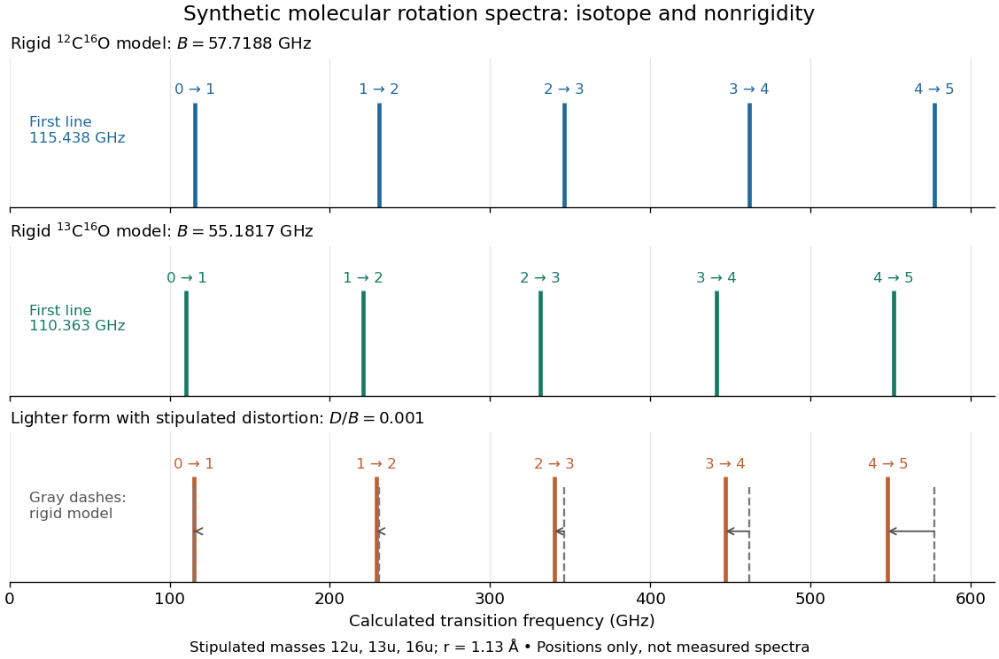

**[Figure 4](#image-molecular-rotation-isotope-and-distortion-spectra). Synthetic rotational spectroscopy comparison: a heavier isotope compresses the rigid spectrum, while centrifugal distortion bends the spacing pattern**. Original equal-height sticks for $J=0\to1$ through $4\to5$, using only the stipulated [masses](classical-mechanics.md#mass) and [bond length](chemical-bond.md#bond-length) above. The lower panel additionally stipulates $D/B=0.001$ for the lighter form and compares $2B(J+1)-4D(J+1)^3$ with dashed rigid positions. Neither heights, distortion constant nor line [frequencies](wave.md#frequency) are measured data; no thermal-population or instrument model is included.

#### Centrifugal distortion

↑ **Parent:** [Rigid rotor](#rigid-rotor)

Real [chemical bonds](chemical-bond.md) can stretch as [molecular rotation](#molecular-rotation) increases. The resulting larger [moment of inertia](rigid-body-dynamics.md#moment-of-inertia) lowers the [energy eigenvalues](energy-eigenvalue.md) relative to a [rigid rotor](#rigid-rotor). Within one vibrational [quantum state](quantum-system.md#quantum-state), a leading effective correction is

$$
\frac{E_J}{h}=B_vJ(J+1)-D_v[J(J+1)]^2+\cdots,\qquad
\nu_{J\to J+1}=2B_v(J+1)-4D_v(J+1)^3+\cdots.
$$

Both $B_v$ and $D_v$ are in [frequency](wave.md#frequency) units here; $v$ labels the vibrational [quantum state](quantum-system.md#quantum-state). For positive $D_v$, the adjacent-line spacing becomes

$$
\nu_{J+1\to J+2}-\nu_{J\to J+1}=2B_v-4D_v(3J^2+9J+7),
$$

so the departures grow with $J$. [Molecular vibration](#molecular-vibration) also changes the effective [rotational constant](#rotational-constant): even the lowest vibrational [quantum state](quantum-system.md#quantum-state) does not have motionless [atomic nuclei](atomic-nucleus.md).[§2a, equations (7)–(8): distortion and vibration-dependent constants](chemistry-bibliography.md#diatomic-spectral-database-by-national-institute-of-standards-and-technology/1-sigma-ground-state-molecules)

The quartic correction is a limited expansion, not a model to extrapolate to arbitrary $J$. It is small relative to the rigid contribution only while $(D_v/B_v)J(J+1)\ll1$; eventually higher terms, changed internal motion, or [chemical bond](chemical-bond.md) breaking matter. In the synthetic plot, the largest upper-state label is $J=5$, giving a stipulated correction ratio of $0.03$. No universal maximum valid $J$ follows without a particular [molecule](molecule.md) and precision target.

The [quantum numbers](quantum-system.md#quantum-number) also have limits of meaning. Here $J$ describes spin-free rotation. In a [molecule](molecule.md) with electronic [spin](angular-momentum-operator.md#spin), rotation alone is commonly labelled $N$, while $J$ includes electronic [angular momentum](momentum.md#angular-momentum); including nuclear [spin](angular-momentum-operator.md#spin) introduces additional total-[angular momentum](momentum.md#angular-momentum) labels and resolved splittings. An applied [electric field](electric-field.md) can mix different field-free $J$ states through the [Stark effect](mathematical-physics.md#stark-effect). For identical [atomic nuclei](atomic-nucleus.md), the [Pauli exclusion principle](tensor-product-of-quantum-systems.md#pauli-exclusion-principle) can restrict combinations of rotational and nuclear-[spin](angular-momentum-operator.md#spin) states. The simple $2J+1$ degeneracy and every-integer-$J$ ladder therefore describe the stated idealization, not all observed sublevels.[§2a: hyperfine discussion; §2b: distinct definitions of J, N and F](chemistry-bibliography.md#diatomic-spectral-database-by-national-institute-of-standards-and-technology/1-sigma-ground-state-molecules)

### Rotational spectroscopy

↑ **Parent:** [Molecular rotation](#molecular-rotation)  
ⓦ [Wiki](https://en.wikipedia.org/wiki/Rotational_spectroscopy)

[Rotational spectroscopy](#rotational-spectroscopy) measures transitions between [molecular rotation](#molecular-rotation) [quantum states](quantum-system.md#quantum-state), usually in low-pressure gaseous [molecules](molecule.md). The measured [spectral lines](stellar-astrophysics.md#spectral-line) become a molecular fingerprint only after [rotational spectral line assignment](#rotational-spectral-line-assignment): identify which transitions belong together, determine their [quantum numbers](quantum-system.md#quantum-number), fit a rotational [Hamiltonian](hamiltonian-mechanics.md#hamiltonian), and test additional predictions. Line positions constrain [moments of inertia](rigid-body-dynamics.md#moment-of-inertia), while [rotational state populations](#rotational-state-populations) and transition coupling determine which lines can be detected.

The simplest ordinary microwave absorption ladder belongs to a polar [linear molecule](#linear-molecule) obeying [pure rotational electric-dipole selection rules](#pure-rotational-electric-dipole-selection-rules). A [homonuclear diatomic molecule](#homonuclear-diatomic-molecule) has no permanent [electric dipole moment](electrostatics.md#electric-dipole-moment) in its symmetric internal state, but [rotational Raman spectroscopy](#rotational-raman-spectroscopy) can probe its rotation through anisotropic [electric polarizability](electrostatics.md#electric-polarizability). The coupling mechanism must therefore be specified before interpreting a missing spectrum.

The existing [linear rigid rotor](#linear-rigid-rotor), [rotational constant](#rotational-constant), [isotope shift of a linear rotor](#isotope-shift-of-a-linear-rotor), and [centrifugal distortion](#centrifugal-distortion) explain the forward model. [Molecular structure from rotational constants](#molecular-structure-from-rotational-constants) asks the reverse question: which arrangements of [chemical atoms](physics.md#atom-physics) could produce the fitted constants? The [NIST trace-gas FTMW validation experiment](#nist-trace-gas-ftmw-validation-experiment) makes the measurement chain concrete and separates identifying a species from measuring its [concentration](mathematical-physics.md#concentration).

#### Rotational spectrum

↑ **Parent:** [Rotational spectroscopy](#rotational-spectroscopy)

A set of [spectral lines](stellar-astrophysics.md#spectral-line) associated with transitions between molecular [rotational energy](#rotational-energy) levels. A polar [linear rigid rotor](#linear-rigid-rotor) has electric-dipole transitions with $\Delta J=\pm1$; in the ideal model adjacent absorption frequencies are separated by twice the [rotational constant](#rotational-constant) in frequency units.

#### Symmetric-top rotational spectrum

↑ **Parent:** [Rotational spectroscopy](#rotational-spectroscopy)

For a polar rigid [symmetric top](rigid-body-dynamics.md#symmetric-top) with its permanent dipole on the [symmetry](physics.md#symmetry-physics) axis, electric-dipole pure rotation has $\Delta J=\pm1$, $\Delta K=0$. The $A-B$ term cancels within each transition; [centrifugal distortion](#centrifugal-distortion) can lift the rigid-model coincidence of different K components.

#### Rotational spectral line assignment

↑ **Parent:** [Rotational spectroscopy](#rotational-spectroscopy)

A [rotational spectral line assignment](#rotational-spectral-line-assignment) associates a measured [spectral line](stellar-astrophysics.md#spectral-line) with a [molecule](molecule.md), an internal [quantum state](quantum-system.md#quantum-state), and an initial and final set of [quantum numbers](quantum-system.md#quantum-number). For the spin-free [linear rigid rotor](#linear-rigid-rotor), absorption is labelled $J\to J+1$. A regularly spaced group suggests a candidate [rotational constant](#rotational-constant), but the lowest line inside a scanned band need not be $0\to1$. Several [molecules](molecule.md) can contribute to the same spectrum, and an apparent missing member can lie outside the band or below the detection threshold.

First determine line centers and their uncertainties from the instrument's readout, accounting for resolved [Doppler shifts](wave.md#doppler-effect) or [hyperfine structure](quantum-mechanics.md#hyperfine-structure) rather than treating every peak as a separate rotational transition. Then propose integer assignments, fit a rotational [Hamiltonian](hamiltonian-mechanics.md#hamiltonian), and predict additional [spectral lines](stellar-astrophysics.md#spectral-line). For a weakly distorted [linear molecule](#linear-molecule) within one vibrational [quantum state](quantum-system.md#quantum-state), the [centrifugal distortion](#centrifugal-distortion) model gives the useful diagnostic

$$
\nu_m=2Bm-4Dm^3,\qquad
\frac{\nu_m}{2m}=B-2Dm^2,\qquad m=J+1.
$$

Here $B,D,\nu_m$ are all [frequencies](wave.md#frequency) in $\mathrm{Hz}$. Correct assignments make the second expression a [straight line](euclidean-geometry.md#straight-line) against $m^2$, with intercept $B$ and slope $-2D$. This follows by division of the transition formula; no additional model of [molecular geometry](#molecular-geometry) is required. A direct [weighted least squares](normal-linear-model.md#weighted-least-squares) fit of $\nu_m$ to $2Bm-4Dm^3$ uses the measured uncertainties. If instead the transformed values are fitted, their uncertainties must also be divided by $2m$.[§2a, equation (7): rotational transition frequencies with centrifugal distortion](chemistry-bibliography.md#diatomic-spectral-database-by-national-institute-of-standards-and-technology/1-sigma-ground-state-molecules)

For an original example, stipulate $B=5.000000\,\mathrm{GHz}$ and $D=2.000\,\mathrm{kHz}$, and suppose a scan covers $38$–$72\,\mathrm{GHz}$. The model places four consecutive transitions at $39.999488$, $49.999000$, $59.998272$, and $69.997256\,\mathrm{GHz}$. Their assignments are $m=4,5,6,7$, hence $J=3,4,5,6$. An extra stipulated line at $53.2\,\mathrm{GHz}$ is unrelated to this series. All these [frequencies](wave.md#frequency) are calculated example inputs, not measured OCS data.

At $m=4$ and $m=7$, the transformed values are $4999.936$ and $4999.804\,\mathrm{MHz}$. Their [straight line](euclidean-geometry.md#straight-line) has slope $(4999.804-4999.936)/(49-16)=-0.004\,\mathrm{MHz}$, recovering $D=0.002\,\mathrm{MHz}$ and $B=5000\,\mathrm{MHz}$. Both intermediate transitions satisfy the same line exactly. Merely relabelling the first visible transition $0\to1$ fails this diagnostic. The model predicts a withheld $7\to8$ transition at $79.995904\,\mathrm{GHz}$: an additional measurement there would test the assignment rather than merely refit the original four lines.

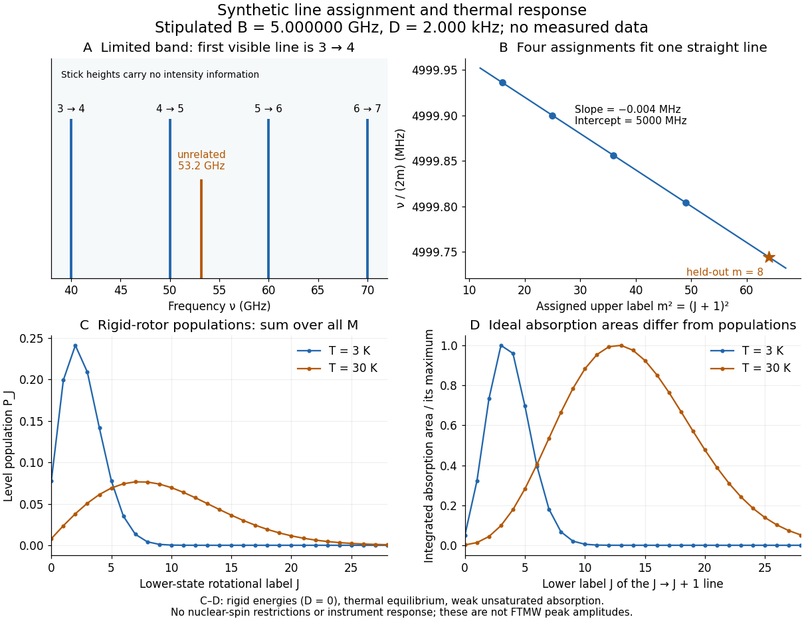

**[Figure 5](#image-rotational-line-assignment-and-thermal-response). Original synthetic rotational spectral line assignment, fit diagnostic, and rotational state populations**. Stipulated values, not measured data. Upper panels use $B=5\,\mathrm{GHz}$ and $D=2\,\mathrm{kHz}$; stick heights show positions only. Lower panels independently use the [linear rigid rotor](#linear-rigid-rotor) with the same $B$, $D=0$, and [temperatures](temperature.md) $3$ and $30\,\mathrm K$. [Rotational state populations](#rotational-state-populations) and ideal integrated absorption areas are different quantities; each absorption curve is normalized separately. Neither is a predicted pulsed [FTMW spectroscopy](#fourier-transform-microwave-spectroscopy) peak amplitude.

An assignment earns confidence when several independently observed [spectral lines](stellar-astrophysics.md#spectral-line), including lines outside the fitted interval, agree within uncertainty and expected strong accessible lines are present. Inspect the [residual of an inverse problem](inverse-problem.md#residual-of-an-inverse-problem) for each line against $J$: systematic curvature can signal inadequate [centrifugal distortion](#centrifugal-distortion), whereas isolated discrepancies suggest a blend or wrong assignment. Comparing a known sample, a blank, and an [isotope shift of a linear rotor](#isotope-shift-of-a-linear-rotor) supplies different checks. These are general inference controls; the actual reported controls of the [NIST trace-gas FTMW validation experiment](#nist-trace-gas-ftmw-validation-experiment) are described separately. One isolated match or one fitted [rotational constant](#rotational-constant) alone cannot certify molecular identity.

#### Rotational state populations

↑ **Parent:** [Rotational spectroscopy](#rotational-spectroscopy)

For the spin-free [linear rigid rotor](#linear-rigid-rotor) in [thermal equilibrium](thermal-equilibrium.md) at [temperature](temperature.md) $T>0$, assume all integer $J\geq0$ are allowed and ignore nuclear-[spin](angular-momentum-operator.md#spin) restrictions. Each $J$ level has $2J+1$ [quantum states](quantum-system.md#quantum-state) sharing one [energy eigenvalue](energy-eigenvalue.md), an instance of [degenerate energy levels](quantum-mechanics.md#degenerate-energy-levels), so the [Boltzmann distribution](thermodynamics.md#boltzmann-distribution) gives

$$
Q_{\rm rot}=\sum_{J=0}^{\infty}(2J+1)e^{-hBJ(J+1)/(k_{\rm B}T)},\qquad
P_J=\frac{(2J+1)e^{-hBJ(J+1)/(k_{\rm B}T)}}{Q_{\rm rot}}.
$$

Here $Q_{\rm rot}$ is a rotational [partition function](canonical-ensemble.md#canonical-partition-function), $h$ the [Planck constant](quantum-mechanics.md#planck-constant), $k_{\rm B}$ the [Boltzmann constant](thermodynamics.md#boltzmann-constant), and $B$ a [frequency](wave.md#frequency) in $\mathrm{Hz}$. Thus $hB/(k_{\rm B}T)$ is [dimensionless](physics.md#dimensionless-quantity). The $2J+1$ factor counts [magnetic quantum numbers](quantum-mechanics.md#magnetic-quantum-number); it does not mean that a whole level is one [quantum state](quantum-system.md#quantum-state). For the stipulated $B=5\,\mathrm{GHz}$, the most populated levels are $J=2$ at $3\,\mathrm K$ and $J=7$ at $30\,\mathrm K$.

Population alone is insufficient to predict intensity. In weak, unsaturated absorption, the integrated absorption coefficient includes the transition [frequency](wave.md#frequency), the squared [electric dipole moment](electrostatics.md#electric-dipole-moment) [matrix element](vector-space.md#matrix-element), and the difference of lower and upper substate populations because [stimulated emission](laser.md#stimulated-emission) returns [energy](energy.md) to the field. A pulsed [FTMW spectroscopy](#fourier-transform-microwave-spectroscopy) signal additionally depends on excitation, [quantum coherence](density-matrix.md#quantum-coherence-in-a-specified-basis), cavity tuning, and receiver response.[Andrei Tokmakoff, §§6.1–6.2, printed pp. 6-2–6-6, equations (6.8)–(6.10), (6.27)–(6.29): population difference and rotational dipole matrix elements](chemistry-bibliography.md#absorption-lineshapes-by-andrei-tokmakoff)

For an isotropic sample with [polarization of an electromagnetic wave](electromagnetic-wave.md#polarization-of-an-electromagnetic-wave) along $z$, write $d_z=d\cos\theta$. Normalized [spherical harmonics](analysis.md#spherical-harmonic) give

$$
|\langle J+1,M|\cos\theta|J,M\rangle|^2
=\frac{(J+1)^2-M^2}{(2J+1)(2J+3)},\qquad
\sum_{M=-J}^{J}|\langle J+1,M|\cos\theta|J,M\rangle|^2=\frac{J+1}{3}.
$$

The last equality follows from $\sum_{M=-J}^{J}M^2=J(J+1)(2J+1)/3$. Combining this sum with the per-substate [Boltzmann distribution](thermodynamics.md#boltzmann-distribution) and subtracting [stimulated emission](laser.md#stimulated-emission) gives relative integrated absorption areas

$$
A_J\propto\frac{\nu_J(J+1)}{Q_{\rm rot}}e^{-hBJ(J+1)/(k_{\rm B}T)}\left(1-e^{-h\nu_J/(k_{\rm B}T)}\right),\qquad \nu_J=2B(J+1).
$$

The common factor includes $d^2/3$ and cancels upon normalization. This formula describes integrated weak absorption in a thermal, spin-free [linear rigid rotor](#linear-rigid-rotor), not arbitrary peak heights. The example's strongest integrated lines originate at $J=3$ and $J=13$ for $3$ and $30\,\mathrm K$, respectively: they differ from the most populated levels. A missing line can reflect population, coupling, coverage, or sensitivity; it does not prove that the corresponding [quantum state](quantum-system.md#quantum-state) is absent.

##### Most populated rotational level

↑ **Parent:** [Rotational state populations](#rotational-state-populations)

The [rotational state populations](#rotational-state-populations) of a spin-free polar [linear rigid rotor](#linear-rigid-rotor) are proportional to $(2J+1)e^{-\theta_{\rm rot}J(J+1)/T}$. Differentiating their logarithm with respect to continuous $J$ gives the displayed maximum when it is nonnegative. The actual maximum must be selected among nonnegative integers by comparing adjacent populations. This population maximum generally differs from a maximum in measured [spectral line](stellar-astrophysics.md#spectral-line) intensity.

#### Molecular structure from rotational constants

↑ **Parent:** [Rotational spectroscopy](#rotational-spectroscopy)

Recovering [molecular geometry](#molecular-geometry) from [rotational constants](#rotational-constant) is an [inverse problem](inverse-problem.md). In the synthetic assignment, $B=5\times10^9\,\mathrm{Hz}$ gives $I=h/(8\pi^2B)\simeq1.6784\times10^{-45}\,\mathrm{kg\,m^2}$. For a [diatomic molecule](#diatomic-molecule) with known [masses](classical-mechanics.md#mass), [rotational constant](#rotational-constant) explains how to infer an effective [bond length](chemical-bond.md#bond-length). For a longer [linear molecule](#linear-molecule), one $I$ cannot determine every [bond length](chemical-bond.md#bond-length): several different arrangements can have the same [moment of inertia](rigid-body-dynamics.md#moment-of-inertia).

For a fixed three-atom linear model with positions $0,a,a+b$ and positive [masses](classical-mechanics.md#mass) $m_1,m_2,m_3$, subtracting the [centre of mass](classical-mechanics.md#center-of-mass) gives

$$
I=\frac{m_1m_2a^2+m_2m_3b^2+m_1m_3(a+b)^2}{m_1+m_2+m_3}.
$$

This is one equation for two unknown [bond lengths](chemical-bond.md#bond-length). Even fixing the order of the [chemical atoms](physics.md#atom-physics) leaves a family of solutions. Additional [isotope](chemical-substance.md#isotope) substitutions change known [masses](classical-mechanics.md#mass) and supply independent equations, provided the effective [molecular geometry](#molecular-geometry) can be treated as shared. For nonlinear [molecules](molecule.md), three principal [moments of inertia](rigid-body-dynamics.md#moment-of-inertia) give frequency-valued constants $A=h/(8\pi^2I_a)$, $B=h/(8\pi^2I_b)$, and $C=h/(8\pi^2I_c)$; a single evenly spaced comb is generally insufficient.

Vibrational averaging, unresolved [hyperfine structure](quantum-mechanics.md#hyperfine-structure), internal motion, and [centrifugal distortion](#centrifugal-distortion) limit structural inference. A ground-vibrational fitted [rotational constant](#rotational-constant) is not automatically the equilibrium constant. Ordinary field-free [rotational spectroscopy](#rotational-spectroscopy) also gives identical spectra for opposite [enantiomers](stereochemistry.md#enantiomer) under the usual parity-symmetric molecular [Hamiltonian](hamiltonian-mechanics.md#hamiltonian); assigning composition and conformation does not by itself determine handedness. Molecular identification from a rich fingerprint can therefore succeed even when a unique full [molecular geometry](#molecular-geometry) cannot be reconstructed.

#### Rotational Raman spectroscopy

↑ **Parent:** [Rotational spectroscopy](#rotational-spectroscopy)

[Rotational Raman spectroscopy](#rotational-raman-spectroscopy) observes a [frequency](wave.md#frequency) change of scattered light associated with [molecular rotation](#molecular-rotation). The coupling uses the induced [electric dipole moment](electrostatics.md#electric-dipole-moment), $\mathbf d_{\rm ind}=\boldsymbol\alpha\mathbf E$, where $\boldsymbol\alpha$ is the [electric polarizability](electrostatics.md#electric-polarizability) tensor. For a [linear molecule](#linear-molecule), the useful anisotropy is $\alpha_\parallel-\alpha_\perp$: the response differs for an [electric field](electric-field.md) parallel or perpendicular to the molecular axis. A permanent [electric dipole moment](electrostatics.md#electric-dipole-moment) is not required.[Andrei Tokmakoff, §6.2, printed pp. 6-7–6-8, equations (6.40)–(6.44): induced dipole, polarizability tensor and rotational Raman response](chemistry-bibliography.md#absorption-lineshapes-by-andrei-tokmakoff)

For the spin-free [linear rigid rotor](#linear-rigid-rotor) in one internal [quantum state](quantum-system.md#quantum-state), the anisotropic tensor depends quadratically on the molecular direction. Its angular part has even parity and degree two in [spherical harmonics](analysis.md#spherical-harmonic). The [triangle inequality](topological-analysis.md#triangle-inequality) for coupled [angular momenta](momentum.md#angular-momentum) permits $|\Delta J|\leq2$, and even parity removes odd $\Delta J$, leaving $\Delta J=0,\pm2$. The $\Delta J=0$ contribution is unshifted light; shifted rotational lines have $\Delta J=\pm2$. Consequently the rigid-model Stokes shifts, in ordinary [frequency](wave.md#frequency) units, are

$$
\Delta\nu_J=\frac{E_{J+2}-E_J}{h}=B(4J+6),\qquad J=0,1,2,\ldots.
$$

Successive allowed shifts are separated by $4B$, rather than the $2B$ absorption spacing of [pure rotational electric-dipole selection rules](#pure-rotational-electric-dipole-selection-rules). In [spectroscopic wavenumber](wave-equation.md#spectroscopic-wavenumber) units replace $B$ by $\widetilde B=B/c$ and $\Delta\nu$ by $\Delta\widetilde\nu=\Delta\nu/c$, using the [speed of light](special-relativity.md#speed-of-light) in $\mathrm{cm\,s^{-1}}$ for $\mathrm{cm^{-1}}$.

A [homonuclear diatomic molecule](#homonuclear-diatomic-molecule) such as [molecular hydrogen](chemical-substance.md#molecular-hydrogen) has no permanent [electric dipole moment](electrostatics.md#electric-dipole-moment) in its symmetric internal state, so it lacks the ordinary electric-dipole microwave ladder. Its anisotropic [electric polarizability](electrostatics.md#electric-polarizability) can nevertheless give [rotational Raman spectroscopy](#rotational-raman-spectroscopy) lines. Nuclear-[spin](angular-momentum-operator.md#spin) symmetry can change the populations of even and odd $J$ levels, so the spin-free population example above must not be reused unchanged for [molecular hydrogen](chemical-substance.md#molecular-hydrogen). The method of coupling, as well as the [energy eigenvalues](energy-eigenvalue.md), determines what the experiment can see.

#### Fourier transform microwave spectroscopy

↑ **Parent:** [Rotational spectroscopy](#rotational-spectroscopy)

[Fourier transform microwave spectroscopy](#fourier-transform-microwave-spectroscopy) excites gaseous [molecules](molecule.md) with a pulse of [electromagnetic radiation](electromagnetic-radiation.md), then records the emitted time-dependent [electric field](electric-field.md). A [Fourier transform](fourier-transform.md) extracts transition [frequencies](wave.md#frequency) from the decaying signal. In a cavity implementation, two facing mirrors form a resonator; tuned excitation, receiver electronics and digitization replace the molecule-counting readout of [molecular beam electric resonance](electronegativity.md#molecular-beam-electric-resonance). The pulsed radiation prepares [quantum coherence](density-matrix.md#quantum-coherence-in-a-specified-basis) between rotational [quantum states](quantum-system.md#quantum-state); it does not set the whole gas spinning at one classical [angular velocity](rigid-body-dynamics.md#angular-velocity).

For documented laboratory context, [Evolution of Microwave Spectroscopy at the National Bureau of Standards (NBS) and the National Institute of Standards and Technology (NIST) by F. J. Lovas and others](chemistry-bibliography.md#evolution-of-microwave-spectroscopy-at-the-national-bureau-of-standards-nbs-and-the-national-institute-of-standards-and-technology-nist-by-f-j-lovas-and-others) (§5, printed pp. 280–282) describes the NIST cavity instrument, phase-locked sources, mirror tuning and detector-mixer modifications. That account explains one instrument family; it does not establish the electronics of every later commercial [spectrometer](optical-instrument.md#spectrometer).

##### NIST trace-gas FTMW validation experiment

↑ **Parent:** [Fourier transform microwave spectroscopy](#fourier-transform-microwave-spectroscopy)

The NIST validation report used $1\%$ [carbonyl sulfide](chemical-substance.md#carbonyl-sulfide) in [argon](chemical-substance.md#argon) to illustrate the readout. A pulsed nozzle injected a [molecular beam](physics.md#molecular-beam) along a two-mirror cavity. Approximately $1\,\mathrm{\mu s}$ excitation prepared [quantum coherence](density-matrix.md#quantum-coherence-in-a-specified-basis); a receiver digitized the decaying [electric field](electric-field.md), then a [Fourier transform](fourier-transform.md) produced [spectral lines](stellar-astrophysics.md#spectral-line). Counterpropagating cavity waves produced a [Doppler shift](wave.md#doppler-effect) doublet; its midpoint represents one rest-frame transition.[The Validation of Fourier-Transform Microwave Spectroscopy for Trace-Gas Analysis, printed pp. 25–26, Figures 2–3: coaxial apparatus, excitation and OCS readout; PDF pages 31–32](chemistry-bibliography.md#manufacturing-technology-the-road-ahead-nistir-6816/the-validation-of-fourier-transform-microwave-spectroscopy-for-trace-gas-analysis)

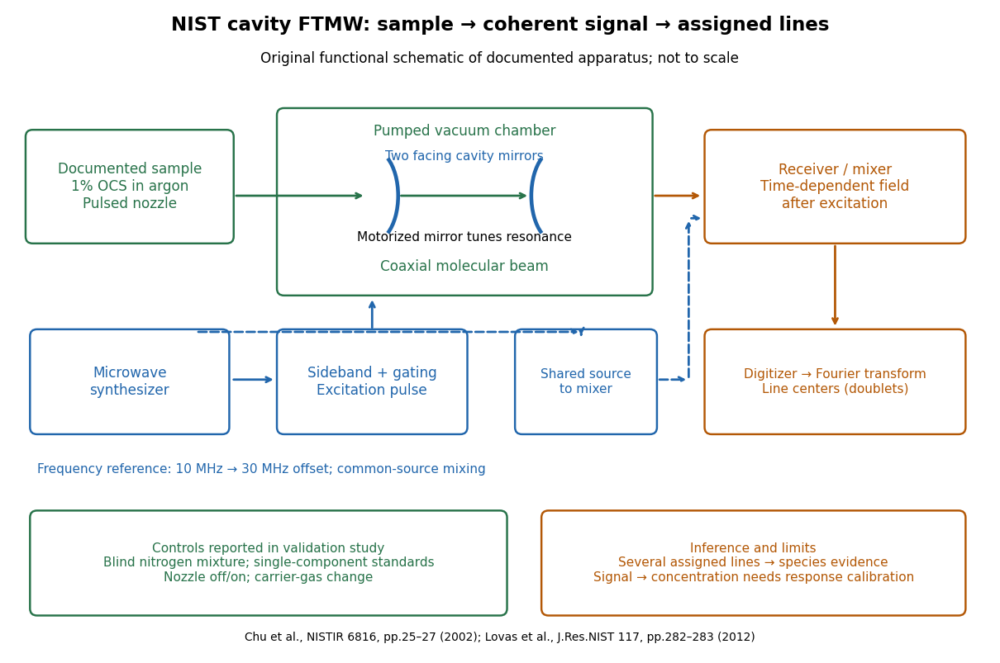

**[Figure 6](#image-rotational-nist-ftmw-sample-to-assignment). Original functional schematic of the NIST trace-gas FTMW validation experiment**. An original arrangement of the documented sample, cavity, excitation and readout functions; no published figure is copied. The frequency-reference branch summarizes the later portable electronics described in the NIST historical account. The sample fraction is a reported preparation, not a synthetic measured spectrum.

The portable electronics used a common microwave source and a $30\,\mathrm{MHz}$ offset derived from a $10\,\mathrm{MHz}$ reference. Cavity tuning selects the accessible band; it does not independently calibrate the line's [frequency](wave.md#frequency). Absolute accuracy also requires a characterized reference and receiver offset.[§5, printed pp. 282–283, Figure 20: source splitting, frequency reference, single-sideband modulation, mixer and digitizer](chemistry-bibliography.md#evolution-of-microwave-spectroscopy-at-the-national-bureau-of-standards-nbs-and-the-national-institute-of-standards-and-technology-nist-by-f-j-lovas-and-others)

Reported controls included nozzle off/on, carrier-gas changes, and a blind [nitrogen](chemical-substance.md#nitrogen) mixture. Assigned components were correctly identified. Single-component standards supplied preliminary [concentration](mathematical-physics.md#concentration) calibration; one standard per quantified component left response validation incomplete. Condensation and departure from [thermal equilibrium](thermal-equilibrium.md) in the nozzle were acknowledged limitations.[printed pp. 26–27: nozzle/carrier comparison in Figure 6, blind mixture in Table II, one-standard calibration and nozzle-expansion limitations](chemistry-bibliography.md#manufacturing-technology-the-road-ahead-nistir-6816/the-validation-of-fourier-transform-microwave-spectroscopy-for-trace-gas-analysis)

The lesson is that [rotational spectral line assignment](#rotational-spectral-line-assignment) and [concentration](mathematical-physics.md#concentration) inference answer different questions. Reproducible [frequencies](wave.md#frequency) support molecular identity; converting signal size into [concentration](mathematical-physics.md#concentration) requires calibrated response under the same transfer and excitation conditions. The thermal absorption example above does not model a nozzle's nonequilibrium populations or the cavity's pulsed response.

##### Rotational monitoring of deuterium exchange

↑ **Parent:** [Fourier transform microwave spectroscopy](#fourier-transform-microwave-spectroscopy)

A distinct experiment in [An Automated, Highly Selective Reaction Monitoring Instrument Using Molecular Rotational Resonance Spectroscopy by Ann Adele Byars and others](chemistry-bibliography.md#an-automated-highly-selective-reaction-monitoring-instrument-using-molecular-rotational-resonance-spectroscopy-by-ann-adele-byars-and-others) (Figure 1 and Figure 3) tracked exchange of [hydrogen](chemical-substance.md#hydrogen) for [deuterium](chemical-substance.md#deuterium) in [ethyl acetoacetate](chemical-substance.md#ethyl-acetoacetate) mixed with deuterated [methanol](chemical-substance.md#methanol). A pump circulated [chemical solution](mixture.md#solution-chemistry) through a valve; a calibrated loop injected aliquots into a temperature-controlled inlet, held at room [temperature](temperature.md) for this exchange experiment. [Neon](chemical-substance.md#neon) carried the vaporized sample to a cavity [spectrometer](optical-instrument.md#spectrometer). Separately recorded broadband spectra and fitted rotational [Hamiltonians](hamiltonian-mechanics.md#hamiltonian) identified transitions for the four isotopic forms before targeted monitoring.[apparatus and assignment paragraphs around Figure 1; deuterium-exchange method and Figure 3](chemistry-bibliography.md#an-automated-highly-selective-reaction-monitoring-instrument-using-molecular-rotational-resonance-spectroscopy-by-ann-adele-byars-and-others)

The readout was each assigned line's signal over reaction time, normalized by the sum of the four signals. Transitions with the same [quantum numbers](quantum-system.md#quantum-number) reduced response-factor differences. A solvent wash addressed observed sample carryover. The signals distinguished the unsubstituted, two singly substituted, and doubly substituted forms. Only one gas-phase structural form was detected; the authors explicitly caution that their readout does not recover the structural [chemical equilibrium](chemical-potential.md#chemical-equilibrium) in [chemical solution](mixture.md#solution-chemistry).[deuterium-exchange paragraphs surrounding Figure 3; sample carryover and wash paragraph](chemistry-bibliography.md#an-automated-highly-selective-reaction-monitoring-instrument-using-molecular-rotational-resonance-spectroscopy-by-ann-adele-byars-and-others)

This example uses nonlinear [molecules](molecule.md), so neither the single-constant [linear rigid rotor](#linear-rigid-rotor) nor the synthetic comb above is a fit to its spectrum. Its connection to the model is the sensitivity of [moments of inertia](rigid-body-dynamics.md#moment-of-inertia) to [isotope](chemical-substance.md#isotope) placement. Line position helps assign a species; signal size additionally depends on sample transfer, initial [quantum state](quantum-system.md#quantum-state) populations and instrument response. Matching [quantum numbers](quantum-system.md#quantum-number) is a useful control, not a proof of identical response factors. These distinctions explain why resolving species and determining their [concentrations](mathematical-physics.md#concentration) are separate inference steps.

## Linear molecule

↑ **Parent:** [Molecule](molecule.md)

A [linear molecule](#linear-molecule) has collinear [atomic nuclei](atomic-nucleus.md) in its idealized [molecular geometry](#molecular-geometry). Both a [diatomic molecule](#diatomic-molecule) and [carbon dioxide](chemical-substance.md#carbon-dioxide) can supply [linear rigid rotor](#linear-rigid-rotor) examples, although their [electric-dipole selection rules](quantum-mechanics.md#electric-dipole-selection-rule) need not give an observable permanent-[electric dipole](electrostatics.md#electric-dipole) spectrum.

### Diatomic molecule

↑ **Parent:** [Linear molecule](#linear-molecule)  
ⓦ [Wiki](https://en.wikipedia.org/wiki/Diatomic_molecule)

A [diatomic molecule](#diatomic-molecule) contains two [chemical atoms](physics.md#atom-physics); [hydrogen chloride](electronegativity.md#hydrogen-chloride) and [carbon monoxide](chemical-substance.md#carbon-monoxide) are examples. Their fixed-separation [moment of inertia](rigid-body-dynamics.md#moment-of-inertia) is $I=\mu r^2$ in the [linear rigid rotor](#linear-rigid-rotor) model.

#### Lithium beryllium diatomic molecule

↑ **Parent:** [Diatomic molecule](#diatomic-molecule)

A heteronuclear three-valence-electron diatomic. A simple bonding/antibonding two-orbital description predicts [bond order](chemistry.md#bond-order) one-half and one [unpaired electron](chemistry.md#unpaired-electron). More electronegative [beryllium](chemical-substance.md#beryllium) carries the negative end of the bond dipole.

#### Lithium dimer

↑ **Parent:** [Diatomic molecule](#diatomic-molecule)

The neutral molecule Li-two. In the elementary valence [molecular orbital](chemistry.md#molecular-orbital) description, its two [valence electrons](chemical-bond.md#valence-electron) occupy the bonding sigma-two-s orbital, giving [bond order](chemistry.md#bond-order) one and a closed-shell ground state.

#### Helium dimer

↑ **Parent:** [Diatomic molecule](#diatomic-molecule)

A very weakly bound van der Waals molecule, observed in cold [helium](chemical-substance.md#helium) expansions. The absence of an ordinary [covalent bond](covalent-bond.md) in the elementary [molecular orbital](chemistry.md#molecular-orbital) model must not be confused with absence of every possible bound dimer.[The weakest bond: experimental observation of helium dimer by Fei Luo and colleagues](chemistry-bibliography.md#the-weakest-bond-experimental-observation-of-helium-dimer-by-fei-luo-and-colleagues)

#### Beryllium dimer

↑ **Parent:** [Diatomic molecule](#diatomic-molecule)

The neutral molecule Be-two. Its simplest filled sigma-two-s/bonding and antibonding description gives zero [bond order](chemistry.md#bond-order), but mixing of accessible two-p configurations and [electron correlation](physics.md#electron-correlation) produce a weak [covalent bond](covalent-bond.md). Resolved vibrational levels establish a bound ground-state potential.[Beryllium dimer caught in the act of bonding by Jeremy M. Merritt and colleagues](chemistry-bibliography.md#beryllium-dimer-caught-in-the-act-of-bonding-by-jeremy-m-merritt-and-colleagues)

#### Homonuclear diatomic molecule

↑ **Parent:** [Diatomic molecule](#diatomic-molecule)

A [diatomic molecule](#diatomic-molecule) whose two [chemical atoms](physics.md#atom-physics) belong to the same [chemical element](chemical-substance.md#chemical-element).

##### Spin isomers of hydrogen

↑ **Parent:** [Homonuclear diatomic molecule](#homonuclear-diatomic-molecule)  
ⓦ [Wiki](https://en.wikipedia.org/wiki/Spin_isomers_of_hydrogen)

[Spin isomers of hydrogen](#spin-isomers-of-hydrogen) are two forms of [molecular hydrogen](chemical-substance.md#molecular-hydrogen), $^{1}\mathrm H_2$, distinguished by the combined [nuclear spin](atomic-nucleus.md#nuclear-spin) of their two [protons](physics.md#proton). They have the same [chemical formula](chemical-substance.md#chemical-formula) and electronic [ground state](quantum-mechanics.md#ground-state), but different allowed [molecular rotation](#molecular-rotation) states. [Parahydrogen](#parahydrogen) has total nuclear [spin](angular-momentum-operator.md#spin) zero and even rotational [quantum number](quantum-system.md#quantum-number) $J$; [orthohydrogen](#orthohydrogen) has total nuclear [spin](angular-momentum-operator.md#spin) one and odd $J$. The difference makes [heat capacity](heat.md#heat-capacity) a probe of [fermionic exchange symmetry](tensor-product-of-quantum-systems.md#fermi-dirac-statistics), and makes cooling history matter for a tank of [molecular hydrogen](chemical-substance.md#molecular-hydrogen).

Assume the electronic [ground state](quantum-mechanics.md#ground-state) $X\,{}^1\Sigma_g^+$ and the vibrational [ground state](quantum-mechanics.md#ground-state) of a free [molecule](molecule.md). The electronic factor is symmetric under exchanging the two [protons](physics.md#proton), and the vibrational factor depends only on their separation, so it is also symmetric. These assumptions concern the exchange of [protons](physics.md#proton); the electronic [wavefunction](wave-function.md) separately obeys [fermionic exchange symmetry](tensor-product-of-quantum-systems.md#fermi-dirac-statistics) under exchange of [electrons](physics.md#electron). Neglect electronic excitation, vibrational excitation, external fields, and small interactions involving [nuclear spin](atomic-nucleus.md#nuclear-spin) when calculating rotational [energy eigenvalues](energy-eigenvalue.md).

The two [protons](physics.md#proton) are [identical particles](tensor-product-of-quantum-systems.md#indistinguishable-particles) with [spin](angular-momentum-operator.md#spin) $1/2$. Their complete [wavefunction](wave-function.md) must change sign under their [particle exchange operator](tensor-product-of-quantum-systems.md#particle-exchange-operator). Interchanging the two ends reverses the internuclear direction $\widehat{\mathbf r}$, and the [spherical harmonic](analysis.md#spherical-harmonic) rotational factor satisfies

$$
Y_{JM}(-\widehat{\mathbf r})=(-1)^JY_{JM}(\widehat{\mathbf r}).
$$

The antisymmetric [spin-one-half singlet state](angular-momentum-operator.md#spin-one-half-singlet-state) therefore requires symmetric, even-$J$ rotation; the symmetric [spin-one-half triplet state](angular-momentum-operator.md#spin-one-half-triplet-state) requires antisymmetric, odd-$J$ rotation. This is [exchange symmetry of two identical spin-one-half fermions](tensor-product-of-quantum-systems.md#exchange-symmetry-of-two-identical-spin-one-half-fermions) applied inside a [diatomic molecule](#diatomic-molecule), not an extra rotational [force](force.md). A [linear rigid rotor](#linear-rigid-rotor) may omit spin-dependent splittings while still requiring this restriction on its allowed [quantum states](quantum-system.md#quantum-state).

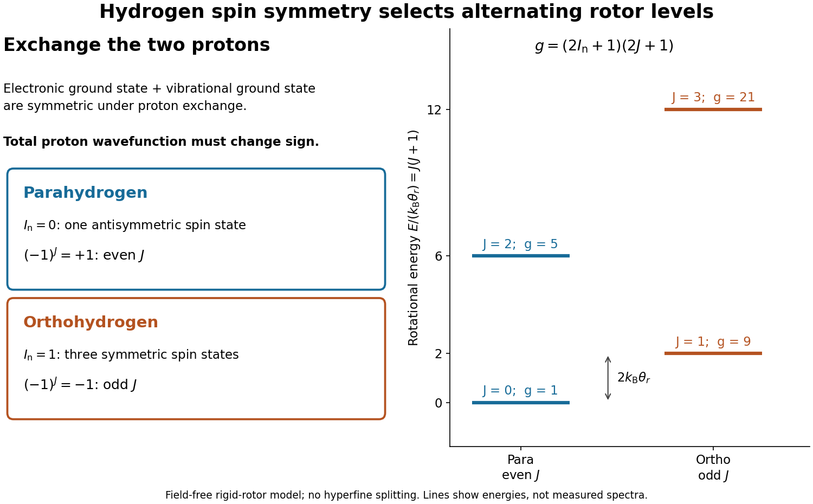

**[Figure 7](#image-hydrogen-spin-symmetry-and-rotational-levels). Proton exchange selects even-$J$ parahydrogen and odd-$J$ orthohydrogen**. Original [linear rigid rotor](#linear-rigid-rotor) diagram under the electronic and vibrational [ground state](quantum-mechanics.md#ground-state) assumptions above. Each line represents $g=(2I_{\rm n}+1)(2J+1)$ [quantum states](quantum-system.md#quantum-state), including both [nuclear spin](atomic-nucleus.md#nuclear-spin) and rotational [degenerate energy levels](quantum-mechanics.md#degenerate-energy-levels). The [energy](energy.md) separation between the two lowest allowed levels is rotational. No measured spectrum or spin-dependent splitting is shown.

###### Ortho-para conversion

↑ **Parent:** [Spin isomers of hydrogen](#spin-isomers-of-hydrogen)

Interconversion of [orthohydrogen](#orthohydrogen) and [parahydrogen](#parahydrogen), which changes the coupled nuclear-spin and rotational populations. An active conversion mechanism allows the mole fractions to follow equilibrium as [temperature](temperature.md) changes; slow conversion instead gives a [frozen ortho-para mixture](#frozen-ortho-para-mixture). Whether conversion remains active during a thermal measurement must therefore be distinguished from how the initial sample was prepared.

###### Ortho-para conversion heat

↑ **Parent:** [Ortho-para conversion](#ortho-para-conversion)

For [hydrogen](chemical-substance.md#hydrogen) approximated as a [linear rigid rotor](#linear-rigid-rotor), the $\ell=1$ to $\ell=0$ [energy](energy.md) decrease is $\hbar^2/I$, with [moment of inertia](rigid-body-dynamics.md#moment-of-inertia) $I\simeq m_pr^2/2$. A sample of mass $M$ initially containing an [orthohydrogen](#orthohydrogen) fraction $x_o$ therefore releases $Q\simeq x_oM\hbar^2/(m_p^2r^2)$ on complete conversion to the lowest [parahydrogen](#parahydrogen) level. This estimate neglects the [electron](physics.md#electron) contribution to molecular mass and changes of the rotational constant with environment. It describes an internal [heat](heat.md) load that external insulation cannot remove.

###### Frozen ortho-para mixture

↑ **Parent:** [Spin isomers of hydrogen](#spin-isomers-of-hydrogen)

A mixture whose [orthohydrogen](#orthohydrogen) and [parahydrogen](#parahydrogen) mole fractions are fixed on the observation timescale, although each species can equilibrate over its own rotational levels. Its molar [heat capacity](heat.md#heat-capacity) is $x_oC_o+x_pC_p$. [normal hydrogen](#normal-hydrogen) retained during cooling has $x_o=3/4$ and $x_p=1/4$. A mixture initially prepared at some other equilibrium composition can also be frozen; its subsequent heat response does not include a changing-composition term.

###### Parahydrogen

↑ **Parent:** [Spin isomers of hydrogen](#spin-isomers-of-hydrogen)

[Parahydrogen](#parahydrogen) uses the antisymmetric [spin-one-half singlet state](angular-momentum-operator.md#spin-one-half-singlet-state),

$$
\chi_{00}=\frac{|\uparrow\downarrow\rangle-|\downarrow\uparrow\rangle}{\sqrt2}.
$$

Here $I_{\rm n}$ labels total [nuclear spin](atomic-nucleus.md#nuclear-spin); it is not the [moment of inertia](rigid-body-dynamics.md#moment-of-inertia) $I$ in the [linear rigid rotor](#linear-rigid-rotor) formula. There is one nuclear-spin state for every rotational [quantum state](quantum-system.md#quantum-state). The lowest allowed rotational level is $J=0$, and the next is $J=2$. The description “opposite spins” alone is insufficient: the relative minus sign distinguishes this [singlet state](angular-momentum-operator.md#singlet-state) from the zero-projection member of the [triplet state](angular-momentum-operator.md#spin-one-half-triplet-state).

###### Orthohydrogen

↑ **Parent:** [Spin isomers of hydrogen](#spin-isomers-of-hydrogen)

[Orthohydrogen](#orthohydrogen) uses the three symmetric [spin-one-half triplet states](angular-momentum-operator.md#spin-one-half-triplet-state),

$$
\chi_{11}=|\uparrow\uparrow\rangle,\qquad
\chi_{10}=\frac{|\uparrow\downarrow\rangle+|\downarrow\uparrow\rangle}{\sqrt2},\qquad
\chi_{1,-1}=|\downarrow\downarrow\rangle.
$$

These three states give a nuclear-spin multiplicity of three, in addition to the rotational multiplicity $2J+1$. Thus the lowest [orthohydrogen](#orthohydrogen) level, $J=1$, has nine states, whereas the lowest [parahydrogen](#parahydrogen) level, $J=0$, has one. The familiar high-[temperature](temperature.md) $3:1$ ratio is not the ratio $9:1$ of these two lowest levels: at high [temperature](temperature.md), many even and odd rotational levels contribute.

###### Normal hydrogen

↑ **Parent:** [Spin isomers of hydrogen](#spin-isomers-of-hydrogen)

[Normal hydrogen](#normal-hydrogen) denotes the $3:1$ [orthohydrogen](#orthohydrogen)-to-[parahydrogen](#parahydrogen) mixture, the high-[temperature](temperature.md) equilibrium limit. Near room [temperature](temperature.md) the equilibrium ratio is already close to this limit. Cooling an isolated sample need not change its composition on the measurement timescale: ordinary collisions can redistribute rotational populations within each spin species much faster than they interconvert the spin species. A kinetically frozen composition can therefore coexist with rotational [thermal equilibrium](thermal-equilibrium.md) separately within each species.

The distinction was historically decisive. The institutional account [Die Entdeckung des para-Wasserstoffs](https://www.mpinat.mpg.de/607569/para-Wasserstoff), in its discussion of the rotational [heat capacity](heat.md#heat-capacity), explains that assuming an equilibrating composition missed the observed behavior, whereas freezing the high-[temperature](temperature.md) ratio reproduced it. It also records [Karl Friedrich Bonhoeffer](chemistry.md#karl-friedrich-bonhoeffer) and [Paul Harteck](chemistry.md#paul-harteck)'s 1929 preparation using a [catalyst](chemical-kinetics.md#catalyst) and [thermal conductivity](heat.md#thermal-conductivity) detection.[paragraphs on frozen high-temperature composition and the 1929 charcoal/thermal-conductivity discovery](chemistry-bibliography.md#die-entdeckung-des-para-wasserstoffs)

###### Rotational partition functions of hydrogen

↑ **Parent:** [Spin isomers of hydrogen](#spin-isomers-of-hydrogen)

Write the [linear rigid rotor](#linear-rigid-rotor) [energy eigenvalues](energy-eigenvalue.md) as $E_J=k_{\rm B}\theta_r J(J+1)$, where $\theta_r=\hbar^2/(2Ik_{\rm B})=hB/k_{\rm B}$ is the rotational [temperature](temperature.md) scale, $I$ the [moment of inertia](rigid-body-dynamics.md#moment-of-inertia), $B$ the frequency-valued [rotational constant](#rotational-constant), and $k_{\rm B}$ the [Boltzmann constant](thermodynamics.md#boltzmann-constant). Put $t=T/\theta_r$ and $\epsilon_J=J(J+1)$. Define sums that include rotational multiplicity but exclude nuclear-spin multiplicity:

$$
q_{\rm p}(t)=\sum_{J\ \mathrm{even}}(2J+1)e^{-\epsilon_J/t},\qquad
q_{\rm o}(t)=\sum_{J\ \mathrm{odd}}(2J+1)e^{-\epsilon_J/t}.
$$

The [canonical partition function](canonical-ensemble.md#canonical-partition-function) for one equilibrating internal rotor is $q_{\rm eq}=q_{\rm p}+3q_{\rm o}$, so its equilibrium [orthohydrogen](#orthohydrogen) fraction is

$$
x_{\rm o}^{\rm eq}=\frac{3q_{\rm o}}{q_{\rm p}+3q_{\rm o}},\qquad
\frac{x_{\rm o}^{\rm eq}}{1-x_{\rm o}^{\rm eq}}=\frac{3q_{\rm o}}{q_{\rm p}}.
$$

For $t\ll1$, the lowest allowed levels give $q_{\rm p}\simeq1$ and $q_{\rm o}\simeq3e^{-2/t}$, hence $x_{\rm o}^{\rm eq}\simeq9e^{-2/t}/(1+9e^{-2/t})\to0$. For $t\gg1$, the densely populated even and odd ladders have equal leading sums, $q_{\rm p}\sim q_{\rm o}\sim t/2$, hence $x_{\rm o}^{\rm eq}\to3/4$. The factor nine belongs to the low-[temperature](temperature.md) two-level approximation, and the factor three to the high-[temperature](temperature.md) spin multiplicities.

A frozen mixture requires two separately normalized [probability distributions](probability-distribution.md),

$$
p(J\mid\mathrm p)=\frac{(2J+1)e^{-\epsilon_J/t}}{q_{\rm p}}\quad(J\ \mathrm{even}),\qquad
p(J\mid\mathrm o)=\frac{(2J+1)e^{-\epsilon_J/t}}{q_{\rm o}}\quad(J\ \mathrm{odd}).
$$

Multiply these by the prescribed fractions $1-x$ and $x$, respectively. The nuclear-spin factor three cancels from the conditional [orthohydrogen](#orthohydrogen) distribution. For fixed counts $N_{\rm o}$ and $N_{\rm p}$, the internal part of the many-[molecule](molecule.md) [partition function](canonical-ensemble.md#canonical-partition-function) is proportional to $q_{\rm p}^{N_{\rm p}}(3q_{\rm o})^{N_{\rm o}}$, with combinatorial factors independent of [temperature](temperature.md). Its logarithm yields the two conditional means weighted by the fixed counts. Using $q_{\rm p}+3q_{\rm o}$ instead would silently permit conversion and change the physical constraint.

###### Hydrogen rotational heat capacity

↑ **Parent:** [Rotational partition functions of hydrogen](#rotational-partition-functions-of-hydrogen)

Let $u_s=\langle\epsilon\rangle_s$ and $v_s=\operatorname{Var}_s(\epsilon)$ for the conditional distributions of [parahydrogen](#parahydrogen) and [orthohydrogen](#orthohydrogen), with $s=\mathrm p,\mathrm o$. Differentiating the normalized [Boltzmann factors](canonical-ensemble.md#boltzmann-factor) gives $du_s/dt=v_s/t^2$. Thus the rotational [heat capacity at constant volume](heat.md#heat-capacity-at-constant-volume) per [molecule](molecule.md) of a composition frozen at $x$ is

$$
\frac{c_{\rm fr}}{k_{\rm B}}=\frac{(1-x)v_{\rm p}+xv_{\rm o}}{t^2}.
$$

At conversion equilibrium, the [law of total variance](probability-theory.md#law-of-total-variance) adds a nonnegative contribution from the changing species populations:

$$
\frac{c_{\rm eq}}{k_{\rm B}}=
\frac{(1-x_{\rm o}^{\rm eq})v_{\rm p}+x_{\rm o}^{\rm eq}v_{\rm o}
+x_{\rm o}^{\rm eq}(1-x_{\rm o}^{\rm eq})(u_{\rm o}-u_{\rm p})^2}{t^2}.
$$

The last term is the contribution from conversion. Compare the first two terms with a frozen sample at the same instantaneous composition; a frozen $3:1$ sample generally has different weights too. This formula follows directly from the [variance](variance.md) of a mixture: subtract the overall mean inside each species, expand the square, and the cross terms vanish because each conditional deviation has zero mean. It also proves nonnegative rotational [heat capacity](heat.md#heat-capacity) in either model.

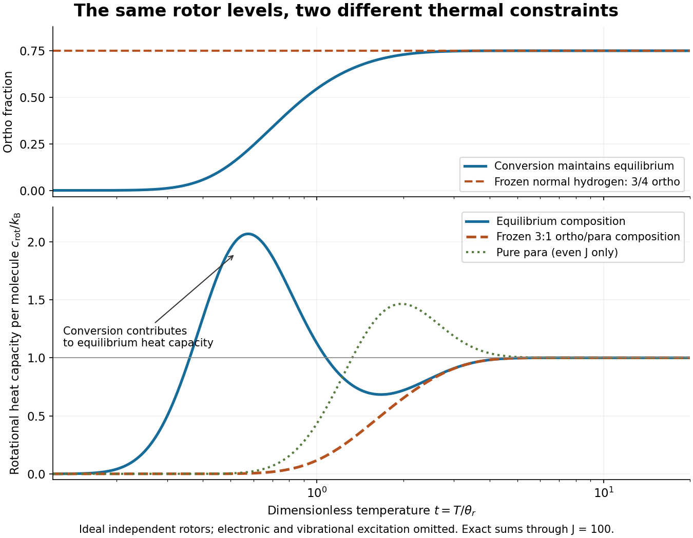

**[Figure 8](#image-hydrogen-equilibrium-and-frozen-rotational-heat-capacity). Hydrogen rotational heat capacity: equilibrating and frozen spin populations**. Original numerical sums of the stated [linear rigid rotor](#linear-rigid-rotor) model through $J=100$. The upper panel compares the equilibrium [orthohydrogen](#orthohydrogen) fraction with frozen [normal hydrogen](#normal-hydrogen); the lower panel also shows pure [parahydrogen](#parahydrogen). These are dimensionless predictions, not experimental curves. Only internal [molecular rotation](#molecular-rotation) contributes: [translation](geometry-and-topology.md#translation-geometry), [molecular vibration](#molecular-vibration), interactions between [molecules](molecule.md), and external-field splittings are omitted.

For an original worked example at $t=1/2$, summing the allowed ladders gives $q_{\rm p}\approx1.00003072$, $q_{\rm o}\approx0.05494692$, and $x_{\rm o}^{\rm eq}\approx0.14150982$. The calculated rotational [heat capacities](heat.md#heat-capacity) are $c_{\rm eq}/k_{\rm B}\approx1.94719633$ and $c_{\rm fr}/k_{\rm B}\approx0.00110733$ for frozen [normal hydrogen](#normal-hydrogen). The contrast is large because changing species accesses the $J=0$ to $J=1$ separation, whereas fixed species must use the larger $J=0$ to $2$ or $J=1$ to $3$ separations. These are model numbers at a chosen dimensionless [temperature](temperature.md), not measured hydrogen data.

Both rotational [heat capacities](heat.md#heat-capacity) approach zero as $t\to0$, although frozen [normal hydrogen](#normal-hydrogen) retains nonzero rotational [internal energy](internal-energy.md). Both approach $k_{\rm B}$ as $t\to\infty$ within the rotor model. The high-[temperature](temperature.md) limit is a formal limit with all other excitations suppressed; actual [molecular hydrogen](chemical-substance.md#molecular-hydrogen) eventually needs [molecular vibration](#molecular-vibration), nonrigidity, and dissociation. Multiplying the per-[molecule](molecule.md) result by the [Avogadro constant](physics.md#avogadro-constant) gives rotational [molar heat capacity](heat.md#molar-heat-capacity) in units of the [molar gas constant](ideal-gas.md#molar-gas-constant) $R$. A dilute classical [ideal gas](ideal-gas.md) additionally contributes $3R/2$ from [translation](geometry-and-topology.md#translation-geometry) to its [heat capacity at constant volume](heat.md#heat-capacity-at-constant-volume).

###### Heat released by hydrogen spin conversion

↑ **Parent:** [Spin isomers of hydrogen](#spin-isomers-of-hydrogen)

As $t\to0$, the conditional mean rotational [energies](energy.md) approach $U_{\rm p}/N=0$ and $U_{\rm o}/N=2k_{\rm B}\theta_r$, using the para $J=0$ level as the common zero. A frozen mixture with ortho fraction $x$ therefore retains $U_{\rm fr}/N\to2xk_{\rm B}\theta_r$. If a bath keeps the sample at low [temperature](temperature.md) while a [catalyst](chemical-kinetics.md#catalyst) permits conversion to almost pure [parahydrogen](#parahydrogen), the rotational [heat](heat.md) delivered to the bath tends to $Q_{\rm out}/N=2xk_{\rm B}\theta_r$, or $3k_{\rm B}\theta_r/2$ for [normal hydrogen](#normal-hydrogen).

One may shift the ortho ladder to its own lowest level for computing its conditional [heat capacity](heat.md#heat-capacity), because a constant [energy](energy.md) offset disappears on differentiation at fixed composition. That offset must be restored before comparing species or calculating conversion [heat](heat.md). Otherwise the calculation loses precisely the stored rotational [energy](energy.md) that conversion releases. The expression above accounts for the internal rotor contribution at fixed bath [temperature](temperature.md); it does not model liquid intermolecular [energies](energy.md), [latent heat](thermodynamic-potential.md#latent-heat), or an adiabatic temperature rise.

A [catalyst](chemical-kinetics.md#catalyst) changes the conversion rate and allows heat removal during cooling; it does not change the free-gas equilibrium weights at a specified [temperature](temperature.md). This connects the microscopic exchange rule to refrigeration: delayed conversion supplies a continuing internal [heat](heat.md) source. [Rotational Raman spectroscopy](#rotational-raman-spectroscopy) offers a complementary population probe because its $\Delta J=\pm2$ transitions stay within the even or odd ladder; line intensities require the appropriate species populations and transition response, not a bare $3:1$ intensity rule.

###### Surface-catalysed hydrogen spin conversion experiment

↑ **Parent:** [Spin isomers of hydrogen](#spin-isomers-of-hydrogen)

The 1935 primary paper [The Spin-Isomerization of Hydrogen at Paramagnetic and Diamagnetic Surfaces](https://doi.org/10.1021/ja01310a023), pp. 1251–1252, describes evacuated [catalyst](chemical-kinetics.md#catalyst) samples cooled before admitting [molecular hydrogen](chemical-substance.md#molecular-hydrogen). Gas samples were analyzed in a [glass](chemical-substance.md#glass) cell in [liquid air](chemical-substance.md#liquid-air): a heated [platinum](chemical-substance.md#platinum) wire and [Wheatstone bridge](electrical-engineering.md#wheatstone-bridge) converted changes in [thermal conductivity](heat.md#thermal-conductivity) into [electrical resistance](electric-charge.md#electrical-resistance) readings, calibrated against [normal hydrogen](#normal-hydrogen).[p. 1251, Experimental Details: sample handling and heated-wire thermal-conductivity analysis](chemistry-bibliography.md#the-spin-isomerization-of-hydrogen-at-paramagnetic-and-diamagnetic-surfaces-by-hugh-stott-taylor-and-h-diamond)

Its comparison of [oxide](chemical-substance.md#oxide) surfaces supplied a control: specimens exhibiting strong [paramagnetism](electromagnetism.md#paramagnetism) converted the gas much faster than the comparison exhibiting [diamagnetism](electromagnetism.md#diamagnetism) despite all adsorbing [molecular hydrogen](chemical-substance.md#molecular-hydrogen). Contact time, [pressure](pressure.md), and [temperature](temperature.md) were recorded. This supports a role for surface magnetic properties beyond [adsorption](physical-chemistry.md#adsorption) alone; it does not identify every microscopic surface site or directly measure nuclear-spin orientations.[p. 1252, Table I description and Discussion of Results: rare-earth oxide comparison and adsorption qualification](chemistry-bibliography.md#the-spin-isomerization-of-hydrogen-at-paramagnetic-and-diamagnetic-surfaces-by-hugh-stott-taylor-and-h-diamond)

The inference chain is preparation, contact with a specified surface, then a calibrated bulk transport readout of composition. It is distinct from a direct [calorimetry](calorimetry.md) measurement of [heat capacity](heat.md#heat-capacity): transport and [heat capacity](heat.md#heat-capacity) can both depend on the spin populations, but they are different measured quantities. Changing the catalyst's own surface structure, introducing magnetic impurities, or changing the detector's gas [pressure](pressure.md) can confound an uncalibrated comparison. The free-rotor [partition functions](canonical-ensemble.md#canonical-partition-function) predict equilibrium populations and stored [energy](energy.md), not the conversion rate on a particular surface.

## Molecular vibration

↑ **Parent:** [Molecule](molecule.md)  
ⓦ [Wiki](https://en.wikipedia.org/wiki/Molecular_vibration)

[Molecular vibration](#molecular-vibration) changes internal separations and [bond angles](#bond-angle), unlike the fixed internal [molecular geometry](#molecular-geometry) of a [rigid rotor](#rigid-rotor). Its coupling to [molecular rotation](#molecular-rotation) makes measured [rotational constants](#rotational-constant) depend on the vibrational [quantum state](quantum-system.md#quantum-state).

A [diatomic molecule](#diatomic-molecule) has one internal stretching coordinate: its two [atomic nuclei](atomic-nucleus.md) approach and separate about an equilibrium [bond length](chemical-bond.md#bond-length). The [diatomic bond stretch](#diatomic-bond-stretch) turns this motion into a particularly useful model. The local [potential energy](energy.md#potential-energy) curvature supplies the restoring [force](force.md), while the [reduced mass](classical-mechanics.md#reduced-mass) accounts for both moving partners. Thus the same [chemical bond](chemical-bond.md) can vibrate more slowly after an [isotope](chemical-substance.md#isotope) substitution even when its electronic structure is nearly unchanged.

This separation makes [infrared spectroscopy](chemistry.md#infrared-spectroscopy) informative: transition [frequencies](wave.md#frequency) constrain [chemical bond](chemical-bond.md) stiffness, and [isotope scaling of diatomic vibration](classical-mechanics.md#isotope-scaling-of-diatomic-vibration) tests the mass dependence. The [University of Florida HCl and DCl FTIR experiment](#university-of-florida-hcl-and-dcl-ftir-experiment) illustrates the measurement. Detectability also requires [vibrational infrared activity](#vibrational-infrared-activity); having vibrational [energy eigenvalues](energy-eigenvalue.md) alone does not guarantee an [infrared](optics.md#infrared) absorption line.

### Vibrational relaxation

↑ **Parent:** [Molecular vibration](#molecular-vibration)

Loss of excess vibrational excitation to other molecular degrees of freedom or to the surroundings. It can occur within one electronic state without [photon emission](quantum-mechanics.md#photon-emission), reducing the energy available to subsequent [fluorescence](fluorescence.md).

### Molecular normal coordinate

↑ **Parent:** [Molecular vibration](#molecular-vibration)

A mass-weighted displacement coordinate along an eigenvector of the molecular harmonic force-constant matrix after rigid translations and rotations are removed. An orthonormal normal-mode basis gives kinetic energy $\frac12\sum_iP_i^2$ and harmonic potential $\frac12\sum_i\omega_i^2Q_i^2$. This use of normal coordinate concerns molecular vibrations, rather than normal coordinates of a spacetime metric.

### Spectroscopic anharmonicity constant

↑ **Parent:** [Molecular vibration](#molecular-vibration)

In the quadratic vibrational term expression $E_v/(hc)=\widetilde\omega_e(v+1/2)-\widetilde\omega_ex_e(v+1/2)^2$, the constant $x_e$ is dimensionless, while $\widetilde\omega_ex_e$ has units of [spectroscopic wavenumber](wave-equation.md#spectroscopic-wavenumber). A positive value makes adjacent level spacings decrease. For an exact [Morse oscillator](quantum-system.md#morse-oscillator), $D_e/(hc)=\widetilde\omega_e/(4x_e)$. Using only two low-lying transitions to extrapolate this identity to a real molecule assumes the higher-order anharmonic terms are negligible all the way to dissociation.

### Equivalent-mode harmonic coupling

↑ **Parent:** [Molecular vibration](#molecular-vibration)

Coordinates belonging to inequivalent irreducible representations cannot have an invariant bilinear cross term. Two copies of the same real irreducible representation can: their componentwise dot product is invariant. Diagonalizing the multiplicity-space force-constant matrix produces the normal modes. Symmetry alone therefore does not require two $T_2$ coordinate sets to have zero coupling before that diagonalization.

### Vibronic coupling

↑ **Parent:** [Molecular vibration](#molecular-vibration)

Coupling between electronic and nuclear vibrational motion. Dependence of an electronic [electric dipole transition moment](quantum-mechanics.md#electric-dipole-transition-moment) on a [normal mode](wave-equation.md#normal-mode) coordinate can give intensity to a transition whose purely electronic matrix element vanishes at the equilibrium geometry.

#### Vibrational activation of an electronic transition

↑ **Parent:** [Vibronic coupling](#vibronic-coupling)

An otherwise forbidden [electronic transition](atomic-physics.md#electronic-transition) gains intensity when accompanying [molecular vibration](#molecular-vibration) supplies a symmetry factor that permits a nonzero [electric dipole transition moment](quantum-mechanics.md#electric-dipole-transition-moment). A symmetry-allowed total [vibronic state](#vibronic-state) specifies a possible transition, while the coupling determines its actual strength.

### Vibronic state

↑ **Parent:** [Molecular vibration](#molecular-vibration)

A joint electronic and vibrational [quantum state](quantum-system.md#quantum-state) of a [molecule](molecule.md). In a product approximation its [irreducible representation](representation-theory.md#irreducible-representation) is the [tensor product of group representations](representation-theory.md#tensor-product-of-group-representations) of the electronic and vibrational factors.

### Vibrational angular momentum

↑ **Parent:** [Molecular vibration](#molecular-vibration)

The [angular momentum](momentum.md#angular-momentum) associated with motion in a degenerate bending [normal mode](wave-equation.md#normal-mode) of a linear [molecule](molecule.md). A one-quantum bend has $l=\pm1$, and the total rotational [quantum number](quantum-system.md#quantum-number) obeys $J\geq|l|$.

### Rovibrational spectroscopy

↑ **Parent:** [Molecular vibration](#molecular-vibration)  
ⓦ [Wiki](https://en.wikipedia.org/wiki/Rotational–vibrational_spectroscopy)

Spectroscopy of simultaneous changes of vibrational and rotational state. The transition wavenumbers combine vibrational energy differences with [rotational constant](#rotational-constant) terms. The allowed rotational changes depend on the molecule and the transition type.

#### Perpendicular rovibrational band

↑ **Parent:** [Rovibrational spectroscopy](#rovibrational-spectroscopy)

A symmetric-top vibrational band whose transition dipole is perpendicular to the [symmetry](physics.md#symmetry-physics) axis, with $\Delta K=\pm1$. Unresolved Q subbranches can create a regular sequence controlled mainly by $A-B$.

#### Parallel rovibrational band

↑ **Parent:** [Rovibrational spectroscopy](#rovibrational-spectroscopy)

A symmetric-top vibrational band whose transition dipole is parallel to the [symmetry](physics.md#symmetry-physics) axis, with $\Delta K=0$ in the elementary model.

#### R branch

↑ **Parent:** [Rovibrational spectroscopy](#rovibrational-spectroscopy)

The [rovibrational spectroscopy](#rovibrational-spectroscopy) branch in which absorption raises the total rotational [angular momentum](momentum.md#angular-momentum) quantum number by one. A label $R(J)$ conventionally specifies the lower-state value $J$.

#### Q branch

↑ **Parent:** [Rovibrational spectroscopy](#rovibrational-spectroscopy)

The [rovibrational spectroscopy](#rovibrational-spectroscopy) branch with unchanged rotational [angular momentum](momentum.md#angular-momentum) quantum number. Differences between upper and lower [rotational constants](#rotational-constant) can resolve its transitions into closely spaced lines. Allowed lower-state values depend on the angular momenta of both states.

#### P branch

↑ **Parent:** [Rovibrational spectroscopy](#rovibrational-spectroscopy)

The [rovibrational spectroscopy](#rovibrational-spectroscopy) branch in which absorption lowers the total rotational [angular momentum](momentum.md#angular-momentum) quantum number by one. A label $P(J)$ conventionally specifies the lower-state value $J$.

#### Rovibrational spectrum

↑ **Parent:** [Rovibrational spectroscopy](#rovibrational-spectroscopy)

The observed collection of lines or bands from vibration-rotation transitions. In the usual parallel diatomic $\Sigma\to\Sigma$ infrared band, P and R branches have $\Delta J=-1,+1$ and the Q branch is absent.

### Hot band

↑ **Parent:** [Molecular vibration](#molecular-vibration)

A transition starting from a thermally populated vibrationally excited state. Its intensity depends on the lower-state population through the [Boltzmann distribution](thermodynamics.md#boltzmann-distribution). [Anharmonicity](wave.md#anharmonicity) and coupling between [normal modes](wave-equation.md#normal-mode) can shift it away from the corresponding [vibrational fundamental](#vibrational-fundamental).

### Vibrational fundamental

↑ **Parent:** [Molecular vibration](#molecular-vibration)

Excitation of one quantum of a [normal mode](wave-equation.md#normal-mode) from the vibrational ground state. For an infrared-active mode in the linear-dipole [harmonic approximation](lagrangian-mechanics.md#harmonic-approximation), this is the allowed absorption underlying the usual fundamental band. A [vibrational overtone](#vibrational-overtone) excites two or more quanta from the ground state.

### Vibrational heat capacity of a diatomic gas

↑ **Parent:** [Molecular vibration](#molecular-vibration)

In the independent harmonic approximation, each [diatomic molecule](#diatomic-molecule) has one bond-stretching [quantum harmonic oscillator](quantum-harmonic-oscillator.md) with energies $(n+1/2)\hbar\omega$. Write $x=\hbar\omega/(k_BT)$. Its [canonical partition function](canonical-ensemble.md#canonical-partition-function) is $z=e^{-x/2}/(1-e^{-x})$, and differentiating its logarithm gives

$$
U_{\mathrm{vib}}=N\hbar\omega\left(\frac12+\frac1{e^x-1}\right),\qquad C_{V,\mathrm{vib}}=Nk_B\frac{x^2e^x}{(e^x-1)^2}.
$$

For $T\ll\hbar\omega/k_B$, excitation is exponentially suppressed and the heat capacity tends to zero. At high temperature it tends to $Nk_B$, one $k_B/2$ contribution from each quadratic kinetic and potential term. The zero-point energy does not contribute to the derivative with temperature. For a dilute gas whose rotations are already active, adding translation and rotation gives molar $C_V\simeq5R/2$ before vibration is activated and $7R/2$ afterwards, provided dissociation and electronic excitations are negligible.

### Diatomic bond stretch

↑ **Parent:** [Molecular vibration](#molecular-vibration)

Let $r$ be the instantaneous [bond length](chemical-bond.md#bond-length), $r_e>0$ its equilibrium value, and $q=r-r_e$ the stretching [displacement](classical-mechanics.md#displacement). Assume one fixed electronic [quantum state](quantum-system.md#quantum-state), a smooth [potential energy](energy.md#potential-energy) $V(r)$ with a nondegenerate [local minimum](analysis.md#local-minimum) at $r_e$, and omit [molecular rotation](#molecular-rotation) initially. The [Taylor series](calculus.md#taylor-series) has no linear term because $V'(r_e)=0$:

$$
V(r_e+q)=V_0+\frac12kq^2+O(q^3),\qquad
V_0=V(r_e),\qquad k=V''(r_e)>0.
$$

Keeping only the quadratic term is the [harmonic approximation near a potential minimum](bloch-s-theorem.md#harmonic-approximation-near-a-potential-minimum). The [bond force constant](#bond-force-constant) $k$ has units $\mathrm{N\,m^{-1}}$. It measures local stiffness; it is not the [bond-dissociation energy](chemical-bond.md#bond-dissociation-energy), which concerns the depth and distant shape of the entire well.

The [two-particle relative coordinate](classical-mechanics.md#two-particle-relative-coordinate) explains the [reduced mass](classical-mechanics.md#reduced-mass). For stretching along a fixed axis in a stationary [centre of mass](classical-mechanics.md#center-of-mass) frame, let $u_1,u_2$ be the nuclear [displacements](classical-mechanics.md#displacement) from equilibrium. Then $u_2-u_1=q$ and $m_1u_1+m_2u_2=0$, so

$$
u_1=-\frac{m_2}{m_1+m_2}q,\qquad
u_2=\frac{m_1}{m_1+m_2}q,\qquad
T=\frac12m_1\dot u_1^2+\frac12m_2\dot u_2^2=\frac12\mu\dot q^2,\qquad
\mu=\frac{m_1m_2}{m_1+m_2}.
$$

Here $T$ is the internal [kinetic energy](energy.md#kinetic-energy), and $m_1,m_2>0$ are the two nuclear [masses](classical-mechanics.md#mass). The lighter partner moves farther; the [reduced mass](classical-mechanics.md#reduced-mass) is smaller than either individual [mass](classical-mechanics.md#mass). The restoring [force](force.md) $-dV/dq\simeq-kq$ gives [simple harmonic motion](classical-mechanics.md#simple-harmonic-motion):

$$
\mu\ddot q=-kq,\qquad
q(t)=A\cos(\omega t+\phi),\qquad
\omega=\sqrt{\frac{k}{\mu}},\qquad
\nu=\frac{\omega}{2\pi},\qquad
\widetilde\nu_{\rm harm}=\frac{\omega}{2\pi c}.
$$

The [angular frequency](lagrangian-mechanics.md#angular-frequency) is $\omega$, the ordinary [frequency](wave.md#frequency) is $\nu$, and $\widetilde\nu_{\rm harm}$ is the corresponding [spectroscopic wavenumber](wave-equation.md#spectroscopic-wavenumber); $c$ is the [speed of light](special-relativity.md#speed-of-light). Use $c$ in $\mathrm{cm\,s^{-1}}$ to obtain $\widetilde\nu_{\rm harm}$ in $\mathrm{cm^{-1}}$. The symbol $k$ here is a [bond force constant](#bond-force-constant), not an angular [wavenumber](wave-equation.md#wavenumber).

For an original dimensionless example, choose $m_1=m_2=2$ and $k=4$ in consistent model units. Then $\mu=1$ and $\omega=2$. Releasing at $q(0)=0.1$ with $\dot q(0)=0$ gives $q(t)=0.1\cos(2t)$ and $u_1=-q/2$, $u_2=q/2$. Each [atomic nucleus](atomic-nucleus.md) moves only half the stretching [amplitude](wave.md#wave-amplitude), while the conserved internal [mechanical energy](energy.md#mechanical-energy) above $V_0$ is $\frac12k(0.1)^2=0.02$. Fixing one partner instead would give $\omega=\sqrt2$, demonstrating why a one-body calculation changes the model.

#### Bond force constant

↑ **Parent:** [Diatomic bond stretch](#diatomic-bond-stretch)

The [bond force constant](#bond-force-constant) is the curvature of the effective [potential energy](energy.md#potential-energy) at the equilibrium [bond length](chemical-bond.md#bond-length). For a [diatomic bond stretch](#diatomic-bond-stretch), it plays the role of a [spring constant](elasticity-physics.md#spring-constant). Its definition is local: two wells with the same curvature can have different [bond-dissociation energies](chemical-bond.md#bond-dissociation-energy).

#### Harmonic vibrational energy levels

↑ **Parent:** [Diatomic bond stretch](#diatomic-bond-stretch)

Quantizing the stretching coordinate gives a [quantum harmonic oscillator](quantum-harmonic-oscillator.md) with [reduced mass](classical-mechanics.md#reduced-mass) $\mu$:

$$
\widehat H=V_0-\frac{\hbar^2}{2\mu}\frac{d^2}{dq^2}+\frac12kq^2,\qquad
E_v=V_0+\hbar\omega\left(v+\frac12\right),\qquad
v=0,1,2,\ldots.
$$

Here $v$ is the vibrational [quantum number](quantum-system.md#quantum-number) and $\hbar=h/(2\pi)$ the reduced [Planck constant](quantum-mechanics.md#planck-constant). Consecutive [energy eigenvalues](energy-eigenvalue.md) have gap $\hbar\omega$; the [ground state](quantum-mechanics.md#ground-state) has [zero-point energy](quantum-harmonic-oscillator.md#zero-point-energy) $\hbar\omega/2$ above the well minimum. The offset $V_0$ cancels from every transition [energy](energy.md).

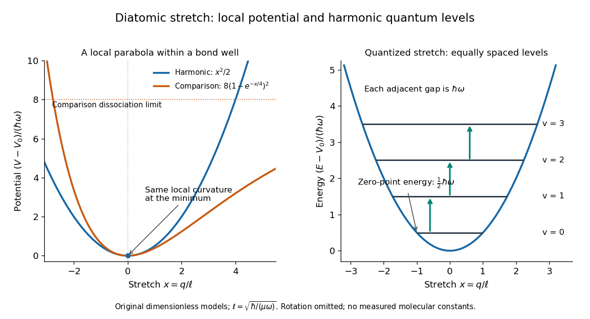

**[Figure 9](#image-diatomic-stretch-potential-and-quantum-levels). Local harmonic approximation near a potential minimum and equally spaced vibrational energy eigenvalues**. Original dimensionless model with $x=q/\sqrt{\hbar/(\mu\omega)}$ and $e=(E-V_0)/(\hbar\omega)$. The blue parabola is $x^2/2$; levels are $e=v+1/2$. The orange comparison is the stipulated [Morse potential](quantum-system.md#morse-potential) $8(1-e^{-x/4})^2$, with the same curvature at $x=0$; it is not a fit to [hydrogen chloride](electronegativity.md#hydrogen-chloride). Arrows show adjacent vibrational gaps, with [molecular rotation](#molecular-rotation) omitted.

A short proof uses [creation and annihilation operators](quantum-harmonic-oscillator.md#creation-and-annihilation-operators): with $\ell=\sqrt{\hbar/(\mu\omega)}$, write $q=\ell(a+a^\dagger)/\sqrt2$. The [Quantum Hamiltonian](quantum-system.md#hamiltonian-quantum-mechanics) becomes $\widehat H-V_0=\hbar\omega(a^\dagger a+1/2)$. Nonnegativity of $a^\dagger a$ gives the lowest level; repeated application of $a^\dagger$ raises its [energy](energy.md) by $\hbar\omega$ each time. This also gives $\langle q\rangle_v=0$ and

$$
\langle q^2\rangle_v=\frac{\hbar}{\mu\omega}\left(v+\frac12\right).
$$

The [ground state](quantum-mechanics.md#ground-state) therefore has a nonzero spread of [bond lengths](chemical-bond.md#bond-length), even though its mean stretching [displacement](classical-mechanics.md#displacement) vanishes. A stationary [energy eigenstate](energy-eigenvalue.md#energy-eigenstate) has a time-independent position [probability density](wave-function.md#probability-density); the classical [oscillation](wave.md#oscillation) curve is not a trajectory of an [atomic nucleus](atomic-nucleus.md) in that state.

The parabolic model formally extends $q$ to the whole [real line](real-analysis.md#real-line), whereas an actual [bond length](chemical-bond.md#bond-length) satisfies $r>0$. It is useful for low levels concentrated near $r_e$, with typical stretching [displacements](classical-mechanics.md#displacement) much smaller than $r_e$. It fails near breakup of the [chemical bond](chemical-bond.md) and when neglected [anharmonicity](wave.md#anharmonicity) becomes substantial.

#### HCl and DCl harmonic stretch comparison

↑ **Parent:** [Diatomic bond stretch](#diatomic-bond-stretch)

Keep the same [bond force constant](#bond-force-constant) $k$ and approximate the nuclear [masses](classical-mechanics.md#mass) of $^{1}\mathrm H$, $^{2}\mathrm H$, and $^{35}\mathrm{Cl}$ by $1u$, $2u$, and $35u$, respectively. Here $u$ is the [unified atomic mass unit](chemical-substance.md#dalton-unit), and $\mathrm D$ denotes [deuterium](chemical-substance.md#deuterium). These are chosen [mass number](chemical-substance.md#mass-number) approximations, not measured [atomic masses](chemical-substance.md#atomic-mass) or natural-abundance averages. With the same [chlorine](chemical-substance.md#chlorine) [isotope](chemical-substance.md#isotope) in both [molecules](molecule.md),

$$
\mu_{\rm HCl}=\frac{35}{36}u,\qquad
\mu_{\rm DCl}=\frac{70}{37}u,\qquad
\frac{\omega_{\rm DCl}}{\omega_{\rm HCl}}
=\frac{\widetilde\nu_{{\rm harm},\rm DCl}}{\widetilde\nu_{{\rm harm},\rm HCl}}
=\sqrt{\frac{\mu_{\rm HCl}}{\mu_{\rm DCl}}}
=\sqrt{\frac{37}{72}}\approx0.716860.
$$

This is the [isotope scaling of diatomic vibration](classical-mechanics.md#isotope-scaling-of-diatomic-vibration) prediction. Doubling the light partner's [mass](classical-mechanics.md#mass) nearly doubles the [reduced mass](classical-mechanics.md#reduced-mass), lowering the [frequency](wave.md#frequency) by about $28.3\%$. The factor differs from $1/\sqrt2$ because the [chlorine](chemical-substance.md#chlorine) partner also moves.

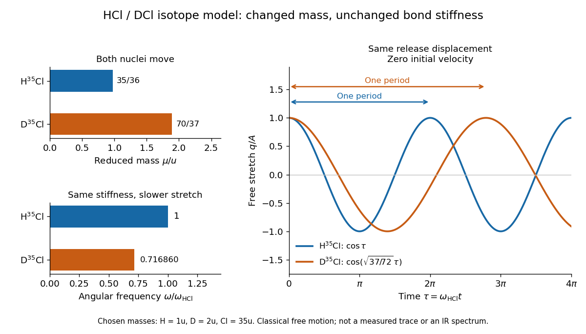

**[Figure 10](#image-hcl-dcl-mass-and-stretch-response). Isotope substitution slows a stipulated harmonic diatomic bond stretch**. Original approximate [mass number](chemical-substance.md#mass-number) model: $1u,2u,35u$ and unchanged [bond force constant](#bond-force-constant). Left: calculated [reduced masses](classical-mechanics.md#reduced-mass) and normalized [angular frequencies](lagrangian-mechanics.md#angular-frequency). Right: free classical stretches released from the same small [displacement](classical-mechanics.md#displacement) and zero [velocity](classical-mechanics.md#velocity), $q_{\rm HCl}/A=\cos\tau$ and $q_{\rm DCl}/A=\cos(\sqrt{37/72}\,\tau)$, with $\tau=\omega_{\rm HCl}t$. This is not a measured time trace or an [infrared](optics.md#infrared) spectrum.

For the same small initial stretch $A$ and zero [velocity](classical-mechanics.md#velocity), both models start with the same internal [mechanical energy](energy.md#mechanical-energy) $kA^2/2$, but the DCl [oscillation period](classical-mechanics.md#period-of-an-oscillation) is longer by $\sqrt{72/37}\approx1.394972$. In the [centre of mass](classical-mechanics.md#center-of-mass) frame, $u_{\rm H}=-35q/36$ and $u_{\rm Cl}=q/36$ for HCl; $u_{\rm D}=-35q/37$ and $u_{\rm Cl}=2q/37$ for DCl. These ratios explain which partner moves and are separate from the change in [frequency](wave.md#frequency).

The common-$k$ assumption belongs to the leading [Born-Oppenheimer approximation](quantum-mechanics.md#born-oppenheimer-approximation): fixed nuclear positions and [electric charges](electric-charge.md) determine the electronic [potential energy](energy.md#potential-energy), while nuclear [masses](classical-mechanics.md#mass) govern motion on that curve. Quantitative comparison requires actual [atomic masses](chemical-substance.md#atomic-mass), departures from that approximation, and separation of [anharmonicity](wave.md#anharmonicity) and [molecular rotation](#molecular-rotation) from the measured band. Even with common $k$, the [quantum harmonic oscillator](quantum-harmonic-oscillator.md) predicts a different [zero-point energy](quantum-harmonic-oscillator.md#zero-point-energy) for each [isotope](chemical-substance.md#isotope).[printed pp. 1 and 3, electronic motion; p. 12, Comprehension Question 2: common isotope potential and inferred spring constants](chemistry-bibliography.md#rotation-vibration-spectrum-of-the-hcl-molecule-university-of-florida-laboratory)

### Vibrational infrared activity

↑ **Parent:** [Molecular vibration](#molecular-vibration)

In the ideal [electric-dipole interaction](quantum-mechanics.md#electric-dipole-interaction), a vibrational transition needs a nonzero [matrix element](vector-space.md#matrix-element) of the [electric dipole moment](electrostatics.md#electric-dipole-moment). For a [diatomic bond stretch](#diatomic-bond-stretch), expand the body-axis dipole component as $d(q)=d_e+d'_eq+\cdots$. A changing [electric dipole moment](electrostatics.md#electric-dipole-moment), rather than a permanent value $d_e$ alone, permits the harmonic fundamental. Keeping only the linear term and harmonic [wavefunctions](wave-function.md) gives $\Delta v=\pm1$.[Lecture 14, introductory recap and infrared-activity section: dipole change and adjacent-level selection](chemistry-bibliography.md#14-harmonic-oscillators-and-ir-spectroscopy-ucd-chem-110a-by-delmar-s-larsen)

The derivation is sharper than a picture of a shaking [molecule](molecule.md). [Orthogonality](inner-product.md#orthogonal-vectors) removes the constant term for $v'\ne v$, and [creation and annihilation operators](quantum-harmonic-oscillator.md#creation-and-annihilation-operators) give

$$
\langle v'|q|v\rangle=\sqrt{\frac{\hbar}{2\mu\omega}}\left(\sqrt{v+1}\,\delta_{v',v+1}+\sqrt v\,\delta_{v',v-1}\right).
$$

Here $\delta$ is the [Kronecker delta](multilinear-algebra.md#kronecker-delta). Thus absorption raises $v$ by one when the dipole derivative and angular factor are nonzero, and its [photon](quantum-mechanics.md#photon) satisfies

$$
h\nu_\gamma=E_{v+1}-E_v=\hbar\omega,\qquad
\widetilde\nu_\gamma=\frac{E_{v+1}-E_v}{hc}=\widetilde\nu_{\rm harm}.
$$

A nonzero vibrational [matrix element](vector-space.md#matrix-element) is only one factor: rotational [electric-dipole selection rules](quantum-mechanics.md#electric-dipole-selection-rule), initial populations, and spectral resolution also constrain visibility.

For an isolated [diatomic molecule](#diatomic-molecule) with identical [atomic nuclei](atomic-nucleus.md), such as [molecular hydrogen](chemical-substance.md#molecular-hydrogen) in its symmetric electronic [ground state](quantum-mechanics.md#ground-state), stretching preserves zero [electric dipole moment](electrostatics.md#electric-dipole-moment). By symmetry, this homonuclear stretch is infrared inactive in the ideal dipole model, although it still vibrates. Other interactions or environments can permit detection.[Lecture 14, introductory recap: dipole-change criterion; the identical-nuclei case follows here by symmetry](chemistry-bibliography.md#14-harmonic-oscillators-and-ir-spectroscopy-ucd-chem-110a-by-delmar-s-larsen)

### University of Florida HCl and DCl FTIR experiment

↑ **Parent:** [Molecular vibration](#molecular-vibration)

The University of Florida's [Rotation Vibration Spectrum of the HCl Molecule, University of Florida laboratory](chemistry-bibliography.md#rotation-vibration-spectrum-of-the-hcl-molecule-university-of-florida-laboratory) protocol, printed pp. 2–3 and 10–11, uses a scanning [Michelson interferometer](physical-optics.md#michelson-interferometer) for [Fourier transform spectroscopy](optical-instrument.md#fourier-transform-spectroscopy). An air-filled [silicon](chemical-substance.md#silicon)-window cell supplies the background. Supervised preparation adds concentrated [hydrogen chloride](electronegativity.md#hydrogen-chloride) liquid; the cleaned cell subsequently receives DCl liquid. Acquisition settings are identical.

The readout is transmission or [absorbance](physical-chemistry.md#absorbance) against [spectroscopic wavenumber](wave-equation.md#spectroscopic-wavenumber), resolving [molecular rotation](#molecular-rotation) alongside stretching. Background addresses instrument and cell contributions; cleaning addresses carryover. Excessive absorption impairs analysis. Assigning [isotopes](chemical-substance.md#isotope) and rotational branches precedes fitting band parameters to test [isotope scaling of diatomic vibration](classical-mechanics.md#isotope-scaling-of-diatomic-vibration). These are prescribed measurements, not numerical observations supplied here.[printed pp. 10–12: Measurements, Preliminary Analysis and Data Analysis, including matched scans, excessive absorption, isotope assignments and fitted band origin](chemistry-bibliography.md#rotation-vibration-spectrum-of-the-hcl-molecule-university-of-florida-laboratory)

For a transparent ideal model, add the [linear rigid rotor](#linear-rigid-rotor) to the [harmonic vibrational energy levels](#harmonic-vibrational-energy-levels) and assume the same frequency-valued [rotational constant](#rotational-constant) $B$ in both vibrational states:

$$
E_{v,J}=V_0+h\nu_{\rm harm}(v+1/2)+hB J(J+1).
$$

For a spin-free [diatomic molecule](#diatomic-molecule) with no electronic [angular momentum](momentum.md#angular-momentum), [electric-dipole selection rules](quantum-mechanics.md#electric-dipole-selection-rule) give $\Delta J=\pm1$ for this vibrational absorption. Subtracting initial from final [energy eigenvalues](energy-eigenvalue.md) yields

$$
\begin{aligned}
\widetilde\nu_R(J)&=\widetilde\nu_{\rm harm}+2\widetilde B(J+1),&&J=0,1,2,\ldots,\\
\widetilde\nu_P(J)&=\widetilde\nu_{\rm harm}-2\widetilde B J,&&J=1,2,3,\ldots,\qquad \widetilde B=B/c.
\end{aligned}
$$

These are two rotational branches about the vibrational band origin, not a single stretch line. For stipulated dimensionless values $\widetilde\nu_{\rm harm}=100$ and $\widetilde B=1$, the first three R-branch positions are $102,104,106$, and the first three P-branch positions are $98,96,94$. There is no $J=0\to-1$ transition. The numbers illustrate level subtraction; they are not HCl measurements. Real upper and lower [rotational constants](#rotational-constant) differ, and [centrifugal distortion](#centrifugal-distortion) shifts lines further.

### Vibrational overtone

↑ **Parent:** [Molecular vibration](#molecular-vibration)

A [vibrational overtone](#vibrational-overtone) excites more than one vibrational quantum: $v=0\to2$ is the first overtone, and $0\to3$ the second. Such transitions vanish in the combined harmonic-potential and linear-dipole approximation. [Anharmonicity](wave.md#anharmonicity) changes [wavefunctions](wave-function.md) and level spacing; nonlinear terms in the [electric dipole moment](electrostatics.md#electric-dipole-moment) can also supply otherwise missing transition [matrix elements](vector-space.md#matrix-element).[Lecture 14, overtone section, Table 1 and following potential-expansion discussion](chemistry-bibliography.md#14-harmonic-oscillators-and-ir-spectroscopy-ucd-chem-110a-by-delmar-s-larsen)

For an original illustrative level model, set

$$
E_v-V_0=\hbar\omega\left[(v+1/2)-\epsilon(v+1/2)^2\right],\qquad 0<\epsilon\ll1.
$$

Then $E_1-E_0=\hbar\omega(1-2\epsilon)$ and $E_2-E_0=2\hbar\omega(1-3\epsilon)$. With chosen $\epsilon=0.02$, the fundamental gap is $0.96\hbar\omega$ and the first-overtone gap $1.88\hbar\omega$, below twice the fundamental, $1.92\hbar\omega$. This low-level illustration does not determine transition intensity or justify extrapolation to arbitrarily large $v$. It shows why even a well-resolved fundamental band origin need not equal the harmonic curvature scale $\widetilde\nu_{\rm harm}$.

## Molecular geometry

↑ **Parent:** [Molecule](molecule.md)  
ⓦ [Wiki](https://en.wikipedia.org/wiki/Molecular_geometry)

Why do [methane](chemical-substance.md#methane), [ammonia](chemical-substance.md#ammonia), and [water](chemical-substance.md#water) have different shapes when each central [chemical atom](physics.md#atom-physics) is surrounded by eight [valence electrons](chemical-bond.md#valence-electron)? The answer separates the positions of [atomic nuclei](atomic-nucleus.md) from the [electron domains](covalent-bond.md#electron-domain) used in a [VSEPR model](covalent-bond.md#valence-shell-electron-pair-repulsion-theory).

[Molecular geometry](#molecular-geometry) describes the three-dimensional arrangement of the [atomic nuclei](atomic-nucleus.md) in a [molecule](molecule.md), including [bond lengths](chemical-bond.md#bond-length) and [bond angles](#bond-angle). For a larger [molecule](molecule.md), a shape name often describes just the neighbours of one central [chemical atom](physics.md#atom-physics). A [Lewis structure](covalent-bond.md#lewis-structure) records connections and electron bookkeeping; its flat layout does not fix [molecular geometry](#molecular-geometry).

In the [VSEPR model](covalent-bond.md#valence-shell-electron-pair-repulsion-theory), [electron pair geometry](covalent-bond.md#electron-pair-geometry) includes both bonding [electron domains](covalent-bond.md#electron-domain) and [lone pairs](covalent-bond.md#lone-pair), whereas [molecular geometry](#molecular-geometry) counts only the [chemical atoms](physics.md#atom-physics). In [methane](chemical-substance.md#methane), four [bond pairs](covalent-bond.md#bond-pair) and no [lone pairs](covalent-bond.md#lone-pair) give [tetrahedral molecular geometry](#tetrahedral-molecular-geometry). In [ammonia](chemical-substance.md#ammonia), three [bond pairs](covalent-bond.md#bond-pair) and one [lone pair](covalent-bond.md#lone-pair) give [trigonal pyramidal molecular geometry](#trigonal-pyramidal-molecular-geometry). In [water](chemical-substance.md#water), two [bond pairs](covalent-bond.md#bond-pair) and two [lone pairs](covalent-bond.md#lone-pair) give [bent molecular geometry](#bent-molecular-geometry). All three use the same ideal tetrahedral [electron pair geometry](covalent-bond.md#electron-pair-geometry); this does not make their actual [bond angles](#bond-angle) equal. See [Flowers, Theopold, Langley and Robinson, Chemistry 2e, §7.6: electron-pair and molecular geometries](https://openstax.org/books/chemistry-2e/pages/7-6-molecular-structure-and-polarity).

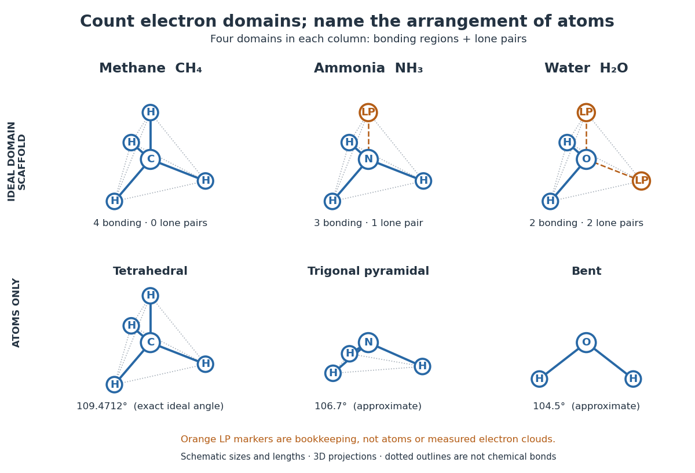

**[Figure 11](#image-molecular-geometry-domains-and-atoms). Four electron domains, three arrangements of atomic nuclei: methane, ammonia, and water**. Original geometric constructions. The upper row is an ideal [VSEPR model](covalent-bond.md#valence-shell-electron-pair-repulsion-theory) counting scaffold: orange LP markers identify [lone pairs](covalent-bond.md#lone-pair), not additional [chemical atoms](physics.md#atom-physics) or measured [electron density](chemistry.md#electron-density). The lower row shows only [chemical atoms](physics.md#atom-physics); [ammonia](chemical-substance.md#ammonia) and [water](chemical-substance.md#water) use the sourced approximate [bond angles](#bond-angle) discussed below. Sizes and [bond lengths](chemical-bond.md#bond-length) are arbitrary. Three-dimensional projections can change the apparent [bond angles](#bond-angle) on the page. Dotted outlines are geometric guides, not extra [chemical bonds](chemical-bond.md).

A static drawing also needs a physical interpretation. The [atomic nuclei](atomic-nucleus.md) undergo [oscillations](wave.md#oscillation); an arrangement at a minimum of [potential energy](energy.md#potential-energy) and an experimentally averaged arrangement need not have identical [bond lengths](chemical-bond.md#bond-length) or [bond angles](#bond-angle). This distinction matters when comparing measurements with [quantum mechanics](quantum-mechanics.md) calculations; see the [IUPAC Gold Book: experimental bond-length conventions](https://goldbook.iupac.org/terms/view/BT07003). [Gas electron diffraction](#gas-electron-diffraction) gives a concrete route from a laboratory signal to [molecular geometry](#molecular-geometry) rather than inferring shape from a drawing alone.

### Fluxionality

↑ **Parent:** [Molecular geometry](#molecular-geometry)

Interconversion of molecular arrangements that exchanges chemically distinguishable sites. In [NMR spectroscopy](nuclear-magnetic-resonance.md), exchange fast compared with the relevant frequency difference can merge signals, so observed equivalence need not be a static [molecular symmetry](euclidean-geometry.md#molecular-symmetry).

### Polyhedral cluster

↑ **Parent:** [Molecular geometry](#molecular-geometry)

A connected molecular framework described by a polyhedral vertex graph. Terminal ligands are distinguished from atoms belonging to the skeletal framework.

#### Zintl cluster

↑ **Parent:** [Polyhedral cluster](#polyhedral-cluster)

A polyanionic main-group cluster whose [electron](physics.md#electron) count can support delocalized skeletal bonding. Localized [lone pairs](covalent-bond.md#lone-pair) must be separated before applying a polyhedral count.

#### Arachno cluster

↑ **Parent:** [Polyhedral cluster](#polyhedral-cluster)

An open cluster framework formally obtained by removing two vertices from a [closo](#closo-cluster) parent. Its usual [electron](physics.md#electron) count is $n+3$ skeletal pairs; [hydrogen](chemical-substance.md#hydrogen) positions and cage distortions require additional structural information.

#### Nido cluster

↑ **Parent:** [Polyhedral cluster](#polyhedral-cluster)

An open cluster framework formally obtained by removing one vertex from a [closo](#closo-cluster) parent. In the usual electron-counting model, an $n$-vertex [nido](#nido-cluster) framework has $n+2$ skeletal pairs.

#### Closo cluster

↑ **Parent:** [Polyhedral cluster](#polyhedral-cluster)

A closed deltahedral cluster described by $n+1$ [skeletal electron pairs](chemical-bond.md#skeletal-electron-pair) in the usual Wade model. [borane](chemical-substance.md#borane) examples include $[\mathrm{B_{12}H_{12}}]^{2-}$.

### Spiro compound

↑ **Parent:** [Molecular geometry](#molecular-geometry)

A molecular framework in which two rings share exactly one atom.

#### Spirodienone

↑ **Parent:** [Spiro compound](#spiro-compound)

A spirocyclic framework containing a dienone ring. An acid-promoted [dienone-phenol rearrangement](chemical-reaction.md#dienone-phenol-rearrangement) can convert a suitably substituted spiro framework into fused-ring connectivity.

### Trigonal-bipyramidal molecular geometry

↑ **Parent:** [Molecular geometry](#molecular-geometry)

A five-coordinate geometry with two axial sites and three equatorial sites. Ideal axial–equatorial and equatorial–equatorial angles are $90^\circ$ and $120^\circ$.

### Trigonal planar molecular geometry

↑ **Parent:** [Molecular geometry](#molecular-geometry)  
ⓦ [Wiki](https://en.wikipedia.org/wiki/Trigonal_planar_molecular_geometry)

A [molecular geometry](#molecular-geometry) in which three attached [chemical atoms](physics.md#atom-physics) and their central atom lie in one plane. The ideal symmetric arrangement has three $120^\circ$ angles and [D3h molecular point group](euclidean-geometry.md#d3h-molecular-point-group) symmetry, as in an isolated [boron trifluoride](chemical-substance.md#boron-trifluoride) molecule.

### Ring fusion

↑ **Parent:** [Molecular geometry](#molecular-geometry)

A [ring fusion](#ring-fusion) shares two neighboring atoms and their bond between rings. Cis or trans fusion specifies the relative faces of junction substituents; axial/equatorial labels additionally require a [conformation](stereochemistry.md#conformation).

### Square-pyramidal molecular geometry

↑ **Parent:** [Molecular geometry](#molecular-geometry)

[Square-pyramidal molecular geometry](#square-pyramidal-molecular-geometry) has four basal donor positions in a square and one axial donor. Removing one axial ligand from an [octahedral molecular geometry](#octahedral-molecular-geometry) lowers orbitals with $z$ character. A common $d$-level order is $d_{x^2-y^2}>d_{z^2}>d_{xy}>d_{xz}=d_{yz}$, although the middle pair depends on axial strength and distances.

### Square planar molecular geometry

↑ **Parent:** [Molecular geometry](#molecular-geometry)

In [square planar molecular geometry](#square-planar-molecular-geometry), four donor atoms surround a center in a plane. Two matching ligands can be cis or trans. Low-spin $d^8$ complexes of many late transition metals commonly have this geometry.

### Octahedral molecular geometry

↑ **Parent:** [Molecular geometry](#molecular-geometry)

In [octahedral molecular geometry](#octahedral-molecular-geometry), six donor directions point toward the vertices of an octahedron. Three mutually cis donors can occupy one face; three coplanar donor directions can occupy a meridian.

### Bond angle

↑ **Parent:** [Molecular geometry](#molecular-geometry)

A [bond angle](#bond-angle) is the [angle](geometry-and-topology.md#angle) between two [chemical bonds](chemical-bond.md) sharing a central [chemical atom](physics.md#atom-physics). In H–O–H, the middle symbol identifies the vertex: the [angle](geometry-and-topology.md#angle) is at [oxygen](chemical-substance.md#oxygen). Let $u$ and $v$ be the nonzero displacement [vectors](vector-space.md#vector) from that [atomic nucleus](atomic-nucleus.md) to the two neighbours. The actual three-dimensional [bond angle](#bond-angle) satisfies

$$
\cos\theta=\frac{u\cdot v}{\|u\|\|v\|},\qquad 0\leq\theta\leq\pi,
$$

using the [dot product](inner-product.md#dot-product) and [Euclidean norm](normed-vector-space.md#euclidean-norm). Rotating the whole [molecule](molecule.md) preserves this expression; projecting it onto a page generally does not.

There is another useful way to find a [bond angle](#bond-angle). If the two [bond lengths](chemical-bond.md#bond-length) are $a,b$ and the distance between the outer [atomic nuclei](atomic-nucleus.md) is $d$, the [law of cosines](euclidean-geometry.md#law-of-cosines) gives

$$
d^2=a^2+b^2-2ab\cos\theta.
$$

For equal [bond lengths](chemical-bond.md#bond-length) $a=b$, this becomes $d=2b\sin(\theta/2)$. Thus a measured outer-atom separation contains information about a [bond angle](#bond-angle) even though those outer [chemical atoms](physics.md#atom-physics) are not directly joined by a [chemical bond](chemical-bond.md).

For a stipulated rigid, equal-[bond length](chemical-bond.md#bond-length) model using [water](chemical-substance.md#water)'s $104.4776^\circ$ equilibrium [bond angle](#bond-angle), $d/b\approx1.5811$, whereas a straight H–O–H arrangement would give $d/b=2$. These are calculated geometric ratios, not new measured distances. [Gas electron diffraction](#gas-electron-diffraction) illustrates how pair-distance information can constrain [molecular geometry](#molecular-geometry). Substituting independently averaged distances into the rigid [triangle](euclidean-geometry.md#triangle) formula does not automatically recover an equilibrium [bond angle](#bond-angle), because averaging and this nonlinear calculation need not commute.

### Tetrahedral molecular geometry

↑ **Parent:** [Molecular geometry](#molecular-geometry)  
ⓦ [Wiki](https://en.wikipedia.org/wiki/Tetrahedral_molecular_geometry)

In [tetrahedral molecular geometry](#tetrahedral-molecular-geometry), four neighbouring [chemical atoms](physics.md#atom-physics) surround a central [chemical atom](physics.md#atom-physics) in the directions of the vertices of a [tetrahedron](euclidean-geometry.md#tetrahedron). In the regular idealization, the central [atomic nucleus](atomic-nucleus.md) lies at the centre of a [regular tetrahedron](euclidean-geometry.md#regular-tetrahedron), and every pair of [chemical bonds](chemical-bond.md) makes the same [bond angle](#bond-angle). [Methane](chemical-substance.md#methane), $\mathrm{CH}_4$, provides the standard example: its [carbon](chemical-substance.md#carbon) has four bonding [electron domains](covalent-bond.md#electron-domain) and no [lone pair](covalent-bond.md#lone-pair). See [Chemistry 2e, §7.6: tetrahedral methane](https://openstax.org/books/chemistry-2e/pages/7-6-molecular-structure-and-polarity).

The exact ideal [bond angle](#bond-angle) follows from four directions proportional to $(1,1,1)$, $(1,-1,-1)$, $(-1,1,-1)$, and $(-1,-1,1)$. Each has squared [Euclidean norm](normed-vector-space.md#euclidean-norm) $3$, and each distinct pair has [dot product](inner-product.md#dot-product) $-1$. Hence

$$
\theta=\arccos(-1/3)\approx109.4712^\circ.
$$

This is a statement about a [regular tetrahedron](euclidean-geometry.md#regular-tetrahedron), rather than a universal exact value for every [molecule](molecule.md) labelled tetrahedral. It also explains why a cross-shaped flat drawing with $90^\circ$ gaps is misleading: four equal directions can spread out more evenly in three dimensions.

The same [vectors](vector-space.md#vector) sum to zero. Consequently, four equal bond-dipole contributions along those directions cancel. The symmetric [methane](chemical-substance.md#methane) [molecule](molecule.md) is [nonpolar](physical-chemistry.md#nonpolar-molecule), but a tetrahedral shape alone does not imply a [nonpolar molecule](physical-chemistry.md#nonpolar-molecule): replacing one neighbour can make the electronic distribution and bond contributions unequal. [Chemical polarity](physical-chemistry.md#chemical-polarity) depends on both [molecular geometry](#molecular-geometry) and [electron density](chemistry.md#electron-density). See [McMurry, Organic Chemistry, §2.2: molecular dipoles and methane](https://openstax.org/books/organic-chemistry/pages/2-2-polar-covalent-bonds-and-dipole-moments).

### Trigonal pyramidal molecular geometry

↑ **Parent:** [Molecular geometry](#molecular-geometry)  
ⓦ [Wiki](https://en.wikipedia.org/wiki/Trigonal_pyramidal_molecular_geometry)

In [trigonal pyramidal molecular geometry](#trigonal-pyramidal-molecular-geometry), three neighbouring [chemical atoms](physics.md#atom-physics) form a triangular base and the central [chemical atom](physics.md#atom-physics) lies outside its plane. The pyramid has four [atomic nuclei](atomic-nucleus.md); its central [chemical atom](physics.md#atom-physics) is the apex, not the centre of the base. [Ammonia](chemical-substance.md#ammonia), $\mathrm{NH}_3$, has this arrangement. The [NIST CCCBDB experimental ammonia entry, geometric data, citing Herzberg (1966)](https://cccbdb.nist.gov/exp2x.asp?casno=7664417&charge=0) lists an H–N–H [bond angle](#bond-angle) of $106.67^\circ$, commonly rounded to $106.7^\circ$ or about $107^\circ$.

The [Lewis structure](covalent-bond.md#lewis-structure) of [ammonia](chemical-substance.md#ammonia) allocates eight [valence electrons](chemical-bond.md#valence-electron) as three [bond pairs](covalent-bond.md#bond-pair) and one [lone pair](covalent-bond.md#lone-pair). Four [electron domains](covalent-bond.md#electron-domain) therefore suggest tetrahedral [electron pair geometry](covalent-bond.md#electron-pair-geometry); removing the [lone pair](covalent-bond.md#lone-pair) marker leaves three [hydrogen](chemical-substance.md#hydrogen) [chemical atoms](physics.md#atom-physics) below [nitrogen](chemical-substance.md#nitrogen). The [VSEPR model](covalent-bond.md#valence-shell-electron-pair-repulsion-theory) treats the [lone pair](covalent-bond.md#lone-pair) as more space-demanding and predicts compression relative to $109.4712^\circ$, but it does not calculate the precise $106.67^\circ$ value. See [Chemistry 2e, §7.6: lone-pair effects](https://openstax.org/books/chemistry-2e/pages/7-6-molecular-structure-and-polarity).

Three equal bond-dipole contributions in this pyramid cancel sideways, but retain a component along its axis. By contrast, three equal contributions lying in one plane at $120^\circ$ would cancel completely. This shows how a small change in [molecular geometry](#molecular-geometry) can permit a permanent [electric dipole moment](electrostatics.md#electric-dipole-moment). [Ammonia](chemical-substance.md#ammonia) is a [polar molecule](physical-chemistry.md#polar-molecule); NIST lists a measured magnitude of about $1.476$ debye in the same [experimental entry, electric dipole moment, citing Shimizu (1970)](https://cccbdb.nist.gov/exp2x.asp?casno=7664417&charge=0). The vector argument predicts allowed direction and cancellation, not the full measured magnitude.

### Bent molecular geometry

↑ **Parent:** [Molecular geometry](#molecular-geometry)  
ⓦ [Wiki](https://en.wikipedia.org/wiki/Bent_molecular_geometry)

In [bent molecular geometry](#bent-molecular-geometry), two neighbours and their central [chemical atom](physics.md#atom-physics) form a noncollinear [triangle](euclidean-geometry.md#triangle), with an interior [bond angle](#bond-angle) strictly between $0^\circ$ and $180^\circ$. [Water](chemical-substance.md#water), $\mathrm H_2\mathrm O$, is the standard example. The [NIST CCCBDB experimental water entry, internal coordinates, citing Hoy and Bunker (1979)](https://cccbdb.nist.gov/exp2x.asp?casno=7732185&charge=0) gives the equilibrium H–O–H [bond angle](#bond-angle) as $104.4776^\circ$ with quoted uncertainty $0.0019^\circ$, usually rounded to $104.5^\circ$.

The [oxygen](chemical-substance.md#oxygen) in [water](chemical-substance.md#water) has two bonding [electron domains](covalent-bond.md#electron-domain) and two [lone pairs](covalent-bond.md#lone-pair). Its ideal [electron pair geometry](covalent-bond.md#electron-pair-geometry) is tetrahedral, while the three [atomic nuclei](atomic-nucleus.md) give [bent molecular geometry](#bent-molecular-geometry). Three points always lie in a plane; this does not make the four-domain scaffold planar. Nor does the word bent by itself determine an [electron domain](covalent-bond.md#electron-domain) count: the same atomic shape can arise from other domain arrangements.

In an illustrative model with two equal bond-dipole contributions of magnitude $p$ separated by [bond angle](#bond-angle) $\theta$, their sum of [vectors](vector-space.md#vector) points along the bisector and has magnitude $2p\cos(\theta/2)$. At $180^\circ$ it vanishes; at $104.4776^\circ$ it is approximately $1.2247p$. This ratio is a geometric calculation, not a prediction of [water](chemical-substance.md#water)'s measured [electric dipole moment](electrostatics.md#electric-dipole-moment). The entire [electron density](chemistry.md#electron-density), including contributions represented by [lone pairs](covalent-bond.md#lone-pair), matters. [Water](chemical-substance.md#water) is a [polar molecule](physical-chemistry.md#polar-molecule); [chemical polarity](physical-chemistry.md#chemical-polarity) helps explain its interactions with other [polar molecules](physical-chemistry.md#polar-molecule). See [McMurry, Organic Chemistry, §2.2: water, lone-pair contributions, and polarity](https://openstax.org/books/organic-chemistry/pages/2-2-polar-covalent-bonds-and-dipole-moments).

### Gas electron diffraction

↑ **Parent:** [Molecular geometry](#molecular-geometry)  
ⓦ [Wiki](https://en.wikipedia.org/wiki/Gas_electron_diffraction)

[Gas electron diffraction](#gas-electron-diffraction) infers [molecular geometry](#molecular-geometry) from the [diffraction](quantum-scattering.md#diffraction) of [electrons](physics.md#electron) by a gaseous sample. It makes a useful experimental test of shape: distances between both bonded and nonbonded [atomic nuclei](atomic-nucleus.md) affect the signal, so a proposed straight arrangement and a bent arrangement can be distinguished through their pair separations.

A concrete modern apparatus is the Bielefeld instrument described by [Reuter, Vishnevskiy, Blomeyer and Mitzel (2016), Gas electron diffraction of increased performance, §§1, 3 and 12](https://doi.org/10.1515/znb-2015-0186). A hot cathode supplies [electrons](physics.md#electron); apertures and magnetic lenses shape the beam. A temperature-controlled nozzle injects sample vapour across it inside a [vacuum](physics.md#vacuum) chamber. Pumps and a cold trap reduce unwanted residual gas. A central beam stop catches the strong unscattered beam; off-axis scattered [electrons](physics.md#electron) expose imaging plates. A rotating sector can attenuate the intense small-angle region to accommodate detector range. The authors checked both the spatial scale of the plate scanner and its response to electron dose. These checks matter because an error in detector position or intensity calibration can masquerade as a structural difference.

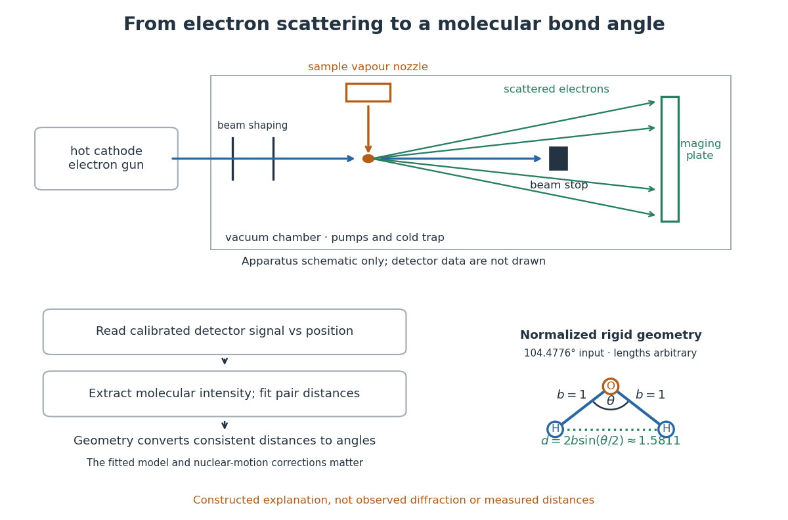

**[Figure 12](#image-molecular-geometry-electron-diffraction). Gas electron diffraction: apparatus, pair-distance inference, and a bond angle**. Original schematic, not an engineering drawing or a recorded [diffraction](quantum-scattering.md#diffraction) pattern. Rays identify possible incident and scattered paths; the detector is deliberately shown without invented rings or intensity traces. The lower [triangle](euclidean-geometry.md#triangle) is a normalized rigid-model construction using $104.4776^\circ$; it illustrates a geometric inference, not distances measured in this apparatus.

What is measured is detector signal as a function of position, converted to scattering [angle](geometry-and-topology.md#angle) using the sample-to-detector distance. Randomly oriented [molecules](molecule.md) give radial information. After extracting the molecular intensity, compare it with predictions from a candidate arrangement and adjust the [bond lengths](chemical-bond.md#bond-length) and [bond angles](#bond-angle) to improve the fit. The [Wann Electron Diffraction Group's account of time-averaged GED, experiment and theory](https://www.york.ac.uk/chemistry/people/dwann/wanngroup/time-averagedged/) describes radial averaging and this refinement. The apparatus does not photograph one [molecule](molecule.md) with labelled [atomic nuclei](atomic-nucleus.md).

Why can distances survive random orientation? In a simplified rigid pair model with separation $r$, write $s$ for the magnitude of the difference between incident and scattered [wave vectors](elasticity-physics.md#wavevector). Averaging the interference factor over uniformly distributed directions gives

$$
\frac12\int_{-1}^{1}\cos(srt)\,dt=\frac{\sin(sr)}{sr},
$$

with limiting value one at $sr=0$. This follows by integrating the [cosine](geometry-and-topology.md#cosine); $t$ is the [cosine](geometry-and-topology.md#cosine) of the angle between the pair and the scattering direction. The [oscillations](wave.md#oscillation) depend on $r$, although the orientation has disappeared. A real calculation weights many pairs by their [scattering amplitudes](quantum-scattering.md#scattering-amplitude) and includes nuclear motion. The [wave interference](physical-optics.md#interference-wave-propagation) explanation and superposed pair-distance contributions are discussed in the same [Wann group theory account](https://www.york.ac.uk/chemistry/people/dwann/wanngroup/time-averagedged/).

Once a consistent structural model supplies two equal [bond lengths](chemical-bond.md#bond-length) $b$ and an outer-atom separation $d$, the [law of cosines](euclidean-geometry.md#law-of-cosines) converts these to a [bond angle](#bond-angle). For example, the illustrative $d/b=1.5811$ corresponds to approximately $104.5^\circ$, while $d/b=2$ is straight. This geometric step explains what a shape measurement is trying to establish; it is not a new [water](chemical-substance.md#water) measurement.

There are two essential limits. First, recovering labelled three-dimensional positions from a summed radial signal is an [inverse problem](inverse-problem.md): composition, candidate connectivity, and other structural information can be needed to distinguish competing fits. Karle's authored review [Structure determination of gaseous and amorphous substances by diffraction methods (1977), abstract](https://pmc.ncbi.nlm.nih.gov/articles/PMC432024/?page=-1) explains why too few independent observations make supplementary structural information indispensable. A good fit alone does not prove that the proposed arrangement is unique. Second, [atomic nuclei](atomic-nucleus.md) are moving. Distances inferred by [gas electron diffraction](#gas-electron-diffraction) are motion-dependent averages; corrections are required before identifying them with a minimum-[potential energy](energy.md#potential-energy) arrangement. For experimental distance conventions, see the [IUPAC Gold Book: bond length](https://goldbook.iupac.org/terms/view/BT07003). These limitations explain why model assumptions and the averaging convention must accompany a precise [bond angle](#bond-angle).

## Nucleoside

↑ **Parent:** [Molecule](molecule.md)  
ⓦ [Wiki](https://en.wikipedia.org/wiki/Nucleoside)

A [nucleoside](#nucleoside) combines a [nucleobase](#nucleotide-base) with a [sugar](chemical-substance.md#sugar), without the [phosphate](chemical-substance.md#phosphate) groups of a [nucleotide](#nucleotide). [Adenosine](#adenosine) is the [nucleoside](#nucleoside) built from [adenine](#adenine) and [ribose](chemical-substance.md#ribose). See [Alberts et al., Molecular Biology of the Cell: nucleosides and nucleotides](https://www.ncbi.nlm.nih.gov/books/NBK26883/).

### Thymidine

↑ **Parent:** [Nucleoside](#nucleoside)

### Bromodeoxyuridine

↑ **Parent:** [Nucleoside](#nucleoside)

A brominated [thymidine](#thymidine) analogue incorporated during [DNA](polymer.md#deoxyribonucleic-acid) synthesis. Substitution changes [buoyant density](biology.md#buoyant-density), allowing copied strands to be distinguished from unsubstituted strands.

### Inosine

↑ **Parent:** [Nucleoside](#nucleoside)

[Inosine](#inosine) is the ribonucleoside of [hypoxanthine](#hypoxanthine). [Hydrolytic deamination](chemical-reaction.md#hydrolytic-deamination) of [adenosine](#adenosine) replaces its exocyclic amino group with a carbonyl [oxygen](chemical-substance.md#oxygen) while retaining its sugar attachment.

### Adenosine

↑ **Parent:** [Nucleoside](#nucleoside)  
ⓦ [Wiki](https://en.wikipedia.org/wiki/Adenosine)

[Adenosine](#adenosine) consists of [adenine](#adenine) joined to [ribose](chemical-substance.md#ribose). Adding one, two, or three [phosphate](chemical-substance.md#phosphate) groups at the [ribose](chemical-substance.md#ribose)'s $5'$ position gives [AMP](#adenosine-monophosphate), [ADP](#adenosine-diphosphate), or [ATP](#adenosine-triphosphate), respectively. See [Alberts et al., Molecular Biology of the Cell: the components of nucleotides](https://www.ncbi.nlm.nih.gov/books/NBK26883/).

## Nucleotide

↑ **Parent:** [Molecule](molecule.md)

A [nucleotide](#nucleotide) contains a [nucleobase](#nucleotide-base), a [sugar](chemical-substance.md#sugar), and one or more [phosphate](chemical-substance.md#phosphate) groups. In [DNA](polymer.md#deoxyribonucleic-acid) and [RNA](polymer.md#ribonucleic-acid), linked [nucleotides](#nucleotide) form a [polymer](polymer.md) whose [nucleotide sequence](polymer.md#nucleic-acid-sequence) carries information. The [sugar](chemical-substance.md#sugar) is [deoxyribose](chemical-substance.md#deoxyribose) in [DNA](polymer.md#deoxyribonucleic-acid) and [ribose](chemical-substance.md#ribose) in [RNA](polymer.md#ribonucleic-acid). See [NHGRI: nucleotide](https://www.genome.gov/genetics-glossary/Nucleotide).

### Nucleotide exchange

↑ **Parent:** [Nucleotide](#nucleotide)

Replacement of a bound [nucleotide](#nucleotide) by another. A changed exchange rate can alter a [protein](protein.md) state without proving direct competition at the nucleotide-binding site.

### Nucleotide sugar

↑ **Parent:** [Nucleotide](#nucleotide)

A [nucleotide sugar](#nucleotide-sugar) carries an activated sugar linked to a nucleotide-containing group. It supports selective glycosyl transfer; donor identity alone does not specify the linkage or final glycan structure.

#### UDP-glucuronic acid

↑ **Parent:** [Nucleotide sugar](#nucleotide-sugar)

[UDP-glucuronic acid](#udp-glucuronic-acid) is an activated donor containing a glucuronic acid residue linked to UDP. Transfer requires an appropriate [glycosyltransferase](enzyme.md#glycosyltransferase) and acceptor; access to the correct compartment can be limiting.

#### CMP-sialic acid

↑ **Parent:** [Nucleotide sugar](#nucleotide-sugar)

[CMP-sialic acid](#cmp-sialic-acid) is an activated donor containing a sialic acid residue linked to CMP. Transfer requires an appropriate [glycosyltransferase](enzyme.md#glycosyltransferase) and acceptor; access to the correct compartment can be limiting.

#### ADP-glucose

↑ **Parent:** [Nucleotide sugar](#nucleotide-sugar)

[ADP-glucose](#adp-glucose) is an activated donor containing a [glucose](chemical-substance.md#glucose) residue linked to [ADP](#adenosine-diphosphate). Transfer requires an appropriate [glycosyltransferase](enzyme.md#glycosyltransferase) and acceptor; access to the correct compartment can be limiting.

#### GDP-fucose

↑ **Parent:** [Nucleotide sugar](#nucleotide-sugar)

[GDP-fucose](#gdp-fucose) is an activated donor containing a fucose residue linked to [GDP](#guanosine-diphosphate). Transfer requires an appropriate [glycosyltransferase](enzyme.md#glycosyltransferase) and acceptor; access to the correct compartment can be limiting.

#### GDP-mannose

↑ **Parent:** [Nucleotide sugar](#nucleotide-sugar)

[GDP-mannose](#gdp-mannose) is an activated donor containing a mannose residue linked to [GDP](#guanosine-diphosphate). Transfer requires an appropriate [glycosyltransferase](enzyme.md#glycosyltransferase) and acceptor; access to the correct compartment can be limiting.

#### UDP-N-acetylglucosamine

↑ **Parent:** [Nucleotide sugar](#nucleotide-sugar)

[UDP-N-acetylglucosamine](#udp-n-acetylglucosamine) is an activated donor containing a N-acetylglucosamine residue linked to UDP. Transfer requires an appropriate [glycosyltransferase](enzyme.md#glycosyltransferase) and acceptor; access to the correct compartment can be limiting.

#### UDP-galactose

↑ **Parent:** [Nucleotide sugar](#nucleotide-sugar)

[UDP-galactose](#udp-galactose) is an activated donor containing a galactose residue linked to UDP. Transfer requires an appropriate [glycosyltransferase](enzyme.md#glycosyltransferase) and acceptor; access to the correct compartment can be limiting.

#### UDP-glucose

↑ **Parent:** [Nucleotide sugar](#nucleotide-sugar)

[UDP-glucose](#udp-glucose) is an activated donor containing a [glucose](chemical-substance.md#glucose) residue linked to UDP. Transfer requires an appropriate [glycosyltransferase](enzyme.md#glycosyltransferase) and acceptor; access to the correct compartment can be limiting.

<h3 id="p-ppgpp">(p)ppGpp</h3>

↑ **Parent:** [Nucleotide](#nucleotide)

Collective notation for guanosine tetraphosphate and pentaphosphate alarmones involved in the bacterial [stringent response](molecular-genetics.md#stringent-response).

### Nucleoside triphosphate

↑ **Parent:** [Nucleotide](#nucleotide)

A nucleoside carrying three [phosphate](chemical-substance.md#phosphate) groups. The relevant ribonucleoside triphosphates supply substrates for [RNA polymerase](molecular-genetics.md#rna-polymerase).

### Ribonucleotide

↑ **Parent:** [Nucleotide](#nucleotide)

An [RNA](polymer.md#ribonucleic-acid)-type [nucleotide](#nucleotide) containing [ribose](chemical-substance.md#ribose). Chemical modification can affect its contacts, pairing or recognition without changing its place in the transcript.

### Guanosine diphosphate

↑ **Parent:** [Nucleotide](#nucleotide)

[guanosine diphosphate](#guanosine-diphosphate), abbreviated [GDP](#guanosine-diphosphate), is the diphosphate form of a guanine nucleotide. Exchange between [GDP](#guanosine-diphosphate) and [GTP](#guanosine-triphosphate), rather than receptor-catalyzed phosphorylation of GDP, controls the usual [G protein](protein.md#g-protein) switch.

### Adenosine triphosphate

↑ **Parent:** [Nucleotide](#nucleotide)  
ⓦ [Wiki](https://en.wikipedia.org/wiki/Adenosine_triphosphate)

[ATP](#adenosine-triphosphate) is a [nucleotide](#nucleotide) consisting of [adenosine](#adenosine), itself [adenine](#adenine) joined to [ribose](chemical-substance.md#ribose), carrying three [phosphate](chemical-substance.md#phosphate) groups. From the [ribose](chemical-substance.md#ribose) outward, these groups are labelled $\alpha$, $\beta$, and $\gamma$. [ATP](#adenosine-triphosphate) connects [energy](energy.md)-supplying processes to [energy coupling](chemical-reaction.md#energy-coupling) for synthesis and [active transport](cell-membrane.md#active-transport); the same carrier can be regenerated and reused. [OpenStax Biology 2e, 6.4: ATP composition and recycling](https://openstax.org/books/biology-2e/pages/6-4-atp-adenosine-triphosphate).

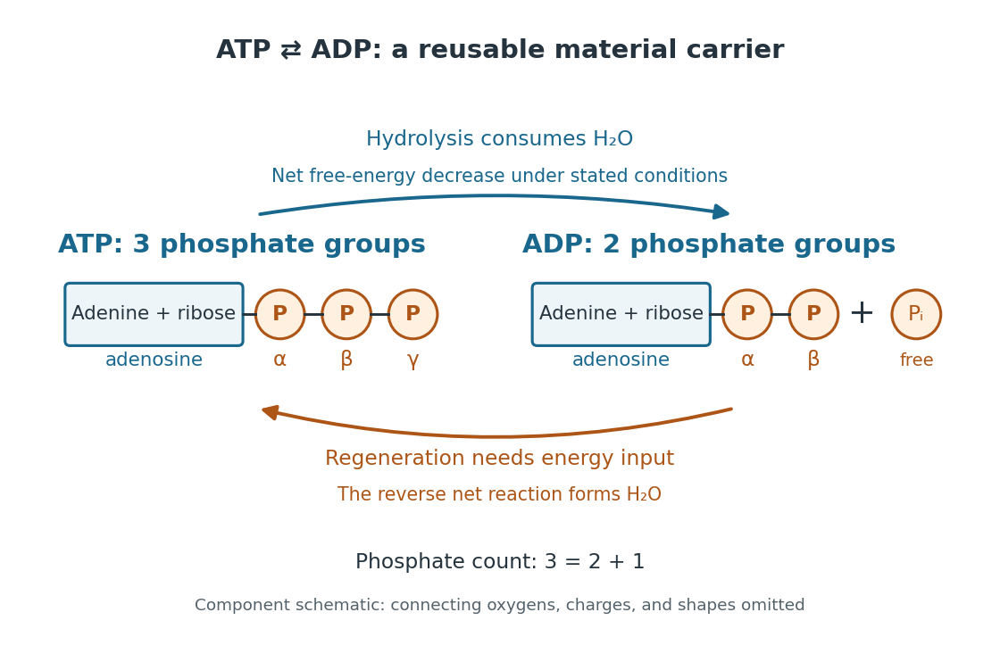

**[Figure 13](#image-atp-has-three-phosphate-groups-adp-has-two-and-regeneration-requires-energy-input). ATP has three phosphate groups; ADP has two, and regeneration requires energy input**. Original component schematic, rather than a molecular structure or a [reaction mechanism](chemical-kinetics.md#reaction-mechanism). Lines indicate component order and omit connecting [oxygen](chemical-substance.md#oxygen) [chemical atoms](physics.md#atom-physics), [electric charges](electric-charge.md), and three-dimensional geometry. Both sides retain [adenine](#adenine) and [ribose](chemical-substance.md#ribose); [hydrolysis](chemical-reaction.md#hydrolysis) consumes [water](chemical-substance.md#water), whereas the reverse net [chemical reaction](chemical-reaction.md) forms [water](chemical-substance.md#water). The [energy](energy.md) labels describe transfers, not extra material [reactants](chemical-reaction.md#reactant) or [reaction products](chemical-reaction.md#product-chemistry).

The net [hydrolysis](chemical-reaction.md#hydrolysis) commonly used in [energy coupling](chemical-reaction.md#energy-coupling) is

$$
\mathrm{ATP}+\mathrm{H_2O}\longrightarrow\mathrm{ADP}+\mathrm P_i.
$$

Here $\mathrm P_i$ denotes [inorganic phosphate](chemical-substance.md#inorganic-phosphate). At buffered [pH](acid-base-chemistry.md#ph) $7$, this biochemical shorthand groups the appropriate [protonation](chemical-reaction.md#protonation) states into pools and leaves [proton](physics.md#proton) exchange with the [buffer solution](acid-base-chemistry.md#buffer-solution) implicit. An explicit, charge-balanced choice is $\mathrm{ATP}^{4-}+\mathrm{H_2O}\longrightarrow\mathrm{ADP}^{3-}+\mathrm{HPO_4}^{2-}+\mathrm H^+$, without implying these are the only [chemical species](mathematical-biology.md#chemical-species) present. See the [IUBMB recommendations for biochemical thermodynamics](https://iubmb.qmul.ac.uk/thermod2/).

The quoted textbook biochemical [standard state](chemical-potential.md#standard-state) value is approximately

$$
\Delta G^{\circ\prime}=-30.5\,\mathrm{kJ\,mol^{-1}}.
$$

This convention uses fixed [pH](acid-base-chemistry.md#ph) $7$, [temperature](temperature.md) $298.15\,\mathrm K$ ($25\,{}^\circ\mathrm C$), reference [pressure](pressure.md) $100\,\mathrm{kPa}$ ($1\,\mathrm{bar}$), unit reference [thermodynamic activities](chemical-potential.md#thermodynamic-activity) for dissolved [reactants](chemical-reaction.md#reactant) and [reaction products](chemical-reaction.md#product-chemistry), and [water](chemical-substance.md#water) [thermodynamic activity](chemical-potential.md#thermodynamic-activity) approximated by one. The prime indicates the fixed-[pH](acid-base-chemistry.md#ph) biochemical convention. See [OpenStax Biology 2e, 6.4: standard ATP hydrolysis value](https://openstax.org/books/biology-2e/pages/6-4-atp-adenosine-triphosphate) and [Biology 2e, 6.2: biochemical standard conditions](https://openstax.org/books/biology-2e/pages/6-2-potential-kinetic-free-and-activation-energy). This is a reference value, rather than a universal value inside a [biological cell](biological-cell.md); precise tables must also specify [chemical solution](mixture.md#solution-chemistry) conditions and any [magnesium](chemical-substance.md#magnesium) [ion](chemistry.md#ion) binding convention. Different reference conventions and data treatments give different tabulated values, as discussed in [Li et al., 2010: a database of thermodynamic quantities for biochemical reactions](https://pmc.ncbi.nlm.nih.gov/articles/PMC3299200/).

An [exergonic reaction](chemical-reaction.md#exergonic-reaction) has a negative change in [Gibbs free energy](thermodynamic-potential.md#gibbs-free-energy), so the overall [ATP](#adenosine-triphosphate) [hydrolysis](chemical-reaction.md#hydrolysis) is favourable under those reference conditions. Breaking a [chemical bond](chemical-bond.md) by itself costs [energy](energy.md); forming new [chemical bonds](chemical-bond.md) can release [energy](energy.md). The net change compares all [reactants](chemical-reaction.md#reactant) with all [reaction products](chemical-reaction.md#product-chemistry), including their interactions with [water](chemical-substance.md#water) and the [entropy](entropy.md) contribution. Calling the phosphate connection a "high-energy bond" describes a large favourable change in [Gibbs free energy](thermodynamic-potential.md#gibbs-free-energy) on [hydrolysis](chemical-reaction.md#hydrolysis), rather than [energy](energy.md) released by bond breaking alone. See [7.5 Strengths of Ionic and Covalent Bonds](chemistry-bibliography.md#chemistry-2e-by-paul-flowers-and-others/7-5-strengths-of-ionic-and-covalent-bonds) and [Cooper, The Cell: ATP and metabolic energy](https://www.ncbi.nlm.nih.gov/books/NBK9903/).

Composition changes the driving force. At the same fixed [pH](acid-base-chemistry.md#ph), [temperature](temperature.md), [pressure](pressure.md), and binding convention, write the molar reaction change as

$$
\Delta G=\Delta G^{\circ\prime}+RT\ln Q,\qquad
Q=\frac{a_{\mathrm{ADP}}a_{\mathrm P_i}}{a_{\mathrm{ATP}}}.
$$

Here $R$ is the [molar gas constant](ideal-gas.md#molar-gas-constant), $T$ the absolute [temperature](temperature.md), and $a$ a [dimensionless](physics.md#dimensionless-quantity) [thermodynamic activity](chemical-potential.md#thermodynamic-activity) for a biochemical pool. Constant [water](chemical-substance.md#water) [thermodynamic activity](chemical-potential.md#thermodynamic-activity) is absorbed into the reference term; fixed [pH](acid-base-chemistry.md#ph) accounts for buffered [protons](physics.md#proton). The shorthand $\Delta G$ means transformed molar reaction [Gibbs free energy](thermodynamic-potential.md#gibbs-free-energy) change, $\Delta_rG'$, rather than a finite sample's total change. The [natural logarithm](calculus.md#natural-logarithm) acts on a [dimensionless](physics.md#dimensionless-quantity) [reaction quotient](chemical-potential.md#reaction-quotient), never on [concentrations](mathematical-physics.md#concentration) with units. See the [IUBMB biochemical thermodynamics recommendations](https://iubmb.qmul.ac.uk/thermod2/) and the general [equilibrium constant](chemical-potential.md#equilibrium-constant) relation.

For a stipulated ideal dilute [chemical solution](mixture.md#solution-chemistry), let $a_i=[i]/c^\circ$, with $c^\circ=1\,\mathrm{mol\,L^{-1}}$. Choose $[\mathrm{ATP}]=5\,\mathrm{mmol\,L^{-1}}$, $[\mathrm{ADP}]=0.5\,\mathrm{mmol\,L^{-1}}$, and $[\mathrm P_i]=1\,\mathrm{mmol\,L^{-1}}$, ignoring [activity coefficient](chemical-potential.md#activity-coefficient) corrections and [magnesium](chemical-substance.md#magnesium) binding. These are illustrative inputs, not a claim about a particular [biological cell](biological-cell.md). Then

$$
Q=\frac{(0.0005)(0.001)}{0.005}=10^{-4},\qquad
RT=(0.008314462618)(298.15)=2.47895703\,\mathrm{kJ\,mol^{-1}},
$$

and

$$
\Delta G=-30.5+2.47895703\ln(10^{-4})
\approx-53.332\,\mathrm{kJ\,mol^{-1}}.
$$

Increasing $Q$ tenfold raises $\Delta G$ by $RT\ln10\approx5.708\,\mathrm{kJ\,mol^{-1}}$ at this [temperature](temperature.md). Thus the [ATP](#adenosine-triphosphate) to [ADP](#adenosine-diphosphate) ratio and available [inorganic phosphate](chemical-substance.md#inorganic-phosphate) matter, even with the same [standard state](chemical-potential.md#standard-state) value. These are local molar predictions at the stipulated composition, rather than a constant total yield as an isolated sample reacts.

### Adenosine diphosphate

↑ **Parent:** [Nucleotide](#nucleotide)  
ⓦ [Wiki](https://en.wikipedia.org/wiki/Adenosine_diphosphate)

[ADP](#adenosine-diphosphate) contains the same [adenosine](#adenosine) unit as [ATP](#adenosine-triphosphate), with two [phosphate](chemical-substance.md#phosphate) groups instead of three. One [ATP](#adenosine-triphosphate) converted by the stated [hydrolysis](chemical-reaction.md#hydrolysis) gives one [ADP](#adenosine-diphosphate) and one [inorganic phosphate](chemical-substance.md#inorganic-phosphate): $3=2+1$ accounts for the [phosphate](chemical-substance.md#phosphate) groups while [adenine](#adenine) and [ribose](chemical-substance.md#ribose) are retained. [ADP](#adenosine-diphosphate) is therefore a reusable material carrier, rather than [ATP](#adenosine-triphosphate) with its entire structure discarded.

Regeneration reverses the net [chemical reaction](chemical-reaction.md):

$$
\mathrm{ADP}+\mathrm P_i\longrightarrow\mathrm{ATP}+\mathrm{H_2O}.
$$

At the same stipulated reference conditions its $\Delta G^{\circ\prime}$ is $+30.5\,\mathrm{kJ\,mol^{-1}}$, the negative of the [hydrolysis](chemical-reaction.md#hydrolysis) value. It is an [endergonic reaction](chemical-reaction.md#endergonic-reaction) and requires [energy](energy.md) input through [energy coupling](chemical-reaction.md#energy-coupling); a [catalyst](chemical-kinetics.md#catalyst) alone cannot supply that input. Recycling the material carrier does not recycle the expended driving [energy](energy.md). [Cellular respiration](biology.md#cellular-respiration) and [light-dependent reactions](biology.md#light-dependent-reactions) supply routes for regeneration. See [Cooper, The Cell: ATP generation and energy coupling](https://www.ncbi.nlm.nih.gov/books/NBK9903/).

[ADP](#adenosine-diphosphate) is a [nucleotide](#nucleotide) with two [phosphate](chemical-substance.md#phosphate) groups. Formation of [ATP](#adenosine-triphosphate) from [ADP](#adenosine-diphosphate) and [phosphate](chemical-substance.md#phosphate) couples to [energy](energy.md) supply in [light-dependent reactions](biology.md#light-dependent-reactions); the [Calvin cycle](biology.md#calvin-cycle) returns [ADP](#adenosine-diphosphate) after using [ATP](#adenosine-triphosphate). [OpenStax Biology 2e, 8.3: recycling ATP and ADP](https://openstax.org/books/biology-2e/pages/8-3-using-light-energy-to-make-organic-molecules).

### Adenosine monophosphate

↑ **Parent:** [Nucleotide](#nucleotide)  
ⓦ [Wiki](https://en.wikipedia.org/wiki/Adenosine_monophosphate)

[AMP](#adenosine-monophosphate) is [adenosine](#adenosine) carrying one [phosphate](chemical-substance.md#phosphate) group at the [ribose](chemical-substance.md#ribose)'s $5'$ position. The count distinguishes [AMP](#adenosine-monophosphate) from [ADP](#adenosine-diphosphate) with two and [ATP](#adenosine-triphosphate) with three; [adenosine](#adenosine) itself has none. See [Cooper, The Cell: ATP, ADP, and AMP](https://www.ncbi.nlm.nih.gov/books/NBK9903/).

### Guanosine triphosphate

↑ **Parent:** [Nucleotide](#nucleotide)

## Nucleotide base

↑ **Parent:** [Molecule](molecule.md)  
ⓦ [Wiki](https://en.wikipedia.org/wiki/Nucleotide_base)

### Purine

↑ **Parent:** [Nucleotide base](#nucleotide-base)

[Purine](#purine) is the fused six- and five-membered [nitrogen](chemical-substance.md#nitrogen) heterocyclic framework underlying [adenine](#adenine) and [hypoxanthine](#hypoxanthine). Its numbered ring nitrogens distinguish [protonation](chemical-reaction.md#protonation) and hydrogen-bonding sites.

### Hypoxanthine

↑ **Parent:** [Nucleotide base](#nucleotide-base)

[Hypoxanthine](#hypoxanthine) is the 6-oxopurine base of [inosine](#inosine).

### Adenine

↑ **Parent:** [Nucleotide base](#nucleotide-base)  
ⓦ [Wiki](https://en.wikipedia.org/wiki/Adenine)

### Guanine

↑ **Parent:** [Nucleotide base](#nucleotide-base)  
ⓦ [Wiki](https://en.wikipedia.org/wiki/Guanine)

### Cytosine

↑ **Parent:** [Nucleotide base](#nucleotide-base)  
ⓦ [Wiki](https://en.wikipedia.org/wiki/Cytosine)

### Thymine

↑ **Parent:** [Nucleotide base](#nucleotide-base)  
ⓦ [Wiki](https://en.wikipedia.org/wiki/Thymine)

### Uracil

↑ **Parent:** [Nucleotide base](#nucleotide-base)  
ⓦ [Wiki](https://en.wikipedia.org/wiki/Uracil)

## Molecular mass

↑ **Parent:** [Molecule](molecule.md)

The [molecular mass](#molecular-mass) is the [mass](classical-mechanics.md#mass) of a [molecule](molecule.md); [relative molecular mass](chemistry.md#relative-molecular-mass) compares it with a reference [mass](classical-mechanics.md#mass).

## ↑ Ancestors (2)

1. [Chemistry](chemistry.md)
2. [Codex Wiki](README.md)

## ← Incoming links (364)

- [Achirality](stereochemistry.md#achirality)
- [Acid-base titration measurement](acid-base-chemistry.md#acid-base-titration-measurement)
- [Acidic permanganate-iron balance](chemical-reaction.md#acidic-permanganate-iron-balance)
- [Adsorption](physical-chemistry.md#adsorption)
- [Aerobic respiration](biology.md#aerobic-respiration)
- [Agarose gel electrophoresis](biology.md#agarose-gel-electrophoresis)
- [Aldehyde](chemical-substance.md#aldehyde)
- [Alpha helix](protein.md#alpha-helix)
- [Amino acid](chemical-substance.md#amino-acid)
- [Amino acid residue](protein.md#amino-acid-residue)
- [Ammonia inversion transition](maser.md#ammonia-inversion-transition)
- [Ammonia maser](maser.md#ammonia-maser)
- [Amount of substance](physics.md#amount-of-substance)
- [Amphiphile](physical-chemistry.md#amphiphile)
- [Andrews's carbon dioxide experiment](pressure.md#andrews-s-carbon-dioxide-experiment)
- [Atomic basis of a crystal](physical-chemistry.md#atomic-basis-of-a-crystal)
- [ATP-driven sugar phosphorylation](biochemistry.md#atp-driven-sugar-phosphorylation)
- [ATP synthase rotary mechanism](enzyme.md#atp-synthase-rotary-mechanism)
- [BCS theory](fermi-liquid.md#bcs-theory)
- [Benzene dimer](force.md#benzene-dimer)
- [Beta sheet](protein.md#beta-sheet)
- [Biochemistry](biochemistry.md)
- [Biological cell](biological-cell.md)
- [Biology](biology.md)
- [Biotin](chemical-substance.md#biotin)
- [Bond angle](#bond-angle)
- [Bond dipole](electronegativity.md#bond-dipole)
- [Bond-dissociation energy](chemical-bond.md#bond-dissociation-energy)
- [Bond-dissociation enthalpy](chemical-bond.md#bond-dissociation-enthalpy)
- [Bond pair](covalent-bond.md#bond-pair)
- [Born-Haber cycle](ionic-bonding.md#born-haber-cycle)
- [Boron trifluoride](chemical-substance.md#boron-trifluoride)
- [Boyle's law](second-law-of-thermodynamics.md#boyle-s-law)
- [Butadiene](optics.md#butadiene)
- [Calvin cycle](biology.md#calvin-cycle)
- [Carbohydrate](chemical-substance.md#carbohydrate)
- [CDK1 activity and protein abundance](signal-transduction.md#cdk1-activity-and-protein-abundance)
- [Cell-cycle DNA content](cell-cycle.md#cell-cycle-dna-content)
- [Cell membrane](cell-membrane.md)
- [Centrifugal distortion](#centrifugal-distortion)
- [Centromere](genetics.md#centromere)
- [Chain-growth initiation](polymer.md#chain-growth-initiation)
- [Chain-growth polymerization](polymer.md#chain-growth-polymerization)
- [Chain-growth termination](polymer.md#chain-growth-termination)
- [Chain transfer in chain polymerization](polymer.md#chain-transfer-in-chain-polymerization)
- [Chemical bond](chemical-bond.md)
- [Chemical element](chemical-substance.md#chemical-element)
- [Chemical environment dependence of electronegativity](electronegativity.md#chemical-environment-dependence-of-electronegativity)
- [Chemical equation](chemical-reaction.md#chemical-equation)
- [Chemical equilibrium](chemical-potential.md#chemical-equilibrium)
- [Chemical formula](chemical-substance.md#chemical-formula)
- [Chemical polarity](physical-chemistry.md#chemical-polarity)
- [Chemical reaction](chemical-reaction.md)
- [Chemistry](chemistry.md)
- [Chemoselectivity](chemical-reaction.md#chemoselectivity)
- [Chiral molecule](stereochemistry.md#chiral-molecule)
- [Chirality (chemistry)](stereochemistry.md#chirality-chemistry)
- [Chlorophyll](biology.md#chlorophyll)
- [Chromatographic partition coefficient](chromatography.md#chromatographic-partition-coefficient)
- [Chromatography](chromatography.md)
- [Chromosome](genetics.md#chromosome)
- [Citric acid cycle](biochemistry.md#citric-acid-cycle)
- [Citric acid cycle carbon and carrier balance](biochemistry.md#citric-acid-cycle-carbon-and-carrier-balance)
- [Citric acid cycle first-turn carbon tracing](biochemistry.md#citric-acid-cycle-first-turn-carbon-tracing)
- [Clément-Desormes experiment](ideal-gas.md#clement-desormes-experiment)
- [Cloud-chamber expansion model](particle-detection.md#cloud-chamber-expansion-model)
- [Coil-stretch transition](polymer.md#coil-stretch-transition)
- [Competitive adsorption](physical-chemistry.md#competitive-adsorption)
- [Conductivity experiment on salt solutions](ionic-bonding.md#conductivity-experiment-on-salt-solutions)
- [Conformational isomerism](stereochemistry.md#conformational-isomerism)
- [Conical intersection](chemical-kinetics.md#conical-intersection)
- [Continuum approximation](continuum-mechanics.md#continuum-approximation)
- [Covalent bond](covalent-bond.md)
- [Crystal structure](physical-chemistry.md#crystal-structure)
- [Cyclization in step-growth polymerization](polymer.md#cyclization-in-step-growth-polymerization)
- [Cytosol](biological-cell.md#cytosol)
- [D infinity h molecular point group](euclidean-geometry.md#d-infinity-h-molecular-point-group)
- [Delocalization energy](chemistry.md#delocalization-energy)
- [Density-gradient centrifugation](biology.md#density-gradient-centrifugation)
- [Deoxyribonucleic acid](polymer.md#deoxyribonucleic-acid)
- [Dialysis (biochemistry)](biochemistry.md#dialysis-biochemistry)
- [Dielectric](permittivity.md#dielectric)
- [Dielectric breakdown](permittivity.md#dielectric-breakdown)
- [Diffusion](thermodynamics.md#diffusion)
- [Diol](chemical-substance.md#diol)
- [Dipole evidence for bond polarization](electronegativity.md#dipole-evidence-for-bond-polarization)
- [Dissociation of an ionic compound](ionic-bonding.md#dissociation-of-an-ionic-compound)
- [Dissociative adsorption](physical-chemistry.md#dissociative-adsorption)
- [Dissolution](ionic-bonding.md#dissolution)
- [Disulfide bond](covalent-bond.md#disulfide-bond)
- [DNA replication](molecular-genetics.md#dna-replication)
- [Dobson unit](chemistry.md#dobson-unit)
- [Dye laser](laser.md#dye-laser)
- [Electric dipole](electrostatics.md#electric-dipole)
- [Electrochemistry](electrochemistry.md)
- [Electrolyte](electrochemistry.md#electrolyte)
- [Electron carrier](biochemistry.md#electron-carrier)
- [Electronegativity](electronegativity.md)
- [Enantiomer](stereochemistry.md#enantiomer)
- [Enantiomeric excess](stereochemistry.md#enantiomeric-excess)
- [Endocytosis](cell-membrane.md#endocytosis)
- [Equipartition theorem](canonical-ensemble.md#equipartition-theorem)
- [Eukaryote](organism.md#eukaryote)
- [Excluded-volume ideal gas](statistical-physics.md#excluded-volume-ideal-gas)
- [Fluid mechanics](fluid-mechanics.md)
- [Fluorescent ion sensor](fluorescence.md#fluorescent-ion-sensor)
- [Fluorophore](fluorescence.md#fluorophore)
- [Formula unit](chemical-substance.md#formula-unit)
- [Fourier transform microwave spectroscopy](#fourier-transform-microwave-spectroscopy)
- [Fractional distillation](chemistry.md#fractional-distillation)
- [FRET donor](biology.md#fret-donor)
- [Frustrated Lewis pair](acid-base-chemistry.md#frustrated-lewis-pair)
- [Functionality in polymerization](polymer.md#functionality-in-polymerization)
- [Gas electron diffraction](#gas-electron-diffraction)
- [Gel band](biology.md#gel-band)
- [Gel electrophoresis](biology.md#gel-electrophoresis)
- [Gelation](polymer.md#gelation)
- [Glutamic acid residue](protein.md#glutamic-acid-residue)
- [Glycine titration](chemical-substance.md#glycine-titration)
- [Glycolysis carbon and ATP ledger](biochemistry.md#glycolysis-carbon-and-atp-ledger)
- [Glycosylation](biochemistry.md#glycosylation)
- [Ground-state dissociation energy](chemical-bond.md#ground-state-dissociation-energy)
- [HCl and DCl harmonic stretch comparison](#hcl-and-dcl-harmonic-stretch-comparison)
- [HCl and DCl vibrational isotope experiment](classical-mechanics.md#hcl-and-dcl-vibrational-isotope-experiment)
- [Heat capacity ratio](ideal-gas.md#heat-capacity-ratio)
- [Heterolysis](chemical-bond.md#heterolysis)
- [Histone H1 kinase assay](signal-transduction.md#histone-h1-kinase-assay)
- [Homolysis](chemical-bond.md#homolysis)
- [Hydration of ions](ionic-bonding.md#hydration-of-ions)
- [Hydration shell](ionic-bonding.md#hydration-shell)
- [Hydrodynamic size](mixture.md#hydrodynamic-size)
- [Hydrogen bond](chemical-bond.md#hydrogen-bond)
- [Hydrogen bond acceptor](chemical-bond.md#hydrogen-bond-acceptor)
- [Hydrogen bond donor](chemical-bond.md#hydrogen-bond-donor)
- [Hydrogen rotational heat capacity](#hydrogen-rotational-heat-capacity)
- [Hydronium](chemistry.md#hydronium)
- [Hydrophobic effect](physical-chemistry.md#hydrophobic-effect)
- [Hydroxy group](chemistry.md#hydroxy-group)
- [Ideal gas](ideal-gas.md)
- [Infrared](optics.md#infrared)
- [Insulin](protein.md#insulin)
- [Intermolecular force](force.md#intermolecular-force)
- [Internal energy](internal-energy.md)
- [Internal energy of an ideal gas](ideal-gas.md#internal-energy-of-an-ideal-gas)
- [Intramolecular aldol reaction](chemical-reaction.md#intramolecular-aldol-reaction)
- [Ion](chemistry.md#ion)
- [Ion-dipole attraction](ionic-bonding.md#ion-dipole-attraction)
- [Ion pair](ionic-bonding.md#ion-pair)
- [Ionic approximation of bonds](chemical-reaction.md#ionic-approximation-of-bonds)
- [Ionic bonding](ionic-bonding.md)
- [Isocyanate](chemical-substance.md#isocyanate)
- [Isoelectric point](acid-base-chemistry.md#isoelectric-point)
- [Isotope scaling of diatomic vibration](classical-mechanics.md#isotope-scaling-of-diatomic-vibration)
- [Kinetochore ablation experiment](cell-cycle.md#kinetochore-ablation-experiment)
- [Langmuir adsorption model](physical-chemistry.md#langmuir-adsorption-model)
- [Lewis structure](covalent-bond.md#lewis-structure)
- [Ligand (biochemistry)](protein.md#ligand-biochemistry)
- [Ligand in coordination chemistry](chemistry.md#ligand-in-coordination-chemistry)
- [Limiting reagent](chemical-reaction.md#limiting-reagent)
- [Linear step-growth molecule count](polymer.md#linear-step-growth-molecule-count)
- [Lipid](chemical-substance.md#lipid)
- [Lone pair](covalent-bond.md#lone-pair)
- [Lysosome](biological-cell.md#lysosome)
- [Macromolecule](#macromolecule)
- [Maser](maser.md)
- [Maser cavity](maser.md#maser-cavity)
- [Maser oscillation threshold](maser.md#maser-oscillation-threshold)
- [Maser state selection](maser.md#maser-state-selection)
- [Meso compound](stereochemistry.md#meso-compound)
- [Metabotropic receptor](protein.md#metabotropic-receptor)
- [Microscopic dielectric polarization](permittivity.md#microscopic-dielectric-polarization)
- [Mitochondrial respiratory chain](biochemistry.md#mitochondrial-respiratory-chain)
- [Mitotic daughter chromosome accounting](cell-cycle.md#mitotic-daughter-chromosome-accounting)
- [Mixed chlorine-bromine ozone-loss cycle](chemistry.md#mixed-chlorine-bromine-ozone-loss-cycle)
- [Molar mass](chemistry.md#molar-mass)
- [Molecular beam](physics.md#molecular-beam)
- [Molecular count and amount of substance](chemical-reaction.md#molecular-count-and-amount-of-substance)
- [Molecular diffusion](thermodynamics.md#molecular-diffusion)
- [Molecular dipole cancellation](electronegativity.md#molecular-dipole-cancellation)
- [Molecular formula](chemical-substance.md#molecular-formula)
- [Molecular geometry](#molecular-geometry)
- [Molecular ion](chemistry.md#molecular-ion)
- [Molecular mass](#molecular-mass)
- [Molecular orbital](chemistry.md#molecular-orbital)
- [Molecular orbital theory](chemistry.md#molecular-orbital-theory)
- [Molecular rotation](#molecular-rotation)
- [Molecular structure from rotational constants](#molecular-structure-from-rotational-constants)
- [Molecular weight cut-off](biochemistry.md#molecular-weight-cut-off)
- [Molecularity](chemical-kinetics.md#molecularity)
- [Molecule](molecule.md)
- [Molecule bookkeeping](#molecule-bookkeeping)
- [Monolayer](physical-chemistry.md#monolayer)
- [Monomer](polymer.md#monomer)
- [Monomer molecule](polymer.md#monomer-molecule)
- [Monomeric unit](polymer.md#monomeric-unit)
- [Monosaccharide](chemical-substance.md#monosaccharide)
- [NaCl conventional cell and coordination](physical-chemistry.md#nacl-conventional-cell-and-coordination)
- [Net ionic equation](chemical-reaction.md#net-ionic-equation)
- [Nonelectrolyte](electrochemistry.md#nonelectrolyte)
- [Nonpolar molecule](physical-chemistry.md#nonpolar-molecule)
- [Number-average molar mass](chemistry.md#number-average-molar-mass)
- [Oblate symmetric top](rigid-body-dynamics.md#oblate-symmetric-top)
- [Octet rule](covalent-bond.md#octet-rule)
- [Oligomer](#oligomer)
- [Optical activity](stereochemistry.md#optical-activity)
- [Optical tweezers](optics.md#optical-tweezers)
- [Osmosis](cell-membrane.md#osmosis)
- [Osmotic concentration](cell-membrane.md#osmotic-concentration)
- [Osmotic pressure](cell-membrane.md#osmotic-pressure)
- [Outer mitochondrial membrane](biological-cell.md#outer-mitochondrial-membrane)
- [Oxidation state](chemical-reaction.md#oxidation-state)
- [Oxidation state sum rule](chemical-reaction.md#oxidation-state-sum-rule)
- [Solution](past-exam-of-the-chemistry-a-course-of-the-university-of-cambridge/2021/paper-1.md#a3/a/i/solution)
- [Solution](past-exam-of-the-chemistry-a-course-of-the-university-of-cambridge/2021/paper-1.md#a3/b/iv/solution)
- [Solution](past-exam-of-the-chemistry-a-course-of-the-university-of-cambridge/2022/paper-1.md#a3/a/iv/solution)
- [Solution](past-exam-of-the-chemistry-a-course-of-the-university-of-cambridge/2022/paper-2.md#a8/b/ii/solution)
- [Solution](past-exam-of-the-chemistry-a-course-of-the-university-of-cambridge/2022/paper-2.md#a8/b/iii/solution)
- [Solution](past-exam-of-the-chemistry-b-course-of-the-university-of-cambridge/2021/paper-1.md#b5/b/i/solution)
- [Solution](past-exam-of-the-chemistry-b-course-of-the-university-of-cambridge/2021/paper-1.md#b5/b/ii/solution)
- [Solution](past-exam-of-the-chemistry-b-course-of-the-university-of-cambridge/2021/paper-1.md#b5/b/iii/solution)
- [Solution](past-exam-of-the-chemistry-b-course-of-the-university-of-cambridge/2022/paper-1.md#b5/a/i/solution)
- [Solution](past-exam-of-the-chemistry-b-course-of-the-university-of-cambridge/2022/paper-1.md#b5/a/ii/solution)
- [Solution](past-exam-of-the-chemistry-b-course-of-the-university-of-cambridge/2022/paper-1.md#b5/a/iii/solution)
- [Solution](past-exam-of-the-chemistry-b-course-of-the-university-of-cambridge/2023/paper-1.md#b3/a/ii/solution)
- [Solution](past-exam-of-the-chemistry-b-course-of-the-university-of-cambridge/2023/paper-1.md#b5/a/ii/solution)
- [Solution](past-exam-of-the-chemistry-course-of-the-year-1-of-the-natural-sciences-course-of-the-university-of-cambridge/2023/paper-1.md#2/a/v/solution)
- [Solution](past-exam-of-the-chemistry-course-of-the-year-1-of-the-natural-sciences-course-of-the-university-of-cambridge/2023/paper-1.md#5/b/ii/solution)
- [Solution](past-exam-of-the-chemistry-course-of-the-year-1-of-the-natural-sciences-course-of-the-university-of-cambridge/2023/paper-1.md#5/c/i/solution)
- [Solution](past-exam-of-the-chemistry-course-of-the-year-1-of-the-natural-sciences-course-of-the-university-of-cambridge/2023/paper-1.md#5/c/iii/solution)
- [Solution](past-exam-of-the-chemistry-course-of-the-year-1-of-the-natural-sciences-course-of-the-university-of-cambridge/2023/paper-1.md#6/b/ii/solution)
- [Solution](past-exam-of-the-chemistry-course-of-the-year-1-of-the-natural-sciences-course-of-the-university-of-cambridge/2023/paper-1.md#6/c/solution)
- [Solution](past-exam-of-the-chemistry-course-of-the-year-1-of-the-natural-sciences-course-of-the-university-of-cambridge/2023/paper-1.md#6/d/solution)
- [Solution](past-exam-of-the-chemistry-course-of-the-year-1-of-the-natural-sciences-course-of-the-university-of-cambridge/2025.md#2/b/ii/solution)
- [Solution](past-exam-of-the-chemistry-course-of-the-year-1-of-the-natural-sciences-course-of-the-university-of-cambridge/2025.md#5/e/solution)
- [Solution](past-exam-of-the-chemistry-course-of-the-year-3-of-the-natural-sciences-course-of-the-university-of-cambridge/2022/paper-3.md#42/c/ii/solution)
- [Solution](past-exam-of-the-chemistry-course-of-the-year-3-of-the-natural-sciences-course-of-the-university-of-cambridge/2022/paper-3.md#49/a/ii/solution)
- [Solution](past-exam-of-the-chemistry-course-of-the-year-3-of-the-natural-sciences-course-of-the-university-of-cambridge/2022/paper-3.md#49/a/iii/solution)
- [Solution](past-exam-of-the-chemistry-course-of-the-year-4-of-the-natural-sciences-course-of-the-university-of-cambridge/2021/paper-id.md#1/a/i/solution)
- [Solution](past-exam-of-the-chemistry-course-of-the-year-4-of-the-natural-sciences-course-of-the-university-of-cambridge/2021/paper-id.md#1/b/solution)
- [Solution](past-exam-of-the-chemistry-course-of-the-year-4-of-the-natural-sciences-course-of-the-university-of-cambridge/2021/paper-id.md#2/b/solution)
- [Solution](past-exam-of-the-chemistry-course-of-the-year-4-of-the-natural-sciences-course-of-the-university-of-cambridge/2021/paper-id.md#3/a/i/solution)
- [Solution](past-exam-of-the-chemistry-course-of-the-year-4-of-the-natural-sciences-course-of-the-university-of-cambridge/2021/paper-id.md#3/b/i/solution)
- [Solution](past-exam-of-the-chemistry-course-of-the-year-4-of-the-natural-sciences-course-of-the-university-of-cambridge/2022/paper-1.md#1/a/i/solution)
- [Solution](past-exam-of-the-chemistry-course-of-the-year-4-of-the-natural-sciences-course-of-the-university-of-cambridge/2022/paper-1.md#1/a/ii/solution)
- [Solution](past-exam-of-the-chemistry-course-of-the-year-4-of-the-natural-sciences-course-of-the-university-of-cambridge/2022/paper-1.md#1/a/iv/solution)
- [Solution](past-exam-of-the-chemistry-course-of-the-year-4-of-the-natural-sciences-course-of-the-university-of-cambridge/2022/paper-1.md#1/b/solution)
- [Solution](past-exam-of-the-chemistry-course-of-the-year-4-of-the-natural-sciences-course-of-the-university-of-cambridge/2022/paper-1.md#1/c/solution)
- [Solution](past-exam-of-the-chemistry-course-of-the-year-4-of-the-natural-sciences-course-of-the-university-of-cambridge/2022/paper-1.md#11/b/solution)
- [Solution](past-exam-of-the-chemistry-course-of-the-year-4-of-the-natural-sciences-course-of-the-university-of-cambridge/2022/paper-1.md#11/c/solution)
- [Solution](past-exam-of-the-chemistry-course-of-the-year-4-of-the-natural-sciences-course-of-the-university-of-cambridge/2022/paper-1.md#11/d/solution)
- [Solution](past-exam-of-the-chemistry-course-of-the-year-4-of-the-natural-sciences-course-of-the-university-of-cambridge/2022/paper-1.md#15/a/solution)
- [Solution](past-exam-of-the-chemistry-course-of-the-year-4-of-the-natural-sciences-course-of-the-university-of-cambridge/2022/paper-1.md#4/c/i/solution)
- [Solution](past-exam-of-the-chemistry-course-of-the-year-4-of-the-natural-sciences-course-of-the-university-of-cambridge/2022/paper-2.md#section-f/29/c/solution)
- [Solution](past-exam-of-the-mphil-in-micro-and-nanotechnology-enterprise-course-of-the-university-of-cambridge/2021/paper-1.md#10/i/solution)
- [Solution](past-exam-of-the-mphil-in-micro-and-nanotechnology-enterprise-course-of-the-university-of-cambridge/2021/paper-1.md#10/ii/a/solution)
- [Solution](past-exam-of-the-mphil-in-micro-and-nanotechnology-enterprise-course-of-the-university-of-cambridge/2021/paper-1.md#10/ii/b/solution)
- [Solution](past-exam-of-the-mphil-in-micro-and-nanotechnology-enterprise-course-of-the-university-of-cambridge/2021/paper-1.md#5/ii/solution)
- [Solution](past-exam-of-the-physics-a-course-of-the-university-of-cambridge/2015/paper-1.md#section-b/b9/solution)
- [Solution](past-exam-of-the-physics-b-course-of-the-university-of-cambridge/2017/paper-2.md#section-c/c13/solution)
- [Solution](past-exam-of-the-physics-b-course-of-the-university-of-cambridge/2018/paper-2.md#section-a/a4/solution)
- [Solution](past-exam-of-the-physics-b-course-of-the-university-of-cambridge/2018/paper-2.md#section-b/b7/solution)
- [Solution](past-exam-of-the-physics-b-course-of-the-university-of-cambridge/2021/paper-2.md#section-a/a1/solution)
- [Solution](past-exam-of-the-physics-b-course-of-the-university-of-cambridge/2021/paper-2.md#section-c/c9/d/solution)
- [Solution](past-exam-of-the-physics-b-course-of-the-university-of-cambridge/2022/paper-2.md#section-b/b7/b/solution)
- [Solution](past-exam-of-the-physics-course-of-the-year-1-of-the-natural-sciences-course-of-the-university-of-cambridge/2018.md#section-e/15/a/solution)
- [Solution](past-exam-of-the-soft-condensed-matter-course-of-the-university-of-cambridge/2016/paper-1.md#2/b/solution)
- [Solution](past-exam-of-the-soft-condensed-matter-course-of-the-university-of-cambridge/2016/paper-1.md#3/solution)
- [Solution](past-exam-of-the-soft-condensed-matter-course-of-the-university-of-cambridge/2021.md#section-b/5/a/solution)
- [Solution](past-exam-of-the-soft-condensed-matter-course-of-the-university-of-cambridge/2021.md#section-b/6/a/solution)
- [Solution](past-exam-of-the-soft-condensed-matter-course-of-the-university-of-cambridge/2022.md#section-a/3/solution)
- [Solution](past-exam-of-the-thermal-and-statistical-physics-course-of-the-university-of-cambridge/2015/paper-1.md#3/solution)
- [Solution](past-exam-of-the-thermal-and-statistical-physics-course-of-the-university-of-cambridge/2019.md#section-b/5/solution)
- [Solution](past-exam-of-the-thermal-and-statistical-physics-course-of-the-university-of-cambridge/2021.md#section-b/4/a/solution)
- [Solution](past-exam-of-the-thermal-and-statistical-physics-course-of-the-university-of-cambridge/2021.md#section-b/4/b/solution)
- [Solution](past-exam-of-the-thermal-and-statistical-physics-course-of-the-university-of-cambridge/2021.md#section-b/4/c/solution)
- [Solution](past-exam-of-the-thermal-and-statistical-physics-course-of-the-university-of-cambridge/2021.md#section-b/4/d/solution)
- [Solution](past-exam-of-the-thermal-and-statistical-physics-course-of-the-university-of-cambridge/2021.md#section-b/5/a/solution)
- [Pauling electronegativity](electronegativity.md#pauling-electronegativity)
- [Permeating solute](cell-membrane.md#permeating-solute)
- [Permittivity](permittivity.md)
- [Phospholipid](chemical-substance.md#phospholipid)
- [Phosphorylation](chemical-reaction.md#phosphorylation)
- [Photodissociation](chemical-bond.md#photodissociation)
- [Photoelectron peak overlap and resolution](physical-chemistry.md#photoelectron-peak-overlap-and-resolution)
- [Photoemission spectroscopy](physical-chemistry.md#photoemission-spectroscopy)
- [Photoexcitation](chemistry.md#photoexcitation)
- [Photolytic branching in the chlorine dimer cycle](chemistry.md#photolytic-branching-in-the-chlorine-dimer-cycle)
- [Photosynthesis](biology.md#photosynthesis)
- [Pi electron](chemical-bond.md#pi-electron)
- [Polar covalent bond](electronegativity.md#polar-covalent-bond)
- [Polarimetry](stereochemistry.md#polarimetry)
- [Polyaddition](polymer.md#polyaddition)
- [Polycondensation](polymer.md#polycondensation)
- [Polymer physics](polymer.md#polymer-physics)
- [Polymerization](polymer.md#polymerization)
- [Polyurethane](polymer.md#polyurethane)
- [Protein](protein.md)
- [Proximity labeling](biology.md#proximity-labeling)
- [Quantum mechanics](quantum-mechanics.md)
- [Racemate](stereochemistry.md#racemate)
- [Ramsey separated oscillatory fields experiment](quantum-system.md#ramsey-separated-oscillatory-fields-experiment)
- [Rayleigh scattering by a small sphere](electromagnetic-radiation.md#rayleigh-scattering-by-a-small-sphere)
- [Receptor phosphorylation assay](protein.md#receptor-phosphorylation-assay)
- [Relative molecular mass](chemistry.md#relative-molecular-mass)
- [Residual-group monitoring of polyurethane formation](polymer.md#residual-group-monitoring-of-polyurethane-formation)
- [Resonance (chemistry)](covalent-bond.md#resonance-chemistry)
- [Resonance hybrid](covalent-bond.md#resonance-hybrid)
- [Respiration and ATP coupling](biology.md#respiration-and-atp-coupling)
- [Ribonucleic acid](polymer.md#ribonucleic-acid)
- [Ribozyme](enzyme.md#ribozyme)
- [Rigid rotor](#rigid-rotor)
- [Rotational monitoring of deuterium exchange](#rotational-monitoring-of-deuterium-exchange)
- [Rotational partition functions of hydrogen](#rotational-partition-functions-of-hydrogen)
- [Rotational spectral line assignment](#rotational-spectral-line-assignment)
- [Rotational spectroscopy](#rotational-spectroscopy)
- [Saccharomyces cerevisiae](organism.md#saccharomyces-cerevisiae)
- [Sanger ladder reading](molecular-genetics.md#sanger-ladder-reading)
- [Scattering efficiency](electromagnetic-radiation.md#scattering-efficiency)
- [SEC light-scattering detection](chromatography.md#sec-light-scattering-detection)
- [Second messenger](signal-transduction.md#second-messenger)
- [Self-ionization of water](chemical-substance.md#self-ionization-of-water)
- [Sequential bond-dissociation energies](chemical-bond.md#sequential-bond-dissociation-energies)
- [Signal amplification](signal-transduction.md#signal-amplification)
- [Signaling feedback](signal-transduction.md#signaling-feedback)
- [Single-molecule absorption in a molecular crystal](#single-molecule-absorption-in-a-molecular-crystal)
- [Single-molecule experiment](#single-molecule-experiment)
- [Single-molecule observation of F1 rotation](enzyme.md#single-molecule-observation-of-f1-rotation)
- [Size-exclusion chromatography](chromatography.md#size-exclusion-chromatography)
- [Solubility](ionic-bonding.md#solubility)
- [Solution (chemistry)](mixture.md#solution-chemistry)
- [Solution mass and volume bookkeeping](mixture.md#solution-mass-and-volume-bookkeeping)
- [Solvation](ionic-bonding.md#solvation)
- [Solvation shell](ionic-bonding.md#solvation-shell)
- [Solvation thermodynamic balance](ionic-bonding.md#solvation-thermodynamic-balance)
- [Spatial orbital](tensor-product-of-quantum-systems.md#spatial-orbital)
- [Spin isomers of hydrogen](#spin-isomers-of-hydrogen)
- [Step-growth polymerization](polymer.md#step-growth-polymerization)
- [Stereochemistry](stereochemistry.md)
- [Stoichiometric imbalance in step growth](polymer.md#stoichiometric-imbalance-in-step-growth)
- [Stoichiometry](chemical-reaction.md#stoichiometry)
- [Strong electrolyte](electrochemistry.md#strong-electrolyte)
- [Sucrose](chemical-substance.md#sucrose)
- [Sulfur dioxide](chemical-substance.md#sulfur-dioxide)
- [Supernatant](biology.md#supernatant)
- [Surface coverage](physical-chemistry.md#surface-coverage)
- [Surface tension](surface-tension.md)
- [Symmetry operation](euclidean-geometry.md#symmetry-operation)
- [Synaptic vesicle](neuroscience.md#synaptic-vesicle)
- [Tetrahedral mirror-image test](stereochemistry.md#tetrahedral-mirror-image-test)
- [Tetrahedral molecular geometry](#tetrahedral-molecular-geometry)
- [Two-population molar mass example](chemistry.md#two-population-molar-mass-example)
- [Ultraviolet](optics.md#ultraviolet)
- [Valence shell electron pair repulsion theory](covalent-bond.md#valence-shell-electron-pair-repulsion-theory)
- [Vibrational angular momentum](#vibrational-angular-momentum)
- [Vibrational infrared activity](#vibrational-infrared-activity)
- [Vibronic state](#vibronic-state)
- [Water dimer](chemical-bond.md#water-dimer)
- [Water mass to molecular count](chemistry.md#water-mass-to-molecular-count)
- [Weak acid dissociation measurement](acid-base-chemistry.md#weak-acid-dissociation-measurement)
- [Weak electrolyte](electrochemistry.md#weak-electrolyte)
- [Weight-average molar mass](chemistry.md#weight-average-molar-mass)
- [Western blot separation](protein.md#western-blot-separation)
- [Why the sky is blue](electromagnetic-radiation.md#why-the-sky-is-blue)
- [Zwitterion](chemical-substance.md#zwitterion)
